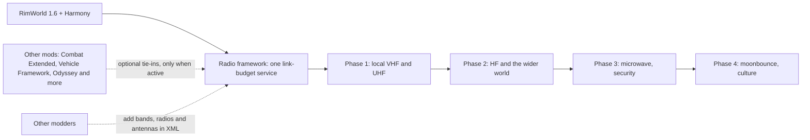

# Phobos RimWorld

Community mods for RimWorld by **House D'thorga**. The first project is a radio framework in which a real
link budget decides every contact: power, antennas, feedline, distance, terrain, noise and mode.

**Welcome! This is an early design-stage project.** No mod is published on the Steam Workshop yet, and
there is nothing to install. **Code → Download ZIP** gives you design documents, not a playable mod.

## Read this first (gotchas)

- **Nothing to install yet.** The mods will be free on the Steam Workshop; [installing](docs/installing-mods.md)
  explains how it will work.
- **Built for RimWorld 1.6**, Steam's main branch. RimWorld 1.7 (the Waylith engine) is on the unstable beta
  branch, and is kept in view.
- **Design before code.** The radio framework is refined in play before any implementation starts.
- **"Not yet tested in game"** means exactly that. A build or an offline check is not a play test.

## The projects

As of **18 October 2026**.

| Project | Stage | What it is | Records |
| --- | --- | --- | --- |
| **D'thorga Radio Framework** (working title) | Design | An XML-extensible radio framework: bands with their own personalities, propagation that changes with time and weather, and kit as heavy as physics says. Three display modes (Plain, Operator, Engineer) show as much of the maths as you want. | [Design](docs/development/radio-framework-design.md), [reference checks](docs/development/radio-reference-checks.md) |
| **D'thorga Factory Additions** | Built, not yet tested in game | XML additions to Vanilla Furniture Expanded - Factory, starting with a human-meat neutroamine bill. | [README](mods/PhobosFactoryAdditions/README.md), [record](docs/development/vfe-factory-additions.md) |

Solid arrows show the planned build order; dotted arrows show optional extensions. The phases and their
gates are in the [design](docs/development/radio-framework-design.md#scope-and-roadmap).

## Choose your starting point

- **Player:** [installing](docs/installing-mods.md) and [help](SUPPORT.md).
- **Curious about the radio design:** [the design](docs/development/radio-framework-design.md) and the
  [project direction](docs/development/project-direction.md).
- **Mod author or contributor:** [contributing](CONTRIBUTING.md), [building](docs/development/building.md)
  and the [RimWorld modding reference](docs/development/rimworld-modding-reference.md).
- **Claude and other agents:** [AGENTS.md](AGENTS.md) holds the standing rules (Claude Code loads it through
  `CLAUDE.md`).

## Help shape the project

Questions, ideas, documentation fixes and translations are welcome, and you do not need to write code to
contribute. Radio amateurs and engineers: corrections to the physics are especially welcome. Use
[Issues](https://github.com/phobos-dthorga/phobos-rimworld/issues/new/choose), and please be patient and kind.
This is a small community project with no guaranteed response time.

## Credits and reuse

An independent community project by **Phobos A. D'thorga (phobosgekko)**.

- [RimWorld](https://rimworldgame.com/) is made by **Ludeon Studios**. These mods are community-created
  content, **not official and not endorsed by Ludeon Studios**.
- Mod tie-ins name and credit the mods they work with; see [third-party notices](THIRD_PARTY_NOTICES.md).
- Research behind the radio physics is credited beside each claim, for example in the
  [reference checks](docs/development/radio-reference-checks.md). No institution endorses these mods.

Original Phobos work is MIT-licensed, with the exclusions stated in [LICENSE](LICENSE). The game's files,
saves and other authors' mods are not included.
