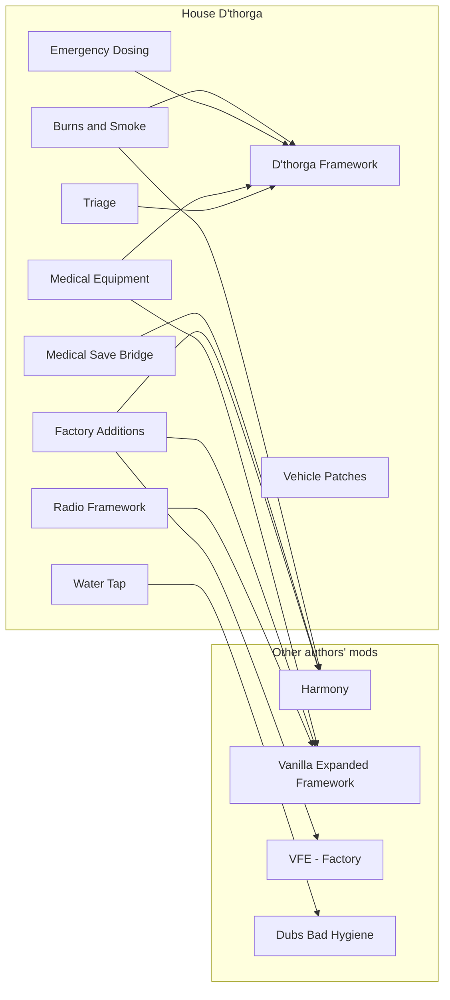

# Phobos RimWorld

Community mods for RimWorld by **House D'thorga**: burns and smoke that matter, doctors who act on their own, hospital
equipment, factory automation, vehicle fixes, plumbing, and a radio framework in which a real link budget decides every contact.

**No mod is published on the Steam Workshop yet.** Ten mods are built and install from source; several are partly tested in
game by the owner. **Code → Download ZIP** gives you source, not a built mod.

## Read this first (gotchas)

- **Nothing to subscribe to yet.** Today the mods install from source with `scripts/deploy.py`
  ([installing](docs/installing-mods.md)). They will be free on the Steam Workshop.
- **Built for RimWorld 1.7**, which leads since 4 November 2026. Every mod with code also builds for **1.6**, kept as the
  minimum until it is retired. The radio framework still declares 1.6 only.
- **Most medical and gas mods need D'thorga Framework**, loaded before them. Each mod's README lists exactly what it needs.
- **"Not yet tested in game" means exactly that.** A build, a unit test or reading the code is not a play test. Each README says
  what the owner has tested, with the date.
- **Safe to add to a running colony**, every one of them. Removal is safe for most after a step or two; each README says which.

## The mods

As of **6 November 2026**.

| Mod | Version | What it does | Tested in game |
| --- | --- | --- | --- |
| [D'thorga Framework](mods/PhobosFramework/README.md) | 0.3.0 | The shared library: what a pawn breathes, carbon monoxide from fires, the health layer the medical mods share, per-person care choices | Partly: gas layer and oxygen, through other mods |
| [D'thorga Burns and Smoke](mods/PhobosBurnsAndSmoke/README.md) | 0.5.0 | Burned body fraction, burn shock, airway burns with a tracheotomy, smoke-damaged lungs, carbon monoxide, and fires that heat the air around them in the open | Partly: burns, shock and the More Injuries tie-ins |
| [D'thorga Emergency Dosing](mods/PhobosDosing/README.md) | 0.3.1 | Doctors give painkillers, sedatives and disease-fighting drugs on their own; colonists in pain take what their drug policy allows | Partly: doctors' dosing |
| [D'thorga Medical Equipment](mods/PhobosMedicalEquipment/README.md) | 0.2.2 | Bedside oxygen (a concentrator and a canister stand) and a burn unit bed | Partly: oxygen and the burn bed |
| [D'thorga Triage](mods/PhobosTriage/README.md) | 0.1.0 | Doctors queue the life-saving operations a patient needs, and take the worst case first | No |
| [D'thorga Medical Save Bridge](mods/PhobosMedicalSaveBridge/README.md) | 0.1.2 | Adds More Injuries to a running colony by re-numbering saved body parts on the first load | Yes: the first load |
| [D'thorga Factory Additions](mods/PhobosFactoryAdditions/README.md) | 0.11.2 | Additions to Vanilla Furniture Expanded - Factory: belts from any storage, an automated fabrication bay, other mods' drug labs as factory bills, and fixes | Partly |
| [D'thorga Vehicle Patches](mods/PhobosVehiclePatches/README.md) | 0.5.0 | Fixes and honest costs for the Harrier VTOL, RimThunder's heavy casting and Spaceship Turret Hull under Combat Extended | No |
| [D'thorga Water Tap](mods/PhobosWaterTap/README.md) | 0.2.1 | A plumbing fixture for Dubs Bad Hygiene that keeps bottled water ready and refills from your water towers | No |
| [D'thorga Radio Framework](mods/PhobosRadioFramework/README.md) | 0.1.2 | Phase 1 of the radio design: hand-held VHF and UHF radios, a base station, coax and antennas, a real link budget | No |

What each mod needs from other authors, and from one another:

An arrow means "needs, loaded before it". Optional tie-ins (More Injuries, Combat Extended, Vanilla Gravship Expanded, the
vehicle mods Vehicle Patches fixes, and more) switch on only when that mod is active; each README lists them. How the medical
mods share the work when a colonist is hurt is in [the medical mods together](docs/medical-mods.md).

## Choose your starting point

- **Player:** [installing](docs/installing-mods.md), [the medical mods together](docs/medical-mods.md), and
  [help](SUPPORT.md). Each mod's README is its guide, gotchas first.
- **Curious about the designs:** [development and research](docs/development/README.md) holds a design record per mod, with
  what was read from the game's code, who chose what, and the test protocol.
- **Mod author or contributor:** [contributing](CONTRIBUTING.md), [building](docs/development/building.md), the
  [framework's API](mods/PhobosFramework/README.md#for-modders) and the
  [RimWorld modding reference](docs/development/rimworld-modding-reference.md).
- **Claude and other agents:** [AGENTS.md](AGENTS.md) holds the standing rules (Claude Code loads it through `CLAUDE.md`).

## Help shape the project

Questions, ideas, documentation fixes and translations are welcome, and you do not need to write code to contribute. Radio
amateurs, engineers, chemists and medics: corrections to the physics, chemistry and medicine are especially welcome. Use
[Issues](https://github.com/phobos-dthorga/phobos-rimworld/issues/new/choose), and please be patient and kind. This is a small
community project with no guaranteed response time.

## Credits and reuse

An independent community project by **Phobos A. D'thorga (phobosgekko)**.

- [RimWorld](https://rimworldgame.com/) is made by **Ludeon Studios**. These mods are community-created content, **not official
  and not endorsed by Ludeon**. Portions of the materials used to create this content/mod are trademarks and/or copyrighted works
  of Ludeon Studios Inc. All rights reserved by Ludeon.
- Tie-ins name and credit the mods they work with; see [third-party notices](THIRD_PARTY_NOTICES.md). No other author's files are
  copied into this repository or a build.
- Research behind the physics, chemistry and medicine is credited beside each claim in the design records. No institution
  endorses these mods.

Original Phobos work is MIT-licensed, with the exclusions stated in [LICENSE](LICENSE). The game's files, saves and other authors'
mods are not included.
