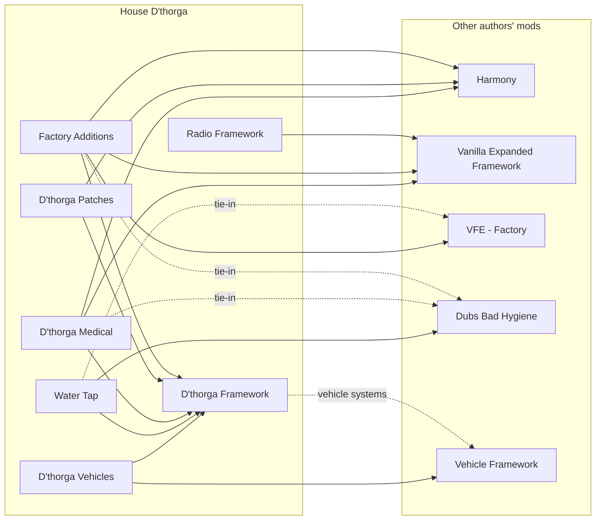

# Phobos RimWorld

Community mods for RimWorld by **House D'thorga** (also spelt dthorga): vehicles that need looking after and working trucks to
look after, burns and smoke that matter, doctors who act on their own, hospital equipment, factory automation, fixes for other
mods, plumbing, and a radio framework in which a real link budget decides every contact.

**New here? Start with the [player guide](docs/player-guide/README.md)**: what each mod does, what to build first, and what to
press, with pictures.

**No mod is published on the Steam Workshop yet.** Seven mods are built and install from source; several are partly tested in
game by the owner. **Code → Download ZIP** gives you source, not a built mod.

## Read this first (gotchas)

- **Nothing to subscribe to yet.** Today the mods install from source with `scripts/deploy.py`
  ([installing](docs/installing-mods.md)). They will be free on the Steam Workshop.
- **RimWorld 1.7 only.** No mod supports 1.6 since 8 November 2026.
- **Every D'thorga mod with code needs D'thorga Framework**, loaded before it. Each mod's README lists exactly what it needs.
- **"Not yet tested in game" means exactly that.** A build, a unit test or reading the code is not a play test. Each README says
  what the owner has tested, with the date.
- **Safe to add to a running colony**, every one of them. Removal is safe for most after a step or two; each README says which.

## The mods

Seven mods. Each one's version is in [the documentation index](docs/README.md), and each has a chapter in the
[player guide](docs/player-guide/README.md). Several older mods were merged into these on 7 November 2026
([why](docs/development/mod-consolidation.md)).

| Mod | What it does | Tested in game |
| --- | --- | --- |
| [D'thorga Framework](mods/PhobosFramework/README.md) | The shared library: what a pawn breathes, carbon monoxide from fires, the health layer the medical mods share; with Vehicle Framework, vehicle systems (battery, coolant, oil, tyres, brakes, wear and service), a workshop, fittings and tunes, sling loads and submarine diving | Partly: gas layer and oxygen, through other mods |
| [D'thorga Vehicles](mods/PhobosVehicles/README.md) | Six working vehicles (a bulk tanker, drill rig, tipper, survey truck, generator set and seabed crawler) and real figures for other mods' vehicles | Partly: the survey truck |
| [D'thorga Medical](mods/PhobosMedical/README.md) | Five mods in one since 7 November 2026: burns, burn shock, airway burns and smoke; doctors who dose and operate on their own (triage); oxygen, a burn unit bed and other hospital kit; radiation control with Rimatomics; and a safe way to add More Injuries to a running colony | Partly, as the five mods before the merge; not yet as one |
| [D'thorga Factory Additions](mods/PhobosFactoryAdditions/README.md) | Additions to Vanilla Furniture Expanded - Factory: belts from any storage, an automated fabrication bay, other mods' drug labs as factory bills, and fixes | Partly |
| [D'thorga Patches](mods/PhobosPatches/README.md) | Fixes and honest costs for other authors' mods: the Harrier VTOL, RimThunder's heavy casting, Spaceship Turret Hull under Combat Extended, InterRim Ballistic Missile's strategic blast, Visit Settlements and Vehicle Framework | Partly: the stuck vehicle fires, a crash guard, and the missile fix once |
| [D'thorga Water Tap](mods/PhobosWaterTap/README.md) | A plumbing fixture for Dubs Bad Hygiene that keeps bottled water ready and refills from your water towers | No |
| [D'thorga Radio Framework](mods/PhobosRadioFramework/README.md) | Phase 1 of the radio design: hand-held VHF and UHF radios, a base station, coax and antennas, a real link budget | No |

What each mod needs from other authors, and from one another:

A solid arrow means "needs, loaded before it"; a dotted one is an optional tie-in that loads only while that mod is active. Optional tie-ins (More Injuries, Combat Extended, Vanilla Gravship Expanded, the
mods D'thorga Patches fixes, and more) switch on only when that mod is active; each README lists them. How D'thorga Medical's
parts share the work when a colonist is hurt is in [the medical mods together](docs/medical-mods.md).

## Choose your starting point

- **Player:** the [player guide](docs/player-guide/README.md), then [installing](docs/installing-mods.md) and
  [help](SUPPORT.md). Each mod's README has every figure, setting and test, gotchas first.
- **Curious about the designs:** [development and research](docs/development/README.md) holds a design record per mod, with
  what was read from the game's code, who chose what, and the test protocol.
- **Mod author or contributor:** [contributing](CONTRIBUTING.md), [building](docs/development/building.md), the
  [framework's API](mods/PhobosFramework/README.md#for-modders) and the
  [RimWorld modding reference](docs/development/rimworld-modding-reference.md).
- **Claude and other agents:** [AGENTS.md](AGENTS.md) holds the standing rules (Claude Code loads it through `CLAUDE.md`).

## Help shape the project

Questions, ideas, documentation fixes and translations are welcome, and you do not need to write code to contribute. Radio
amateurs, engineers, chemists and medics: corrections to the physics, chemistry and medicine are especially welcome. Use
[Issues](https://github.com/phobos-dthorga/phobos-rimworld/issues/new/choose), and please be patient and kind. This is a small
community project with no guaranteed response time.

## Credits and reuse

An independent community project by **Phobos A. D'thorga (phobosgekko)**.

- [RimWorld](https://rimworldgame.com/) is made by **Ludeon Studios**. These mods are community-created content, **not official
  and not endorsed by Ludeon**. Portions of the materials used to create this content/mod are trademarks and/or copyrighted works
  of Ludeon Studios Inc. All rights reserved by Ludeon.
- Tie-ins name and credit the mods they work with; see [third-party notices](THIRD_PARTY_NOTICES.md). No other author's files are
  copied into this repository or a build.
- Research behind the physics, chemistry and medicine is credited beside each claim in the design records. No institution
  endorses these mods.

Original Phobos work is MIT-licensed, with the exclusions stated in [LICENSE](LICENSE). The game's files, saves and other authors'
mods are not included.
