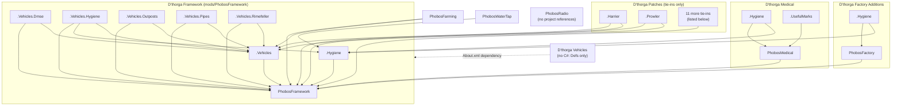
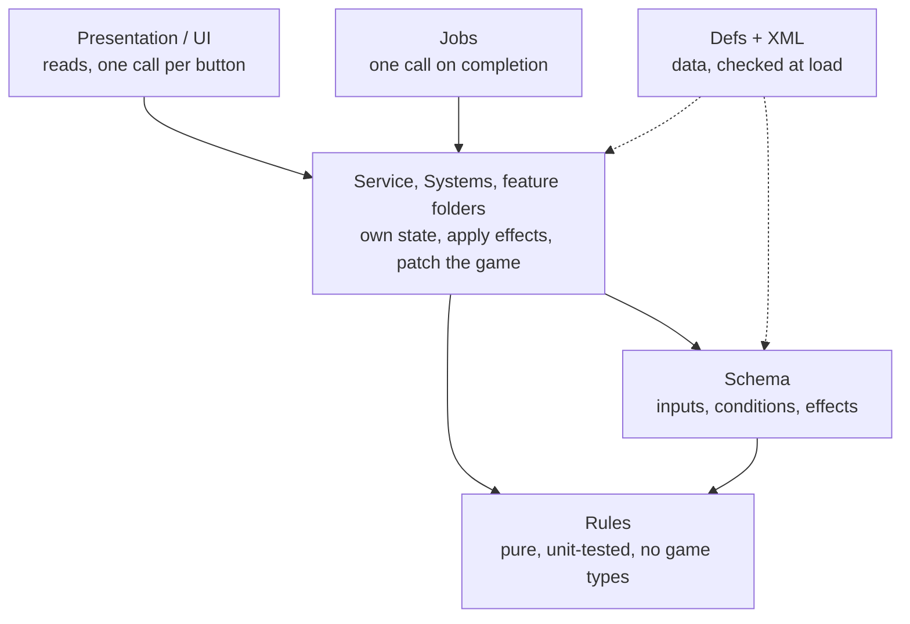

# How the code is built

**Status (23 Nov 2026):** living. Written from the code as it stood on 23 Nov 2026 (D'thorga Framework 0.262.0), for the
owner's docs rewrite, step 4. It says how the code works now; the design records say how it came to be. Where this page says
"inferred", the point was worked out from comments or patterns rather than read in the code that does it.

## Read this first (gotchas)

- **`Rules/` files are compiled into test projects without the game.** Each rule-test project includes `src/<Project>/Rules/*.cs`
  straight from the source (`tests/PhobosFramework.Vehicles.Rules.Tests/PhobosFramework.Vehicles.Rules.Tests.csproj`). A rule
  that adds `using Verse`, `RimWorld`, `UnityEngine` or `Vehicles` breaks the gate's build, not just a test. A vehicle rule may
  call only one core rule, `PowerUnits`; to use another, add its file to that project's `Compile` list.
- **Namespaces do not follow folders, and must not be "tidied".** Saves name classes by namespace. The vehicle systems' code is
  `Phobos.VehicleSystems` in almost every folder (279 files), their rules `Phobos.Framework.Vehicles.Rules`, and D'thorga
  Medical keeps each former mod's namespace (`Phobos.BurnsAndSmoke`, `Phobos.Triage` …) ([why](mod-consolidation.md)).
- **The vehicle systems live in D'thorga Framework, not D'thorga Vehicles.** `PhobosFramework.Vehicles` is a tie-in assembly
  that loads only with Vehicle Framework. D'thorga Vehicles has no C# at all: it is Defs, patches and art. The systems attach
  to **every** mod's vehicles, not just ours (see [the worked example](#worked-example-a-brake-pad-wearing-down)).
- **Real work never runs every tick.** It runs on the rare tick (every 250 ticks), on a pass every 60 ticks, or on request,
  and catches up by the hours that passed. The whole vehicle model's budget is **0.05 ms a tick on average**
  ([vehicle health design, Performance](archive/vehicle-health-design.md#performance)).
- **A core assembly never names an optional mod's types.** Code that must goes in a separate tie-in assembly. When the core
  needs to call into a tie-in, the core declares an interface and the tie-in registers itself from a static constructor.
- **Write by-name lookups with fixed names** (`"Namespace.Type:Member"`, a constant), never names built at run time:
  `python scripts/check-targets.py` (part of the gate) can only check what it can read.
- **Saved data of a part that loads only with another mod goes in the core's part store**
  (`src/PhobosFramework/Persistence/PartStore.cs`), not in a component of its own: the save names every component's class,
  and a class that stops loading costs an error at the next load.
- **UI presents, services decide.** Tabs, dialogs, gizmos and alerts read state and make one service call. They never change
  the game themselves (`src/AGENTS.md`).

## The mods and their projects

**Nine mods, 29 C# projects.** Six projects are a mod's main assembly; the other 23 are tie-in assemblies that load only when
another mod is active. D'thorga Patches is all tie-ins: it has no main assembly. The full list (output folder, references,
Harmony, test projects) is the generated table in [building.md, The projects](building.md#the-projects); this diagram only
shows which project references which.

- **The 11 D'thorga Patches tie-ins that reference only the Framework**: AircraftRearm, Biotech, Classical, CloseAirSupport,
  CombatExtended, Irbm, NiceResearchTab, Outposts, RimPacts, VehicleFramework and VisitSettlements (each `PhobosPatches.<Name>`).
- **Every project reference is `Private=false`**, so D'thorga Framework's DLL ships only in its own mod
  (`Directory.Build.targets`). A project file names only its mod folder (`ModFolder`), its tie-in folder if any
  (`TieInFolder`) and whether it patches (`UsesHarmony`); the targets file does the rest ([building.md](building.md)).
- **`src/Shared/HarmonyPatchApplier.cs` is compiled into every project that patches**, as an internal class. It applies each
  patch class on its own, so a target an update renames switches off only that part, with one log line.
- **D'thorga Radio stands apart**: it references no project of ours and does not depend on the Framework. It is on the back
  burner (`AGENTS.md`).

## Inside the Framework and its vehicle systems

**The shape is the same in the core and the vehicle systems: game-free rules at the bottom, Defs and their XML vocabulary
beside them, game-facing services and comps in the middle, and presentation on top that only reads.** Big features get a
folder of their own, but their maths still goes in `Rules/`.

### The layers

Each layer below is a folder of `src/PhobosFramework.Vehicles`, with what it holds, what it may do and what it may not.

- **`Rules/` (70 files): pure functions, figures in and figures out** (`PartWearRule`, `BrakeWearRule`, `SystemIntegrator`,
  `DrivetrainModel`). May use maths, `System.*` and other rules in the folder. **May not** touch any game type, hold state,
  read the game's clock or roll the game's dice. Unit-tested.
- **`Defs/` (17): Def classes and the spec classes XML fills** (`PhobosVehicleSystemDef`, `QuantitySpec`, `PerPartSpec`,
  `FlowSpec`). Hold data, check it at load (`ConfigErrors`), answer lookups. **May not** act in a running game.
- **`Schema/` (6): the XML vocabulary named with `Class=`**: inputs (`VehicleSystemInput`), conditions (`When_…`) and effects
  (`VehicleSystemEffect`). Inputs and conditions read the vehicle and the world; effects change the vehicle when a stage starts,
  ends or lasts. **May not** own maths a rule should: they call `Rules/`.
- **`Systems/` (44): the per-vehicle runtime**: the hub comp `CompPhobosVehicleSystems`, `VehicleSystemWorker`, `SystemState`,
  `PartFigures`, `Powertrain`, fittings, repairs, diagnostics. Owns and saves the vehicle's state, runs the update, applies
  stages. **May not** draw (the hub's "Presentation (reads only)" region builds text, never state).
- **`Service/` (94): game-facing services**, one static class per concern, most Harmony patches (27 files) and several game
  components. Wires the model into Vehicle Framework and the game: injection, refusals, fuel, notices, fleet-wide state.
  **May not** draw, or copy a rule's maths.
- **Feature folders** (`Camp/`, `Cabins/`, `Flight/`, `Hitch/`, `Sling/`, `SetOut/`, `Tanks/`, `Field/`, `Gather/`,
  `Litter/`, `LifeAboard/`, `Armour/`): one feature's comp, service and patches together, with the rights of `Systems/` and
  `Service/`. **Their maths stays in `Rules/`** (`HitchRule`, `SlingRule`, `CampRule` and the rest).
- **`Jobs/` (6): WorkGivers and JobDrivers** (service, diagnose, push, jump start, claim). Move pawns and, on completion, make
  **one** service call. **May not** decide outcomes themselves.
- **`Presentation/` (33): tabs, dialogs, gizmos, alerts, inspect text, letters, the fleet window.** Read state, format it, call
  one service method per button. **May not** change game state, roll chances or grant anything.
- **`Debug/` (6): dev actions and in-game self-tests** (`VehicleSelfTest.cs`, `SpallSelfTest.cs`), behind dev mode only.
- **`VehicleSystemsMod.cs`**: the vehicle systems' settings, logs and Harmony start-up.

**The core (`src/PhobosFramework`)** follows the same split with different folders: `Rules/` (90 files, game-free, tested by
`tests/PhobosFramework.Rules.Tests`); `Defs/` (`PhobosRulesDef`, the base of every rules Def); feature folders that are
services and comps (`Gases/`, `Health/`, `Environment/`, `Power/`, `Protection/`, `Work/`, `Upgrades/`, `Bills/`, `Bulk/`,
`TopUp/`, `Recall/`, `Research/`, `WorldMap/` …); and shared plumbing: `UI/` (widgets, `SettingsBook`, tab state),
`Persistence/`, `Logging/`, `Debug/`, `Uninstall/`, `Patching/` (`PatchFlags`), and root files such as `OptionalMods.cs`,
`LoadReport.cs` and `DisplayMode.cs`. The other mods use the same names at smaller scale: Factory Additions and Water Tap have
`Comps/`, `Services/` and `Rules/`; Medical has a folder per former mod, each with its own `Rules/`, `Services/`, `Comps/` and
`Jobs/`; Radio keeps its physics in `Physics/`.

**Tuning figures are rules Defs, preferences are settings.** A figure a design says to tune in play goes in a rules Def: one
XML instance, read through `PhobosRulesDef.Current<T>()` (`src/PhobosFramework/Defs/PhobosRulesDef.cs`), so other modders can
patch it. A player's choice goes in mod settings. Never the other way round.

### Worked example: a brake pad wearing down

This traces one real feature, per-wheel brake wear (Framework 0.250.0 onwards), from data to save. Every vehicle system works
this way: only the XML differs.

1. **Start-up: the systems attach to every vehicle.** A Harmony prefix on `VehicleDef.ResolveReferences`
   (`src/PhobosFramework.Vehicles/Service/Patches.cs:34`) calls `VehicleSystems.Inject`
   (`src/PhobosFramework.Vehicles/Service/VehicleSystems.cs:41`) once per design. It picks a loadout, appends our parts and
   adds `CompPhobosVehicleSystems`, before Vehicle Framework builds the design's hitboxes. Any mod's vehicle with a matching
   loadout gets the systems.
2. **The data.** The brake system is XML:
   `mods/PhobosFramework/Mods/VehicleFramework/Common/Defs/Phobos/Framework/VehicleSystems/Systems_Chassis.xml:221`. It
   declares a quantity `brakeWear` from 0 to 1, marked `perPart` with role `Brakes` and `frontAxleWeight` 1.5; two flows into
   it (`drivingWear`, `descentWear`); an event (`MoveStop`) that adds wear and squeals once worn; wear from hits on the brake
   part; stages; and a service ("new brake pads", due above 0.7, needing a brake pad set). The game reads it into
   `PhobosVehicleSystemDef`, `QuantitySpec` and `PerPartSpec` (`src/PhobosFramework.Vehicles/Defs/SystemDefs.cs:323`, `:87`,
   `:133`). `python scripts/check-vehicle-schemas.py` checks it offline.
3. **The tick.** Vehicle Framework calls `CompPhobosVehicleSystems.CompTickRare`
   (`src/PhobosFramework.Vehicles/Systems/CompPhobosVehicleSystems.cs:866`). For a player's vehicle (the Full tier) it calls
   `UpdateNow` (`:1045`), which works out the hours since the last update (capped by the rules Def's `maxCatchUpHours`) and
   asks each switched-on system's worker to advance. `UpdateNow` does nothing twice in one tick, so anything may call it.
4. **The flow.** `VehicleSystemWorker.Advance` (`src/PhobosFramework.Vehicles/Systems/VehicleSystemWorker.cs:34`) multiplies
   each flow's inputs. One of them is `Input_BrakeWork` (`src/PhobosFramework.Vehicles/Schema/Inputs.cs:399`), which reads
   the vehicle's load and speed and hands them to `BrakeWearRule` (`src/PhobosFramework.Vehicles/Rules/BrakeWearRule.cs`).
   The rates go to `SystemIntegrator.Advance` (`src/PhobosFramework.Vehicles/Rules/SystemIntegrator.cs:46`), which steps the
   quantity on.
5. **Each wheel's share.** `PartFigures.Sync` (`src/PhobosFramework.Vehicles/Systems/PartFigures.cs:83`) shares the gain
   among the brake parts with `PartWearRule.AxleShares` (`src/PhobosFramework.Vehicles/Rules/PartWearRule.cs:42`): the front
   axle takes 1.5 to the others' 1, scaled so the mean stays 1. The vehicle's figure becomes the most worn part's. The rule
   is tested in `tests/PhobosFramework.Vehicles.Rules.Tests/PartWearRuleTests.cs`.
6. **Stages and effects.** `EvaluateStages` (`CompPhobosVehicleSystems.cs:1940`) moves the quantity into its "worn" stage at
   0.7. The stage's effects (`src/PhobosFramework.Vehicles/Schema/Effects.cs`: sounds, refusals, stat factors) apply, and the
   stat factors are recached for Vehicle Framework's stats.
7. **Shown.** The dashboard telltale and the Systems tab
   (`src/PhobosFramework.Vehicles/Presentation/ITab_VehicleSystems*.cs`) read `comp.States`. They change nothing.
8. **Fixed.** `WorkGiver_PhobosServiceVehicle` (`src/PhobosFramework.Vehicles/Jobs/ServiceJobs.cs:134`) finds the due
   service. Its driver's `WorkComplete` makes one call, `systems.CompleteService(actor)`, and the service code fits pads to
   the most worn axle (`PartWearRule.RestoreSet`).
9. **Saved.** `PostExposeData` (`CompPhobosVehicleSystems.cs:653`) saves the values by key under
   `PhobosVehicleSystems_Values` and the per-part figures under `PhobosVehicleSystems_PartFigures`. Keys, not list
   positions, so a system added later loads cleanly.

## How things run

**Almost everything runs on the rare tick or a fixed pass, does nothing when it has nothing to do, and catches up by
elapsed time.** Counted on 23 Nov 2026 (overrides in `src/`, counted with grep for this page):

| Hook | Overrides | Examples |
| --- | --- | --- |
| `CompTickRare` (every 250 ticks) | 35 | The vehicle hub, tanks, rigs, generator sets, medical equipment, radios |
| `CompTick` (every tick) | 13 | Night lights, cold burners (fuel counts by the tick), the vehicle hub (sound, beams), hitch |
| `CompTickInterval` | 2 | Submersibles, the field lab |
| `MapComponentTick` | 11 | Room gases, fire smoke, fire heat, triage, standby power, protection zones, paddocks |
| `GameComponentTick` | 5 | The part store's timers, recalls, fire fighting, the parked-vehicle warning, vehicle lights |
| `WorldComponentTick` | 3 | Night driving, life aboard on the road, caravan cooking |
| A building's `Tick` or `TickRare` | 4 | Sling wrecks, water drops, the cold box, the field kitchen |

Per-frame hooks are few: `FrameWorkQueue`'s `GameComponentUpdate`, `ProtectionZones`' `MapComponentUpdate`, the caravan
reach `WorldComponentUpdate`, and a dev-only gas overlay.

**How the work stays cheap:**

- **Catch up by hours.** One update moves a vehicle on by however many hours passed (`ElapsedRule.Hours`), so a rare tick, a
  caravan on the world map and a towed trailer (caught up by its tower, `CatchUpTowedBy`) all use the same code.
- **Detail tiers.** `DetailTierRule.For` (`src/PhobosFramework/Rules/DetailTierRule.cs:22`): a player's vehicle runs the full
  model; another faction's on a map runs a lite tier (hits counted, a few quantities such as the driver's fitness, nothing
  else evolves); one off the map runs nothing.
- **Passes, not ticks.** Gases make one pass every 60 ticks (`GasMixRule.PassTicks`), over rooms that hold gas only
  (`src/PhobosFramework/Gases/MapComponent_PhobosRoomGases.cs:82`). Pipes beneath a vehicle are looked at every eighth rare
  tick.
- **Staggered intervals.** `(TicksGame + ID) % interval` or `IsHashIntervalTick`, so a hundred things do not all run on one
  tick (`src/PhobosFramework.Vehicles/Service/CaravanComp.cs:118`, `src/PhobosMedical/Equipment/Comps/BoilOffComps.cs:88`).
- **Tick on request.** Seven vehicle comps set Vehicle Framework's `TickByRequest` and stop ticking when idle
  (`RequestTickStop`): camp, flight, hitch, articulated trailers, litter, sling, dispensers.
- **Registries, not searches.** `MapRegistry` (`src/PhobosFramework/Environment/MapRegistry.cs`) keeps the things of one
  kind on each map, after the owner's recording of 18 Nov 2026 found the game's building lookup behind most of our time.
- **Long one-off jobs over frames.** `FrameWorkQueue` (`src/PhobosFramework/Work/FrameWorkQueue.cs`) runs one job a slice per
  drawn frame, 12 ms by default (`SliceBudgetRule.DefaultBudgetMs`). Strategic missile blasts use it. Never for steady work.
- **Caches recomputed on events, never saved** (`src/AGENTS.md`, "Derived state is never saved"). The one granted exception
  is a history ring for the vehicle graphs (`src/PhobosFramework/Persistence/ScribeHistory.cs`).
- **Measure, don't guess.** `using (PhobosTiming.Measure("label"))` (`src/PhobosFramework/Debug/PhobosTiming.cs`) costs one
  bool test outside dev mode; a dev action prints the totals. `python scripts/perf.py` records the running game (ask the
  owner first).

**Figures.** The budget is 0.05 ms a tick averaged for the whole vehicle model, 0.1 ms per full-tier vehicle per rare tick,
and nothing per ordinary tick. Measured once, in the owner's game on 9 Nov 2026 (Framework 0.42.0, 12 vehicles in full
detail, 3 lite): 0.0076 ms a tick on average, but **0.131 ms per full-tier rare tick, about a third over** its line
([vehicle health design, Performance](archive/vehicle-health-design.md#performance)). The owner's colony already runs at 36 to 50 TPS
of 60, so there is no headroom. Nothing newer is measured; the [code audit of 11 Nov 2026](code-audit-2026-11-11.md) lists
the hot Harmony patches and how each leaves early.

**Jobs.** JobDefs and WorkGiverDefs are XML; the classes live in each part's `Jobs/` folder. Vehicle work derives from
Vehicle Framework's `JobDriver_WorkVehicle` through `PhobosVehicleWorkDriver`
(`src/PhobosFramework.Vehicles/Jobs/ServiceJobs.cs:162`), which allows work longer than Vehicle Framework's own repair step.
A driver's last toil calls one service method.

## Tie-ins

**A tie-in switches on only when its mod is active, and a player without that mod sees nothing.** Three switches, used
together:

- **`IfModActive` and `IfModActiveAll` in each mod's `LoadFolders.xml`** (98 entries across seven mods, counted 23 Nov 2026)
  load a `Mods/<Other>/` folder's Defs and patches, and its `1.7/Assemblies` tie-in DLL, only with that mod (or all the named
  mods).
- **`MayRequire` and `PatchOperationFindMod` in XML** keep one list entry, or one patch, to that mod.
- **`OptionalMods.IsActive` in C#** (`src/PhobosFramework/OptionalMods.cs:28`), a cached `ModsConfig.IsActive`, for code in
  an assembly that always loads.

How the code is arranged around them:

- **Tie-in assemblies** build into `mods/<Mod>/Mods/<Other>/1.7/Assemblies/` and may reference the other mod's assembly,
  which is referenced from the installed mod and never copied. **Their mod must be in our `loadAfter`**, or the game rejects
  the tie-in with "Could not load type" (`tests/test_tie_in_load_order.py` keeps that hint).
- **The core calls a tie-in through an interface it owns.** The core declares the interface; the tie-in registers an
  instance from a static constructor. Example: `VehiclePipes.ILink` and `VehiclePipes.Register`
  (`src/PhobosFramework.Vehicles/Service/VehiclePipes.cs:38`, `:53`), implemented by
  `src/PhobosFramework.Vehicles.Pipes/PipeNetLink.cs` only when Vanilla Expanded Framework is active.
- **By-name lookups** reach a mod with no reference at all: `OptionalMods.TypeNamed`, `StaticMember` and `SettingField` for
  its types and settings, `…DefNamed` for its Defs (missing is null, never an error), and Harmony patches naming its members
  by string. **`python scripts/check-targets.py`** (phobos-modkit's rimworld-targets; part of the gate) checks that every
  such name and signature still exists in the installed assemblies. It reads only fixed names, so write
  `"Namespace.Type:Member"` or a constant in the lookup itself. Its inputs are set in `config/update-check.json`
  (`targets`). A pass says the names exist, not that the code behaves.
- **Harmony.** Patch only what has no extension point; prefer postfixes; find our patches with `typeof(OurType).Assembly`.
  Every patch is listed, generated, in [building.md, Harmony patches](building.md#harmony-patches);
  `python scripts/query-patches.py` says who else patches a method.
- **The register.** Every tie-in, by mod, is in [the tie-in register](tie-in-register.md); patches for other authors' faults
  also have a row in [temporary patches](temporary-patches.md) and `config/temporary-patches.json`. There is no config file
  for the register itself.

## Saves and removal

**State lives in four places: a thing's comps, a map, the world, or the game. Settings are not in the save at all.** Every
component class is written into the save by name, even one that saves no data of its own: the game's
`Scribe_Collections.Look(ref components, "components", LookMode.Deep, …)` (`Verse.Game.cs:443` and `Verse.Map.cs:898` in the
1.7 decompile, read with `query-code.py`). So a class that stops loading costs a "Could not find class" error at the next
load; the save after that is clean.

- **A thing's comps and hediffs.** The vehicle hub saves values, part healths, switches, fittings and the trip record by key,
  under `PhobosVehicleSystems_…` (`CompPhobosVehicleSystems.cs:653`). Tanks, rigs and bulk stores save in their comps;
  Medical's conditions are hediffs.
- **Map components.** Room gases (by cell, not room number), ground wetness, protection zones, paddocks, service yards,
  unload zones, survey results, water-tap stock. Medical's fire heat, caustic plants and triage save no data but are named.
- **World components.** Night driving, caravan cooking, life aboard on the road, caravan reach.
- **Game components.** The part store, practice hours, the colony mood file, research grants, recalls, the frame work queue;
  the vehicles' field research, fire fighting, service kits, upgrade prices, unload zones, lights and bulk orders; Medical's
  triage bill ledger; Farming's paddocks adrift.
- **Mod settings.** Every `ModSettings` class, in RimWorld's `Config` folder, never in the save.

What keeps saves safe:

- **Tie-in parts keep their data in the core's part store.** `GameComponent_PhobosPartStore`
  (`src/PhobosFramework/Persistence/PartStore.cs:16`) holds a record per key and runs timers registered with `Every` (`:43`),
  so removing the other mod leaves no missing class. Combat Extended's kept guns, IRBM's strike memory and RimPacts'
  countdown use it. A component that used to hold such data stays only so old saves load, and retires once loading ends
  (`src/PhobosPatches.RimPacts/WarQuestCountdown.cs:105`).
- **Found while writing this page:** `PhobosFramework.Vehicles` is itself a part that loads only with Vehicle Framework, yet
  it keeps about a dozen game, world and map components of its own (`Service/FleetService.cs`, `Camp/NightDriving.cs` …).
  Removing Vehicle Framework from a colony would therefore log one missing-class line each, once (inferred from the part
  store's own reasoning; not tested). Vehicles vanish with Vehicle Framework anyway, so this is noise rather than loss.
- **Older saves:** conversions run on load and are idempotent; `DeepLoad` (`src/PhobosFramework/Persistence/DeepLoad.cs`)
  rebuilds saved objects whose class has no parameterless constructor; `SettingsImport` carries settings across the 7 Nov
  2026 merge of mods.

**Removal.** The player's steps are in the [player guide, Removing a mod](../player-guide/getting-started.md#removing-a-mod)
and each README. Two mods have a button:

- **D'thorga Framework's vehicle systems: "Remove the added parts from this colony's vehicles"** (`VehicleSystemsMod.cs:807`).
  It runs `VehicleSystems.Sweep` (`Service/VehicleSystems.cs:368`): cuts each vehicle's part list back to its design's own
  count, forgets every system's state (`ClearForRemoval` in `CompPhobosVehicleSystems.cs`), and stops the service for the
  session. It does not empty parks, yards, garages, depots, tanks or litters: the player does that first.
- **D'thorga Medical: "Remove every condition this mod adds, from every pawn"** (`src/PhobosMedical/MedicalMod.cs:155`). It
  runs `CleanupService.RemoveHediffsOf` (`src/PhobosFramework/Uninstall/CleanupService.cs`): every hediff whose Def is the
  mod's, on every pawn alive or dead, world pawns included. Buildings, items and components are left to the game, which drops
  them with an error line.
- **The other mods have no button**; their READMEs list what to deconstruct or empty first.

**Why a mod becomes unsafe to remove**, in the order it bites:

1. **Structure another mod reads by position.** Vehicle Framework loads part healths by their place in the list, and we
   append parts to every vehicle design. Without the sweep, saved vehicles may fail to load (`mods/PhobosFramework/README.md`;
   our own restore by key is `RestorePartHealths` in `CompPhobosVehicleSystems.cs`). This is the one real hazard.
2. **Things whose Def goes.** Our buildings, vehicles and items vanish, with what is inside them (grain in a silo, goods in
   a bunker, a tanker's load). The game logs a line and drops them.
3. **Bills and processes** naming our recipes (Factory Additions, D'thorga Patches): dropped with an error.
4. **Component classes** named in the save: one harmless line each, once.
5. **Conditions** on pawns: Medical's button removes them first.

## Settings and logging

- **Settings classes** sit beside each mod's `Mod` class (`FrameworkSettings`, `src/PhobosFramework/FrameworkMod.cs:13`;
  `VehicleSystemsSettings`, `src/PhobosFramework.Vehicles/VehicleSystemsMod.cs:15`; one per mod or part). The game writes
  each to its `Config` folder as `Mod_<Folder>_<Class>.xml` (as `src/PhobosFramework/SettingsImport.cs` records it).
- **One window per book.** `SettingsBookMod` and `SettingsBook` (`src/PhobosFramework/UI/SettingsBook.cs`) let several `Mod`
  classes share one settings window: every D'thorga Patches tie-in adds its page to the `PhobosDthorga.Patches` book, and
  whichever loads hosts it. The vehicle systems have a book of their own. The layout is in
  [settings pages](settings-pages.md).
- **Settings that change Defs** are read by XML patches through `PatchFlags`
  (`src/PhobosFramework/Patching/PatchFlags.cs`) and take effect at the next start.
- **Every setting, generated**, is in [the settings reference](settings-reference.md)
  (`python scripts/doc-tables.py --write`). **A change that adds, removes or re-defaults a setting is reported to the
  owner**, with `python scripts/mod-settings.py changes --since REV`.
- **How much is shown** is `DisplayMode` (`src/PhobosFramework/DisplayMode.cs`): plain, operator or engineer, the same reason
  at every depth.
- **Logging** goes through phobos-log, pinned at `external/phobos-log` and compiled into D'thorga Framework
  (`src/PhobosFramework/PhobosFramework.csproj`). Each mod or part has a static `Logger` from `Logs.For(mod, part)`. Detail is
  `Logger.Debug`, behind `Logger.DebugEnabled` where a line costs anything; the Framework's settings switch each log's detail
  on. The Framework also keeps the game's log alive past its 10,000-message limit (`Logging/GameLogKeeper.cs`), says when
  our code was on an error's path (`Logging/ErrorNotes.cs`), and every mod logs one load line (`LoadReport.cs`). The record
  is [the logging framework](logging-framework-design.md).
- **Seen-in-play notes** (`Seen.Note`, `src/PhobosFramework/Debug/SeenInPlay.cs`, off by default) tell the test list a
  feature ran. They prove the code ran, never that it looked right ([seen-in-play checks](seen-in-play-checks.md)).

## Tests

**Three kinds, all run by the gate: rule tests in C#, Python tests, and offline checkers.** None is a test in game:
**nothing counts as tested in game until the owner says so.**

- **Rule tests** (xunit): seven projects in `tests/`, each compiling a project's `Rules/` files from `src/` with no game
  reference (the Radio's `Physics/`). The two big ones are `PhobosFramework.Rules.Tests` and
  `PhobosFramework.Vehicles.Rules.Tests`. They run on GitHub too, where no other author's assembly is available.
- **Python tests** (`tests/test_*.py`, 51 files): the scripts, and guards that read our C# as text and refuse known faults,
  for example `test_no_spawn_in_spawn_setup.py`, `test_no_shared_hook_swaps.py`, `test_no_executing_assembly.py`,
  `test_damage_prefix_runs_first.py`, `test_seen_note_cost.py` and `test_tie_in_load_order.py`.
- **Offline checkers**: `check-vehicle-schemas.py`, `check-upgrade-trees.py`, `check-targets.py`, `check-mod-layout.py`
  and more.
- **In-game self-tests** are dev actions (`src/PhobosFramework.Vehicles/Debug/VehicleSelfTest.cs`), run by the owner.
- **The gate** is `python scripts/check-all.py` (steps in `config/gate.json`), with the commit guard behind it. How it runs,
  and what GitHub runs, is in [building.md, The checks](building.md#the-checks-run-before-every-commit).

## Where to read more

- [Building, testing and deploying](building.md): the projects table, the Harmony patch list, the gate, deploying. Living.
- [D'thorga Framework](phobos-framework.md): what the core offers other mods.
- [Vehicle health design](archive/vehicle-health-design.md): the condition layer, the tiers and the performance budget.
- [Tie-ins with other mods](tie-in-register.md) and [patches for other authors' faults](temporary-patches.md). Living.
- [Every setting of every mod](settings-reference.md) (generated) and [settings pages](settings-pages.md).
- [The logging framework](logging-framework-design.md) and [seen-in-play checks](seen-in-play-checks.md).
- [Mod consolidation](mod-consolidation.md): why namespaces and keys outlived the mods that named them.
- [Analysis tooling](analysis-tooling.md): which tool answers which question.
- [The modders' reference site](https://phobos-dthorga.github.io/phobos-rimworld/), generated from the code (built, not yet
  published on 23 Nov 2026; [reference site](reference-site.md)).
- The rules this code follows: `src/AGENTS.md`, and `src/PhobosFramework.Vehicles/AGENTS.md` for vehicles.
