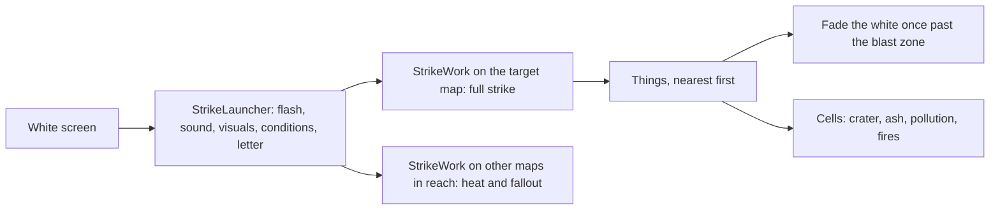

# Missile patches: research and decisions (7 Nov 2026)

**Since 7 November 2026 this mod is a part of [D'thorga Patches](../../../mods/PhobosPatches/README.md)** ([why](../mod-consolidation.md)); paths below are updated, the rest is as recorded.

**Merged here on 17 Nov 2026**, each kept as written: [Strategic strike: design and decisions](#strategic-strike-design-and-decisions-7-nov-2026). **Moved out the same day**, as written: the RimPacts section to [RimPacts patches](rimpacts-patches.md), the Visit Settlements sections to [Visit Settlements patches](visit-settlements-patches.md).

The record behind D'thorga Missile Patches. **Tried once in game: no freeze, but far too slow** (see [results from play](#results-from-play)). The player
guide is the mod's README; this holds the log evidence, the code readings, the sources and who chose what.

## The hang: a strategic warhead landing

**What the owner reported** (7 November 2026): every strategic missile launched from InterRim Ballistic Missile (IRBM, Psionic
Zephyr, Workshop item 3682304832, declares 1.6, run on RimWorld 1.7.5000) "completely crashes" the game at landing or detonation.

**What the owner's `Player.log` showed** (run started 12:04:02, log copied with shared read):

```text
12:15:39  INFO [IRBM] Launched missile: DF-5 (Standard Strategic Nuclear Warhead)
12:16:16  INFO [IRBM] Strategic impact sequence initiated on map Lance Village. Screen fading to white...
12:16:16  INFO [IRBM] Strategic missile impacted at (84.4, -27.9, 45.9). Physics Radius: 1.49, Tile Radius: 6
12:16:20  ERROR penAmount or armorAmount are zero for Blunt on VAEA_Apparel_MiniTurretPack...
12:16:2x .. 12:18:12  ERROR Tried to destroy already-destroyed thing Fence... / Sandbags... / Barricade... / Wall... / ShelfSmall...
    at IRBM.StrategicImpactCountdown.ApplyStrategicDamage(...) in ...\IRBM\Source\StrategicImpactCountdown.cs:464
    at IRBM.StrategicImpactCountdown.OnWhiteScreenReached() ...:143
    at IRBM.StrategicImpactCountdown.Update() ...:77
    at IRBM.Patch_RootPlay_Update.Postfix() ...HarmonyPatches.cs:349
```

About a hundred such errors, spaced 0.05 to 1 s apart, over almost two minutes, all from the same call; the log then stops
without a "Log closed" line. **The Windows Application log** has the rest: at 12:18:27 Windows Error Reporting filed an
`AppHangB1` for `RimWorld.exe 1.7.5000.1275` and at 12:18:28 "Application Hang" event 1002, "stopped interacting with Windows and
was closed". So it is a hang on the main thread, not an exception: one frame that never ended. (The owner closed the
not-responding game, or Windows did; either way the frame was still inside the same loop two minutes in.)

The destroy errors are a symptom, not the cause: the mod snapshots every thing on the map and later reaches things that
something earlier in the pass had already destroyed (a wall's collapse taking a shelf with it, for instance).

The earlier run that morning (`Player-prev.log`, 12:00 to 12:03) ended normally and had no strategic launch; it is unrelated.

## Why one frame takes minutes (read from code)

**IRBM's side** (`StrategicImpactCountdown`, decompiled from the mod's 1.6 assembly on 27 October 2026; the assembly is dated
18 October 2026 and unchanged since; `.local/decompiled/IRBM-1.6`):

- A strategic warhead's impact (`WorldObjectComp_StrategicPayload`) finds every world object within the warhead's `tileRadius`
  (6 tiles for the extinction-class warhead) and, for each that **already has a map open**, calls `Initiate(map)`. Settlements
  without a map are simply destroyed as world objects. Lance Village had a map open.
- `Initiate` pauses the game, fades the screen to white over 3 s and counts down in `Update`, which the mod runs from a Harmony
  postfix on `Root_Play.Update` (so it runs every drawn frame, paused or not).
- When the screen is white, `OnWhiteScreenReached` runs **in that one frame**: the visuals, then for each target map
  `ApplyStrategicDamage`, then (dismantling warheads) a terrain pass over every cell, then fires on a fraction of all cells
  (`fireChance`, 0.2 for the extinction-class warhead), then conditions, weather, a letter.
- `ApplyStrategicDamage` copies `map.listerThings.AllThings` and, for each thing in the warhead's categories (pawn, building, item,
  plant), calls `TakeDamage` with the warhead's damage (extinction-class: Bomb, 10,000, armour penetration 200, pawns hit on
  their core part), unless the thing sits under thick rock roof. Every per-thing exception is swallowed. Warheads with
  `damageTimes` above 1 (the "clean" and "surgical" strategic warheads, 10 passes each) repeat the call every 60 ticks from a
  `GameComponent`.

**The game's side** (RimWorld 1.7 assembly, decompiled with ilspycmd to `.local/decompiled/RimWorld-1.7`, 7 November 2026):

1. A destroyed building leaves things behind (`Building.Destroy` with `KillFinalize` runs `GenLeaving.DoLeavingsFor`), placed
   with `GenPlace.TryPlaceThing(..., ThingPlaceMode.Near)`.
2. `GenPlace.PlaceSpotQualityAt` asks `c.GetRoom(map)` for the candidate cell and the centre (line 261 of the decompile).
3. `GetRoom` goes through `RegionGrid.GetValidRegionAt`, which calls `map.regionAndRoomUpdater.TryRebuildDirtyRegionsAndRooms()`
   before answering.
4. Every building despawn has dirtied regions (`Thing.DeSpawn` calls `regionDirtyer.Notify_ThingAffectingRegionsDespawned`), so
   that call regenerates the dirtied regions and rebuilds their rooms, then fires `map.events.Notify_RegionsRoomsChanged`,
   which every mod that watches rooms answers.

So the pass is: destroy a wall, dirty its regions; place its leavings, rebuild those regions and rooms now; destroy the next
wall... Normally the rebuild happens once per frame, in `Map.MapUpdate`; inside this loop it happens once per building. The
cost of each rebuild grows with how much the base's rooms merge into the outdoors, and with the mods reacting to room changes;
the number of rebuilds is the number of buildings. On a town map under about 340 mods, that is minutes.

The 1.6 assembly has the same structure in these methods (`RegionAndRoomUpdater` has the same `working` and `enabledInt` fields
in the 1.6 reference assembly), so the difference between the owner's 1.6 and 1.7 play is most likely only the map and mod
count, not the engine; **not measured**.

Other costs in the same frame, smaller but real: `ListerThings.Remove` scans its lists for each removed thing (`IndexOf`, then a
swap), filth and rubble for each damaged building, each mod's patches on `TakeDamage` (11 in the owner's game) and
`Building.Destroy` (7), and the fire pass that spawns fires on a fifth of the map's cells.

## What the fix does

A Harmony prefix on `StrategicImpactCountdown.ApplyStrategicDamage` skips the original and queues a `StrategicSweep`
(`src/PhobosPatches.Irbm/StrategicSweeps.cs`); a postfix on `Root_Play.Update` runs the queue a slice per frame.

- **Spread over frames.** Each frame hits things until a real-time budget is spent (12 ms by default, a setting from 2 to 50;
  at least 8 things a frame so a slow thing can't make the blast creep). The game draws, the white screen fades as before,
  messages and the camera work.
- **The room rebuild is held during a slice.** The updater's private `working` flag is set for the slice through
  `AccessTools.FieldRefAccess`; while it is set, `TryRebuildDirtyRegionsAndRooms` returns at once and a room lookup in a
  dirtied cell answers null, which the callers already handle (an impassable cell has no room either: `GenPlace` then falls
  back to a reachability test, which answers false, and places the thing with a lower score). At the slice's end the flag is
  cleared and the rebuild is run once. Setting `Enabled = false` instead was rejected because `GetValidRegionAt` logs a warning
  on every lookup while the updater is disabled and anything is dirty.
- **Same outcome.** The per-thing rules are IRBM's, written again: the damage info with the mod's own weapon Def (so the
  health and battle logs name the missile), `IRBM_DamageContext` set for the mod's own damage patches and restored after each
  slice, the thick-rock-roof shelter, the core-part hit, and the dismantle paths (buildings refunded and removed, mineables
  mined out, plants harvested, fresh corpses stripped, their implants dropped and butchered). Things already destroyed or
  despawned are counted and skipped, which also ends the red "already-destroyed" errors.
- **Order from the centre out** (agent choice): the mod's order was spawn order; a wave reads better when the blast takes
  seconds. Nothing in play depends on the order.
- **One log line per finished blast** with counts, seconds, frames and swallowed errors, for the owner's reports.
- **Messages** in the game's own words, after two seconds and at the end, naming the place and never the mod.

What it leaves alone: `OnWhiteScreenReached`'s other work (visuals, the terrain pass of dismantling warheads, the fire pass,
conditions, weather, the letter) still runs in the frame the screen reaches white. The fire pass spawns thousands of fires
in one frame on a big map; if it proves slow in the owner's game, it is the next candidate, but it needs a replacement of the
whole private method and was not worth that on a guess.

## Decisions

| Decision | Who | Why |
| --- | --- | --- |
| A mod of its own, D'thorga Missile Patches, in IRBM's load folder | Agent | The same pattern as Vehicle Patches: one patch mod per other author's mod, nothing loaded without it |
| Built on D'thorga Framework (load line, debug category) | Owner (7 Nov 2026: "make use of our Framework wherever appropriate") | The shared helpers; `OptionalMods` is not needed because the assembly loads only with IRBM |
| Prefix that skips the original | Agent, recorded reason | The original is one loop with no extension point; pacing it needs replacing it. A setting turns the prefix off |
| Hold the updater's `working` flag rather than `Enabled` | Agent | No warning spam; identical effect on lookups |
| 12 ms a frame, 8 things minimum, 2 s before a message | Agent defaults | For the owner to tune in play |
| Centre-outward order | Agent | Reads as a wave; no gameplay effect |
| No pause forced during the blast | Agent | IRBM pauses at initiation; a warhead with 10 passes would otherwise pause and unpause 10 times |
| The fire pass left as it is | Agent | Not shown slow; replacing it means replacing a private method wholesale |

## Test protocol (owner runs it)

1. Deploy, switch the mod on after InterRim Ballistic Missile and D'thorga Framework, load a throwaway copy of the save. Read
   the load line: `[D'thorga Missile Patches] 0.1.0 loaded. On: strategic blasts spread over frames, 12 ms a frame, rooms
   rebuilt once a frame during a blast.`
2. Dev mode, debug actions, category **D'thorga**: **Missile Patches: strike current map** on a map you can lose (an enemy
   town you have open, or the home map of a throwaway save). Expect the map to empty from the centre out over a few seconds
   with the game still responding, a message if it runs over two seconds, and one log line `Blast over <place>: N of M things
   hit in S s over F frames`. Report that line.
3. Then the real thing: a strategic missile at a settlement you have a map open on (the case that hung). Expect the white
   screen, the fade back, the wave, the letter, no hang. Quote the blast line and any error naming `Phobos.MissilePatches`.
4. If anything about rooms looks wrong after a blast (temperature, roof, indoors status on the struck map), switch off
   "Rebuild rooms once per moment during a blast" and repeat step 2; report the difference in the blast line's seconds.
5. Optional: a "surgical" or "clean" strategic warhead, which strikes ten times a game second apart, to see the passes queue.

## Results from play

**7 November 2026, the owner, Missile Patches 0.1.0** (read from `Player.log`, run started 13:11:45): load line as expected ("strategic
blasts spread over frames, 12 ms a frame, rooms rebuilt once a frame during a blast"). A DF-5 struck Lance Village at 13:18:37 (the
same target as the hang). **The game did not hang:** no Application Hang in the Windows log, and the log kept running. **But the blast
did not finish:** at 13:32:57, more than 14 minutes later, it was still crossing the map, with no "Blast over" line, and
"Tried to destroy already-destroyed thing" errors from our sweep (now walls first, centre outward) at roughly the rate of the hang.

**Correction to "What the fix does".** Holding the room rebuild was **not** most of the saving, as this record and the README first
said: the same error rate means the work per thing is about what it was, so the rebuild was not the main cost. The two likely costs,
both unmeasured: the frame budget (12 ms is a small share of a frame on a game with about 340 mods, so the blast gets perhaps a seventh
of real time; agent's estimate from the timings), and the per-building work of every mod's damage and destruction hooks plus the
game's roof-holder checks (`RoofCollapseCellsFinder.ProcessRoofHolderDespawned`, a flood fill over connected roof for each fallen wall,
read 7 Nov 2026). **Work stopped here at the owner's request**: they have proposals for what to do about this mod.

## Stage 1: the strike finishes (0.8.0, 7 Nov 2026)

The owner asked for proposals in our own flavour, with Dubs Rimatomics' nukes as inspiration, and approved a two-stage plan.

**Where the time went** (read from code; the owner's Combat Extended settings file has `fragmentsFromWalls` on):

1. **Combat Extended's wall fragments.** CE's prefix on `DamageWorker.Apply` (`Harmony_DamageWorker_Apply`) gives a building hit
   with 10,000 Bomb (x4 for impassable buildings) up to 100 medium fragments, and drains `CompFragments.FragRoutine` at once. The
   game is paused through a strike, so they stay, and `Thing.DeSpawn`'s `spawnedThings.Remove` and `ListerThings.Remove` scan ever
   longer lists. This fits the owner's log: about 60 hits a minute at first, 3 a minute at the end. Not measured.
2. **Roof checks per fallen wall**: `RoofCollapseCellsFinder.ProcessRoofHolderDespawned` flood-fills the connected roof (unbounded)
   and checks about 145 cells within 6.9 of a holder, each a bounded flood fill.
3. **The kill path**: leavings, filth, effects, lord and faction notices, and seven mods' patches on `TakeDamage`, `Kill`,
   `Destroy` and `DeSpawn`, each spawning more things.

**How Rimatomics does it** (`NuclearStrike.cs`, 1.7): it strips every built roof first; skips every cell under natural rock roof,
thin or thick; vanishes things near ground zero with `Destroy(Vanish)`; damages beyond with a log falloff; and runs its passes back
to back behind a "Detonating..." loading screen. One tile only, no time budget.

**What 0.8.0 does**: `HitRule` vanishes what the warhead's damage would destroy (pawns still take it); built roofs go first; the
shelter setting (default any rock roof, the owner's choice) keeps sheltered cells out of the snapshot; CE's fragments are off during a
slice by default, through its settings object by name, put back after each slice; 40 ms a frame while the screen is white; repeat
strikes fold into passes; the queue moved to D'thorga Framework (`FrameWorkQueue`). Settings and their cost warnings are in the
README. Stage 2, a blast model of our own for the extinction-class warhead, is in [strategic strike](#strategic-strike-design-and-decisions-7-nov-2026) (0.9.0).

## No "Area revealed" letters during a blast (0.10.0, 7 Nov 2026)

**Owner's call** after the strike on Lance Village left about eighty "Area revealed" letters, which piled into the game's "more..."
bundle and could only be cleared one right-click at a time: no such letters for a strategic blast, since it leaves nothing in the
places it opens.

- **Why there were so many** (read from the 1.7 code, `Verse.FogGrid`): removing a wall or rock calls `FloodUnfogAdjacent`, which sends
  one letter for every separate fogged pocket that opens, unless its `sendLetters` argument is false. A blast removes rock all over
  the map, so every cave, ruin and vault sends its own. The bundle button (`Verse.BundleLetter`) refuses right-click by design, and
  its menu entries only open letters.
- **What the fix does:** a prefix on both `FloodUnfogAdjacent` overloads sets `sendLetters` to false while a blast works on that map
  (one of our blast jobs queued for it, or the missile mod's own pass while spreading is off). It skips nothing; the fog clears as
  before. The mechanoid warning shares the letter and goes quiet with it during a blast (agent choice within the owner's "every
  letter of this kind"). A setting, on by default; a dev action dismisses letters sent before 0.10.0.
- **Not yet tested in game.**

## RimPacts assaults on a struck town (7 Nov 2026, evening)

*Moved on 17 Nov 2026 to [RimPacts patches](rimpacts-patches.md#rimpacts-assaults-on-a-struck-town-7-nov-2026-evening), as written.*

## Visit Settlements closes a RimPacts battle map (8 Nov 2026)

*Moved on 17 Nov 2026 to [Visit Settlements patches](visit-settlements-patches.md#visit-settlements-closes-a-rimpacts-battle-map-8-nov-2026), as written,
with its draft bug report.*

## Visit Settlements' food drops throw every tick (8 Nov 2026)

*Moved on 17 Nov 2026 to [Visit Settlements patches](visit-settlements-patches.md#visit-settlements-food-drops-throw-every-tick-8-nov-2026), as written.*

## Bug report to post (draft; the owner posts it)

**Hold this draft** (owner, 7 Nov 2026: after the owner's test confirms the cause). Its cause below is the room rebuild, which play did not bear out; the likelier cause now is Combat Extended's wall fragments, which D'thorga Patches holds back during a strike. Run the dev action that counts Combat Extended fragments on the map during a strike, then revise the cause and post.

To Psionic Zephyr, on the Workshop page of InterRim Ballistic Missile:

> On RimWorld 1.7 with a large mod list, a strategic warhead landing on a settlement I had a map open on froze the game for over
> two minutes until Windows closed it as not responding. The log shows `StrategicImpactCountdown.ApplyStrategicDamage` still
> running two minutes after "Strategic impact sequence initiated", with "Tried to destroy already-destroyed thing" errors every
> few hundred milliseconds. The cause, from the game's code: each destroyed building's leavings are placed through
> `GenPlace.TryPlaceThing`, which asks for a room, which rebuilds every region dirtied so far (`RegionGrid.GetValidRegionAt` calls
> `TryRebuildDirtyRegionsAndRooms`), so the rebuild runs once per building instead of once per frame. Two suggestions: spread the
> pass over frames with a time budget, and hold the room rebuild during each slice (the updater's `working` flag, or batch the
> destruction before any leavings are placed). Skipping things with `Destroyed` set would also end the red errors. I've published
> a compatibility patch that does this, D'thorga Missile Patches, and would happily retire it if the mod itself changes.

## Sources

- The owner's `Player.log` and `Player-prev.log` of 7 November 2026, and the Windows Application event log (events 1001 and
  1002, 12:18:27 to 12:18:28).
- IRBM 1.6 assembly and symbols, Workshop item 3682304832, decompiled to `.local/decompiled/IRBM-1.6` (27 October 2026; file
  dates unchanged on 7 November).
- RimWorld 1.7.5000 `Assembly-CSharp.dll`, decompiled by type to `.local/decompiled/RimWorld-1.7` (`Verse.RegionGrid`,
  `Verse.RegionAndRoomUpdater`, `Verse.GenPlace`, `RimWorld.GenLeaving`, `RimWorld.FilthMaker`, `Verse.ListerThings`,
  `Verse.Building`, `Verse.Thing`); the 1.6 reference assembly (`Krafs.Rimworld.Ref` 1.6.4633) for the updater's fields.
- The IRBM Workshop comments page (fetched 7 November 2026, first page of 855): players asking for 1.7 since mid-October, no
  author reply visible, no comment reporting this hang; the description page was region-blocked, so the licence is unread.

## Moved from the README (17 Nov 2026)

The owner's go-ahead of 17 November 2026 ("Slim them") cut D'thorga Patches' README to today's gotchas, the settings and links. **How
to play is now in the player guide's [Patches chapter](../../player-guide/patches.md#interrim-ballistic-missile)**, and the settings
table stays in [the README](../../../mods/PhobosPatches/README.md#settings); where the sections above say "the README", read those. What
the README held that no other record, the guide or the changelog carried is kept here as it was written.

**Why 0.7.0 crawled** (read from the mods' code, 7 November 2026). Every building went through the full damage path. With Combat
Extended's wall fragments on, each one threw about a hundred fragments; the game stays paused during a strike, so they never flew
away, and every one made the next removal slower. Each fallen wall also checked the whole connected roof for collapse, and left
rubble, filth and leavings that grew the map's lists further.

*Moved on 17 Nov 2026 to [Visit Settlements patches](visit-settlements-patches.md#moved-from-the-readme-17-nov-2026), as written:* how to tell the
Visit Settlements part is working.

## Strategic strike: design and decisions (7 Nov 2026)

*Merged into this record on 17 Nov 2026 from `strategic-strike.md`; kept as written.*

**Added 22 Nov 2026:** this design never considered vehicles, and in the owner's game they came through a strike untouched. Why,
what else it shows, and what a strike could do to vehicles and people is in
[nuclear strikes, vehicles and people](../nuclear-strike-effects.md), which also corrects two statements below: how far a strike
reaches on the world map, and what the pulse finds left to stun.


The record behind D'thorga Patches' own strike model for InterRim Ballistic Missile's extinction-class warhead (0.9.0), Stage 2 of the
owner-approved plan. The player guide is the [D'thorga Patches README](../../../mods/PhobosPatches/README.md#interrim-ballistic-missile);
Stage 1 (the fast sweep every warhead uses) and the original hang are in [missile patches](missile-patches.md). **Not yet tested in
game.**

### Why

The owner (7 November 2026) asked for "extensive changes of our own to the IRBM mod, in our own flavour", taking inspiration from Dubs
Rimatomics' nukes. Stage 1 made every strategic strike finish; it kept the missile mod's model, which destroys everything on every
open map within six world tiles evenly, then lights fires on a fifth of every cell in one frame. Stage 2 gives the true blast warhead
a shape: a fireball, a blast zone and a thermal zone around ground zero, with burns, wilting, ash, a pulse, pollution and fallout.

### The model



**Ground zero is the map's centre**: the missile mod has no impact cell on the map. Zones by distance in cells, on the warhead
(`PhobosStrikeExtension`, added to `IRBM_Warhead_Strategic_Standard` by XML patch):

| Zone | Radius (authored) | People | Buildings and items | Plants | Ground |
| --- | --- | --- | --- | --- | --- |
| Fireball | 25 | Killed (the warhead's own 10,000 Bomb to the core) | Vanish, mountain rock too | Vanish | Every roof gone, floors stripped, ash, polluted |
| Blast | 25 to 110 | Bomb by falloff, then burns | Vanish (rubble and fragment settings apply) | Vanish | Built roofs gone; ash and pollution by chance; fires |
| Thermal | 110 to the edge | 0.3 of the blast by falloff, then burns; flash blindness and radiation with Rimatomics; pulse on mechanoids | Bomb by falloff (may stand); pulse on powered buildings | Leafless | Built roofs gone; fires falling with distance |
| Neighbouring maps | treated as 200 cells | As thermal | Pulse only | Leafless | Fires |

**The falloff is Dubs Rimatomics' curve** (`NuclearStrike.DamageAt`, read 7 November 2026): reach times minus the natural log of
distance over reach. With reach 250: about 576 at the fireball's edge, 205 at the blast zone's edge, nothing at 250. Rimatomics
vanishes within a tenth of its reach; we keep that ratio for the fireball.

**Shelter** is the Stage 1 setting (any overhead mountain by default): sheltered cells and things are skipped outside the fireball.
Inside the fireball every roof goes first, mountain too, as in Rimatomics' `Flash`.

**Fallout** ("existing effects first", the owner's rule and choice): with Dubs Rimatomics active and the setting on Automatic, its
`NuclearFallout` condition on each struck map (10 to 30 days, its own range), up to six of its drifting `Fallout` world objects from
the target tile, radiation through its `DubUtils.applyRads` by falloff, and its `FlashBlindness` on the eyes by chance. Without
Rimatomics, the missile mod's nuclear winter as before. None of it in space: no air to carry fallout, the call Rimatomics++ makes too.

**Realism note.** At one metre per cell, a real strategic warhead's fireball alone would be wider than the map. The zones are a
gameplay choice so a strike has a centre and an edge; every radius and factor is authored, in the rules Def and on the warhead, for
the owner to tune.

### Decisions

| Decision | By |
| --- | --- |
| Both stages, Stage 1 first | owner |
| Shelter is a setting; any overhead mountain by default, as in Rimatomics | owner |
| Rimatomics' fallout and radiation as an optional tie-in, by name | owner |
| Other maps in reach get heat and fallout only, with a setting for a full strike everywhere | owner |
| Every setting that costs speed carries a warning | owner |
| A setting for Combat Extended's wall fragments | owner |
| Only the extinction-class warhead is a blast; the others keep the missile mod's effects | agent (they are gamma ray, cold, storm and vacuum effects) |
| Ground zero at the map centre; zones 25, 110 and reach 250 | agent defaults after Rimatomics' high yield |
| A prefix that skips the missile mod's private `OnWhiteScreenReached` for marked warheads | agent; recorded reason: one block, no extension point |
| The white screen held until the blast zone is done (at most 8 s) | agent |
| The fragments setting's middle choice is "a tenth as many", not "only in the blast zone" as first planned | agent: the cost is per fragment wherever it is thrown |

### Settings

In the D'thorga Patches window, section "The blast, the heat and what follows": the blast model itself, a full strike on every map
in reach, fires (none, sparse, moderate, firestorm), fallout (automatic, nuclear winter only, nothing), fallout clouds (0 to 6) and
radiation (with Rimatomics), ground pollution (with Biotech), and the pulse. Costly choices show their cost in amber. The README has
the table.

### Test protocol (owner runs it)

1. Deploy D'thorga Framework and D'thorga Patches with the game closed. The load line names the blast model, fires, fallout and
   whether Rimatomics is active.
2. On a throwaway save, dev mode, D'thorga category: **strike current map with D'thorga's blast model**. Expect a crater of bare,
   ashen, polluted ground at the centre; nothing standing within the blast zone; standing walls, wilted plants, burned survivors and
   scattered fires towards the edges; with Rimatomics, fallout on the map and flash-blinded survivors; batteries and turrets stunned.
   Report the line that starts "Strike on".
3. A real extinction-class missile at a settlement with its map open, and a second map open nearby: white, the letter, the fade
   within about 8 seconds, the target struck, the neighbour burning but standing.
4. Settings: turn on the full strike everywhere and repeat; see the warning and the cost in the log's seconds.

### Sources

- Dubs Rimatomics 1.7, decompiled to `.local/decompiled/Rimatomics-1.7` (`NuclearStrike`, `WorldObject_ICBMfission`, `DubUtils`,
  `GameCondition_NuclearFallout`) and its Defs; read 7 November 2026, nothing copied.
- Rimatomics++ by NachoToast: its settings and README (fallout in space; no change to the names we read).
- InterRim Ballistic Missile 1.6 (`StrategicImpactCountdown`, `MissileWarheadDef`, its strategic warhead Defs).
- RimWorld 1.7 (`Plant.MakeLeafless`, `TerrainGrid.RemoveTopLayer`, `PollutionGrid.SetPolluted`, `TileFinder`, `StunHandler`).
