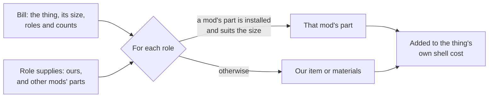

# Parts bills: what a built thing is made of, by role (11 Nov 2026)

How upgrades and fittings work now: [systems/upgrades-and-fittings.md](../systems/upgrades-and-fittings.md); this record keeps its history.

**Read this first**

- A **parts bill** says what a built thing needs by **role** (an engine, a fuel tank, a pump), not by item. At start-up each role is
  filled by **another mod's part where that mod is installed and the part suits**, and by **ours otherwise**.
- It is **generic**: it lives in D'thorga Framework's core and works for **anything the player builds**, a placed building as much as
  a vehicle. Any mod, ours or another author's, uses it in XML alone.
- **Not yet tested in game.** Every count and figure here is authored and held for the owner's review.
- **A frame already being built** keeps what was delivered and then asks for the new list. Finish or cancel frames before installing a
  version that changes a bill.
- `python scripts/query-defs.py patched` cannot show a cost made in code. Read a bill in game with the dev action **"Framework: list
  every parts bill"**.

## Why

The owner (11 Nov 2026), on seeing the tanker's build cost beside the other vehicles': "all of our vehicles need to be brought more
inline with the kind of parts our Ullage Bulk Tanker is making use of ... making soft-dependencies where appropriate to enrich the
ecosystem where we can." Then, on the first plan: "Can any of this be genericized? I'm thinking about creating a possible chemical
industry mod later that might involve these mechanics, but with placed buildings instead."

Before this, only the tanker drew on other mods' parts, through four hand-written patch folders (one per mix of RimThunder and Vanilla
Vehicles Expanded). Every further parts mod would have doubled the folders, and a build could disagree with a repair: the tanker asked
for a heavy engine where the repair table gave its weight a medium one.

**What it lets the player do:** build our things from the parts their other mods make. **What it stops:** a vehicle built from steel
and three kits alone. **How it changes play:** building becomes gathering or making the parts first, as it is for other mods' vehicles.

## How it works



| Piece | Where | What it is |
| --- | --- | --- |
| `PhobosRoleSupplyDef` | `src/PhobosFramework/Bills/BillDefs.cs` | What fills a role: ours (an `item`, or `materials`), and `substitutes` from other mods, each with `MayRequire`, a `count` and an optional size window. The first Def that fits a role wins |
| `PhobosBillDef` | the same file | A built thing's bill: its `target` (any ThingDef the player builds), an optional `size`, `tags`, and `parts` written as the game writes a cost |
| `BuildBillRule` | `src/PhobosFramework/Rules/BuildBillRule.cs` | The game-free rule, with tests: which part fills a role, and how parts merge into the shell |
| `PartsBills` | `src/PhobosFramework/Bills/PartsBills.cs` | Applies every bill once at start-up; `Resolve` for a consumer with more to fill; `Report` for the dev action |
| `PhobosVehiclePartSupplyDef` | `src/PhobosFramework.Vehicles/Defs/PartSupplyDefs.cs` | The core's role supply with a repair's own figures added (whole-part share, turbine or not, cost by part health): one table for builds and repairs |
| `PhobosVehicleBillDef` | `src/PhobosFramework.Vehicles/Defs/VehicleBillDefs.cs` | A bill aimed at a vehicle's blueprint: its size is the vehicle's empty weight, and it may fill upgrade-tree nodes by key |

**The rules of the rule:**

- The target's own `costList` in XML is its **shell**: steel and the like. The bill adds the parts. Nothing is written twice.
- The shell's lines keep their order, and its first stays first (Vehicle Framework reads a vehicle's first cost item for its
  destruction sound).
- A substitute suits when the thing's size is inside its window. With no size, only a substitute with no window suits.
- A kit of ours marked `coversWholeBuild` is asked for **once**, however many of its roles a bill lists.
- A bill naming a role nothing supplies is a config error at load. A fault in one bill leaves that thing at its shell cost and is
  logged once.
- Costs are Def data. Nothing is saved, and removing a bill puts a thing back at the cost in its XML.

## Using it for a placed building

A reactor that needs a vessel, two pumps and piping. Ours is steel and components; where a mod that makes real pumps is installed, the
build asks for its pump. The names of the other mod's items are examples only.

```xml
<!-- What fills the role, once for every building that asks for it. -->
<Phobos.Framework.Bills.PhobosRoleSupplyDef>
  <defName>MyMod_Supply_Pump</defName>
  <label>process pump</label>
  <roles>
    <li>Pump</li>
  </roles>
  <materials>
    <Steel>25</Steel>
    <ComponentIndustrial>2</ComponentIndustrial>
  </materials>
  <substitutes>
    <li MayRequire="another.authors.mod"><thing>TheirPumpItem</thing></li>
  </substitutes>
</Phobos.Framework.Bills.PhobosRoleSupplyDef>

<!-- What the building is made of. Its ThingDef keeps only its shell in costList. -->
<Phobos.Framework.Bills.PhobosBillDef>
  <defName>MyMod_Bill_Reactor</defName>
  <target>MyMod_Reactor</target>
  <parts>
    <Vessel>1</Vessel>
    <Pump>2</Pump>
    <Piping>4</Piping>
  </parts>
</Phobos.Framework.Bills.PhobosBillDef>
```

**For the later chemical industry mod** this gives, with no new code: reactors, columns and pump stations with roles such as Vessel,
Pump, HeatExchanger, Piping and Instruments, each filled from another mod's items when installed. A `size` on the bill (litres, or a
tier) lets a small pump suit a small plant only.

**Not covered, said plainly:** recipe ingredients (a recipe takes filters, a different shape; the rule could serve it later), floors
and other terrain (a bill's target is a ThingDef), and anything like repairs for buildings. **An item made at a bench cannot take a
bill**: the game writes its recipe from its cost before the bills are applied, so the recipe would keep the shell cost.

## The roles (authored, held for the owner's review)

One table, `PartSupplies.xml`, fills both builds and repairs. The order of a role's substitutes is the order of preference for a build.

| Role | Ours | RimThunder - Core | Vanilla Vehicles Expanded |
| --- | --- | --- | --- |
| Engine | Engine assembly: 1 under 4 t, 2 from 4 to 15 t, 3 from 15 t | Light engine under 4 t, medium 4 to 15 t, heavy from 15 t | 1 engine block under 6 t, 2 from 6 to 15 t, 3 from 15 t |
| Engine, on a turbine vehicle | Gas turbine assembly | Turbine | None |
| Transmission | Transmission | Transmission component | Car transmission, under 15 t |
| Fuel tank | 30 steel, 1 component | Fuel tank component | Car fuel tank |
| Wheels | One drivetrain kit for the whole build (a repair: 10 steel, 1 component each) | Tyre | Car wheel, under 15 t |
| Suspension | The same drivetrain kit | None | Car suspension, under 15 t |
| Alternator | One electrical kit for the whole build (a repair: 10 steel, 2 components) | None | Car alternator |
| Battery | The same electrical kit (a repair: 10 steel, 2 components) | None | Car battery |
| Wiring | The same electrical kit | None | Car wiring |
| Radiator | The same electrical kit (a repair: 20 steel, 2 components) | None | Car radiator |
| Exhaust | 40 steel | None | Car exhaust |
| Frame | 60 steel | Heavy casting | None |
| Fuel pump and other small mechanical parts | 12 steel, 2 components | None | None |

Two roles are filled from a materials mod or a job's own mod:

| Role | Ours | Another mod's | On |
| --- | --- | --- | --- |
| Hose | 20 chemfuel (rubber: the game has none, so chemfuel stands for it, as in our drive belts and other mods' tyres) | Rimefeller: 20 synthylene, a made polymer | Tanker 2, drill rig 1, tipper 1 |
| Oxygen store | 20 steel (flasks, charged by the boat's own air plant) | Vanilla Gravship Expanded: 30 oxygen canisters | Seabed crawler 1 |

**Changed from 9 Nov 2026:** Vanilla Vehicles Expanded's parts were limited to vehicles under 6 tonnes. Its own heavy vehicles use more
of the same parts (its Wisent takes three engine blocks), so the table now does the same, and a repair accepts them too. The engine
classes are why the tanker, at 9 tonnes, now asks for RimThunder's medium engine where its old patch asked for the heavy one.

## The bills

Counts follow each vehicle's layout: tyres by its axles, suspension per axle, electrics and cooling once, an exhaust, a frame casting
on the heavy ones, and the pump or compressor its job needs. All authored.

| Thing | Size | Shell (its XML cost) | Parts |
| --- | --- | --- | --- |
| Survey truck | 4,500 kg | 300 steel, 10 plasteel, 10 uranium, 8 components | Engine 1, transmission 1, fuel tank 1, wheels 4, suspension 2, alternator 1, battery 1, wiring 1, radiator 1, exhaust 1, hydraulic pump 1 |
| Generator set | 6,000 kg | 340 steel, 10 plasteel, 9 components | Engine 1, fuel tank 1, wheels 4, suspension 2, traction motor 1, battery 1, wiring 1, radiator 1, exhaust 1 (diesel-electric: no gearbox) |
| Bulk tanker | 9,000 kg | 400 steel, 8 components | Engine 1, transmission 1, fuel tank 1, wheels 6, suspension 3, alternator 1, battery 1, wiring 1, radiator 1, exhaust 1 |
| Tipper truck | 10,000 kg | 420 steel, 8 components | As the tanker, with hydraulic pump 1 and frame 1 |
| Drill rig | 20,000 kg | 560 steel, 40 plasteel, 12 components | Engine 1, transmission 1, fuel tank 1, wheels 8, suspension 4, alternator 1, battery 2, wiring 1, radiator 1, exhaust 1, hydraulic pump 1, compressor 1, frame 2 |
| Seabed crawler | 4,800 kg (from its mass figure) | 480 steel, 15 plasteel, 10 components | Engine 1, fuel tank 1, battery 2, wiring 1 |
| Depot bay (a placed building) | none | 80 steel, 3 components | Fuel tank 1, fuel pump 1 |

**What each comes to** (worked out from the shipped XML; with neither mod the tanker, tipper and rig also ask for their hoses' chemfuel; the game's dev action shows the same for the mods actually installed):

| Thing | With RimThunder and Vanilla Vehicles Expanded (the owner's list) | With neither |
| --- | --- | --- |
| Survey truck | 312 steel, 10 plasteel, 10 uranium, 10 components, a medium engine, a transmission component, a fuel tank component, 4 tyres, 2 car suspensions, a car alternator, battery, wiring, radiator and exhaust | 382 steel, 10 plasteel, 10 uranium, 11 components, 2 engine assemblies, a transmission, a drivetrain kit, an electrical kit |
| Generator set | 380 steel, 10 plasteel, 17 components, a medium engine, a fuel tank component, 4 tyres, 2 car suspensions, a car battery, wiring, radiator and exhaust | 450 steel, 10 plasteel, 18 components, 2 engine assemblies, a drivetrain kit, an electrical kit |
| Bulk tanker | 400 steel, 8 components, 40 chemfuel (hoses; 40 synthylene with Rimefeller), a medium engine, a transmission component, a fuel tank component, 6 tyres, 3 car suspensions, a car alternator, battery, wiring, radiator and exhaust | 470 steel, 9 components, 2 engine assemblies, a transmission, a drivetrain kit, an electrical kit |
| Tipper truck | 432 steel, 10 components, 20 chemfuel, the tanker's parts and a heavy casting | 562 steel, 11 components, 2 engine assemblies, a transmission, a drivetrain kit, an electrical kit |
| Drill rig | 584 steel, 40 plasteel, 16 components, 20 chemfuel, a heavy engine, a transmission component, a fuel tank component, 8 tyres, a drivetrain kit (car suspension stops at 15 t), a car alternator, 2 car batteries, wiring, radiator and exhaust, 2 heavy castings | 774 steel, 40 plasteel, 17 components, 3 engine assemblies, a transmission, a drivetrain kit, an electrical kit |
| Seabed crawler | 480 steel, 15 plasteel, 10 components, a medium engine, a fuel tank component, 2 car batteries, car wiring, 30 oxygen canisters (with Vanilla Gravship Expanded; else 20 more steel) | 510 steel, 15 plasteel, 11 components, 2 engine assemblies, an electrical kit |
| Depot bay | 92 steel, 5 components, a fuel tank component | 122 steel, 6 components |

**Beside similar trucks** (their costs read with the owner's patches applied, 11 Nov 2026): Vanilla Vehicles Expanded's Bulldog is 440
steel, 16 components and about 36 car parts; GTek's L-ATV 410 steel, 60 plasteel, 12 components and about 26; the HUMVEE 550 steel, 6
components and about 13. Ours had been 220 to 360 steel and three kits. The shells were raised to sit beside those by weight (survey
truck 220 to 300, generator set 320 to 340, tanker 280 to 400, tipper 260 to 420, drill rig 360 to 560, crawler 350 to 480).

## Soft dependencies: what was read, taken and left (11 Nov 2026)

The owner asked for the reach to go to more parts from the two part makers, to materials mods and to job-specific gear. Each candidate
on the owner's list was read with every patch applied (`python scripts/query-defs.py patched`) before use. **A part is taken only where
the real thing is made of it, and never in an amount that takes real hours to gather** (the owner's rule of 2 Nov 2026).

| Mod | Item | Decision | Why |
| --- | --- | --- | --- |
| RimThunder - Core | Light, medium, heavy engine; turbine; transmission; fuel tank; tyre | **Taken** | The parts they are |
| RimThunder - Core | Heavy casting | **Taken**, as a frame on the tipper and drill rig | A heavy truck's frame is a casting |
| RimThunder - Core | Road wheel | Left | The crawler's bottoming wheels are our own made item, and an item made at a bench cannot take a bill |
| Vanilla Vehicles Expanded | Engine block, transmission, fuel tank, wheel, suspension, alternator, battery, wiring, radiator | **Taken** | The parts they are |
| Vanilla Vehicles Expanded | Exhaust | **Taken**, one on every land vehicle | Every one has one |
| Rimefeller | Synthylene | **Taken**, as hoses | A made polymer, in place of the chemfuel that stands for rubber |
| Rimefeller | Synthamide, composite | Left | A fibre and a spacer-tech composite: nothing on these vehicles is made of either yet. A candidate for a faired or insulated upgrade later |
| Vanilla Gravship Expanded | Oxygen canister | **Taken**, as the crawler's first air | A submersible carries oxygen |
| The Dead Man's Switch | Cluster control chipsets, T/R component | Left | Worth 2,000 and 1,000 silver each: out of all proportion to a survey truck's console or an array |
| The Dead Man's Switch | Stamped component | Left | A mass-production pressing: it matches no role |
| Dubs Bad Hygiene | None | Left | It ships buildings, water and waste, no pump or pipe item |
| Vanilla Chemfuel Expanded | Deepchem | Left | A fuel, not a part |
| Combat Extended | FSX, prometheum | Left | Explosive and incendiary fill, not a part |
| Dubs Rimatomics | Depleted uranium, plutonium | Left | The survey truck's source is the game's own uranium, which Rimatomics also uses |
| HUMVEE | Its own engine | Left | One vehicle's engine, not a general part |

## Upgrade-tree nodes

All 31 nodes across the six trees were read. **Three are a real part that a role already covers**, and take it by role; the node's own
ingredients in its tree are what is left beside the part. An upgrade adds to a vehicle already built, so ours is the part's own
materials, never a kit for a whole vehicle. With none of the parts mods these three cost exactly what they did.

| Vehicle | Node | Was | Now: its own ingredients, and the part |
| --- | --- | --- | --- |
| Generator set | Uprated alternator | 60 steel, 4 components | 50 steel, 2 components, and 1 alternator |
| Generator set | Battery buffer | 20 steel, 10 components | 6 components, and 2 batteries |
| Survey truck | Large battery | 120 steel, 8 components | 100 steel, 4 components, and 2 batteries |

**Left as written, and why:** the tanker's tanks, compartments and hose reel, the tipper's bodies, the rig's mast, bits and lights and
the survey truck's arrays and probe are plate, fittings and instruments nobody else makes; the rig's electric power pack has no part
another mod ships; the seabed crawler's eight nodes already ask for our own made items (a sonar transducer, a scrubber rack). A node
joins when a role with a real substitute fits it.

## Our own parts beside the other mods' (authored, held for the owner's review)

The aim, from the owner's answers: neither route is the cheap one. Other mods' figures were read with the owner's patches applied.

| Our part | Its recipe | Stands for | The other mods' equivalent |
| --- | --- | --- | --- |
| Engine assembly | 60 steel, 8 components, 5,000 work, worth 420; **unchanged** | One light engine; a heavier vehicle takes 2 or 3 | RimThunder's light, medium and heavy engines are worth 400, 800 and 1,350; Vanilla Vehicles Expanded's engine block is 40 steel, 4 silver, 6 components, worth 325, and its own heavy vehicles take 2 or 3 |
| Transmission | 40 steel, 4 components, 3,500 work; **unchanged** | One gearbox | Vanilla Vehicles Expanded's is 10 plasteel, 2 components, worth 170 |
| Drivetrain kit | **120 steel, 8 components, 6,000 work, worth 480** (was 90, 6, 5,000 and 380) | Axles, suspension and wheels for a whole vehicle (it no longer claims the gearbox and fuel tank, which are their own roles) | On the tanker, Vanilla Vehicles Expanded's 6 wheels and 3 suspensions are worth 690 |
| Electrical kit | 25 steel, 8 components, 5,000 work, worth 340; **unchanged** | Alternator, batteries, wiring and radiator for a whole vehicle | Vanilla Vehicles Expanded's four are worth 430 |
| Gas turbine assembly | 60 steel, 15 plasteel, 10 components, 8,000 work; **unchanged** | One turbine | RimThunder's turbine is worth 2,500 |

**A repair follows the same counts**: replacing a destroyed engine on a vehicle of 4 to 15 tonnes now asks for two engine assemblies
(or the materials of two, at the player's share), and three from 15 tonnes, as RimThunder's medium and heavy engines already did.

## Aircraft and turbine parts (19 Nov 2026)

**Status (19 Nov 2026):** built in D'thorga Framework 0.178.0 and D'thorga Vehicles 0.87.0; not yet tested in game.

**Why.** The owner, on the Osprey: "not terrible well balanced, perhaps not in overall wealth ... but in terms of the part *choices*",
and leaning towards new parts "especially if they are of benefit to our other vehicles, both present and near future, and even perhaps
as upgrade/service use". The read behind it: the Osprey's bill was a truck's with a rotor drive added. The shell and the two turbines
were about 88% of its cost; a proprotor gearbox cost about 185 silver, less than a car battery and alternator together; the
fly-by-wire was six advanced components in the shell; and without RimThunder it asked for a truck's drivetrain kit for its wheels.

**What it lets the player do:** build an aircraft from aircraft parts made at the parts bench, and keep spares of the ones that fail
(gearboxes, flight computers, actuators, hot-section kits). **What it stops:** a gearbox, a flight-control channel or an avionics bay
replaced with a handful of steel. **How it changes play:** an aircraft programme is a parts programme: gold and advanced components for
flight computers, plasteel for blades and turbines, and a stock of hot-section kits for the hangar.

### The new parts (authored, held for the owner's review)

| Part | Recipe | Worth | Research | Takes it |
| --- | --- | --- | --- | --- |
| **Turbine blade set** (an intermediate, the owner's idea) | 35 plasteel, 1 advanced component, 6,000 work, Crafting 8 | 540 | Turbine engines | The gas turbine assembly |
| **Reduction gearbox** | 60 steel, 20 plasteel, 8 components, 6,000 work, Crafting 7 | 570 | Turbine engines | The rotor drive role, on every helicopter |
| **Flight computer** | 10 steel, 2 gold, 4 components, 1 advanced component, 5,000 work, Crafting 8 | 385 | Vehicle parts and Fabrication | Flight-control channels and avionics bays |
| **Hydraulic actuator** | 30 steel, 3 components, 2,500 work, Crafting 5 | 160 | Vehicle parts | The Osprey's nacelle tilts and ramp; the tipper's body rams and its loading grab; the drill rig's mast rams; the survey truck's boom |
| **Hot-section kit** (a service kit) | 10 plasteel, 3 components, 1,500 work, Crafting 6 | 190 | Turbine engines | A turbine's hot-section overhaul, which took the same materials raw |

**The gas turbine assembly** is now 100 steel, 15 plasteel, 14 components, 1 advanced component and a turbine blade set, 10,000 work,
worth about 1,550 (was 60 steel, 15 plasteel, 10 components, about 600). RimThunder's turbine is 2,500, much of it 500 steel of casting.
The owner chose an intermediate over a bigger pile of raw materials.

### The aircraft roles

| Role | Ours | Another mod's | Bound to a part, so repairs use it |
| --- | --- | --- | --- |
| RotorDrive | A reduction gearbox, whole (was 30 steel and 4 components) | None | Every helicopter's gearbox, transmission or rotor mast that plays it: the Osprey's two proprotor gearboxes, the Hind's, Mongoose's, Cherokee's and the other tie-ins' |
| DriveShaft (new) | 30 steel, 4 components (the old rotor drive figure) | None | The Osprey's interconnect shaft |
| FlightControl (new) | A flight computer, whole | None | The Osprey's three channels |
| Avionics | A flight computer, whole (had no supply: the hull's figure, by health) | None | **Every aircraft's avionics bay**, ours appended where an aircraft has none |
| Actuator (new) | A hydraulic actuator, whole | None | Since Framework 0.179.0 ("The second pass"): the tipper's rams and other mods' aircraft's servos |
| LandingGear | 30 steel, 2 components, 10 chemfuel a leg (had no supply) | None | The Osprey's three legs |
| RotorBlades (new, a build's role only) | 40 plasteel a rotor | Rimefeller: 45 composite | None |

**One trick, said plainly:** the rotor drive's condition sets how much power reaches the rotors (`Powertrain`), so the Osprey's shaft
stays in that role. A part's first role sets its replacement cost, so the shaft's DriveShaft role is listed before RotorDrive in its
loadout, as the hydraulics part already plays two roles.

### The changed bills

| Thing | Before | Now |
| --- | --- | --- |
| Osprey shell | 900 steel, 250 plasteel, 40 components, 6 advanced components | 900 steel, 170 plasteel, 24 components |
| Osprey parts | Engine 2, rotor drive 3, fuel tank 4, wheels 3, alternator 2, battery 2, wiring, hydraulic pump and lines | Engine 2, rotor drive 2, drive shaft 1, rotor blades 2, flight control 3, avionics 1, actuator 3, fuel tank 4, landing gear 3, alternator 2, battery 2, wiring, hydraulic pump and lines |
| Tipper shell | 420 steel, 8 components | 360 steel, 2 components, and actuator 2 in its bill |
| Tipper's loading grab | 120 steel, 4 components | 90 steel, 1 component, and 1 actuator |
| Drill rig shell | 560 steel, 40 plasteel, 12 components | 500 steel, 40 plasteel, 6 components, and actuator 2 |
| Survey truck shell | 300 steel, 10 plasteel, 10 uranium, 8 components | 270 steel, 10 plasteel, 10 uranium, 5 components, and actuator 1 |

The trucks' shells gave up exactly what their actuators are made of, so their totals move only by the actuators' work.

**What the Osprey comes to** (worked out by hand, not read in game): about **14,400 silver** with RimThunder and Vanilla Vehicles
Expanded (was 13,000): the shell about 4,000, two RimThunder turbines 5,000, gearboxes 1,140, flight computers 1,540, blades 720,
actuators 480, landing gear 430, the rest about 1,100. With neither mod about **12,500** (was 9,500), the turbines now 1,550 each.
The owner chose to let it rise rather than thin the shell (19 Nov 2026).

### What else changes

- **A destroyed rotor drive part on any helicopter** our repair rules cover now asks for a reduction gearbox. Where a tie-in binds only
  a rotor mast (Vanilla Vehicles Expanded's aircraft), the mast stands for the rotor drive's whole assembly: an approximation.
- **A destroyed avionics bay on any aircraft** asks for a flight computer. The bay is 20 health on most: it was about 10 steel.
- **A destroyed turbine** asks for a turbine assembly now worth 1,550, or RimThunder's turbine.
- **A hot-section overhaul** asks for a hot-section kit, or its raw materials while the colony still accepts them.

### Who chose the aircraft parts

| Choice | Who |
| --- | --- |
| Rebalance the part choices, with new parts that serve other vehicles, upgrades and services | Owner, 19 Nov 2026 |
| An intermediate inside the turbine, rather than a bigger raw cost | Owner, 19 Nov 2026 |
| Actuators on the tipper, drill rig and survey truck too | Owner, 19 Nov 2026 (the agent's recommendation) |
| The hot-section kit | Owner, 19 Nov 2026 (the agent's recommendation) |
| Let the Osprey rise to about 14,400 | Owner, 19 Nov 2026 (the agent's recommendation) |
| Which parts, their recipes, worth and research; the roles; the shaft's role; the grab's actuator | Agent |

## The second pass (20 Nov 2026)

**Status (20 Nov 2026):** built in D'thorga Framework 0.179.0 and D'thorga Vehicles 0.88.0; not yet tested in game.

**Why.** The owner, after the Osprey: "reassess our other vehicles and the like now ... including ones where we've already modified
the parts". The read, vehicle by vehicle, against what each real machine is made of:

- **The tipper's rams were built from actuators but repaired as a small pump.** No part on any vehicle played the Actuator role, so the
  0.178.0 bills built rams that a repair never asked for. Only the tipper's rams are their own part; the drill rig's mast rams, the
  survey truck's boom ram and the Osprey's nacelle tilts and ramp sit inside bigger parts, so they stay a build's role.
- **Other mods' aircraft's servos** (Vanilla Vehicles Expanded's aircraft, the Cherokee, RimArrow's helicopters) were repaired as a
  small pump (12 steel, 2 components): they are actuators. The Hind and Mongoose have no servos part.
- **Every trailer was charged a whole electrical kit** (alternator, batteries, wiring and radiator, 340) for the lights it runs from
  the truck: the Osprey's fault again, a truck's part on something that is not a truck.
- **The generator set's generator and traction motors were steel**: the main generator in the shell, the motors one lot of materials,
  and the generator, the thing the vehicle exists for, repaired as plain hull.
- **One drivetrain kit for any size**: a 2-tonne trailer and the 20-tonne, four-axle drill rig both took one, though the engine count
  already rises with weight.
- **Upgrades that are real parts were raw materials**: a second hose that held no hose, an electric pump and an electric power pack
  with no motor, a terrain radar and an infrared jammer with no computer.
- **The seabed crawler** costs about 2,250 to build against a worth of 6,500, with no propulsion motor, air plant or real pressure hull.
  **Left alone**: the owner put submarine work on the back burner the same day.

**What it lets the player do:** keep one stock of electric motors and actuators that serves trucks, trailers, upgrades, fittings and
other mods' aircraft. **What it stops:** a trailer's lights costing an alternator and a radiator; a generator, a traction motor, a ram
or a servo replaced with a handful of steel. **How it changes play:** electric motors join engines and actuators as the parts a motor
pool keeps on the shelf.

### The electric motor (authored, held for the owner's review)

| Part | Recipe | Worth | Research | Takes it |
| --- | --- | --- | --- | --- |
| **Electric motor** | 25 steel, 4 components, 3,000 work, Crafting 6 | 210 | Vehicle parts | Traction motors (the generator set's, Trains of the Rim's locomotives'); the generator set's main generator; the tanker's electric pump; the drill rig's electric power pack; the recovery winch |

Steel stands for its iron core and frame, components for its windings and controls: the game has no copper. A vehicle of 15 tonnes or
more takes two of ours for one motor, as with engines. The rescue hoist keeps its materials: its research (vehicle electrics) can come
before the vehicle parts research that makes a motor.

### The roles

| Role | Before | Now | Bound to a part, so repairs use it |
| --- | --- | --- | --- |
| TractionMotor | 40 steel, 8 components (the "electric drive", with the traction battery) | An electric motor, whole | The generator set's traction motors; Trains of the Rim's |
| Generator (new) | None: the hull's figure | An electric motor, whole | The generator set's traction generator |
| ElectricMotor (new, a build's role) | None | An electric motor | None |
| TractionBattery | The electric drive | The same materials, now labelled "traction battery" | Other mods' electric vehicles |
| Actuator | A hydraulic actuator | The same, or its 30 steel and 3 components while the colony accepts raw materials (the owner's choice) | The tipper's rams; other mods' aircraft's servos |
| Lighting (new, a build's role) | None | 5 steel, 1 component | None |
| Wheels and Suspension | One drivetrain kit | Two at 15 tonnes and up (the owner's choice) | Repairs unchanged |

**The same trick as the Osprey's shaft:** a part's first role sets its replacement, so the Actuator binding is listed before the
hydraulic roles on the tipper's rams and every servos part. The hydraulic roles stay, so a hit still bleeds hydraulic oil and the pump
still drives them.

### The changed bills and upgrades

| Thing | Before | Now |
| --- | --- | --- |
| Five trailers (flatbed, fuel and water bowsers, shower trailer, field kitchen) | Wiring: an electrical kit | A lighting harness |
| Generator set | Traction motor 1 (materials); shell 450 steel, 10 plasteel, 9 components | Traction motor 2, generator 2 (four electric motors); shell 350 steel, 10 plasteel, 2 components |
| Drill rig | One drivetrain kit | Two |
| Tanker's second hose reel | 30 steel, 1 component | A hose set, and 25 steel, 1 component |
| Bowsers' and shower trailer's second hose | 20 steel, 1 component | A hose set, and 10 steel, 1 component |
| Tanker's electric pump | 20 steel, 2 components | An electric motor, and 15 steel |
| Drill rig's electric power pack | 80 steel, 6 components | An electric motor, a hydraulic pump's materials, and 45 steel |
| Osprey's terrain-following radar | 25 steel, 6 components, 2 advanced components | A flight computer, and 15 steel, 2 components, 1 advanced component |
| Osprey's infrared jammer | 30 steel, 6 components, 2 advanced components | A flight computer, and 20 steel, 2 components, 1 advanced component |
| Recovery winch fitting | 90 steel, 5 components | An electric motor, 65 steel, 1 component |

**What they come to** (worked out by hand from worth, not read in game; our own parts, no other mods): the flatbed about 1,180 (was
1,470) against its worth of 1,200; the fuel bowser about 1,240 (was 1,540, worth 1,500); the water bowser and shower trailer the same
(worth 1,400); the field kitchen about 1,410 (was 1,710, worth 1,400); the generator set about 3,480 (was 3,390, worth 2,900); the drill
rig about 5,210 (was 4,730, worth 4,200). The trailers now sit at their worth.

### Seen and left (for the owner's review)

- **The survey truck's sensor head** stays in its shell (its uranium is the source). A sensor package could be a part of its own.
- **The tanker's and bowsers' pumps** have no role, so a destroyed pump is repaired as hull by its health.
- **The generator set and drill rig** now cost more to build than their worth says; the worth was not changed.
- **The seabed crawler**, above: set aside with submarine work.

### Who chose the second pass

| Choice | Who |
| --- | --- |
| Reassess every vehicle, including those already changed | Owner, 20 Nov 2026 |
| The electric motor, with a paid picture | Owner, 20 Nov 2026 (the agent's recommendation); the picture is the owner's pick |
| Servos repaired with an actuator, or its materials in a raw-accepting colony | Owner, 20 Nov 2026 (the agent's recommendation, after the owner asked whether both have uses) |
| Two drivetrain kits at 15 tonnes and up | Owner, 20 Nov 2026 (the agent's recommendation) |
| The crawler left alone | Owner, 20 Nov 2026: submarines to the back burner |
| The lighting harness; the generator's role and count; which nodes and fittings take parts; the hoist left as materials; the flight computer in the radar and jammer | Agent |

## Research

The owner asked for research gates decided the same way for every vehicle. **The agent's decision:** a vehicle's blueprint asks only for
its own project. Each land vehicle's project also asks for Vanilla Vehicles Expanded's basic vehicles research where that mod is
installed (the tipper, tanker and generator set already did; the drill rig and survey truck now do). The tanker's blueprint used to ask
for RimThunder's or Vanilla Vehicles Expanded's research directly, through the patch folders; that went with them, because those mods'
parts already need their makers' research to be made. The seabed crawler is a boat and is left on its own project.

## Checks

- `tests/test_parts_bills.py` (in the gate): every role a bill asks for is supplied, every target and node key exists, and another
  mod's part is always behind `MayRequire`.
- The dev action **"Vehicle systems: run the self-test"** reads every bill as the game holds it.

## The player's setting

**Parts for building** (D'thorga Framework's settings): **Other mods' parts where installed** (default) or **Always our own parts**.
A change takes effect the next time the game starts.

## Limits

- Another mod that reads build costs in its own start-up code may read them before the bills are applied, and so see the shell cost.
  None on the owner's list is known to; the dev action shows what the game holds.
- A substitute is chosen by the order it is listed in, not by price.

## Who chose what

| Choice | Who |
| --- | --- |
| Bring every vehicle's parts in line with the tanker's, with soft dependencies | Owner, 11 Nov 2026 |
| One table worked out at start-up, not patch files; costs that match similar trucks; reach to materials mods and job gear; nodes, recipes and research in scope | Owner, question cards, 11 Nov 2026 |
| Generic, for placed buildings too | Owner's question, 11 Nov 2026; the design is the agent's |
| The Def types and their fields, the size window, kits that cover a whole build, the shell kept in XML, the setting and its default | Agent |
