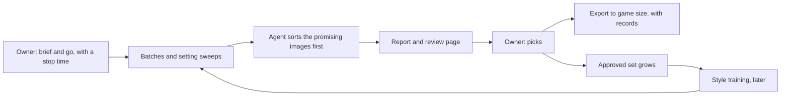

# Art automation and medical equipment: design (4 Nov 2026)

A working design that keeps these plans in one place. **Nothing here is built, and nothing is tested in game.** The owner's
choices, agent suggestions and untested assumptions are labelled, so the owner can change any of them. Update this page as things
are decided, and record finished work in the owning mod's changelog or record.

## Where everything stands

| Work | State | Next step | Record |
| --- | --- | --- | --- |
| D'thorga Framework 0.1.0 | Installed; not yet tested in game | The owner's first load | [Framework](phobos-framework.md) |
| D'thorga Burns and Smoke 0.1.0 | Installed; not yet tested in game | The owner's first load | [Burns and smoke](burns-and-smoke.md) |
| Native 1.7 builds of all seven mods | Built and installed; not yet tested in game | The same first load, watching the Harmony mods | [Building](building.md) |
| Burns and Smoke 0.2.0: eschar, escharotomy, fluids | Planned | Wait for what the first test shows | [Burns and smoke](burns-and-smoke.md) |
| Hands-off art pipeline | Designed here | Build the safeguards, then a short test night | [Below](#hands-off-art-pipeline) |
| Style training | Designed here | Needs a set of approved images first | [Below](#style-training) |
| Medical equipment mod | Ideas only | The owner picks a first piece, after the first test | [Below](#medical-equipment) |

## Decisions so far

| Decision | By |
| --- | --- |
| The owner wants less direct involvement in local AI tools, and is happy for long jobs to run while away or asleep | Owner |
| Existing effects first; add our own only where it earns more than inference, or nothing exists, or on the owner's call-out; keep a manual override | Owner (rule) |
| We may add our own medical equipment, for both hospital and field | Owner |
| The medical equipment mod may depend on Vanilla Expanded Framework, for its years of track record | Owner |
| Start the art work with style references, not training on vanilla sprites | Agent suggestion, not yet decided |
| Put medical equipment in its own mod, not in Burns and Smoke | Agent suggestion, not yet decided |

## Hands-off art pipeline

**The owner gives the brief, the go-ahead and the final pick.** The agent does everything between.

**What exists:** `scripts/generate-art.py` starts ComfyUI, runs batches and writes a record beside each image. `assets/phobos-radio/`
holds a review page, a contact sheet and an export script, written for the radio art. The recipes that worked are in the
[artwork direction](artwork-direction.md).

**What needs building (agent):**

- **One command** that joins generating, reviewing and exporting, with the tools no longer tied to the radio folder.
- **New model workflows.** The script knows only Flux.1-schnell and FLUX.2 Klein.
- **Unattended safeguards**, tested on a short run before a long one:

| Safeguard | What it does |
| --- | --- |
| Stop time | Ends at a set hour, even if the batch is unfinished |
| Game check | Stops if RimWorld starts, on either its 1.7 or 1.6 process name |
| Safe finish | Frees the graphics memory and writes a report, even after a failure |
| Disk limit | Stops before a batch can fill the drive |

**What an unattended night needs from the owner:** the session left open, Windows kept awake, and the commands allowed beforehand,
because a permission prompt would stall the run until morning. New downloads and installs are named first; licence questions are
checked before anything runs.

### The stronger generator

A friend of the owner's gets far better results from a local setup. Its name is not yet known; ask which model and workflow it
uses. Open WebUI, which the owner has tried, only passes image requests to a separate backend: its
[documentation](https://docs.openwebui.com/features/images) names AUTOMATIC1111, ComfyUI and OpenAI's DALL·E. So the difference is
probably the model and workflow, not a new tool (agent inference). We have used only two fast, small models so far.

**Check before use:** each model's licence, because these mods are public. From memory and unverified, Flux.1-dev is non-commercial,
unlike Flux.1-schnell's Apache 2.0.

## Style training

**Training material is a folder of images, each with a short caption.** The model learns what the images have in common. This
section is general practice from memory; none of it has been tried on our setup.

| Material | Use | Why |
| --- | --- | --- |
| Large masters of our own sprites | **Best** | Clean detail, one subject, ours to use |
| Game-size sprites | Avoid | Too little detail; enlarging adds blur the model learns |
| In-game screenshots | Avoid | Interface, tiny subjects, clutter, other people's art |

- **A good set:** one consistent style, varied subjects, about 20 to 50 images at around 1024 px, plain backgrounds, approved images only.
- **Captions describe the subject, not the style**, after a made-up trigger word: "phobosstyle, oxygen tank with a frosted valve".
- **Hardware:** from memory and unverified, SDXL training should suit the 12 GB card, and Flux would be tight. No training tool is
  installed yet.
- **Each trained model gets a record** of its images, settings and tool, and the art keeps its AI disclosure.

### Vanilla sprites

Sizes read from the file headers in the game's `Assets.zip` (RimWorld 1.7.4998, 4 Nov 2026); nothing was extracted:

| Vanilla sprites | Count | Most common size (px) | Largest (px) |
| --- | ---: | ---: | ---: |
| All things | 2,693 | 128 | 1,280 |
| Buildings | 674 | 64 | 1,024 |
| Items | 310 | 64 | 640 |
| Apparel | 271 | 128 | 512 |
| Medicine | 10 | 64 | 64 |

Some of those counts include mask files, which are not usable art. Most sprites are well short of training size. AI upscalers such
as Real-ESRGAN could enlarge them, but their licences are unchecked. These files are compressed, and a 64 px sprite gives an
upscaler little to work from, so a style model could learn the flaws as if they were the style (agent inference).

**What the rules say:** [Ludeon's EULA](https://rimworldgame.com/eula/) lets modders use its resources "as a basis or reference for a
Mod", but not "rip these resources out and pass them around independently", and a mod must not contain "a substantial part" of
its artwork. It does not mention AI training, so whether training counts as a basis is unsettled; only Ludeon can say. Our own rule
is that we never ship or commit the game's art.

**The suggested route (agent):**

1. **Style reference:** give Klein vanilla sprites as references, kept in the ignored `.local/`.
2. **Our own art:** generate varied items at full size overnight, and the owner picks the keepers.
3. **Training:** train on those picks, so the model learns from clean images that are ours.

Compare results against the reference sprites, so nothing ships as a near-copy. Training on upscaled vanilla stays available as a
private experiment, for the owner to decide.

**Before publishing:** the EULA also gives a disclaimer wording for works made with Ludeon's materials ("Portions of the materials
used to create this content/mod are trademarks and/or copyrighted works of Ludeon Studios Inc."). Read that clause and compare it
with the disclaimer in our About files.

## Medical equipment

**Your mods already cover more than the first ideas assumed.** A scan of the Defs in every active mod on 4 Nov 2026 found:

| Need | Already there | How it works (read from its Defs) |
| --- | --- | --- |
| Oxygen supply | Vanilla Gravship Expanded | An oxygen pipe network, pumps, tanks and an oxygen canister item that explodes when burned. Research: Oxygen Network, on the gravship research path |
| Portable oxygen | Vanilla Gravship Expanded | Oxygen packs, consumed in vacuum |
| Emergency oxygen | The Dead Man's Switch - Expedition | An oxygen candle, a sodium chlorate device for sealed cabins |
| Ventilator | More Injuries: Organ Failure | A surgery that intubates the patient, which needs an active life-support bed. It stands in for breathing but does not repair the lungs. Which mods supply such a bed is unread |
| IV stand | VFE Medical Module | A facility beside a hospital bed that adds immunity gain speed |

None of the oxygen above treats a patient yet, as far as these Defs show: it serves vacuum and sealed rooms.

**Under the owner's rule, reuse these where present:**

- **Medical oxygen** uses Vanilla Gravship Expanded's canister or pipe network when that mod is active, as an optional tie-in.
  Without it, we supply a simple oxygen item of our own, because nothing else would exist.
- **Airway support** hands off to Organ Failure's ventilation where it is active; we build a ventilator only if it would add something.

**Equipment nothing here provides (agent ideas, for review):**

| Where | Item | Purpose |
| --- | --- | --- |
| Field | Oxygen mask and regulator | Treats a patient with carbon monoxide or smoke-damaged lungs from a canister |
| Field | Burn dressings | Better than plain tending for large burns; silver sulfadiazine is a natural chemistry tie-in |
| Field | Manual resuscitator | Holds a closing airway until someone can do the tracheotomy |
| Hospital | Bedside oxygen | Treats patients in bed from a canister or the pipe network |
| Hospital | Hyperbaric chamber | The top-end carbon monoxide treatment |
| Hospital | Burn unit bed | Eases cold sensitivity and infection risk |

**Treatment tiers for carbon monoxide:** half-life about 320 minutes on room air, about 75 on oxygen, 15 to 30 hyperbaric
(see the sources in [burns and smoke](burns-and-smoke.md#sources)). The kinetics are sourced, but the hyperbaric chamber is a game
tier, not medical advice: the NHS England review noted there that clinical evidence for it is low quality.

**The frost effect:** the owner loves the frosting on DMS2's Pressure Chamber. Liquid oxygen tanks and vaporisers really do frost
over, so a liquid oxygen vessel of ours would give that effect a real reason. This is the one piece that may earn its place
despite Vanilla Gravship Expanded's tanks, and it is the owner's call.

**Engineering notes:**

- **Its own mod** (agent suggestion), because it will serve more than burns. Shared services go in D'thorga Framework.
- **Vanilla Expanded Framework is a required dependency of this mod** (owner, 4 Nov 2026). Its PipeSystem module can carry our own
  piped oxygen when Vanilla Gravship Expanded is absent, the same module that network already uses and the radio framework's
  feedline relies on. Declared in `modDependencies`; the installed assembly is referenced with `Private=false`, never copied
  (CC BY-NC-ND 4.0, [third-party notices](../../THIRD_PARTY_NOTICES.md)). D'thorga Framework and Burns and Smoke stay free of it,
  so a mod using only those needs nothing extra (agent assumption, for the owner to correct).
- **Its own treatment jobs:** More Injuries' suction and CPR target lists are hard-coded, so new devices cannot join them through XML.
- **Oxygen is a treatment you supply, not a gas in the room**, which keeps it clear of an air model.

## Open questions

| Question | For |
| --- | --- |
| Which model and workflow does the friend's setup use? | Owner to ask |
| Pick the radio art candidates still waiting since 19 October (`assets/phobos-radio/generated/review.html`) | Owner |
| Train on vanilla sprites privately, or only use them as references? | Owner |
| How should our own oxygen be made: concentrator, electrolysis or air separation? | Owner, as the chemist |
| Should a frosted liquid oxygen vessel exist beside Vanilla Gravship Expanded's tanks? | Owner |
| Which mods supply Organ Failure's life-support bed? | Agent, when medical work starts |
| Licences of any new model, upscaler and training tool | Agent, before use |
