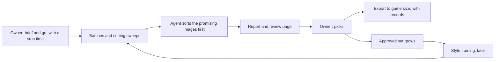

# Art automation and medical equipment: design (4 Nov 2026, updated 5 Nov 2026)

A working design that keeps these plans in one place. **Nothing here is built, and nothing is tested in game.** The owner's
choices, agent suggestions and untested assumptions are labelled, so the owner can change any of them. Update this page as things
are decided, and record finished work in the owning mod's changelog or record.

## Where everything stands

| Work | State | Next step | Record |
| --- | --- | --- | --- |
| D'thorga Framework 0.1.1 | Draft; first look in game was 0.1.0 | The owner's test of the current build | [Framework](phobos-framework.md) |
| D'thorga Burns and Smoke 0.3.0 | Draft; first look in game was 0.1.0, and 0.3.0 is not yet tested in game | The owner's test of the current build | [Burns and smoke](burns-and-smoke.md) |
| Native 1.7 builds of all seven mods | Built and installed; not yet tested in game | The same test, watching the Harmony mods | [Building](building.md) |
| Burns and Smoke: eschar, escharotomy | Planned | Wait for what the test shows | [Burns and smoke](burns-and-smoke.md) |
| Hands-off art pipeline | **Built; checked offline only, never run on the GPU** | The owner's go for a short test run | [Below](#hands-off-art-pipeline) |
| Medical art, first batch | Requests written, held for review; nothing generated | After the test run | [`assets/phobos-medical`](../../assets/phobos-medical/README.md) |
| Style training | Tooling written; the training tool is installed and accepts our job; **no training has run** | The owner's go for the night run | [Below](#style-training) |
| D'thorga Medical Equipment 0.1.0 | Draft: concentrator and bedside stand; not yet tested in game | The owner's test | [Record](medical-equipment.md) |

## Decisions so far

| Decision | By |
| --- | --- |
| The owner wants less direct involvement in local AI tools, and is happy for long jobs to run while away or asleep | Owner |
| Existing effects first; add our own only where it earns more than inference, or nothing exists, or on the owner's call-out; keep a manual override | Owner (rule) |
| We may add our own medical equipment, for both hospital and field | Owner |
| The medical equipment mod may depend on Vanilla Expanded Framework, for its years of track record | Owner |
| Our own oxygen comes from three devices: a concentrator, an electrolyser and a frosted liquid oxygen store | Owner, 5 Nov 2026 (the owner chose electrolysis for the chemistry; the agent moved the frost from the concentrator to the liquid store, because a concentrator runs at room temperature) |
| The look comes from vanilla references first; a LoRA on our own approved art comes later; and one private LoRA experiment on upscaled vanilla sprites runs alongside | Owner, 5 Nov 2026 |
| Prefer slow, full models: "It's better than having to repeat the action several times or more" | Owner, 5 Nov 2026 |
| Use FLUX.2 Klein 4B base and Z-Image base first; FLUX 3 Image Klein waits for the owner to read its licence | Agent default, 5 Nov 2026, for the owner to change |
| The first batch makes south views only; the other views come from the picks | Agent default, 5 Nov 2026 |
| The concentrator stand-in is "not bad" for a starter: it leads its subject on the review page, and four more candidates use it as a reference, beside the model's own attempts | Owner, 5 Nov 2026 |
| Put medical equipment in its own mod, not in Burns and Smoke | Agent choice, built 5 Nov 2026 |
| Bedside oxygen first, automatic, with a concentrator too; no Questionable Ethics, and a ventilator of our own later | Owner, 5 Nov 2026 |

## Hands-off art pipeline

**The owner gives the brief, the go-ahead and the final pick.** The agent does everything between.



**One command runs it all, and it needs a stop time:**

```text
python scripts/art-run.py generate assets/phobos-medical/requests/test-run.json --stop-at HH:MM
```

| Part | What it does |
| --- | --- |
| `scripts/art-run.py` | Runs a request file or a training job with the safeguards below, then sorts, checks for near-copies, makes sheets and a review page, and writes a report with the time per image |
| `scripts/art-run.py night plan.json --stop-at HH:MM` | Runs a list of those jobs in order under one stop time, and writes one summary. A failed step doesn't end the night. A plan naming private paths stays in `.local/art/` |
| `scripts/generate-art.py` | Builds the graph for each engine, and writes a record beside each image |
| `scripts/art/` | Review page, contact sheets, sorting, export, the near-copy check, the model fetcher and the LoRA experiment |

| Safeguard | What it does |
| --- | --- |
| Stop time | Required. Ends at that hour, even mid-image |
| Game check | Stops if RimWorld starts, checked every few seconds. If the process list can't be read, it also stops. `--also-stop-on NAME.exe` adds other games |
| Safe finish | However it ends, it frees the graphics memory, stops any server it started and writes a report |
| Disk limit | Stops before a drive falls under 5 GB free |
| Graph check | Before any GPU work, it checks each graph against ComfyUI's own node list, including that the model files are installed |
| Failures | One failed image is recorded and skipped. Three in a row, retries included, end the run |
| Crash recovery | If ComfyUI dies or hangs, or on a second failure in a row, it starts a fresh ComfyUI and tries that image again, at most five times a run. It never replaces a ComfyUI it didn't start. Rehearsed against a stand-in, not yet against a real crash |
| Staying awake | Asks Windows not to sleep, only while it runs |

**Checked so far (5 Nov 2026), and no further:**

- Offline tests of the graphs and rules.
- Every engine's graph against the node list of ComfyUI 0.41.0, started on the CPU. `flux3-base` passes except for its two files, which are correctly reported as not installed.
- A real refusal while the owner played: `not starting: rimworld.exe is running`.
- The sorter, contact sheet and review page on real radio candidates, in a scratch copy.

- A rehearsal of every way a run can end against a stand-in ComfyUI, in `tests/test_art_run_rehearsal.py`: finishing, the game starting mid-image, the stop time, a full disk, an unreadable process list, one failure, three in a row, a missing model, a stuck image and the server vanishing. It found and fixed three faults.

**No image has been generated with the new engines, no step count has been timed on this card, and nothing has run against the real ComfyUI's generation.** The sorter's sharpness mark also gave all four of those candidates full marks, so it may need raising once real batches exist.

**What a run needs from the owner:** the go and a stop time, and the commands allowed beforehand, because a permission prompt would stall a night's work. New downloads are named first; licences are checked before anything runs.

### Models

Read from each publisher's page on 5 Nov 2026. `scripts/art/fetch_models.py` refuses a Hugging Face file if its declared licence changes, and it never fetches a gated one.

| Model | Licence | Status | Use |
| --- | --- | --- | --- |
| [FLUX.2 Klein 4B base](https://huggingface.co/black-forest-labs/FLUX.2-klein-base-4B), Black Forest Labs | Apache 2.0 | **Installed** (fp8, 4.1 GB) | Sprites from references. The model card's example is 50 steps at guidance 4, and it names this version as the one for LoRA training |
| [Z-Image base](https://huggingface.co/Tongyi-MAI/Z-Image), Alibaba Tongyi lab | Apache 2.0 | **Installed** (int8, 6.2 GB) | Text only, so the Workshop preview. ComfyUI's template uses 25 steps at guidance 4 |
| Real-ESRGAN x4plus, Xintao Wang and colleagues | BSD 3-Clause | **Installed** | Upscaling for the private experiment only |
| FLUX 3 Image Klein, Black Forest Labs | FLUX Kommunity License v1.0 | **Not installed: the owner's decision** | See below |

**FLUX 3 Image Klein may be the strongest of these,** but that is unproven here. It came out on 15 October 2026, it is 5.6B parameters, and ComfyUI's install already has its templates, with up to 10 reference images reported. The quality claims come from [Black Forest Labs' own evaluations](https://www.layer3labs.io/guides/flux-3-image-explained), as reported by a third party. The `flux3-base` engine is written but unrun. **Three things make it the owner's call:**

- **It is gated.** Its [Hugging Face page](https://huggingface.co/black-forest-labs/flux-3-image-klein-comfy) asks the owner to accept the terms and share their account details. The agent handles no credentials.
- **Its outputs may not train other models.** The model card says the licence bars using the model or its outputs "to improve another AI model" with a similar function. So **art made with it must not join a training set for Klein 4B or Z-Image**. Pick one family for the approved set before training.
- **The licence text is unread.** The card allows non-commercial use, and commercial output use under US$5M revenue, and says that is "not blanket permission for commercial fine-tuning or distribution". Our mods are free, but the owner should read the full text once the page opens (agent reading, not legal advice).

Without its prompt upsampler (9.7 GB more), the publisher [reportedly](https://www.layer3labs.io/guides/flux-3-image-explained) warns of weaker results from short prompts. Our requests would carry full captions instead, untested.

**Hiddensoul's setup is still worth asking about.** Its name is not yet known. Open WebUI only passes image requests to a separate backend ([documentation](https://docs.openwebui.com/features/images)), so the difference is probably the model and workflow (agent inference). The most useful thing to ask for is the workflow exported from ComfyUI as JSON, plus which model, LoRAs and step count it uses.

## Style training

**Training material is a folder of images, each with a short caption.** The model learns what the images have in common. Apart
from the figures Black Forest Labs publishes, this section is general practice from memory; none of it has been tried on our setup.

| Material | Use | Why |
| --- | --- | --- |
| Large masters of our own sprites | **Best** | Clean detail, one subject, ours to use |
| Game-size sprites | Avoid | Too little detail; enlarging adds blur the model learns |
| In-game screenshots | Avoid | Interface, tiny subjects, clutter, other people's art |

- **A good set:** one consistent style, varied subjects, about 20 to 50 images at around 1024 px, plain backgrounds, approved images only.
- **Captions describe the subject, not the style**, after a made-up trigger word: "phobosstyle, oxygen tank with a frosted valve".
- **Hardware:** [Black Forest Labs' guide](https://docs.bfl.ai/flux_2/flux2_klein_training) lists Klein 4B training at 12 GB of graphics memory and 32 GB of system memory; this machine has 12 GB and 63 GB. Untested here.
- **The tool:** [ai-toolkit](https://github.com/ostris/ai-toolkit) by Ostris (MIT), cloned to `C:\AI\ai-toolkit` and **installed by the owner on 5 Nov 2026** with `install-phobos.sh` in Git Bash (from PowerShell, give Git Bash's full path, because plain `bash` finds Windows' WSL shortcut). Checked: it sees the card, Klein's model files load from the local cache, and it accepts our training job with the card hidden from it. **No training has run yet.**
- **Each trained model gets a record** of its images, settings and tool, and the art keeps its AI disclosure.

### Vanilla sprites

Sizes read from the file headers in the game's `Assets.zip` (RimWorld 1.7.4998, 4 Nov 2026); nothing was extracted:

| Vanilla sprites | Count | Most common size (px) | Largest (px) |
| --- | ---: | ---: | ---: |
| All things | 2,693 | 128 | 1,280 |
| Buildings | 674 | 64 | 1,024 |
| Items | 310 | 64 | 640 |
| Apparel | 271 | 128 | 512 |
| Medicine | 10 | 64 | 64 |

Some of those counts include mask files, which are not usable art. Most sprites are well short of training size, and a 64 px sprite gives an upscaler little to work from, so a style model could learn the flaws as if they were the style (agent inference).

**The look, read from the sprites themselves (5 Nov 2026):** a **thick near-black outline** around every shape, soft cel shading, pale grey panels with rounded corners on machines, muted colours, and small blue screens. Odyssey has its own [oxygen pump](#medical-equipment) sprite, a useful reference.

**Extraction:** the sprites are in a rearranged block format, not plain DDS. `.local/tools/art/extract_references.py` reads it, and 12 medical references and 60 varied training sprites are in `.local/references/`. The extractor is not committed, because it was written from the game's decompiled loader, and nor is its output.

**What the rules say:** [Ludeon's EULA](https://rimworldgame.com/eula/) lets modders use its resources "as a basis or reference for a
Mod", but not "rip these resources out and pass them around independently", and a mod must not contain "a substantial part" of
its artwork. It does not mention AI training, so whether training counts as a basis is unsettled; only Ludeon can say. Our own rule
is that we never ship or commit the game's art.

**The chosen route (owner, 5 Nov 2026):**

1. **Style references now:** give Klein base two vanilla sprites per subject.
2. **Our own art:** generate at full size, and the owner picks the keepers.
3. **Training later:** train on those picks, so the model learns from clean images that are ours.
4. **A private experiment alongside:** train one LoRA on upscaled vanilla sprites, then run the same subjects and seeds through three routes: references only, LoRA only, and both. `scripts/art/lora_experiment.py` prepares each step.

**What difference training makes:**

| | References | LoRA on vanilla sprites |
| --- | --- | --- |
| How the style gets in | Each image looks at the sprites you hand it | Baked into the weights, so short prompts work |
| Consistency | Good within a batch, may drift between batches | Should hold across hundreds of assets |
| Cost | Only generation | GPU time per attempt, and usually several attempts |
| Material | Any size | About 1024 px, so an upscale first, and its blur can be learned as style |
| Copy risk | Low | Real: a small set can reproduce its training images |
| Rules | The EULA allows use as "a basis or reference for a Mod" | Unsettled. The file must stay private either way |

**The experiment's limits (owner's decision, agent's safeguards):** the dataset, upscales and LoRA stay in `C:\AI\lora-experiments`, off the synced drive, never committed and never shared. Its images are for comparison. **Whether any of its output could ever ship is unsettled, so nothing from it ships unless the owner decides so**, and then only after `scripts/art/near_copy.py` passes it. 

**What the near-copy check catches, measured on 5 Nov 2026** (four vanilla sprites redrawn at 1024 px, 16 variants):

| Variant | First thresholds (0.75, 10 bits) | Current thresholds (0.60, 12 bits) |
| --- | --- | --- |
| Exact copy | 4 of 4 | 4 of 4 |
| Recoloured | 4 of 4 | 4 of 4 |
| Blurred | 3 of 4 | 4 of 4 |
| Tilted 4 degrees | **0 of 4** | 2 of 4 |

Unrelated art reached at most 0.43 similarity and 17 hash bits at closest, and raises no flag at either setting. **A slightly tilted copy can still pass, so the owner's eye stays the last check.** These thresholds are authored, and images made from references may need them revisited.

The runner checks every batch against the folders its references came from, puts the result in its report, and marks a flagged image "do not pick" on the review page, so nothing ships as a near-copy. A check that couldn't run says so rather than passing silently.

**The disclaimer (settled 5 Nov 2026):** the EULA requires its own two sentences on each mod, and our About files had a shorter line. All eight now carry its wording, and `scripts/check-mod-layout.py` enforces it.

## Medical equipment

**Your mods already cover more than the first ideas assumed.** A scan of the Defs in every active mod on 4 Nov 2026 found:

| Need | Already there | How it works (read from its Defs) |
| --- | --- | --- |
| Oxygen supply | Vanilla Gravship Expanded | An oxygen pipe network, pumps, tanks and an oxygen canister item that explodes when burned. Research: Oxygen Network, on the gravship research path |
| Portable oxygen | Vanilla Gravship Expanded | Oxygen packs, consumed in vacuum |
| Emergency oxygen | The Dead Man's Switch - Expedition | An oxygen candle, a sodium chlorate device for sealed cabins |
| Ventilator | More Injuries: Organ Failure | A surgery that intubates the patient. **It cannot appear in the owner's game (read from its source, 5 Nov 2026):** it needs the hediff `QE_LifeSupport`, from Questionable Ethics' life support, and no installed mod defines that |
| IV stand | VFE Medical Module | A facility beside a hospital bed that adds immunity gain speed |

None of the oxygen above treats a patient yet, as far as these Defs show: it serves vacuum and sealed rooms.

**Pipes come free (read from Vanilla Expanded Framework's code, 5 Nov 2026):** its `AutoLinkRefuelables` adds a pipe link to any building whose fuel filter accepts a resource a pipe network names, and `VGE_OxygenNet` names `VGE_OxygenCanister`. So a building that burns those canisters also refills from Gravship's oxygen pipes, with no code from us. Not yet tested in game.

**Under the owner's rule, reuse these where present:**

- **Medical oxygen** uses Vanilla Gravship Expanded's canister or pipe network when that mod is active, as an optional tie-in.
  Without it, we supply a simple oxygen item of our own, because nothing else would exist.
- **Airway support:** Organ Failure's ventilation only works alongside Questionable Ethics, which the owner does not want ("done poorly and we can do much better", 5 Nov 2026). Nothing else exists to reuse, so a ventilator of ours earns its place, later.

### The oxygen chain (owner, 5 Nov 2026)

Our own supply, used when Vanilla Gravship Expanded's is absent. Game values are not set yet, and each will be labelled authored.

| Device | Needs | Gives | The real thing |
| --- | --- | --- | --- |
| **Oxygen concentrator** (bedside, field) | Power | Oxygen for one patient, with no storage | Pressure-swing adsorption: zeolite beds hold back nitrogen from compressed air. WHO's [plant specification](https://wkc.who.int/resources/publications/i/item/technical-specifications-for-pressure-swing-adsorption(psa)-oxygen-plants) targets 93% ±3. Runs at room temperature, so **it does not frost** |
| **Electrolyser** (hospital) | Power, water | Purer oxygen to pipes or canisters; hydrogen is vented | 2 H2O gives 2 H2 + O2. Typical systems use [about 4.5 to 6 kWh per cubic metre of hydrogen](https://arts.units.it/retrieve/e2913fde-cecd-f688-e053-3705fe0a67e0/energies-14-05347-v2_compressed2.pdf) |
| **Liquid oxygen store** (hospital) | Power, piped oxygen | Dense storage, and **the frost** | [Boils at about -183 C](https://eg.airliquide.com/sites/al_eg/files/2022-10/al008b-liq.-o2.pdf); one litre of liquid gives [about 862 litres of gas](https://ehs.princeton.edu/laboratory-research/chemical-safety/cryogenic-liquids). A [strong oxidiser](https://cal-tool.com/wp-content/uploads/2014/07/MSDS-OXYGEN-LIQUID-LINDE.pdf), so it should be a real fire hazard in play |

**The power cost, our own arithmetic:** each cubic metre of oxygen comes with two of hydrogen, so 9 to 12 kWh per cubic metre of oxygen. A patient on 5 litres a minute uses 0.3 cubic metres an hour, so about **3 to 3.6 kW of cell power per patient**. That hunger is honest, and it is the electrolyser's gameplay cost against the concentrator.

**The frost is a real effect:** water vapour deposits as rime on the store's cold pipes and vaporiser. Following [DMS2's Pressure Chamber](https://steamcommunity.com/sharedfiles/filedetails/?id=3819799478), it shows while the store is working, as our own mote or fleck and our own art.

**Equipment nothing here provides (agent ideas, for review):**

| Where | Item | Purpose |
| --- | --- | --- |
| Field | Oxygen mask and regulator | Treats a patient with carbon monoxide or smoke-damaged lungs from a canister |
| Field | Burn dressings | Better than plain tending for large burns; silver sulfadiazine is a natural chemistry tie-in |
| Field | Manual resuscitator | Holds a closing airway until someone can do the tracheotomy |
| Hospital | Bedside oxygen | Treats patients in bed from a canister or the pipe network |
| Hospital | Hyperbaric chamber | The top-end carbon monoxide treatment |
| Hospital | Burn unit bed | Eases cold sensitivity and infection risk |

**Treatment tiers for carbon monoxide:** half-life about 320 minutes on room air, about 75 on oxygen, 15 to 30 hyperbaric
(see the sources in [burns and smoke](burns-and-smoke.md#sources)). The kinetics are sourced, but the hyperbaric chamber is a game
tier, not medical advice: the NHS England review noted there that clinical evidence for it is low quality.

**Engineering notes:**

- **Its own mod,** because it will serve more than burns. Shared services go in D'thorga Framework. Built: [Medical equipment record](medical-equipment.md).
- **Vanilla Expanded Framework is a required dependency of this mod** (owner, 4 Nov 2026). Its PipeSystem module can carry our own
  piped oxygen when Vanilla Gravship Expanded is absent, the same module that network already uses and the radio framework's
  feedline relies on. Declared in `modDependencies`; the installed assembly is referenced with `Private=false`, never copied
  (CC BY-NC-ND 4.0, [third-party notices](../../THIRD_PARTY_NOTICES.md)). D'thorga Framework and Burns and Smoke stay free of it,
  so a mod using only those needs nothing extra (agent assumption, for the owner to correct).
- **Its own treatment jobs:** More Injuries' suction and CPR target lists are hard-coded, so new devices cannot join them through XML.
- **Oxygen is a treatment you supply, not a gas in the room**, which keeps it clear of an air model.

## Open questions

| Question | For |
| --- | --- |
| Which model and workflow does Hiddensoul's setup use? A ComfyUI workflow JSON would be ideal | Owner to ask |
| Allow installing ai-toolkit, by running `bash /c/AI/ai-toolkit/install-phobos.sh`? | Owner |
| Accept FLUX 3 Image Klein's terms and read its licence, or stay on Apache models? | Owner |
| The go and a stop time for the short test run | Owner |
| Pick the radio art candidates still waiting since 19 October (`assets/phobos-radio/generated/review.html`) | Owner |
| Review the medical art prompts (`assets/phobos-medical/requests/first-batch.json`) | Owner |
| Is the electrolyser's water a Dubs Bad Hygiene pipe tie-in or a water item? | Agent, when the mod starts |
| Should vented hydrogen be a room gas of ours, flammable in a closed room? It may earn its place under the gas rule | Owner |
| Is the frost one overlay texture or several frames? | Agent, when the store's art is picked |
| Licences of any further model or tool | Agent, before use |
