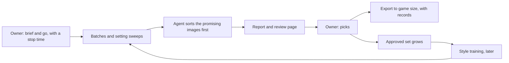

# Art pipeline: from request to texture (17 Nov 2026)

**Status (17 Nov 2026):** current. How a picture of ours is made today, end to end, with every route in use; the shipped art is in
the mods, each texture with its record. Shipping a texture is not testing it: what a texture looks like in game is the owner's word.

The rules for art are in [the art and sound rules](../../assets/AGENTS.md); this page links them rather than
repeating them. Below the pipeline is the art half of the first design (4 to 5 Nov 2026), moved here as written: the runner and its
safeguards, the models, the owner's first picks, style training, the vanilla sprites and the decision to ship style-model output.

## Read this first (gotchas)

- **Every local run needs the owner's go and a stop time**, and no graphics-card work runs while the game is open: the runner refuses
  to start and stops if RimWorld starts.
- **Every paid run has `--dry-run` first and `--max-usd` on the real run**, and only our own art is ever sent as a reference
  ([paid generation rules](paid-image-generation-rules.md)).
- **Every generated image goes to an art branch** unless it is truly fugly, byte for byte with its record; a near-copy stays local.
- **The background AI looks at every picture before any export**, and a vehicle is judged tinted on dark ground, never raw.
- **Text is never generated.** A Workshop preview's names are added by script.

## Routes in use

Verified against the records on 17 Nov 2026 (the engine named in each texture's or preview's record, and the request files).

| What | Route | Engine in a request | Since | Where it is recorded |
| --- | --- | --- | --- | --- |
| Machines, furniture, items and button icons | Local: ComfyUI on the owner's graphics card, **FLUX.2 Klein 4B base with references** (our stand-in drawings and picks, and the game's sprites, which never leave the PC), often with the **private v1 style model** | `klein-base` | 5 Nov 2026 | [Models](#models), [art backlog](art-backlog.md) |
| Vehicle bodies, their overlays, fittings and parts, and some vehicle icons | Paid: **the OpenAI image API** (gpt-image-2), with only our own art as references | `openai` | 8 Nov 2026, the owner's pick | [Paid generation rules](paid-image-generation-rules.md) |
| Vehicle east and south facings, paint masks and the 64 px icon | Code, from the north body: `scripts/art/export_vehicle.py` turns it, so the facings never drift | none | 8 Nov 2026 | [Vehicle paint masks](vehicle-paint-masks.md) |
| Workshop preview backgrounds | Local: **Flux.1-schnell**; the names are added by `scripts/art/make_preview.py`. Z-Image (`zimage`) was tried for backgrounds; all seven shipped previews are Flux.1-schnell | `schnell` | 19 Oct 2026 | [Preview backgrounds](../../assets/phobos-previews/README.md) |
| Linked atlases (the radio's coax), stand-in drawings and placeholders | **Code**: `assets/phobos-radio/make_textures.py`, `assets/phobos-medical/draw_placeholders.py` | none | 19 Oct 2026 | [Radio art](../../assets/phobos-radio/README.md) |
| The liquid oxygen store's frost | Drawn in the game by D'thorga Medical's code, from the store's outline | none | Medical 0.15.0, 12 Nov 2026 | [Medical changelog](../../mods/PhobosMedical/CHANGELOG.md) |
| Sounds | Local: Stable Audio 3, then ffmpeg | `sa3-sfx`, `sa3-sfx-base` | 10 Nov 2026 | [Sound generation](sound-generation.md) |
| **Not used: PixelLab** | Rejected: pixel art looks foreign in RimWorld (19 Oct 2026), and its rotation tools stop at 128 to 256 px against vehicle bodies of 384 by 640 px (8 Nov 2026) | | | [Image routes research](image-routes-research.md) |

The other routes weighed (Gemini, fal.ai, Midjourney and others, the view-angle models) are in the
[image routes research](image-routes-research.md).

## The steps, in order

1. **Request.** The owner gives the brief, the go and, for a local run, a stop time. The agent writes a request file in
   `assets/<set>/requests/`: engine, prompt (the camera instruction first), size, seeds, and each reference with its role. Before a
   vehicle's first picture, its size is measured against the biggest comparable vehicle and generated at 1.5 times or more
   ([the art and sound rules](../../assets/AGENTS.md)); one pilot picture comes before a family.
2. **Generate with `scripts/art-run.py`.** `python scripts/art-run.py generate <requests.json> --stop-at HH:MM`, or
   `night plan.json` for a queue under one stop time. It writes a record beside every image (`scripts/generate-art.py`), sorts the
   promising ones first, and makes contact sheets and a review page. Its safeguards are listed under
   [hands-off art pipeline](#hands-off-art-pipeline); the paid engine's are in
   [paid generation rules](paid-image-generation-rules.md#running-the-openai-engine).
3. **Near-copy check.** The runner checks every batch against its references' folders with `scripts/art/near_copy.py` and marks a
   flagged image "do not pick". A flagged image stays local, off the art branches. The owner's eye stays the last check
   ([what the check catches](#vanilla-sprites)). **A likeness to our own art is reported apart and never blocks** (21 Nov 2026):
   a source folder holding only our picks carries `own-art.json` (`lora_experiment.py picks` writes it into a style model's
   dataset), or is named with `--own`; such an image may still be picked and archived, and a close match may only mean the model
   repeated a training picture.
4. **Review and pick.** The owner picks from the review page. Approved picks stay unless the owner reopens them.
5. **Archive.** `python scripts/art/archive_branch.py art-masters manifest.json --message "..."` for the picks, `art-references` for
   the rest and for reference drawings: originals byte for byte with their records, added on top and never rewritten.
6. **Background AI.** `python scripts/art/clean_backgrounds.py masks --cpu --stop-at HH:MM` before any export, re-export, crop or
   overlay (BiRefNet; the graphics card only with the game closed). The exporters then clear enclosed white where the AI is sure
   ([background clean-up](background-cleanup.md)).
7. **Export.** `scripts/art/export_sprite.py` for buildings, items and icons; `scripts/art/export_vehicle.py body` and `overlay` for
   vehicles (north, east, south, masks, icon and a transform the overlays reuse); `scripts/art/export_overlay.py` for a building
   upgrade's overlay, cut from an edit of the building's picked master that adds only the upgrade (the paid edit route keeps the
   building in place; measure the edit's offset and pass `--shift`), framed as the building was so the two line up (21 Nov 2026,
   the fuel pump's charging cable). Each writes an `.export.json` beside its output. **export_sprite warns when white it kept
   inside the object looks like background** (21 Nov 2026: a large enclosed patch in the master's own flat background colour, such
   as a hole showing white); look at the sprite on coloured ground, and use `--all-white` if it is a hole. `export_sprite.py
   --sweep` checks every shipped sprite the same way (about 4 minutes; its first run found three: the run-flat tyres, the service
   spanner and the long gearing tune).
   Re-exporting existing textures goes through `clean_backgrounds.py stage`, its review page and `apply`.
8. **Paint (vehicles).** Run `scripts/art/paint_segments.py` on the new master, then
   `python scripts/art/repaint_vehicles.py stage --paint repaired`, `review` and `apply --paint repaired`; then
   `python scripts/art/paint_check.py` counts the visible flecks before the owner sees it ([vehicle paint masks](vehicle-paint-masks.md)).
9. **Records.** Each shipped texture has a `.record.md` beside it: tool, model, prompt, seeds, date, hashes, AI disclosure, and for a
   paid image its cost and the provider's terms as read that day. The mod's changelog entry and version follow, as for any change.
10. **Player guide figures.** `python scripts/art/guide_figures.py` redraws the guide's figures that use a changed texture
    (listed in `docs/player-guide/images/figures.json`); `--check` is part of the gate.
11. **Install.** `python scripts/deploy.py --build --apply <Mod>`, with RimWorld closed; it encodes our textures to DDS.

## The first design's art half (4 Nov 2026, updated 5 Nov 2026)

*Moved here on 17 Nov 2026 from `art-automation-and-medical-equipment.md` ("Art automation and medical equipment: design"); kept as written. Its tables of where everything stood and of decisions, and its open questions, were split by row: the art rows are here (the table of where everything stands is as of 7 Nov 2026), the medical rows went with its medical half to [medical equipment](medical-equipment.md#the-first-designs-medical-half-4-to-5-nov-2026).*

**Status (17 Nov 2026):** the table under "Where everything stands" is as of 7 Nov 2026. Since then the five medical mods have been
parts of D'thorga Medical and the two patch mods parts of D'thorga Patches (7 Nov; [mod consolidation](mod-consolidation.md)), so there
are seven mods, not ten. Every medical machine and item has its own generated picture (Medical 0.14.1, 12 Nov) and the liquid oxygen
store's frost is drawn in code (Medical 0.15.0). The pipeline ran more local nights (8 and 10 Nov), and vehicle bodies come from the
OpenAI image API since 8 Nov ([paid generation rules](paid-image-generation-rules.md)). Style model v3's training was cut off by the
stop time on 8 Nov with no model saved, so v1 stays in use. The equipment's later versions are in D'thorga Medical's changelog.

A working design that keeps these plans in one place. **When this was written, the art pipeline and most of the equipment below were not built;**
D'thorga Medical Equipment's oxygen machines and burn unit bed are (status table, 6 Nov 2026), and the owner has tested the
concentrator and the bed. The owner's
choices, agent suggestions and untested assumptions are labelled, so the owner can change any of them. Update this page as things
are decided, and record finished work in the owning mod's changelog or record.

### Where everything stands

| Work | State | Next step | Record |
| --- | --- | --- | --- |
| Hands-off art pipeline | Built and run: three nights so far (5 Nov twice, 6 to 7 Nov), every step finished inside its stop time | The next batch, on the owner's go | [Below](#hands-off-art-pipeline) |
| Medical art | First batch 5 Nov 2026, second batch 6 to 7 Nov. The owner's picks are in the [list of picks](#the-owners-picks) | Defs for the machines and items the picks are for; a top-down redraw of the hyperbaric chamber | [`assets/phobos-medical`](../../assets/phobos-medical/README.md) |
| Style training | Tooling written; first real training ran 5 Nov 2026, after two fixes below. Alone the LoRA gave no game style; the owner preferred it with references | Later training on approved art | [Below](#style-training) |

### Decisions so far

| Decision | By |
| --- | --- |
| The owner wants less direct involvement in local AI tools, and is happy for long jobs to run while away or asleep | Owner |
| The look comes from vanilla references first; a LoRA on our own approved art comes later; and one private LoRA experiment on upscaled vanilla sprites runs alongside | Owner, 5 Nov 2026 |
| Prefer slow, full models: "It's better than having to repeat the action several times or more" | Owner, 5 Nov 2026 |
| Use FLUX.2 Klein 4B base and Z-Image base first; FLUX 3 Image Klein waits for the owner to read its licence | Agent default, 5 Nov 2026, for the owner to change |
| The first batch makes south views only; the other views come from the picks | Agent default, 5 Nov 2026 |
| The concentrator stand-in is "not bad" for a starter: it leads its subject on the review page, and four more candidates use it as a reference, beside the model's own attempts | Owner, 5 Nov 2026 |
| LoRA output may ship, after the near-copy check. "We could just do what everyone else is doing"; if Ludeon objected, they would be cracking down by now. The agent recommended remaking the designs without the LoRA, and noted that no enforcement is not permission | Owner, 5 Nov 2026 |

### Hands-off art pipeline

**The owner gives the brief, the go-ahead and the final pick.** The agent does everything between.



**One command runs it all, and it needs a stop time:**

```text
python scripts/art-run.py generate assets/phobos-medical/requests/test-run.json --stop-at HH:MM
```

| Part | What it does |
| --- | --- |
| `scripts/art-run.py` | Runs a request file or a training job with the safeguards below, then sorts, checks for near-copies, makes sheets and a review page, and writes a report with the time per image |
| `scripts/art-run.py night plan.json --stop-at HH:MM` | Runs a list of those jobs in order under one stop time, and writes one summary. A failed step doesn't end the night. A plan naming private paths stays in `.local/art/` |
| `scripts/generate-art.py` | Builds the graph for each engine, and writes a record beside each image |
| `scripts/art/` | Review page, contact sheets, sorting, export, the near-copy check, the model fetcher and the LoRA experiment |

| Safeguard | What it does |
| --- | --- |
| Stop time | Required. Ends at that hour, even mid-image |
| Game check | Stops if RimWorld starts, checked every few seconds. If the process list can't be read, it also stops. `--also-stop-on NAME.exe` adds other games |
| Safe finish | However it ends, it frees the graphics memory, stops any server it started and writes a report |
| Disk limit | Stops before a drive falls under 5 GB free |
| Graph check | Before any GPU work, it checks each graph against ComfyUI's own node list, including that the model files are installed |
| Failures | One failed image is recorded and skipped. Three in a row, retries included, end the run |
| Crash recovery | If ComfyUI dies or hangs, or on a second failure in a row, it starts a fresh ComfyUI and tries that image again, at most five times a run. It never replaces a ComfyUI it didn't start. Rehearsed against a stand-in, not yet against a real crash |
| Staying awake | Asks Windows not to sleep, only while it runs |

**Checked so far (5 Nov 2026), and no further:**

- Offline tests of the graphs and rules.
- Every engine's graph against the node list of ComfyUI 0.41.0, started on the CPU. `flux3-base` passes except for its two files, which are correctly reported as not installed.
- A real refusal while the owner played: `not starting: rimworld.exe is running`.
- The sorter, contact sheet and review page on real radio candidates, in a scratch copy.

- A rehearsal of every way a run can end against a stand-in ComfyUI, in `tests/test_art_run_rehearsal.py`: finishing, the game starting mid-image, the stop time, a full disk, an unreadable process list, one failure, three in a row, a missing model, a stuck image and the server vanishing. It found and fixed three faults.

**No image has been generated with the new engines, no step count has been timed on this card, and nothing has run against the real ComfyUI's generation.**
(True on 5 Nov 2026 before the first night. **Since then** the real runs began that day: three nights by 7 Nov, as the status table says.) The sorter's sharpness mark also gave all four of those candidates full marks, so it may need raising once real batches exist.

**What a run needs from the owner:** the go and a stop time, and the commands allowed beforehand, because a permission prompt would stall a night's work. New downloads are named first; licences are checked before anything runs.

#### Models

Read from each publisher's page on 5 Nov 2026. `scripts/art/fetch_models.py` refuses a Hugging Face file if its declared licence changes, and it never fetches a gated one.

| Model | Licence | Status | Use |
| --- | --- | --- | --- |
| [FLUX.2 Klein 4B base](https://huggingface.co/black-forest-labs/FLUX.2-klein-base-4B), Black Forest Labs | Apache 2.0 | **Installed** (fp8, 4.1 GB) | Sprites from references. The model card's example is 50 steps at guidance 4, and it names this version as the one for LoRA training |
| [Z-Image base](https://huggingface.co/Tongyi-MAI/Z-Image), Alibaba Tongyi lab | Apache 2.0 | **Installed** (int8, 6.2 GB) | Text only, so the Workshop preview. ComfyUI's template uses 25 steps at guidance 4 |
| Real-ESRGAN x4plus, Xintao Wang and colleagues | BSD 3-Clause | **Installed** | Upscaling for the private experiment only |
| FLUX 3 Image Klein, Black Forest Labs | FLUX Kommunity License v1.0 | **Not installed: the owner's decision** | See below |

**FLUX 3 Image Klein may be the strongest of these,** but that is unproven here. It came out on 15 October 2026, it is 5.6B parameters, and ComfyUI's install already has its templates, with up to 10 reference images reported. The quality claims come from [Black Forest Labs' own evaluations](https://www.layer3labs.io/guides/flux-3-image-explained), as reported by a third party. The `flux3-base` engine is written but unrun. **Three things make it the owner's call:**

- **It is gated.** Its [Hugging Face page](https://huggingface.co/black-forest-labs/flux-3-image-klein-comfy) asks the owner to accept the terms and share their account details. The agent handles no credentials.
- **Its outputs may not train other models.** The model card says the licence bars using the model or its outputs "to improve another AI model" with a similar function. So **art made with it must not join a training set for Klein 4B or Z-Image**. Pick one family for the approved set before training.
- **The licence text is unread.** The card allows non-commercial use, and commercial output use under US$5M revenue, and says that is "not blanket permission for commercial fine-tuning or distribution". Our mods are free, but the owner should read the full text once the page opens (agent reading, not legal advice).

Without its prompt upsampler (9.7 GB more), the publisher [reportedly](https://www.layer3labs.io/guides/flux-3-image-explained) warns of weaker results from short prompts. Our requests would carry full captions instead, untested.

**Hiddensoul's setup is still worth asking about.** Its name is not yet known. Open WebUI only passes image requests to a separate backend ([documentation](https://docs.openwebui.com/features/images)), so the difference is probably the model and workflow (agent inference). The most useful thing to ask for is the workflow exported from ComfyUI as JSON, plus which model, LoRAs and step count it uses.

### The owner's picks

The owner picked twice: on 5 Nov 2026 from the three-route comparison (references plus LoRA), and on 7 Nov from the first batch
(references only, seeds 101 to 104) and the second. **The 7 Nov picks replace the 5 Nov ones** where both exist. Every pick passed the
near-copy check. Masters are in `.local/art/picks-5nov/` and `.local/art/picks-7nov/`, not committed; each is exported when its
machine or item has a Def.

| Subject | Pick (7 Nov unless stated) | Route | State |
| --- | --- | --- | --- |
| Oxygen concentrator | `oxygen-concentrator-from-stand-in-103` | References only: our stand-in and the game's vitals monitor | In the mod, 0.2.3 |
| Bedside oxygen stand | `bedside-oxygen-103` (replaces 5 Nov seed 11) | References only | In the mod, 0.2.3 |
| Burn unit bed | 5 Nov seed 11, kept: nothing from the second batch suited | References plus LoRA | In the mod, 0.2.0 |
| Triage's care-choice button | `triage-authority-icon-14` | References plus LoRA | In D'thorga Triage, 0.1.2 |
| Workshop preview, Medical Equipment | `workshop-preview-204` | Z-Image, no references | In the mod, 0.2.3, with the name added by script |
| Liquid oxygen store | `liquid-oxygen-store-103` (replaces 5 Nov seed 12) | References only | Waiting for its Def. The owner wants to see it in game before judging it. Drawn at an angle |
| Oxygen mask and regulator | `oxygen-mask-104` (replaces 5 Nov seed 11) | References only | Waiting for its Def |
| Burn dressing | `burn-dressing-101` | References only | Waiting for its Def |
| Manual resuscitator | `manual-resuscitator-103` | References only | Waiting for its Def |
| Hyperbaric chamber | `hyperbaric-chamber-102`, for its look | References only | Drawn at a three-quarter angle. **Turning the picture can't make it top-down** (tried 7 Nov: turned upright it looks like a capsule standing on end). Next: a redraw with 102 as the design reference and the flat stand-in for the layout |
| Electrolyser | None: the owner found no candidate suitable (7 Nov), withdrawing 5 Nov seed 11 | | A new batch |

**Exporting:** `scripts/art/export_sprite.py` clears only the white background now, because clearing all white made the burn bed's mattress see-through. Use `--all-white` where background shows through the object, as with the stand's loop of tube.

### Style training

**Two fixes the first real run needed (5 Nov 2026, on the 12 GB card):**

- `qtype` and `qtype_te` are `float8`. With the default, `qfloat8`, the text encoder crashed with a CUBLAS internal error, and with one caption at a time it crashed moving to the card a second time.
- `TEXT_EMBED_CACHE_BATCH` is 1 in the local ai-toolkit's `toolkit/dataloader_mixins.py`, not 16. With `float8` and 16 captions, each padded to 512 tokens, the card stalled and cached nothing in two minutes. The cause is inferred from that, not measured. This edits the tool's own file, so a fresh install or update has to repeat it.

Caching the 60 captions then takes about 9 minutes, and training about 1.8 s a step.

**Training material is a folder of images, each with a short caption.** The model learns what the images have in common. Apart
from the figures Black Forest Labs publishes, this section is general practice from memory; none of it has been tried on our setup.

| Material | Use | Why |
| --- | --- | --- |
| Large masters of our own sprites | **Best** | Clean detail, one subject, ours to use |
| Game-size sprites | Avoid | Too little detail; enlarging adds blur the model learns |
| In-game screenshots | Avoid | Interface, tiny subjects, clutter, other people's art |

- **A good set:** one consistent style, varied subjects, about 20 to 50 images at around 1024 px, plain backgrounds, approved images only.
- **Captions describe the subject, not the style**, after a made-up trigger word: "phobosstyle, oxygen tank with a frosted valve".
- **Hardware:** [Black Forest Labs' guide](https://docs.bfl.ai/flux_2/flux2_klein_training) lists Klein 4B training at 12 GB of graphics memory and 32 GB of system memory; this machine has 12 GB and 63 GB. Untested here.
- **The tool:** [ai-toolkit](https://github.com/ostris/ai-toolkit) by Ostris (MIT), cloned to `C:\AI\ai-toolkit` and **installed by the owner on 5 Nov 2026** with `install-phobos.sh` in Git Bash (from PowerShell, give Git Bash's full path, because plain `bash` finds Windows' WSL shortcut). Checked: it sees the card, Klein's model files load from the local cache, and it accepts our training job with the card hidden from it. **No training had run at install.**
  The first real run followed on 5 Nov 2026, after the two fixes at the top of this section.
- **Each trained model gets a record** of its images, settings and tool, and the art keeps its AI disclosure.

#### Vanilla sprites

Sizes read from the file headers in the game's `Assets.zip` (RimWorld 1.7.4998, 4 Nov 2026); nothing was extracted:

| Vanilla sprites | Count | Most common size (px) | Largest (px) |
| --- | ---: | ---: | ---: |
| All things | 2,693 | 128 | 1,280 |
| Buildings | 674 | 64 | 1,024 |
| Items | 310 | 64 | 640 |
| Apparel | 271 | 128 | 512 |
| Medicine | 10 | 64 | 64 |

Some of those counts include mask files, which are not usable art. Most sprites are well short of training size, and a 64 px sprite gives an upscaler little to work from, so a style model could learn the flaws as if they were the style (agent inference).

**The look, read from the sprites themselves (5 Nov 2026):** a **thick near-black outline** around every shape, soft cel shading, pale grey panels with rounded corners on machines, muted colours, and small blue screens. Odyssey has its own [oxygen pump](medical-equipment.md#medical-equipment) sprite, a useful reference.

**Extraction:** the sprites are in a rearranged block format, not plain DDS. `.local/tools/art/extract_references.py` reads it, and 12 medical references and 60 varied training sprites are in `.local/references/`. The extractor is not committed, because it was written from the game's decompiled loader, and nor is its output.

**What the rules say:** [Ludeon's EULA](https://rimworldgame.com/eula/) lets modders use its resources "as a basis or reference for a
Mod", but not "rip these resources out and pass them around independently", and a mod must not contain "a substantial part" of
its artwork. It does not mention AI training, so whether training counts as a basis is unsettled; only Ludeon can say. Our own rule
is that we never ship or commit the game's art.

**The chosen route (owner, 5 Nov 2026):**

1. **Style references now:** give Klein base two vanilla sprites per subject.
2. **Our own art:** generate at full size, and the owner picks the keepers.
3. **Training later:** train on those picks, so the model learns from clean images that are ours.
4. **A private experiment alongside:** train one LoRA on upscaled vanilla sprites, then run the same subjects and seeds through three routes: references only, LoRA only, and both. `scripts/art/lora_experiment.py` prepares each step.

**What difference training makes:**

| | References | LoRA on vanilla sprites |
| --- | --- | --- |
| How the style gets in | Each image looks at the sprites you hand it | Baked into the weights, so short prompts work |
| Consistency | Good within a batch, may drift between batches | Should hold across hundreds of assets |
| Cost | Only generation | GPU time per attempt, and usually several attempts |
| Material | Any size | About 1024 px, so an upscale first, and its blur can be learned as style |
| Copy risk | Low | Real: a small set can reproduce its training images |
| Rules | The EULA allows use as "a basis or reference for a Mod" | Unsettled. The file must stay private either way |

**The experiment's limits (owner's decision, agent's safeguards):** the dataset, upscales and LoRA stay in `C:\AI\lora-experiments`, off the synced drive, never committed and never shared. Whether its output may ship is unsettled, because only Ludeon can say; **the owner decided on 5 Nov 2026 that it may**, each image only after `scripts/art/near_copy.py` passes it, with its record saying how it was made. The LoRA and dataset stay private. 

**What the near-copy check catches, measured on 5 Nov 2026** (four vanilla sprites redrawn at 1024 px, 16 variants):

| Variant | First thresholds (0.75, 10 bits) | Current thresholds (0.60, 12 bits) |
| --- | --- | --- |
| Exact copy | 4 of 4 | 4 of 4 |
| Recoloured | 4 of 4 | 4 of 4 |
| Blurred | 3 of 4 | 4 of 4 |
| Tilted 4 degrees | **0 of 4** | 2 of 4 |

Unrelated art reached at most 0.43 similarity and 17 hash bits at closest, and raises no flag at either setting. **A slightly tilted copy can still pass, so the owner's eye stays the last check.** These thresholds are authored, and images made from references may need them revisited.

The runner checks every batch against the folders its references came from, puts the result in its report, and marks a flagged image "do not pick" on the review page, so nothing ships as a near-copy. A check that couldn't run says so rather than passing silently.

**The disclaimer (settled 5 Nov 2026):** the EULA requires its own two sentences on each mod, and our About files had a shorter line. All eight now carry its wording, and `scripts/check-mod-layout.py` enforces it.

### Open questions

| Question | For |
| --- | --- |
| Which model and workflow does Hiddensoul's setup use? A ComfyUI workflow JSON would be ideal | Owner to ask |
| ~~Allow installing ai-toolkit, by running `bash /c/AI/ai-toolkit/install-phobos.sh`?~~ Settled: the owner installed it on 5 Nov 2026 | Owner |
| Accept FLUX 3 Image Klein's terms and read its licence, or stay on Apache models? | Owner |
| ~~The go and a stop time for the short test run~~ Settled: the test run and three nights ran by 7 Nov 2026 | Owner |
| ~~Pick the radio art candidates still waiting since 19 October (`assets/phobos-radio/generated/review.html`)~~ Settled: picked on 7 Nov 2026, the base station on 12 Nov (Radio 0.1.7) | Owner |
| ~~Review the medical art prompts (`assets/phobos-medical/requests/first-batch.json`)~~ Settled: the batch ran on 5 Nov 2026 and the owner picked from it | Owner |
| Licences of any further model or tool | Agent, before use |
