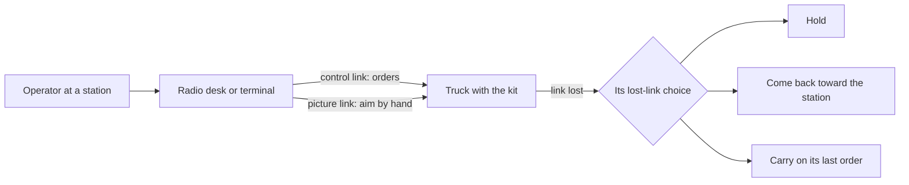

# Autonomous vehicles by radio (24 Nov 2026)

**Status (25 Nov 2026):** every step is built: 1 to 5 and 8 in Radio Framework 0.9.0 to 0.14.0, D'thorga Framework 0.278.0 and 0.279.0
and D'thorga Vehicles 0.117.0 to 0.117.3; step 6, [the picture link and remote guns](#step-6-the-picture-link-and-remote-guns-framework-02800-radio-0150),
in Framework 0.280.0 and Radio 0.15.0; step 7a, [the route level](#step-7a-the-route-level-framework-02810), in Framework 0.281.0; step 7b,
[the mechanitor level](#step-7b-the-mechanitor-level-framework-02820), in Framework 0.282.0; our own remote weapon station (MV8) in
Vehicles 0.119.0 and Framework 0.285.0 ([its record](vehicle-militarised-service-vehicles.md#the-remote-weapon-station-built-vehicles-01190-framework-02850)).
Since then (26 Nov 2026): loops work at their stops (Framework 0.299.0 to 0.305.0), the base turret (Radio 0.18.0 to 0.20.0), and
[step 9, an aircraft's round between places](#step-9-an-aircrafts-round-between-places-framework-03070) (Framework 0.307.0). Left: the
buttons' own pictures (queued for night 16), crewless rounds, and the turret radio's measurement.
Nothing is tested in game.

The owner, 24 Nov 2026: "the real feature I wish to implement soon is autonomous vehicles and perhaps their weapon systems too, all
via our radio framework." **[O]** It builds on what the owner chose on 18 and 19 Nov 2026 in
[modern military vehicles](modern-military-vehicles.md#working-without-a-crew-three-levels-of-one-system) (three ways of working
without a crew; the seat stays; four followers to a leader) and
[militarised service vehicles](vehicle-militarised-service-vehicles.md) (a remote weapon station that fires with nobody aboard).
This record is the **station level** of those three, done through the radio, and it turns that record's
[radio tie-in ideas](modern-military-vehicles.md#radio-tie-in-ideas) into a design.

**How to read the marks.** **[O]** the owner's word or card. **[code]** read in code on the date given. **[S]** a source named
beside it. **[A]** an agent's default or authored figure, for the owner to revise. Every figure not marked **[S]** is authored.

## Read this first

- **Built so far: steps 1 to 5**: the ledger's kinds and pre-emption, radios fitted to vehicles, driving from a station, **the
  remote control kit as an upgrade on the five service trucks** (after the research "remote vehicle control") and **the colonist at
  the console** (the work type "Remote operation"), with the kit's antenna drawn on the cab. Nothing is tested in game.
- **The owner's four cards of 24 Nov 2026 [O]:** our **service trucks get a remote-control kit first**; **a colonist works the
  console** while vehicles are driven; **lost link is chosen per vehicle, hold by default**; **remote guns fire only while an
  operator has a picture link**, with a setting, **off by default**, that lets them fire on their own.
- **Station control needs the Radio Framework [O]** ("all via our radio framework"). The route level (follow a leader, run a loop)
  and the mechanitor level stay free of it, as chosen on 18 Nov 2026.
- **Performance first** (the radio's rule): the cost is written [below](#its-cost-the-radios-performance-rule) before anything is
  built. The check Vehicle Framework makes on every move order reads one field we keep; nothing is worked out there.
- **The weak points are the point** (from the 18 Nov record): the operator, the station, its mast, and the ground between them.

## The owner's choices (24 Nov 2026)

| Question | The owner's choice | What it sets |
| --- | --- | --- |
| Which vehicles first | **A kit for our trucks** | An upgrade node on our service trucks: a control radio and antenna on the cab. No new vehicle art beyond a small antenna overlay |
| Who controls | **An operator at the console** | A colonist works a radio station as a job while vehicles are under control; the operator is the one to protect |
| Lost link | **Chosen per vehicle, hold by default** | Hold, come back toward the station, or carry on the last order, after a short delay; a letter says it happened |
| Remote guns | **An operator with a picture link; a setting to fire alone, off by default** | A human in the loop by default; firing alone is high risk, so its setting starts off |

## How it works

### The link is a real link

- **The kit is a radio on the vehicle [A]:** a VHF data radio with a whip on the cab, about 3 m up, its figures in XML like any other
  radio. The radio net works out its link to every station in reach, both ways, with the walls, rock, roofs, masts and amplifiers it
  already counts **[code: `Services/RadioNet.cs`, `LinkBudgetService`]**. The worse direction decides, as the radio's rules say.
- **Two thresholds on one path [A]**, the 18 Nov record's idea 2 ("orders get through where pictures do not"): a narrow **control**
  mode for orders, and a wide **picture** mode for aiming by hand. The picture needs more signal (a wider bandwidth raises the noise
  floor, and it asks a higher signal-to-noise ratio), so it fails first as the vehicle goes further or behind cover. In Plain display
  the vehicle reads **"orders and picture"**, **"orders only"** or **"no link"**, never a figure.
- **Two kinds in the ledger [A]**, as the radio's rules require (a new use is a kind, never a second system of frequencies):

| Kind | Mode [A] | Channels one use takes | Vehicles per use | Held while |
| --- | --- | --- | --- | --- |
| **Vehicle control** | 12.5 kHz data, keyed half the time, needs about 6 dB | 1 | 2 | the vehicle is under station control |
| **Vehicle picture** | 50 kHz video, keyed all the time, needs about 15 dB | 2 | 1 | the operator is driving it under direct orders (drafted) |
| Local voice (built) | 12.5 kHz FM voice, keyed a fifth of the time | 1 | 5 | a colonist is in touch |

  So the radio desk (one channel, two with its second transceiver) can give orders to two vehicles but cannot carry a picture; the
  **radio terminal** (four channels) can drive two vehicles, show one picture and still serve five talking colonists. A large
  remote fleet wants more terminals, as the owner's "a computer terminal can effectively be a base station with an SDR" suggests.
- **Control takes a channel from talk [A].** Vehicle control is served before voice, and when every station it reaches is full it
  **takes a channel from the weakest talking colonists**, who go "net busy", as a trunked system's emergency call pre-empts others.
  Without this, colonists already talking would keep a vehicle off the net for as long as they talk, since a holder keeps its place.
  The picture does not pre-empt anyone.
- **How pre-emption works (built in Radio 0.9.0) [code: `Physics/Channels.cs`, `Allocate`]:** a kind with `preempts` set that finds
  no room takes channels at the best station where it can, from kinds served after it that do not pre-empt, **the weakest of the
  kind served last first, and only as many radios as it needs**. On a desk of two channels with six colonists talking, a truck puts
  one colonist off (five still share one channel); on a desk of one channel it puts all five off, since a use needs a whole channel.
  A colonist put off tries the other stations in reach. Nothing is taken where even everyone would not make room, and nothing from
  another kind that pre-empts. "The weakest" replaced the design's first wording, "the newest": the ledger keeps no time a radio
  joined, and the weakest is the one whose talk was worst anyway [A].

### The operator

- **A colonist works the console [O]**: a job at a radio desk or terminal, like research, given by a work type the player orders
  as usual [A: "Remote operation", its own work type, so the player can put one colonist on it]. While the operator is at the
  console, that station controls vehicles; when they leave, sleep, eat or are downed, its vehicles lose control. **Built in Radio
  0.12.0** ([step 5](#step-5-the-operator-radio-0120)).
- **An operator drives two vehicles at once [A]**, a figure in the rules Def. A third waits for a second operator, at another
  station: **a station takes one operator [A]** (built so; a second seat at one station waits for a need).
- **No skill is asked at first [A].** A skill could later shorten the lost-link delay or steady the aim; nothing here needs it.

### Under control

- **It drives as if crewed.** Vehicle Framework lets a vehicle move when every seat that handles movement is filled, or when no
  seat does (it is then "autonomous") **[code: `VehiclePawn.HasEnoughOperators`, VehicleFramework 1.7 decompile 16178-16199]**.
  Our trucks keep their driver's seat (the owner's choice of 18 Nov 2026), so **one small postfix** answers yes for a vehicle our
  kit has under control. It reads one field our comp keeps; nothing is worked out in it.
- **Drafted, it takes move orders** from the player as any vehicle does; its station must hold its link for them to be obeyed.
- **A colonist can still climb in** and drive it the ordinary way; with someone at the wheel the kit stands aside.
- **Two Vehicle Framework checks read the seats as written** (the 18 Nov record's code read): the caravan dialog and a role check.
  Read at step 3 ([below](#step-3-driven-from-a-station-framework-02780-radio-0110)): our answer holds on the map only, so a crewless
  vehicle cannot travel in a caravan.
- **An empty vehicle ticks slowly**, but only its `TickInterval`: read at step 3, its pather runs every tick whoever is aboard, so a
  crewless vehicle on the move paths and moves as a crewed one does ([below](#step-3-driven-from-a-station-framework-02780-radio-0110)).

### Lost link

- **Chosen per vehicle [O]**, a gizmo on the vehicle, saved with it: **hold** (the default), **come back** toward its station until
  the link returns, or **carry on** its last order.
- **After a short delay [A: ten seconds at normal speed, 600 ticks]**, as real procedures wait before acting (NASA's study of lost
  links found waits of one to eight minutes **[S, [NASA Ames](https://ntrs.nasa.gov/api/citations/20190001648/downloads/20190001648.pdf)]**).
  If the link returns within the delay, nothing happens.
- **A letter** names the vehicle, where it is and what it is doing; a second when the link returns.

### Remote guns

- **The gun is the remote weapon station** designed in [militarised service vehicles](vehicle-militarised-service-vehicles.md)
  (MV8), built in Vehicles 0.119.0 on the Talus and Busbar.
- **By default, only with an operator and a picture link [O]**: the operator aims it by hand through Vehicle Framework's own
  targeting, or it picks its own targets while the picture holds (the operator watching). On orders only, or with no link, it holds
  fire.
- **"Remote guns fire on their own" [O], off by default**: with it on, a remote gun fires at enemies by itself when its link is weak
  or lost, as GTek's L-ATV station does. Its risk is high (below), so it starts off.
- **How the L-ATV does it [code: its installed XML, 24 Nov 2026, at the owner's suggestion]:** GTek's Oshkosh L-ATV
  (`killerbot.jltv`) ships no assembly. Its three main guns are upgrade nodes (`Vehicles.TurretUpgrade`) whose turret no seat
  names: its only roles are a driver (`Movement`) and three passengers. Vehicle Framework counts a turret no role names as manned
  (`VehicleTurret.IsManned`, read 18 Nov 2026), so the gun aims and fires with nobody aboard once its auto-targeting is on. **It
  drives with a driver only**: nothing in it moves a crewless vehicle. So it is the model for step 6's remote weapon station (a
  turret no seat names, plus our rule for when it may fire), and our step 3 has no precedent there.
- **An armed crewless vehicle is a threat.** Vehicle Framework ignores an empty vehicle unless a comp says it is a threat
  (18 Nov read, `VehiclePawn_AI.cs:92-106`); our kit says so while a gun is fitted. The owner accepted this with the remote station.

### Step 2: radios fitted to vehicles (Radio 0.10.0)

Built 24 Nov 2026, not yet tested in game.

- **The seam [code: `Services/CarriedRadios.cs`]:** the net now counts a radio built into a pawn of the colony that is not a person
  (a vehicle; a mechanoid later), besides worn hand-helds. A tie-in registers a rule (`ICarriedRadioRule`) that says what each one
  does: **off** (not fitted), **standing by** (its links are worked out and shown, but it asks no channel), or **in use** (it asks a
  channel of its kind, as a hand-held does). With no rule answering, a built-in radio is in use. The net never names a vehicle.
- **The fitting [code: `RadioFittingDef`, `Common/Defs/Radio/Fittings.xml`] [A]:** the vehicle control radio's figures, written once:
  VHF, the control data mode, the vehicle control kind, 25 W, a whip on the cab about 3 m up with no gain over a plain whip, noise
  figure 8 dB. All authored.
- **The tie-in [code: `src/PhobosRadio.Vehicles`]**, its own assembly in the Radio Framework's `Mods/VehicleFramework/1.7`, loaded
  only with Vehicle Framework: a vehicle def that names a fitting (`Phobos.Radio.Vehicles.VehicleRadioFitting`, with the key of the
  upgrade node that fits it) is given that radio's comp at start-up, so every vehicle of it is built with one. Its rule says
  **standing by** once the node is done (or when none is named) and **off** before. Step 3 makes it **in use** while the vehicle is
  under station control.
- **What shows:** the vehicle's own signal button (its bars, "no station", or standing by); its row in the station's Net tab
  ("(standing by)"); the ray line from the vehicle to its antenna while it is selected; the station's count now says "radios", not
  "hand-helds". A vehicle standing by holds no channel, so it pre-empts nobody.
- **Testing before step 4:** the dev action "Fit a control radio to selected vehicles (until loaded again)" puts the radio on any
  vehicle for the session; nothing is saved, so loading the game takes it off.
- **Its cost:** each recompute (about once a second) looks up a radio comp on each spawned pawn of the colony that is not a person (a
  dictionary lookup in the game's own comp table) and asks the rules once for each vehicle with one; each fitted vehicle then costs
  what a worn hand-held costs, one link per station antenna. The start-up pass over vehicle defs runs once. Nothing per tick or frame.
- **Other factions [A]:** only the colony's pawns join our net, so a raider's vehicle with the fitting costs nothing here and does
  nothing; a captured one joins once it is ours.

### Step 3: driven from a station (Framework 0.278.0, Radio 0.11.0)

Built 24 Nov 2026, not yet tested in game.

- **D'thorga Framework's vehicle part holds it [code: `src/PhobosFramework.Vehicles/Remote/RemoteControl.cs`]:** a comp,
  `CompPhobosRemoteControl`, that keeps the player's ask ("Drive from a station", a button), the lost-link choice (a button, hold by
  default [O]), and the vehicle's state with its link. Its states, and how one follows another, are a game-free rule with tests
  (`Rules/RemoteControlRule.cs`): **off**, **waiting for a station** (asked, never yet linked: nothing is lost, nobody is told),
  **driven**, **link just lost** (it carries on while the delay runs), then **holding**, **coming back** or **carrying on**. Coming
  back or carrying on turns to holding once the vehicle stops. A link that returns at any point takes the vehicle back.
- **Where the link comes from:** a source registers itself (`IRemoteControlSource`), so the Framework never names the radio. The
  radio's tie-in is the first: a vehicle is linked while a station serves its radio on a channel. The radio asks that channel only
  while the player has asked for the vehicle to be driven (in use); otherwise its radio stands by, as in step 2. The route and
  mechanitor levels (step 7) feed the same comp.
- **The one patch [code: `RemoteControlOperatorsPatch`]:** a postfix on Vehicle Framework's `VehiclePawn.HasEnoughOperators`, which
  both drafting (`CanDraft`) and moving (`CanMoveFinal`) read. It changes only a "no", only on the map, and reads one field of the comp.
  No other mod patches that getter (`query-patches.py`, 24 Nov 2026).
- **Holding needs no code of its own:** Vehicle Framework's `VehiclePathFollower.PatherTick` checks `CanMoveFinal` on every tick a
  drafted vehicle has a path **[code: VehicleFramework 1.7 decompile 15017-15062]**, so a vehicle stops the tick its control drops.
- **Coming back** drives to a place on a ring round the station it last heard (`comeBackRing`, 5 cells [A]), through the
  Framework's own `VehicleAutoDrive`, as gathering runs do, and stops when the link returns.
- **The delay** is `lostLinkDelayTicks` in `PhobosRemoteControlRulesDef` (600 ticks, ten seconds [A]). The comp looks at its link on
  the vehicle's rare tick, every 250 ticks, so a loss is acted on between 600 and 850 ticks after it starts; when the player asks,
  it looks at once, so the vehicle can be drafted straight away.
- **A colonist at the wheel:** the comp counts the driving seats itself, without our answer to Vehicle Framework's check (which would
  chase itself on and off), and stands aside while they are filled: no channel asked, nothing patched.
- **Letters [O]:** one when a vehicle starts acting on a lost link, naming what it is doing; one when a station has it again. A link
  back within the delay tells nobody.
- **The setting "Remote control of vehicles by radio"** (D'thorga Vehicle Systems settings, the crews page, "Remote control"; on by
  default, as the risk table says). Off, the buttons go, no vehicle is driven from afar, and one driving stops where it is.
- **Until step 5 [A]:** no operator was asked for: a powered station that served the control channel drove the vehicle. Step 5
  (Radio 0.12.0) adds the colonist at the console and the two vehicles each.
- **Read in Vehicle Framework's code at this step (24 Nov 2026):**
  - **Ticking:** `VehiclePawn.Tick` runs `BaseTickOptimized`, and with it the pather, every tick whoever is aboard; only
    `TickInterval` slows to every 250 ticks for an empty vehicle (`UpdateRateTicks`), and only when its tick list is empty. **[code:
    decompile 16597-16607, 19732-19869]** So nothing of ours is needed to keep a crewless vehicle moving.
  - **Plain comps and ticking:** Vehicle Framework puts every comp that is not one of its `VehicleComp`s asking ticks by request
    into that tick list (`RecacheCompTickers`, 17445-17455), so a vehicle carrying a plain comp never takes the slow rate. The
    radio's comp (step 2) is plain; our trucks already carry plain comps, so it changes nothing for them, but it would on another
    author's vehicle with none. The remote control comp asks no ticks; it uses the rare tick every comp gets.
  - **Caravans:** our answer holds on the map only, so a crewless vehicle in a caravan cannot move on the world map. The caravan
    dialog checks while the vehicles are still on the map, so it may let one join. **Give a vehicle a driver before it joins a
    caravan** (a known limit, untested).
  - **Aircraft:** Vehicle Framework's launch check reads the same getter (`CompVehicleLauncher.CanLaunchWithCargoCapacity`), so an
    aircraft driven from a station could take off with nobody aboard. The kit is for our trucks; another author's aircraft that names
    the fitting would allow it.
- **Buttons:** "Drive from a station" borrows the radio's signal icon, and the lost-link choice the vehicle park's sign, until their
  own icons are made (owed, for the night run).
- **Its cost:** the patch reads one field, only when Vehicle Framework has already said no (a crewless vehicle); the comp looks once
  every 250 ticks at a vehicle asked to be driven (a dictionary lookup in the net's last pass), and nothing for one that is not;
  letters only when the state changes.
- **Other factions:** nothing here acts on a vehicle not of the colony: the buttons are the player's, and the radio serves the
  colony's vehicles only. As the record says, a raid's vehicle keeps its own control.

### Step 4: the kit on the trucks (Vehicles 0.117.0, Radio 0.12.0)

Built 24 Nov 2026, its antenna picture 25 Nov 2026 (Vehicles 0.117.2); not yet tested in game.

- **The upgrade [code: `mods/PhobosVehicles/Mods/RadioFramework/Patches/RemoteControlKit.xml`]:** "Remote control kit" on the
  Talus, Ullage, Kelly, Datum and Busbar, loaded only with the Radio Framework (D'thorga Vehicles' tie-in folder `Mods/RadioFramework`).
  It sits at (22, 12) in each tree, after the truck's own upgrades in row 12: a tie-in goes last and never in a row of its own, and
  the tanker's lower rows are full. It needs the research **remote vehicle control** (the radio's, after software radio, 1,500 [A]),
  and costs 25 steel, 3 components and **an advanced component** [O: the owner, 25 Nov 2026, "the upgrade should require an
  advanced component"; the controller that works the servos is a computer, as the radio terminal's is], 2,000 work [A]. It borrows the radio's signal icon until its own is drawn.
- **What it does:** each truck names the radio's vehicle control radio as its fitting, with this node as the upgrade that fits it
  (`VehicleRadioFitting`), so every truck is built with the radio and the remote control (step 2's start-up), which stay off the net
  until the node is done. Nothing else on the truck changes.
- **The picture [A]:** a whip antenna on the cab, bent back and tied down as real military trucks carry them (straight up, seen from
  above, it would be a dot), drawn alone on white by the paid route ([the record](../../assets/phobos-vehicles/requests/remote-kit-antenna-record.md)).
  **The owner picked try 1 on 25 Nov 2026**; it is laid on each truck's three facings by `assets/phobos-vehicles/export_remote_kit.py`
  (Vehicles 0.117.2): the mount near the front of the roof on its right, the whip tied back along it, drawn on layer 4 above the
  cab armour [A placement, to revise once seen in game].

### Step 5: the operator (Radio 0.12.0)

Built 24 Nov 2026, not yet tested in game.

- **The work [code: `src/PhobosRadio/Work/RemoteOperation.cs`, `Common/Defs/Work.xml`]:** the work type **Remote operation**
  (Work tab "remote", high in the list [A]; intellectual work, no skill asked [A]; off for slaves, as research is). A station that serves a
  vehicle asked to be driven, with nobody working it, has work: an assigned colonist walks to it, stands beside it facing it, and
  stays while it serves a vehicle. A stint lasts 2,000 ticks before they look again at what else needs them, so food, sleep and
  anything more urgent take them away as usual [A].
- **One operator per station [A]:** the colonist holds the station. **Two vehicles each** (`vehiclesPerOperator` in the radio's
  rules Def [A]): the first two in the station's control channels, in the ledger's order, are driven; a third waits.
- **What it changes:** a vehicle is linked (step 3) only while its station both serves it on a channel and has an operator with a
  hand free for it. When the operator leaves, its vehicles lose their link, and after the delay do what was chosen for them. The
  lost-link letter says the link was lost; it does not yet say it was the operator who left (a follow-up: a reason from the source).
- **What shows:** the station's inspect text names its operator and how many vehicles it serves, or says nobody works it; the Net
  tab marks a served vehicle "(waiting for an operator)", and the vehicle's radio button says the same.
- **Its cost:** the net already walks the free colonists for their radios each pass; it now also reads each one's job driver (a
  type check) to find operators. The work giver reads a list the net keeps; the job checks one dictionary each tick it runs.

### Step 6: the picture link and remote guns (Framework 0.280.0, Radio 0.15.0)

Built 25 Nov 2026, not yet tested in game. The owner's cards of 25 Nov 2026: **third-party vehicles come in, by a fitting for any
vehicle [O]**; **remote guns are the turrets no seat works [O]**; **they fire on a picture link, or with the setting [O]**, the same
rule with or without the Radio Framework. The first remote guns were other authors', such as GTek's L-ATV's, which already fire
with nobody aboard; **our own remote weapon station (MV8) followed in Vehicles 0.119.0**, under the same rule on any truck, kit or not, by
a marker on its Def (Framework 0.285.0).

- **The kit as a fitting [code: the Radio Framework's `Mods/VehicleFramework/Common/Defs/RemoteControlKit.xml`]:** "remote control
  kit", fitted at the vehicle workshop on any Vehicle Framework vehicle with a D'thorga loadout, in a new **control radio bay** every
  land vehicle now has (D'thorga Framework's `Loadouts_Default.xml`, `RemoteKitMount`). Its cost matches the trucks' node (25 steel, 3
  components, an advanced component [O]); 15 kg, 2,000 work, Construction 4 [A]. It draws about 2 A at 12 V on the battery, shed late,
  and works only with that power on [A]. It needs the research remote vehicle control. Our five trucks keep their node; either puts
  the radio in place.
- **How the radio reaches those vehicles:** at start-up the radio's tie-in gives every design with a D'thorga loadout the vehicle
  control radio and the remote control, off until the kit is in (`VehicleRadios.Fitted`: the node, or the fitting granting
  `RemoteControl` with its load on). Those designs already carry our systems comp, so this changes nothing about how often they tick
  (step 3's reading).
- **The picture link [code: `Physics/OtherMode.cs`, `RadioNet`]:** a vehicle driven from a station **and drafted** asks a picture as
  well as orders (`CarriedRadioUse.InUseWithPicture`): a second use of its radio, of the vehicle picture kind (two channels), offered
  to the stations where the picture's margin holds. That margin follows from the control link on the same path with no second walk: a
  picture four times as wide lifts the noise floor 6 dB, and it asks 9 dB more, so it has **15 dB less margin** than the orders, and
  fails first as the vehicle goes further or behind cover. An approximation, labelled in its code: exact where thermal noise rules,
  a little pessimistic near the colony's own noise. A picture counts only where the same station serves the orders. The vehicle's text
  reads "orders and picture" or "orders only".
- **Remote guns [code: `Remote/RemoteGuns.cs`, `Rules/RemoteGunRule.cs`]:** a turret no seat works, on a vehicle with the kit, fires
  only while its station has the picture, or always when **"Remote guns fire on their own"** is on (off by default [O]). A vehicle
  without the kit fires as its author built it. **One postfix** on Vehicle Framework's `VehicleTurret.RecacheMannedStatus` turns
  "manned" into "not manned" for such a turret when it may not fire; Vehicle Framework then neither aims, fires nor reloads it
  (`TurretDisabled`, `CanTarget`, read in its 1.7 build). The vehicle's comp asks its turrets again only when whether they may fire
  changes, at most every 250 ticks. Nobody else patches that method (`query-patches.py`, 25 Nov 2026).
- **A threat when armed:** Vehicle Framework already treats a vehicle with an enabled turret as a target, crew or none (the
  militarised trucks record's code read), so nothing of ours was needed.
- **Its cost:** the picture is one more candidate in the ledger for each vehicle driven drafted, and one subtraction per link; the
  turret check runs only when Vehicle Framework re-checks a turret or the answer changes. Nothing per tick or frame.
- **Other factions:** their vehicles carry the comps too but join no net of ours and never have the kit fitted by us, so their guns
  fire as their authors built them.
- **Our own station (Framework 0.285.0) [code: `Remote/RemoteGuns.cs`]:** a turret whose Def carries `PhobosRemoteGunExtension` is
  governed by the rule on any vehicle, so without the kit (and so without the Radio Framework) it fires only with the setting. The comp
  re-checks its guns when the kit, the picture or the setting changes, compared as one number (`RemoteGuns.Inputs`).
- **Still open:** aiming by hand through the picture is Vehicle Framework's own targeting while the turret is manned, untested.

### Step 7: the route and mechanitor levels (decided 25 Nov 2026, not built)

The other two of the three levels the owner chose on 18 Nov 2026 ([modern military vehicles](modern-military-vehicles.md#working-without-a-crew-three-levels-of-one-system)),
feeding the remote control comp of step 3 through the same seam as the radio (`IRemoteControlSource`), so the lost-link choices,
letters and remote-gun rule serve them too. **Neither needs the Radio Framework** (18 Nov 2026). Already chosen then: **at most four
followers to a leader**; **the seat stays**; **followers stop when the leader is lost**; mechanitor control **adds the vehicle's cost to
the used bandwidth, so vehicles lose control first, newest first**, within the mechanitor's command range (about 25 cells) on their map.

**The owner's cards of 25 Nov 2026 [O]:**

| Question | The owner's choice |
| --- | --- |
| How a vehicle gets the route kit | **A fitting for any vehicle** with a D'thorga loadout, as the remote control kit is |
| How a loop is marked | **Two stops (pick-up and drop-off), with optional waypoints** in between to force the way |
| How a follower is given its leader | **Both**: a Follow button on the follower (click the leader), and convoys formed and edited on the fleet board |
| Helicopters' rounds between our own places | **Later, a step of their own**; step 7 is ground vehicles |
| What a mechanitor needs | **A fitting of its own**, a mech control link for any vehicle with a loadout, after its own research following the game's basic mechtech (Biotech) |
| A vehicle's bandwidth | **By size**: 1 light, 2 medium, 3 heavy or tracked, from its loadout's class |
| Order | **7a, the route level, first**, committed for testing; then **7b, the mechanitor level** |

Each part states its cost in this record before it is built, as the radio's rule asks of this record.

### Step 7a: the route level (Framework 0.281.0)

Built 25 Nov 2026, not yet tested in game, on the owner's go ("You may proceed") and the cards above. Needs no other mod.

- **The kit [code: `Fittings_Route.xml`]:** "route kit", a fitting for any vehicle with a D'thorga loadout, on a new **sensor bar**
  every land vehicle has (`RouteKitMount`). 30 steel, 4 components and an advanced component, as the owner chose for the remote control
  kit's controller; 20 kg, 3,000 work, Construction 5; about 3 A at 12 V on the battery, shed late, and it works only with that power
  on [A]. Research **leader-follower driving** (1,500, after vehicle parts and microelectronics) [A].
- **One comp drives it [code: `Remote/Route.cs`]:** `CompPhobosRoute` asks the remote control comp of step 3 to drive the vehicle
  through a new source, `RouteControl` (the remote control comp now remembers which source drives it, and keeps the station's button
  for the radio). So **the lost-link choices, delay and letters are step 3's**: a follower whose leader is lost holds by default, and
  the letter says "leader lost". D'thorga Framework gives every design with the sensor bar the remote control and route comps, off
  until a kit is in, so this needs no radio.
- **Follow:** the **Follow** button (choose a vehicle) or the fleet board's **Add a follower** puts the vehicle at the end of that
  vehicle's convoy, **at most four behind one leader [O]**. Each follower keeps behind the vehicle ahead of it, its half length and
  the other's plus two clear cells [A], and orders a fresh drive only when its aim has moved more than four cells from the drive in
  hand (`RouteRule`, tested). **The leader needs a crew at its wheel, or a station driving it** (step 3): a radio-driven truck can lead
  a convoy. Leaving closes the gap behind; **Break up the convoy** sends every follower its own way.
- **Loop:** the **Run a loop** button: the pick-up stop, then the drop-off [O]; **Add a waypoint** puts a point on the leg it lengthens
  least [O: optional waypoints]. It waits **an hour of the game's at each stop** [A] for colonists to load or unload it (it cannot load
  itself, as the 18 Nov record says), then drives on. Selected, it shows its loop, or its line to the vehicle ahead.
- **The fleet board:** a follower is listed under its leader, as a trailer under its tractor; its row says "following X" or "running
  its loop"; the chosen vehicle's pane has **Convoy** buttons: add a follower, follow another vehicle, leave, break up [O].
- **Remote guns stay the station's [A]:** a route has no picture to watch through, so a gun on a vehicle with only the route kit fires
  as its author built it (step 6's rule applies to the station's kit).
- **A new setting, "Vehicles follow a leader and run loops by themselves"**, on by default (moderate risk, as remote control's).
- **Its cost:** a field read each tick for a vehicle that is not routing; while one routes, one look a second [A] (a few distances,
  and a drive order only when its aim has moved); the fleet board lists convoys at its own refresh. Drawing a route only while the
  vehicle is selected. Nothing for a whole map per tick or frame.
- **Other factions:** a raid's convoy would stop when its leader is destroyed, by the same rule, once another faction's vehicles carry
  the kit; nothing gives them one today.
- **The engine at a stop [O, 25 Nov 2026]:** off while it waits, so colonists refuel and unload it as a parked vehicle (Framework
  0.284.0), "unless perhaps the battery is nearly out of energy" (0.286.0): below a quarter of its charge the engine runs to charge it
  until it is above half (`RouteRule.ChargesAtStop`, tested; both figures authored, in the rules Def). A remote gun on it may rest while
  the engine is off.
- **Working at its stops (Framework 0.299.0) [code: `Remote/Route.cs`, `RouteRule.LeavesStop`]:** the owner's cards of 26 Nov 2026:
  tippers now, tankers later [O]; at the drop-off it **backs up to the bunker or stockpile the stop is on** and tips, or tips where it
  stands [O]; **it leaves once empty** [O]; and **a Talus with the loading grab loads itself at the pick-up** [O], with what its gathering
  run's Gather what allows, within the grab's reach [A, a decision in `config/decisions.json`]. It tips everything aboard [A, also a
  decision]. The tip and the grab are the gathering runs' own workers (`IVehicleUnloadWorker`, `IVehicleGatherWorker`), backing up
  through `VehicleAutoDrive.TryFindBackUpSpot`; three failed drives to the back-up spot and it tips where it is. Storage full or nothing
  in reach, it waits out the stop's hour, told once why. The engine runs while its own gear works. Its stop work is saved; the workers'
  tests are handed back after a load. Cost: one look a second while at a stop, as before.
- **Tankers pumping out at the drop-off (Framework 0.303.0) [code: `Remote/Route.cs`, `RouteRule.PumpIdle`]:** the owner's word of 26 Nov
  2026 ("Let's do the tankers pumping out at the drop-off"), the later step of the cards above. A vehicle whose own tank holds a load
  (not a trailer, which colonists set up by hand) **sets up where it stands, quietly, and pumps out** [A], into whatever its pump reaches
  there by the tank's own rules: a port's plumbing or pipeline under it, or a tank beside it set to take the same. The tank comes first:
  a truck with both a tank and a tipping body pumps. It works through every loaded compartment, turning to the next when one empties or
  its pump moves nothing for `loopPumpIdleTicks` (750, three of the pump's looks [A]). **Empty, it leaves at once**, as the tipper does
  [O, the cards above]. Once every loaded compartment has stood idle it says why once (the pump's own line) and **keeps pumping until the
  stop's hour is up** [A, a decision in `config/decisions.json`: leave at once instead?]; then it stops the pump and packs up, whoever
  set it up, since a tanker set up cannot drive. Unable to set up (pump damaged, load frozen), it says why once and waits out the hour.
  Its set-up, pump and compartment orders are quiet (`quietly`), so a tanker on a loop puts up no messages at each stop; its inspect
  line says it is pumping. Saved: whether it set its pump going; the rest is worked out again. Cost: one look a second while at the
  stop, a sum over its compartments; the pumping itself is the tank's own rare tick, as by hand.
- **Tankers filling at the pick-up (Framework 0.305.0) [code: `Remote/Route.cs`]:** the owner's go of 26 Nov 2026 ("You may proceed
  with all of these"), the mirror of the drop-off: a vehicle whose own tank has room in a compartment **already set to a contents** sets
  up and pumps in from whatever its pump reaches (a port's plumbing or pipeline, a tank beside it set to give the same) [A]. It never
  chooses a contents for itself [A]: an empty tank set to nothing waits for colonists. **Full, it leaves at once**, as the grab does once
  loaded [O, the cards above]; **if its source runs dry part way it leaves with what it has** [A, as the grab leaves with any load];
  with nothing taken on at all it says why once and keeps pumping its hour. The tank comes before the grab. Saved: which way it pumps.
  Cost: as at the drop-off.
- **Still open:** the buttons' own pictures (queued for night 16, the owner's card of 26 Nov 2026). Helicopter rounds became
  [step 9](#step-9-an-aircrafts-round-between-places-framework-03070).

### Step 7b: the mechanitor level (Framework 0.282.0)

Built 25 Nov 2026, not yet tested in game, on the owner's go ("Let's do 7b") and the cards of 25 Nov 2026. Needs Biotech and Vehicle
Framework (D'thorga Framework's new tie-in folder `Mods/VehiclesBiotech`); no radio.

- **The kit [code: `Mods/VehiclesBiotech/.../MechLink.xml`]:** "mech control link", a fitting for any vehicle with a D'thorga loadout
  [O], in the **control radio bay** (one fitting to a part, so a vehicle takes this or the radio's remote control kit there [A]). 20
  steel, 3 components and an advanced component; 12 kg, 2,500 work, Construction 5; about 2 A at 12 V, shed late, working only with
  that power on [A]. Research **mechlinked vehicles** (1,200), after the game's **basic mechtech** [O].
- **Linking [code: `Remote/MechLink.cs`]:** **Link to a mechanitor** on the vehicle, then choose one of the colony's mechanitors; it is
  refused when they have too little bandwidth free. **Unlink** frees it, and it stops. Linked, it asks the remote control comp of step 3
  to drive it through a third source, `MechControl`, so the lost-link choices, delay and letters serve it too, in a mechanitor's words.
- **Bandwidth [O]:** **by size**, 1 light, 2 medium, 3 heavy or tracked. Heavy and tracked come from the loadout's class; light and
  medium share one class of loadout, so they are told apart by empty mass: **4 t or less is light** [A] (`MechLinkRule`, tested). It is
  **added to the mechanitor's used bandwidth** (the owner, 18 Nov 2026) by one postfix on the game's `Pawn_MechanitorTracker.UsedBandwidth`,
  **only while the game's bandwidth meter draws** (Framework 0.284.0; fault-read A3): the same getter decides whether a mechanoid may be
  controlled, resurrected or kept (the game's `CanControlMech`, `HasBandwidthToResurrect`, the band node's warning, other mods' mech
  capsules), and vehicles counted there kept mechanoids out, against "mechanoids first". Gestation reads the mechanoids' own figure and was
  never limited by vehicles. Nobody else patches the getter or the meter (`query-patches.py`, 25 Nov 2026).
- **Mechanoids first [O, 18 Nov 2026]:** when bandwidth runs short, the vehicles lose control first, **the newest link first**: after the
  mechanoids' own use, the oldest links are kept while they fit (`MechLinkRule.Kept`, tested).
- **Reach:** driven only while the mechanitor is up, on its map, and the vehicle within their command range, through the game's own
  `CanCommandTo` (24.9 cells), so Combat Extended's and Alpha Genes' changes to that range carry over. Out of reach it does what was chosen
  for a lost link, hold by default, and a letter says it slipped out of control.
- **Freed and downed:** a mechanitor who dies or loses their mechlink frees the vehicle, which stops; a downed one keeps it and commands
  nothing. **A vehicle never goes feral** and never becomes a mechanoid (the 18 Nov code read).
- **Remote guns [A]:** as for the route, a gun on a mechanitor-driven vehicle fires as its author built it; the picture rule is the
  station's.
- **A new setting, "Mechanitors can drive vehicles"**, on by default, shown only with Biotech.
- **Its cost:** the bandwidth postfix adds a short list read wherever the game asks a mechanitor's used bandwidth; each linked vehicle
  checks its mechanitor on its rare tick; reach and bandwidth are read when the remote control comp looks, every 250 ticks. Nothing per
  tick or frame for a map.
- **Other factions:** only the colony's mechanitors can be chosen, so another faction's vehicles are never linked.

## Step 8: keeping to radio cover (Framework 0.279.0, Radio 0.14.0)

The owner's card of 25 Nov 2026 ("Design it, with its cost"), after the wider way round for towing
([hitches and trailers](systems/hitches-and-trailers.md#the-wider-way-round)) showed how one of our mods can add costs to Vehicle
Framework's path finder. **Built the same day on the owner's word, "You can continue with Step #8"**, before the measurement the
design asked for: the cost below is still an estimate, and **the measurement is now test row 492's first step**, with a dev action
of its own. The design as written follows; what was built differently is [below it](#as-built-framework-02790-radio-0140).

- **What it would do [A]:** a vehicle driven from a station pays more to cross ground where its control link would fail, so its
  route bends toward ground the stations reach. It only makes a way dearer, never closes it: an order to a spot with no cover is
  still obeyed, and the vehicle still loses its link there.
- **How it reaches the path finder [code, read 24 Nov 2026]:** Vehicle Framework's newer path finder (on in its 1.7 release)
  makes one of every `VehicleCostOffsets` type per map and asks each, per path request, whether it applies. Ours would apply only
  to a vehicle under station control. No Harmony patch; the towing grid (`Hitch/TowClearanceCosts.cs`) is the pattern.
- **Where the cover comes from [A]:** a coarse map of the control link, one cell per 4 by 4 block, as the coverage overlay's quick
  pass takes ([radio visuals](radio-visuals.md#as-built-radio-020-24-nov-2026)): the same walk, inputs and arithmetic as a real
  contact, so the route cannot disagree with the link. **Not the overlay's own figures**: those are for a hand-held; this is the
  kit's radio and whip, in the control mode, against stations that have an operator. Each block's cells take its sample.
- **It softens a weak point this design chose.** "A convoy is planned around where the link holds" is the player's work today.
  With this, the truck does part of that planning. So it is **a setting [A]**, and whether it starts on is the owner's card, put
  with the measured cost.
- **Where the code would go [A]:** the grid in D'thorga Framework's vehicle part, which must never name the radio; the cover from
  the Radio Framework's Vehicle Framework tie-in, through a seam beside `IRemoteControlSource` (a source that can say which
  ground it covers). A route or mechanitor source that has no notion of cover simply gives none.

**Its cost, stated before building** (the radio's performance rule). **Every figure is an estimate [A] until measured.**

| What | How much | How often | What starts it again |
| --- | --- | --- | --- |
| No vehicle under station control on the map | Nothing: the grid answers "does not apply" from one field | Per path request | — |
| The cover map | About 3,900 samples on a 250 by 250 map, each one walk per station antenna in reach | Once, spread over frames at the overlay's budget (1.5 ms a frame, itself an authored guess) | A building that is an edifice, coax or an antenna port spawning or going; a roof changing; the noise sources changing; an operator taking or leaving a console |
| A path request while the map is being worked out | The last finished map is used; none on the first pass | Per request | — |
| Writing into Vehicle Framework's grid | Only blocks whose answer changed, 16 cells each | At the end of a pass | — |
| Memory | One short per map cell in Vehicle Framework's grid (125 KB on a 250 by 250 map), one byte per block for ours | While the map is loaded | — |

- **What must be measured first:** the coverage overlay's quick pass has never been timed on the owner's colony; its record says
  so. **One press of the dev action "Time coverage of selected station or antenna"**, with a station selected, gives
  microseconds a cell, and this proposal's cost follows from it. Then `python scripts/perf.py` before and after, asked for first.
- **The four questions.** *Lets the player do:* send a remote truck across a map with rock and thick walls without tracing the
  link by eye. *Stops them doing:* nothing; off, routes are as before. *Changes how they play:* masts are still sited for the
  ground the trucks cross, but a truck forgives a careless order. *What outside notices:* nothing beyond the vehicle; a chosen
  default **[A]**.
- **Risk [A]: low.** It lengthens a route and loses nothing; the worst case is today's lost link.
- **Other factions:** their vehicles join no net of ours, so it never applies to them and costs nothing with several on a map.
- **What a next game would need:** nothing here is game-free but turning blocks into cell costs (`Rules/RemoteCoverRule.cs`); the
  rest is Vehicle Framework's path finder and the radio's link.

### As built (Framework 0.279.0, Radio 0.14.0)

All **[code]**, nothing tested in game. What differs from, or settles, the design above:

- **No operator in the sum [A]**, changed from the design. The cover is every powered station's antennas, manned or not: who sits at
  the console is not the ground, and counting it would redraw routes each time the operator eats. The link itself still needs the
  operator, as before.
- **Worked out per tick, not per frame [A]**, at most 0.5 ms of real time a tick (`remoteCoverBudgetMsPerTick`), so a map that is
  not on screen keeps up too, and nothing runs while paused. It runs through the radio net's own tick (`RadioNet.Ticked`), so **no map
  component is added to the save**, and only on a map where a vehicle was asked to be driven in the last 1,000 ticks
  (`remoteCoverWantedTicks`). It looks for a change every 250 ticks (`remoteCoverLookTicks`); a change during a pass finishes the
  pass, then starts another, so a busy noise source cannot keep it from ever finishing.
- **What starts it again**: the coverage overlay's own change count (walls, doors, rock, coax, antenna ports, roofs, upgrades; exposed
  as `RadioCoverage.ChangeCount`), the noise snapshot's signature, the cell scale, the block size, the powered stations
  (`RadioNet.Stations`) and the vehicle's radio kind. The operator is no longer among them.
- **The sample**: the first cell of each block a vehicle could stand on and is not fogged, through `LinkBudgetService.Evaluate` from
  the vehicle's own radio to each antenna in turn, stopping at the first in touch. A block with no such cell costs nothing.
- **The cost [A]**: 8 a cell out of cover (`uncoveredCellCost`, D'thorga Framework's remote control rules): a step wholly out of
  cover is worth about eight cells of detour.
- **The seam**: `IRemoteCoverSource`, optional beside `IRemoteControlSource`, gives a `RemoteCover` (blocks, never changed once
  handed out); the grid, `RemoteCoverCosts`, rewrites only when a newer one appears, and only the cells that changed.
- **Stands down while a field run drives a row**, the rule learned for the wider way round, now one helper for both
  (`CompPhobosFieldRun.DrivingARow`). A truck driven from afar that also tows takes both costs.
- **The setting**: "Vehicles driven from afar keep to radio cover", **on [A]**, by the shared rule for a low risk. The design left
  the default to the owner's card; this is the card still owed, and a one-word change.
- **The measurement**: the dev action **Time radio cover for selected vehicle** runs one whole pass and logs milliseconds,
  microseconds a sample and how many ticks that is at the budget. Its figures go here once the owner sends them.
- **Seen in play**: `radio.remote-cover` when a pass finishes, `vehicles.remote-cover` when a path takes the costs; row 492.

Two other uses of the same extension point were checked on 25 Nov 2026 and **left, on the owner's cards**: heavy vehicles
preferring firm ground, and errands going round growing crops. Vehicle Framework already prices both; the finding is in
[hitches and trailers](systems/hitches-and-trailers.md#the-wider-way-round).

## Step 9: an aircraft's round between places (Framework 0.307.0)

Step 7 left "helicopters' rounds between our own places" for a step of their own [O, 25 Nov 2026]. The owner's go of 26 Nov 2026 ("You
may proceed with all of these") and their cards the same day:

| Question | The owner's choice |
| --- | --- |
| Who flies it | **Either**: a pilot aboard now; crewless, by the route kit, a later step once an empty aircraft can be held in the air |
| Where it may stop | **Any tile picked** |
| What it carries | **Whatever is loaded**, by colonists at each stop as for any flight |
| How its stops are set | **Picked on the world map**, with a landing spot on each place with a map, as the airdrop's target is picked |
| How long it waits | **Set per stop** |

**As built [code: `Flight/Rounds.cs`, `RoundRule`, tested]:** every aircraft on our flight that flies on the map (not those on it only for
drops) gets `CompPhobosRound` at start-up. **Plan a round** clears the plan and makes where it stands the first stop; each click on the
world map adds the next, up to eight [A]; on a place with a map the player picks the landing spot with Vehicle Framework's own landing
picker (in bounds and not under a roof, its own test), then goes on picking; right-click ends it. A place is refused if it is the stop
before it, or an enemy's town [A]. **Fly its round** sets it going: at each stop it waits that stop's time (an hour by default, as a loop's;
choices none to a day, as preset buttons) [A], then takes off for the next once **Vehicle Framework's own launch check passes** (a pilot
aboard, not overloaded, not roofed in: `CanLaunchWithCargoCapacity`) and it has **the fuel for the leg** (`RoundRule.FuelMargin`: a sixth
to spare in 0.307.0 [A]; **exactly the leg's fuel from 0.310.0, the owner's answer on the Decisions page** [O]). Short of either, it waits there and says why once. A leg to a place with a map
lands at its spot through `ArrivalAction_LandToCell`, which our flight turns into an arrival over the edge and a landing; a leg to a tile
with no map, or a place whose map has gone since, lands as a caravan (`ArrivalAction_LandToCaravan`) and flies on from there, alone in
its caravan [A]. If its spot is taken when it arrives it holds in the air, says so, and goes on once landed by hand. It finds its place
in the round by the tile it stands on, so a hand landing at any stop puts it back on its round. The setting "Vehicles follow a leader,
run loops and fly rounds by themselves" (the route setting, relabelled; on) covers it [A].

- **What it lets the player do:** supply outposts, mining camps and allies' neighbours on a schedule without sending a colonist's caravan
  each time, and move people between colonies.
- **What it stops them doing:** nothing new; a pilot on a round is away from the colony for its legs, as on any flight.
- **How it changes the way they play:** fuel and landing spots become standing work at each stop (a fuel dump and a clear pad at every
  outpost), and the waits set how often a place is served.
- **What outside it notices:** the places it lands at, whose colonists unload and refuel it; the world map, where it flies and stands as
  a caravan on open ground, open to the game's caravan events there; Vehicle Framework's own flight, landing and fuel. Nothing else yet
  (an ally does not trade with it; a later step could).
- **Risk: moderate [A, for the owner to confirm].** The player can lose an aircraft and its pilot at an open-ground stop (a caravan
  ambush) or a place raided while it waits; one at a time, and each stop is one the player picked. So it is on with the route setting,
  not a setting of its own off by default (the shared design rule).
- **Its cost:** nothing while no round is flown. While one is: on a map, a look every 250 ticks (a few comparisons and, at the wait's end,
  Vehicle Framework's launch check and fuel sum); on open ground the same from one world component that walks the player's caravans every
  250 ticks; nothing in flight. Saved: the stops, whether it runs, which stop and the wait's end.
- **Other factions:** a round is the player's own; enemy aircraft are unchanged.
- **Still open:** its buttons' and the kit's own pictures (night 16; they borrow the flight's until then); a round drawn on the world map
  while selected.

### Crewless rounds (Framework 0.310.0)

The owner's go of 26 Nov 2026 ("let's do the crewless rounds next") and their cards the same day: **an aircraft kit of its own, which needs
the autopilot** [O] (the truck route kit's servos work a wheel and pedals, and aircraft have no sensor bar for it); **open-ground stops
allowed with nobody aboard, as with a pilot** [O].

**As built [code: `Flight/Rounds.cs`, `RemoteControlOperatorsPatch`, `VehicleFittings.NeedsMet`]:** every aircraft with a D'thorga loadout
gains a **flight computer bay** (Loadouts_Default.xml), for the **optionally piloted kit** (`Fittings_Uncrewed.xml`: two advanced
components, 5 A, after vehicle autonomy research; all authored [A]). The kit is offered only where the autopilot is built in or fitted: a
new fitting field, `needsParameters`, for any fitting that needs another's capability. As it leaves a stop with nobody to fly it (no
pilot in the seats that fly, `RemoteControl.CrewDrives`) and a working kit (fitted, powered, its autopilot working: `AirCombat.Works`),
the round marks the leg **crewless**; Vehicle Framework's crew check (`HasEnoughOperators`, our existing postfix) then answers yes for it
on the map, in the air and as a caravan, by reading that one field. With a pilot aboard the pilot flies [A]. It stays crewless until it is
down with its round stopped, so an empty aircraft is never left able to be drafted. On open ground it stands as a caravan with no one in
it, which the game reads as a caravan whose people are all down: it cannot walk, which it never does, and it can be lost to what finds it
there (the owner's choice). Real basis: Sikorsky's MATRIX, which flew a Black Hawk with nobody aboard in February 2022, and the unmanned
K-MAX that carried cargo to US Marines in Afghanistan from 2011 to 2014.

- **The four questions:** it lets the player run a supply round without spending a pilot; it stops nothing new; it makes the kit, the
  autopilot and fuel at each stop the round's standing work; outside it, the places it lands at and the world map notice it, as with a
  pilot, and an empty caravan on open ground is a target for the game's caravan events.
- **Risk: moderate [A, for the owner to confirm]**, as with a pilot: one aircraft at a time, no person at risk, every stop picked by the
  player. On with the route setting.
- **Its cost:** the crew check reads one more component, only when Vehicle Framework has said no (an aircraft short of crew); the round's
  looks as before.
- **Still open:** the kit's own picture (night 16).

## The base turret (designed 26 Nov 2026; built in Radio 0.18.0 to 0.20.0)

The owner's word of 25 Nov 2026 on the remote weapon station's picks ("How about we use both? Since I see this being applied to both
vehicles and ground-stations"), and the cards of 26 Nov 2026. A ground remote weapon station for the colony's defences: the station's
second try as its turning top, on a pedestal of its own (paid picture, the owner's pick).

- **Its mod [O]:** the Radio Framework: it is worked from a radio station, and its picture comes over the radio.
- **Its link [O]: either.** **By coax**: on the radio's feedline network, like an antenna, a station on the same feedline is linked to it.
  **By its own radio**: with no feedline to a station, a control radio and whip on the turret, its link worked out by the radio's physics
  as a vehicle's is. Coax first.
- **The firing rule [O, 25 Nov 2026]:** the remote guns' rule: it fires only while a station's operator has its picture, or when D'thorga
  Framework's "Remote guns fire on their own" is on. That setting lives in Framework's Vehicle Framework part; without Vehicle Framework
  there is no such switch and the turret fires only with the picture [A].
- **The operator [O]:** a turret takes one of the station operator's hands, as a driven vehicle does (two at once today).
- **Ammunition [O]:** a 200-round .50 belt fed from steel by haulers, as the trucks' station's; Combat Extended's .50 BMG with it.
- **Power [A]:** grid power for its drive, as the game's turrets; without power it holds fire.
- **Research [A]:** remote turrets, after remote vehicle control and the game's gun turrets.

**Its cost (before it is built):**
- **Coax link:** read from the feedline network the station already walks for its antennas, when that network changes (a pipe built
  or removed), never per tick. A turret's link is one dictionary lookup when the gun asks whether it may fire.
- **Own radio:** the turret's radio joins the net's links as one more fixed radio, worked out when the net is marked dirty (a wall, a
  roof, an antenna, a radio put on or taken off), as every link is; a fixed building's link never changes between those. Its picture is
  the second ledger candidate, as a vehicle's. One more radio per turret in the net's pass: to be measured with `perf.py` on the owner's
  colony, before and after, with several turrets placed (the radio's rule: measured, never assumed).
- **The gun:** the game's own turret loop; our check is a field read when it looks for a target. Nothing per frame.

**Slices [A]:** (1) the turret, its art, coax link, firing rule and operator hands; (2) its own radio link, then the measurement.

**Slice 1, built (Radio 0.18.0), not yet tested in game.** What differs from the design above:
- **[code: `Comps/CompRemoteTurret.cs`, `Services/RadioNet.ServeTurrets`, `Physics/RemoteTurretRule`]** The building is the game's
  turret (`Building_PhobosRemoteTurret`), finding no target while it may not fire and taking a forced target only while watched; no
  patch. Turrets register with the net as they spawn; its pass gives each the powered station on its feedline and a hand after the
  station's vehicles (`RemoteTurretRule.HasHand`, tested).
- **An operator only while enemies are about [A, a decision in `config/decisions.json`]:** a station with turrets wants an operator
  while the game's threat check says so, so nobody sits at the console all day; a station serving a vehicle wants one always, as before.
- **The switch:** the radio's Vehicle Framework tie-in hands D'thorga Framework's "Remote guns fire on their own" to the radio at start-up.
- **The pictures:** the pedestal (the owner's pick, 1.4 cells about its centre) and the top (the station's try 2, framed on its ring,
  0.85 cells across, in a 2.25-cell square), by `assets/phobos-radio/export_remote_turret.py`.
- **Combat Extended (Radio 0.19.0) [code: `src/PhobosRadio.CombatExtended`, `Mods/CombatExtended`]:** the owner's question of 26 Nov 2026,
  everything appropriate supported by it: a CE twin of the building class on Combat Extended's `Building_TurretGunCE`, with the same
  three overrides (it has the same hooks), and a patch shaped as Combat Extended's own for the game's mini-turret: the class swapped, the
  steel belt removed, the gun made CE-compatible with its .50 BMG from a 200-round magazine [figures A].

**Slice 2, built (Radio 0.20.0), not yet tested in game.** Its own radio (`CompProperties_Radio` on the turret: the vehicle control radio's
figures, a whip two metres up [A]) joins the net as a fixed radio (`RadioNet.CollectTurretRadios`): one more link per station for each
turret no coax reaches, worked out in the net's pass as a hand-held's is. While enemies are about it asks a control channel and its
picture, as a driven vehicle does; otherwise it stands by, its link worked out but no channel held [A]. Coax first: a turret on a
powered station's feedline never asks the air. Its hand is its place in the station's control kind, shared with the vehicles; coax
turrets take theirs after every radio of that kind. **Still to do: the measurement** with `perf.py` on the owner's colony, with several
turrets placed, before and after (the radio's rule), asked of the owner first.

## The four questions

- **What it lets the player do:** send a truck where no colonist should go (a supply run past a raid, a fire, a toxic fallout zone),
  fight with it from a console, and keep a convoy moving with fewer people at risk.
- **What it stops them doing:** driving beyond the radio's reach or behind hills and rock; more vehicles than their operators and
  channels can carry; aiming a gun with no picture; doing any of it when the operator sleeps, eats or is hurt.
- **How it changes the way they play:** masts and stations are sited for the ground the trucks must cross; the operator becomes
  the colonist to guard; a terminal's channels are split between talk and trucks; a convoy is planned around where the link holds.
- **What outside notices [A]:** enemies, who treat an armed crewless truck as a threat; the colonists, who lose their channel (and
  their "in touch" mood) when a truck takes it; the player, through a letter when a link is lost and found. Later: a jammer
  (Phase 3) would drop a truck to its lost-link choice, ours or theirs.

## Risks, and their settings

| Behaviour | What the player can lose | Grade [A] | Its setting |
| --- | --- | --- | --- |
| **Remote control by radio** | A truck stranded where the link failed, or one that comes back through danger. One vehicle at a time, never a person, and the link strength is shown before it fails | **Moderate** | "Remote control of vehicles by radio", **on** by default |
| **Remote guns fire on their own** | Rounds fired with nobody watching: wasted ammunition, a fight started early, a shot through friends | **High** | "Remote guns fire on their own", **off** by default [O] |

## Other factions

- **A raid's vehicle with our kit [A]:** controlled from off the map, so always in control until jamming exists (Phase 3). Our own
  station does nothing to it.
- **A vehicle parked at a base we attack:** the same; it moves only as that faction's own orders move it.
- **One we capture:** it works for us once one of our stations reaches it and an operator is at the console.
- **Cost with several on a map:** another faction's vehicles join no radio net of ours, so they cost nothing here.

## Its cost (the radio's performance rule)

- **The links:** each kitted vehicle of ours joins the net's pass, about once a second, as a worn hand-held does now: one walk across
  the map per station antenna, worked out for both modes at once (the picture mode reuses the control mode's walk, with its own
  bandwidth and threshold). A vehicle not under control and not moving is worked out only when the net is rebuilt.
- **The ledger:** two more kinds, a count each per station; pre-emption is one more pass over the holders of a full station.
- **Vehicle Framework's move check:** one field read in a postfix. Nothing per tick or per frame for a whole map.
- **Pictures:** the ray line from station to truck (the radio's RV2) only while the truck or station is selected.
- **Measured, never assumed:** each step is recorded with `python scripts/perf.py` on the owner's colony (asking first), before and
  after, and the figures are kept here.

## Where the code goes [A]

- **D'thorga Framework's vehicle part** holds what is not about radio: the kit's comp (control state, its lost-link choice, the
  delay, the letter), the postfix on Vehicle Framework's move check, the threat rule, the remote gun's rule. It takes the link's
  state from whoever provides it, so the mechanitor level can feed it the same way later.
- **The Radio Framework's Vehicle Framework tie-in** (a new assembly in its `Mods/VehicleFramework` folder, loaded only with Vehicle
  Framework) adds kitted vehicles to the radio net, holds their channels, and gives the kit its link each pass. The net gets one
  seam for radios that are not worn, so it never names a vehicle itself. **Built in Radio 0.10.0** ([step 2](#step-2-radios-fitted-to-vehicles-radio-0100)):
  `src/PhobosRadio.Vehicles`, with the seam `CarriedRadios` in the core.
- **D'thorga Vehicles** holds the kit's upgrade nodes on the trucks, their antenna overlays, and the remote gun when MV8 builds it.
- The tie-in register (`docs/development/tie-in-register.md`) gains the new folder in the same commit (done in Radio 0.10.0).

## The steps [A]

| # | Step | Mod | Needs |
| --- | --- | --- | --- |
| 1 | The two kinds, and pre-emption in the ledger, with tests. **Built in Radio 0.9.0** | Radio | Nothing |
| 2 | A seam in the net for radios that are not worn; the tie-in adds kitted vehicles and shows their links. **Built in Radio 0.10.0** | Radio | 1 |
| 3 | The kit's comp, the move-check postfix, lost-link choices and letters. **Built in Framework 0.278.0 and Radio 0.11.0** | Framework | 2 to be useful |
| 4 | The kit as an upgrade node on the five service trucks, with its antenna overlay (art first, as the owner's rule says). **Built in Vehicles 0.117.0 and Radio 0.12.0; its antenna picture in 0.117.2** | Vehicles | 3 |
| 5 | The operator's job and work type. **Built in Radio 0.12.0** | Radio | 2 |
| 6 | The picture link and remote guns. **Built in Framework 0.280.0 and Radio 0.15.0**, with the kit as a fitting for any vehicle; the remote guns are other authors' turrets no seat works until MV8 builds ours | Framework, Radio | 5 |
| 7 | The route level (MV4) and mechanitor level (MV6) feeding the same comp. **Decided by card 25 Nov 2026** ([above](#step-7-the-route-and-mechanitor-levels-decided-25-nov-2026-not-built)): **7a, the route level, built in Framework 0.281.0**; **7b, the mechanitor level, built in Framework 0.282.0** | Framework | 3 |
| 8 | Keeping to radio cover, [above](#step-8-keeping-to-radio-cover-framework-02790-radio-0140). **Built in Framework 0.279.0 and Radio 0.14.0; its cost still to be measured** | Framework, Radio | 3 |

**Test rows** come with each step. **Settings**, as listed under risks, come with step 3 and step 6.

## Still open

- **The figures marked [A]**: the modes, two vehicles per operator, the ten-second delay, pre-emption of talk by control (built,
  so a change is a Def edit: `preempts` on `PhobosRadio_KindVehicleControl`).
- ~~**What the second Vehicle Framework seat checks need**, and whether a moving crewless truck needs help to keep ticking: read at
  step 3.~~ Read: it keeps ticking; caravans and aircraft are known limits ([step 3](#step-3-driven-from-a-station-framework-02780-radio-0110)).
- **Icons for the two buttons**, borrowed until made.
- ~~**The lost-link letter's reason**: when the operator leaves, the letter should say so rather than "lost its link".~~ Built (Framework
  0.314.0, Radio 0.20.1, the owner's go of 26 Nov 2026): `RemoteLink.Why`, an in-world sentence each source gives when it has no link (the
  radio: no operator, hands full, channels full, out of reach; the route: leader gone or undriven, off the loop's place; the mechanitor:
  its own `Why()`), said in the letter as `{REASON}`, with a source's general line where it cannot say. A property rather than a new
  position, so a Radio Framework built against an older Framework still loads.
- **Step 8's measurement and card**: the owner's press of "Time radio cover for selected vehicle" (row 492), then a card with the
  cost and whether keeping to radio cover stays on by default.

## Who chose what

- **Owner (24 Nov 2026):** autonomous vehicles and their weapons via the radio; trucks first, by kit; an operator at the console;
  lost link per vehicle, hold by default; remote guns only with an operator and a picture, plus a setting to fire alone, off by
  default. Earlier, 18 and 19 Nov 2026: the three levels, the seat stays, four followers, a remote station that fires with nobody
  aboard.
- **Owner (25 Nov 2026), by card:** keeping to radio cover is designed with its cost before anything is built; no firm-ground
  cost and no crop cost for vehicles' routes.
- **Owner (25 Nov 2026):** "You can continue with Step #8": build it before the measurement.
- **Owner (25 Nov 2026), by card, step 7:** the route kit a fitting for any vehicle; loops by two stops with optional waypoints;
  leaders by a Follow button and on the fleet board; helicopter rounds later; a mech control link fitting after basic mechtech;
  bandwidth by size (1, 2, 3); 7a before 7b.
- **Owner (25 Nov 2026), by card, step 6:** third-party vehicles join by a fitting for any vehicle; remote guns are the turrets no
  seat works; they fire on a picture link, or with the fire-alone setting, with or without the Radio Framework. Earlier the same day:
  the kit takes an advanced component.
- **Agent (25 Nov 2026), for the owner to revise:** everything in step 8: the coarse cover map, what starts it again, no operator in
  the sum, the tick budget and its figures, the cost of 8, the seam, the setting and its default, the risk grade.
- **Agent (24 Nov 2026), for the owner to revise:** the two kinds and their modes, pre-emption, the work type, two vehicles per
  operator, the delay, the risk grades, other factions' vehicles always in control, where the code goes, the steps.
