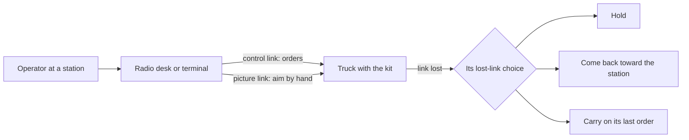

# Autonomous vehicles by radio (24 Nov 2026)

**Status (24 Nov 2026):** steps 1 and 2 of 7 are built, in Radio Framework 0.9.0 and 0.10.0: the vehicle control and picture
kinds, control taking channels from talk ([radio stations](radio-stations.md#kinds-radio-080)), and radios fitted to vehicles,
whose links are worked out and shown while they stand by ([below](#step-2-radios-fitted-to-vehicles-radio-0100)). No vehicle
carries the kit yet (step 4), and none can be driven from a station (step 3). Steps 3 to 7 are not built. Nothing is tested in game.

The owner, 24 Nov 2026: "the real feature I wish to implement soon is autonomous vehicles and perhaps their weapon systems too, all
via our radio framework." **[O]** It builds on what the owner chose on 18 and 19 Nov 2026 in
[modern military vehicles](modern-military-vehicles.md#working-without-a-crew-three-levels-of-one-system) (three ways of working
without a crew; the seat stays; four followers to a leader) and
[militarised service vehicles](vehicle-militarised-service-vehicles.md) (a remote weapon station that fires with nobody aboard).
This record is the **station level** of those three, done through the radio, and it turns that record's
[radio tie-in ideas](modern-military-vehicles.md#radio-tie-in-ideas) into a design.

**How to read the marks.** **[O]** the owner's word or card. **[code]** read in code on the date given. **[S]** a source named
beside it. **[A]** an agent's default or authored figure, for the owner to revise. Every figure not marked **[S]** is authored.

## Read this first

- **Built so far: the ledger's kinds and pre-emption** (step 1, Radio 0.9.0) **and radios fitted to vehicles** (step 2, Radio
  0.10.0). No vehicle carries the kit yet: a dev action fits a radio to a vehicle until the game is loaded again, to see its
  links. Nothing is tested in game.
- **The owner's four cards of 24 Nov 2026 [O]:** our **service trucks get a remote-control kit first**; **a colonist works the
  console** while vehicles are driven; **lost link is chosen per vehicle, hold by default**; **remote guns fire only while an
  operator has a picture link**, with a setting, **off by default**, that lets them fire on their own.
- **Station control needs the Radio Framework [O]** ("all via our radio framework"). The route level (follow a leader, run a loop)
  and the mechanitor level stay free of it, as chosen on 18 Nov 2026.
- **Performance first** (the radio's rule): the cost is written [below](#its-cost-the-radios-performance-rule) before anything is
  built. The check Vehicle Framework makes on every move order reads one field we keep; nothing is worked out there.
- **The weak points are the point** (from the 18 Nov record): the operator, the station, its mast, and the ground between them.

## The owner's choices (24 Nov 2026)

| Question | The owner's choice | What it sets |
| --- | --- | --- |
| Which vehicles first | **A kit for our trucks** | An upgrade node on our service trucks: a control radio and antenna on the cab. No new vehicle art beyond a small antenna overlay |
| Who controls | **An operator at the console** | A colonist works a radio station as a job while vehicles are under control; the operator is the one to protect |
| Lost link | **Chosen per vehicle, hold by default** | Hold, come back toward the station, or carry on the last order, after a short delay; a letter says it happened |
| Remote guns | **An operator with a picture link; a setting to fire alone, off by default** | A human in the loop by default; firing alone is high risk, so its setting starts off |

## How it works

### The link is a real link

- **The kit is a radio on the vehicle [A]:** a VHF data radio with a whip on the cab, about 3 m up, its figures in XML like any other
  radio. The radio net works out its link to every station in reach, both ways, with the walls, rock, roofs, masts and amplifiers it
  already counts **[code: `Services/RadioNet.cs`, `LinkBudgetService`]**. The worse direction decides, as the radio's rules say.
- **Two thresholds on one path [A]**, the 18 Nov record's idea 2 ("orders get through where pictures do not"): a narrow **control**
  mode for orders, and a wide **picture** mode for aiming by hand. The picture needs more signal (a wider bandwidth raises the noise
  floor, and it asks a higher signal-to-noise ratio), so it fails first as the vehicle goes further or behind cover. In Plain display
  the vehicle reads **"orders and picture"**, **"orders only"** or **"no link"**, never a figure.
- **Two kinds in the ledger [A]**, as the radio's rules require (a new use is a kind, never a second system of frequencies):

| Kind | Mode [A] | Channels one use takes | Vehicles per use | Held while |
| --- | --- | --- | --- | --- |
| **Vehicle control** | 12.5 kHz data, keyed half the time, needs about 6 dB | 1 | 2 | the vehicle is under station control |
| **Vehicle picture** | 50 kHz video, keyed all the time, needs about 15 dB | 2 | 1 | the operator is driving it under direct orders (drafted) |
| Local voice (built) | 12.5 kHz FM voice, keyed a fifth of the time | 1 | 5 | a colonist is in touch |

  So the radio desk (one channel, two with its second transceiver) can give orders to two vehicles but cannot carry a picture; the
  **radio terminal** (four channels) can drive two vehicles, show one picture and still serve five talking colonists. A large
  remote fleet wants more terminals, as the owner's "a computer terminal can effectively be a base station with an SDR" suggests.
- **Control takes a channel from talk [A].** Vehicle control is served before voice, and when every station it reaches is full it
  **takes a channel from the weakest talking colonists**, who go "net busy", as a trunked system's emergency call pre-empts others.
  Without this, colonists already talking would keep a vehicle off the net for as long as they talk, since a holder keeps its place.
  The picture does not pre-empt anyone.
- **How pre-emption works (built in Radio 0.9.0) [code: `Physics/Channels.cs`, `Allocate`]:** a kind with `preempts` set that finds
  no room takes channels at the best station where it can, from kinds served after it that do not pre-empt, **the weakest of the
  kind served last first, and only as many radios as it needs**. On a desk of two channels with six colonists talking, a truck puts
  one colonist off (five still share one channel); on a desk of one channel it puts all five off, since a use needs a whole channel.
  A colonist put off tries the other stations in reach. Nothing is taken where even everyone would not make room, and nothing from
  another kind that pre-empts. "The weakest" replaced the design's first wording, "the newest": the ledger keeps no time a radio
  joined, and the weakest is the one whose talk was worst anyway [A].

### The operator

- **A colonist works the console [O]**: a job at a radio desk or terminal, like research, given by a work type the player orders
  as usual [A: "Remote operation", its own work type, so the player can put one colonist on it]. While the operator is at the
  console, that station controls vehicles; when they leave, sleep, eat or are downed, its vehicles lose control.
- **An operator drives two vehicles at once [A]**, a figure in the rules Def. A third waits for a second operator, at the same or
  another station.
- **No skill is asked at first [A].** A skill could later shorten the lost-link delay or steady the aim; nothing here needs it.

### Under control

- **It drives as if crewed.** Vehicle Framework lets a vehicle move when every seat that handles movement is filled, or when no
  seat does (it is then "autonomous") **[code: `VehiclePawn.HasEnoughOperators`, VehicleFramework 1.7 decompile 16178-16199]**.
  Our trucks keep their driver's seat (the owner's choice of 18 Nov 2026), so **one small postfix** answers yes for a vehicle our
  kit has under control. It reads one field our comp keeps; nothing is worked out in it.
- **Drafted, it takes move orders** from the player as any vehicle does; its station must hold its link for them to be obeyed.
- **A colonist can still climb in** and drive it the ordinary way; with someone at the wheel the kit stands aside.
- **Two Vehicle Framework checks read the seats as written** (the 18 Nov record's code read): the caravan dialog and a role check.
  The build reads both before deciding whether they need an answer of ours.
- **An empty vehicle ticks slowly** (every 250 ticks with nobody aboard, the same read). The build checks that a crewless vehicle
  on the move still paths and moves smoothly, and keeps it ticking while it moves if not.

### Lost link

- **Chosen per vehicle [O]**, a gizmo on the vehicle, saved with it: **hold** (the default), **come back** toward its station until
  the link returns, or **carry on** its last order.
- **After a short delay [A: ten seconds at normal speed, 600 ticks]**, as real procedures wait before acting (NASA's study of lost
  links found waits of one to eight minutes **[S, [NASA Ames](https://ntrs.nasa.gov/api/citations/20190001648/downloads/20190001648.pdf)]**).
  If the link returns within the delay, nothing happens.
- **A letter** names the vehicle, where it is and what it is doing; a second when the link returns.

### Remote guns

- **The gun is the remote weapon station** designed in [militarised service vehicles](vehicle-militarised-service-vehicles.md)
  (MV8), not yet built; this needs it first.
- **By default, only with an operator and a picture link [O]**: the operator aims it by hand through Vehicle Framework's own
  targeting, or it picks its own targets while the picture holds (the operator watching). On orders only, or with no link, it holds
  fire.
- **"Remote guns fire on their own" [O], off by default**: with it on, a remote gun fires at enemies by itself when its link is weak
  or lost, as GTek's L-ATV station does. Its risk is high (below), so it starts off.
- **An armed crewless vehicle is a threat.** Vehicle Framework ignores an empty vehicle unless a comp says it is a threat
  (18 Nov read, `VehiclePawn_AI.cs:92-106`); our kit says so while a gun is fitted. The owner accepted this with the remote station.

### Step 2: radios fitted to vehicles (Radio 0.10.0)

Built 24 Nov 2026, not yet tested in game.

- **The seam [code: `Services/CarriedRadios.cs`]:** the net now counts a radio built into a pawn of the colony that is not a person
  (a vehicle; a mechanoid later), besides worn hand-helds. A tie-in registers a rule (`ICarriedRadioRule`) that says what each one
  does: **off** (not fitted), **standing by** (its links are worked out and shown, but it asks no channel), or **in use** (it asks a
  channel of its kind, as a hand-held does). With no rule answering, a built-in radio is in use. The net never names a vehicle.
- **The fitting [code: `RadioFittingDef`, `Common/Defs/Radio/Fittings.xml`] [A]:** the vehicle control radio's figures, written once:
  VHF, the control data mode, the vehicle control kind, 25 W, a whip on the cab about 3 m up with no gain over a plain whip, noise
  figure 8 dB. All authored.
- **The tie-in [code: `src/PhobosRadio.Vehicles`]**, its own assembly in the Radio Framework's `Mods/VehicleFramework/1.7`, loaded
  only with Vehicle Framework: a vehicle def that names a fitting (`Phobos.Radio.Vehicles.VehicleRadioFitting`, with the key of the
  upgrade node that fits it) is given that radio's comp at start-up, so every vehicle of it is built with one. Its rule says
  **standing by** once the node is done (or when none is named) and **off** before. Step 3 makes it **in use** while the vehicle is
  under station control.
- **What shows:** the vehicle's own signal button (its bars, "no station", or standing by); its row in the station's Net tab
  ("(standing by)"); the ray line from the vehicle to its antenna while it is selected; the station's count now says "radios", not
  "hand-helds". A vehicle standing by holds no channel, so it pre-empts nobody.
- **Testing before step 4:** the dev action "Fit a control radio to selected vehicles (until loaded again)" puts the radio on any
  vehicle for the session; nothing is saved, so loading the game takes it off.
- **Its cost:** each recompute (about once a second) looks up a radio comp on each spawned pawn of the colony that is not a person (a
  dictionary lookup in the game's own comp table) and asks the rules once for each vehicle with one; each fitted vehicle then costs
  what a worn hand-held costs, one link per station antenna. The start-up pass over vehicle defs runs once. Nothing per tick or frame.
- **Other factions [A]:** only the colony's pawns join our net, so a raider's vehicle with the fitting costs nothing here and does
  nothing; a captured one joins once it is ours.

## The four questions

- **What it lets the player do:** send a truck where no colonist should go (a supply run past a raid, a fire, a toxic fallout zone),
  fight with it from a console, and keep a convoy moving with fewer people at risk.
- **What it stops them doing:** driving beyond the radio's reach or behind hills and rock; more vehicles than their operators and
  channels can carry; aiming a gun with no picture; doing any of it when the operator sleeps, eats or is hurt.
- **How it changes the way they play:** masts and stations are sited for the ground the trucks must cross; the operator becomes
  the colonist to guard; a terminal's channels are split between talk and trucks; a convoy is planned around where the link holds.
- **What outside notices [A]:** enemies, who treat an armed crewless truck as a threat; the colonists, who lose their channel (and
  their "in touch" mood) when a truck takes it; the player, through a letter when a link is lost and found. Later: a jammer
  (Phase 3) would drop a truck to its lost-link choice, ours or theirs.

## Risks, and their settings

| Behaviour | What the player can lose | Grade [A] | Its setting |
| --- | --- | --- | --- |
| **Remote control by radio** | A truck stranded where the link failed, or one that comes back through danger. One vehicle at a time, never a person, and the link strength is shown before it fails | **Moderate** | "Remote control of vehicles by radio", **on** by default |
| **Remote guns fire on their own** | Rounds fired with nobody watching: wasted ammunition, a fight started early, a shot through friends | **High** | "Remote guns fire on their own", **off** by default [O] |

## Other factions

- **A raid's vehicle with our kit [A]:** controlled from off the map, so always in control until jamming exists (Phase 3). Our own
  station does nothing to it.
- **A vehicle parked at a base we attack:** the same; it moves only as that faction's own orders move it.
- **One we capture:** it works for us once one of our stations reaches it and an operator is at the console.
- **Cost with several on a map:** another faction's vehicles join no radio net of ours, so they cost nothing here.

## Its cost (the radio's performance rule)

- **The links:** each kitted vehicle of ours joins the net's pass, about once a second, as a worn hand-held does now: one walk across
  the map per station antenna, worked out for both modes at once (the picture mode reuses the control mode's walk, with its own
  bandwidth and threshold). A vehicle not under control and not moving is worked out only when the net is rebuilt.
- **The ledger:** two more kinds, a count each per station; pre-emption is one more pass over the holders of a full station.
- **Vehicle Framework's move check:** one field read in a postfix. Nothing per tick or per frame for a whole map.
- **Pictures:** the ray line from station to truck (the radio's RV2) only while the truck or station is selected.
- **Measured, never assumed:** each step is recorded with `python scripts/perf.py` on the owner's colony (asking first), before and
  after, and the figures are kept here.

## Where the code goes [A]

- **D'thorga Framework's vehicle part** holds what is not about radio: the kit's comp (control state, its lost-link choice, the
  delay, the letter), the postfix on Vehicle Framework's move check, the threat rule, the remote gun's rule. It takes the link's
  state from whoever provides it, so the mechanitor level can feed it the same way later.
- **The Radio Framework's Vehicle Framework tie-in** (a new assembly in its `Mods/VehicleFramework` folder, loaded only with Vehicle
  Framework) adds kitted vehicles to the radio net, holds their channels, and gives the kit its link each pass. The net gets one
  seam for radios that are not worn, so it never names a vehicle itself. **Built in Radio 0.10.0** ([step 2](#step-2-radios-fitted-to-vehicles-radio-0100)):
  `src/PhobosRadio.Vehicles`, with the seam `CarriedRadios` in the core.
- **D'thorga Vehicles** holds the kit's upgrade nodes on the trucks, their antenna overlays, and the remote gun when MV8 builds it.
- The tie-in register (`docs/development/tie-in-register.md`) gains the new folder in the same commit (done in Radio 0.10.0).

## The steps [A]

| # | Step | Mod | Needs |
| --- | --- | --- | --- |
| 1 | The two kinds, and pre-emption in the ledger, with tests. **Built in Radio 0.9.0** | Radio | Nothing |
| 2 | A seam in the net for radios that are not worn; the tie-in adds kitted vehicles and shows their links. **Built in Radio 0.10.0** | Radio | 1 |
| 3 | The kit's comp, the move-check postfix, lost-link choices and letters | Framework | 2 to be useful |
| 4 | The kit as an upgrade node on the five service trucks, with its antenna overlay (art first, as the owner's rule says) | Vehicles | 3 |
| 5 | The operator's job and work type | Radio | 2 |
| 6 | The picture link and remote guns | Framework, Vehicles | 5 and MV8's remote weapon station |
| 7 | The route level (MV4) and mechanitor level (MV6) feeding the same comp | Framework | 3 |

**Test rows** come with each step. **Settings**, as listed under risks, come with step 3 and step 6.

## Still open

- **The figures marked [A]**: the modes, two vehicles per operator, the ten-second delay, pre-emption of talk by control (built,
  so a change is a Def edit: `preempts` on `PhobosRadio_KindVehicleControl`).
- **What the second Vehicle Framework seat checks need**, and whether a moving crewless truck needs help to keep ticking: read at
  step 3.
- **The antenna overlay's picture**: small, but it is art, so it waits for the owner's pick before the first test.

## Who chose what

- **Owner (24 Nov 2026):** autonomous vehicles and their weapons via the radio; trucks first, by kit; an operator at the console;
  lost link per vehicle, hold by default; remote guns only with an operator and a picture, plus a setting to fire alone, off by
  default. Earlier, 18 and 19 Nov 2026: the three levels, the seat stays, four followers, a remote station that fires with nobody
  aboard.
- **Agent (24 Nov 2026), for the owner to revise:** the two kinds and their modes, pre-emption, the work type, two vehicles per
  operator, the delay, the risk grades, other factions' vehicles always in control, where the code goes, the steps.
