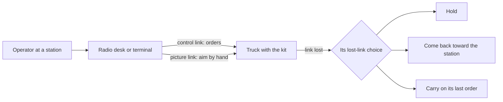

# Autonomous vehicles by radio (24 Nov 2026)

**Status (24 Nov 2026):** steps 1 to 5 of 7 are built, in Radio Framework 0.9.0 to 0.12.0, D'thorga Framework 0.278.0 and D'thorga
Vehicles 0.117.0: the vehicle control and picture kinds, control taking channels from talk ([radio stations](radio-stations.md#kinds-radio-080)),
radios fitted to vehicles ([step 2](#step-2-radios-fitted-to-vehicles-radio-0100)), vehicles driven from a station with their lost-link
choices and letters ([step 3](#step-3-driven-from-a-station-framework-02780-radio-0110)), the kit on the five service trucks
([step 4](#step-4-the-kit-on-the-trucks-vehicles-01170-radio-0120)) and the colonist at the console
([step 5](#step-5-the-operator-radio-0120)). The kit's antenna picture waits for the owner's pick; steps 6 and 7 are not built.
Nothing is tested in game.

The owner, 24 Nov 2026: "the real feature I wish to implement soon is autonomous vehicles and perhaps their weapon systems too, all
via our radio framework." **[O]** It builds on what the owner chose on 18 and 19 Nov 2026 in
[modern military vehicles](modern-military-vehicles.md#working-without-a-crew-three-levels-of-one-system) (three ways of working
without a crew; the seat stays; four followers to a leader) and
[militarised service vehicles](vehicle-militarised-service-vehicles.md) (a remote weapon station that fires with nobody aboard).
This record is the **station level** of those three, done through the radio, and it turns that record's
[radio tie-in ideas](modern-military-vehicles.md#radio-tie-in-ideas) into a design.

**How to read the marks.** **[O]** the owner's word or card. **[code]** read in code on the date given. **[S]** a source named
beside it. **[A]** an agent's default or authored figure, for the owner to revise. Every figure not marked **[S]** is authored.

## Read this first

- **Built so far: steps 1 to 5**: the ledger's kinds and pre-emption, radios fitted to vehicles, driving from a station, **the
  remote control kit as an upgrade on the five service trucks** (after the research "remote vehicle control") and **the colonist at
  the console** (the work type "Remote operation"). The kit's antenna picture on the cab waits for the owner's pick. Nothing is
  tested in game.
- **The owner's four cards of 24 Nov 2026 [O]:** our **service trucks get a remote-control kit first**; **a colonist works the
  console** while vehicles are driven; **lost link is chosen per vehicle, hold by default**; **remote guns fire only while an
  operator has a picture link**, with a setting, **off by default**, that lets them fire on their own.
- **Station control needs the Radio Framework [O]** ("all via our radio framework"). The route level (follow a leader, run a loop)
  and the mechanitor level stay free of it, as chosen on 18 Nov 2026.
- **Performance first** (the radio's rule): the cost is written [below](#its-cost-the-radios-performance-rule) before anything is
  built. The check Vehicle Framework makes on every move order reads one field we keep; nothing is worked out there.
- **The weak points are the point** (from the 18 Nov record): the operator, the station, its mast, and the ground between them.

## The owner's choices (24 Nov 2026)

| Question | The owner's choice | What it sets |
| --- | --- | --- |
| Which vehicles first | **A kit for our trucks** | An upgrade node on our service trucks: a control radio and antenna on the cab. No new vehicle art beyond a small antenna overlay |
| Who controls | **An operator at the console** | A colonist works a radio station as a job while vehicles are under control; the operator is the one to protect |
| Lost link | **Chosen per vehicle, hold by default** | Hold, come back toward the station, or carry on the last order, after a short delay; a letter says it happened |
| Remote guns | **An operator with a picture link; a setting to fire alone, off by default** | A human in the loop by default; firing alone is high risk, so its setting starts off |

## How it works

### The link is a real link

- **The kit is a radio on the vehicle [A]:** a VHF data radio with a whip on the cab, about 3 m up, its figures in XML like any other
  radio. The radio net works out its link to every station in reach, both ways, with the walls, rock, roofs, masts and amplifiers it
  already counts **[code: `Services/RadioNet.cs`, `LinkBudgetService`]**. The worse direction decides, as the radio's rules say.
- **Two thresholds on one path [A]**, the 18 Nov record's idea 2 ("orders get through where pictures do not"): a narrow **control**
  mode for orders, and a wide **picture** mode for aiming by hand. The picture needs more signal (a wider bandwidth raises the noise
  floor, and it asks a higher signal-to-noise ratio), so it fails first as the vehicle goes further or behind cover. In Plain display
  the vehicle reads **"orders and picture"**, **"orders only"** or **"no link"**, never a figure.
- **Two kinds in the ledger [A]**, as the radio's rules require (a new use is a kind, never a second system of frequencies):

| Kind | Mode [A] | Channels one use takes | Vehicles per use | Held while |
| --- | --- | --- | --- | --- |
| **Vehicle control** | 12.5 kHz data, keyed half the time, needs about 6 dB | 1 | 2 | the vehicle is under station control |
| **Vehicle picture** | 50 kHz video, keyed all the time, needs about 15 dB | 2 | 1 | the operator is driving it under direct orders (drafted) |
| Local voice (built) | 12.5 kHz FM voice, keyed a fifth of the time | 1 | 5 | a colonist is in touch |

  So the radio desk (one channel, two with its second transceiver) can give orders to two vehicles but cannot carry a picture; the
  **radio terminal** (four channels) can drive two vehicles, show one picture and still serve five talking colonists. A large
  remote fleet wants more terminals, as the owner's "a computer terminal can effectively be a base station with an SDR" suggests.
- **Control takes a channel from talk [A].** Vehicle control is served before voice, and when every station it reaches is full it
  **takes a channel from the weakest talking colonists**, who go "net busy", as a trunked system's emergency call pre-empts others.
  Without this, colonists already talking would keep a vehicle off the net for as long as they talk, since a holder keeps its place.
  The picture does not pre-empt anyone.
- **How pre-emption works (built in Radio 0.9.0) [code: `Physics/Channels.cs`, `Allocate`]:** a kind with `preempts` set that finds
  no room takes channels at the best station where it can, from kinds served after it that do not pre-empt, **the weakest of the
  kind served last first, and only as many radios as it needs**. On a desk of two channels with six colonists talking, a truck puts
  one colonist off (five still share one channel); on a desk of one channel it puts all five off, since a use needs a whole channel.
  A colonist put off tries the other stations in reach. Nothing is taken where even everyone would not make room, and nothing from
  another kind that pre-empts. "The weakest" replaced the design's first wording, "the newest": the ledger keeps no time a radio
  joined, and the weakest is the one whose talk was worst anyway [A].

### The operator

- **A colonist works the console [O]**: a job at a radio desk or terminal, like research, given by a work type the player orders
  as usual [A: "Remote operation", its own work type, so the player can put one colonist on it]. While the operator is at the
  console, that station controls vehicles; when they leave, sleep, eat or are downed, its vehicles lose control. **Built in Radio
  0.12.0** ([step 5](#step-5-the-operator-radio-0120)).
- **An operator drives two vehicles at once [A]**, a figure in the rules Def. A third waits for a second operator, at another
  station: **a station takes one operator [A]** (built so; a second seat at one station waits for a need).
- **No skill is asked at first [A].** A skill could later shorten the lost-link delay or steady the aim; nothing here needs it.

### Under control

- **It drives as if crewed.** Vehicle Framework lets a vehicle move when every seat that handles movement is filled, or when no
  seat does (it is then "autonomous") **[code: `VehiclePawn.HasEnoughOperators`, VehicleFramework 1.7 decompile 16178-16199]**.
  Our trucks keep their driver's seat (the owner's choice of 18 Nov 2026), so **one small postfix** answers yes for a vehicle our
  kit has under control. It reads one field our comp keeps; nothing is worked out in it.
- **Drafted, it takes move orders** from the player as any vehicle does; its station must hold its link for them to be obeyed.
- **A colonist can still climb in** and drive it the ordinary way; with someone at the wheel the kit stands aside.
- **Two Vehicle Framework checks read the seats as written** (the 18 Nov record's code read): the caravan dialog and a role check.
  Read at step 3 ([below](#step-3-driven-from-a-station-framework-02780-radio-0110)): our answer holds on the map only, so a crewless
  vehicle cannot travel in a caravan.
- **An empty vehicle ticks slowly**, but only its `TickInterval`: read at step 3, its pather runs every tick whoever is aboard, so a
  crewless vehicle on the move paths and moves as a crewed one does ([below](#step-3-driven-from-a-station-framework-02780-radio-0110)).

### Lost link

- **Chosen per vehicle [O]**, a gizmo on the vehicle, saved with it: **hold** (the default), **come back** toward its station until
  the link returns, or **carry on** its last order.
- **After a short delay [A: ten seconds at normal speed, 600 ticks]**, as real procedures wait before acting (NASA's study of lost
  links found waits of one to eight minutes **[S, [NASA Ames](https://ntrs.nasa.gov/api/citations/20190001648/downloads/20190001648.pdf)]**).
  If the link returns within the delay, nothing happens.
- **A letter** names the vehicle, where it is and what it is doing; a second when the link returns.

### Remote guns

- **The gun is the remote weapon station** designed in [militarised service vehicles](vehicle-militarised-service-vehicles.md)
  (MV8), not yet built; this needs it first.
- **By default, only with an operator and a picture link [O]**: the operator aims it by hand through Vehicle Framework's own
  targeting, or it picks its own targets while the picture holds (the operator watching). On orders only, or with no link, it holds
  fire.
- **"Remote guns fire on their own" [O], off by default**: with it on, a remote gun fires at enemies by itself when its link is weak
  or lost, as GTek's L-ATV station does. Its risk is high (below), so it starts off.
- **How the L-ATV does it [code: its installed XML, 24 Nov 2026, at the owner's suggestion]:** GTek's Oshkosh L-ATV
  (`killerbot.jltv`) ships no assembly. Its three main guns are upgrade nodes (`Vehicles.TurretUpgrade`) whose turret no seat
  names: its only roles are a driver (`Movement`) and three passengers. Vehicle Framework counts a turret no role names as manned
  (`VehicleTurret.IsManned`, read 18 Nov 2026), so the gun aims and fires with nobody aboard once its auto-targeting is on. **It
  drives with a driver only**: nothing in it moves a crewless vehicle. So it is the model for step 6's remote weapon station (a
  turret no seat names, plus our rule for when it may fire), and our step 3 has no precedent there.
- **An armed crewless vehicle is a threat.** Vehicle Framework ignores an empty vehicle unless a comp says it is a threat
  (18 Nov read, `VehiclePawn_AI.cs:92-106`); our kit says so while a gun is fitted. The owner accepted this with the remote station.

### Step 2: radios fitted to vehicles (Radio 0.10.0)

Built 24 Nov 2026, not yet tested in game.

- **The seam [code: `Services/CarriedRadios.cs`]:** the net now counts a radio built into a pawn of the colony that is not a person
  (a vehicle; a mechanoid later), besides worn hand-helds. A tie-in registers a rule (`ICarriedRadioRule`) that says what each one
  does: **off** (not fitted), **standing by** (its links are worked out and shown, but it asks no channel), or **in use** (it asks a
  channel of its kind, as a hand-held does). With no rule answering, a built-in radio is in use. The net never names a vehicle.
- **The fitting [code: `RadioFittingDef`, `Common/Defs/Radio/Fittings.xml`] [A]:** the vehicle control radio's figures, written once:
  VHF, the control data mode, the vehicle control kind, 25 W, a whip on the cab about 3 m up with no gain over a plain whip, noise
  figure 8 dB. All authored.
- **The tie-in [code: `src/PhobosRadio.Vehicles`]**, its own assembly in the Radio Framework's `Mods/VehicleFramework/1.7`, loaded
  only with Vehicle Framework: a vehicle def that names a fitting (`Phobos.Radio.Vehicles.VehicleRadioFitting`, with the key of the
  upgrade node that fits it) is given that radio's comp at start-up, so every vehicle of it is built with one. Its rule says
  **standing by** once the node is done (or when none is named) and **off** before. Step 3 makes it **in use** while the vehicle is
  under station control.
- **What shows:** the vehicle's own signal button (its bars, "no station", or standing by); its row in the station's Net tab
  ("(standing by)"); the ray line from the vehicle to its antenna while it is selected; the station's count now says "radios", not
  "hand-helds". A vehicle standing by holds no channel, so it pre-empts nobody.
- **Testing before step 4:** the dev action "Fit a control radio to selected vehicles (until loaded again)" puts the radio on any
  vehicle for the session; nothing is saved, so loading the game takes it off.
- **Its cost:** each recompute (about once a second) looks up a radio comp on each spawned pawn of the colony that is not a person (a
  dictionary lookup in the game's own comp table) and asks the rules once for each vehicle with one; each fitted vehicle then costs
  what a worn hand-held costs, one link per station antenna. The start-up pass over vehicle defs runs once. Nothing per tick or frame.
- **Other factions [A]:** only the colony's pawns join our net, so a raider's vehicle with the fitting costs nothing here and does
  nothing; a captured one joins once it is ours.

### Step 3: driven from a station (Framework 0.278.0, Radio 0.11.0)

Built 24 Nov 2026, not yet tested in game.

- **D'thorga Framework's vehicle part holds it [code: `src/PhobosFramework.Vehicles/Remote/RemoteControl.cs`]:** a comp,
  `CompPhobosRemoteControl`, that keeps the player's ask ("Drive from a station", a button), the lost-link choice (a button, hold by
  default [O]), and the vehicle's state with its link. Its states, and how one follows another, are a game-free rule with tests
  (`Rules/RemoteControlRule.cs`): **off**, **waiting for a station** (asked, never yet linked: nothing is lost, nobody is told),
  **driven**, **link just lost** (it carries on while the delay runs), then **holding**, **coming back** or **carrying on**. Coming
  back or carrying on turns to holding once the vehicle stops. A link that returns at any point takes the vehicle back.
- **Where the link comes from:** a source registers itself (`IRemoteControlSource`), so the Framework never names the radio. The
  radio's tie-in is the first: a vehicle is linked while a station serves its radio on a channel. The radio asks that channel only
  while the player has asked for the vehicle to be driven (in use); otherwise its radio stands by, as in step 2. The route and
  mechanitor levels (step 7) feed the same comp.
- **The one patch [code: `RemoteControlOperatorsPatch`]:** a postfix on Vehicle Framework's `VehiclePawn.HasEnoughOperators`, which
  both drafting (`CanDraft`) and moving (`CanMoveFinal`) read. It changes only a "no", only on the map, and reads one field of the comp.
  No other mod patches that getter (`query-patches.py`, 24 Nov 2026).
- **Holding needs no code of its own:** Vehicle Framework's `VehiclePathFollower.PatherTick` checks `CanMoveFinal` on every tick a
  drafted vehicle has a path **[code: VehicleFramework 1.7 decompile 15017-15062]**, so a vehicle stops the tick its control drops.
- **Coming back** drives to a place on a ring round the station it last heard (`comeBackRing`, 5 cells [A]), through the
  Framework's own `VehicleAutoDrive`, as gathering runs do, and stops when the link returns.
- **The delay** is `lostLinkDelayTicks` in `PhobosRemoteControlRulesDef` (600 ticks, ten seconds [A]). The comp looks at its link on
  the vehicle's rare tick, every 250 ticks, so a loss is acted on between 600 and 850 ticks after it starts; when the player asks,
  it looks at once, so the vehicle can be drafted straight away.
- **A colonist at the wheel:** the comp counts the driving seats itself, without our answer to Vehicle Framework's check (which would
  chase itself on and off), and stands aside while they are filled: no channel asked, nothing patched.
- **Letters [O]:** one when a vehicle starts acting on a lost link, naming what it is doing; one when a station has it again. A link
  back within the delay tells nobody.
- **The setting "Remote control of vehicles by radio"** (D'thorga Vehicle Systems settings, the crews page, "Remote control"; on by
  default, as the risk table says). Off, the buttons go, no vehicle is driven from afar, and one driving stops where it is.
- **Until step 5 [A]:** no operator was asked for: a powered station that served the control channel drove the vehicle. Step 5
  (Radio 0.12.0) adds the colonist at the console and the two vehicles each.
- **Read in Vehicle Framework's code at this step (24 Nov 2026):**
  - **Ticking:** `VehiclePawn.Tick` runs `BaseTickOptimized`, and with it the pather, every tick whoever is aboard; only
    `TickInterval` slows to every 250 ticks for an empty vehicle (`UpdateRateTicks`), and only when its tick list is empty. **[code:
    decompile 16597-16607, 19732-19869]** So nothing of ours is needed to keep a crewless vehicle moving.
  - **Plain comps and ticking:** Vehicle Framework puts every comp that is not one of its `VehicleComp`s asking ticks by request
    into that tick list (`RecacheCompTickers`, 17445-17455), so a vehicle carrying a plain comp never takes the slow rate. The
    radio's comp (step 2) is plain; our trucks already carry plain comps, so it changes nothing for them, but it would on another
    author's vehicle with none. The remote control comp asks no ticks; it uses the rare tick every comp gets.
  - **Caravans:** our answer holds on the map only, so a crewless vehicle in a caravan cannot move on the world map. The caravan
    dialog checks while the vehicles are still on the map, so it may let one join. **Give a vehicle a driver before it joins a
    caravan** (a known limit, untested).
  - **Aircraft:** Vehicle Framework's launch check reads the same getter (`CompVehicleLauncher.CanLaunchWithCargoCapacity`), so an
    aircraft driven from a station could take off with nobody aboard. The kit is for our trucks; another author's aircraft that names
    the fitting would allow it.
- **Buttons:** "Drive from a station" borrows the radio's signal icon, and the lost-link choice the vehicle park's sign, until their
  own icons are made (owed, for the night run).
- **Its cost:** the patch reads one field, only when Vehicle Framework has already said no (a crewless vehicle); the comp looks once
  every 250 ticks at a vehicle asked to be driven (a dictionary lookup in the net's last pass), and nothing for one that is not;
  letters only when the state changes.
- **Other factions:** nothing here acts on a vehicle not of the colony: the buttons are the player's, and the radio serves the
  colony's vehicles only. As the record says, a raid's vehicle keeps its own control.

### Step 4: the kit on the trucks (Vehicles 0.117.0, Radio 0.12.0)

Built 24 Nov 2026, not yet tested in game; its antenna picture waits for the owner's pick.

- **The upgrade [code: `mods/PhobosVehicles/Mods/RadioFramework/Patches/RemoteControlKit.xml`]:** "Remote control kit" on the
  Talus, Ullage, Kelly, Datum and Busbar, loaded only with the Radio Framework (D'thorga Vehicles' tie-in folder `Mods/RadioFramework`).
  It sits at (22, 12) in each tree, after the truck's own upgrades in row 12: a tie-in goes last and never in a row of its own, and
  the tanker's lower rows are full. It needs the research **remote vehicle control** (the radio's, after software radio, 1,500 [A]),
  and costs 25 steel and 4 components, 2,000 work [A]. It borrows the radio's signal icon until its own is drawn.
- **What it does:** each truck names the radio's vehicle control radio as its fitting, with this node as the upgrade that fits it
  (`VehicleRadioFitting`), so every truck is built with the radio and the remote control (step 2's start-up), which stay off the net
  until the node is done. Nothing else on the truck changes.
- **The picture [A]:** a whip antenna on the cab, bent back and tied down as real military trucks carry them (straight up, seen from
  above, it would be a dot), drawn alone on white by the paid route and laid on each truck's three facings by script once picked
  ([the record](../../assets/phobos-vehicles/requests/remote-kit-antenna-record.md)). The node carries no picture until then, as the
  tree check requires.

### Step 5: the operator (Radio 0.12.0)

Built 24 Nov 2026, not yet tested in game.

- **The work [code: `src/PhobosRadio/Work/RemoteOperation.cs`, `Common/Defs/Work.xml`]:** the work type **Remote operation**
  (Work tab "remote", high in the list [A]; intellectual work, no skill asked [A]; off for slaves, as research is). A station that serves a
  vehicle asked to be driven, with nobody working it, has work: an assigned colonist walks to it, stands beside it facing it, and
  stays while it serves a vehicle. A stint lasts 2,000 ticks before they look again at what else needs them, so food, sleep and
  anything more urgent take them away as usual [A].
- **One operator per station [A]:** the colonist holds the station. **Two vehicles each** (`vehiclesPerOperator` in the radio's
  rules Def [A]): the first two in the station's control channels, in the ledger's order, are driven; a third waits.
- **What it changes:** a vehicle is linked (step 3) only while its station both serves it on a channel and has an operator with a
  hand free for it. When the operator leaves, its vehicles lose their link, and after the delay do what was chosen for them. The
  lost-link letter says the link was lost; it does not yet say it was the operator who left (a follow-up: a reason from the source).
- **What shows:** the station's inspect text names its operator and how many vehicles it serves, or says nobody works it; the Net
  tab marks a served vehicle "(waiting for an operator)", and the vehicle's radio button says the same.
- **Its cost:** the net already walks the free colonists for their radios each pass; it now also reads each one's job driver (a
  type check) to find operators. The work giver reads a list the net keeps; the job checks one dictionary each tick it runs.

## The four questions

- **What it lets the player do:** send a truck where no colonist should go (a supply run past a raid, a fire, a toxic fallout zone),
  fight with it from a console, and keep a convoy moving with fewer people at risk.
- **What it stops them doing:** driving beyond the radio's reach or behind hills and rock; more vehicles than their operators and
  channels can carry; aiming a gun with no picture; doing any of it when the operator sleeps, eats or is hurt.
- **How it changes the way they play:** masts and stations are sited for the ground the trucks must cross; the operator becomes
  the colonist to guard; a terminal's channels are split between talk and trucks; a convoy is planned around where the link holds.
- **What outside notices [A]:** enemies, who treat an armed crewless truck as a threat; the colonists, who lose their channel (and
  their "in touch" mood) when a truck takes it; the player, through a letter when a link is lost and found. Later: a jammer
  (Phase 3) would drop a truck to its lost-link choice, ours or theirs.

## Risks, and their settings

| Behaviour | What the player can lose | Grade [A] | Its setting |
| --- | --- | --- | --- |
| **Remote control by radio** | A truck stranded where the link failed, or one that comes back through danger. One vehicle at a time, never a person, and the link strength is shown before it fails | **Moderate** | "Remote control of vehicles by radio", **on** by default |
| **Remote guns fire on their own** | Rounds fired with nobody watching: wasted ammunition, a fight started early, a shot through friends | **High** | "Remote guns fire on their own", **off** by default [O] |

## Other factions

- **A raid's vehicle with our kit [A]:** controlled from off the map, so always in control until jamming exists (Phase 3). Our own
  station does nothing to it.
- **A vehicle parked at a base we attack:** the same; it moves only as that faction's own orders move it.
- **One we capture:** it works for us once one of our stations reaches it and an operator is at the console.
- **Cost with several on a map:** another faction's vehicles join no radio net of ours, so they cost nothing here.

## Its cost (the radio's performance rule)

- **The links:** each kitted vehicle of ours joins the net's pass, about once a second, as a worn hand-held does now: one walk across
  the map per station antenna, worked out for both modes at once (the picture mode reuses the control mode's walk, with its own
  bandwidth and threshold). A vehicle not under control and not moving is worked out only when the net is rebuilt.
- **The ledger:** two more kinds, a count each per station; pre-emption is one more pass over the holders of a full station.
- **Vehicle Framework's move check:** one field read in a postfix. Nothing per tick or per frame for a whole map.
- **Pictures:** the ray line from station to truck (the radio's RV2) only while the truck or station is selected.
- **Measured, never assumed:** each step is recorded with `python scripts/perf.py` on the owner's colony (asking first), before and
  after, and the figures are kept here.

## Where the code goes [A]

- **D'thorga Framework's vehicle part** holds what is not about radio: the kit's comp (control state, its lost-link choice, the
  delay, the letter), the postfix on Vehicle Framework's move check, the threat rule, the remote gun's rule. It takes the link's
  state from whoever provides it, so the mechanitor level can feed it the same way later.
- **The Radio Framework's Vehicle Framework tie-in** (a new assembly in its `Mods/VehicleFramework` folder, loaded only with Vehicle
  Framework) adds kitted vehicles to the radio net, holds their channels, and gives the kit its link each pass. The net gets one
  seam for radios that are not worn, so it never names a vehicle itself. **Built in Radio 0.10.0** ([step 2](#step-2-radios-fitted-to-vehicles-radio-0100)):
  `src/PhobosRadio.Vehicles`, with the seam `CarriedRadios` in the core.
- **D'thorga Vehicles** holds the kit's upgrade nodes on the trucks, their antenna overlays, and the remote gun when MV8 builds it.
- The tie-in register (`docs/development/tie-in-register.md`) gains the new folder in the same commit (done in Radio 0.10.0).

## The steps [A]

| # | Step | Mod | Needs |
| --- | --- | --- | --- |
| 1 | The two kinds, and pre-emption in the ledger, with tests. **Built in Radio 0.9.0** | Radio | Nothing |
| 2 | A seam in the net for radios that are not worn; the tie-in adds kitted vehicles and shows their links. **Built in Radio 0.10.0** | Radio | 1 |
| 3 | The kit's comp, the move-check postfix, lost-link choices and letters. **Built in Framework 0.278.0 and Radio 0.11.0** | Framework | 2 to be useful |
| 4 | The kit as an upgrade node on the five service trucks, with its antenna overlay (art first, as the owner's rule says). **Built in Vehicles 0.117.0 and Radio 0.12.0; the picture waits for the owner's pick** | Vehicles | 3 |
| 5 | The operator's job and work type. **Built in Radio 0.12.0** | Radio | 2 |
| 6 | The picture link and remote guns | Framework, Vehicles | 5 and MV8's remote weapon station |
| 7 | The route level (MV4) and mechanitor level (MV6) feeding the same comp | Framework | 3 |

**Test rows** come with each step. **Settings**, as listed under risks, come with step 3 and step 6.

## Still open

- **The figures marked [A]**: the modes, two vehicles per operator, the ten-second delay, pre-emption of talk by control (built,
  so a change is a Def edit: `preempts` on `PhobosRadio_KindVehicleControl`).
- ~~**What the second Vehicle Framework seat checks need**, and whether a moving crewless truck needs help to keep ticking: read at
  step 3.~~ Read: it keeps ticking; caravans and aircraft are known limits ([step 3](#step-3-driven-from-a-station-framework-02780-radio-0110)).
- **Icons for the two buttons**, borrowed until made.
- **The antenna overlay's picture**: two paid tries drawn 24 Nov 2026; the owner's pick, then fitting by script on the five trucks.
- **The lost-link letter's reason**: when the operator leaves, the letter should say so rather than "lost its link".

## Who chose what

- **Owner (24 Nov 2026):** autonomous vehicles and their weapons via the radio; trucks first, by kit; an operator at the console;
  lost link per vehicle, hold by default; remote guns only with an operator and a picture, plus a setting to fire alone, off by
  default. Earlier, 18 and 19 Nov 2026: the three levels, the seat stays, four followers, a remote station that fires with nobody
  aboard.
- **Agent (24 Nov 2026), for the owner to revise:** the two kinds and their modes, pre-emption, the work type, two vehicles per
  operator, the delay, the risk grades, other factions' vehicles always in control, where the code goes, the steps.
