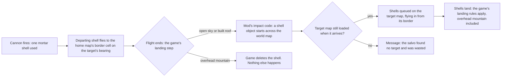

# Striking another map: lessons from DMS Expedition's long-range cannon (11 Nov 2026)

**Status: research and an agent proposal, nothing built.** The owner asked on 11 November 2026 for this to be written down for our own
mods, with ballistic submarines and similar weapons in mind. It records a fault found in another author's mod in the owner's game, why
it happened, and the rules it suggests for any weapon of ours that leaves one map and lands on another. Agent-authored, for the
owner's review.

## Read this first

- **A shell that leaves the map through the game's "landing" step can be deleted without a trace.** The game destroys any high-flying
  projectile whose flight ends under overhead mountain (thick rock roof), and does not run the projectile's own impact code. If that
  code is what hands the shell to the world map, the shell is simply gone: no world-map shell, no message, no log line, and the
  ammunition is already spent.
- **On the colony map, that failure looks exactly like success.** Every departing shell vanishes at the border either way. The owner
  watched it for minutes and reasonably took it for normal behaviour.
- **The game's rule is right for a landing shell**: it is what makes mountain bases mortar-proof, and our weapons should keep it.
  The fault was in using a landing to mean "leave the map".
- **For our ballistic submarines, launch straight up and hand over in our own code** (proposal below), never through a projectile's
  landing at the map border.

## What happened in the owner's game

The owner's three long-range cannons (the NK-30 "Empero", from **The Dead Man's Switch - Expedition** by AobaKuma, Bread Mo and
others: [Steam Workshop](https://steamcommunity.com/sharedfiles/filedetails/?id=3689879335),
[source on GitHub](https://github.com/AobaKuma/Dead-Man-Switch-Expedition)) fired at an enemy map to the south that the owner had open.
Shells flew to the home map's southern border and disappeared. None appeared on the world map and none reached the target.

How the mod's chain works, in our words, read from its 1.7 build (commit 751c6512 of 8 Nov 2026, matched byte for byte to the
installed `DMSE.dll`; decompile kept in `.local/`, never committed):

- **The cause.** In RimWorld 1.7, `Verse.Projectile.ImpactSomething` checks the roof where a high-flying projectile ends its flight. On
  thick rock roof it plays the projectile's "hit thick roof" sound, if its Def names one, and destroys it without calling `Impact`. The
  mod's departing shell does its hand-off in `Impact` and names no such sound, so the loss was silent as well as invisible.
- **The evidence.** The owner's home map (325 by 325) has overhead mountain over 31% to 69% of each border, wrapping the north-west and
  south-east corners. Tracing every bearing from the three cannons with the mod's own edge rule, 122 of 360 bearings end on overhead
  mountain: roughly south (149 to 211 degrees) and west (251 to 311). The owner confirmed the shells vanished on the southern border.
- **Not the update.** The owner suspected the mod's 8 November update. That update fixed a mirrored east-west bearing, required the target
  map to be loaded on arrival (it used to generate the map), and added ranging and fire-for-effect modes. None of these caused this:
  a southern bearing was the same before and after, so the shells would have died there before the update too.
- **Fixed on the owner's PC only.** At the owner's request, a small local mod outside this repository sends that one projectile type
  straight to its impact code. **The owner tested it in game on 11 November 2026: shells reach the world map and land.** It is not in
  this repository and not published.

## Other ways the game ends a projectile without a word

Read from RimWorld 1.7's `Verse.Projectile`, for anything of ours that flies:

| What happens | When | Visible to the player? |
| --- | --- | --- |
| Destroyed on overhead mountain | A high-flying projectile's flight ends on thick rock roof | Only a thud, and only if the Def names one |
| Destroyed off the map | Its position leaves the map's bounds during flight | No |
| Not drawn | It is over a fogged cell, unless its Def sees through fog (projectiles do not by default) | No: it still flies and still does damage |
| Intercepted | A shield or another mod's point defence catches it on the way | Depends on that mod |

**The fog row matters for any strike on a map the player is only watching.** DMS Expedition's unguided shells aim at the middle of the
target map, give or take 14 cells, which is usually still fogged. The blasts happen; the player sees nothing.

## Rules for our own cross-map weapons (agent proposal)

[Air-defence tie-ins](air-defence-tie-ins.md) (13 Nov 2026) adds how these rules meet InterRim Ballistic Missile and The Dead Man's
Switch: strike reports from satellites or radar (AD6), our missiles interceptable by DMS defences (AD11), and enemy submarines as IRBM's
sea launches (AD10).

These are proposals for the owner to accept, change or drop. They follow AGENTS.md's standing rules where those already apply.

1. **Leave the map through our own code, never a landing.** Three ways, best first for a submarine:
   - **Straight up, like a shuttle leaving.** A missile from a submarine or silo launches vertically. A "leaving" thing of our own
     rises and hands over to the world map when its animation ends. No border cell, no bearing on the home map, no roof check at the
     edge. It needs open sky above the launcher, and a refusal says so when there is none. *This is the recommendation for ballistic
     submarines.*
   - **A projectile that overrides `ImpactSomething`**, so the hand-off runs wherever its flight ends. Good for guns that must be seen to
     fire towards the target, as the long-range cannon does.
   - **Hand over at the moment of firing**, with only an effect at the launcher. Cheapest, least to see.
2. **Never spend ammunition on a shot that cannot leave.** Check before firing, and refuse with a reason (AGENTS.md: every refusal
   says why). If something can still go wrong after firing, the player is told what happened, in in-world words.
3. **Decide what an unloaded target map means, per weapon.** DMS Expedition now requires the target map to be loaded, both when aiming
   and when the shell arrives; creating a map on arrival is one of the heaviest things the game does, and the map then stays. The
   options for us: require a loaded map (simple, needs eyes on the target); resolve the strike on the world map against the settlement
   itself, with no map (cheap, needs a model of what a strike does to a settlement); or create the map (avoid). **An open question for
   the owner** (below).
4. **Use the game's own bearing.** `PlanetLayer.GetHeadingFromTo` gives the heading from one tile to another, 0 degrees north and
   clockwise, the convention the game's own map generator uses for roads and rivers. DMS Expedition's earlier hand-made maths had east
   and west swapped. Test all four quadrants.
5. **Keep the game's landing rules for the warhead.** Overhead mountain stopping a shell, roofs collapsing and shields catching it are
   the game's balance, and players plan their bases around them.
6. **Tell the player what they cannot see.** A strike on a fogged area is reported after the fact by what the strikers could know (a
   message, or a report from a spotter or a radar), never by revealing the map. This follows the submarine rule of never showing the
   player what their crew could not know.
7. **Design for enemy launches from the start** (owner, 10 Nov 2026: enemy submarines are coming soon). Every incoming projectile
   carries a launcher or a faction, so interception mods can tell friend from foe. DMS Expedition's incoming shells carry neither. In
   InterRim Ballistic Missile's 1.6 build, as read, its CIWS turrets ignore projectiles fired by the player and fire at others only
   when they head for the player's things. Enemy launches also need arrival warnings the player's radar or sonar could plausibly
   give.
8. **Log a gated line per launch and arrival** through the shared logger (AGENTS.md), so a fault like this one shows in the log without
   development mode. DMS Expedition logs a landing shell only in development mode, which is why the owner's log was silent.
9. **Test on awkward maps.** Overhead mountain on the borders; a target map closed while the shot is in the air; a fogged target; all
   four quadrants; an enemy launch at the player; several launchers firing at once.

## How it was found

Kept for the next fault of this kind. The tools are described in [analysis tooling](analysis-tooling.md).

1. `python scripts/triage-log.py`: no errors from the mod at all, so the shells were lost silently.
2. A decompile of the mod into `.local/decompiled`, read with `python scripts/query-code.py`, to follow the chain step by step.
3. `python scripts/query-save.py`: the cannons, their shells and their last firing; then `grid --kind roof --render` for the border roofs.
4. `python scripts/query-patches.py who "Projectile.*"` and `query-defs.py patched`: no other mod changes these shells.
5. Matching the installed `DMSE.dll` to the author's GitHub history by its git object hash, to see what the update really changed.
6. **The owner's own observation decided it**: where the shells vanished, and that they never appeared on the world map.

Two things worth a tool later: matching an installed assembly to a commit in an author's public history, and tracing every bearing from
a building to the map border against the roof grid. Both were small scripts here.

**An observation, cause unknown:** the owner's `Player.log` was not written to for at least 15 minutes of play after 16:08, though the
game was running. It may hold lines back; a quiet log is not proof that nothing happened.

## Who chose what

- **Owner (11 Nov 2026):** document this for our own mods, thinking of ballistic submarines; keep the fix to DMS Expedition local to
  their PC and off GitHub. Called it a fault worth fixing once the cause was clear.
- **Agent proposals, owner to revise:** every rule under [Rules for our own cross-map weapons](#rules-for-our-own-cross-map-weapons-agent-proposal),
  including straight-up launches for submarines.

## Open questions for the owner

1. **An unloaded target:** should our strategic weapons require the target map to be open, strike the settlement on the world map with no
   map, or offer both?
2. **What the player sees of a strike they cannot watch:** a message, a damage report from a spotter or radar, or nothing?
3. **A bug report for DMS Expedition's authors:** the owner posts only when a fault is dire; a draft is available on request.

## Sources

- **The Dead Man's Switch - Expedition** by AobaKuma, Bread Mo and others: [Steam Workshop](https://steamcommunity.com/sharedfiles/filedetails/?id=3689879335),
  [GitHub repository](https://github.com/AobaKuma/Dead-Man-Switch-Expedition) (commits 751c6512 and ad605c24 of 8 Nov 2026 read), its
  README's artillery section, and our own decompile of its 1.7 assembly (kept in `.local/`, never committed). The behaviour described is
  our reading, not the authors' statement.
- **RimWorld 1.7** by Ludeon Studios: `Verse.Projectile` and `RimWorld.Planet.PlanetLayer`, read from our decompile.
- **InterRim Ballistic Missile**: its CIWS targeting, read from our decompile of its 1.6 build.
- The owner's save PG6 and `Player.log` of 11 Nov 2026, read only.
