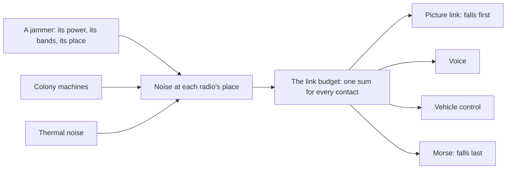

# Electronic warfare for every aircraft and vehicle: the Prowler's jamming meets the radio (27 Nov 2026)

**Status (27 Nov 2026):** the owner opened the radio's Phase 3 the same day. **Slice 1 is built**: EW2 (noise by bandwidth), EW1
(jamming as noise) and EW11 (the Busbar mast's switch), in Radio Framework 0.45.0, D'thorga Framework 0.355.0 and D'thorga Vehicles
0.130.1 ([as built](#built-slice-1-27-nov-2026)); not yet tested in game (rows 706 to 708). **Slice 2 is built**: EW18 (jam the
call), in Radio Framework 0.46.0 ([as built](#built-slice-2-27-nov-2026)); not yet tested in game (row 709). Every other row is a
proposal; the radar simulation is a sketch only. The owner answered seven questions by card ([below](#questions-for-the-owner)).

**A research record.** The owner, 27 November 2026: "I would especially like to make the Prowler aircraft and any knock on effects
that come from it a part of all other aircraft and perhaps vehicles too", as "strictly a research and record purview"; and, on
reading the plan, of a detailed radar simulation: it "doesn't have to be planned in detail yet, just that it exists as a possibility
in the next several slices away".

It is one of two records written together; the other is [radio ties with the game's and other mods' things](radio-ties-with-other-mods.md)
(rows RT1 to RT18). It builds on [the EA-6B Prowler in the fold](archive/ea6b-prowler.md), [air-defence tie-ins](air-defence-tie-ins.md),
[autonomous vehicles by radio](autonomous-vehicles.md) and [radio visuals](radio-visuals.md).

How to read it: **[C]** read from code, **[D]** from a Def as patched, **[d]** from a description only, **[inferred]** the agent's
reading, **[authored]** a figure we would make up and label, **[unverified]** a real-world claim with no source read for this record.
**Kind**, **risk** and the four questions are as in the other record.

## Read this first

- **Jamming never reaches a radio today.** The Prowler's field and the Busbar's jammer mast live in `JamFields`
  (`src/PhobosFramework.Vehicles/Service/JamFields.cs`), and blind two things only: a vehicle's `radar` and `warningReceiver`
  (`Rules_VehicleSystems.xml:396-399`). The radio has no jamming, direction finding, interception or decoys anywhere in its code.
- **An enemy Prowler never jams.** The only code that gives a Prowler a spot to jam is the player's own targeting button
  (`EA6BProwler.Jammer.BeginJamTargeting`, decompile line 3486 [C]); nothing does it for another faction's jet. So "their fields jam
  the player's systems", as our Framework 0.225.0 built it, has nothing to set it off but a Busbar mast in other hands.
- **The Prowler's own field and ours disagree on whom they hit.** Its field hits everything that is not its own faction, allies and
  neutrals included [C]; `JamFields.Covering` hits hostile factions only [C]. Neither is wrong; a design must say which it follows.
- **Aircraft have no radio bays.** The voice radio, repeater, Morse key and remote kit bays exist only on land vehicles
  (`Loadouts_Default.xml:362-442`). Every aircraft with our systems does get a radio comp at start-up, switched off for want of a
  kit to fit (`VehicleRadios.cs:60-67` [C]).
- **A correction to the Prowler record.** It says "a radar jammer floods radar frequencies". The real pods are fitted by band, and
  **their three lowest bands cover our radio bands**: band 1 is 64 to 150 MHz (our 2 m band is at its top) and band 3 is 270 to
  500 MHz (our 70 cm band is inside it) (Wikipedia, "AN/ALQ-99", citing Teal Group, 2022). So the honest split is by which bands a
  jet carries, not "radar jammer" against "radio jammer" (row EW4).
- **Local noise is not scaled to a mode's bandwidth** (`NoiseFloor.cs` [C]): Morse's narrow filter earns it nothing against a nearby
  noise source today. Jamming as noise needs that put right first (row EW2).
- **A link between world tiles hears no local noise at all** (`LinkBudgetService.EvaluateWorld` [C]: a quiet floor at each end). A
  jammer on a map would not touch a call leaving it (row EW3).
- **No public figure was found for a jamming pod's radiated power.** Every power figure for a jammer in this record is authored.
- **The Dead Man's Switch Expedition has its own electronic warfare**: a jammer station with a world-map ring, a control component
  with rules of engagement, and a rule that switches off the player's own comms console while their jammer runs
  (`DMSE.MapComponent_EWControl`, `DMSE.CompJammer.BlocksCommsNow` [C]). Ours must sit beside it.

## What exists today

| Piece | What it does | Where |
| --- | --- | --- |
| The Prowler's field (the author's) | Sent to circle a spot, the player's jet jams up to 44 cells: automated turrets shut down (one in four) or fire badly and cannot aim at aircraft; shields drop; powered buildings flicker; mechanoids slow and are stunned now and then. Only fuel is spent | `EA6BProwler.Jammer`, `MapComponent_ProwlerJammer` [C] |
| Jam fields (ours) | Any registered field blinds the radar and warning receiver of hostile vehicles inside it; read at most once a second per map | `JamFields.cs`, `JamFieldRule.cs` |
| ICAP II and III | Widen the Prowler's field by 10 % and 25 % | `Fittings_EA6BProwler.xml` |
| Self-protection pod | Automated turrets miss the carrying aircraft 30 % of the time; world-map air defences hit less and lock more slowly | `EcmPod.cs`, `Fittings_EcmPod.xml` |
| Busbar jammer mast | A field of 18 cells for 800 W of the set's output, whenever it is set up and running; no switch | `UpgradeTree_GeneratorSet.xml`, `CompPhobosGeneratorSet.cs` |

All of it is built and none of it is tested in game (rows 342 to 345 of the test pass).

## The main idea: jamming is noise

Every contact the radio makes is one sum (`LinkSheet.cs`): **margin = received signal − noise floor − what the mode needs**. A jammer
is one more thing in the noise floor at the receiving end:



Because one service decides every contact, **nothing that rides a link needs code of its own to be jammed**. That is the knock-on
the owner asked for, and it costs one term.

**It also settles an older note.** [Radio stations](radio-stations.md) says jamming "would take channels away". The radio's rule is
that channels are capacity, never physics; so jamming is noise in the link budget, and the ledger is left alone.

### A worked example

All four jammer figures are **authored**, chosen to show the shape; the sums are the radio's own free-space rule.

| Step | Figure |
| --- | --- |
| A jammer of 100 W, spread evenly over the whole 2 m band (4 MHz) | 50 dBm in all; **24.9 dBm in one 12.5 kHz voice channel** |
| At a station 500 m away, on 146 MHz (path loss 69.7 dB) | Jamming arrives at **−44.8 dBm** |
| The station's floor with no jamming (thermal, noise figure 8 dB) | −125.0 dBm: the jammer raises it by 80 dB |
| A 5 W hand-held 50 m from that station (path loss 49.7 dB) | Arrives at −12.7 dBm: 32 dB over the jamming. **Voice needs 12: it gets through** |
| The farthest that hand-held can be and still be heard | **About 500 m: as far as the jammer itself is** |
| The same by Morse, once row EW2 is built (23 dB better) | About 7 km |

The rule of thumb that falls out, for a jammer and a radio of like power: **you get through to anyone nearer than the jammer is**.
A stronger jammer shrinks that circle and an amplifier grows it. This is what "burn-through" means, and it needs no rule of its own.

### What falls first

From the modes the radio ships (`Modes.xml`), against wideband noise and with EW2 built:

| Mode | Carries | Against voice |
| --- | --- | --- |
| Picture (50 kHz, needs 15 dB) | A remote vehicle's camera; remote guns | 9 dB worse: **falls first** |
| Voice (12.5 kHz, needs 12 dB) | Hand-helds, advice, calls | The yardstick |
| Control data (12.5 kHz, needs 6 dB) | Driving a vehicle from a station | 6 dB better |
| Morse (500 Hz, needs 3 dB) | The Morse key | 23 dB better: **falls last** |

So a jammed remote truck loses its picture, and with it its guns, before it loses its steering; and a station with a key still
reaches a convoy that voice has lost.

## Part 1: jamming reaches the radio

| # | Row | Reads → changes | Lets · Stops · Changes · Who else notices | Kind and cost | Risk and lean |
| --- | --- | --- | --- | --- | --- |
| EW1 | **A jam field is a noise source** | Each field gains a power, a spread and a list of bands, beside the radius it keeps for turrets and radar → the radio's noise snapshot takes it in at every radio's place | **Lets** a jammer cut what an enemy's links carry, and a strong, close link ride through. **Stops** remote driving, pictures, calls and relays inside a strong field. **Changes** where stations, relays and cable go. **Noticed by** everything in the table under Part 2, the lost-link letter (a new reason: jammed), the link sheet (a "jamming" line) and the waterfall picture (a bright band) | C#. The join is the open question below. Jammers are few (none to three on a map); each is one more source per radio end per pass | **Moderate**: links fail, a truck may be stranded; nobody is lost, and the link sheet shows it coming. A setting, on. **Take first** |
| EW2 | **Local noise scaled to each mode's bandwidth** | A source's level becomes a level per hertz → Morse hears 14 dB less of it than voice, a picture 6 dB more | **Lets** the Morse key ride through noise as it should. **Stops** nothing. **Changes built behaviour**: Morse near a generator gets better, a picture near one gets worse. **Noticed by** every link near a noise source | C# in the physics library, with its rule tests. No cost at run time | Low. **Chosen by the owner (card 3): yes, scale it.** Take with EW1 |
| EW3 | **Jamming on links between world tiles** | Each end's quiet floor gains the jamming at that end: a jammer on its map, a world-map jammer ring over its tile, an aircraft jamming overhead | **Lets** a base be cut off from the world, ours or theirs. **Stops** calls out of a jammed place. **Changes** the worth of a relay outside the jammed ground. **Noticed by** convoys, advice, medevac | C#. Worked out only when world reach is, never per tick | Moderate, under EW1's setting. **Take after EW1** |
| EW4 | **Which bands a jammer covers** | The Prowler's pods by band. The simple form: a choice on the player's jet between radar, radio, or both at half strength each [authored]. The ICAP III suite adds radio jamming without giving up a pod: the real jet carried a separate communications jammer, the AN/USQ-113 (FAS; its bands and what it jammed were not on the page read, so the detail is **[unverified]**) | **Lets** the player choose what to blind. **Stops** having both at full strength. **Changes** a sortie's plan. **Noticed by** the defenders | A button on another author's jet, from our tie-in (`PhobosPatches.Prowler`), and a grant on the ICAP III fitting. Read on each field refresh | Low. **Take with EW10** |
| EW5 | **Does our own jamming drown our own radios?** | The noise either reaches every radio in its bands, or only hostile ones as fields do today | **Lets**, if it does, a real cost: a mast running beside our own remote trucks cuts them too. **Stops** leaving a jammer on without thought. **Changes** the mast and the jet into things to switch. **Noticed by** our own net | None beyond EW1 | **Chosen by the owner (card 2): yes, noise is noise.** Our own radios in its bands suffer too, so the mast and the jet need a switch (EW11, EW4). The Dead Man's Switch Expedition already does this to its owner's comms console |

**The join (agent's default, for the owner to revise).** `JamFields` lives in the vehicle framework's assembly, which needs Vehicle
Framework; the radio's core must not name it. Two ways:

| Way | What moves | For | Against |
| --- | --- | --- | --- |
| **A noise seam in the radio's core** (the agent's lean) | The radio gains one registration point for noise that is not a colony building; the `PhobosRadio.Vehicles` tie-in feeds it from `JamFields` | `JamFields` stays put; the same seam serves vehicles' engine noise (EW25) and other factions' buildings | One more seam to keep stable |
| The field list moves to the Framework's core | `JamField` and its registry leave the vehicle part | Any mod of ours can read fields | The list holds vehicles today; it would have to stop naming them |

## Part 2: what follows with no code of its own

Each of these already rides the link budget, so EW1 reaches it at once:

| What | What jamming does to it | What already handles it |
| --- | --- | --- |
| A vehicle driven from a station | The link is lost | Its lost-link choice (hold, by default) and letter |
| Its picture, and its remote guns | Lost first, 15 dB before control | Guns fall silent with no picture, unless "Remote guns fire on their own" is on |
| A base turret linked by its own radio | It stops firing | The same rule. **A turret linked by coax is untouched**: cable earns its cost |
| The mech control link fitting | The link is lost | The fitting's own lost-link text |
| A convoy's reach home; advice, the Elmer, medevac, radio friends | No call (with EW3) | Each already explains why there is no contact |
| A relay chain | The worst hop decides, so one jammed relay breaks it | The chain search tries another route |
| Morse | Gets through where voice cannot (with EW2) | The Morse fall-back |
| Marking for artillery | Refused, if row RT4 of the other record is built | That row's reason |

Each needs only its "why" to gain a line for jamming, so the player is told the cause and never left to guess.

## Part 3: aircraft carry radios

| # | Row | Reads → changes | Lets · Stops · Changes · Who else notices | Kind and cost | Risk and lean |
| --- | --- | --- | --- | --- | --- |
| EW6 | **Radio bays on aircraft** | The aircraft loadout gains the voice radio and repeater bays the land base has; the fittings accept aircraft | **Lets** a crew stay in touch and an aircraft carry the kits. **Stops** nothing. **Changes** little by itself; it is the door for EW7 to EW9. **Noticed by** the net and the ledger | XML: part roles on the aircraft base, `kinds` on four fittings. One more radio per fitted aircraft in the pass | None. **Take: everything else in this part needs it.** Real aircraft radios work other bands; ours would keep the radio's two (an authored simplification, to be labelled) |
| EW7 | **An aircraft is a flying relay** | An aircraft with the repeater kit is a relay node while it circles a map, flies between tiles, or holds over a tile on the world map | **Lets** one aircraft do the work of a chain of masts, over mountains, for as long as its fuel lasts. **Stops** nothing. **Changes** aircraft into peacetime workers, and fuel into radio cover. **Noticed by** convoys, medevac, every link it carries, and anyone hunting it | C#: a relay source in the vehicle tie-in (`RelayNodes.Register` exists). World reach is worked out again when the aircraft changes tile, not each tick; one holding over a tile is as cheap as a mast | Low: the risks are the aircraft's own (fuel, air defence). **Take second in this part** |
| EW8 | **Height, roofs and rock** | An airborne radio or jammer is above every wall, so only the roof over the other end counts; a ground jammer's noise is cut by the walls and rock in its way | **Lets** a cave base shrug off a ground jammer, and a jet reach what a truck cannot. **Stops** nothing. **Changes** the choice between a jamming truck and a jamming aircraft. **Noticed by** the coverage picture | C#. **The costly part**: a walk across the map per ground jammer per radio end per pass. The cheaper form, and the agent's lean: for an airborne source read only the receiver's roof; for a ground one walk only inside its radius | Low. **Take with EW1 in its cheap form**, and measure |
| EW9 | **A crewless aircraft asks a real link** | The optionally piloted kit's "data links" are words only today → a round flown with no crew needs a control link, through a station or a relay chain | **Lets** radio cover decide how far a crewless aircraft may go. **Stops** flying one beyond it. **Changes** relays into its road. **Noticed by** the fleet board, the letter on a lost link | C#, in the round's rule; asked at each leg | **Moderate**: with its autopilot it holds its course to the next stop rather than falling. A setting, on. **Ask** |

**How far a flying relay sees.** The radio's own horizon rule is 4.12 km times the sum of the square roots of the two heights in
metres (`Propagation.cs`). A 20 m mast sees 18 km over flat ground. An aircraft at 3,000 m sees **226 km**, and 239 km to a 10 m
mast: at the rules' 1,000 m to a world tile, about 240 tiles. At 200 km a 25 W vehicle radio still has more than 30 dB to spare on
voice (path loss 122.5 dB). **So the horizon, not power, is what an aircraft buys.** Radio amateurs know the effect from repeaters
flown on balloons and the cross-band repeater on the International Space Station **[unverified: from the agent's memory]**.

## Part 4: every aircraft and vehicle as a carrier

| # | Row | Reads → changes | Lets · Stops · Changes · Who else notices | Kind and cost | Risk and lean |
| --- | --- | --- | --- | --- | --- |
| EW10 | **A radio jamming pod for any aircraft** | A fitting on the pylon the self-protection pod uses (one or the other), with a power, its bands and an electrical load while airborne | **Lets** any aircraft jam radios, not only the Prowler. **Stops** carrying it with the self-protection pod. **Changes** a strike's escort. **Noticed by** whoever is under it | XML for the fitting, C# for the field source. It must grant something or the fitting's own check refuses it (`FittingDefs.cs:182-184` does not count a jam figure alone) | Low. **Take after EW1** |
| EW11 | **The Busbar mast: bands, a switch, and watts that mean something** | The mast's 800 W becomes radiated power through the radio's own rule (draw = power ÷ efficiency × duty); it gains radar, radio or both, and an off switch | **Lets** the truck choose what to jam and when. **Stops** jamming with nobody deciding. **Changes** the mast from scenery into a tool. **Noticed by** our own net if EW5 says so | C# and XML in the vehicle framework. The 18-cell radius stays for radar; for radios the sums decide | Low. **Take with EW1**: it is the jammer the player already owns |
| EW12 | **A direction-finding set** | A fitting for any aircraft or vehicle, and a station upgrade: it gives a bearing to each emitter in reach; two bearings from two places make a fix, which lifts the fog on that spot | **Lets** the player find the jammer, radar or uplink to kill first. **Stops** nothing. **Changes** scouting before an assault. **Noticed by** the map (fog lifted), a letter, and [radio visuals](radio-visuals.md) RV14 | C#. Runs only while a set is on and something emits: one bearing per emitter per set per pass | None. **Take: it gives every emitter in this record a reason to matter** |
| EW13 | **Anti-radiation missiles seek real emitters** | The Prowler's missile picks any enemy turret nobody mans (`IsEnemyTurret` [C]), emitting or not → emitters also count: a running radar, a jammer, an uplink | **Lets** the missile do what its name says. **Stops** nothing if we only add targets. **Noticed by** the defenders | A hook into another author's targeting | None to the player. **Ask**, as AD5 was: it changes his targeting. The agent's lean: add targets, never take any away |
| EW14 | **Jamming kit for any truck** | The Busbar's mast as a fitting, for any vehicle with our systems and a generator to feed it | **Lets** other authors' vehicles jam. **Stops** nothing. **Noticed by** other factions, who may field it (the three cases below) | XML and overlay art | Low. **Later**: it needs art, and the Busbar is enough to learn from |
| EW15 | **We can be found too** | Our stations, radars and jammers are emitters; the stronger and the longer on air, the easier to find. The player's answers: a radio-silence switch, low power, a decoy (The Dead Man's Switch's decoy transmitters could stand in as false emitters) | **Lets** silence be a tactic. **Stops** transmitting at full power for nothing. **Changes** when to talk. **Noticed by** raiders with the means to hunt a signal | C#, and enemy behaviour that does not exist yet | **High**: a station or its operator lost. Off by default. **Record only for now**: it is the design's "operational security", and wants its own record |

**What emits, for EW12, EW13 and EW15:**

| Emitter | Whose | Read from |
| --- | --- | --- |
| A jam field's source | The Prowler; a Busbar mast; other mods' jammers (EW21) | `JamFields`, which already knows each field's source |
| A fire-control or search radar | The Dead Man's Switch Expedition | Its public list (`MapComponent_BVRCombat.fireControlRadars`, per [air-defence tie-ins](air-defence-tie-ins.md)) |
| A vehicle's radar | Any vehicle with our systems, raiders' included | Our avionics |
| An uplink, while it calls | The Dead Man's Switch | EW18 |
| A station or a relay, while it transmits | Ours | The net's last pass |

## Part 5: the other side

| # | Row | Reads → changes | Lets · Stops · Changes · Who else notices | Kind and cost | Risk and lean |
| --- | --- | --- | --- | --- | --- |
| EW16 | **Raiders' Prowlers jam** | A hostile Prowler over the map is given a spot to circle (the jam spot is a public field, and the orbit a public method [C]); the author's whole effect then falls on the player, with our radio noise on top | **Lets** a Prowler in a raid be the threat its name promises. **Stops** trusting automated defences under one. **Changes** air defence from optional to wanted. **Noticed by** the colony's turrets, shields, power and radios | A tie-in beside the author's code, in `PhobosPatches.Prowler`. One choice of spot when the jet arrives | **High**: turrets shut down and power flickers in the middle of a raid. A setting, **off** by default: **chosen by the owner (card 4)**. It is an addition to the author's design, not a fix; whether Prowlers come in raids at all was not checked |
| EW17 | Raiders carry radios | A raid from an industrial faction or later has a net, as one figure, not as radios on each raider | **Lets** our jammer do something to a ground raid. **Stops** nothing. **Changes** little unless the effect can be seen | C# against the game's raid behaviour | Low. **Weak as it stands**: without a visible effect it is depth nobody sees. EW18 to EW22 are the concrete forms |
| EW18 | **Jam the call** | The Dead Man's Switch's reinforcement uplink and fire support uplink (`CompAlertEffector_CallBattleGroup`, `_MortarStrike` [C]) → inside our radio jamming, the call does not go out | **Lets** a jammer earn its place on an assault: jam the uplink, or kill it, before the alarm. **Stops** nothing of the player's. **Changes** how a defended base is taken. **Noticed by** that base's faction: no battle group, no mortars | A postfix on `Fortified.CompAlertEffector.CanFire`, narrowed to the two kinds that call out; nobody else patches it (`query-patches.py who`, 27 Nov). One lookup when an alarm fires | None to the player. **Take: the best row here for the world noticing.** Their own text already lets the call be stopped by cutting power or by EMP, so it fits their design |
| EW19 | Mech drop beacons and ammo beacons | Royalty's `MechDropBeacon` and Combat Extended's ammo beacon → a jammed beacon's delivery waits | **Lets** a jammer buy time against a cluster. **Stops** nothing. **Noticed by** the cluster | Hooks on two comps | None. **Maybe, small** |
| EW20 | Mech command under jamming | A hostile field over the player's mechs → command falls back to the game's 24.9 cells (only if row RT15 widened it) | **Stops** command at a distance under a field | None beyond RT15 | Moderate. **Only with RT15** |
| EW21 | **Other mods' jammers feed our fields and our noise** | Vanilla Gravship Expanded's enemy and mechanoid signal jammers (55.9 cells [C]) and ancient signal jammer; The Dead Man's Switch Expedition's jammer station (a world ring of 8 tiles) and its comms-jammed rule; Royalty's EMI dynamo → each registers a field and a noise source | **Lets** an enemy base with a jammer blind our radar and radios, and gives EW12 something to find. **Stops** easy radio use beside one. **Changes** which building to destroy first. **Noticed by** our whole net on that map | C# by name in a tie-in, one small source each | Moderate, under EW1's setting. **Take after EW1**, one mod at a time |
| EW22 | Drones lose their link | The Dead Man's Switch's drones and platforms, Odyssey's drones → inside hostile radio jamming a remotely flown drone idles or falls | **Lets** a jammer answer a drone swarm. **Stops** our own drones under theirs. **Noticed by** both sides | Hooks; their drone code was not read | Moderate. **Ask, and read first**: strong flavour, unknown cost |

### Other factions' vehicles

The vehicle rules ask every mechanic what it does in three cases:

| Mechanic | In a raid on us | Parked at a base we attack | Captured |
| --- | --- | --- | --- |
| Jam noise (EW1) | Their jammer raises our noise; ours raises theirs if they have radios (EW17) | A set-up Busbar with a mast jams us already, for radar; it would for radios too | Ours, with its fittings |
| A jam pod or mast (EW10, EW14) | Fitted by tech level, as the ICAP suites are | Parked with its fittings | Kept |
| Radio bays and the flying relay (EW6, EW7) | Nothing: they join no net of ours | Nothing | Usable once fitted |
| A direction-finding set (EW12) | Nothing until EW15 gives them a use for it | Nothing | Usable |

Cost with several on a map: a vehicle with no jammer running adds nothing; each running jammer is one field and one noise source.

## Part 6: resisting jamming

| # | Row | What it is | Lean |
| --- | --- | --- | --- |
| EW23 | **Frequency hopping** | A research and an upgrade. The real SINCGARS hops about 100 times a second over 2,320 channels of 25 kHz between 30 and 88 MHz (Wikipedia; a US Army lesson plan on FAS). A hopper forces a jammer to spread over the whole band, as our worked example already does, so against that jammer it gains nothing. It matters only once a jammer may sit on one channel: then the gain is the ratio of band to channel, about 22 dB on our 2 m band (**our own sum; no published figure was found**) | **Later**, as one authored figure, and only if jammers gain a narrow mode |
| EW24 | Directional antennas | A beam hears less from its sides, so jamming off its line is weaker. It needs the antenna patterns the design leaves to Phase 3 | **Later**, with antenna patterns |

Three answers need no row: **cable** (a coax-linked turret is never jammed), **Morse** (with EW2) and **nearness and power** (the
worked example). An amplifier gains a wartime use.

## Part 7: ordinary noise from vehicles

| # | Row | Reads → changes | Lets · Stops · Changes · Who else notices | Kind and cost | Risk and lean |
| --- | --- | --- | --- | --- | --- |
| EW25 | Spark ignition is radio noise | Our drivetrains already say petrol or diesel (seven petrol, eight diesel Defs) → a running petrol engine is a small noise source; a diesel is not; a suppression kit removes it | **Lets** a diesel fleet be the quiet one. **Stops** nothing. **Changes** where trucks idle. **Noticed by** a station beside the vehicle yard | C#, through EW1's noise seam. One source per running petrol vehicle; a moving source would redraw the coverage picture each pass, so its place is rounded to a coarse grid | Low. **Maybe**: a true touch, and a small one. ITU-R P.372 lists engine ignition among man-made noise; a 2010 URSI bulletin found it a large part of VHF noise in the 1970s and no longer significant with modern ignition (as a search summary gave it; the paper was not opened) |

## A detailed radar simulation: a sketch, several slices away

**Not a design.** It has no rows, no figures and no steps, by the owner's word.

| The sketch says | In short |
| --- | --- |
| What it would share with the radio | The same decibel sums, radio horizon, ground between tiles and noise floor; and jamming as noise, so burn-through close to a radar falls out of the sums |
| What it would add | A two-way path: the echo goes out and back, so it falls with the fourth power of distance where a radio signal falls with the square; a target size for each vehicle; a warning receiver that listens one way and so hears a radar from farther than the radar can see it |
| Who would use it | Our aircraft's radar and warning receiver, the `RadarMount` fittings, air tracks, and by tie-in other mods' radars (The Dead Man's Switch Expedition, Rimatomics, and InterRim Ballistic Missile if it returns) |
| What it would replace | Today's flat rule: inside a field's radius, radar "does not work" |
| What stays open | Its cost; where it lives (the radio's physics library is the natural home); and how it sits beside The Dead Man's Switch Expedition's own radar and jammer rules, which are already in play |

**The real sum it would rest on.** For a jammer carried by the target itself, a US Navy handbook gives jamming-to-signal as rising
with 20 log of the range: the jamming travels one way, the echo two (the "Electronic Warfare and Radar Systems Engineering Handbook",
Naval Air Warfare Center Weapons Division, as transcribed by RF Cafe). The handbook calls the range where the echo first shows
through the jamming the burn-through range. So a jammed radar sees nothing far away and sees again close in: the same shape as the
radio's worked example, with a steeper slope.

**Where it sits in the order:** after EW1 and EW6, which it builds on.

**A correction to the plan.** The plan said a warning receiver hears a radar "from about twice as far". That is not a general
figure: how much farther depends on the receiver's sensitivity. The table above says only "from farther".

**Why the agent's lean changed, and what still argues for the simple rule.** The first lean was against radar depth: the radius rule
plays well enough. It changed because a radar model would reuse nearly all of the radio's physics, and because jamming as noise makes
burn-through cost nothing extra. What still argues for the simple rule: another mod already owns radar in the owner's game, a second
model beside it could confuse more than it adds, and performance is the radio's first concern.

## The four questions, for the rows that add a behaviour

| Row | Lets | Stops | Changes | Who else notices |
| --- | --- | --- | --- | --- |
| EW1, jamming as noise | Cut an enemy's links; ride through with a close, strong link | Remote driving, pictures and calls under a strong field | Where stations, relays and cable go | Every link, the letters, the link sheet, the waterfall |
| EW7, the flying relay | One aircraft in place of a chain of masts | Nothing | Aircraft work in peacetime; fuel buys cover | Convoys, medevac, hunters |
| EW12, direction finding | Find the emitter to kill first | Nothing | Scouting before an assault | The map's fog, a letter |
| EW16, raiders' Prowlers | A Prowler raid worth fearing | Trusting automated defences under one | Air defence becomes wanted | Turrets, shields, power, radios |
| EW18, jam the call | A jammer's place on an assault | Nothing of the player's | How a defended base is taken | That base's faction |

## Risks, and their settings

All grades are the agent's, for the owner to confirm.

| Behaviour | What the player can lose | Grade | Its setting |
| --- | --- | --- | --- |
| Jamming reaches radios (EW1, EW3, EW21) | A link at a bad moment: a truck stranded, a call not made. Never a person directly; the link sheet shows it | **Moderate** | "Jamming reaches radios", on |
| A crewless aircraft needs a link (EW9) | A round broken off | **Moderate** | Its own, on |
| Raiders' Prowlers jam (EW16) | Automated defences and power, in the middle of a raid | **High** | Its own, **off** |
| We can be found (EW15) | A station, or its operator | **High** | Its own, **off** |
| Everything else here | Nothing of the player's | None or low | None needed |

Each setting, when built, is reported to the owner in the reply that delivers it, as the repository's rule asks.

## Its cost (the radio's performance rule)

- **What EW1 touches:** the noise snapshot, which the net retakes on its own pass (about once a second). Each jammer adds one source
  to the sum at each radio end, and at each cell the coverage picture paints.
- **What makes it run again:** a jammer starting, stopping or moving. The Prowler's field is centred on its fixed spot, not on the
  jet, and a set-up Busbar does not move, so both leave the snapshot's signature alone between changes.
- **A moving jammer** (a pod on an aircraft crossing the map) would change the signature every pass, and so redraw the coverage
  picture every second while it is shown. Its place is therefore rounded to a coarse grid **[authored: to be measured]**.
- **Walks:** EW8's cheap form adds no walk for an airborne source, and one walk per radio end inside a ground jammer's radius.
- **Nothing per tick or per frame for a whole map.** Direction finding runs only while a set is on and something emits.
- **Measured, never assumed:** each built row is recorded with `python scripts/perf.py` on the owner's colony, asking first, before
  and after, and its figures are kept here.

## Where the code would go (agent's default)

| What | Where |
| --- | --- |
| The noise seam, bandwidth scaling, world-link jamming | The radio's core and its physics library (`src/PhobosRadio`), with rule tests |
| Feeding jam fields into the seam; aircraft as relay sources | The radio's Vehicle Framework tie-in (`src/PhobosRadio.Vehicles`) |
| A field's power and bands; the mast's switch; pods; direction-finding sets | The vehicle framework (`src/PhobosFramework.Vehicles`), as fittings and upgrade nodes |
| The Prowler's band choice; raiders' Prowlers | `src/PhobosPatches.Prowler` |
| Other mods' jammers and uplinks | A tie-in folder per mod, each with its row in [the tie-in register](tie-in-register.md) |

## An order of slices (agent's default; the owner chose slice 1 as the first, card 7)

| Slice | Rows | Why here |
| --- | --- | --- |
| 1 | EW2, EW1, EW11 | The term itself, with the jammer the player already owns. **Built 27 Nov 2026** |
| 2 | EW18 | The first thing outside our mods to notice. **Built 27 Nov 2026** |
| 3 | EW6, EW7 | Radios on aircraft, and the flying relay |
| 4 | EW10, EW4, EW3 | Pods for other aircraft; the Prowler's bands; world links |
| 5 | EW12 | Direction finding, once there are emitters worth finding |
| 6 | EW21, EW22 | Other mods' jammers and drones, one mod at a time |
| 7 | EW16 | Raiders' Prowlers, behind its setting |
| Later | The radar sketch, EW15, EW23, EW24 | Each wants its own record first |

## Built: slice 1 (27 Nov 2026)

The owner opened Phase 3 and asked for this slice the same day ("Open Phase 3 and start the jamming-as-noise slice"). Built in Radio
Framework 0.45.0, D'thorga Framework 0.355.0 and D'thorga Vehicles 0.130.1. **Not yet tested in game**: rows 706 to 708 of the
[test pass](in-game-test-pass.md). What differs from, or adds to, the rows above:

| Row | As built |
| --- | --- |
| EW2 | `NoiseFloor.TotalDbm` scales local noise, quoted in 12.5 kHz, to the mode's bandwidth (`BandwidthScaleDb`). One line, so every caller follows: links, the coverage picture, the cover map for driven vehicles, the waterfall |
| EW1, the join | **The noise seam, as leaned**: `RadioJamming.Register` in the radio's core (`Services/RadioJamming.cs`), fed by the Vehicle Framework tie-in from D'thorga Framework's jam fields (`VehicleRadios.JammersFromFields`). A `JamField` gained `radioWatts`; the Prowler's stays 0 until EW4 |
| EW1, the sum | `Physics/Jamming.cs`: a jammer's power spread evenly over the bands it covers (all of the radio's bands for the mast: 24 MHz), the receiver's share by its bandwidth, free space at the band's centre, then **through the receiver's own antenna gain and cable** (`LinkBudgetService.JammingAtInputDbm`), so jamming meets a signal on the same terms. **No radius and no walls** (labelled simplifications; EW8 is the walls) |
| EW1, what the player sees | Plain reason **"jamming drowns the signal"** when jamming raises the limiting receiver's floor by more than 6 dB (`jammingRaisesFloorDb`, authored, the plain reason's figure for noise); a line on the Engineer sheet; the lost-link letter of a vehicle driven by radio says it is jammed. Setting **Jamming reaches radios**, on |
| EW5 | As the owner chose: noise is noise. Every radio of the colony in a jammed band hears it, from the colony's own jammer too |
| EW11 | A **Jammer** button on the Busbar with the mast fitted: radar, radios, radar and radios, off. **Radios are offered only with the Radio Framework installed**. Radios: 400 W sent out (`groundJammerRadioEfficiency` 0.5 of the 800 W drawn, authored). Both: half each, radar to 18 × √0.5 ≈ 13 cells (`groundJammerBothRadarShare`, authored). Off draws nothing. **A set built before keeps jamming radar** (agent default) |

**What the mast does to a 5 W hand-held**, the jammer 100 m from the station, figures from the radio's own sums (VHF, 0 dBi, 8 dB
noise figure):

| Mode | Jamming at the station | Farthest the hand-held is still heard |
| --- | --- | --- |
| Picture (a remote truck's video) | −26.5 dBm | about 44 m |
| Voice | −32.5 dBm | about 120 m |
| Vehicle control | −32.5 dBm | about 250 m |
| Morse | −46.5 dBm | about 1.7 km |

**Not built in this slice:** the waterfall's bright band (EW1 named it); the waterfall's floor when a station serves nobody yet reads
local noise only; jamming between world tiles (EW3); walls and rock (EW8); the Prowler's bands (EW4).

**Cost.** The snapshot asks each registered source once a pass (about once a second); the mast's comes from `JamFields.On`, which reads
the map at most once a second already. Each jammer is one more term per receiving end per band of each link, and per painted cell of
the coverage picture: no walk, nothing per tick of its own. The coverage picture redraws when a jammer starts, stops or moves (the noise
signature), and a set-up Busbar does not move. **Not yet measured**: a `scripts/perf.py` recording on the owner's colony, asked for
first, with a station selected and the mast on radios.

## Built: slice 2 (27 Nov 2026)

The owner's word the same day ("Start slice 2"). Built in Radio Framework 0.46.0. **Not yet tested in game**: row 709 of the
[test pass](in-game-test-pass.md). What differs from, or adds to, EW18 above:

| Piece | As built |
| --- | --- |
| The rule | `Jamming.Drowns` (physics, tested): a call is jammed when jamming at the caller, added to the floor it hears anyway, leaves the far end's reply less than the mode's margin above it. A call off the map is two-way, and only its near end can be jammed |
| Its figures | `callOutBand` VHF, `callOutMode` control data (12.5 kHz, needs 6 dB), `callOutReplyDbm` -90, `callOutNoiseFigureDb` 8: all **authored**. With the Busbar's mast on radios anywhere on the same map the call is drowned (at 1 km the jamming is about 37 dB above the reply): the figures decide only for weaker or more distant jammers, when there are some |
| The service | `JammedCalls.Jammed(map, cell, out jamming)` in the radio's core, reading the net's last noise snapshot; any mod's call-out building may ask it |
| The hook | A postfix on Fortified Features Framework's `CompAlertEffector.CanFire`, narrowed to The Dead Man's Switch's `CompAlertEffector_CallBattleGroup` (the reinforcement uplink, `DMS_Building_AlertCaller_BattleGroup`) and `CompAlertEffector_MortarStrike` (the fire support uplink, `DMS_Building_AlertCaller_Mortar`). Neither overrides the check; nobody else patches it. Its own assembly, `src/PhobosRadio.DeadMansSwitch`, loaded only with `Aoba.DeadManSwitch.Core` |
| What the player sees | A message, at most once an hour per uplink and only where the map is not fogged: an enemy uplink "tried to call for help, but the radio noise drowned its call" (good news), or ours could not get its call out (bad) |
| Not spent | The building's one-shot is not used up: its call goes out at the next alarm once the jamming stops, as its author's text says of cutting its power |
| Its setting | **Jamming reaches radios** (on): off, nothing is jammed. No setting of its own: it puts nothing of the player's at risk unless the player owns such an uplink and jams it themselves (agent's grade: none to low) |

**Who notices:** that base's faction, whose drop pods and mortar fire never come; the player, by the message. **Other factions'
vehicles:** none; it is about buildings. **Cost:** one lookup in the noise snapshot each time one of the two answers an alarm, nothing
per tick; on a map with no jammer it returns at once.

**Not built:** the other alarm responses (gas vents, the infrasonic emitter, drones) stay as they were: they are wired, not radio.

## Questions for the owner

Put as cards on 27 Nov 2026, and all seven answered that day. Each is recorded as it was put: every option, the agent's recommendation
marked, then the owner's answer. **The owner chose the recommended option on every card.** An answer sets the design; it starts no work.

| # | Question | Options, as put | Answer |
| --- | --- | --- | --- |
| 1 | **The radio pack's band** (RT1) | **Its real band, military low VHF, 30 to 76 MHz** (recommended): a new band; a station needs an antenna for it; it cannot talk straight to our hand-helds · Our 2 m band: simple, talks to everything today, a labelled simplification · Both bands in one pack: easiest in play, least real | **Its real band** |
| 2 | **Does our own jamming drown our own radios?** (EW5) | **Yes, noise is noise** (recommended): every radio in its bands nearby, ours included; the mast and the jet gain a switch · No, hostile radios only, as jam fields work today · Yes, with a later research that leaves a gap for our own channels, at the cost of weaker jamming | **Yes, noise is noise** |
| 3 | **Local noise scaled to a mode's bandwidth** (EW2) | **Yes** (recommended): Morse gains 14 dB near a noise source and a picture loses 6; it changes behaviour already built · No, keep the single figure | **Yes, scale it** |
| 4 | **Raiders' Prowlers** (EW16) | **They jam, behind a setting that starts off** (recommended; graded high) · They jam, on by default · Leave the jet as its author made it | **They jam, behind a setting that starts off** |
| 5 | **The comms console as a long-range station** (RT6) | **Later, with HF, and off by default** (recommended) · Now, on VHF and relays, off by default · Never | **Later, with HF** |
| 6 | **Hand-helds in a solar flare** (RT18) | **They keep working** (recommended): a real flare leaves VHF line of sight largely alone, and it gives a hand-held its hour · They go dark with everything else · A setting, working by default | **They keep working** |
| 7 | **Which slice first, when building opens** | **Jamming as noise, with the Busbar mast** (recommended; EW1, EW2, EW11) · Jam the call (EW18) · Radios on aircraft and the flying relay (EW6, EW7) · The third-party batch (RT1, RT10, RT11) | **Jamming as noise, with the Busbar mast** |

## Who chose what

- **Owner (27 Nov 2026):** the scope: the Prowler and its knock-on effects for all aircraft and perhaps vehicles; research and record
  only; a detailed radar simulation as a possibility several slices away, not planned in detail.
- **Owner (27 Nov 2026, by card):** the radio pack on its real band; our own jamming drowns our own radios too; local noise scaled to a
  mode's bandwidth; raiders' Prowlers jam, behind a setting that starts off; the comms console later, with HF; hand-helds keep working
  in a solar flare; jamming as noise, with the Busbar mast, as the first slice when building opens.
- **Owner (22 Nov 2026), carried over:** jam fields jam our systems, a self-protection pod, a jamming truck (the Busbar).
- **Agent:** every row, lean, risk grade, figure, the join, the order of slices and the radar sketch, for the owner to revise.

## Commands to run again

```text
python scripts/query-code.py refs jamCell --in EA6BProwler-1.7-2026-11-26
python scripts/query-code.py show EA6BProwler.Jammer.BeginJamOrbit --in EA6BProwler-1.7-2026-11-26
python scripts/query-code.py show Fortified.CompAlertEffector.CanFire --in Fortified-1.7-2026-11-23
python scripts/query-code.py show DMS.CompAlertEffector_CallBattleGroup.DoEffect --in DMS-1.7-2026-11-12
python scripts/query-code.py find "*Jammer*" --in VGE2
python scripts/query-code.py show DMSE.MapComponent_EWControl.CommsJammed --in DMSE-1.7-2026-11-23
python scripts/query-patches.py who "CompAlertEffector.*"
python scripts/vehicle-bindings.py
```

## Sources

- The EA-6B Prowler mod's code (`potemkinvillager.ea6bprowler`), read from a decompile of its 26 Nov 2026 build and summarised in our
  own words; it also ships its own source. Fortified Features Framework, The Dead Man's Switch family and Vanilla Gravship Expanded -
  Chapter 2, read the same way.
- Wikipedia, "AN/ALQ-99" (secondary): the ten bands, citing Teal Group Corporation, "EA-6B & EA-18G EW" (March 2022); "a maximum power
  output of 10.8 kW in its older versions and of 6.8 kW in its newer versions", citing a US defence research paper on the pod's cooling,
  without saying whether that is per pod or radiated. en.wikipedia.org/wiki/AN/ALQ-99. Read 27 Nov 2026.
- Federation of American Scientists, "AN/USQ-113 Communications Jammer" (secondary, 1999): that it is a stand-alone communications
  jammer on the EA-6B. man.fas.org/dod-101/sys/ac/equip/an-usq-113.htm. Read 27 Nov 2026.
- Naval Air Warfare Center Weapons Division, "Electronic Warfare and Radar Systems Engineering Handbook" (primary), its section on
  jamming-to-signal ratio, read as transcribed by RF Cafe:
  rfcafe.com/references/electrical/ew-radar-handbook/jamming-to-signal-ratio-constant-power.htm. The handbook itself was not opened.
- Wikipedia, "SINCGARS", and a US Army lesson plan hosted by FAS (irp.fas.org/doddir/army/miobc/lp-sincg.htm) (secondary), from
  search results on 27 Nov 2026; the pages themselves were not opened.
- ITU-R Recommendation P.372, "Radio noise" (primary), and a 2010 URSI Radio Science Bulletin paper, "Man-Made Noise in Our Living
  Environments", from search results on 27 Nov 2026; the documents themselves were not opened.
- The US Navy's own fact file on the AN/ALQ-99 refused an automated read (27 Nov 2026).
- Every sum in the worked example and the flying relay is ours, from the radio's own rules (`src/PhobosRadio/Physics`).
