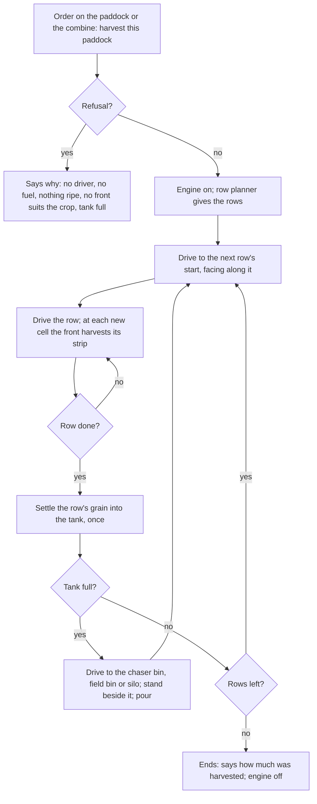
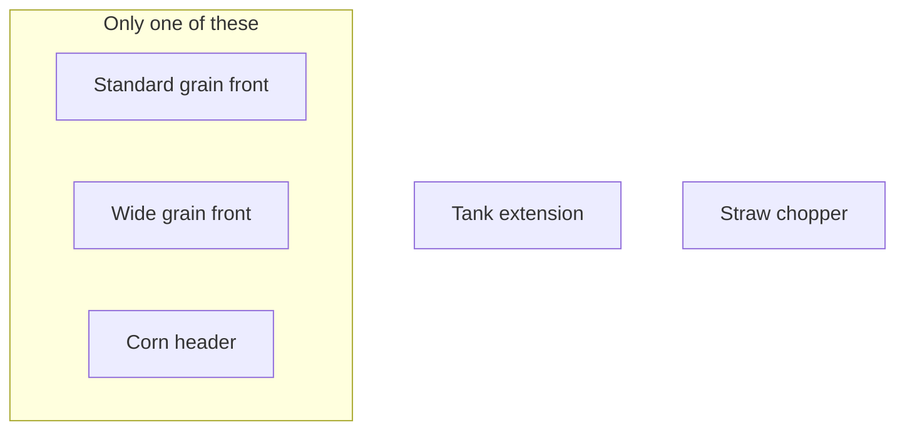

# D'thorga Farming, batch one: the build design (19 Nov 2026)

**Status (20 Nov 2026):** batch one is mostly built, in D'thorga Framework 0.189.0 and D'thorga Farming 0.1.0: the shared run base, the field run, bulk holds, couplings, draught and carried weight in the Framework; paddocks with their two patches, the combine with both grain fronts, the chaser bin, crop classes, research, icons and test rows 272-274 in Farming. **Built since:** the field bin and the silo (Farming 0.2.0), the corn header (Farming 0.3.0). **Not built yet:** the remaining overlays and the sounds. Nothing is tested in game. The owner chose on 20 Nov 2026 to commit as it is built and go straight on to batch two before a first test.

The owner chose this batch on 19 Nov 2026 ("Base and harvest first"), and on the same day said to proceed with the groundwork before
a build: read the real figures in full, write this design, and draw up the art list. The figures are in
[farm machines](farming-machines.md#real-figures-read-in-full-19-nov-2026); this record is the design and the art plan.

**How to read the marks:** **[code]** was read in code on 19 Nov 2026 by a research helper, never run; **[code, checked]** was also
read by the agent writing this; **[I]** our inference; **[A]** an authored figure or choice for the owner to revise. **None of it
is tested in game.**

## Read this first

- **What batch one makes:** paddocks; the "harvest this paddock" order with its row planner; a **combine harvester** with a grain
  front; a **chaser bin** trailer; a **field bin** and a **silo** that hold grain as a bulk amount. Hand-sown paddocks can then be
  harvested by machine.
- **It stands on untested code**: the gathering run (rows 201 and 202), the hitch and trailers, and the engine-load ledger. A fault
  in any of them would show in batch one. Seeing a gathering run and a tow once in ordinary play first would separate the two.
- **Any vehicle with our hitch tows the chaser bin** (owner, 19 Nov 2026): D'thorga Vehicles' trucks, or another mod's vehicle on
  our loadout. **So D'thorga Farming alone has a chaser bin with nothing to pull it until batch two's tractors**; its README says so
  among the gotchas, and the bin's inspect text names what it waits for. The combine can still pour straight into a field bin or
  silo.
- **The harvest run and the gathering run share one base** (owner, 19 Nov 2026), built in this batch.
- **Most of it reuses what exists.** The engine ledger already charges an implement's load while driving; the gathering run already
  starts, drives, unloads, stops with a reason and resumes after a load. New: the bulk grain hold, the strip hook, the row planner,
  the harvest steps, a draught term, and the paddock mark.
- **Two Harmony patches** are needed, each with a reason: the paddock's own gizmos on the growing zone, and the harvest-scan skip.
- **The combine's picture is the first paid picture of this mod**: one pilot body, with a dry run first and the owner's go.

## What batch one lets, stops and changes

The design record's table covers each behaviour ([farm machines](farming-machines.md#what-each-behaviour-lets-stops-and-changes)).
For this batch alone:

| Behaviour | Lets | Stops | Changes |
| --- | --- | --- | --- |
| Paddock | Mark a growing zone for machines, and keep hands from walking it | Hands working it, unless "hands may help" is on | Big fields are laid out once, for machines |
| Harvest this paddock | Harvest a whole paddock with one order and one driver | Harvesting unripe crops; harvesting a crop no front suits at full rate | Harvest is a short visit with a start and an end |
| Grain tank and auger | Carry a harvest as bulk and pour it out | Carrying without limit, or for free: the grain weighs on the engine | The tank's size sets how often the combine must unload |
| Chaser bin | Keep the combine working while the bin carts grain to the edge | Unloading on the move (a later row, AG2.4) | Two machines and two drivers make a harvest crew |
| Field bin and silo | Store a harvest as one amount, not hundreds of stacks | Storing without limit; storing forever without care | Storage is sized before the harvest |

## Where each piece goes

The rules require generic code in D'thorga Framework's core and only what is the mod's own in D'thorga Farming.

| Piece | Where | Why there |
| --- | --- | --- |
| **Row planner** (`RowPlanRule`) | Framework core, `src/PhobosFramework/Rules/`, with tests | Game-free; any vehicle that covers an area (a mower, a road paver) would use it |
| **Strip rule** (`StripRule`: the cells a strip covers from a footprint, a facing and a width) | Framework core, `Rules/`, with tests | Game-free; sprayers, spreaders and the plough reuse it |
| **Harvest yield rule** (`HarvestRule`: the failure roll and the yield multiplier as numbers) | Framework core, `Rules/`, with tests | Game-free half of the game's steps, so it is tested |
| **Bulk hold rule** (`BulkHoldRule`: amounts, mixing freshness, capacity by mass) | Framework core, `Rules/`, with tests | Game-free; the silo, the tank and the chaser bin share it |
| **Bulk hold comps**: `CompPhobosBulkHold` (vehicles) and `CompPhobosBulkStore` (buildings) | Framework core for the store; `PhobosFramework.Vehicles` for the vehicle comp | Any mod's machine could carry bulk goods; the vehicle half needs Vehicle Framework |
| **Load mass interface** (`IVehicleCarriedLoad`) | `PhobosFramework.Vehicles` | Replaces the two places that know only tanks (`Powertrain.MassKg`, `CompPhobosSling.LoadKilograms`) [code], so a tank, a bulk hold and anything later all weigh the same way |
| **Draught** (`DriveConditions.DraughtN`) | `PhobosFramework.Vehicles/Rules/DrivetrainModel.cs` | Added to `RoadLoad` and the traction rolling term, set in `Powertrain.SampleGround` beside the tow mass, and a parameter of `TowRule.Modelled` so "can this work that?" forecasts the same way [code] |
| **The field run** | `PhobosFramework.Vehicles`, beside the gathering run | Generic: a vehicle working its way over an area of cells |
| **Paddocks**: the mark, the map component, the two patches | D'thorga Farming | Farming's own |
| **The harvester comp** (`CompPhobosHarvester`) and its fronts | D'thorga Farming | Farming's own policy |
| **Defs, text, art, sounds, research, settings** | D'thorga Farming | Content stays in the content mod |

**Shared with the gathering run** (owner's choice, 19 Nov 2026, AG0.5): the field run and the gathering run share their stuck
detection, their "stop and say why", their back-up-and-unload and their save-and-resume, lifted into one base, `VehicleRun`, in
this build. The gathering run's behaviour stays exactly as it is, its saved keys are kept, and its seen-in-play notes keep their
keys. **The stated risk, accepted:** the gathering run is untested, and this touches it before its first test; its first test
then checks the shared base too.

## The mod

- **Folder and identity:** `mods/PhobosFarming`, `packageId` `PhobosDthorga.Farming`, source `src/PhobosFarming`, rule tests
  `tests/PhobosFarming.Rules.Tests` for anything game-free that is Farming's own.
- **Hard dependencies:** D'thorga Framework and Vehicle Framework, in `modDependencies`, with `loadAfter` naming both
  (`smashphil.vehicleframework` and `PhobosDthorga.Framework`) [code].
- **The first mod of ours whose own assembly references `PhobosFramework.Vehicles`** [code]: the vehicle assembly ships in the
  Framework's `Mods/VehicleFramework/1.7` folder. `tests/test_tie_in_load_order.py` checks load order only for tie-in projects, so it
  is widened to any project that references a tie-in assembly, in the same change.
- **Registered in:** `config/maintained-constants.json` (a `PhobosFarming.version` block); the mod table in `docs/README.md` and the
  root `README.md` (with its dependency diagram); the mod-name pattern in `scripts/check-doc-status.py`; `config/test-evidence.json`'s
  `versionNames`, with its own `Seen` class; the player guide, a new chapter.
- **The Mod class** follows the patches' pattern: a `Logger` from `Logs.For("D'thorga Farming", part)`, Harmony applied per patch,
  and one `LoadReport` per part, as D'thorga Medical does with its parts' settings.
- **The README** opens with "One of House D'thorga's mods (also spelt dthorga)", the version and built date, "**Not yet tested in
  game.**", then **Read this first (gotchas)**: needs Vehicle Framework and D'thorga Framework; safe to add mid-game; what removal
  does (paddocks become plain growing zones; machines, bins and their grain vanish with the mod); settings to decide first.

## Paddocks (AG0.1)

- **A paddock is a `Zone_Growing` with a mark.** The mark lives in a `MapComponent_PhobosPaddocks`, keyed by the zone's `ID`, which
  the game keeps stable across saves (`Zone.ID`, saved as `"ID"`) [code]. Nothing about the zone itself changes, so blight, raiders,
  Crop Rotation and every other mod see a growing zone.
- **Making one:** a "Machine-worked" toggle on any growing zone. Its state: `machineWorked`, `handsMayHelp` (off), and later the
  soil figures.
- **Hands skip it:**
  - **Sowing**: while a paddock is machine-worked and hands may not help, its `allowSow` is held off. The game's sowing scan honours
    that with no patch (`WorkGiver_GrowerSow.ExtraRequirements` returns false) [code, checked].
  - **The game's own "allow sowing" toggle can be flipped back by hand** [code], so **patch one**, a postfix on
    `Zone_Growing.GetGizmos` (as Dubs Bad Hygiene adds its fertilise toggle [code]), replaces that toggle on a paddock with ours:
    "Machine-worked" and "Hands may help". On a growing zone that is not a paddock, it only adds "Machine-worked".
  - **Harvesting**: **patch two**, a postfix on `WorkGiver_Grower.ExtraRequirements` returning false for a machine-only paddock
    [code, checked: the base method is a virtual returning true; the sowing giver overrides it without calling it, so the patch
    reaches only the harvest giver]. **Reason for the patch**, as the rules ask: there is no extension point, and without it every
    colonist looking for work walks every paddock cell.
- **Batch one has no seed drill**, so in this batch a paddock is sown by hand: the player turns "Hands may help" on to sow and the
  machines harvest. The inspect text says so. In batch two the drill takes over.

## Harvest this paddock (AG0.2)

- **Started by a gizmo**, as the gathering run is [code]: on the combine with a paddock picked, and on the paddock with a combine
  picked. A colonist must already be aboard as driver, as for the gathering run. No new job; no work type.
- **The row planner** (`RowPlanRule`, game-free): from the paddock's cells, the strip width and the machine's footprint, it returns
  rows in order, alternating direction, each with a start and end cell and a facing. Cells it cannot reach (an obstacle, a gap) split
  a row. Headlands: the outer ring of the paddock is left for a last pass round the edge [A].
- **Driving** uses `VehicleAutoDrive.DriveTo(vehicle, cell, endFacing)` one row end at a time [code]. No queue of waypoints: Vehicle
  Framework has none outside its interface [code].
- **The strip hook:** the combine's comp registers for Vehicle Framework's `PositionChanged` event [code]; the handler has no
  arguments, so the comp keeps its own last rectangle and works out the cells newly under the front with `StripRule`, using the
  vehicle's full rotation, since a combine may move diagonally [code]. A few cells per cell moved; nothing else.
- **What the front does at each cell** (AG2.1): finds a plant; checks it the way the game's harvest scan does (ripe and mature,
  not prevented from cutting, can yield, harvestable by hand, the zone allows cutting it) [code]; then the harvest steps below. An
  unripe plant is passed over, never destroyed.
- **Stops and refusals** reuse the gathering run's: stuck detection, a threat on the map, the driver leaving, fuel running out, an
  order from the player. Each says why.

### The harvest steps (AG2.2)

The game's own steps from the colonist's job, in its order, with the driver standing in for the colonist and the vehicle as the
harvester the harvest hook sees [code, checked against the research's reading of `JobDriver_PlantWork.cs:54-124`]:

1. **The driver's stat**: `PlantHarvestYield` (or `DrugHarvestYield` for a drug crop) read from the driver aboard. Reading a stat
   does not need the pawn to be on the map [I].
2. **The failure roll**: if the driver is humanlike, the crop can fail and is not blighted, and a roll is above the stat, the plant
   yields nothing. Batch one keeps the roll (agent lean): the driver's skill matters on a machine as by hand.
3. **The yield**: `plant.YieldNow()`, times the stat when the stat is above 1, rounded at random. Every mod that changes yield does
   it through `YieldNow` [code].
4. **The quest notice**: `Find.QuestManager.Notify_PlantHarvested(driver, product)`, and the driver's "plants harvested" record.
5. **The comps' extra yield** when the plant is still harvestable.
6. **The harvest hook**: `plant.PlantCollected(vehicle, PlantDestructionMode.Chop)`. The vehicle is spawned, on the map and the
   player's, which every active patch on it tolerates [code].
7. **The second product of a dual crop** (Vanilla Expanded Framework's `DualCropExtension`: barley's hay, oats' raw oats), worked
   out by us the way its own patch does (the stat roll, `outPutAmount x growth`, the multiplier above 1), because its patch skips a
   vehicle [code]. Read by reflection from a tie-in only when the framework is active.
8. **Into the row's tally**, never into Vehicle Framework's cargo: adding cargo recalculates the vehicle's stats each time [code].
   The tally is settled into the grain tank once at the row's end.

**Plants XP** for the driver [A]: a share of what the hand harvest would give, scaled by the plants harvested, so a combine driver
still learns, slower than by hand.

### Fronts (AG2.3)

- **The front decides which crops the combine takes, read from each crop's traits, never its name.** A crop fits the grain front
  when its plant is not a tree, is harvested whole at one time (`harvestAfterGrowth` 0), its product is food or fibre with a small
  mass per unit, and it is sown in the ground. Agent's reading of the owner's crops: rice, corn, haygrass, cotton, wheat, barley,
  oats, rye, sorghum, buckwheat and canola fit; potatoes, pumpkins and vegetables do not (no root or vegetable front in this batch).
- **An XML extension overrides the reading for odd crops** (`PhobosCropFrontExtension`), patched onto crops by `PatchOperationFindMod`
  where a mod's crop is misread.
- **A crop no front suits** is refused with the reason, not harvested slowly, in this batch [A].
- **The front is an either/or upgrade** on the combine's tree: a standard grain front (strip 6 cells) and, after research, a wide
  front (strip 8 cells) (owner, 20 Nov 2026: even widths, so each front sits centred on the 4-cell body; the record had 5 and 7).

## The bulk grain hold (AG2.5)

- **A new hold, not a tank** [code]: our tanks are built for fluids (phases, freezing, venting, pumping only when standing and set
  up), and the bulk bunker holds item stacks.
- **What it holds:** amounts by product (`ThingDef` and count) with their freshness, up to a mass (kilograms), not a stack count.
  Mixed products are allowed in a bin and a silo [A]; a combine's tank holds one product at a time, and a second crop waits for it to
  be emptied.
- **Freshness:** each product's rot clock is kept as one weighted figure per product, the way the bulk tanker keeps one quality per
  fluid [code]. A silo with power (aeration) slows it like cool storage [A]; a field bin keeps it as the open air would.
- **Pouring out** turns amounts back into item stacks: next to the bin (as the tanker's item port does, through `StorageNearby.Place`)
  [code], into a standing vehicle's cargo (as the loading chute does) [code], or into another hold in reach.
- **Pouring between holds** (combine to chaser bin, chaser bin to silo) follows the tanker's tank-to-tank pattern: both standing,
  within reach, the same product or room for it [code].
- **Weight:** the hold says what it carries through `IVehicleCarriedLoad`, so grain loads the engine and the tow.

## The machines (AG2)

| Machine | Footprint [A] | What it carries | Notes |
| --- | --- | --- | --- |
| **Combine harvester** | 4 by 9 cells, front overhanging | Grain tank, about 9,000 kg [A] | Self-propelled; driver seat; the threshing drum and the front as shaft loads; a folding unloading auger |
| **Chaser bin** | 3 by 7 cells (the trailer floor) | About 12,000 kg [A] | A trailer on our hitch, with its own auger; tyres only, as every trailer of ours |
| **Field bin** | 3 by 3 cells, a building | About 25,000 kg [A] | No power; fills from an auger; empties through its own spout |
| **Silo** | 4 by 4 cells, a building | About 60,000 kg [A] | Aeration by power slows spoiling; empties into a truck under its spout |

- **The threshing drum and the front's drive are shaft loads.** The engine ledger already charges shaft loads while driving
  [code]; each is a `PhobosVehicleShaftLoadDef` switched on by a new `When_Harvesting` condition read from the combine's comp, as the
  tank pump's is [code]. **No new engine state is needed for the combine.**
- **Draught** (`DraughtN`) is needed for towed implements (batch two) and to make a full chaser bin's rolling weight count; the
  combine's front is driven, not dragged.
- **Parts bills** by role for each: engine, transmission, wheels or tracks, frame, hydraulics, and a "threshing" role filled by our
  own part.
- **Research** (agent proposal, on the D'thorga tab): "Mechanised harvesting" for the combine, chaser bin and field bin; "Grain
  storage" for the silo. A hard requirement on our vehicle parts research [code].
- **Other factions' machines:** a combine and a chaser bin parked at a farming settlement, on the light model. None in raids.

### Upgrade trees (agent proposals)

Every node moves a figure that changes an outcome. Either/or nodes fill the same place.

| Machine | Node | What it changes | Link |
| --- | --- | --- | --- |
| Combine | Standard grain front | Strip 6 cells | Either/or with the wide front |
| Combine | Wide grain front | Strip 8 cells, more drum load | Either/or; needs research |
| Combine | Tank extension | Tank capacity up a third | Free-standing |
| Combine | Straw chopper | Straw left as mulch, for the soil rules later | Free-standing |
| Combine | Cab air filter | Less dust wear in the engine's air filter | Free-standing |
| Combine | Yield monitor | Shows the paddock's yield per row; an electrical load | Free-standing |
| Chaser bin | Fast auger | Pours faster, more power take-off load | Free-standing |
| Chaser bin | Flotation tyres | Less rolling resistance on soft ground | Free-standing |
| Silo | Aeration fan | Slows spoiling; draws power | Free-standing |

**As built (20 Nov 2026, Farming 0.1.0):** the two fronts, the tank extension and the straw chopper on the combine; the fast auger on the
chaser bin. The cab air filter, the yield monitor and the flotation tyres are not built: each needs a hook into the vehicle systems first.

<!-- upgrade-tree: Phobos_Combine_UpgradeTree -->

<!-- upgrade-tree: Phobos_ChaserBin_UpgradeTree -->

## Settings (batch one)

Reported by name when built, as the standing rule asks. **Agent proposals:**

| Section | Setting | Default |
| --- | --- | --- |
| Paddocks | "Hands may help on new paddocks" | Off |
| Harvest | "A combine driver can fail a harvest, as by hand" | On |
| Harvest | "Combines leave the headland for a last pass" | On |
| Harvest | "Harvest fires on hot, dry days" (the owner's switch; on in Realistic only, which arrives with the soil rules) | Off until the soil presets exist |
| Storage | "Grain keeps longer in an aerated silo" | On |

## Seen-in-play notes (batch one)

Each behaviour with a test row notes itself, as the rules require. Keys proposed; rows are claimed from the shared test list at the
build, not now.

| Key | When | Carries |
| --- | --- | --- |
| `farming.paddock.marked` | A zone is marked machine-worked | The zone's cell count |
| `farming.harvest-run.start` | A harvest run starts | The crop, the rows planned |
| `farming.harvest.cell` | First harvest by a front (once) | Variant: the front; values: the yield |
| `farming.harvest.second-product` | A dual crop's second product is made | The product, the amount |
| `farming.harvest-run.end` | A run ends | Variant: why; values: plants, kilograms, rows |
| `farming.hold.pour` | Grain pours between holds or out | Variant: into a bin, a vehicle, the ground; values: kilograms |
| `farming.silo.aerated` | An aerated silo's spoiling is slowed | The rate |

## Cost to run

- **Per combine working**: a strip of a handful of cells at each cell moved, one tally per row, one ledger load. Nothing while
  parked.
- **Per paddock**: one entry in a map component; the hand scans skip it, which saves more than the machine costs.
- **Per bin or silo**: nothing per tick; spoiling is worked out when it is read or poured, from elapsed time [A].
- **Measured** with `python scripts/perf.py` before and after, with the owner's leave.

## Art and sound plan

Sized by the rule: measured against the biggest comparable vehicle on the owner's list, generated at 1.5 times the drawn size or
more. **Comparables measured on 19 Nov 2026** [code]: our trucks 3 by 8 to 3 by 10 cells (tipper and generator set 3 by 8; tanker
and drill rig 3 by 10), drawn 4 by 9 for the tipper; the Osprey 5 by 9; the Pintle trailers 3 by 7 and 3 by 8. No farm vehicle is
active to measure against.

| Picture | Footprint | Drawn size [A] | In game at 128 px | Requested | Route |
| --- | --- | --- | --- | --- | --- |
| **Combine body (pilot)** | 4 by 9 | 6 by 10, to hold the front's overhang | 768 by 1,280 px | **1,536 by 2,048** (1.6 times) | Paid, the OpenAI image API |
| Combine fronts: standard (6 cells) and wide (8 cells) | — | Their own canvases, 6 by 2 and 8 by 2.75 | 768 by 256 and 1,024 by 352 px | 1,536 by 512 and 2,048 by 704, drawn alone | Paid: **done** 20 Nov 2026, standard attempts 2 and 1, wide attempt 2 ([record](../../assets/phobos-vehicles/requests/combine-fronts-record.md)) |
| Combine overlays: auger out, tank extension, straw chopper | — | The body's canvas | — | Pieces of the body, per rule 13 | Paid, still to do |
| Chaser bin body | 3 by 7 | 4 by 8 | 512 by 1,024 px | 1,024 by 2,048 | Paid: **done**, attempt 3 picked (20 Nov 2026) |
| Chaser bin overlay: auger out | — | The body's canvas | — | A piece of the body | Paid |
| Field bin | 3 by 3 | 3 by 3 | 384 by 384 px | 1,024 by 1,024 | Paid or local, the owner's choice |
| Silo | 4 by 4 | 4 by 4 | 512 by 512 px | 1,024 by 1,024 | Paid or local, the owner's choice |
| Button icons (harvest, paddock, hands may help, pour) | — | — | — | Local, a small batch | Local, on the owner's go |

- **One pilot before the family**: the combine's north body first. Its request is written
  (`assets/phobos-vehicles/requests/combine-pilot.json`); its dry run is free and sends nothing; the real run waits on the owner's go.
- **Bodies drawn bare**: no front, no grain, no driver. The front is an overlay, so the standard and the wide front are drawn on the
  same body.
- **Sounds**: a combine's engine, threshing drum and auger, a tractor's engine and the bins' pouring, from real recordings where a
  public-domain or CC0 recording of a combine exists (owner's rule of 19 Nov 2026), otherwise generated. A search for recordings
  comes with the sound batch.

## The owner's answers (19 Nov 2026)

| Question | The owner's answer |
| --- | --- |
| What tows the chaser bin in batch one | **Any vehicle with our hitch** (the agent had leaned to moving the medium tractor forward) |
| Share the gathering run's driving with the harvest run now, or copy and share later | **Share it in the build** |
| Run the combine's pilot picture | **Yes, now** |
| The fronts' widths (20 Nov 2026) | **6 and 8 cells**, centred on the body |
| When the first test comes (20 Nov 2026) | **After batch two**, so the first test is a whole loop of till, sow and harvest |
| How the rest of the art is paced (20 Nov 2026) | **A question card for each paid run**, with its dry-run ceiling, before anything is spent |
| The combine's fronts (20 Nov 2026) | **Standard: keep both**, attempt 2 the default and 1 an alternate look; **wide: attempt 2** (US$0.128) |
| The chaser bin's body (20 Nov 2026) | **Attempt 3** of three (US$0.151; [record](../../assets/phobos-vehicles/requests/chaser-bin-pilot-record.md)) |

## The fault-read (20 Nov 2026)

A separate reviewer read the build's code on the owner's go for overnight agency, checking it against the game's and Vehicle
Framework's code; nothing was run. **No crash, no load or save fault, no Def that would show red.** Ten findings, all fixed in
Framework 0.191.0 and Farming 0.4.0 except the last, which only play can settle:

| # | Finding | Fixed how |
| --- | --- | --- |
| 1 | Fresh grain poured into a long-idle bin was aged for the bin's idle weeks | The bin is aged to now before a pour; an empty bin starts its clock afresh |
| 2 | A row's cut grain was lost on a save and load, on leaving the map, or dropped on a stop even with room in the tank | Saved; poured into the tank first; only the rest left beside the combine |
| 3 | Every row start put the body beyond the paddock; against a wall the run gave up | A row starts further in where the body fits, and a sweep drives the unfinished rows from their other end |
| 4 | A tank filling mid-row left the rest of that row for the whole run | The sweep finishes it |
| 5 | A combine could unload into another combine | Field machines' tanks are never a destination |
| 6 | Arriving end-on to a long cart left it out of auger reach | The combine stands side-on, only where its auger reaches |
| 7 | Ground pours laid hundreds of stacks a moment; a destroyed silo and a crowded straw pile lost goods silently | A few heaps a step; the silo names what it lost; straw is kept for the next row |
| 8 | A paddock deleted during a wait for a driver left a dead reference in the save | Dropped before saving |
| 9 | Colonists' harvest scans looked up the paddock record for every zone | Cached for the map |
| 10 | The patch keeping hands off a machine-only paddock changes a one-line method the runtime might fold into its caller | **Not fixable by reading; to watch in play** (row 272) |

**A balance question the fault-read raised, for the owner** (not changed): the tank holds 9,000 kg, which is about 300,000 rice at the
game's 0.03 kg a unit, while a thousand-cell rice paddock yields about 6,000 rice (180 kg). As built, a combine's tank never fills and
the chaser bin is never needed. Real weights against the game's scale is the owner's call.

## Still unknown

- **Whether Vehicle Framework's `PositionChanged` fires when our hitch moves a trailer.** Its patch on the position setter suggests
  it does; our own code comment says our moves raise no move events. Read again at the build; if it does not fire, the hitch raises
  our own.
- **How a combine 4 cells wide turns at a headland** in Vehicle Framework's pathing: a row planner can leave room, but a cramped
  paddock may still trap it.
- **Whether reading a stat from a driver aboard works for every mod's stat parts**: one that reads the pawn's map would see none.
