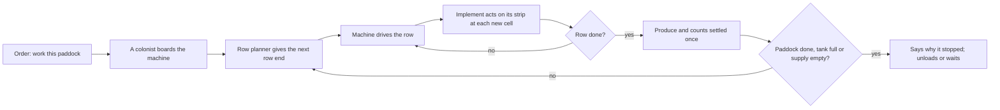

# Farm machines: research and design for D'thorga Farming (19 Nov 2026)

**Status (19 Nov 2026):** research and record only. No mod, Def, code or picture exists for any of it, and nothing here is tested in game. The owner answered seven questions the same day (below); the rest wait as open questions at the end.

The owner's request, 19 Nov 2026: "one idea I've just had is that of properly working, fully simulated, agricultural vehicles. At
that too, we will normalize working agricultural land on tiles of the map other than that of your main colony [...] I know
performance is going to be an important criteria, especially with that of having more than one open world map at a time [...] We
have done the bulk of the work with simulating vehicle engine code and the like already, so most of the investment will be into
farming logic and the like. It might need its own mod too". This record covers the mod, the machines and field work on any map.
[Farms on other tiles](farming-remote-farms.md) and [soil rules](farming-soil.md) are its two companions.

**How to read the marks:** **[code]** was read in code or Defs on 19 Nov 2026 by research helpers, never run; **[code, checked]** was
also read by the agent writing this; **[Defs]** comes from the Def tools over the owner's active mods; **[tool]** from the Workshop
tool; **[S]** a secondary source, and **[S, summary]** one read only as a search summary, not the page; **[I]** our inference;
**[A]** an authored figure or choice for the owner to revise. **None of it is tested in game.**

## Read this first

- **What it is:** a new mod, **D'thorga Farming** (dthorga farming), with working farm machines on Vehicle Framework: a tractor
  pulling a plough, cultivator and seed drill; a combine harvester with grain handling; a sprayer and a spreader. Machines work
  **paddocks**: growing zones marked for machine work.
- **The guiding principle is the owner's:** realism is not the end goal; the balance of realism and play is, with Farming Simulator
  25 as the model. Realism stays where it gives the player a decision and is abstracted where it is only bookkeeping.
- **Nobody has done this properly.** None of the owner's 364 active mods has a farm vehicle [Defs]. The one tractor mod, Tractor:
  Industrial Age, declares 1.5 and 1.6 only and, by its author's word, is "super jank" [tool].
- **Most of the vehicle side exists, untested in game**: the engine-load ledger, the hitch, trailers, self-driving runs, tanks,
  hoppers and top-up. **Nothing of ours sows, harvests or changes terrain yet**, and the engine model has no state for working
  while driving [code].
- **A machine must repeat the game's own harvest steps.** The game has no single harvest call; VFE Factory's autofarmer skips the
  steps and so loses barley's hay and oats' second product today [code].
- **Machine sowing uses up seed** (owner). Sowing by hand stays free, as in the game (agent's reading, to confirm).
- **Big fields are cheap for the game; hand-work scans of big fields are not** [code]. Paddocks are skipped by hand-work scans.
- **The art and sound load is large**: about a dozen bodies with overlays, and real recordings for real machines.

## The owner's answers (19 Nov 2026)

| Question | The owner's answer |
| --- | --- |
| Farms on other tiles | **A mix**: the farm runs in the background by simulation ledgers, as realistically as performance allows, and the player may observe it whenever they wish ([record](farming-remote-farms.md)) |
| Soil and crop rules | **Configurable settings** for the player to choose from; a more punishing, more realistic mode must exist, off by default ([record](farming-soil.md)) |
| Where it lives | **A new mod, D'thorga Farming** |
| Machines in depth | **Tillage and seeding; harvest and grain handling; spraying and fertiliser.** Hay, irrigation and forestry get short entries: "largely offered by other mods already" |
| Other mods | **Learn from other mods as we expand into this** |
| Soil moisture | **Study Dubs Bad Hygiene's way**: its balance of game mechanics and realism is "quite good", "even refreshing" |
| Seeds | **Machine sowing uses up seed**: "an excellent tradeoff for the ability to mass-plant and farm at an industrial scale" |

## The guiding principle (owner, 19 Nov 2026)

"Being truly realistic isn't also the ultimate end-goal, that's why I enjoy Farming Simulator 25 and its mods so much. They do a
good job at balancing realism and game play together." And, correcting the agent's first draft: "We should be giving the player
choices, not denying or negating them", clarified as "shouldn't", not "never".

How these records apply it (agent's reading, for the owner to revise):

- **Keep realism where it gives the player a decision**: which tractor for which implement, plough or direct-drill, when to spray,
  what to grow next. **Abstract it where it is only bookkeeping.**
- **Farming Simulator 25 is the first design reference**: field states a player can see, a few care steps that each add yield, and
  machines that state the power they need.
- **The real physics stays underneath** (the engine ledger already exists), but the player meets it as plain statements: "this
  tractor is too small for this plough". Figures are tuned for play and labelled as authored; Engineer mode may show the maths.
- **Balance sets the defaults, not the ceiling.** Where it is reasonable a realism rule is a setting, and a harsher mode exists for
  players who want it.
- **The rule against value from nothing still holds**: a harvest is paid for in fuel, seed, fertiliser, wear and time.

## What each behaviour lets, stops and changes

| Behaviour | What it lets the player do | What it stops them doing | How it changes the way they play |
| --- | --- | --- | --- |
| **Paddock** (a machine-worked growing zone) | Farm an area far larger than hands could, without colonists walking every cell looking for work | Having hands work it by default: a paddock is left to machines unless "hands may help" is on | Fields are laid out for machines: long, clear, with room to turn |
| **"Work this paddock"** (one order; the machine steers its own rows) | Send a colonist and a machine to plough, sow, spray or harvest a whole paddock with one order | Steering by hand, row by row; and working it with nobody aboard until a crewless fit exists | Farm work becomes a job with a start and an end, done in a visit |
| **Field work loads the engine** | See honestly whether a tractor suits an implement | Pulling a wide plough with a small tractor: it crawls or stalls, and says why | Tractors are chosen by size; a big implement is an investment in a big tractor |
| **Plough or direct-drill** | Choose between burying weeds at a cost in fuel and time, or sowing straight into stubble | Getting both: direct drilling saves fuel and lets weeds build | Ploughing becomes a decision made per paddock and per season |
| **Seed drill and seed** (owner) | Sow a paddock many times faster than hands | Sowing for nothing: the drill uses up seed, and stops when empty | Seed is planned, stored and carted like fuel |
| **Combine harvester** | Harvest a ripe paddock before it rots, with the driver's skill setting the yield | Harvesting trees, or crops its front does not suit, at full rate | Harvest becomes a short, intense season; crops are picked partly for the machines owned |
| **Grain tank, chaser bin, field bin, silo** | Hold a harvest as bulk, not as thousands of item stacks, and cart it home | Storing without limit: each has a capacity, and grain still spoils | Storage and haulage are sized to the harvest before it starts |
| **Sprayer and spreader** | Treat a whole paddock for weeds, blight or fertility in one pass | Treating for nothing: each uses up water and a chemical or fertiliser | Care steps are done at the right growth stage, in one visit |
| **Crop-dusting aircraft** | Spray a paddock, or drop water on a fire, from the air | Cheap flying: it burns aircraft fuel and needs a strip or pad | A distant or wet paddock is treated without driving on it |
| **Other factions' farm machines** | Meet, capture or buy machines at farming settlements | Nothing | A raid on a farming settlement has something worth taking |

## What the research found

### The owner's game has no farm vehicle, and one tractor mod exists

- **None of the 83 vehicle Defs in the owner's active mods is agricultural** [Defs]. The nearest machines are VFE Factory's
  autofarmer (a fixed 7 by 3 machine that moves across a zone), The Dead Man's Switch - Legion's agricultural frame mech and
  Biotech's agrihand.
- **Tractor: Industrial Age** (Workshop 3276694110, TheRealCaptRex; 1.5 and 1.6) ploughs, plants and harvests into its cargo, driven
  by hand. Its uploader said in October 2025 that he works on it only for game updates; players report that it harvests "but thats
  it", ignores modded plants and will not plant on Tilled Soil [tool]. No public source was found, so its code is unread.
- **No maintained grain silo mod was found**, and no active mod defines a pesticide, a herbicide, ammonia, nitrates or potash [Defs].
- The Workshop tool has no Workshop-wide keyword search: the two Vehicle Framework community collections, the Vanilla Expanded
  collection and the tool's cache were searched, so a mod outside those could have been missed.

### How the game grows, sows and harvests

All from the RimWorld 1.7 decompile in `.local/decompiled/RimWorld-1.7` [code].

- **A plant is cheap.** Plants tick on the long list: one update every 2,000 ticks, about fifteen cell lookups and no allocation
  (`RimWorld.Plant.cs:810-880`). A 2,500-plant paddock adds about 1.25 such updates per game tick [I].
- **Growth** is `1 / (60000 x growDays) x fertility x temperature x light` per tick, zero while resting (outside 06:00 to 19:12) and
  out of season (`Plant.cs:277-348`; `PlantUtility.cs:352-381`).
- **Left unharvested, a crop rots** once its age passes eight times its growing days (`Plant.cs:210-213`; `PlantProperties.cs:73`).
- **Sowing has a clean model**: `CompPlantable.DoPlant` spawns the plant, sets growth to 0.0001 and marks it sown. The checks before
  it are `PlantUtility.CanNowPlantAt`, `GrowthSeasonNow`, `AdjacentSowBlocker` and snow depth.
- **Harvesting has no single call.** The steps live inside the colonist's job (`JobDriver_PlantWork.cs:55-111`): the harvester's
  yield stat, a failure roll for humanlike harvesters, `Plant.YieldNow()`, `QuestManager.Notify_PlantHarvested`, the comps' extra
  yield, then `Plant.PlantCollected(pawn, mode)`.
- **Hand-work scans walk every growing cell.** `WorkGiver_Grower.PotentialWorkCellsGlobal` yields each cell of each growing zone for
  each colonist looking for work (`WorkGiver_Grower.cs:18-56`) [code, checked]. This, not the plants, is what a huge hand-worked
  field costs.
- **The sowing scan can be skipped by zone with no patch**: `WorkGiver_GrowerSow.ExtraRequirements` returns false when the zone's
  `allowSow` is off (`WorkGiver_GrowerSow.cs:21-46`) [code, checked]. **The harvest scan cannot**: the base `ExtraRequirements`
  returns true and the harvest work-giver does not override it (`WorkGiver_Grower.cs:13-16`) [code, checked].

### Who listens when a plant is harvested

`Plant.PlantCollected(by, mode)` is patched by five active mods, and a machine's choice of "harvester" decides which of them work
[code].

| Patch | What it reads from the harvester | Nobody passed | A vehicle passed | A driver aboard passed (no map) |
| --- | --- | --- | --- | --- |
| The game itself (`Plant.cs:621-664`) | Faction and jobs, for trees, stumps and blighted cuts only | Throws on trees; crops are fine | Fine | Fine |
| Vanilla Expanded Framework (second product of dual crops) | Yield stat, race, faction, position, map | **Throws; the harvest never completes** | Second product skipped silently | Error logged, second product lost |
| Quiet Wonders (falling trees) | Position, if spawned | Fine | Fine | Fine |
| TD Enhancement Pack | Nothing | Fine | Fine | Fine |
| Vanilla Plants Expanded (uses up tilled soil) | Nothing | Fine | Fine | Fine |
| The Dead Man's Switch - Legion | Returns at once unless spawned | Fine | Fine | Fine |

- **Yield changes are pawn-free**: every mod that alters yield does so through `Plant.YieldNow` (Vanilla Ideology Expanded - Memes
  and Structures among the active ones), so a machine that calls it picks them all up.
- **Our conclusion [I]:** do the per-plant steps ourselves with **the driver's** skill and stats, then call
  `PlantCollected(vehicle, Chop)` with **the vehicle** as the harvester, and make a dual crop's second product ourselves from the
  crop's own extension so it cannot be doubled. Machines work field crops only, never trees, so the tree paths never run.

### What Vehicle Framework gives and does not

Read in its public source (`SmashPhil/Vehicle-Framework`, MIT, branch `develop` at `026420b`, 17 Nov 2026) and checked against the
installed 1.7.2537 build [code].

- **It never touches plants**: a vehicle neither crushes nor harvests them; a plant only adds path cost.
- **It announces every cell a vehicle enters**: the `PositionChanged` event, with handlers registered in a vehicle comp.
- **It has one model of a vehicle doing work**: a colonist joins `LordJob_TravelWithVehicle`, which gathers, boards, travels, runs an
  `IVehicleTask` and returns. Its only task is fishing, with a placeholder end condition.
- **It will not drive without a draft and a crew**, or the `Autonomous` permission; paths are worked out asynchronously.
- **Adding cargo recalculates the vehicle's stats every time**, so produce must not be added plant by plant.
- **It has no towing.** Ours is the hitch in `src/PhobosFramework.Vehicles/Hitch/`.

### What we already have, and its gaps

All built and, unless said, not tested in game [code].

| Piece | Where | What a farm machine uses it for |
| --- | --- | --- |
| Engine-load ledger | `Defs/ShaftLoadDefs.cs`, `Rules/ShaftLoadRule.cs` | One Def per implement drive (threshing drum, sprayer pump, drill fan) |
| Drivetrain and tow mass | `Rules/DrivetrainModel.cs` (`RoadLoad`, `TowedMassKg`) | Soft ground already raises rolling resistance and cuts grip |
| Hitch and trailers | `Hitch/CompPhobosHitch.cs` (`TryPlace` lists the cells a trailer leaves and enters) | An implement is a trailer; its cell change is the hook for acting on its strip |
| Tow forecast | `TowRule` | "Can this pull that?" becomes "can this work that?" |
| Self-driving runs | `Gather/CompPhobosGatherRun.cs`, `Service/VehicleAutoDrive.cs` | Start the engine, drive to a cell, back up, unload: the model for a field run |
| Standing work | `Systems/CompPhobosSetUp.cs`, `Systems/CompPhobosRigWork.cs` | Stationary farm jobs (unloading, a grain dryer) |
| Tanks and tank-to-tank pumping | `CompPhobosTank` | The sprayer's tank, filled from the water bowser |
| Top-up machines | `src/PhobosFramework/TopUp/PhobosTopUpDef.cs` | Haulers refill a seed hopper or spreader |
| Bulk bunker, loading chute, hoppers | [universal hoppers](universal-hoppers.md) | Where grain goes when it reaches the colony |
| Parts bills | `src/PhobosFramework/Bills/BillDefs.cs` | What each machine and silo is built from, by role |
| Condition and wear | `Systems/VehicleConditions.cs` | Wear on shares, knives and belts |
| Flight and water drop | `Flight/CompPhobosFlight.cs`, `Sling/WaterDrop.cs` | The crop-dusting aircraft |

**The gaps:**

1. **No working while driving.** `EngineStateRule.Why` ranks Driving before Working, the work share is charged only in the Working
   state, and a set-up vehicle refuses to move.
2. **No draught force**: nothing models an implement dragging through soil.
3. **No row driving**: `VehicleAutoDrive` goes point to point; nothing plans rows over a zone.
4. **Nothing acts on plants or terrain**, and no link to growing zones.
5. **One trailer per vehicle**, no front-mounted implement, no unloading on the move.
6. **No bulk solids**: tanks hold fluids; grain as a bulk amount is new.

### Mods we learn from

Vetted 19 Nov 2026 with the Workshop tool, source read where public. **These are sources of lessons, not mods to install.** MIT code
may be learned from and adapted with attribution; code with no licence is read only and never copied.

| Mod | State [tool] | Source | The lesson |
| --- | --- | --- | --- |
| [Project RimFactory Revived](https://github.com/zymex22/Project-RimFactory-Revived) (zymex) | 1.7, updated 25 Oct 2026 | Public, MIT | The one machine that harvests compatibly: its cultivator calls `PlantCollected` so other mods' hooks fire, and documents its workaround (`CultivatorTools/Building_Cultivator.cs:132-171`) |
| VFE Factory's autofarmer (Vanilla Expanded team; active) | Updated 18 Nov 2026 | Decompile only | A working 1.7 sweep machine with lane buffers and hoppers. **Not to copy**: it never calls `PlantCollected`, has no skill or failure roll, offers only crops needing no skill, and destroys unripe plants in its row (`Building_Autofarmer.cs:325-431`) |
| Vehicles at Work (active) | 1.7 build | Decompile only | A colonist boarding, driving, getting out and resuming the earlier job; load, drive, unload hauling as the model for carting grain |
| [Farming Expansion](https://github.com/emipa606/FarmingExpansion) (Mlie) | 1.7, updated 9 Nov 2026 | Public, MIT | Weeds and pests as incidents; chemicals applied as a work task and felt through `YieldNow`: the sprayer's model |
| Vanilla Nutrient Paste Expanded's grinder (active) | 1.7 | Vanilla Expanded Framework's public source | Food held as a bulk amount in a network, not item stacks: the model for a silo |
| [SeedsPlease: Lite](https://github.com/Owlchemist/RimWorld-SeedsPlease) (Owlchemist) | Stopped at 1.4 | Public, MIT | Seeds as items: the seed kept in the plant's `blueprintDef` field, dropped at harvest |

## The design

### The mod

- **D'thorga Farming**: folder `mods/PhobosFarming`, `packageId` `PhobosDthorga.Farming`, source `src/PhobosFarming`. **Hard
  dependencies: D'thorga Framework and Vehicle Framework.**
- **Why a new mod** (owner's decision; the reason [the consolidation rule](mod-consolidation.md) asks for): its audience is
  players who want to farm, where D'thorga Vehicles' is players who want trucks, trailers and aircraft; and it brings paddocks,
  soil rules, seed and silos, which are not vehicles and would sit oddly in a vehicle mod.
- **Generic code goes to D'thorga Framework**, as the rules require: the field-work engine state, draught, the row planner, the
  strip hook, the bulk hold, and the ledger host and map view of [farms on other tiles](farming-remote-farms.md).
- **Soft tie-ins only**, each switched on when its mod is active: Vanilla Plants Expanded and More Plants, Vanilla Cooking Expanded,
  VFE Tribals' sowing research, Dubs Bad Hygiene, VFE Farming, VFE Factory, Smart Farming, Crop Rotation, Vehicles at Work, Trains
  of the Rim, Tilled Soil.
- **The name is free as far as the tools see**: neither "D'thorga Farming" nor "D'thorga Agriculture" appears among the active mods,
  the installed Workshop mods or the tool's 717 cached items. That is not proof for the whole Workshop.

### Paddocks

- **A paddock is a growing zone with a mark** (AG0.1). It stays a `Zone_Growing`, so blight, raiders burning sown crops, Crop
  Rotation and every other mod that looks at growing zones see it as before.
- **Hands skip it at the zone level.** Its `allowSow` is held off for hand sowing, which the game's own check honours with no patch.
  For hand harvesting, **one small Harmony postfix** on `WorkGiver_Grower.ExtraRequirements` answers "no work here" for a
  machine-only paddock. Reason for the patch, as the rules require: the base method has no extension point, and without it every
  colonist's harvest scan walks every paddock cell.
- **"Hands may help"** is a switch on each paddock, for players who want both.
- **The crop is chosen as on any growing zone**, and sowing research, minimum sowing skill and other mods' sowing rules still apply:
  the driver's skill counts as the sower's.

### Field work

- **One order** (AG0.2): "plough", "sow", "spray", "spread" or "harvest" on a paddock, given from the paddock or the machine. A
  colonist takes it as a job, boards, and the machine drives itself row by row with the driver aboard. Built on
  `VehicleAutoDrive` and the gathering run's pattern, with Vehicle Framework's lord job as the reference for crewed work.
- **The row planner is a game-free rule** in the Framework core (`Rules/`, with tests): from a zone's cells, the implement's width
  and the machine's turning room it gives row ends in order, skipping obstacles. One drive order per row end.
- **The implement acts only when it changes cell** (AG0.3): the hitch's cell-change list for a towed implement, Vehicle Framework's
  `PositionChanged` for a mounted one. It touches only the cells of its own strip: a handful per cell moved, never a scan.
- **A strip may be wider than the machine's footprint** [I]: a boom or a header overhangs. The width is in the implement's Def, and
  the overhang is drawn as an overlay.
- **Sowing** follows `CompPlantable.DoPlant` after the game's own checks; each cell sown takes seed from the drill.
- **Harvesting** repeats the game's steps as concluded above. Produce is counted per plant but **settled once per row** into the
  grain tank, never added to Vehicle Framework's cargo plant by plant.
- **It never destroys an unripe crop** (the autofarmer's fault): a cell not ready is left.
- **Every stop says why**: tank full, seed out, fuel low, blocked row, crop not ripe, nobody able to drive.
- **A new engine state, field work** (AG0.4): driving and working at once. The implement's drives are shaft-load Defs switched on
  in that state; **draught** joins the drivetrain's road load as a force from the implement's width, depth and the ground. The
  form is the one ASABE standard D497 uses (draught from soil, speed, width and depth), as papers citing it give it [S, summary];
  **the standard's own tables were not read** (it is copyrighted), and field studies report it under-predicting plough draught
  [S, summary], so our coefficients are authored [A].
- **The player sees a plain statement**: "needs about 110 kW at this depth; this tractor has 75". Engineer mode may show the terms.
- **Work rate is one rule**: speed times width times an efficiency for turns and overlap, the standard field-capacity relation
  [S, summary: ASABE EP496, not read]. The same rule sets the rate of a farm running off the map.

**How much faster than hands** [A, I]: a grower of Plants 10 sows a cell in about 140 work ticks before walking (`sowWork` 170 at
plant work speed 1.23). A five-cell drill moving at 1.5 cells a second sows about 7.5 cells a second: roughly fifteen to twenty
times a skilled hand. The figure is authored and will be set in play, not derived.

### Tillage and seeding (AG1)

| Machine | What it does | What it uses up | Notes |
| --- | --- | --- | --- |
| **Tractor**, in size classes | Pulls and drives the implements | Fuel, by the engine ledger | Our drivetrain, a hitch, a power take-off as shaft loads. Agent lean: one mid-size tractor first, a small and a large class as later Defs |
| **Plough** | Turns the soil: buries weeds and stubble, gives the ploughing step | Fuel: the heaviest pass by far | With Vanilla Plants Expanded active it lays that mod's tilled soil (fertility 1.4), which the mod's own patch uses up at harvest [Defs, code] |
| **Cultivator** | A lighter, faster pass: seedbed and shallow weed control | Fuel | The cheaper choice when weeds are low |
| **Seed drill** | Sows the paddock's crop in its strip | **Seed** (owner), from its hopper | Direct-drills into stubble, or sows a prepared seedbed for the full step |

- **Plough or direct-drill is the family's decision.** Real passes differ widely in fuel: ploughing about 21 litres a hectare,
  heavy cultivation about 13, a seedbed pass 5 to 9, direct drilling about 12 against about 60 for ploughing, cultivating and
  sowing together [S, summary: an Irish farm survey in the Farmers Journal; a Scottish Farm Advisory Service guide]. We keep the
  proportions, not the numbers [A].
- **Wet ground stops work** [A]: grip already falls in rain and on soft ground (`WeatherGripRule`, `TreadRules`), so a loaded tractor
  bogs on a wet paddock without a new rule.

### Harvest and grain handling (AG2)

| Machine | What it does | Notes |
| --- | --- | --- |
| **Combine harvester** | Harvests its strip into its grain tank, with the driver's skill setting the yield | Self-propelled; the threshing drum and header are shaft loads |
| **Fronts** (headers) | Suit the combine to a kind of crop | Fitted as an either/or upgrade. Which front suits a crop is read from the crop's traits (its product, its harvest tag, whether it is a tree), never its name; a crop no front suits is harvested at a reduced rate and the machine says so |
| **Grain tank and auger** | Holds the harvest as a bulk amount; unloads into a bin, trailer or bunker in reach | A new bulk hold beside `CompPhobosTank`; unloading stands still at first |
| **Chaser bin** | A trailer that takes the combine's load and carries it to the paddock's edge | Unloading on the move is a later row (AG2.4): it needs two machines driving side by side |
| **Field bin and silo** | Store grain in bulk at the paddock or the colony | Capacity by size; grain still spoils unless the silo is aired (power) [A]; feeds [hoppers](universal-hoppers.md) and the bulk bunker |

- **Our own trucks carry it home**: the Talus tipper and the Pintle flatbed exist; Vanilla Vehicles Expanded's Big Rig and Hermano
  are the nearest other mods' haulers [Defs].
- **Dual crops give their second product** (barley's hay, oats' raw oats, from Vanilla Expanded Framework's extension), made by us
  because the framework skips it for a vehicle.
- **Harvest fires** [A]: a combine working a dry paddock on a hot day may start a fire, a real risk that Australian fire services
  write harvest rules for (unverified here; no source read). It ties into the existing fire and smoke work, and is a switch.

### Spraying and fertiliser (AG3)

| Machine | What it does | What it uses up |
| --- | --- | --- |
| **Boom sprayer** (towed) | Sprays a wide strip: weed killer, blight treatment, liquid fertiliser or plain water | Water from its tank (filled from the water bowser by the existing tank-to-tank pumping) and a chemical |
| **Spreader** (towed) | Spreads solid fertiliser or lime over a wide strip | Fertiliser or lime from its hopper |
| **Crop-dusting aircraft** | Sprays from the air in passes; with water alone it is a small water bomber | Aircraft fuel, water, a chemical |

- **With Dubs Bad Hygiene active, the spreader lays that mod's fertiliser and the sprayer adds to its soil wetness**, so the game
  has one soil model, never two ([soil rules](farming-soil.md)).
- **Blight** [A]: a sprayer treating a blighted paddock early saves the crop; late, it only stops the spread. Hands still cut
  blight as today.
- **The chemistry is a tie-in, not a requirement.** D'thorga Farming ships plain fertiliser, lime and spray items with simple
  recipes and trader stock [A]; the real routes (ammonia, nitric acid, ammonium nitrate, superphosphate) belong to the planned
  chemical industry mod and replace the simple recipes when it is present.
- **The aircraft waits on our own flight being tested** ([record](vehicle-flight-over-the-map.md)); it reuses the circling and the
  water drop.

### Hay, irrigation and forestry (short entries, AG5)

The owner's view is that other mods largely offer these. What the research found, so the gap is known:

- **Irrigation is covered**: Dubs Bad Hygiene's sprinkler, VFE Farming's sprinkler and a wall-mounted one are all active [Defs]. A
  sprayer carrying plain water is our only addition.
- **Hay**: haygrass is an ordinary crop a combine's forage front can cut. No hay-making machine was found in the active mods or the
  collections searched.
- **Forestry**: a log forwarder is already listed in [the utility vehicles catalogue](utility-vehicles-design.md). No forestry
  vehicle was found in the active mods; the search was not wide.

### Seed (owner's decision)

- **A seed drill carries seed as a bulk amount and uses it up as it sows.** An empty drill stops and says why; haulers refill it
  through a top-up Def.
- **Sowing by hand stays free**, as in the game: seed is the price of sowing at scale (agent's reading, to confirm).
- **Where seed comes from is open** (question 4 below): one generic seed as Farming Simulator 25 has; seed kept back from each
  crop's own harvest; or both.

### Other factions' machines

The standing rule asks every vehicle mechanic to be designed for other factions.

- **At a farming settlement we attack or visit**: tractors and a harvester parked by its fields, on the light model other factions'
  vehicles already run.
- **Captured or bought**: an ordinary vehicle of ours from then on, implements included.
- **In a raid**: none. Raiders do not bring combines. They do burn sown crops (`TrashUtility`) [code], paddocks included.
- **Several on a map**: parked machines cost what any parked vehicle costs.

### Cost to run

- **The vehicle budget stands**: 0.05 ms a tick for the whole vehicle model across every map
  ([vehicle health](vehicle-health-design.md)).
- **A working implement costs a few cell operations per cell moved** and nothing while parked or while driving on a road.
- **A paddock's plants cost what the game's plants cost**; the hand-work scans are avoided.
- **Measured, not assumed**: a recording with `python scripts/perf.py` before and after the first build, with the owner's leave.

### Economy

- **A machine harvest yields what a hand harvest of the same cells would**, by the driver's skill. Machines add cells, not yield.
- **What it costs**: fuel, seed, fertiliser, wear, the machines themselves and a driver's time.
- **To check with real figures before a first build** (AG6): that growing to sell does not beat the vanilla economy. Raw crops sell
  cheaply and traders carry limited silver, but a thousand-cell paddock is new territory.

### Saves

- **Safe to add mid-game.** A paddock's mark and soil figures are saved in a map component with stable keys.
- **Removal**: paddocks fall back to plain growing zones and machines vanish with the mod, as any vehicle does. The README will say
  so and say what to do first.

### Art and sound

- **About a dozen bodies**: tractor, plough, cultivator, seed drill, combine with two or three fronts, chaser bin, sprayer,
  spreader, field bin, silo, aircraft. Each body drawn bare with one overlay per visible upgrade, planned before the first picture,
  and no stand-in art ([the art rules](../../assets/AGENTS.md)).
- **Real recordings for real machines**, as decided on 19 Nov 2026 for sounds.
- **Names** follow the family's pattern, a technical word and a plain noun (agent proposals, the owner picks): Tilth tractor,
  Furrow plough, Tine cultivator, Coulter seed drill, Awn harvester, Auger chaser bin, Headland sprayer, Broadcast spreader.

## Questions for the owner

| # | Question | Agent lean |
| --- | --- | --- |
| 1 | Does sowing by hand stay free while machine sowing uses seed? | Yes: seed is the price of scale |
| 2 | May an implement be smaller than the 3 by 7 trailer floor set on 13 Nov 2026? | Yes for implements: a plough is not a trailer of goods |
| 3 | One tractor first, or three size classes at once? | One mid-size tractor first, with the classes as later Defs |
| 4 | Where does seed come from: one generic seed, seed kept back from each crop's harvest, or both? | Kept back from the harvest, with traders selling seed for a first sowing |
| 5 | The machines' names | The proposals above |
| 6 | Harvest fires: in, as a switch? | In, on by default at the Realistic preset only |
| 7 | The first batch to build | The base (AG0) with tillage and seeding (AG1), then harvest (AG2) |

## Still unknown

- **Whether Vehicle Framework's lord job or our own driven job is the better base** for a field run: both were read, neither tried.
- **How a vehicle as the harvester behaves in play**: reasoned from five patches' code, never run.
- **Tractor: Industrial Age's code**: no public source; not installed.
- **The real figures above were read as search summaries only**, and no Def may carry one until its page is read (AG6).

## Sources

- **Game and mod code**: the RimWorld 1.7 decompile; Vehicle Framework's public source (SmashPhil, MIT); decompiles of VFE Factory,
  Vehicles at Work, Vanilla Expanded Framework's plant patch, Quiet Wonders, TD Enhancement Pack and Vanilla Plants Expanded, kept in
  the ignored `.local/` and summarised here in our own words.
- **Public mod source read**: Project RimFactory Revived (zymex, MIT); Farming Expansion (Mlie, MIT); SeedsPlease: Lite (Owlchemist,
  MIT).
- **Fuel by field pass** [S, summary]: an Irish farm survey reported in the
  [Irish Farmers Journal](https://www.farmersjournal.ie/amp/focus/blank/keep-machine-costs-under-control-170506); Scotland's Farm
  Advisory Service, [a practical guide to optimising tractor fuel use](https://www.fas.scot/downloads/practical-guide-optimising-tractor-fuel-use);
  Iowa State University Extension, [PM 709](https://store.extension.iastate.edu/Product/pm709-pdf). None read in full.
- **Draught and field capacity**: the American Society of Agricultural and Biological Engineers' standards D497 and EP496, named
  for the form of the relations only; neither was read.
- **Farming Simulator 25** (GIANTS Software) as the design reference, with its sources in [soil rules](farming-soil.md).
