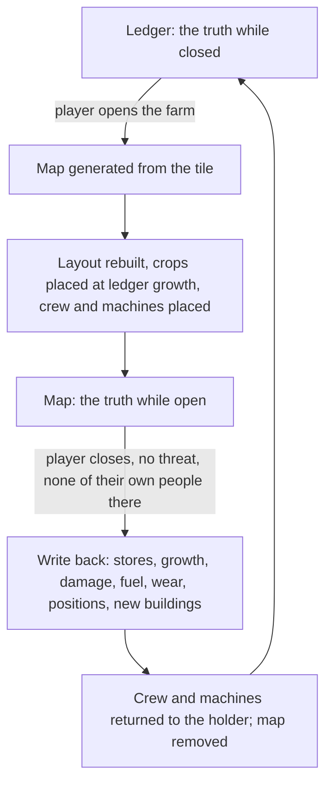

# Farms on other tiles: research and design (19 Nov 2026)

**Status (19 Nov 2026):** research and record only. No code, Def or world object exists for any of it, and nothing here is tested in game. The owner chose the direction and answered every question it raised the same day (below).

The owner's request, 19 Nov 2026: "we will normalize working agricultural land on tiles of the map other than that of your main
colony, like is the norm for most players right now. I'm not sure how that would work in practice at this point in time [...] I know
performance is going to be an important criteria, especially with that of having more than one open world map at a time". And, asked
how a farm should work when none of the player's people are there: "We can provide a mix, perhaps? Give the player the opportunity
to observe when they wish but otherwise, 'run in the backround' via our simulation ledgers and the like to keep things as realistic
as possible while maintaining good performance track records". This record is the research and the design it leads to. Its
companions are [farm machines](farming-machines.md) and [soil rules](farming-soil.md).

**How to read the marks:** **[code]** was read in code on 19 Nov 2026 by research helpers, never run; **[tool]** comes from the
Workshop tool; **[S]** a secondary source; **[I]** our inference; **[A]** an authored figure or choice for the owner to revise.
**None of it is tested in game.**

How farming works now: [systems/farming.md](systems/farming.md); this record keeps its history.

## Read this first

- **What it is:** a **farmstead** on another world tile that keeps farming while nobody watches, worked by a crew and machines the
  player leaves there, and that the player can **open and watch** at any time as a real map.
- **The ledger is the truth; the map is a view with write-back.** While closed, a ledger advances crops, field jobs, fuel, wear and
  stores. Opening builds a real map from the ledger; closing writes the map's state back and removes the map.
- **A closed farmstead costs almost nothing**: one small step a day, and no map.
- **No mod found does this.** Several keep a ledger with no map, and several store or freeze maps with no ledger; none keeps the
  two consistent in both directions. **We would be the first, and that is the stated risk.**
- **The agent's first suggestion, a map kept asleep, is withdrawn.** A sleeping map still sits in the game's map list, where other
  mods' alerts, counts and incidents reach it, and its timers go stale [code].
- **The research found 29 hazards**, all named below. The worst: the two views drifting apart, which would make opening and
  closing an exploit or a loss.
- **Vanilla Outposts Expanded's farming outpost is the baseline**: about 1,800 rice a year from two growers of Plants 10, with no
  soil, seasons or machines [code].

## The owner's direction (19 Nov 2026)

| Question | The owner's answer |
| --- | --- |
| How a farm on another tile works when nobody is there | **A mix**: it runs in the background by simulation ledgers, as realistically as performance allows, and the player may observe it when they wish |
| Soil and crop rules | Configurable, with a punishing realistic mode available; **the same rules run in the ledger** ([soil rules](farming-soil.md)) |
| Other mods | **Learn from other mods** as we expand into this |
| Our own site or an outpost (card) | **Our own** kind of world-map site |
| Deliveries (card) | **Real convoys from the start**: a real vehicle carries the harvest across the world map |
| Raids (card) | **Rarely, opening the map**, behind a setting that starts off |
| Who may be left as crew (card) | **Anyone**: colonists, animals, mechs and prisoners, from the first build |
| Wealth (card) | **Counts in full** toward colony wealth |
| Farms open at once (card) | **One, as a setting** the player may raise |
| The player's own colonists (card) | **May work at an open farm** beside its crew |

## What each behaviour lets, stops and changes

| Behaviour | What it lets the player do | What it stops them doing | How it changes the way they play |
| --- | --- | --- | --- |
| **Founding a farmstead** | Put good land on another tile to work, with a crew and machines left there | Founding one for nothing: it needs people, machines, seed, fuel and a first visit | Land is scouted for soil, season and distance, not only for the colony's own map |
| **The ledger works while closed** | Farm at scale with no second map running | Getting more than the crew and machines could really do: the ledger uses their real work rates, fuel and wear | A farm is planned by its machines and its seasons, then left to run |
| **Observing** | Open the farm and watch the same crew and machines doing the same work, or join in | Using the opening to reset or improve anything: the map shows what the ledger says | A visit is for seeing, fixing and deciding, not for gaming the numbers |
| **Closing with write-back** | Leave at any quiet moment, with everything as it stood | Closing during a fight, or with the player's own colonists still there | Visits end deliberately |
| **Crew held at the farm** | Leave growers and drivers there for seasons | Forgetting them: they eat from the farm's stores and can fall ill | A farm needs its own food and care, like any outpost |
| **Deliveries** | Have the harvest trucked home | Free transport: a delivery takes a vehicle, fuel and time | The route home matters; a far farm needs bigger trucks |
| **A warning before decline** | Learn that a paddock is running down or a store is nearly empty | Nothing | Remote farms are managed by exception |

## What the research found

### The game has no farm without a map, and a camp is thrown away

All from the RimWorld 1.7 decompile [code].

- **Every open map costs every tick**, whether or not anything happens there: `MapPreTick` and `MapPostTick` run for each map, with
  every map component, the weather, power, fire, lords and the wild plant and animal spawners (`Verse.Map.cs:933-1146`).
- **A camp removes its map and its world object** once no colonist remains and nothing is incoming; it never looks at buildings
  (`RimWorld.Planet.Camp`). The crops go with it.
- **A settlement keeps its map** while it is a home, so a second colony is a second map running in full.
- **No vanilla world object produces goods over time.** The nearest thing is caravan foraging.
- **Growth can be worked out with no map**: the game's own sums need only temperature, daylight, fertility and the hours a plant
  rests, and `Find.World.tileTemperatures` and `GenCelestial` give the first two for any tile. The game's ready-made calculator for
  a tile covers wild grazing plants only and returns nothing for crops, so the sum must be written again [code].
- **The game already catches up what it does not watch**: a thing off the current map or out of view is updated every 15 ticks and
  handed the skipped time (`Thing.DoTick`, `TickInterval(delta)`). That is the pattern to follow.

### A live map cannot be put away

- **A thing finds its map only by its place in the game's map list** (`Verse.Thing.cs:233-243`), and spawning refuses a map that is
  not in the list (`:819-830`). So a map cannot be held live outside the list.
- **Loading a map is a one-time path**: `Game.LoadGame` refuses to run if any map exists, and things are spawned only in
  `Map.FinalizeLoading`. Restoring a stored map mid-game means replaying that path by hand.
- **Removing a map shifts every later map's index** (`Verse.MapDeiniter.cs:240-293`), and the game's own removal passes pawns to the
  world with "lost" thoughts, signals quests and releases beds.
- **Vehicle Framework keeps a cache per map** (SmashTools' `DetachedMapComponentCache`, a dictionary keyed by the map's ID that
  throws on a second add). It is filled on load and on `Game.AddMap` and cleared on the game's own removal [code]. Anything that
  adds or removes maps another way must keep it straight.
- **The game allows 127 maps**, shared with pocket maps and every mod that makes maps.

### Mods we learn from

Vetted 19 Nov 2026 with the Workshop tool, source read where public. **Sources of lessons, not mods to install.**

| Mod | State [tool] | Source | The lesson |
| --- | --- | --- | --- |
| [RimExodus Framework](https://github.com/Laurence-042/RimExodusFramework) (Laurence-042) | 1.7; author replying daily | Public, MIT | **`MapArchive.cs`: storing and restoring a whole map mid-game.** It refuses when a quest or queued incident targets the map or a fight is on; captures with the game's own saver; unloads without the game's removal path; restores by replaying the load path, adding the map before the reference pass; checks every thing spawned; rolls back on failure; clears Vehicle Framework's caches |
| [RimExodus](https://github.com/Laurence-042/RimExodus) (Laurence-042) | 1.7, updated 18 Nov 2026 | Public, MIT | **What to block on a map that is not running**: incident targets, raid countdowns, the colonist bar. **Not to copy**: a map slowed without handing on the skipped time grows crops at half speed; its dormancy list is not saved; its lighter archive keeps no plants or pawns |
| [Pause other settlements simulation](https://github.com/ghsdfkdfhkj/RimWorld-PauseOtherSettlementsSimulation) (esvn) | 1.6; a third-party 1.7 continuation | Public, MIT | Block incidents at `IncidentWorker.TryExecute`, the last step before one fires; **every time-stamped value goes stale on a frozen map**, which it answers with a local clock for each map |
| [Vanilla Outposts Expanded](https://github.com/Vanilla-Expanded/VanillaOutpostsExpanded) (Vanilla Expanded team; active) | 1.7 | Public | **The baseline.** Its farming outpost pays `floor(45 / growDays x harvestYield)` of the best-yielding crop per point of Plants skill, once every 3,600,000 ticks (a 60-day year); "growing" is checked only at founding (`Outpost_Farming.cs:15-41`) |
| Vanilla Expanded Framework's outposts (active) | 1.7 | Public | **Keeping a crew alive with no map**: occupants held by the world object, which ticks their age, rest, food and health itself (`Outpost.cs:953-1030`) |
| [Empire (continued)](https://github.com/matathias/Empire-1_6-Continued) (Matathias; Empire Refactored is active) | 1.7, updated 8 Nov 2026 | Public, GPL-3.0: **read only** | A daily ledger with biome and terrain modifiers; a map opened only for a battle, with casualties written back |
| [Rim War](https://github.com/TorannD/RimWar---Threaded) (Torann) | 1.6 | Public | The only mod found that reads a real map's state back into its ledger, for strength points |
| Faction Manager (Merel) | 1.6 | None found | A warning from its players: pawns, animals and vehicles gone on reload, and **crops dead on return because the date kept running** |
| The game's own gravship | — | Game code | Holding things, pawns, zones, areas, roofs, terrain and power state exactly in a world object (`RimWorld.Planet.Gravship`) |

**Where our RimExodus copy stands:** the local decompile is of an older build than the installed one, and its public source replaces
it. The source register's check lists both RimExodus repositories as unconfirmed only because their `About.xml` names a
development package ID; they are the mods' own source (agent's judgement, from the Workshop page's own link).

### Other games

- **Dyson Sphere Program's Weaver mod** [S]: planets the player is not on run lighter logic and return to the full logic on arrival.
  **Same rules, cheaper execution, swap the representation when someone looks.**
- **Minecraft's Unloaded Activity mod** [S]: missed crop growth is worked out in one step when an area loads. Its warning is ours:
  **a copied rule drifts from the real one.**
- **Captain of Industry** [S]: fertility follows one simple equation per field that can be solved for any stretch of time in one
  step. That shape suits a ledger ([soil rules](farming-soil.md)).
- **Dwarf Fortress** [S, partly unverified]: a retired fortress keeps its people and goods and produces nothing meanwhile.

## The design

### The farmstead

- **A world object of ours** (RF1), not a Vanilla Expanded outpost (owner): no new hard dependency, and none of the outposts'
  known hazards for vehicles (the garage, in [vehicle stations](archive/vehicle-stations.md)). It implements the existing `IPhobosVehicleHolder`, so
  the fleet board lists its machines.
- **It is founded from a real visit**: the player's convoy arrives, the map opens as any tile's does, paddocks are marked, sheds and
  bins built, and a crew and machines assigned. Founding needs at least one paddock and one person who can grow [A].
- **It holds four things:**

| Held | What is kept |
| --- | --- |
| **The ledger** | Each paddock's cells, crop, sowing date, growth, health, soil figures and next job; the stores of grain, seed, fuel, fertiliser and food |
| **The crew** | The people themselves, held by the farmstead as outposts hold theirs, with their needs kept up from the farm's stores |
| **The machines** | The vehicles themselves, with fuel, wear and where each stands |
| **The layout** | Everything the player built, with its full state, and the zones and areas, as the gravship keeps its own |

### The ledger step

- **Once a day for each farmstead**, on staggered ticks, and again whenever the player opens the farm or a job finishes (RF2). Its
  cost grows with paddocks and machines, never with cells.
- **Growth** is added by hourly samples through the day with the game's own terms: fertility, temperature and light, no growth while
  the plant rests or out of season, and rot once a crop is left too long. Frost and season are in from the first build: a ledger
  that ignored them would kill the crop the moment the map opened.
- **Field jobs** advance at the machines' real work rate: the same speed-times-width rule the map uses
  ([farm machines](farming-machines.md)), times the hours the crew works, less the days the ground is too wet.
- **Fuel and wear** come from the same engine and condition rules, as amounts per area worked.
- **Soil** follows its equations, each solvable for any stretch of time in one step ([soil rules](farming-soil.md)).
- **Stores** fill at harvest and empty by seed, fuel, the crew's food and deliveries. Stored food ages, so a closed farm is never a
  free cold store.
- **The plan** is the player's: for each paddock, the crop and the passes wanted (plough or not, spray or not), set once and
  followed season after season until changed [A].

### Observing

1. **Opening** (RF3): the tile's map is generated; the layout is rebuilt; each paddock's crop is placed at the ledger's growth, sown
   and at its health; crew and machines are placed where the ledger says, mid-row or in the shed, and take up their jobs.
2. **While open, the map is the truth** and the ledger does not step. The machines do their work by the map's rules; the player may
   give orders, bring colonists, build and repair.
3. **Closing**: everything is read back: stores, each paddock's growth and health, damage, fuel, wear, positions, deaths, new
   buildings. Crew and machines return to the holder, the layout is captured, and the map is removed by a controlled unload.
4. **Closing is refused, with the reason**, while a threat is on the map, a fight is on, a quest or queued incident targets the map,
   or the player's own colonists are still there.

- **A full stored map is the fallback** (the RimExodus Framework's way) where something unmodelled matters. It costs save size, and
  an archive breaks when the mod list changes, so it is not the first choice.

### Keeping the two views the same

This is the heart of the risk, so it has its own rules (RF4).

- **One rule, two callers.** Work rate, fuel, wear and soil are game-free rules in the Framework core, called by the map's machines
  and by the ledger alike. They cannot disagree, because they are the same code.
- **Growth cannot be shared**: on a map it is the game's own code, patched by other mods (Vanilla Temperature Expanded, Smart
  Farming and Complementary Odyssey among the active ones [code]); in the ledger it is our copy.
- **So the ledger learns from the map** [I]: while a farm is open, each paddock's real growth per day is compared with the ledger's
  forecast, and the ratio is kept for that paddock and applied while closed. A mod that speeds or slows growth is then felt off the
  map too.
- **A test harness** runs N days on a map and N days of ledger from the same start and compares them, as a rule test where it can be
  game-free.
- **Seen-in-play notes carry both figures**, so the test report's "figures off" section flags a drift.
- **Opening and closing is never worth doing for its own sake**: write-back is exact, and nothing is granted by either.

### Crew, machines and deliveries

- **The crew are held by the farmstead**, not passed to the world: the game's cleaner can delete pawns it thinks nobody needs
  [code]. Their food, rest, age and health are kept up by us, as outposts do; they are off the colonist bar and out of colony
  alerts, so the farmstead raises its own (RF5).
- **Anyone may be left there** (owner): colonists, animals, mechs and prisoners, from the first build. That is the most to build
  and check, and the record says where: animals, mechs and prisoners are exactly the pawns the game's cleaner deletes [code], so
  the holder must own them outright; a mech needs its mechanitor link and bandwidth kept; a bonded animal its bond; a prisoner a
  guard and a way to escape that the ledger can work out [A].
- **The player's own colonists may work at an open farm** beside its crew (owner): driving, hauling, building and repairing as
  anywhere. The farm cannot close while they are still on its map.
- **Machines keep working figures while held**: fuel falls and wear rises with the work done. This differs from the garage outpost,
  whose vehicles are frozen.
- **Deliveries are real convoys from the start** (RF6; owner): a truck of the farm's own, with a driver from its crew, leaves the
  farmstead as a real vehicle caravan, crosses the world map by the existing travel rules, unloads at the colony and returns. It
  burns real fuel, can break down and can be attacked on the way. While it is away, the ledger has one truck and one person fewer.
- **What it must beat, and not by much**: the farming outpost's yield above. A machine farm should out-produce it for the far
  greater investment, and never for nothing.

### Raids and incidents

- **A closed farmstead is not a target for the game's ordinary incidents**, as RimExodus and the pause mod arrange, with incidents
  blocked at the last step before they fire.
- **A farmstead can be raided, rarely, and the raid opens its map** (owner), as Empire Refactored opens a map for a battle. It sits
  behind a setting that starts off. The player defends with the crew there or whoever they send; a letter gives warning [A].
- **Goods and machines at a farmstead count in full toward colony wealth** (owner), so a farm is no way to hide wealth from the
  storyteller. The farmstead reports its wealth itself while closed, as the game's gravship does for raid points
  (`Gravship.PlayerWealthForStoryteller`) [code].
- **One farm may be open at a time by default** (owner), a setting the player may raise; the settings window says what each open
  farm costs.

### Cost to run

- **Closed**: one ledger step a day for each farmstead; no map, no things, no tick. This is the "good performance track record" the
  owner asked for.
- **Open**: what any second map costs, by the player's choice and for as long as they watch. The window says so.
- **Opening takes seconds** (map generation and layout). A short soft pause after closing avoids rebuilding if the player reopens
  at once [A].

### Saves

- **Safe to add mid-game.** The farmstead, its ledger, crew, machines and layout are saved in the world object with stable keys.
- **Removing the mod loses held crew and machines.** The README must say so in its first section and say what to do first: bring
  everyone and everything home.
- **A save made while a farm is open** keeps the map as any map is kept, with the ledger marked as waiting.

## The hazards

Every hazard the research found, grouped. Each must have an answer before the build it belongs to.

| # | Hazard | Our answer [I, A] |
| --- | --- | --- |
| 1 | A live map cannot exist outside the game's map list; every removal shifts later maps' indices | No map is held: it is rebuilt from the ledger and removed by a controlled unload |
| 2 | The load path runs once; restoring mid-game must replay it between frames with saving idle | Only the fallback (a full stored map) needs it; copy the RimExodus Framework's preconditions |
| 3 | `AddMap` initialises nothing; Vehicle Framework's caches throw on a second add or go stale | Use the game's own generation and removal paths wherever possible; clear the caches where not |
| 4 | Other mods' per-map setup and caches miss a map made mid-game | A generated map is an ordinary new map to them; a restored one is not: one more reason generation is first choice |
| 5 | The 127-map limit is shared with every map-making mod | One farm open at a time by default, a setting (owner) |
| 6 | The game's removal passes crew to the world with "lost" thoughts, signals quests, releases beds | Crew and machines leave the map into the holder before removal |
| 7 | Things outside the map that point into it go null: beds, bills, lords, quests, queued incidents | Closing is refused while any exists, with the reason |
| 8 | The same object must never be both stored and live | One owner at a time: the holder or the map |
| 9 | Full stored maps swell the save | Fallback only, with a limit |
| 10 | A changed mod list or game version breaks a stored map | The ledger and layout are plain data; a missing Def drops one thing, not the farm |
| 11 | Regenerated terrain is not guaranteed the same | The layout record carries terrain under buildings and paddocks; a size change is refused with a message |
| 12 | A sleeping map stops every map component, ours included | No sleeping maps |
| 13 | World-object timers keep running: detection raids, site timeouts, quest deadlines | The farmstead has none of the game's timers; ours are the ledger's |
| 14 | Filtering incident targets is not enough; queued and direct incidents get through | Block at the last step before an incident fires |
| 15 | Time-stamped values jump on waking: lords, jobs, training decay | Nothing is frozen: pawns are held and kept up, not paused |
| 16 | Slowing a map without handing on skipped time halves work and growth | The ledger works in elapsed time; our comps use `TickInterval(delta)` |
| 17 | A map out of view still shows in alerts, pawn finders, wealth and counts | No map while closed |
| 18 | Held crew need needs, age and health kept up; they vanish from the bar and alerts; the cleaner can delete animals, mechs and prisoners | Held outright by the farmstead with its own alerts. **Anyone may be left there from the first build (owner)**, so this hazard is in full force: links, bonds and guards are part of that build |
| 19 | A ledger that ignores frost and season kills crops when the map opens | Season and frost in the first build |
| 20 | Ledger and map drifting apart makes opening an exploit or a loss | The rules above: shared code, learned growth ratio, harness, notes |
| 21 | Anything the write-back leaves out is lost | The layout keeps full state for buildings and items; the list of what is kept is in the README |
| 22 | The storyteller cannot target a farm with no map | Our own rare raid, which opens the map (owner); behind a setting that starts off |
| 23 | Goods at a closed farm do not count toward wealth | They count in full (owner): the farmstead reports its own wealth |
| 24 | Delivery routes and the destination need designing | Real convoys from the start (owner), on the existing world-map travel rules (RF6) |
| 25 | The farm's own sub-maps are lost on removal | A farm with a pocket map hanging from it refuses to close |
| 26 | Uninstalling loses held pawns and vehicles | The README's first section |
| 27 | A save made during an observation must stay consistent | The ledger is marked as waiting while a map is open |
| 28 | Threats or the player's own pawns on the map must block closing | Refused, with the reason |
| 29 | Reference code drifts fast: RimExodus changed twice in ten days | Read at the build's own date, from its public source |

## What the owner's answers add to the first build

Two of the seven answers chose more than the agent's lean, and the record says plainly what that costs:

- **Real convoys from the start** means the first remote-farm build includes a vehicle caravan leaving a world object, travelling,
  unloading and returning, with its breakdowns and attacks. The world-map travel, cargo and tow rules exist; a convoy that starts
  and ends in a ledger does not.
- **Anyone as crew from the start** means the holder handles animals, mechs and prisoners in the first build, each with its own
  hazard (above).

Neither is a reason to shrink the design; both make the first remote-farm build larger, and it follows the machines' batches.

## Still unknown

- **Whether rebuilding a map from a layout is fast and exact enough in the owner's mod list.** The gravship proves the game can move
  such a record; nobody has rebuilt a worked farm from one.
- **How far the ledger's growth drifts from a real map** under the owner's mods. The learned ratio is a proposal, not a result.
- **Vanilla Outposts Expanded's Workshop build against its public source**: read from the repository, not from the installed files.
- **Custom Base Framework's tick-skipping patches**: its local decompile is older than the installed build, so they are unread.

## Sources

- **Game code**: the RimWorld 1.7 decompile, kept in the ignored `.local/` and summarised in our own words.
- **Public mod source read on 19 Nov 2026**: RimExodus and RimExodus Framework (Laurence-042, MIT); Pause other settlements
  simulation (esvn, MIT); Vanilla Outposts Expanded (Vanilla Expanded team); Empire, continued (Matathias, GPL-3.0); Rim War
  (Torann); Vehicle Framework and its SmashTools (SmashPhil, MIT). Authorship is the mod authors'; GitHub only hosts them.
- **Decompiles read**: Vanilla Expanded Framework's outposts, Real Ruins, RimPacts.
- **Other games** [S]: the [Weaver mod's page](https://thunderstore.io/c/dyson-sphere-program/p/Loom/Weaver/) for Dyson Sphere
  Program; the [Unloaded Activity mod's page](https://modrinth.com/mod/unloaded-activity) for Minecraft; the
  [Captain of Industry wiki on fertility](https://wiki.coigame.com/Fertility).
