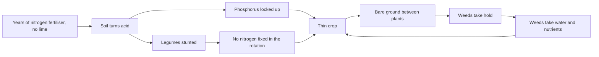

# Soil rules for D'thorga Farming: research and design (19 Nov 2026)

**Status (23 Nov 2026):** mostly research and record: the presets, field care, the Realistic rules and the moisture ledger are not built (seed use is, in D'thorga Farming's [farm machines](farming-machines.md)). Nothing here is tested in game. The owner set its direction and answered every question it raised on 19 Nov 2026 (below). **One part is built**: [rain that soaks the fields](#rain-that-soaks-the-fields-sl10-built-23-nov-2026) (SL10), in D'thorga Framework 0.269.0, a setting off by default, not yet tested in game.

The owner's words, 19 Nov 2026, asked how deep the soil and crop rules should go: "We offer configurable settings for the player to
choose from. I'm honest in saying that I tend to be weird one out in enjoying soil chemistry, realistic farming, etc." On moisture:
"Dub's Hygiene implements/adjusts soil moisture in a way that I find quite good in a games mechanics-to-realistic ratio, and even
refreshing, so that's something I would find a definite and worthwhile study." On seed: "seeds too would be an excellent tradeoff
for the ability to mass-plant and farm at an industrial scale." And, correcting the agent's draft, which had softened the deep
rules: "there should be a more punishing and more realistic mode available for players like me. Soil hydration is the only one I
agree on with you, especially in terms of weather which is sort of outside of the players control. We should be giving the player
choices, not denying or negating them", clarified as "shouldn't", not "never".

This record is the soil side of [farm machines](farming-machines.md) and [farms on other tiles](farming-remote-farms.md).

**How to read the marks:** **[code]** was read in code on 19 Nov 2026, never run; **[code, checked]** was read by the agent writing
this; **[Defs]** comes from the Def tools; **[S]** a secondary source, and **[S, summary]** one read only as a search summary, not
the page; **[C]** textbook chemistry stated from the agent's own knowledge, for the owner, a chemist, to check; **[I]** our
inference; **[A]** an authored figure or choice for the owner to revise. **None of it is tested in game.**

## Read this first

- **Three presets, and a switch for each rule beneath them**: **Off**, **Field care** and **Realistic**.
- **Realistic is punishing on purpose** (owner): harvests take nutrients away, yields fall below the plain game's, and mistakes
  last for seasons. It is off by default and exists for players who want it.
- **Field care never punishes**: care steps add yield, in Farming Simulator 25's manner; neglect only forgoes a bonus.
- **Moisture never punishes, in any preset** (owner): it follows Dubs Bad Hygiene's shape, a bonus that fades.
- **With Dubs Bad Hygiene active there is one soil model, never two**: our machines write into its wetness and fertiliser.
- **Every figure is kept per paddock and changed at events**, never per cell or per tick, and each follows an equation that can be
  caught up over any stretch of time in one step. That is what lets a farm run off the map.
- **Machine sowing uses up seed** (owner).
- **Each preset needs its own figures and its own checks**, and Realistic needs careful tuning: hard, never unfair.

## The owner's decisions (19 Nov 2026)

| Question | The owner's answer |
| --- | --- |
| How deep the rules go | **Configurable settings** for the player to choose from |
| A harsher mode | **Yes: "a more punishing and more realistic mode available for players like me"**, off by default |
| Moisture | **A bonus only**, in Dubs Bad Hygiene's manner: weather is outside the player's control |
| Choices | **We shouldn't deny or negate the player's choices** ("shouldn't", not "never": a strong lean, to be weighed) |
| Seed | **Machine sowing uses up seed** |
| The default preset (card) | **Field care** |
| Where the rules apply (card) | **Paddocks by default, with a separate option for every growing zone, disabled by default.** "We'll also have a wizard at first-run that helps get the player started." |
| How far a yield may fall under Realistic (card) | **To about a third, "but ultimately, I want it to come down to systemic failures like what we have designed with our engine simulation code"** |
| The soil test (card) | **A hand kit first, then a tractor-mounted sampler** |
| Sowing by hand (card) | **A switch, free by default** |
| Where seed comes from (card) | **Both**: kept back from each crop's harvest, and a generic seed from traders |

## What each behaviour lets, stops and changes

| Behaviour | What it lets the player do | What it stops them doing | How it changes the way they play |
| --- | --- | --- | --- |
| **The presets and switches** | Choose how much farming there is to think about, rule by rule | Nothing: each is the player's choice | A colony's farming is as light or as deep as its player wants |
| **Moisture** (a bonus that fades) | Raise yield by watering, or gain from rain | Nothing: dry soil is the plain game | Watering is worth doing in dry spells, never a duty |
| **Care steps** (Field care) | Add yield by ploughing, fertilising, liming and weeding | Getting the top yield with no care | Each paddock has a short list of steps worth doing each season |
| **Nutrients run down** (Realistic) | Farm a paddock hard for a few seasons, knowingly | Cropping without return for ever: yields fall below the plain game's | Fertiliser, legumes and fallow are planned ahead |
| **The scarcest nutrient sets the yield** (Realistic) | Fix exactly what is short, once tested | Curing everything with one fertiliser | A soil test comes before spending |
| **Acidity and lime** (Realistic) | Keep a paddock in its best range with lime | Using nitrogen fertiliser for years with no thought; over-liming | Lime is a slow, occasional job with long effects |
| **Weeds and disease** (Realistic) | Break them with ploughing, spraying, rotation or fallow | Growing one crop for ever in one paddock | Crops rotate; ploughing and spraying become choices |
| **The soil test and warnings** | Know what is wrong and how badly | Guessing | Decisions rest on figures the player can read |
| **Seed** | Sow at industrial scale | Doing so for nothing | Seed is stored, carted and planned |

## The presets

| Preset | What it does | Can it hurt the player? |
| --- | --- | --- |
| **Off** | Machines only; the game's own fertility | No |
| **Field care** (the default: owner) | Visible paddock states; ploughing, fertilising, liming and weeding each add yield; moisture | No: neglect only forgoes a bonus |
| **Realistic** (off by default) | Nitrogen, phosphorus, potassium, acidity, weeds and crop history for each paddock, with real consequences; moisture | **Yes** |

- **Presets are buttons**, not a slider (the owner's standing preference).
- **Beneath them, each rule has its own switch** (SL1): nutrients run down; acidity and lime; weeds; rotation and disease; seed
  use. Changing one shows the preset as "Custom".
- **A switch that makes no sense without another is greyed out and says why**: acidity acts through nutrients, so it needs them on.
  This is where "shouldn't", not "never", applies.
- **The rules apply to paddocks by default** (owner). **A separate option, disabled by default, extends them to every growing
  zone** (owner); it makes hand farming harder too, and only by the player's choice.
- **A wizard at first run helps the player get started** (owner, SL8): it offers the preset, where the rules apply and the
  switches, in plain words, the first time a colony loads with the mod. It is the first use of the
  [setup wizard](first-load-setup-wizard.md) the owner proposed on 9 Nov 2026.
- **Every new setting is reported to the owner by name when built**, as the standing rule asks.

## Moisture: Dubs Bad Hygiene's way, studied

Read from the decompile of its 1.7 build; its public repository holds built files only [code, checked].

- **Two figures for each cell, each 0 to 100**: wetness and fertiliser. Both are saved with the map and drawn as overlays
  (`MapComponent_Hygiene.cs:79-83`, `:359-360`).
- **Wetness only ever helps.** The game's fertility is multiplied by a factor that rises in a straight line from 1 when dry to the
  player's chosen strength when soaked; fertilised soil is multiplied by its own strength (`:997-1009`). Dry soil is never worse
  than the plain game.
- **Water in**: a sprinkler adds 3 to each cell it reaches at each spray, capped at 100, drawing 0.16 units of stored water for
  each cell (`CompSprinkler.cs:113-191`, `CompProperties_Sprinkler.cs:7`); the irrigation sprinkler sprays only during the hour
  from 05:00 (`CompIrrigationSprinkler.cs:21-33`). Rain adds up to 3 times the rain rate at each visit to an unroofed fertile cell,
  evened out by a noise pattern, when the "rain irrigation" option is on (`:1028-1054`). **The owner plays with it on.**
- **Water out**: when it is not raining, each visit takes 2.7 at 0 °C and up to 5 at 40 °C (`:1056-1068`).
- **How often**: the mod visits 0.0006 of the map's cells each tick in random order (`:574-590`), so each cell is visited about 36
  times a day [I]. Soaked soil therefore dries in about a day when cold and about half a day when hot [I].
- **Fertiliser is on or off**: a colonist spreads it, setting the cell to 100; any amount above zero gives the one fixed boost; it
  wears off evenly over the number of days the player set (`:968-986`).

**Why it plays well** (agent's reading): there is no penalty, so no punishing swings; one morning watering gives a boost that
fades through the day, a rhythm the player can see; the strengths are the player's to set. The one RimWorld mod found with a full
moisture model, Terra Project (2019, abandoned), was found punishing by its players [tool].

**What we take from it** (SL2):

- **Our moisture has the same shape**: a bonus only, capped, gained by watering and rain, lost faster in heat.
- **With Dubs Bad Hygiene active, our machines write into its figures**: a sprayer carrying water adds wetness to its strip, and the
  spreader lays its fertiliser through the mod's own `AddFertilizer` (`:968-972`), from a tie-in assembly loaded only when the mod
  is. One soil model in the game, never two.
- **Without it, the same rule runs for each paddock** in our ledger.
- **Off the map**, the ledger mirrors the same rates and reads the player's own Dubs Bad Hygiene settings. Straight-line gain and
  loss can be worked out for any stretch of time in one step.
- **Cheaper than its method**: it sweeps every cell of every map; ours keeps one figure for each paddock.

## Rain that soaks the fields (SL10, built 23 Nov 2026)

**Built in D'thorga Framework 0.269.0** (the setting **Rain soaks open fields**, off by default; not yet tested in game, row 446 of
the test pass). The agent's proposal, the owner's Option A of 23 Nov 2026, and the owner's cards are below; what was built differs
from the proposal only where the cards say.

**What the owner saw:** in save PG20, during rain, the soil did not seem to get wet. **What was found** (the save read only, and
Dubs Bad Hygiene's 1.7 decompile [code, checked]):

- **No feature of ours wets soil for crops.** D'thorga Framework 0.204.0's ground wetness is one figure for each map, read only by
  vehicles' grip and an aircraft's landing dust. In PG20 it read 1, soaked, as it should.
- **Dubs Bad Hygiene's rain irrigation is on and reaches the open fertile cells**: 2.7 in-game hours into a rainy thunderstorm,
  13,297 cells were wet (about the map's open soil, rich soil, gravel and sand [I]), at 5 out of 100 on average and 37 at most.
- **Its speed is the cause, not a fault.** It visits each cell about every 40 in-game minutes (0.0006 of the cells a tick [I]); each
  visit while it rains adds 3 times the rain rate, scaled by a noise pattern from 0.5 to 1 (`DampenCell`,
  `MapComponent_Hygiene.cs:1034-1054`). Soaking a cell takes **about 22 to 45 hours of steady rain** [I]. When the rain stops, each
  visit takes 2.7 to 5 away (`:1056-1068`), so it dries about as fast as it wets and a passing storm hardly shows.
- **The dark ground Realistic Rain draws is a picture only**; it sets no figure.

**The proposal** [A]:

- **While it rains, a visit raises the cell's Dubs Bad Hygiene wetness to our map figure** (0 to 1, taken as 0 to 100), never
  lowering it. Rain then soaks open fields in about an hour, as it already soaks the ground under vehicles.
- **It rides Dubs Bad Hygiene's own visit**: a postfix on `DampenCell`, which runs only while it rains, on unroofed fertile ground, with
  its "rain irrigation" option on. So the player's own switch still rules it, and nothing new sweeps the map. Harmony, because the
  mod has no extension point there; this is our feature on top of their design, not a fix of their fault.
- **Still a bonus only**, as "moisture never punishes" holds: it only fills Dubs Bad Hygiene's grid, whose effect on fertility is
  never below the plain game.
- **One soil model, never two**: our figure feeds theirs; we keep no grid of our own.
- **Home**: D'thorga Framework's existing Dubs Bad Hygiene tie-in (`src/PhobosFramework.Hygiene`), loaded only when that mod is, beside
  the ground wetness it reads.
- **Cost** [I]: one comparison at each of Dubs Bad Hygiene's rain visits, at most about 63 cells a tick on a 325 by 325 map.
- **Saves**: nothing new is saved; Dubs Bad Hygiene's grid saves as before. Safe to add and to remove.
- **Without Dubs Bad Hygiene** nothing changes for crops: our own moisture ledger (SL2) is not built.
- **A new setting**, reported to the owner by name when built.

**The owner's answers (cards, 23 Nov 2026):**

| Card | The owner's answer |
| --- | --- |
| Build it when? | **Now, on its own, "but disabled by default because previous experiences with these things mean huge performance hits that are very noticeable"** |
| After the rain stops | **"Dub's is preferred when available otherwise our own code takes over"** |
| Where its setting lives | **D'thorga Framework** |
| The setting's default | **Off** |
| Without Dubs Bad Hygiene (asked to clarify the second answer) | **Build the fallback now** |
| Measure it | **Measure it first with perf.py**, in the owner's game, before it ships |

**As built**, beyond the proposal:

- **Without Dubs Bad Hygiene, or in its lite mode** (which keeps no water in the soil), our own rule runs: a postfix on the game's
  `FertilityGrid.CalculateFertilityAt` makes unroofed, fertile ground more fertile in proportion to the map's figure, 1 when dry to
  1.8 when soaked (Dubs Bad Hygiene's own default irrigation strength, so the two agree; `soakedFertilityFactor` in the ground
  wetness rules Def) [A]. It dries as our figure dries, over about ten hours.
- **Never both at once**: with Dubs Bad Hygiene active its tie-in registers its patch, and ours stays out whatever the setting.
- **Off means out of the game**: both patches go in and come out with the setting, at once and with no restart (D'thorga
  Framework's `SwitchedPatch`), so the setting off costs nothing at all. The owner's worry was performance; this was the answer.
- **With Dubs Bad Hygiene's Rain irrigation option off, nothing happens** [A, agent choice]: the player turned rain irrigation off
  in Dubs, and our patch rides that visit. The setting's text says so.
- **What a next game would need**: the rule (`IrrigationTarget`, `FertilityFactor`) is game-free; the patches are RimWorld's.

## Field care (SL3)

The model is Farming Simulator 25 (GIANTS Software): a field has states the player can see, and each care step adds to the yield.

- **What the developer says of that game**, read in full on 19 Nov 2026 (GIANTS Software's "Ground working 101" and the community
  wiki's copy of the Farming Simulator 25 manual) [S]: rolling adds 2.5 % and mulching 2.5 %; lime is spread after every three
  harvests; fertiliser goes on up to twice a crop; weed killer costs a small yield penalty. **No official figure was found for
  fertiliser, lime, ploughing or weeding.** The figures players quote (fertiliser about 45 %, lime 15 %, ploughing 15 %, weeding
  20 %) are the wiki's for Farming Simulator 22 and blogs' for 25 [S, unverified for 25].
- **Ours** [A]: a paddock shows its states (ploughed, limed, fertilised once or twice, weeds low or high), each step adds a share
  of yield for the coming crop, and the shares add up to a ceiling. The figures are authored for play and set at the first build.
- **Nothing here runs down the soil**: skip every step and the paddock yields what the plain game gives.
- **Weeds return each season** and are cleared by ploughing, cultivating or spraying; left alone they only remove the weeding share.

## Realistic (SL4)

**What it means, written so it is not softened again.**

- **Every harvest takes nutrients away**, in proportion to what is carted off. A paddock cropped without return yields less each
  season and **falls below the plain game's yield**, with no safety net.
- **The scarcest nutrient sets the yield** (Liebig's law of the minimum [C]): plenty of nitrogen does not make up for missing
  phosphorus.
- **Legumes put nitrogen back** [C]; **fallow restores slowly**; fertiliser restores fast and costs goods. Peas, beans and chickpeas
  exist in Vanilla Plants Expanded [Defs]; which crops count as legumes is named in XML for each crop, never worked out from a
  name.
- **Acidity is real chemistry** [C]. Ammonium turned to nitrate in soil releases acid: NH4+ + 2 O2 -> NO3- + 2 H+ + H2O. So
  nitrogen fertilisers sour a paddock over years, ammonium sulphate most. Acid soil locks up phosphorus and stunts legumes. Lime
  takes the acid up, slowly: CaCO3 + 2 H+ -> Ca2+ + H2O + CO2. Too much lime is its own problem: at high pH other nutrients are
  locked up instead.
- **The figures behind it**, read in full on 19 Nov 2026 [S]:
  - **Lime to undo nitrogen**, kg of lime per kg of N, with half the nitrate leached (Limestone Coast Landscape Board, South
    Australia, "Soil acidity in the Limestone Coast", Feb 2021): urea and ammonium nitrate 1.8; ammonium sulphate, DAP and MAP 5.4.
    Fully leached, double that. Continuous grain cropping acidifies at 180 to 320 kg of lime a hectare a year.
  - **Where harm starts**: aluminium and manganese become toxic and phosphorus is bound by aluminium and iron below pH 5.0 (in
    calcium chloride); the cropping target is 5.5 (Northern and Yorke NRM Board, South Australia, fact sheet 4.007, June 2011).
    Western Australia's soil quality sheets set the topsoil above 5.5 and the subsoil above 4.8.
  - **How slowly lime acts**: "very slowly down the soil profile" (Holbrook Landcare and GRDC, 2016); finer lime acts sooner. A
    rate in centimetres a year was not confirmed.
- **Farming Simulator 25's Precision Farming add-on** keeps an optimum pH by soil type (loamy sand 6.0, sandy loam 6.5, loam 6.75,
  silty clay 7.0) that falls after every harvest (its community wiki) [S]. Its scale is not calcium chloride; we keep the real
  scale and its thresholds [A].
- **Weeds build up** when nothing checks them and take a share of the crop; **the same crop year after year builds disease**, which
  rotation and fallow break.
- **Mistakes last**: a mined or soured paddock takes seasons to restore.
- **The player is told, never left guessing**: a **soil test** gives the figures (Farming Simulator 25's Precision Farming add-on
  works the same way: sample, then treat [S]). **A hand kit comes first; a tractor-mounted sampler that tests while driving follows
  as an upgrade** (owner). Without a test, the crop itself gives a plain hint ("pale leaves"), and a warning comes before a paddock
  is badly run down.
- **The same rules run in the ledger**, so a neglected remote farm declines while nobody watches.

### Failure by chains, not by a floor (owner's direction, SL9)

The owner on how far a yield may fall: "To about a third but ultimately, I want it to come down to systemic failures like what we
have designed with our engine simulation code."

- **For a first build, a floor of about a third** of the plain game's yield stands in.
- **The aim is that no floor is needed**: a paddock fails the way an engine does in our vehicle model, through linked causes, each
  of which the player can see and break. The agent's reading of what that means, for the owner to revise [A]:

- **Each link is its own small rule with its own figure**, as each load in the engine ledger is its own Def, so other mods and the
  owner can add or retune links in XML.
- **A chain can end in a failed crop**, where a floor never could; and it can be stopped at any link, which is the decision the
  player is given.
- **This is a design still to write**, as the engine loads were: a step back first, then the ledger of links
  ([engine loads](archive/vehicle-engine-loads.md) is the model).

**Nutrients carried off in a tonne of grain**, to scale the authored figures, read in full on 19 Nov 2026 [S]:

| Crop | N kg | P kg | K kg | S kg |
| --- | --- | --- | --- | --- |
| Wheat | 23 | 3 | 4 | 1.4 |
| Barley | 20 | 2.9 | 4.4 | 1.1 |
| Canola | 40 | 6.5 | 9.2 | 9.8 |
| Field peas | 37 | 4.0 | 8.2 | 2.0 |
| Chickpeas | 34 | 3.8 | 8.9 | 1.8 |
| Cereal straw (per tonne of straw) | 7 | 0.7 | 10 | 0.7 |

- **Source**: Summit Fertilizers, Western Australia, a fertiliser company's averages, which it says "can vary up to 50 % under
  differing conditions". It agrees with Western Australia's soil quality sheet (wheat and barley 3 kg P a tonne, canola 7) and the
  International Plant Nutrition Institute's manual (winter wheat grain 19 kg N) [S].
- **Straw carries the potassium**: taking straw or hay off as well about doubles the potassium removed (Incitec Pivot Fertilisers,
  reported in Country News, 9 Mar 2020) [S]. A baler is therefore a soil decision, not only a feed one.
- **Corrections to the first round**: wheat's phosphorus is 2.3 to 3.6 kg a tonne (Norton 2009, as Incitec Pivot cites it, Dec
  2025), not 2.3 to 4; the 22 N, 3 P and 8 K figures and the 3.7 to 5 K range could not be confirmed, their pages being gone.
- **Legumes** carry off more nitrogen than cereals because they fix their own [C]; the record's rule that legumes put nitrogen back
  applies to what they leave in the soil, not to their grain.

## The equations

- **Each figure moves towards a balance point at a fixed rate**: `X(t) = X_eq + (X_0 - X_eq) x exp(-k t)`. Cropping sets a low
  balance point, fallow a middle one, fertiliser lifts the figure directly. This is the shape Captain of Industry uses for field
  fertility [S: its wiki], and it can be solved for any stretch of time in one step.
- **Moisture and Dubs Bad Hygiene's fertiliser are straight lines**, solvable the same way.
- **So a paddock's soil is updated only at events** (a pass, a harvest, a daily step off the map), and the map and the ledger agree
  because they call the same rule.
- **Yield is changed through the game's own `Plant.YieldNow`**, by one postfix that looks up the paddock under the plant. Every
  harvest, by hand or machine, and every other mod's yield patch then sees the same figure [code].
- **The factor's range is authored** [A]: about a third at the worst (owner, for a first build) to about 1.3 at the best under
  Realistic; 1.0 to the ceiling under Field care.

## Seed (SL5, owner's decisions)

- **A seed drill uses up seed as it sows.** Its amount for each cell is authored [A]; real sowing rates are a few per cent of a
  harvest [I, unverified], which is the proportion to aim at.
- **Sowing by hand stays free by default**; a switch, "hands use seed too", extends seed use to hands (owner).
- **Seed comes two ways** (owner): kept back from each crop's own harvest, and a generic seed from traders that sows anything at a
  higher price. The detail is in [farm machines](farming-machines.md).

## Fertiliser and the chemistry (SL6)

- **D'thorga Farming ships plain goods** [A]: nitrogen fertiliser, phosphate, potash, lime and a weed killer, with simple recipes
  and trader stock, and takes Dubs Bad Hygiene's biosolids and compost where those mods are active.
- **The real routes belong to the planned chemical industry mod** and replace the simple recipes when it is present [C]: ammonia
  from nitrogen and hydrogen (N2 + 3 H2 -> 2 NH3); nitric acid from ammonia; ammonium nitrate from the two; superphosphate from
  phosphate rock and sulphuric acid (Ca3(PO4)2 + 2 H2SO4 -> Ca(H2PO4)2 + 2 CaSO4).
- **Ammonium nitrate is also an explosive's feedstock**, a tie-in for that mod, noted and not designed here.
- **Crops as fuel already exist** in the owner's game: chemfuel from organics, from wood and from canola [Defs]. A farm at scale
  feeds them; the economy check in [farm machines](farming-machines.md) covers it.

## Mods and games we learn from

| Source | State | The lesson |
| --- | --- | --- |
| Dubs Bad Hygiene (Dubwise; active) | 1.7 | The moisture and fertiliser model above |
| [Crop Rotation](https://github.com/emipa606/CropRotation) (Mlie) | 1.7, updated 12 Nov 2026; MIT | Each cell's crop history and time empty, turned into a yield multiplier through `YieldNow`. It acts only inside growing zones, so it would work on paddocks unchanged |
| [Farming Expansion](https://github.com/emipa606/FarmingExpansion) (Mlie) | 1.7, updated 9 Nov 2026; MIT | Weeds and pests as incidents built on blight; chemicals applied as a work task |
| Fertile Fields (Greysuki's 1.6 continuation) | 1.6; being rewritten | Soil that runs down at harvest by terrain tier, with a "return to soil" switch for each zone. Its only public source is an unofficial fork with no licence: read, never copied |
| Vanilla Plants Expanded (active) | 1.7 | Tilled soil, fertility 1.4, used up at each harvest |
| Terra Project (Lanilor) | 1.0; abandoned 2019 | The warning: a full moisture model with flooding was found punishing |
| Farming Simulator 25 and its Precision Farming add-on (GIANTS Software) [S] | — | Care steps that add yield; soil types with their own acidity and nitrogen, shown by sampling; lime towards a target; spot spraying by weed sensor |
| Captain of Industry [S] | — | One equation for each field: each crop draws fertility to its own balance point; fertiliser raises the ceiling |
| Farthest Frontier [S] | — | Three-year rotations with nitrogen fixers; weeds and rocks that return; disease that builds in the soil |
| Manor Lords [S] | — | Fertility kept for each crop in each field; fallow restores it |

## Cost to run

- **One small record for each paddock**, changed at events. No sweep of cells, no per-tick work.
- **One lookup at each harvested plant** for the yield factor.
- **With Dubs Bad Hygiene active**, its own cell sweep runs as it does today; we add nothing to it.

## Saves

- **Safe to add mid-game**: a paddock starts at a neutral soil, and nothing changes for growing zones that are not paddocks unless
  the player says so.
- **Changing preset mid-game is allowed**: figures the new preset does not use are kept, not thrown away, so changing back loses
  nothing.

## Still unknown

- **What the chains of failure are, link by link** (SL9): the owner's direction is recorded above; the design is not written.

- **Whether one postfix on `Plant.YieldNow` is cheap enough at a large harvest**: it should be, at one lookup a plant, but it is
  unmeasured.
- **How Dubs Bad Hygiene's settings are best read from outside it**: its options were read in code, not through an interface.
- **A rate for lime moving down the soil** in centimetres a year: only a qualitative "very slowly" was confirmed.
- **The textbook chemistry marked [C]** is the agent's own and unsourced: the owner is asked to correct it.

## Sources

- **Dubs Bad Hygiene** (Dubwise): its 1.7 build, decompiled into the ignored `.local/` and summarised in our own words.
- **Public mod source**: Crop Rotation and Farming Expansion (Mlie, MIT).
- **Farming Simulator 25** (GIANTS Software), read in full on 19 Nov 2026: the Precision Farming add-on's
  [changelog](https://www.farming-simulator.com/changelogs/fs25-precisionFarming.php); GIANTS' "Ground working 101" news article;
  the community [wiki page on Precision Farming](https://farmingsimulator.wiki.gg/wiki/Precision_Farming/Farming_Simulator_25) and
  its copy of the manual. GIANTS' [2020 article](https://www.farming-simulator.com/newsArticle.php?news_id=194) cited in the first
  round is about the earlier Precision Farming project, not Farming Simulator 25. Blog percentages, such as
  [itemlevel.net's](https://itemlevel.net/how-to-maximize-yield-in-farming-simulator-25/), are not the developer's.
- **Soil acidity**, read in full: Limestone Coast Landscape Board, "Soil acidity in the Limestone Coast" (Feb 2021); Northern and
  Yorke NRM Board fact sheet 4.007 (June 2011); SoilQuality.org.au's Western Australian sheets.
- **Nutrients in grain**, read in full: Summit Fertilizers' removal table (commercial, Western Australia); the International Plant
  Nutrition Institute's 4R Plant Nutrition Manual, table 4.5; Incitec Pivot Fertilisers, "Grain and hay: understanding nutrient
  removal and replacement" (L. Menhenett, Dec 2025). GRDC's pages refused automated reading.
- **Other games** [S]: the [Captain of Industry wiki on fertility](https://wiki.coigame.com/Fertility); Farthest Frontier's
  [official farming guide](https://www.farthestfrontier.com/guide/gameplay/farming); Gamer Guides on
  [Manor Lords' fertility](https://gamerguides.com/manor-lords/guide/resources/farming/farming-fertility-explained).
- **The first round's nutrient pages** (Incitec Pivot's "nutrient removal after hay or grain harvesting" and Nutrient Advantage's
  winter crop page) now return "not found"; their figures are not used.
