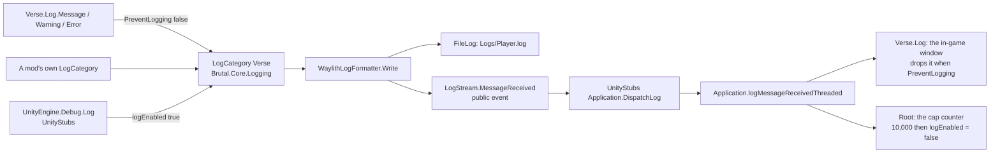

# A shared logging framework: research and direction (8 Nov 2026)

A design record. The owner's logs "keep exceeding some set limit" the game has in place; they proposed a logging framework of our
own, built on generic concepts so every Phobos RimWorld mod takes part, possibly with a Rust core generic enough for other games.
This round is research and record only (owner, 8 Nov 2026). Two read-only explorations (our own logging and tooling; other mods'
loggers), one design critique and the game's and engine's decompiles fed it. Nothing here is built.

## Read this first

- **The limit is 10,000 messages a session, and it kills every mod's log, `Player.log` included.** `Verse.Log` counts every log
  event; at 10,000 it writes "Reached max messages limit. Stopping logging to avoid spam.", sets a flag that makes
  `Log.Message`, `Log.Warning` and `Log.Error` return before they reach the engine, and switches the Unity-shim logger off. Only
  three things turn it back on: the dev log window's Clear button, a save finishing its load, and a hot reload of Defs.
- **What killed the owner's log on 8 November:** Visit Settlements logged **6,846 identical NullReferenceExceptions** from its
  world tick in six minutes (18:17:47 to 18:24:02); the 17.7 MB `Player-prev.log` ends there, and the session ran on for over an
  hour with nothing written. The game merges only consecutive identical lines in its window (up to 99 repeats); the cap counts
  every one.
- **Owner's decisions (8 Nov 2026):** (1) **a bounded revive, no Harmony**: a Framework component checks every 250 ticks whether the
  game switched logging off and calls the game's own public `Log.ResetMessageCount()`, up to a limit, writing one line that names the
  loudest message since the last revive; on by default, with an off switch, and the README says it changes Ludeon's anti-spam
  behaviour; (2) **no Rust inside the game**: Rust stays in the reader (phobos-modkit); (3) **the shared C# logger gets a new sibling
  repository** (proposed name `phobos-log`, an agent default), pinned as a submodule like Scope and modkit; (4) **this round, record
  only**.
- **A message from a mod's own log category survives the cap in `Player.log`** (observed in the engine shims, decompiled this
  round): it never passes the gates the cap closes. It still reaches the in-game window until the cap, and it still counts toward
  the cap, which is why our own logger needs budgets so we are never the storm.
- **Where I disagreed with the framing, plainly:** the pain is another mod's storm killing the game's log, not our own logging; a
  logger of ours does not fix that, a bounded revive and the triage tool do. Rust in the game brings costs and no gain I can name.
  The part worth sharing across games is an event schema and a reader, not a runtime.

## What the game does

Read from the 1.7 decompiles (`.local/decompiled/full/all.cs` as "G:n"; `.local/decompiled/Waylith-core` and the two shims
`UnityStubs` and `Waylith.UnityCompat`, decompiled this round with the local `ilspycmd` 11.2; nothing committed). Ludeon's code,
our summary. **1.7 is unstable and any of it may move.**

- **The cap.** `Verse.Log.Notify_MessageReceivedThreadedInternal` (G:21997-22006) counts every event the Unity-shim event
  delivers; at `StopLoggingAtMessageCount = 10000` (G:21781) it logs the warning, sets `reachedMaxMessagesLimit` and sets
  `UnityEngine.Debug.unityLogger.logEnabled = false`. `PreventLogging` (G:21800-21809) is then true, and `Message` (G:21846),
  `Warning` and `Error` (G:21890) return before calling the category. `ResetMessageCount` (G:21828-21840, public) zeroes the count,
  turns `logEnabled` back on and logs "Message logging is now once again on."; it is called from `Log.Clear` (G:21937), after
  `PlayDataLoader.DoPlayLoad` (G:31385) and after `HotReloadDefs` (G:31622). The counter is registered on
  `Application.logMessageReceivedThreaded` in `Root.CheckGlobalInit` (G:53360).
- **The window.** `Verse.Log.Notify_LogMessageReceived` (G:21958-21986) fills a `LogMessageQueue` of 1,000 (G:22083), merging a
  message identical to the last one up to 99 repeats (G:22096-22117); off-thread messages wait in a queue until the main thread
  drains them; an error opens the window during loading or in dev mode. `WarningOnce` and `ErrorOnce` share one `usedKeys` set
  (G:21875-21928) that `Clear` does not empty: a key fires once per process.
- **The pipeline to `Player.log`.** `Verse.Log` writes through `Brutal.Core.Logging.LogCategory.Make("Verse")` (G:21824,
  21848, 21865, 21894) into Microsoft.Extensions.Logging; Waylith's `WaylithLogFormatter.Write` (Waylith-core
  `Waylith.Logging/WaylithLogFormatter.cs` 40-72) writes `Waylith.Logging.FileLog` and then publishes to the **public event
  `Waylith.Logging.LogStream.MessageReceived(LogLevel, category, message, stackTrace)`** (`LogStream.cs` 5-15). `FileLog`
  (`FileLog.cs` 14-495) writes `Logs/Player.log` under the app's log data path, renames the previous run's to `Player-prev.log`
  (267-296), holds up to 5,000 lines before the file is open and then writes a dropped-lines count, flushes on a one-second timer and
  at once for Warning and above (111-114), and turns itself off after a write error. Line format: `yyyy-MM-dd HH:mm:ss.fff LEVEL
  [Category] message` then stack lines (345-359).
- **The shim bridge** (observed this round). `UnityStubs`' `Application.EnsureLogBridge` subscribes `DispatchLog` to
  `LogStream.MessageReceived` (`UnityEngine/Application.cs` 182-188); `DispatchLog` (190-239) maps the level to a `LogType` and
  raises `logMessageReceivedThreaded` on any thread and `logMessageReceived` on the main thread only. The stub's `Debug.Log`,
  `LogWarning` and `LogError` test `unityLogger.logEnabled` and then write through a `LogCategory` of their own
  (`UnityEngine/Debug.cs` 105-118, 137, 152). `logEnabled` gates nothing else (8 uses, all in `Debug` and `Logger`).
- **So, after the cap:** `Verse.Log.*` and `Debug.Log*` are silent everywhere; a mod's own `LogCategory` still reaches
  `Player.log` and the stream, still counts, and no longer reaches the window. Before the cap, a category line reaches the window
  like any other, with the real `[Category]` in `Player.log`.
- **Who else patches `Verse.Log`** (`scripts/query-patches.py who "Verse.Log.*"`, 8 Nov 2026): `Log.Error` prefixes from Better
  Stacktraces (priority 800), VEF's Mod Settings Framework (may skip), RimPacts (two: one may skip, one priority 800) and Dubs
  Performance Analyzer (prefix and postfix); `Log.Warning` prefixes from Log After Def Error and RimPacts; Mid-saver Saver prefixes
  `Notify_MessageReceivedThreadedInternal` (may skip, priority 800; not decompiled, purpose unknown); the Harmony mod postfixes
  `ResetMessageCount` (unknown); Nightmare Core postfixes `Clear`. **None touches the cap.** `Brutal.Core.Logging.dll`,
  `Waylith.dll` and `UnityStubs.dll` are in the Krafs.Rimworld.Ref 1.7 package our builds already reference: a mod can make its own
  category and subscribe to the stream with no new reference, and must never copy those assemblies.

## What other mods do

From the decompiles in `.local/decompiled` (other authors' code, summarised): nobody writes a continuous log file of their own.

| Mod | What it does | Lesson |
| --- | --- | --- |
| Custom Base Framework (`CBFLog`, `Fehlerbericht`) | Levels gated by a verbose flag or dev mode; `WarnOnce` keyed bucket plus what, cleared when the Game changes; a 200-line ring buffer; during a generation run it subscribes to `Application.logMessageReceivedThreaded` and keeps other mods' warnings and errors; reports under `SaveDataFolderPath/CBF-Reports/<run>/`, keeping 20; user paths replaced by placeholders; an in-game window | The most complete model: gate first, build second; once-keys per Game; a small ring; redact paths; keep N reports |
| RimPacts (`RptLog`) | A settings gate re-read on change; `Gate(key)` once per in-game day; an unused 8 MB string sink | Throttle by in-game time, not real time, for per-tick noise |
| Combat Extended (`CELogger`) | `[CallerMemberName]` prefix and the game tick; `ErrorOnce` keyed by the caller's line number | A call-site key costs nothing to choose, but two files share line numbers |
| More Injuries (`Logger`) | Settings-gated levels; `[Conditional("DEBUG")]` debug lines compiled out; `file::line` on errors | Compiled-out debug cannot be switched on for a player's report |
| RimExodus, Vehicle Framework, PrisonLabor | A category enum with a setting per module; everything behind one debug setting | Per-part switches are what players and we actually toggle |
| The game | `WarningOnce`/`ErrorOnce` on a process-wide key set | Once per process is too coarse for a 12-hour session |

## What we have

- **95 `Log.*` calls** across our projects (Medical 25, Patches' missile part 18, Framework vehicles 17, Framework core 12, Factory 9,
  the rest under 5), every one through `Verse.Log` with a prefix joined by concatenation; **13 separately declared prefix
  constants**, four of them the same "[D'thorga Patches]"; no shared logger.
- `Phobos.Framework.LoadReport` (`src/PhobosFramework/LoadReport.cs`): the one load line each mod writes, `On`/`Off` features, which
  players quote in reports. `Debug/PhobosTiming.cs`: a dev-mode timing accumulator, free outside dev mode. Three `Log.ErrorOnce`
  with hand-picked hex keys; two hand-rolled throttles (`PhobosPatches.Irbm/Strike/RimPactsAssaultSize.cs` per town and tick;
  `PhobosPatches.VisitSettlements/VisitMapStaysOpen.cs` per map per in-game hour). No file writer except `Debug/PatchedDefsDump.cs`
  (one XML, temp-and-move, dev one-shot), the discipline to copy.
- **phobos-modkit** (`external/phobos-modkit`): `logs/model.py` (Entry, LogFile, Evidence; levels FATAL to TRACE),
  `logs/signature.py` (blanks GUIDs, hex, IDs and numbers; 240-char cap), `logs/triage.py` (groups, clusters, comparison),
  `games/rimworld/log.py` (the 1.7 and 1.6 `Player.log` layouts, the cap warning, the native-allocation lines); a 38 MB log becomes a
  5 KB summary. No structured (JSON-lines) reader. One Rust crate (xml-index). Its rules: core never names a game; adapters hold
  public format facts; runtime libraries are out of its scope.
- **Phobos Scope** (sibling repository): a dependency-free .NET Standard 2.1 recorder inside a game writing JSON captures by
  temp-and-move, a Rust analysis engine run afterwards ("ordinary gameplay needs no Rust process"); Ostranauts only.
- **The hosts the owner mods:** RimWorld 1.7 (.NET 10 on Waylith; Linux, macOS and Steam Deck players); Ostranauts (Unity Mono with
  BepInEx: our mods route 280 calls through `Action<string> Log` delegates to BepInEx's logger, whose disk log omits Debug); Farming
  Simulator 25 (GIANTS Lua sandbox; `FS25_PhobosLib/src/Logging.lua` has levels and once-keys and prints to the game log); Project
  Zomboid (Kahlua Lua over Java; `PhobosLib_Debug.lua` with a per-mod switch and a boot buffer); Workers and Resources (data only);
  Kenshi (data; Lua only through RE_Kenshi).

## The direction

### 1. Keep the game's log alive: `GameLogKeeper` (D'thorga Framework, next round)

A `GameComponent` whose rare tick (every 250 ticks) reads `UnityEngine.Debug.unityLogger.logEnabled`. When it is false the game
has capped itself: call `Log.ResetMessageCount()`, count the revival, and write one line through our own category:
"The game's log reached its 10,000-message limit and was turned back on (3rd time this session). The loudest message since the last
time: `<signature>` (6,846 times; first frame in VisitSettlements)." Stop after a bound (agent default 25 revivals, about a quarter
of a million messages; a setting) and say why, as the disk guard. Cost: one bool read per rare tick. No Harmony, so no interaction
with Mid-saver Saver's prefix or the Harmony mod's postfix (decompile both before building; their purpose is unknown). Setting
`keepGameLogAlive`, **on by default** (it acts only after the game has already gone silent), with an off switch; the README says it
replaces Ludeon's anti-spam cap with a bounded number of revivals, and that the offline triage tool already reduces a storm to one
line. **The storm counter**: a dev-mode-free, bounded per-signature counter (512 keys; key = the message with digits blanked, cut at
160 characters, the cheap cousin of modkit's `signature.py`) fed by `LogStream.MessageReceived`, so the revive line and a dev action
can name the culprit; about 2 µs per event; it writes no mirror file (a mirror would duplicate `Player.log` and carry other mods'
text and user paths for no gain over triage).

### 2. Our own messages: a real category, and budgets (the shared logger)

Our mods log through a `LogCategory` of their own (`[D'thorga Framework]`, `[D'thorga Medical]`, `[D'thorga Patches]`), never
through `Verse.Log`: the same `Player.log` line as today but with a real `[Category]`, visible in the in-game window until the cap
and in `Player.log` after it. Because such lines still count toward the cap, the logger carries budgets so we are never the storm.
The facade, `PhobosLog.For("D'thorga Patches", part: "Harrier")`:

| Piece | Rule |
| --- | --- |
| Levels | Debug, Info, Warn, Error. Debug on when `Prefs.DevMode` or a per-category verbose setting is on, so a player can switch it on for a report (never `[Conditional("DEBUG")]`); `DebugEnabled` exposed so callers skip building strings |
| Gate first, build second | `if (log.Once(ref site)) log.Warn(...)`, `if (log.Every(ref throttle, GenDate.TicksPerHour)) ...`: the gates are structs in a static field at the call site; the suppressed path is one compare and allocates nothing. `WarnOnce(message)` keyed by caller file and line for cold paths. A signature-keyed once only for exceptions, whose text is already built |
| Budgets | Per category per 10 real minutes (agent defaults: 200 Warn, 50 Error); past them, count only and write one "N more from [Category] in the last ten minutes were not written" when the window turns |
| Templates | `log.Warn("vehicle {vehicle} lost its water source at {tick}", vehicle, tick)` with typed overloads up to three arguments (no `params object[]`, no boxing); today rendered to text, later kept as fields by the structured sink. The logger never feeds in-world text, so the in-world text rule is untouched |
| Ring buffer | The last 200 events, preallocated, for a dev action "copy the recent Phobos log" and a future report |
| Host sink | Every Waylith and Brutal touch in one class (`RimWorldHostSink`) behind a static call, so an engine change is one catchable load failure with fallback to `Verse.Log` |
| What folds in | The 13 prefixes become categories and parts (the four "[D'thorga Patches]" copies one category with four parts); `LoadReport` keeps its shape and takes a `PhobosLog`; `PhobosTiming` stays a meter whose report goes through the log; the three hex-keyed `ErrorOnce` and the two hand-rolled throttles become gates; other call sites move when next touched |

### 3. Where it lives: `phobos-log`, a sibling repository (owner's choice)

Created in a later round, once the owner names it and chooses its visibility (as with modkit); pinned by phobos-rimworld at
`external/phobos-log` and later by phobos-ostranauts. Proposed layers (agent default): `rules/` game-free C# (.NET Standard 2.1,
like Scope's recorder, no dependencies: `OnceGate`, `Throttle`, `Budget`, `Signature`, the event model, a JSON-lines writer with
temp-and-move and size caps), `hosts/rimworld/` (the category sink), `hosts/bepinex/` (Ostranauts), `schema/` (the documented event:
`ts`, `level`, `game`, `mod`, `part`, `msg`, `template`, `fields`, `count` for collapsed repeats, `session`, mod version), tests on
the rules, MIT. Not inside Phobos Scope (a profile capture and a log stream have different shapes and policies; borrow its file
discipline, not its repository) and not in modkit (its rule excludes runtime libraries).

### 4. Across games, honestly

Generic and worth writing once: the event schema and file layout, the level names, and the once, throttle and budget semantics as
documented rules with reference tests. **The reader** is one `phobos-log` JSON-lines adapter in phobos-modkit's `logs/`, shared by
every game, written when the file exists. **Writers are per host and cannot be shared** between C# and Lua: C# for RimWorld and
Ostranauts; the Lua hosts (FS25's sandbox, PZ's Kahlua) adopt the level names and the once semantics in their existing loggers and
nothing more until a need appears. The structured file itself is the fourth slice, built when Ostranauts adopts or a concrete
diagnostic need asks for it, not as the foundation: the game's own log with a `[Category]` plus modkit's triage already gives most
of "all our mods take part".

### 5. Rust inside the game: no (owner agreed)

A Rust writer loaded through P/Invoke is callable from .NET 10 (RimWorld 1.7) and Mono (Ostranauts) and from neither Lua host, so
it would cover two of five games. A log line is a string appended to a file, which a `StreamWriter` under a lock does in
microseconds; Rust would add a UTF-16 to UTF-8 marshal per line, native binaries per OS and architecture shipped through the Workshop
(Linux, macOS, Steam Deck), antivirus flags, two debuggers, and a crash in native code takes the game down where a C# exception is
caught. No gain was named. Rust earns its place where volume is, in the reader, and modkit already is Rust where that matters; with
budgets our files will be smaller than `Player.log`, so even that need is doubtful.

## Recorded alternatives (not chosen)

- **A dedup prefix on `Verse.Log.Error`** that collapses repeated identical errors: the only option that makes a storm *cheaper* (the
  cost of 6,846 errors is Verse formatting 6,846 stack traces, which a revive does not reduce). Rejected for now: a skipping prefix on
  the most-patched logging method in the owner's list (Better Stacktraces, Mod Settings Framework, RimPacts, Dubs). The fallback if
  revive plus triage proves insufficient (probe T5 measures the case).
- **Leaving the game alone, triage only:** the log still dies at 10,000; rejected by the owner.
- **A full mirror of other mods' messages into our file:** duplicates `Player.log`, carries others' text and user paths, no gain
  over triage.
- **Extending Phobos Scope** or **putting the runtime in modkit**: see section 3.

## Performance budget

| Where | Budget |
| --- | --- |
| A suppressed log call (once, throttle or budget says no) | under 50 ns, no allocation |
| An emitted Info, our own cost | under 20 µs, excluding the engine's write |
| Steady-state logging per tick | none, anywhere |
| The revive check | one bool read per 250 ticks |
| The storm counter | under 2 µs per event (one truncation, one dictionary lookup) |

Measured with a dev-mode "log benchmark" action (10,000 events through each path under `PhobosTiming.Measure`, with
`GC.GetAllocatedBytesForCurrentThread` deltas) and Dubs Performance Analyzer for the tick-level view of the component.

## In-game probes for the next round

Dev actions the owner runs; nothing counts until the owner says so. T1 and T2 were answered offline this round by the shim
decompile (a category line reaches `Player.log` after the cap and the window before it); the probes confirm them in play.

| Probe | What it does | What it settles |
| --- | --- | --- |
| T1 | Flood 10,001 `Verse.Log` messages, then one through our category and one through `Debug.Log` | That the category line is in `Player.log` and the `Debug.Log` one is not (observed in code; confirm) |
| T2 | One category line in a normal session | That it shows in the in-game log window with its category |
| T3 | A dev `LogStream` subscriber counts events for one minute, including another mod's `Log.Error` and a raw `Debug.Log` | That the stream carries every mod's messages (the storm counter's premise) |
| T4 | With revive on, flood; then another mod logs | The revive line appears, with the loudest signature, and later messages are written |
| T5 | Time 10,000 `Log.Error` with stacks before and after revive | Expect no gain: the storm's cost is Verse's formatting. If that matters, it is the case for the dedup prefix |

## Risks and unknowns

- **Waylith 1.7 is unstable:** `LogStream`, `LogCategory` and the shim bridge may move or change signature. One sink class,
  catchable load failure, fallback to `Verse.Log`; the record names the members used and the Krafs version (1.7.4998).
- **Engine assemblies** (`Brutal.Core.Logging`, `Waylith`, `UnityStubs`) are referenced from the Krafs package, never copied.
- **Other mods' `Log.Error` prefixes** (stack enrichment, skipping) do not apply to our category lines. Acceptable for our own
  messages, which attach `Exception.ToString()` themselves; stated here.
- **Privacy:** the storm counter holds other mods' message signatures in memory and writes one summarised line; a future file holds
  only our events, with the save-data and profile paths replaced by placeholders (Custom Base Framework's precedent); nothing of it
  is committed.
- **Disk:** revivals are bounded; a future JSON-lines file is capped (agent default 8 MB per session, keep 5). `Player.log`'s growth
  after a revive is the game's file; the bound is the only control without Harmony.
- **Reviving changes Ludeon's behaviour:** a player who prefers the cap gets the off switch, and the README says what the setting does.
- **Unknown until decompiled:** what the Harmony mod's `ResetMessageCount` postfix and Mid-saver Saver's prefix do (read before L2).

## Roadmap

| Slice | What | Status |
| --- | --- | --- |
| L1 | This record; the shim decompiles in `.local/decompiled/UnityStubs` and `Waylith.UnityCompat` | Done, 8 Nov 2026 |
| L2 | `GameLogKeeper` (revive, bound, setting) and the storm counter in D'thorga Framework, with the probe dev actions and the benchmark (a minor version); the owner runs T1 to T5 | Built: Framework 0.28.0, 8 Nov 2026 (`Logging/GameLogKeeper.cs`, `Logging/HostLog.cs`, `Rules/GameLogRules.cs`, `Debug/LogProbeDebugActions.cs`); not yet tested in game |
| L3 | Create `phobos-log` (owner names it; MIT; layers above); the rules and the RimWorld host sink; adopted by the Framework and D'thorga Patches (four prefixes become one category); other mods when next touched; `LoadReport` moves onto it | Open |
| L4 | The JSON-lines sink, the schema document and modkit's reader, when Ostranauts adopts or a need is named | Open |
| L5 | The Ostranauts host sink (BepInEx) | Open |

## Who chose what

- **Owner (8 Nov 2026):** the aim (a shared logging framework, generic across our mods and, where possible, our games); a bounded
  revive without Harmony as the cap fix; no Rust in the game; a new sibling repository for the shared logger; record only this round.
- **Agent, with the owner's approval of the plan:** the revive's shape, its bound and default; the storm counter; the category-first
  rule for our own messages; the logger's gates, budgets and templates; the generic-versus-per-host split; the repository's layers
  and the placeholder name; the probes and the budget figures.
- **Agent defaults the owner may revise:** 25 revivals; 200 Warn and 50 Error per ten minutes; 512 counter keys; the 200-event ring;
  8 MB and keep 5 for the future file; the name `phobos-log`.

## Sources

- Ludeon Studios: RimWorld 1.7 (`.local/decompiled/full/all.cs`) and the Waylith engine and its Unity shims (`Waylith-core`,
  `UnityStubs`, `Waylith.UnityCompat`, decompiled with ilspycmd 11.2 for research; never committed).
- The decompiled mods' authors: Custom Base Framework, RimPacts, Combat Extended, More Injuries, RimExodus, Vehicle Framework,
  PrisonLabor (summarised in our words).
- Our records: [analysis tooling](analysis-tooling.md) (the log triage), [the Framework record](phobos-framework.md); phobos-modkit's
  `docs/rimworld-log.md`; Phobos Scope's README and `capture-format.md`.
