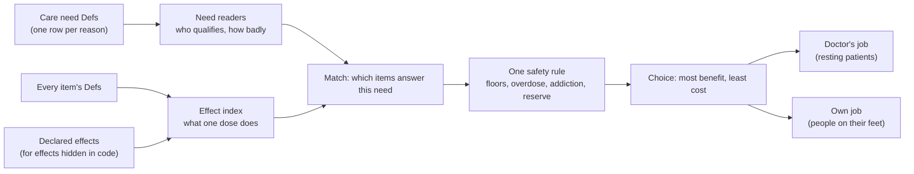

# Care needs: giving and taking every medically useful thing by rule (26 Nov 2026)

**Status (26 Nov 2026):** the first build (slices A and B: the table, cures, prevention in an outbreak, the reserve and the alert)
is in D'thorga Medical 0.28.0 ([as built](#as-built-medical-0280)), not yet tested in game (rows 590 to 592 of
[the test pass](in-game-test-pass.md)). Slice C is in 0.29.0 as a breathing rescue ([as built](#as-built-medical-0290)), not yet
tested in game (row 593): blood loss was left to More Injuries by the owner's choice. Slice D is in 0.30.0 (with Framework
0.327.0) as protection while exposed ([as built](#as-built-medical-0300)), not yet tested in game (rows 605 to 607). Slice E, the
long-term needs, is in 0.31.0 ([as built](#as-built-medical-0310)), each off until turned on, not yet tested in game (rows 613 to
615). Every slice is built. The record's small gaps were closed on 27 Nov 2026 in 0.32.0 ([as built](#as-built-medical-0320)), not
yet tested in game (rows 654 and 655). The owner answered all eight cards on 26 Nov 2026
([the answers](#the-owners-answers-26-nov-2026-by-card-with-every-option-offered)) and then said "Go ahead and build the first slice".

The owner, 26 Nov 2026: "I want to expand the range of medically relevant things that are automatically either taken or given by/to
patients, to pretty much everything [if] there's a medically valid reason for it, given the rule system we have in-place now", then
"let's write the design record with the question cards, so nothing's lost/forgotten". **This record keeps every option offered on
each card, chosen or not**, so a later change of mind starts from the same list.

How dosing works today: [injuries and care](systems/medical-injuries-and-care.md#doctors-who-dose). The earlier record this one takes
a part of: [vaccines and prevention](vaccines-and-prevention.md) (its proposal 1 becomes a care need here; its proposals 2 to 4 stay
there).

## Read this first

- **The idea in one line:** dosing stops being three hard-wired reasons (pain, sedation, a disease that is winning) and becomes **one
  table of care needs**. Each row says who qualifies, what helps, when it acts, who gives it, and how risky it is.
- **Nothing is found by name.** As now (the owner's rule of 5 Nov 2026, "match effects, not names"), an item answers a need because
  of what its Defs say it does. The item lists below are what the owner's game held on 19 Nov 2026, as examples.
- **One safety rule for everything**, the one dosing has now, with four additions: never start an addiction for a small need, never
  start a dependency that kills when it stops, keep a reserve in stock, and keep rare items for saving a life.
- **Every need has its own setting**: off, doctors only, or doctors and self. A need graded high risk starts off (the shared rule for
  riskier behaviours).
- **The item survey is nine days old**: it was read from the patched Defs file written on 19 Nov 2026 with 364 active mods; 387 are
  active now. **Read the Defs again before building** (`python scripts/query-defs.py`, and the Framework's "write patched Defs").
- Every figure here is authored and a proposal. None is medical advice.

## As built: Medical 0.28.0

How it works now is on the living page: [injuries and care](systems/medical-injuries-and-care.md#care-needs-one-table-of-reasons).
This section keeps only where the build differs from the design below, and what the build found.

- **Prevention is worth less in the game as it stands than the design assumed.** The game's disease events pick their victims when
  they fire, and nothing in the owner's mods (read 26 Nov 2026) passes a disease between people. So a preventive taken once a
  disease is in the colony protects against the next strike, not the one under way. It is built as designed and chosen; the
  owner kept the trigger as built ([answered](#the-decisions-left-open-by-the-first-build-as-answered-26-nov-2026-on-the-decisions-page)).
- **A drug policy cannot allow or forbid a plain medicine**: it has a tick for joy and for an addiction, and a schedule, nothing
  else. As built (agent's reading of card 4): the policy decides for an item that addicts or is taken for pleasure; for a plain
  medicine the need's own switch is the gate. The owner kept it as built.
- **The old switches are kept.** Pain's row follows the dosing switch and self-medication's tick, and the disease drug's row its
  own tick, so nothing the owner has set changes; only the two new needs have the three-way choice. Agent's choice, to keep saved
  settings as they are.
- **Radiation is on the table for its switch and the alert only.** Which medicine, when, and the doctor's job stay the radiation
  part's own, unchanged: its choice is by dose and stage, not by an item's effect.
- **The rules stayed in D'thorga Medical**, beside the dosing rules they build on (`Dosing/Rules/CareNeedRule.cs`), not in the
  Framework's core as the design said: they are medical policy, and nothing outside dosing uses them.
- **The wider index reads what the first two needs use**: conditions removed (through the rules' readers, or declared),
  `makeImmuneTo`, and vomiting. Gains to bleeding, breathing and the rest wait for the needs that use them (slice C).
- **Declared effects cover cures and prevention.** Vanilla Races Expanded - Genie's antibiotics are still not read: their class is
  not in the code read here, and a declaration made unread would be a guess. (Read since 0.32.0, from their public source.)
- **The alert speaks only of what the colony can make** (a recipe that makes the item is available now), and not of prevention.
  Both are agent defaults: a colony with no drug laboratory would otherwise be told of every ache.
- **Potassium iodide before entering a radiation area already exists** (D'thorga Medical 0.16.0, the protection part, with Dubs
  Rimatomics). The "before exposure" row of the table below was written without that: slice D starts from it.
- **Rare items** (card 5) are in as chosen, for every row, pain included. Read from the patched Defs, nothing reaches 300 silver
  among the items whose Def states a value; the owner made the mark a setting (0.29.0).

## As built: Medical 0.32.0

The owner, 27 Nov 2026: "Go ahead and close those small gaps next", of the four the record left open. Each was read from the mods' own
public source and the Defs as patched before anything was built.

- **Vanilla Races Expanded - Genie's antibiotics are read now** (their public source, read 27 Nov 2026). They give their condition
  through two outcome classes of the mod's own, so the rules Def gained **given-condition readers**: a class's full name and the fields
  holding the condition, the severity, and anything that makes the effect depend on the taker. The antibiotics add 10% to the speed of
  gaining immunity (more for someone with a weak-immunity gene, which the index does not read), so they join the drugs for fighting a
  disease that is winning. **Their "cures existing infections" is that immunity speed alone**: nothing else in their code touches a
  condition.
- **Items used on oneself are read when they are swallowed.** The game applies an item's use effects when it is swallowed, through its
  own outcome for that, and the dose job is the game's own swallowing, so those effects happen exactly as their mod wrote them. The game's
  own use-effect comp is read by type, and Vanilla Factions Expanded - Medieval 2's comp through a reader (its public source, read 27 Nov
  2026). In the owner's game that adds the **draughts**: the painkiller draught takes 80% of the pain, the immunization draught adds 35% to
  immunity speed, and the antitox draught keeps out 62.5% of toxic buildup, each listed with its cost. **Items only used, never
  swallowed** (Biotech's healer mech serum, which mends the worst condition, among others) still are not: the dose job swallows. Agent's
  choice: a doctor using an item on a patient would be a job of its own.
- **A harm a dose brings alongside its work no longer holds back the next dose.** Every draught but the antitox one leaves 0.2 toxic
  buildup; counted as the dose "still working", any toxic buildup at all would have refused the draught. A condition the game marks
  harmful, given by an item that also gives one it does not, now counts only for the danger check (so someone already full of toxins is
  still refused). An item whose only condition is marked harmful counts as before.
- **What the unpriced items are worth**, worked out by the game's own rule (`StatWorker_MarketValue`: what goes into making it, plus
  0.0036 silver for each unit of work) from the Defs as written; not read in a running game. A Biological Warfare antiserum is worth about
  137 silver, a vaccine about 120, and **Glittertech's addiction remover about 534**: over the 300-silver mark, so **it is never given by
  rule at the default mark** (addiction is a serious need, not a life-threatening one), and addictol is used alone. The new dev action
  "Dosing: log every care list, with worth" prints the game's own figure for every item on every list, and whether the player's mark
  holds it back.
- **Gains to bleeding, consciousness and the blood capacities: surveyed, and left unread on purpose.** Nothing in the owner's game slows
  bleeding. What raises consciousness or the blood capacities is epinephrine (kept out: Search and Rescue gives it), smelling salts
  (already the breathing rescue), hard and social drugs, hemogen packs, and Glittertech's scarlet smelling salts. The two needs that
  would use them, waking the unconscious and treating blood loss, were declined on cards 9 and 10, so reading them would change
  nothing a doctor does. Agent's choice: read them when a need asks.

## As built: Medical 0.31.0

The owner, 26 Nov 2026: "Go ahead and build the long-term needs next". The mods' own code was read first (Medicines+ decompiled, its
public source being a 2021 build with no code; Glittertech's and The Dead Man's Switch's public or decompiled source), and four cards
settled the slice ([the fourth round](#the-fourth-round-26-nov-2026-by-card-with-every-option-offered)).

- **Five needs, not three**: mental strain, addiction, old wounds, a missing part, and refilling an artificial part's reservoir. The
  record's "old wounds and artificial parts" became three, because the items do three different things.
- **The drug policy already schedules by mood**, so a clozapine need repeats what a policy can do; the owner chose to build it anyway.
  The guide says both ways.
- **"The player wants them off it" is read from the drug policy**: an addiction no drug of its chemical may feed. No new switch.
- **Effects in code are read through named classes**, in the rules Def: addictol's condition class, the remover's comp, the
  serum's comp and the biogel reservoir. The game's own healing of permanent wounds is read by type.
- **Hydra's condition has no stages**: the index now counts such a condition for the redose check, so a month's dose is not doubled.
- **Agent choices, for the owner to revise:** all five serious (so addictol's 5% addictiveness is allowed, and nothing rare is held
  back below the mark); looked at after every other need; no reserve and no alert; a steadying drug lowers the threshold by 0.03 or
  more; a scar counts when it hurts, or when its part serves a capacity and works less well; the reservoir is refilled once the
  smallest dose fits.

## As built: Medical 0.30.0

The owner, 26 Nov 2026: "Go ahead and build before exposure next". Reading the game and the owner's mods changed the slice again, and
two cards settled it ([the third round](#the-third-round-26-nov-2026-by-card-with-every-option-offered)).

- **"About to enter" was already solved, for planned work.** D'thorga Framework's protective-gear line stops a colonist at a painted
  area's edge and gives a named preventive first (potassium iodide at the radiation line, Medical 0.16.0). The toxic controlled area is
  a second line on it. The Framework gained `preventiveStats`, so a line's preventive is found by what it does, and
  `ProtectionLine.DoseAllowed`, so Medical's safety and the reserve apply to every line's dose, iodide included.
- **Exposure under way is read from the game's own sources**, at the person's cell: polluted ground, toxic terrain, tox gas, and open
  sky under toxic fallout or toxic weather (ToxicUtility, GasUtility, WeatherWorker in the game's code). Nothing scans the map.
- **The two toxic resistances multiply** in the game's own sum, so AntiTox keeps out 80%, not 60%; the index reads both.
- **AntiTox lasts about 2.4 hours** (0.05 at a dose, falling 0.5 a day): someone working all day in fallout takes about six. The
  reserve holds the last five on the shelf.
- **Vacuum needed a different hook.** The game's search for air sits in the constant think tree, which interrupts any job, so a giver
  at the painkillers' hook would almost never run in a breach. Ours is inserted ahead of it by an XML patch, with no Harmony, and does
  nothing without Odyssey.
- **Vacuum is life-threatening and takes no reserve**: only what the person carries, which never came off the shelf. Agent choice.
- **Agent choices, for the owner to revise:** buildup 0.04 marks exposure as under way (the game's first stage); a quarter kept out,
  or a quarter of vacuum resistance added, makes an item protection; the toxic line asks 0.6; no alert for either (protection, not
  treatment); adults only for vacuum, as for every dose taken oneself; the toxic area's paint tools used the game's home-area pictures
  until their own shipped in 0.32.1.
- **Not read:** our own caustic gas and the Framework's gases, which the game's toxic resistances do not govern.

## As built: Medical 0.29.0

The owner, 26 Nov 2026: "Decisions are made and you can go ahead and build blood loss and collapse next". Reading the owner's mods
for it changed the slice, and two cards settled how ([the second round](#the-second-round-26-nov-2026-by-card-with-every-option-offered)).

- **Blood loss is not built: More Injuries does it already.** It counts a hemogen pack as a blood bag (a mod extension on the pack)
  and its doctors transfuse on their own (`WorkGiver_UseBloodBag`, its public source); Search and Rescue plans it too. The needs
  table's "new" for blood loss was wrong: the survey read the item's Defs and not who already gives it.
- **Collapse is a breathing rescue only.** Search and Rescue gives More Injuries' epinephrine for cardiac arrest (its
  `MedicalLogistics`, read in its public source), so that left Medicines+' smelling salts. The owner chose breathing at 30% or
  less, and not waking the unconscious.
- **More Injuries' epinephrine is kept out of automatic dosing** with `neverAutoDose`, in our More Injuries tie-in folder. By its
  Def it would be a help to breathing (+0.125); its risk is applied in More Injuries' code, which the index cannot see.
- **The rare mark is a setting** (the owner's answer on the Decisions page: "Make it a configurable setting via a slider for
  players to set. 300 silver is the default"): 0 to 2,000 silver in steps of 25; zero keeps nothing back. The rules Def no longer
  holds the figure.
- **Agent choices, for the owner to revise:** the level (0.3) is triage's mark for a vital capacity; a help to breathing must add
  0.1 or more after its own cost; the need is looked at before every other row; it is doctors only, and the alert covers it.
- **The index now reads breathing gained.** Gains to bleeding, consciousness and the blood capacities are still unread: nothing
  built uses them (surveyed in 0.32.0, and left so on purpose).

## What exists today

| Piece | What it does | Where |
| --- | --- | --- |
| Doctors' dosing | Gives a resting patient the best painkiller, a sedative at extreme pain, or a drug that speeds immunity when a disease is winning | `Phobos.Dosing`: `DoseService`, `DoseIndex`, `DoseSafetyRule`, `DoseChoiceRule` |
| Self-medication | A person up and about in pain takes a painkiller their drug policy allows | `JobGiver_PhobosSelfMedicate` |
| Radiation medicines | Doctors give three named medicines of ours by the patient's dose and stage | `Phobos.Radiation`: `RadiationMedicine` (its own path, not the index) |
| Bedside devices | A machine by the bed treats conditions carrying its tag | `BedsideTreatmentService` |
| Triage | Queues operations and orders the doctors' work | `Phobos.Triage` |

**The gap:** each reason for care is written in C#. The index reads only pain, consciousness, breathing, bleeding and immunity gain,
so an item that cures a disease, prevents one, replaces blood or wakes someone is invisible to it.

## The shape (agent proposal)

### A care need is a Def

A new Def type, `PhobosCareNeedDef` (agent's name), so other modders can add a need in XML. Proposed fields:

| Field | Says | Example |
| --- | --- | --- |
| The reading | What makes someone a patient for it, by effect: a capacity under a figure, a condition of a kind, a condition an item removes, a hazard on the map | Blood loss at 0.3 or more |
| The answer | Which part of an item's effect counts as helping | Removes the condition; less bleeding; `makeImmuneTo` naming the disease |
| Timing | Now wherever they lie, waits for the bed, or ahead of time | The Framework's `FieldCareRule` already has the first two |
| Who gives it | A doctor, the person themself, or both | Prevention: both |
| Seriousness | Minor, serious or life-threatening: what cost and what stock the need may spend | Collapse: life-threatening |
| Risk grade | Low, moderate or high, with the reason: sets the setting's default | Old wounds: high |

The game-free parts (matching an effect to a need, the net-benefit score, the reserve) are rules for D'thorga Framework's core
`Rules/`, with tests; the Defs, the policy and the text stay in D'thorga Medical.

### The index reads more

Today a dose's effect is pain relief, consciousness and breathing costs, a bleeding increase, addictiveness and immunity gain. It
would also read, from the same stage of the same conditions:

- **Gains**: less bleeding, and more breathing, consciousness, blood pumping and blood filtration.
- **Resistances**: toxic, toxic environment and vacuum resistance.
- **The mind**: the mental break threshold.
- **Costs it does not read today**: vomiting, slower rest, and a second condition the dose brings with it.
- **Prevention**: the game's `makeImmuneTo` list on a stage.
- **Cures**: the "removes these conditions" outcome classes other mods use. Their XML fields are read as data; their code runs only
  when the game itself gives the item, as it does today.
- **Comps on the condition**: healing old wounds, removing an addiction, regrowing a part.

### Declared effects, for what the Defs hide

Some effects are applied in a mod's own code and no Def shows them (a limit the systems page already records). A second field on
`PhobosDosingExtension` would let an item **declare** an effect by hand: what it treats, prevents or costs. We would ship those for
other authors' items in our tie-in folders, each labelled with what was read and from where. Known cases:

- Vanilla Races Expanded - Genie's antibiotics (given through its own outcome class).
- Dubs Rimatomics' potassium iodide (its condition has no stage figures; inferred to act in code, not yet read).
- More Injuries' morphine raising bleeding (why the bleeding hold exists today).

### One safety rule, four additions

Everything the safety rule checks today stays, for every need: the dose must do what the need asks, the patient must be willing, no
second dose while the first works, none during an overdose, none that reaches a dangerous stage, and consciousness and breathing
above their floors. Added:

1. **No addiction for a small need.** An addictive item is given only for a serious or life-threatening need (the owner's card 6).
2. **Never start a dependency that kills when it stops** (luciferium and its kin). Someone already dependent is the game's own
   schedule to keep supplied; we never begin one.
3. **A reserve.** Prevention and before-exposure needs may not take an item below the number the player keeps back, so they cannot
   empty the shelf before an emergency; treatment may use the last one (the owner's card 3).
4. **Rare items are kept for saving a life.** An item worth 300 silver or more (triage's own mark) is given only for a
   life-threatening need (the owner's card 5).

And one score: **net benefit**. Each effect counts for or against, so an item that mostly harms (a poison, a weaponised disease) is
never on any list, without naming it. `neverAutoDose` stays as the hand-written exclusion.

### Routes other than swallowing

| Route | State | Plan |
| --- | --- | --- |
| Ingested items | Built | The main route for every need here |
| Bedside devices by tag | Built | Unchanged; a need may name a device tag as its answer later |
| Items used on oneself (the game's use effects) | Read when swallowed (0.32.0) | Items only used, never swallowed, are not: the dose job swallows |
| More Injuries' applied items (tourniquets, saline, blood bags, splints) | Search and Rescue gives them | Left to it: it covers them and has no extension point (read 6 Nov 2026) |
| Worn protection (masks) | D'thorga Medical's protection part | Not this record |

## The needs, with what the owner's game held on 19 Nov 2026

Mod names are as the Def index gives them. "Def shows" is what the patched Def says; anything else is marked inferred.

| Need | Who qualifies (proposal) | Items found, and their mod | State |
| --- | --- | --- | --- |
| Pain | Pain at 0.4 or more | Morphine and ThornWeed serum (Medicines+), morphine autoinjector (More Injuries) | Built |
| Sedation | Pain at 0.8 or more, nothing lighter possible | Ketamine autoinjector, chloroform cloth (More Injuries) | Built |
| A disease that is winning | In bed, immunity losing the race | Penicillin, Tyrox (Medicines+); antibiotics (VRE - Genie, needs a declared effect) | Built |
| Radiation | By dose and stage | Our antiemetic, marrow stimulant, Prussian blue | Built on its own path; would move onto the table |
| **Disease cure** | Has a disease an item in stock removes | Seven antiserums: flu, wound infection, malaria, necroa, plague, scaria, sleeping sickness (Ushanka's Biological Warfare, by its own outcome class) | New |
| **Prevention in an outbreak** | Healthy, unprotected, and the disease is on the map | Penoxycyline (the game); seven vaccines (Biological Warfare); Neuroglue against mechanites (The Dead Man's Switch) | New |
| **Before exposure** | About to enter, or standing in, a hazard an item resists | AntiTox: toxic resistance +0.5 (Medicines+); vacsop: vacuum resistance +0.5 (Complementary Odyssey); potassium iodide (Dubs Rimatomics, inferred) | New |
| **Blood loss** | Blood loss at a figure to tune | Hemogen pack, with HemogenDirect's "reduce blood loss" outcome | New |
| **Collapse** | Consciousness or breathing low, not from sedation | Smelling salts: breathing +0.2, consciousness +0.1 (Medicines+); epinephrine autoinjector (More Injuries) | New; first check whether Search and Rescue gives epinephrine already |
| **Mental strain** | Close to a mental break | Clozapine: break threshold -0.05 (Medicines+) | New |
| **Addiction** | Addicted, and the player wants them off it | Addiction remover (Ushanka's Glittertech Expansion); addictol (Medicines+) | New |
| **Old wounds and artificial parts** | A lasting injury; bionic shock | Hydra (Medicines+); Neuroglue, combat regeneration serum (The Dead Man's Switch) | New |

**Never given, whatever the settings** (the net-benefit score, not a list of names): cyanide, flesh-breaker, gamma serum, and the
"malaria pills" and "sleeping sickness pills" that give the disease. **Not medical, so no need reads them**: go-juice, wake-up,
coffee, alcohol and the like, except where a recreational painkiller is already allowed by today's setting.

## The four questions

- **What it lets the player do:** stock a pharmacy and trust it. A cure in stock is given; a vaccine in stock is used when the
  disease arrives; someone walking into toxic ground takes their tablet first.
- **What it stops them doing:** deciding each dose by hand unless they turn a need off; and keeping the last vial untouched unless
  they set a reserve. Stock is spent without a click.
- **How it changes the way they play:** the work moves from clicking doses to deciding what to keep in stock, which needs to allow,
  and whose drug policy permits what.
- **What outside the thing notices:** the stock itself (it runs down, and a reserve holds); the person's drug policy and the
  doctors' work list; and an alert while a need has nothing in stock that answers it (the owner's card 7). **Agent's wish, not designed here:** a
  record of what was given to whom, on the health tab.

## Risk grades (agent proposals, for the owner to confirm)

| Need | What can be lost | Grade | Setting starts |
| --- | --- | --- | --- |
| Disease cure | A dose of a costly antiserum on someone who would have recovered | Low | Doctors only |
| Prevention in an outbreak | Stock, slowly and visibly; held by the reserve | Low | Doctors and self |
| Before exposure | Stock; a side effect on someone working | Low | Doctors and self |
| Blood loss | Hemogen packs a colony may want for other uses | Low | Doctors only |
| Collapse | A stimulant's second condition on a weak patient (More Injuries' autoinjectors bring a build-up) | Moderate | Doctors only |
| Mental strain | A long-term drug started on someone, with its own effects | Moderate | Off (the owner's card 2) |
| Addiction | A harsh treatment: the addiction remover costs 0.3 consciousness and brings vomiting | High | Off |
| Old wounds and artificial parts | A choice about someone's body made unasked; the regeneration serum adds pain and triples hunger (its Def) | High | Off |

## Performance (agent rules for the build)

- **The self check runs every time a person chooses a job**, so it must stay a few comparisons: needs are read from the per-map
  patient list rebuilt every 250 ticks (`PatientCache`), never worked out per person per job choice.
- **Prevention and exposure are per-map events** (a disease appears, a hazard is entered), not a per-person look.
- **Rules first, reach last**, as now: only the chosen item is searched for.
- Nothing here is measured. The owner's computer is a best case.

## Slices

**The owner's order (cards 1 and 8):** A and B together as the first build, then C; D and E after, in an order not yet chosen.
**Done so far:** A and B (0.28.0); C as a breathing rescue, with blood loss left to More Injuries (0.29.0); D as protection while
exposed and a toxic controlled area (0.30.0); E as five long-term needs, each starting off (0.31.0).

| Slice | What | Change in play |
| --- | --- | --- |
| A | The table, the wider index and declared effects; pain, sedation, the disease drug and radiation moved onto it | None intended: the unit tests hold today's choices |
| B | Disease cure and prevention in an outbreak, the reserve, the notice | New |
| C | Blood loss and collapse | New |
| D | Before exposure | New |
| E | Mental strain, addiction, old wounds and artificial parts | New, each starting off |

## The owner's answers (26 Nov 2026, by card), with every option offered

Options are listed as they were put; the chosen one is first and marked. On every card the owner chose the agent's lean.

### 1. What goes in the first build

- **Chosen: the table with cures and prevention, in one build.** One install and one short test list; the move onto the table is
  held by unit tests.
- The table alone first: no change in play, proven before anything new is added, at the cost of an install that shows nothing new.
- Everything in one build: slices A to E together, one long test list.

### 2. The long-term needs: mental strain, addiction, old wounds and artificial parts

- **Chosen: built, each starting off.** They are choices about a person, so the player turns each on.
- Built, each starting on, for doctors only.
- Not built: left to the player's own hand.

### 3. The reserve

- **Chosen: prevention keeps a reserve, treatment may use the last one.** A setting with preset buttons (0, 5, 10, 20), one figure
  for prevention and before-exposure medicines.
- A reserve for every need, set per need.
- No reserve: whatever is in stock may be used.

### 4. Who takes prevention and before-exposure medicines

- **Chosen: people on their feet take their own, by their drug policy; doctors give to those resting.** As pain works today.
- Doctors give them to everyone, as a round: nobody doses themself.
- Each person themself only: doctors never give prevention.

### 5. Rare and costly items (worth 300 silver or more, triage's own mark)

- **Chosen: only for a life-threatening need.** Otherwise the right-click says the item is being kept.
- Whenever the need's setting is on, whatever the item costs.
- Never by rule: rare items are always the player's hand.

**A correction to the card as put.** The card named Hydra as such an item. That was the agent's mistake: Hydra's Def gives it a
market value of 64. Read the same day, none of the surveyed items whose Def states a value reaches 300 (the regeneration serum is
150, Tyrox 105, clozapine 52, AntiTox 50, Neuroglue 18, smelling salts 16); Biological Warfare's antiserums and vaccines and the
addiction remover state none in their own Defs, so theirs is not yet known (worked out in 0.32.0: about 137, 120 and 534, so the
remover is held back at the default mark). The rule stands as chosen and may match nothing in the
owner's game today; whether 300 is the right mark for medicines is open.

### 6. Addictive medicines

- **Chosen: only for a serious or life-threatening need.** A minor need takes only what cannot addict.
- Only when life is at stake, or the person is already addicted to it.
- As today: addictiveness lowers an item's score and never forbids it.

### 7. When a need has nothing in stock that answers it

- **Chosen: an alert at the side of the screen while it lasts.** The game's own way of showing an unmet need.
- A message, once per patient and need, as triage does for an operation nobody can do.
- Nothing on screen: the doctor's right-click says why.

### 8. The slice after the first

- **Chosen: blood loss and collapse.** The two that save a life.
- Before exposure: the one a player with toxic ground or vacuum work meets most often.
- The long-term needs.

## The second round (26 Nov 2026, by card), with every option offered

Put after the first build, once the owner's mods had been read for slice C. The chosen option is first and marked; on both cards
the owner chose the agent's lean.

### 9. Blood loss, which More Injuries already treats

- **Chosen: leave it to More Injuries.** Nothing built for blood loss; this record says why, so it is not proposed again.
- Build it for games without More Injuries: a blood-loss need that stands down whenever More Injuries is active, using the
  Emergency transfusion mod's hemogen packs. It would do nothing in the owner's game.

### 10. What counts as collapse

- **Chosen: breathing at 30% or less.** A doctor gives a stimulant that raises breathing to a patient close to suffocating, as a
  bridge until oxygen or surgery. Epinephrine stays with Search and Rescue. Nobody is woken: an awake patient in pain is tended
  worse, and rousing someone out cold from blood loss is not real medicine.
- Breathing, and waking the unconscious: also a stimulant for anyone unconscious (consciousness 30% or less) who is not sedated.
  About one dose every hour and a half for each unconscious patient.
- Skip collapse for now: nothing built; another slice next.

## The fourth round (26 Nov 2026, by card), with every option offered

Put when building slice E, once the items' code had been read. The chosen option is first and marked.

### 13. Clozapine, which a drug policy can already schedule by mood

- **Chosen: build a "close to a major break" need.** Someone whose mood is below their major break threshold takes or is given
  clozapine, starting off. (The agent leaned to the other option.)
- Leave it to the drug policy: nothing built; the guide says how to schedule clozapine by mood.

### 14. Who gets an addiction treatment

- **Chosen: addicted to a drug their policy won't feed.** Only someone the player is making quit; someone allowed their habit is
  left alone; luciferium never treated.
- Anyone addicted, except to luciferium, whatever the drug policy allows.

### 15. Who gets Hydra

- **Chosen: someone with an old wound or chronic condition that hurts or weakens.** A harmless scar alone gets nothing.
- Anyone with a permanent injury or chronic condition, harmless or not.

### 16. Which of The Dead Man's Switch's items to build, each starting off (more than one could be chosen)

- **Chosen: both.** Biogel running low: Neuroglue, given once there is room for a whole dose (every ten points used rolls a rising
  chance of degeneration, and an empty tank brings xeno-limb syndrome, a mental break or paralysis).
- **Chosen: both.** A missing body part: the regeneration serum (2 to 3 days; hunger tripled, pain and bionic shock meanwhile), not
  where a prosthetic already replaces the part.

## The third round (26 Nov 2026, by card), with every option offered

Put when building slice D, once the game and the owner's mods had been read. The chosen option is first and marked.

### 11. When people take AntiTox by rule

- **Chosen: both.** Taken while exposed anywhere, and a line the player can paint for planned work in a toxic place. (The agent leaned
  to the first alone.)
- While exposure is under way: someone whose toxic buildup has begun and who stands in its source takes one; a doctor gives one to
  someone down or in bed there. No painting. About six a day in fallout; the reserve of 5 holds the last ones.
- At a line you paint: a toxic controlled area, like the radiation line. Only where painted: fallout and stray gas not covered, and
  anyone with no gear turned back.

### 12. What vacsop does by rule

- **Chosen: taken when caught in vacuum.** Someone standing in vacuum and harmed takes a vacsop they carry at once: it halves the
  harm and stops the burns. Nobody walks into vacuum to fetch one, and doctors do not go in.
- Leave vacuum to the game: Odyssey's own avoidance and vacsuits handle it, and vacsop stays for the player's own orders.

## The decisions left open by the first build, as answered (26 Nov 2026, on the Decisions page)

Each was an agent's choice in the 0.28.0 build, put to the owner with its options. The chosen option is first and marked.

### When people take a preventive by rule

- **Chosen: while someone has it.** As built: it reacts to a strike, and guards against a second one while the first runs.
- Always, where the biome brings it: standing protection, as a drug policy's schedule already gives; uses stock steadily, held by
  the reserve.
- A setting for either.

### What lets someone take a plain medicine on their own

- **Chosen: the need's own setting.** As built: a plain medicine needs no policy line; the policy decides for anything addictive
  or taken for pleasure.
- Only if scheduled in the policy: nobody takes one unless that drug is scheduled for them.
- Doctors give it to everyone: nobody takes their own.

### The mark from which a medicine is rare

- **Chosen, in the owner's own words: "Make it a configurable setting via a slider for players to set. 300 silver is the
  default."** Built in 0.29.0.
- Keep 300: one mark for rare tools and rare medicines.
- Lower it to 100: Tyrox and the regeneration serum kept for life-threatening needs only.
- No mark: cost never holds a medicine back.

## The fifth round (27 Nov 2026, by card), with every option offered

Put while closing the small gaps (0.32.0), once the game's own pricing rule showed what the unpriced items are worth.

### 17. Glittertech's addiction remover, worth about 534 silver and so over the rare mark

- **Chosen: leave it held back** (the agent's lean). The rule stands as chosen on card 5: a rare item only to save a life. Addictol
  still covers an addiction, and the slider lets a player raise the mark above 534 to free the remover. Nothing changed in code.
- Addiction ignores the mark: once the player turns the addiction need on, the remover may be used whatever it costs.
- Long-term care ignores the mark: all five long-term needs, each off by default, may use rare items once switched on.

## Agent defaults (for the owner to revise)

- **Who is covered** is unchanged: the people dosing covers now, by care level and by the existing settings for slaves and guests.
  Adults only for self-taken doses, as now. **Animals are not in this record.**
- **Declared effects are shipped by us** for other authors' items, in tie-in folders, each labelled.
- **Radiation's three medicines move onto the table** in slice A, keeping their behaviour.
- **More Injuries' applied items stay with Search and Rescue.**
- **A setting per need**, on D'thorga Medical's Emergency dosing page: off, doctors only, doctors and self.
- **Refusals**: every need gives a right-click reason, in the game world's words, as dosing does now.

## Limits known before building

- **A cure is only as specific as its Def.** Biological Warfare's antiserums name the conditions they remove, so they match exactly.
  The immunity drugs still count for every disease (the existing limit: antibiotics are not told from antivirals).
- **"About to enter a hazard" has no cheap reading yet.** Toxic ground and vacuum are known per cell; knowing someone is about to
  walk there needs their job's destination. To be worked out in slice D.
- **Custom outcome classes need one small reader each.** Four mods' classes were seen in the survey; a class nobody has written a
  reader for stays invisible until an item declares its effect. Since 0.32.0 a reader is a few lines of the rules Def, for a class that
  removes conditions or one that gives them.
- **A drug's tolerance holds the next dose back** (seen in 0.32.0, not changed): Genie's antibiotics last 12 hours, but their tolerance
  counts for the redose check until it falls to a quarter of a dose, about a day. The game's own drugs with a tolerance are treated the
  same way.
- **Mental strain as a medical need is a judgement.** The game treats mood through recreation and comfort; a drug for it is the
  least convincing need here (agent's view).
- **Not generic across games yet:** this is RimWorld's health model end to end. A next game would need its own readers; only the
  game-free matching, scoring and reserve rules would carry over.

## Sources

The owner's patched Defs file (written 19 Nov 2026 by game 1.7.5013 with 364 active mods), read locally with a throwaway script for
every ingested item's outcomes and the stage each gives; the mods named are their authors' work, read and summarised in our own
words, with nothing copied. D'thorga Medical's own code and Defs as of commit 9580b031. No outside medical figures are used.

For 0.32.0 (27 Nov 2026): the public source of Vanilla Races Expanded - Genie (github.com/Vanilla-Expanded/VanillaRacesExpanded-Genie,
its two outcome classes) and of Vanilla Factions Expanded - Medieval 2 (github.com/Vanilla-Expanded/VanillaFactionsExpanded-Medieval2,
its use-effect comp), both by the Vanilla Expanded team; the game's own market value rule, read through `query-code.py`; and the same
patched Defs file, read with a throwaway script for every item that gives a condition through a use effect, or slows bleeding or raises
consciousness or a blood capacity.
