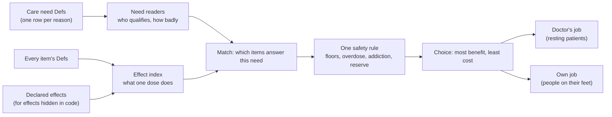

# Care needs: giving and taking every medically useful thing by rule (26 Nov 2026)

**Status (26 Nov 2026):** a design record for D'thorga Medical's dosing part. It is a proposal: no code, Def or setting exists for
it, and none of it is tested in game. The owner answered all eight cards on 26 Nov 2026 ([the answers](#the-owners-answers-26-nov-2026-by-card-with-every-option-offered)):
the first build is the table with cures and prevention. Building waits for the owner's go.

The owner, 26 Nov 2026: "I want to expand the range of medically relevant things that are automatically either taken or given by/to
patients, to pretty much everything [if] there's a medically valid reason for it, given the rule system we have in-place now", then
"let's write the design record with the question cards, so nothing's lost/forgotten". **This record keeps every option offered on
each card, chosen or not**, so a later change of mind starts from the same list.

How dosing works today: [injuries and care](systems/medical-injuries-and-care.md#doctors-who-dose). The earlier record this one takes
a part of: [vaccines and prevention](vaccines-and-prevention.md) (its proposal 1 becomes a care need here; its proposals 2 to 4 stay
there).

## Read this first

- **The idea in one line:** dosing stops being three hard-wired reasons (pain, sedation, a disease that is winning) and becomes **one
  table of care needs**. Each row says who qualifies, what helps, when it acts, who gives it, and how risky it is.
- **Nothing is found by name.** As now (the owner's rule of 5 Nov 2026, "match effects, not names"), an item answers a need because
  of what its Defs say it does. The item lists below are what the owner's game held on 19 Nov 2026, as examples.
- **One safety rule for everything**, the one dosing has now, with four additions: never start an addiction for a small need, never
  start a dependency that kills when it stops, keep a reserve in stock, and keep rare items for saving a life.
- **Every need has its own setting**: off, doctors only, or doctors and self. A need graded high risk starts off (the shared rule for
  riskier behaviours).
- **The item survey is nine days old**: it was read from the patched Defs file written on 19 Nov 2026 with 364 active mods; 387 are
  active now. **Read the Defs again before building** (`python scripts/query-defs.py`, and the Framework's "write patched Defs").
- Every figure here is authored and a proposal. None is medical advice.

## What exists today

| Piece | What it does | Where |
| --- | --- | --- |
| Doctors' dosing | Gives a resting patient the best painkiller, a sedative at extreme pain, or a drug that speeds immunity when a disease is winning | `Phobos.Dosing`: `DoseService`, `DoseIndex`, `DoseSafetyRule`, `DoseChoiceRule` |
| Self-medication | A person up and about in pain takes a painkiller their drug policy allows | `JobGiver_PhobosSelfMedicate` |
| Radiation medicines | Doctors give three named medicines of ours by the patient's dose and stage | `Phobos.Radiation`: `RadiationMedicine` (its own path, not the index) |
| Bedside devices | A machine by the bed treats conditions carrying its tag | `BedsideTreatmentService` |
| Triage | Queues operations and orders the doctors' work | `Phobos.Triage` |

**The gap:** each reason for care is written in C#. The index reads only pain, consciousness, breathing, bleeding and immunity gain,
so an item that cures a disease, prevents one, replaces blood or wakes someone is invisible to it.

## The shape (agent proposal)

### A care need is a Def

A new Def type, `PhobosCareNeedDef` (agent's name), so other modders can add a need in XML. Proposed fields:

| Field | Says | Example |
| --- | --- | --- |
| The reading | What makes someone a patient for it, by effect: a capacity under a figure, a condition of a kind, a condition an item removes, a hazard on the map | Blood loss at 0.3 or more |
| The answer | Which part of an item's effect counts as helping | Removes the condition; less bleeding; `makeImmuneTo` naming the disease |
| Timing | Now wherever they lie, waits for the bed, or ahead of time | The Framework's `FieldCareRule` already has the first two |
| Who gives it | A doctor, the person themself, or both | Prevention: both |
| Seriousness | Minor, serious or life-threatening: what cost and what stock the need may spend | Collapse: life-threatening |
| Risk grade | Low, moderate or high, with the reason: sets the setting's default | Old wounds: high |

The game-free parts (matching an effect to a need, the net-benefit score, the reserve) are rules for D'thorga Framework's core
`Rules/`, with tests; the Defs, the policy and the text stay in D'thorga Medical.

### The index reads more

Today a dose's effect is pain relief, consciousness and breathing costs, a bleeding increase, addictiveness and immunity gain. It
would also read, from the same stage of the same conditions:

- **Gains**: less bleeding, and more breathing, consciousness, blood pumping and blood filtration.
- **Resistances**: toxic, toxic environment and vacuum resistance.
- **The mind**: the mental break threshold.
- **Costs it does not read today**: vomiting, slower rest, and a second condition the dose brings with it.
- **Prevention**: the game's `makeImmuneTo` list on a stage.
- **Cures**: the "removes these conditions" outcome classes other mods use. Their XML fields are read as data; their code runs only
  when the game itself gives the item, as it does today.
- **Comps on the condition**: healing old wounds, removing an addiction, regrowing a part.

### Declared effects, for what the Defs hide

Some effects are applied in a mod's own code and no Def shows them (a limit the systems page already records). A second field on
`PhobosDosingExtension` would let an item **declare** an effect by hand: what it treats, prevents or costs. We would ship those for
other authors' items in our tie-in folders, each labelled with what was read and from where. Known cases:

- Vanilla Races Expanded - Genie's antibiotics (given through its own outcome class).
- Dubs Rimatomics' potassium iodide (its condition has no stage figures; inferred to act in code, not yet read).
- More Injuries' morphine raising bleeding (why the bleeding hold exists today).

### One safety rule, four additions

Everything the safety rule checks today stays, for every need: the dose must do what the need asks, the patient must be willing, no
second dose while the first works, none during an overdose, none that reaches a dangerous stage, and consciousness and breathing
above their floors. Added:

1. **No addiction for a small need.** An addictive item is given only for a serious or life-threatening need (the owner's card 6).
2. **Never start a dependency that kills when it stops** (luciferium and its kin). Someone already dependent is the game's own
   schedule to keep supplied; we never begin one.
3. **A reserve.** Prevention and before-exposure needs may not take an item below the number the player keeps back, so they cannot
   empty the shelf before an emergency; treatment may use the last one (the owner's card 3).
4. **Rare items are kept for saving a life.** An item worth 300 silver or more (triage's own mark) is given only for a
   life-threatening need (the owner's card 5).

And one score: **net benefit**. Each effect counts for or against, so an item that mostly harms (a poison, a weaponised disease) is
never on any list, without naming it. `neverAutoDose` stays as the hand-written exclusion.

### Routes other than swallowing

| Route | State | Plan |
| --- | --- | --- |
| Ingested items | Built | The main route for every need here |
| Bedside devices by tag | Built | Unchanged; a need may name a device tag as its answer later |
| Items used on oneself (the game's use effects) | Not read | Read later, only if a need has nothing ingested; most in the owner's list are not medical |
| More Injuries' applied items (tourniquets, saline, blood bags, splints) | Search and Rescue gives them | Left to it: it covers them and has no extension point (read 6 Nov 2026) |
| Worn protection (masks) | D'thorga Medical's protection part | Not this record |

## The needs, with what the owner's game held on 19 Nov 2026

Mod names are as the Def index gives them. "Def shows" is what the patched Def says; anything else is marked inferred.

| Need | Who qualifies (proposal) | Items found, and their mod | State |
| --- | --- | --- | --- |
| Pain | Pain at 0.4 or more | Morphine and ThornWeed serum (Medicines+), morphine autoinjector (More Injuries) | Built |
| Sedation | Pain at 0.8 or more, nothing lighter possible | Ketamine autoinjector, chloroform cloth (More Injuries) | Built |
| A disease that is winning | In bed, immunity losing the race | Penicillin, Tyrox (Medicines+); antibiotics (VRE - Genie, needs a declared effect) | Built |
| Radiation | By dose and stage | Our antiemetic, marrow stimulant, Prussian blue | Built on its own path; would move onto the table |
| **Disease cure** | Has a disease an item in stock removes | Seven antiserums: flu, wound infection, malaria, necroa, plague, scaria, sleeping sickness (Ushanka's Biological Warfare, by its own outcome class) | New |
| **Prevention in an outbreak** | Healthy, unprotected, and the disease is on the map | Penoxycyline (the game); seven vaccines (Biological Warfare); Neuroglue against mechanites (The Dead Man's Switch) | New |
| **Before exposure** | About to enter, or standing in, a hazard an item resists | AntiTox: toxic resistance +0.5 (Medicines+); vacsop: vacuum resistance +0.5 (Complementary Odyssey); potassium iodide (Dubs Rimatomics, inferred) | New |
| **Blood loss** | Blood loss at a figure to tune | Hemogen pack, with HemogenDirect's "reduce blood loss" outcome | New |
| **Collapse** | Consciousness or breathing low, not from sedation | Smelling salts: breathing +0.2, consciousness +0.1 (Medicines+); epinephrine autoinjector (More Injuries) | New; first check whether Search and Rescue gives epinephrine already |
| **Mental strain** | Close to a mental break | Clozapine: break threshold -0.05 (Medicines+) | New |
| **Addiction** | Addicted, and the player wants them off it | Addiction remover (Ushanka's Glittertech Expansion); addictol (Medicines+) | New |
| **Old wounds and artificial parts** | A lasting injury; bionic shock | Hydra (Medicines+); Neuroglue, combat regeneration serum (The Dead Man's Switch) | New |

**Never given, whatever the settings** (the net-benefit score, not a list of names): cyanide, flesh-breaker, gamma serum, and the
"malaria pills" and "sleeping sickness pills" that give the disease. **Not medical, so no need reads them**: go-juice, wake-up,
coffee, alcohol and the like, except where a recreational painkiller is already allowed by today's setting.

## The four questions

- **What it lets the player do:** stock a pharmacy and trust it. A cure in stock is given; a vaccine in stock is used when the
  disease arrives; someone walking into toxic ground takes their tablet first.
- **What it stops them doing:** deciding each dose by hand unless they turn a need off; and keeping the last vial untouched unless
  they set a reserve. Stock is spent without a click.
- **How it changes the way they play:** the work moves from clicking doses to deciding what to keep in stock, which needs to allow,
  and whose drug policy permits what.
- **What outside the thing notices:** the stock itself (it runs down, and a reserve holds); the person's drug policy and the
  doctors' work list; and an alert while a need has nothing in stock that answers it (the owner's card 7). **Agent's wish, not designed here:** a
  record of what was given to whom, on the health tab.

## Risk grades (agent proposals, for the owner to confirm)

| Need | What can be lost | Grade | Setting starts |
| --- | --- | --- | --- |
| Disease cure | A dose of a costly antiserum on someone who would have recovered | Low | Doctors only |
| Prevention in an outbreak | Stock, slowly and visibly; held by the reserve | Low | Doctors and self |
| Before exposure | Stock; a side effect on someone working | Low | Doctors and self |
| Blood loss | Hemogen packs a colony may want for other uses | Low | Doctors only |
| Collapse | A stimulant's second condition on a weak patient (More Injuries' autoinjectors bring a build-up) | Moderate | Doctors only |
| Mental strain | A long-term drug started on someone, with its own effects | Moderate | Off (the owner's card 2) |
| Addiction | A harsh treatment: the addiction remover costs 0.3 consciousness and brings vomiting | High | Off |
| Old wounds and artificial parts | A choice about someone's body made unasked; the regeneration serum adds pain and triples hunger (its Def) | High | Off |

## Performance (agent rules for the build)

- **The self check runs every time a person chooses a job**, so it must stay a few comparisons: needs are read from the per-map
  patient list rebuilt every 250 ticks (`PatientCache`), never worked out per person per job choice.
- **Prevention and exposure are per-map events** (a disease appears, a hazard is entered), not a per-person look.
- **Rules first, reach last**, as now: only the chosen item is searched for.
- Nothing here is measured. The owner's computer is a best case.

## Slices

**The owner's order (cards 1 and 8):** A and B together as the first build, then C; D and E after, in an order not yet chosen.

| Slice | What | Change in play |
| --- | --- | --- |
| A | The table, the wider index and declared effects; pain, sedation, the disease drug and radiation moved onto it | None intended: the unit tests hold today's choices |
| B | Disease cure and prevention in an outbreak, the reserve, the notice | New |
| C | Blood loss and collapse | New |
| D | Before exposure | New |
| E | Mental strain, addiction, old wounds and artificial parts | New, each starting off |

## The owner's answers (26 Nov 2026, by card), with every option offered

Options are listed as they were put; the chosen one is first and marked. On every card the owner chose the agent's lean.

### 1. What goes in the first build

- **Chosen: the table with cures and prevention, in one build.** One install and one short test list; the move onto the table is
  held by unit tests.
- The table alone first: no change in play, proven before anything new is added, at the cost of an install that shows nothing new.
- Everything in one build: slices A to E together, one long test list.

### 2. The long-term needs: mental strain, addiction, old wounds and artificial parts

- **Chosen: built, each starting off.** They are choices about a person, so the player turns each on.
- Built, each starting on, for doctors only.
- Not built: left to the player's own hand.

### 3. The reserve

- **Chosen: prevention keeps a reserve, treatment may use the last one.** A setting with preset buttons (0, 5, 10, 20), one figure
  for prevention and before-exposure medicines.
- A reserve for every need, set per need.
- No reserve: whatever is in stock may be used.

### 4. Who takes prevention and before-exposure medicines

- **Chosen: people on their feet take their own, by their drug policy; doctors give to those resting.** As pain works today.
- Doctors give them to everyone, as a round: nobody doses themself.
- Each person themself only: doctors never give prevention.

### 5. Rare and costly items (worth 300 silver or more, triage's own mark)

- **Chosen: only for a life-threatening need.** Otherwise the right-click says the item is being kept.
- Whenever the need's setting is on, whatever the item costs.
- Never by rule: rare items are always the player's hand.

**A correction to the card as put.** The card named Hydra as such an item. That was the agent's mistake: Hydra's Def gives it a
market value of 64. Read the same day, none of the surveyed items whose Def states a value reaches 300 (the regeneration serum is
150, Tyrox 105, clozapine 52, AntiTox 50, Neuroglue 18, smelling salts 16); Biological Warfare's antiserums and vaccines and the
addiction remover state none in their own Defs, so theirs is not yet known. The rule stands as chosen and may match nothing in the
owner's game today; whether 300 is the right mark for medicines is open.

### 6. Addictive medicines

- **Chosen: only for a serious or life-threatening need.** A minor need takes only what cannot addict.
- Only when life is at stake, or the person is already addicted to it.
- As today: addictiveness lowers an item's score and never forbids it.

### 7. When a need has nothing in stock that answers it

- **Chosen: an alert at the side of the screen while it lasts.** The game's own way of showing an unmet need.
- A message, once per patient and need, as triage does for an operation nobody can do.
- Nothing on screen: the doctor's right-click says why.

### 8. The slice after the first

- **Chosen: blood loss and collapse.** The two that save a life.
- Before exposure: the one a player with toxic ground or vacuum work meets most often.
- The long-term needs.

## Agent defaults (for the owner to revise)

- **Who is covered** is unchanged: the people dosing covers now, by care level and by the existing settings for slaves and guests.
  Adults only for self-taken doses, as now. **Animals are not in this record.**
- **Declared effects are shipped by us** for other authors' items, in tie-in folders, each labelled.
- **Radiation's three medicines move onto the table** in slice A, keeping their behaviour.
- **More Injuries' applied items stay with Search and Rescue.**
- **A setting per need**, on D'thorga Medical's Emergency dosing page: off, doctors only, doctors and self.
- **Refusals**: every need gives a right-click reason, in the game world's words, as dosing does now.

## Limits known before building

- **A cure is only as specific as its Def.** Biological Warfare's antiserums name the conditions they remove, so they match exactly.
  The immunity drugs still count for every disease (the existing limit: antibiotics are not told from antivirals).
- **"About to enter a hazard" has no cheap reading yet.** Toxic ground and vacuum are known per cell; knowing someone is about to
  walk there needs their job's destination. To be worked out in slice D.
- **Custom outcome classes need one small reader each.** Four mods' classes were seen in the survey; a class nobody has written a
  reader for stays invisible until an item declares its effect.
- **Mental strain as a medical need is a judgement.** The game treats mood through recreation and comfort; a drug for it is the
  least convincing need here (agent's view).
- **Not generic across games yet:** this is RimWorld's health model end to end. A next game would need its own readers; only the
  game-free matching, scoring and reserve rules would carry over.

## Sources

The owner's patched Defs file (written 19 Nov 2026 by game 1.7.5013 with 364 active mods), read locally with a throwaway script for
every ingested item's outcomes and the stage each gives; the mods named are their authors' work, read and summarised in our own
words, with nothing copied. D'thorga Medical's own code and Defs as of commit 9580b031. No outside medical figures are used.
