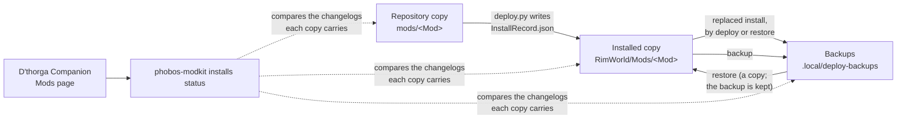

# Mod installs: updating, going back and backups, seen through the changelogs

**Status (18 Nov 2026):** built, not yet tested on screen. phobos-modkit 1.20.0's `installs` and 1.21.0's additions and
`rimworld-textures`, `config/installs.json`, `scripts/installs.py`, `scripts/textures.py`, deploy's install record and
`--build-only`, and D'thorga Companion's Mods page (0.10.0, round two in 0.11.0) are in place. Installing an older version straight
from git history, and deleting old backups from the Companion, are not built.

## Read this first (gotchas)

- **What you gain or lose is read from the changelogs.** Every installed copy and every backup carries the `CHANGELOG.md` it was
  installed with, so comparing two of them says which entries one has and the other lacks. A changelog says what changed, never
  that it works in game. **Not yet tested in game, or on screen by the owner.**
- **Going back past a change a save depends on can break that save.** Entries under "Save compatibility" are put first on every
  comparison. Read them before going back with a colony you care about, and keep a save copy.
- **Going back and installing wait until RimWorld is closed.** A backup can be made while it runs.
- **Nothing is deleted.** Going back keeps the backup, and the install it replaced becomes a new backup. Old backups are
  `python scripts/cleanup.py`'s to list, and go only when the owner runs it with `--apply`.

## What it answers for (owner's request, 18 Nov 2026)

The owner asked for a part of D'thorga Companion "dedicated to the updating, reversing changes, making backups, etc. all with
regard to our mods", starting with seeing the changelogs "track and update to what I'm either benefitting from or losing as
certain changes are made".

| Question | Answer |
| --- | --- |
| What does it let the owner do? | See, for each mod, what installing the repository's copy would give them, and what going back to any backup would take away, by the changelog entries; then back up, go back or install with one confirmed press |
| What does it stop them doing? | Going back or installing while the game runs; going back to a folder that is not one of that mod's backups; filling a drive (each move leaves at least 1 GB free); losing the install they replace |
| How does it change the way they work? | Updating stops being "ask a session to deploy" and becomes a choice made with the changes in front of them; a bad update can be undone from the window without knowing where backups live |

## How it works

- **`config/installs.json`** opts this repository in: the game, the mods folder, the backups folder (deploy's), the settings file
  naming the game's folder, the folders every mod shares (`src`, `external/phobos-log`), and the install command
  (`scripts/deploy.py --build --apply {mod}`).
- **The install record**: every deploy writes `InstallRecord.json` into the installed copy (never the repository's): the commit,
  the time, and any files with uncommitted changes under the mod's folder or the shared ones. Status shows how many commits have
  touched the mod since. Copies installed before 18 November 2026 have none.
- **Matching entries**: by their text, wherever they sit, so an Unreleased entry that later gains a version is neither gained nor
  lost. A lost and a gained entry with the same version, section and bold opening are one entry **reworded**.
- **The moves** (phobos-modkit `docs/installs.md`): backup copies the install; restore copies the backup beside the game's mods
  folder, swaps it in with two renames on the game's drive, and keeps the replaced install as a new backup; install runs deploy.

## Round two: builds, before and after, textures (owner, 18 Nov 2026)

The owner asked, after seeing the page: "Some way to compile the latest changes, as needed. Refresh after a compile. Perhaps the
ability to pre-empt any new changes before a compile is even done, showing changes both before and after. The ability to tell whether
textures needs to be optimized before my next game launch [...] it's always a wild guess currently." **Owner's picks:** check and fix
textures; a Build button plus "Install everything that changed"; all four before-and-after extras (files, settings, test rows, side by
side); a "Before you play" strip.

| Question | Answer |
| --- | --- |
| What does it let the owner do? | Build while playing; install every changed mod in one press and one restart; see, before building, what an install would change in files, settings and the test list; know before launching whether any mod would show an old picture, and fix it |
| What does it stop them doing? | Launching with stale textures unknowingly; installing a mod whose code was never built; encoding while the game runs |
| How does it change the way they work? | One glance at "Before you play" replaces guessing; RimSort's texture step is needed only when the page says so |

| Piece | How |
| --- | --- |
| Needs a build | A C# project's own files, its `Compile Include` files from elsewhere and the root build files, newer than the assembly it built (`config/installs.json` `build`). Referenced projects are not counted: their changes need not rebuild it |
| Build | `scripts/deploy.py --build-only`: every project, nothing copied, so it runs while the game does |
| Files | Every file installing would add, change or remove, by kind; `.dds` and `TestRows.tsv` exist only in installs and are left out (`installOnly`) |
| Settings | `scripts/mod-settings.py changes --since <installed commit> --json`, with each setting's mod (from its project's `ModFolder`) and, where found, the label the settings window shows (`Prefix_Setting<Name>` beside the saved key `Prefix_<Name>`) |
| Look out for | Test rows still waiting whose named version of the mod lies after the installed one and no later than the repository's |
| Textures | `scripts/textures.py`: stale, never encoded and left over, from file names and dates only, about 3 s for 355 mods. A stale `.dds` shows the old picture: the game skips a `.png` with a `.dds` of the same name beside it, without comparing dates (`Verse.ModContentLoader.ShadowedByDds`, read 18 Nov 2026) |

**Checked on the owner's PC (18 Nov 2026):** Steam dates files when it downloads them (the oldest file in 265 active Workshop mods
was dated 18 Oct 2026, though many are years old), so a changed picture is newer than its old `.dds`. The first check found no
stale textures, and 11 newly added mods never encoded (the [LFS] UI Rethemed family and Block Unwanted Minutiae, 825 pictures).

## Round three: progress, and the code behind an entry (owner, 19 Nov 2026)

The owner asked for "progress bars along with some associated status updates, wherever the two would be appropriate", and a code
viewer "that helps show off all the new and shiny code associated with any particular CHANGELOG item", built for every game they mod.

| Piece | How |
| --- | --- |
| Progress | phobos-modkit 1.24.0's progress lines (`docs/manifest.md` there): `deploy.py` counts a step for each project built, mod copied and mod's textures encoded; `installs` passes them on and adds its own for status, backup and going back; the texture check counts mods. Written only when a program asks, so a console is unchanged |
| The code behind an entry | `python scripts/changes.py entry`: the commit that first wrote the entry into its changelog (`git log -S`), and its diff with code first. No new markup in a changelog |

**What it means for how we write changes (for the owner to decide):** nothing has to change. The view is as sharp as the commit is
small: 0.140.1's commit wrote eight entries and changed 21 files, so each of its entries shows all 21. Three choices, in order of
cost: leave commits as they are (agent default); commit separate changes separately where they are separate anyway (the rule added to
AGENTS.md, no extra cost); or one commit for every entry, which costs a full gate run each and would slow every release.

## Changes to the process (agent defaults, for the owner to revise)

- **Changelog entries now matter to the owner directly**: the Mods page reads them as the list of what an update brings. Write each
  entry so it stands alone, keep its bold opening when rewording it (so it reads as reworded, not lost and gained), and put save
  effects under "Save compatibility". The existing rule that every change updates its changelog in the same commit is what keeps
  the page honest.
- **Uncommitted work installs too.** deploy installs the working tree, as before; the record and the page say how many files had
  uncommitted changes, so an install made mid-way through another session's work shows as such.
- Restore keeps the backup rather than moving it (agent default): it costs one more copy of a mod (about 8 to 50 MB) and means
  nothing is ever lost by going back.
- The 1 GB free-space margin and the one-hour install limit are agent defaults; so are the texture check's two-minute margin (a
  `.png` counts as newer than its `.dds` only by more than that) and the eight threads it reads with.
- Writing `.dds` files into Workshop mods' folders is the owner's choice (18 Nov 2026); the tools still never delete there.

## Not built yet (each waits for the owner's word)

- **Going back to any older version, not only a backup**: build and install from a git tag or commit, through a separate worktree.
  It would need the submodules and a full build at that commit.
- **Deleting old backups from the Companion**: today `python scripts/cleanup.py` lists them and the owner runs `--apply`.
- **The Workshop**: none of this touches Steam, and a Workshop copy of a mod is not an install this tool knows.
