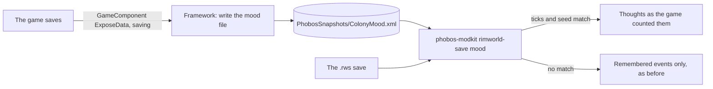

# Colony mood file: design record (10 Nov 2026)

**Built in D'thorga Framework 0.64.0 (10 Nov 2026). Not yet tested in game.** The owner said yes to it on 10 Nov 2026, as the
"snapshot route" of the colony mood report (D'thorga Companion's
[design record](https://github.com/phobos-dthorga/phobos-companion/blob/main/docs/design-record.md#colony-mood-built-10-nov-2026)).

## Read this first

- **Why it exists: a save holds only half of a colonist's mood.** The game saves remembered thoughts (a death, a meal off the
  floor) and works out situational ones while it runs: bedroom and dining room, pain, hunger, cold, darkness, traits, beliefs, a
  drug's high. phobos-modkit's `rimworld-save mood` reads the save, so without this file it can only give the situational half as
  one figure, "everything else".
- **What it does:** at every save, autosaves included, D'thorga Framework writes one small file listing every colonist's, slave's
  and prisoner's thoughts as the game itself adds them up, with each pawn's mood and break thresholds.
- **One setting**, "Write a colony mood file at each save", **on by default** (agent default, owner to revise): it costs a moment at
  each save and nothing between saves.
- **Owner's decisions (10 Nov 2026):** build this route; suggest fixes, labelled as advice; colonists, slaves and prisoners all
  included.

## What it does for the player

| | |
| --- | --- |
| **Lets them** | See every thought behind each colonist's mood, bedrooms, beliefs and pain included, in the mood report, as the game counts them |
| **Stops them** | Nothing: it writes one file outside the save and changes nothing in the game |
| **Changes how they play** | The report names the exact situational causes ("awful bedroom", a belief's demand) instead of one "everything else" figure, so the fix is plain |

## How it works



- **When:** while the game writes a save, from a `GameComponent`'s `ExposeData` in saving mode. No Harmony. A failure is logged
  once a session and never stops the save.
- **Who:** every pawn on a map (spawned or held) with a mood need that is the colony's prisoner, the colony's slave or a colonist,
  the same three groups the kit's report uses.
- **What, per pawn:** its thing ID (the save's `id`), name, group, current mood, the mood it is moving towards, and its three break
  thresholds from the game's own mental breaker (traits, genes and hediffs included). Per thought group, from the game's
  `GetDistinctMoodThoughtGroups` and `MoodOffsetOfGroup`: the Def, the label as the game shows it, memory or situational, how many
  thoughts are stacked in it, the precept behind it if any, and the group's mood offset after stacking.
- **Where:** `PhobosSnapshots/ColonyMood.xml` in the RimWorld user folder, beside `Config` and `Saves`; written to a temporary file
  first, then moved into place. One file, replaced at each save.
- **Matching it to a save:** the root carries the game's tick count and the world's seed. The kit uses the file only when both equal
  the save it reads; otherwise it says the file belongs to another save and reports from the save alone. The newest save and the file
  match after any save, so the newest-save report is exact.

**Cost (estimate, not measured):** about 50 pawns with about 30 thought groups each, a few hundred small elements, once per save.
The game already works these thoughts out for every mood tick; the writer asks for them once more.

## The file

```xml
<ColonyMood format="1" gameVersion="1.7.5000 rev1275" ticksGame="1234567" seed="example" written="2026-11-10T05:00:00Z"
            difficultyMoodOffset="0">
  <pawn id="Human123" name="Annie" group="colonist" mood="0.04" instantMood="0.02"
        minor="0.42" major="0.24" extreme="0.06">
    <thought def="AteWithoutTable" label="Ate without table" kind="memory" count="2" mood="-5.25" />
    <thought def="BedroomImpressiveness" label="Awful bedroom" kind="situational" count="1" mood="-4" />
    <thought def="Example_Precept" label="Desired: no drugs" kind="situational" count="1" mood="-3" precept="DrugUse_Prohibited" />
  </pawn>
</ColonyMood>
```

## Settings

| Mod | Setting (as the window shows it) | What it does | Default |
| --- | --- | --- | --- |
| D'thorga Framework | Write a colony mood file at each save | Writes the file above at every save | On (agent default) |

## Who chose what

- **Owner (10 Nov 2026):** build the snapshot route; suggestions labelled as advice; colonists, slaves and prisoners.
- **Agent choices, owner to revise:** on by default; one file replaced at each save rather than one per save; matching by tick
  count and seed; the folder name `PhobosSnapshots`.

## Limits

- Pawns away in caravans or on other maps' worlds are not on a map and are left out, as the save report leaves them out.
- A label is the game's text in the player's language; the kit matches by Def, never by label.
- If a mod changes how mood is added up in ways the game's own functions do not report, the file shows what those functions say.
