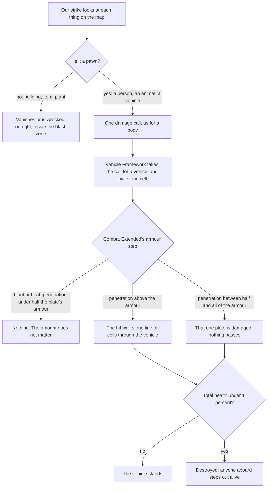

# Nuclear strikes, vehicles and people: why vehicles come through, and what a strike should do (22 Nov 2026)

**Status (22 Nov 2026):** a research record. It changes no code, Def or setting, and every numbered idea in it (NK1 to NK27) is
unbuilt. The fault it explains was seen in the owner's game on 22 Nov 2026; nothing here has been tested.

The owner, 22 Nov 2026: "vehicles, and I think it's all of the ones under our purview, aren't affected by the nuclear weapons
available to me in my Rimworld game. But this might be hiding a bigger problem." And: "it might be good to introduce some other,
realism-based health effects, like pawns receiving an instaneous radiation dose upon detonation and other effects." And: "Let's turn
this into a research and record purview, strictly." In the same conversation the owner proposed glass as a vehicle part with
knock-on effects; that has [its own record](vehicle-glass.md).

**How to read the marks.** **[log]** and **[save]** were read from the owner's `Player.log` and saves on 22 Nov 2026, read-only.
**[code]** was read in code or Defs, never run. **[P]** a primary source; **[S]** a secondary one. **[I]** our inference. **[A]** an
agent's choice or authored figure, for the owner to revise. **[not read]** says so plainly. Short forms: `S/` is
`src/PhobosPatches.Irbm/`; **VFsrc** is Vehicle Framework's public source at commit 026420b5; **CEsrc** is Combat Extended's public
source at commit d847807b (its vehicle armour function matches the installed build's decompile); **IRBM** is InterRim Ballistic Missile.

**Who read what.** Three survey agents read the code on 22 Nov 2026 with `scripts/query-code.py`, `scripts/query-defs.py`,
`scripts/query-patches.py` and the public source clones. The agent writing this record re-read the lines the main findings rest on
(listed under [Sources](#sources)) and read the log and saves itself; every other place is as the surveys reported it. **Re-read a
line before building on it.**

## Read this first

- **Vehicles come through a strike because of three rules meeting, none of them an error that shows in a log.** Our strike treats a
  vehicle as a person; Combat Extended then discards the blast hit; and what little gets through lands on one spot of a machine
  that dies only when nearly all of it is gone.
- **It is every vehicle, not only ours.** The two vehicles seen to survive were another author's, standing at the struck town.
  Nothing of ours makes our vehicles tougher; ours are thin-skinned and would suffer more than a tank if anything reached them.
- **The bigger problem is real, and it is not about nuclear weapons.** In the owner's game, **fire and any blast of low penetration
  do nothing to any vehicle, from any mod**, and **people aboard a vehicle are out of reach of every area effect**: a strike, fallout,
  gas, another mod's radiation.
- **Reality runs the other way.** A vehicle often survives a nuclear burst that kills or disables its crew. Our strike spares the
  crew completely and cannot hurt the vehicle either.
- **The strike already gives an instantaneous radiation dose**, but only with Dubs Rimatomics active, only to people standing in the
  open, and by a curve that knows nothing of walls or armour. We have no radiation model of our own.
- **Two statements in our older strike record need correcting**, and are, [below](#corrections-to-our-older-records): how far a
  strike reaches on the world map, and what the pulse finds left to stun.
- **The ideas start at [the short list](#the-short-list).**

## What the owner saw, and what the game's files show

**The strike.** One extinction-class IRBM warhead on the town of Gukpoi, through D'thorga Patches' own strike model
(Patches 0.31.0). The finish line in the log **[log]**:

> Strike on Gukpoi: 54613 things and 105625 cells in 118.2 s over 906 frames (27568 ms of work): vaporised 13779, wrecked 9121,
> damaged 2809, killed 92, burned 34, blinded 6, irradiated 24, stunned 0, plants wilted 28494, sheltered 1877 (AnyRockRoof), already
> gone 294, roofs stripped 6976, ground scoured 795, cells polluted 14426, fires 4523.

- **No errors were swallowed.** The line reports them when there are any, and it is an ordinary information line. So the blast was
  not cut short by an exception on a vehicle or on anything else.
- **The settings in force** [`scripts/mod-settings.py`]: blast model on, the pulse on, radiation on, shelter under any rock roof,
  fires at firestorm, rubble on, Combat Extended's wall fragments off, a full strike on every map in reach.

**Before and after** [save], from the autosaves either side of it (`Autosave-13`, 11 minutes before; `Autosave-6`, 4 minutes after):

| On Gukpoi's map | Before | After |
| --- | --- | --- |
| Walls | 2,699 | 29 |
| Ash | 918 | 25,558 |
| Fires burning | 1 | 2,305 |
| Plants | 40,244 | 10,807 |
| The town's people and vehicles on the map | (25 defenders standing, by our log line) | 3: **a bus, a Highwayman** and one person |

**The two vehicles** [save], both the town's own (Vanilla Vehicles Expanded designs), both empty of people:

| Vehicle | From ground zero | Zone | Its parts before and after |
| --- | --- | --- | --- |
| Bus (`VVE_BangBus`) | 41 cells | Blast: every building here vanished or was wrecked | **All 36 parts identical.** Not one point of health lost |
| Highwayman (`VVE_Highwayman`) | 79 cells | Blast | Seven parts lost between 5 and 72 health; one small part (25 health) has no health saved afterwards, which is how a part at zero is written **[I]**; 30 parts untouched |

- **The bus is the clean case.** Its plates are rated between 0 and 8 against blunt blows as patched [code], the weakest there
  is, and a blast worth about 452 damage at its distance [code, the falloff below] took nothing from it.
- **What harmed the Highwayman is not in the save.** It was not the blast hit (the next section shows that does nothing), not wall
  fragments (off), and not anyone of the player's (none was on the map). It carried rifle ammunition, and the town was burning:
  ammunition cooking off, which throws real projectiles under Combat Extended, is the likeliest cause **[I]**.
- **"Stunned 0" has an ordinary cause** **[code, save]**: nothing the pulse can reach was left to stun. The pulse is sent only to
  things beyond the blast zone, after the residual blast has hit them, and only to mechanoids and to buildings with the game's stun
  part. Beyond the blast zone stood 25 batteries and 5 turrets, between 110 and 153 cells out, where the residual blast is still
  worth 123 to 205. The batteries (100 health) were wrecked by it; so, it seems, were four turrets of 280 health, since none remained
  and none was counted, the game raising Bomb damage against buildings **[I, the factor not checked]**. There were no mechanoids, and
  vehicles are never sent the pulse. **As tuned, the pulse has almost nothing to act on** on a map of this size: the residual blast
  falls below 100 only beyond about 168 cells, which is the map's corners.

## The route of a hit



**1. Our strike sorts things into pawns and everything else** [code]. `StrikeWork.HitThing` (`S/Strike/StrikeWork.cs:243-254`) sends
a pawn to `HitPawn` and everything else to `Vaporise` or `HeatThing`. A vehicle is a pawn to the game, so it never takes the route
that removes buildings. The fast sweep our other warheads use does the same (`S/IrbmSweep.cs:197-204`), and so does the rule both
share (`HitRule.Choose`, `S/Rules/IrbmRules.cs:104`: "Pawns always take the damage, to die properly").

**2. What `HitPawn` sends** [code] (`StrikeWork.cs:312-339`; the figures are the warhead's and `Rules.xml`'s):

| Zone | Sent to a pawn | Penetration |
| --- | --- | --- |
| Fireball (within 25 cells) | One Bomb hit of 10,000, aimed at the body's core part | 200 |
| Blast (25 to 110) | One Bomb hit by falloff: about 576 at 25 cells, 452 at 41, 288 at 79, 205 at 110 | **0** |
| Thermal (110 to the edge) | One Bomb hit of 0.3 of the falloff | **0** |
| Blast and thermal | Up to ten Burn hits over the skin, a quarter of the falloff in all | **0** |
| Blast and thermal | Rimatomics' flash blindness on the eyes, by chance; its radiation, through `applyRads` | (conditions, not damage) |
| Thermal | The pulse, **only if the pawn is a mechanoid** (`StrikeWork.cs:382`) | — |

The penetration of 0 was copied from Rimatomics' blast wave, which uses it for people (`Rules.xml`, its comment). Against a body
with no armour it is harmless; against plate it decides everything.

**3. Vehicle Framework takes the call** [code]. `VehiclePawn.PreApplyDamage` (VFsrc `VehiclePawn_Health.cs:143-147`) passes the hit
to its own parts system and marks it absorbed, so the game's body-damage code never runs and the "core part" aim means nothing.
`VehicleStatHandler.TakeDamage` (VFsrc `VehicleStatHandler.cs:486-504`) picks **one cell** of the vehicle: the one nearest whoever
caused the hit, here a launcher on another map, or a random one.

**4. Combat Extended's armour step decides** [code]. Its prefix replaces Vehicle Framework's own step whenever its setting "Use New
Vehicle Armor" is on, the default, which the owner has not changed (CEsrc `VehicleArmorPatch.cs:21-34`). For each plate it calls
`DamageArmor` (`:419-442`), which holds this rule:

```csharp
if (!isSharp && (penAmount / armorAmount) < 0.5f)
{
    armorDamage = 0f;
    deflected = true;
}
```

A hit that is not sharp, **and whose penetration is under half the plate's armour, does nothing, whatever its amount**. A part with
no armour at all is then tested against its own bulk (its health ÷ 50, `:405`), with the same result. So **a blunt or heat hit at
penetration 0 can never harm a vehicle part that has any health.** Under Combat Extended, Bomb is blunt and Burn and Flame are heat
[code, the Defs as patched, surveyed].

What the fireball's one hit (10,000 at penetration 200) does, worked from that function [code; the arithmetic is ours]:

| The plate's blunt armour | Result |
| --- | --- |
| 4 (our trucks' Skin class; the bus's is 0 to 8) | The plate is lost and 9,800 carries on, through **one line of cells** |
| 80 (the heaviest blunt figure on any part of ours) | The plate is lost and 6,000 carries on, along the same one line |
| 300 | Stopped, but that one plate takes 4,444 and is lost. Nothing else is touched |
| Above 400 | **Nothing at all.** A main battle tank's plates are in the thousands [code, surveyed] |

**5. A vehicle dies only under 1% of its total health** [code] (CEsrc `VehicleArmorPatch.cs:376-379`; Vehicle Framework's own rule is
the same). One line of parts is far short of that on any vehicle, and D'thorga Framework's loadouts add parts to other authors'
land vehicles, which raises the total a little further (`vehicle-health-design.md`, about 12 to 17 % on the Highwayman).

**6. If it does die, the crew step out** [code, surveyed]. `VehiclePawn.Destroy` puts everyone alive out of the vehicle before it
goes (VFsrc `VehiclePawn_Health.cs:205-263`).

### Each nuclear weapon on the owner's list, against a vehicle

All **[code, surveyed]** except our own two, which were re-read. "With Combat Extended" is the owner's game.

| Weapon | How it reaches a vehicle | Without Combat Extended | With Combat Extended |
| --- | --- | --- | --- |
| **IRBM's extinction-class warhead, through our strike model** | One Bomb hit, then burns, as above | An armour roll at one cell; a few parts at most | **Nothing outside the fireball; one line of parts inside it, and nothing against heavy plate** |
| **IRBM's other strategic warheads, through our fast sweep** | One hit per pass, repeated | As above, repeated | By each warhead's penetration. The solar-flare warhead's pulse does reach vehicles, through D'thorga Framework's vehicle EMP |
| **IRBM's tactical warheads** (mini-nuke, fission, antigrain) | One direct hit, then an ordinary explosion at penetration 60 to 75 | One hit per edge cell | Nothing against any plate above 120 to 150 (twice the penetration) |
| **Dubs Rimatomics, high yield** | Burn and its blast wave, once per cell the vehicle stands on, at **penetration 0**; its building pass skips pawns | Many armour rolls | **Nothing** |
| **Dubs Rimatomics, low yield** (and the warhead armed in place) | **Removes everything within 25 cells outright**, vehicles included, then an explosion of 600 at penetration 100 | Destroyed within 25 cells; the crew step out alive first | The same within 25 cells; beyond, nothing against any plate above 200 |
| **The Dead Man's Switch: Expedition** missiles | An ordinary explosion of 350 to 440 | One hit per edge cell | By the penetration Combat Extended works out for it [not read] |
| **The Dead Man's Switch: Legion** nuclear strike | **Removes everything within 10 cells outright**; then two rings at penetration −1; then a deadly radiation condition on every person on the map | Rings: armour rolls | Rings: **nothing**. The condition is refused on a vehicle, and people aboard are not "on the map" |

RimPacts has no nuclear weapon of its own. Only the two weapons that remove things outright can destroy a vehicle reliably, and
both let the crew out alive first.

## The bigger problem

The owner's suspicion was right. Five things lie behind the report; the first two reach far beyond nuclear weapons.

| # | What | Reach | Whose code | Fault or design |
| --- | --- | --- | --- | --- |
| **B1** | **Under Combat Extended, a blunt or heat hit whose penetration is under half a plate's armour does nothing to a vehicle**, however large. Fire's own damage carries penetration 0 [code, surveyed] | **Every vehicle, every mod**: fire, Rimatomics' blast wave, any explosion a non-Combat-Extended mod makes with a low penetration, our strike's blast and burns | Combat Extended's vehicle compatibility, meeting other mods' figures | A design: blunt blows bounce off armour. It was written for bullets and shells, and nobody gave fire or overpressure a figure it can read |
| **B2** | **People aboard a vehicle are not on the map as the game counts it** | Every area effect that walks the map's people or things: our strike, fallout, gas, pollution, Legion's radiation, Rimatomics' fallout | Vehicle Framework | A design, already noted in [emergent play, audit 2](vehicle-emergent-play.md#audit-2-the-games-incidents-and-the-vehicles): "any vehicle, an open bike included, is today a perfect, free shelter" |
| **B3** | **Vehicle Framework refuses every health condition on a vehicle** (VFsrc `Patch_HealthAndStats.cs:170-177`) | Radiation, flash blindness and Legion's corrosion do nothing to the vehicle, silently | Vehicle Framework | A design, and a sound one: a truck should not catch radiation sickness. But our strike still counts the attempt: "irradiated 24" counts calls made, not doses taken |
| **B4** | **An explosion touches only a vehicle's edge cells**, and skips starting fire, gas and spawns on its inner cells (VFsrc `Patch_Combat.cs:207-216`) | Every explosion | Vehicle Framework | A design, so that a large vehicle is not hit once per cell |
| **B5** | **Our strike gives a vehicle a person's treatment**: never removed, burned "over the skin", pulsed only if a mechanoid | Our strike model and fast sweep | **Ours** | **A gap in our design.** The strike's record has columns for people, buildings, plants and ground, and none for vehicles |

**B1 has already been seen once without being named.** The jet that burned without harm in
[the Vehicle Framework fires record](vehicle-framework-fires.md) fits it exactly.

**What follows from B1 and B2 together:** in the owner's game a vehicle is fireproof, largely blast-proof, and a sealed shelter from
everything in the air, for anyone, whatever the vehicle is. That is the opposite of what a design about vehicles as fragile,
maintained machines wants, and it holds for raiders' vehicles as much as the colony's.

**Smaller things found on the way** [code, surveyed, unless marked]:

- **A vehicle that is destroyed outright sets its crew down alive beside the crater.** Our own "kill whoever is inside first" step
  for caskets (`IrbmSweep.KillHeldPawns`, re-read) would not find a vehicle's crew: it asks the game's general "what do you hold?",
  which a vehicle answers with nothing. A vehicle route of ours must reach the crew through Vehicle Framework's own seats.
- **Shelter is judged at one cell.** Our strike tests a thing's own position for a rock roof, so a long vehicle half under an
  overhang counts as wholly sheltered or wholly not (`StrikeWork.cs:167-168`, re-read).
- **On the world map, IRBM's strategic warheads remove what stands on nearby tiles.** A walking caravan is removed with its people
  left alive but outside any caravan, so the player loses them **[I]**; a vehicle convoy's people are passed to the world alive and
  its vehicles destroyed; an aircraft in flight is destroyed with all aboard. Rimatomics' missile harms no caravan on its tile.
- **IRBM's tactical warheads have one loop with no guard**: if any one thing threw an error as it was hit, the rest of that blast
  would be lost and the missile would try again every tick **[I]**. Nothing was found that throws there.
- **Rimatomics' fallout looks to have a sign wrong**: it multiplies toxic buildup by a person's resistance, not by what is left
  after it, so the better protected gain more **[I, from a decompile]**. It is Rimatomics' to fix; see
  [reports to other authors](#reports-to-other-authors).
- **The owner's log filled with 367 errors as the strike began**, from IRBM's music code and a weighted pick with nothing to pick
  from **[log, surveyed]**. They are not in the damage path. Not looked into further.

### Corrections to our older records

- [Missile patches](missile-patches.md) says a strategic strike reaches "every open map within six world tiles". The owner's log
  gives "Physics Radius: 1.49, Tile Radius: 6", and IRBM's code halves the figure: about three tile widths **[code, log, surveyed]**.
- The same record's test protocol expects "batteries and turrets stunned". In the owner's strike none was: every battery and
  turret beyond the blast zone was wrecked by the residual blast before the pulse could reach it **[save]**. Batteries and turrets
  do carry the game's stun part [code]; the pulse simply arrives second. On a map of 325 cells it can stun only what stands in the
  corners, what is sturdy enough to outlast the residual blast, or a mechanoid.

### Reports to other authors

None of this is dire, and nothing is drafted. Offered once, for the owner to take up or leave: a short note to Rimatomics' author
on the fallout sign (after reading it in game, since it rests on a decompile); and a question to Combat Extended's team on whether
fire is meant to be harmless to vehicles. Agents never post either.

## What the real thing does

Gathered by a research agent on 22 Nov 2026 from documents it opened and read; each is listed with its link under
[Sources](#sources). Quotations are the sources' words. Unit conversions and anything marked [I] are ours. **G&D** is Glasstone and
Dolan's *The Effects of Nuclear Weapons* (third edition, 1977), cited by paragraph; **FM 8-9** is the NATO handbook on the medical
aspects of nuclear, biological and chemical defence, Part I.

**A caution on scale.** At one metre to a cell, a real warhead's effects are far wider than a map, as the strike's own record says.
What can honestly be taken from the sources is **the order in which things fail and the ratios between them**, not distances.

### Where the energy goes

- A fission weapon burst in the air: about **50 % blast, 35 % heat, 5 % radiation in the first minute, 10 % radiation afterwards**
  (G&D §1.25-1.26) **[P]**.
- An enhanced radiation warhead, the "neutron bomb": "30% blast; 20% thermal; 45% initial radiation; and 5% residual radiation"
  (FM 8-9 ¶302c) **[P]**.

### Blast and vehicles

- **It is the wind, not the squeeze.** "In most cases, however, it was not primarily overpressure, but drag forces, which produced
  the damage" (G&D §5.86) **[P]**. The wind behind a 5 psi blast front is 163 mph; behind 30 psi, 669 mph (G&D Table 3.07) **[P]**.
- **Cars and trucks, by blast pressure** (G&D §5.87-5.91) **[P]**:

| Peak overpressure | What happened to motor vehicles in the tests |
| --- | --- |
| 1 psi | "largely unharmed" |
| 1.7 psi | "minor exterior damage, such as broken windows and dished-in panels" |
| 5 psi | "badly battered, with their tops and sides pushed in, windows broken, and hoods blown open. But the engines were still operable and the vehicles could be driven away" |
| 5 psi, side-on to the blast | A truck "was overturned and somewhat damaged, but still operable"; another, facing it at the same place, "was driven away without any repairs being required" |
| 30 psi | A rescue truck "was completely destroyed, and only one wheel and part of the axle were found" |

- **Their damage classes for motor equipment** (G&D Table 5.147a) **[P]**: light, "Glass broken, dents in body, possibly turned over,
  immediately usable"; moderate, "Turned over and displaced, badly dented, frames sprung, need major repairs"; severe, "Gross
  distortion of frame, large displacements, outside appurtenances (doors and hoods) torn off, need rebuilding before use".
- **Tanks.** G&D gives no figures for armour. A US Army report on the 1955 Operation Teapot tests does (Bryant, Ethridge and a
  third author, WT-1123) **[P]**: "Damage was light until the dynamic pressure exceeded approximately 30 psi"; at about 36 psi of wind
  pressure "tanks were turned over, and their tracks and suspension components were blown off. The shock front caused little
  interior damage to the tanks... All three tank engines and transmissions were successfully operated." Before a tank rolls, what
  it loses is "Periscopes, telescope, range finder end windows, pioneer tools, driving lights (glassware), and sheet metal".
  A tank "may be displaced from 20 to 140 feet depending on original orientation".
- **Put together** [I]: a truck is scrap at a pressure where a tank has lost only its glass and fittings, and a tank is rolled only
  at pressures where people in the open are already being killed by the blast itself (below). **Weight and which way it faces decide a vehicle's fate; armour
  thickness barely enters.**

### Blast and people

- **The blast itself** (G&D Table 12.38) **[P]**: eardrums can rupture from 5 psi; lungs are damaged from about 12 psi; deaths begin
  at about 40 psi and reach half at about 62. FM 8-9 gives somewhat lower figures; **the two disagree**.
- **Being thrown does more harm, further out.** At 5.3 psi a standing dummy "attained its maximum velocity, about 21 feet per
  second" and "traveled 13 feet before striking the ground and then slid or rolled another 9 feet. A prone dummy, however, did not
  move under the same conditions" (G&D §12.44) **[P]**. Hitting something hard: about 10 feet a second is mostly safe, deaths begin
  near 21, and half die near 54 (G&D Table 12.49) **[P]**.
- **Flying glass and debris** wound from much further out still: see [vehicle glass](vehicle-glass.md#injuries-from-glass).

### Heat

- **Bare skin burns long before materials catch.** A second-degree burn on bare skin takes about 4 to 7 calories per square
  centimetre, depending on the size of the weapon (FM 8-9 Table 4-VI, converted from joules) **[P]**. Under a summer uniform it
  takes about 15 (62.7 joules; FM 8-9 Table 4-VII) **[P]**. Black rubber ignites at 10 to 25, olive canvas at 12 to 28, and plastics
  only darken at 60 to 70 (G&D Tables 7.35 and 7.40, §7.39) **[P]**. Tyres are not listed; black rubber is the nearest row.
- **Anything opaque is a shield.** "Any solid, opaque material, e.g., a wall, a hill, or a tree, between a given object and the
  fireball will act as a shield and provide protection from thermal radiation... Transparent materials, on the other hand, such as
  glass or plastics, allow thermal radiation to pass through only slightly attenuated" (G&D §7.18) **[P]**. So a wall or a roof
  stops the heat, and a window does not.
- **Clothing can make it worse once it lights:** "Persons wearing heavy clothing could suffer third-degree burns over the whole body
  if the ignited clothing could not be removed quickly" (G&D §12.60) **[P]**.
- **Not verified:** the exposures for first- and third-degree burns, which the book gives only as curves.

### The flash

- **Flash blindness is temporary, and worse at night.** It "does not necessarily require the eye to be focused on the fireball";
  "recovery is complete"; useful vision is lost for "several seconds to minutes"; and it "would be more severe at night since the
  pupil is larger" (G&D §12.83-12.84) **[P]**. By day it "does not persist for more than about 2 minutes"; at night partial recovery
  takes 3 to 10 minutes and full night vision 15 to 35 (FM 8-9 ¶412) **[P]**. In Japan there were "many instances of temporary
  blindness, occasionally lasting up to 2 or 3 hours, but only one case of retinal injury" (G&D §12.79) **[P]**.

### The dose at detonation

- **It arrives within a minute**, by definition (G&D §8.01) **[P]**, most of it in the first second at closer ranges (§8.47).
- **It falls with the square of the distance, and faster**, because the air absorbs it (G&D §8.32) **[P]**. No distances are taken
  from the book: its curves were not read.
- **Mass stops it, and it takes a lot.** To cut the gamma rays to a tenth: 3.3 inches of steel, 11 of concrete, 16 of earth (G&D
  Table 8.41) **[P]**. Steel is poor against neutrons: "An iron shield will attenuate weapon neutrons to some extent, but it is less
  effective" than materials holding hydrogen (G&D §8.66) **[P]**.
- **What buildings pass** (G&D Table 8.72; the share of the outside dose that gets in) **[P]**:

| Shelter | Gamma rays | Neutrons |
| --- | --- | --- |
| Frame house | 0.8 to 1.0 | 0.3 to 0.8 |
| Basement | 0.1 to 0.6 | 0.1 to 0.8 |
| Concrete blockhouse, 9-inch walls | 0.1 to 0.2 | 0.3 to 0.5 |
| Concrete blockhouse, 24-inch walls | 0.007 to 0.02 | 0.1 to 0.2 |
| Three feet underground | 0.002 to 0.004 | 0.002 to 0.01 |

- **What armour passes.** The US Army Nuclear and Chemical Agency's note on armoured vehicles (Davidson, 1979) **[P]**: an M60A1
  tank's protection is "fair for neutrons and good for gammas (TFs equal .5/.1)", that is, half the neutrons and a tenth of the
  gamma rays get in; "neutrons typically make up 50 to 75% of the radiation dose incident on the outside of the vehicle"; and
  "lightly armored vehicles provide comparatively little protection against neutrons, on the order of 10 to 20%". By our
  arithmetic, a tank's crew take roughly a third of the outside dose and a light armoured vehicle's crew most of it **[I]**.
- **That is what the neutron bomb was for.** "In the literature, the main emphasis for ER tactical weapons has been the disabling
  effects on tank crews" (Sandmeier, Battat and Hansen, Los Alamos National Laboratory, 1982) **[P]**.
- **No table was found** for what a car or a truck passes of the dose at detonation.

### What a dose does

Three sources, which agree on the shape and differ on the edges **[P]**:

| Whole-body dose | Vomiting begins | Well period before the illness | Deaths without care |
| --- | --- | --- | --- |
| 1 to 2 Gy | 2 hours or later, in 10 to 50 % | 21 to 35 days | 0 % |
| 2 to 4 Gy | 1 to 2 hours, in 70 to 90 % | 18 to 28 days | 0 to 50 % |
| 4 to 6 Gy | Within an hour, in all | 8 to 18 days | 20 to 70 % |
| 6 to 8 Gy | Within 30 minutes, in all | 7 days or less | 50 to 100 % |
| Above 8 Gy | Within 10 minutes, in all | None | 100 % |

(International Atomic Energy Agency and World Health Organization, Safety Reports Series No. 2.) One gray is 100 rad.

- **Half die without care** at "about 3.5 Gy" (IAEA), "about 2.5 to 5 Gy" (US Centers for Disease Control and Prevention), or
  "about 450 cGy as measured in free air" (US Department of Health and Human Services); with care the IAEA gives 5 to 6 Gy. Part
  of the spread is where the dose is measured **[P]**.
- **Above about 10 Gy the gut fails** and death comes within two weeks; **above about 50 Gy the brain and circulation fail** within
  days, with symptoms in minutes (CDC) **[P]**. "Military personnel receiving an acute incapacitation dose (30 Gy) will become
  performance degraded almost immediately and combat ineffective within several hours. However, they will not die until 5-6 days
  after exposure" (FM 8-9 ¶520b) **[P]**. A US Army planning manual of 1977 names 3,000 and 8,000 rad as its doses for immediate
  incapacitation; its scan was too poor to quote further, and it calls its own data "hypothetical", for training **[P, weak]**.
- **A dose makes every other injury worse.** "The combination of sublethal nuclear radiation exposure and moderate thermal burns
  will produce earlier and more severe shock than would the comparable burns alone. The healing of wounds of all kinds will be
  retarded" (G&D §12.112) **[P]**. With other injuries, the dose that kills half may fall "from as low as 200 to 450 cGy" (FM 8-9
  ¶624) **[P]**.

### The pulse

- **Tested on real vehicles.** The United States' EMP Commission (2008) exposed 37 cars built from 1986 to 2002 and 18 trucks built
  from 1991 to 2003 to fields up to about 50 kilovolts a metre **[P]**:
  - **Switched off, nothing happened**: "No effects were subsequently observed in those automobiles that were not turned on during
    EMP exposure", and the same for the trucks.
  - **Running, a few stalled**: "the motors in three cars stopped at field strengths of approximately 30 kV/m or above"; "three of
    the truck motors stopped. Two could be restarted immediately, but one required towing to a garage for repair."
  - Most of the rest showed nuisances only, such as "blinking dashboard lights".
- **Near a ground burst the field is far stronger than those tests**, within "a radius around ground zero of about 2 to 5 miles,
  depending on the explosion yield" (G&D §11.12) **[P]**. No vehicle tests at such fields were found.

### Fallout, and washing it off

- **It decays by sevens and tens.** "For every sevenfold increase in time after the explosion, the dose rate decreases by a factor
  of ten": a tenth at 7 hours, a hundredth at two days, a thousandth at two weeks (G&D §9.15) **[P]**.
- **What a vehicle passes of fallout's radiation** (US Army FM 3-3-1, Table 6-1; G&D §9.120) **[P]**:

| Riding in | Share of the outside dose |
| --- | --- |
| A quarter-ton truck (a jeep) | 0.8 |
| Cars, buses and trucks | 0.5 to 0.7 |
| An M113 armoured personnel carrier | 0.3 |
| An M2 infantry fighting vehicle | 0.2 |
| An M1 or M60 tank | 0.04 |
| A parked UH-60 helicopter | 0.7 |
| A frame house (for comparison) | 0.3 to 0.6 |
| A basement | 0.05 to 0.1 |

- **Vehicles are washed down, soon.** "Vehicle washdown should be performed within 6 hour of being contaminated", and is "most
  effective if started within 1 hour"; "Each vehicle receives a 2- to 3-minute washdown with hot, soapy water"; dry dust can be
  brushed off, but once wet "brushing or shaking will not remove the contamination" (US Army FM 3-5, 2000) **[P]**.
- **Washdown began at sea.** "The technique of washdown of ships, by continuous flow of water over exposed surfaces to remove
  fallout as it settles, was developed as a result of the Bikini BAKER observations" (G&D, chapter IX, footnote 6) **[P]**.

### Glass at ground zero

- "Sand in the crater was fused by the intense heat into a glass-like solid, the color of green jade... This material was given
  the name trinitite" (US National Park Service, on the Trinity site) **[P]**. Geologists add that some of it was sand carried up
  into the fireball, melted, and rained back (Eby, Charnley and Smoliga, 2010, an abstract) **[P]**.

### What this changes in our picture

- **Our strike has the order backwards for vehicles.** In reality the glass goes first, then a light vehicle is rolled, then it is
  wrecked, and heavy armour outlasts everyone around it; in the game the armour is untouched and so is the bus.
- **A building is a poor shield from the dose and a good one from heat and flash.** A frame house passes nearly all of the dose and
  none of the heat. Our strike today gives full burns, flash and dose to anyone not under a rock roof: about right for the dose,
  and wrong for burns and flash, which any wall or roof would stop.
- **A gas mask does nothing against the dose.** Rimatomics scales it by toxic resistance, so today a mask and suit cut it.
- **A parked vehicle shrugs off the pulse; a running one may stall.** Our pulse, once it reaches vehicles (NK4), should follow that.
- **A vehicle is a modest shelter from fallout and a poor one from the dose**, and a tank is a good shelter from fallout and a
  middling one from the dose. That is the real thing behind NK9 and NK11.
- **Lying down matters**: a person flat on the ground was not thrown where a standing one was.

## What is already there to build on

All **[code]**; the places are in [Sources](#sources).

| Need | What exists | Whose |
| --- | --- | --- |
| A radiation dose and its sickness | `RimatomicsRadiation` (sickness, lethal at 1), `RadiationIncurable` (lasting buildup, with a cancer chance), `FatalRad`, all fed by `DubUtils.applyRads(pawn, strength)`, which scales by the person's `ToxicEnvironmentResistance` [surveyed] | Dubs Rimatomics; our strike already calls it by name (`S/Strike/RimatomicsTieIn.cs`) |
| A stand-in without Rimatomics | The game's `ToxicBuildup`, which IRBM's nuclear winter already uses [surveyed] | The game |
| Flash blindness | Rimatomics' `FlashBlindness` on the eyes, healing by itself; our strike already adds it | Dubs Rimatomics |
| Blast injuries | Concussion, bone fracture, temporary hearing loss, lung collapse and "cut (spall)" as conditions [Defs listed 22 Nov 2026] | More Injuries (Continued) |
| Burns as a load on the body | D'thorga Medical's burn load, shock and airway burns; the strike's burns are already split over the skin for it | Ours |
| Suiting up before a contaminated area | The protection line and the radiation control zone ([radiation control line](radiation-control-line.md)), which judge gear by `ToxicEnvironmentResistance` | Ours |
| A pulse on a vehicle | Vehicle EMP: electrical parts rated by hardening, a stall, a battery that loses charge; under Combat Extended our own step runs it (`V/Service/VehicleEmp.cs`) | Ours, on Vehicle Framework's model |
| Reaching the people aboard | Vehicle Framework's seats (`AllPawnsAboard`), which our code already reads in some thirty files | Vehicle Framework |
| An open or a closed cab | `CabinSpec.closed` on each loadout, and `PhobosVehicleCabinExtension` for any mod's vehicle (`V/Defs/SystemDefs.cs:721-733`); the cab's own temperature (`V/Service/CabClimate.cs`) | Ours |
| Hurting the crew of an armoured vehicle without a penetration | Shock spall: an explosive hit of 30 or more on a plate of the Rifle class or heavier throws one fragment inward, even when the plate shrugs the hit off, because Combat Extended calls a part's reactors on a hit that did nothing (`V/Service/Spall.cs:133-175`; CEsrc `VehicleArmorPatch.cs:363-369`) | Ours |
| A wreck left behind | Hulls: with our setting on, any faction's destroyed vehicle leaves a hull that gives salvaged parts (`V/Service/VehicleHulls.cs:42-43`) | Ours, on Vehicle Framework's wreck |
| Washing | Dubs Bad Hygiene's water; our shower trailer, tanker and hose reel | Dubs Bad Hygiene; ours |

`V/` is `src/PhobosFramework.Vehicles/`.

**One oddity worth knowing** **[I]**: our strike's blast hit is explosive and well over 30, so today it can throw shock spall at the
crew of a vehicle with plates of the Rifle class or more, while doing nothing to the plate. A thin-skinned truck's crew get nothing
at all. It is the only way the strike reaches anyone aboard, and it reaches the best protected.

## The ideas

Every row is unbuilt. **Verdicts are the agent's recommendations [A]**, for the owner to change: **Take** (worth building next),
**Idea** (sound, not urgent), **Hold** (needs something else first), **Waiting** (on an earlier answer of the owner's), **Argued
against**. Every figure a row would need is authored unless [the physics](#what-the-real-thing-does) gives one.

### A. A vehicle's own route through a strike

This is the part that is ours to put right (B5). The principle: **blast and heat act on the whole machine, so they should not go
through an armour step written for a bullet meeting a plate.** A strike would set parts' health directly, part by part, as Combat
Extended itself does, and raise the same events.

| # | Idea | What the reads found | Lets | Stops | Changes | Size and verdict |
| --- | --- | --- | --- | --- | --- | --- |
| **NK1** | **In the fireball a vehicle is gone, with everyone aboard** | Buildings there vanish through `Vaporise`; a vehicle needs its crew killed through its seats first, or Vehicle Framework sets them down alive | Destroy a motor pool at ground zero | Parking at ground zero and driving home | Vehicles are moved or dug in before a strike is called | Small. **Take** |
| **NK2** | **In the blast zone, wrecked or battered by weight.** A light vehicle is wrecked and leaves a hull; a heavier one loses a share of every outer part's health, falling with distance and with its mass; the heaviest armour loses least | Hulls exist; part health can be set directly; each design has a mass. Real vehicles are thrown and rolled by the blast wind long before armour is crushed ([physics](#what-the-real-thing-does)) | See damage graded by distance and weight; salvage hulls afterwards | A bus standing untouched 41 cells from ground zero | Heavy vehicles are worth their cost near a strike; a struck town's motor pool is scrap, not loot | Medium. **Take** |
| **NK3** | **Heat takes the soft parts**: tyres, hoses, wiring, canvas and paint, by distance | Each loadout already names its parts by role (wheels, wiring, tanks), so the soft ones can be picked without a list per vehicle. Rubber and canvas catch at two to four times the exposure that burns bare skin, so this reaches less far than people's burns do | A vehicle that survives but cannot drive away | Driving off on four good tyres from inside the thermal zone | Spare tyres and a recovery truck matter after a strike | Medium. **Take**, in the same pass as NK2 |
| **NK4** | **The pulse reaches vehicles: a running one may stall, a parked one shrugs it off** | One condition keeps it from them. Sent, it would stall a vehicle and drain its battery through the vehicle EMP we already have, by each design's hardening. In the real tests only running vehicles were affected, and most restarted; nearer a ground burst the field is stronger and nobody has published vehicle figures | Stop vehicles that are under way | Driving through a strike's edge with the engine running, unharmed | Engines are switched off before a strike; hardened military vehicles earn their keep | Small. **Take** |
| **NK5** | **Shelter judged over the whole vehicle**, and no shelter from a built roof (the blast takes those first, as now) | Today one cell decides | A vehicle under an overhang is sheltered only if all of it is | Half-parking under rock | Deep parking is the answer, as for people | Small. **Take**, with NK1 |
| **NK6** | **The strike's log line counts vehicles**: struck, wrecked, stalled, people aboard killed and dosed; and "irradiated" counts doses taken, not calls made | The line is the one place a strike reports itself | Read what a strike did to vehicles without loading saves | Nothing | Nothing in play; it makes the next fault quick to read | Small. **Take** |
| **NK7** | **The same route for IRBM's other strategic warheads**, each by what it is: the gamma-ray warhead a dose to crews and no harm to the machine; the solar flare a pulse; the vaporising ones as NK1 | They run our fast sweep today, which also treats a vehicle as a person. "D'thorga treatments for IRBM's other strategic warheads" is already on the deferred list, waiting for the owner's test of this one | A warhead for each purpose, including one that empties vehicles and leaves them | One warhead doing for all | Choosing a warhead becomes a decision | Medium. **Hold**, with that deferred item |

### B. The people aboard

| # | Idea | What the reads found | Lets | Stops | Changes | Size and verdict |
| --- | --- | --- | --- | --- | --- | --- |
| **NK8** | **The crew share the vehicle's fate.** Thrown about inside as the vehicle is battered: blunt injuries, and More Injuries' concussion and fractures where it is active | The seats are reachable; today only shock spall reaches a crew, and only behind heavy plate | Hurt or kill a crew without destroying the vehicle | Sitting out a strike in a parked truck | A vehicle is no bunker; people leave it for real shelter | Medium. **Take** |
| **NK9** | **A dose through the hull.** The strike's dose reaches each person aboard, cut by what they sit in: nothing for an open vehicle, a little for a closed cab, more for armour, most for a tank | Open or closed is already on every loadout; the armour class is on every plate. The real figures: a tank's crew take about a third of the outside dose, a light armoured vehicle's most of it, and no figure was found for a truck ([physics](#the-dose-at-detonation)) | Leave a tank standing with a dying crew, as the real weapons were meant to | Treating armour as radiation shelter | Distance and rock, not steel, are what protect from the dose | Small once NK12 exists. **Take** |
| **NK10** | **The flash takes the driver's sight.** A driver or pilot blinded at the flash stops driving until relieved or recovered; no crash is rolled | The owner's rule for a stoned driver was "no random crashes" (12 Nov 2026); this follows it. Night driving already swaps a tired driver for a rested passenger (`V/Camp/NightDriving.cs`) | Halt a column with a flash | Driving on blind | A second driver aboard matters | Small. **Idea** |
| **NK11** | **Fallout, gas and pollution reach people aboard, by the cab**: fully in an open vehicle, slowed by a closed one | This is EM22 in [emergent play](vehicle-emergent-play.md#questions-for-the-owner). The owner's answer of 20 Nov 2026: it waits for the cab-air model. [Vehicle glass](vehicle-glass.md) proposes what seals a cab | — | — | — | **Waiting** |

### C. People on foot

The owner's own example, the instantaneous dose, is here. **A dose at detonation already exists**: with Rimatomics active, every
survivor outside the fireball who is not under a rock roof gets `applyRads` at 5 times a strength that falls with distance
(`StrikeWork.cs:331-337`, `Rules.xml`). What it lacks is below.

| # | Idea | What the reads found | Lets | Stops | Changes | Size and verdict |
| --- | --- | --- | --- | --- | --- | --- |
| **NK12** | **A dose that knows what stood between.** By distance, then cut by mass in steps: in the open or in a light building (nearly all of it); behind thick stone walls (a fifth or so); underground or under rock (almost none). **Not cut by a gas mask** | Today it is all or nothing: a rock roof gives none, everything else the full dose. That is close to the real thing in kind, since a frame house passes almost all of the dose. What is wrong is the mask: Rimatomics scales the dose by toxic resistance, and a mask does nothing against the real thing | Survive by what was between people and the burst; build shelters in grades | A mask and suit as protection from the flash of radiation | Thick stone and depth are what count | Medium. **Take** |
| **NK13** | **The dose is told.** Each person's dose in words on the strike's letter and in their record, and a colony total | Rimatomics' conditions show a severity, not what caused it | Know at once who needs care | Finding out days later | Triage after a strike starts with a list | Small. **Take**, with NK12 |
| **NK14** | **The real course of radiation sickness**: early sickness, a deceptive well period, then the illness itself, by dose band; care that helps (fluids, blood, antibiotics); wounds and burns that heal worse with a dose | Rimatomics' sickness is one figure that rises and falls. This would be a part of D'thorga Medical, and a large one | Nurse the dosed through weeks | A dose as a number that simply fades | Medicine after a strike is a long job | Large. **Hold**: its own record under D'thorga Medical, and only if Rimatomics' conditions cannot carry it ("existing effects first") |
| **NK15** | **Without Rimatomics, a stand-in dose**: the game's toxic buildup, labelled an approximation | Without Rimatomics the strike gives no dose at all today, only IRBM's nuclear winter afterwards | A strike that irradiates in any mod list | Nothing | Players without Rimatomics see the health side of a strike | Small. **Idea** |
| **NK16** | **Blast injuries for people.** Thrown by the wind: blunt injuries and a fall, by distance, and **not for someone lying down**. Near the fireball, ears and lungs (More Injuries' hearing loss and lung collapse). Indoors, glass and debris | Today one Bomb hit at penetration 0. **Whether Combat Extended lets an armoured person shrug that off, as a vehicle does, was not read**, and matters. In the tests a standing dummy was thrown 13 feet where a prone one did not move | Injuries that say "blast", not one large bruise | Standing behind glass | Shelter means walls without windows; people in bed or lying wounded fare better than those on their feet | Medium. **Idea**; read the armour question first |
| **NK17** | **Shadow: heat and flash need a line to the fireball.** Burns and flash blindness only for people in the open or at a window; anyone under any roof is shadowed, though they still take the blast and the building's fall. Clothing raises the exposure a burn needs about fourfold, until it catches | Today burns and blindness go to everyone not under a rock roof, because built roofs are stripped first. The real order is the reverse: light and heat arrive at once, the blast seconds later. "Any solid, opaque material" is a shield, and glass is not | Shelter from burns and blindness in any building | Burning and blinding people through walls | Indoors, away from windows, is worth a great deal against heat, and nothing against the dose | Small to medium. **Take** |
| **NK18** | **Flash blindness by the light.** Worse and longer at night, when eyes are wide open: minutes by day, up to half an hour for night vision to return | Today a flat chance by distance for anyone not under rock, the same at noon and midnight | A night strike that blinds a town's defenders | Nothing | When to strike is a choice | Small. **Take**, with NK17 |
| **NK19** | **Witnesses remember.** A thought, a tale and a record for those who saw the flash; a heavier one for those who called it down | The strike makes no memory today [not checked in Rimatomics or IRBM] | The colony's story holds the strike | A strike with no trace in anyone's mind | The cost of using the weapon is felt | Small. **Idea** |

### D. The bigger problem, beyond nuclear weapons

| # | Idea | What the reads found | Lets | Stops | Changes | Size and verdict |
| --- | --- | --- | --- | --- | --- | --- |
| **NK20** | **Fire that harms a vehicle** (B1). A fire on or under a vehicle wears its soft parts by role, heats the cab, and can light a leaking tank, through our own systems and not through an armour step | [The fires record](vehicle-framework-fires.md) and knocked-out row C3 (smoke and heat in the cab, waiting for cab air) are the pieces already written down | Lose a vehicle to fire; fight a vehicle fire | Parking in a firestorm | Fire extinguishers, and where vehicles are parked | Medium to large. **Hold**: worth its own record; raise it with the owner |
| **NK21** | **Overpressure from any large explosion**, not only a strike | Shock spall already covers the armoured case. A general rule would change what every shell in Combat Extended does to every vehicle | — | — | — | **Argued against** for now: too wide a change to another mod's balance for the gain |
| **NK22** | **Other mods' nuclear weapons use our vehicle route** (Rimatomics, IRBM's tactical warheads, The Dead Man's Switch) | Each has its own blast code. None is at fault: each was written without vehicles in mind, as ours was | One answer for every nuclear weapon | — | — | **Idea**, after our own strike is right |
| **NK23** | **A vehicle another mod removes outright takes its crew with it** | Rimatomics' low yield and Legion's strike remove vehicles; Vehicle Framework sets the crew down first, at ground zero, where the next stage usually kills them anyway | — | — | — | **Idea only**: the outcome is already close to right |

### E. After the strike

| # | Idea | What the reads found | Lets | Stops | Changes | Size and verdict |
| --- | --- | --- | --- | --- | --- | --- |
| **NK24** | **A contaminated vehicle.** One that stood in the fallout carries it, and doses whoever rides in it until it is washed down or time has worn it away | Vehicle systems already save values per vehicle; water comes from our tanker, hose reel and shower trailer, or Dubs Bad Hygiene; the suit-up line already exists for areas. Real fallout falls to a tenth in 7 hours and a hundredth in two days, and a washdown works best within the hour | Salvage a struck town's vehicles at a price | Driving a fallout-coated truck home for free | A washdown point and a wait become part of salvage | Medium. **Idea**, recommended after A and B |
| **NK25** | **Fused glass at ground zero**: the scoured ground of the fireball leaves glass | The fireball already strips the ground to bare soil with ash. See [vehicle glass](vehicle-glass.md), VG12 | A material from the crater | Nothing | A reason to visit ground zero, in a suit | Small. **Idea** |
| **NK26** | **Caravans and convoys on a struck tile** | IRBM removes them: walkers appear to be lost alive, convoys' people are passed to the world and their vehicles destroyed **[I, surveyed]**. It is IRBM's code | A strike near a convoy graded by distance | Losing a caravan's people to a rule nobody chose | Convoys keep clear of targets | Needs a read of IRBM's world code. **Idea** |
| **NK27** | **When the strike lands on the colony.** Everything above would then act on the player's own fleet and people | IRBM has an incident for another faction's strategic strike. The risk grades below are written for this case | — | — | — | Not an idea of its own: the reason for the settings |

### What outside the thing notices

- **The colony:** the strike's letter, with doses (NK13) and vehicles (NK6); doctors, for blast injuries and the dose; the alerts
  the vehicle systems already raise for a stalled or damaged vehicle.
- **Other factions:** a struck town's motor pool is wrecked, stranded or contaminated, so what an ally's assault or the player's
  salvage party finds there changes (NK2, NK4, NK24).
- **The map:** hulls where vehicles stood (NK2), glass at ground zero (NK25).
- **The game's own records:** witnesses' memories and tales (NK19); kills credited as today.
- **Nothing**, as a stated choice: NK5 and NK6 are bookkeeping.

## Risk and settings

Grades are the agent's proposals **[A]** until the owner confirms them; the shared rule sets each default from its grade. A strike
on someone else's town risks nothing of the player's; **the grades are for a strike that lands on the colony** (NK27).

| Behaviour | What the player can lose | Proposed grade | Default by the rule |
| --- | --- | --- | --- |
| Vehicles in a strike (NK1 to NK5) | Whole vehicles at once, with their loads | **High** by the rule's wording. But a strike already removes every building and kills everyone in the open; exempting vehicles is the oddity | Off by the rule; **the agent would ask the owner to grade it as part of the strike itself**, which is already an accepted risk, and start it on |
| People aboard (NK8 to NK10) | People, at once | **High** | The same question |
| Shadow and a graded dose (NK12, NK13, NK17, NK18) | People under rock stay safe; people indoors are spared burns and blindness they take today; a mask no longer cuts the dose | **Lower than today's rule** on balance: it adds shelter from heat and takes away only the mask's false protection | On |
| The course of radiation sickness (NK14) | People, slowly, with warning | Moderate | On |
| Contaminated vehicles (NK24) | Health, slowly, with warning | Low to moderate | On |

Harsher versions (no shelter from built walls; no recovery from blindness) would be settings, off by default, under the owner's
"realism balanced with play".

## Other factions' vehicles

| Where | What happens |
| --- | --- |
| **A raid on us** | The rules are the same for any faction's vehicle: a strike or pulse the player calls on raiders' vehicles wrecks, strands or empties them by the same grades. Raiders' crews take the dose and the injuries as ours would |
| **Parked at a base we attack** | The main case, and the one the owner saw. Empty vehicles are wrecked, stranded or contaminated; what is left is salvage with a price (NK24) |
| **One we capture** | It keeps its damage, its dead battery and its contamination until repaired and washed |

**Cost with several on a map:** everything in A and B happens once, at the strike, per vehicle; nothing runs per tick. NK24 adds one
saved figure per contaminated vehicle and a check on the rare tick while someone rides in it.

## Saves

- **Nothing is built, so nothing changes in any save.**
- If built: A and B write only part healths (Vehicle Framework saves those) and the game's own injuries and conditions. NK12 and
  NK13 add nothing saved beyond Rimatomics' own conditions and a line in a letter. NK24 adds one saved figure per vehicle, with a
  stable key. NK14 would add conditions of ours, and is the only row that could leave anything behind on removal.

## To read or prove before building

1. **How Combat Extended's armour for people treats a blunt hit at penetration 0** (NK16): whether an armoured person shrugs off
   the blast hit as a vehicle does.
2. **How a vehicle's part health is best set from outside a hit**: which events Vehicle Framework and our systems need raised
   (damage taken, health changed), as the spall work found for fuel leaks.
3. **Killing a crew through the seats** without Vehicle Framework setting them down first, and what its own destroy step then does.
4. **Whether `applyRads` can be given a dose that ignores a gas mask** (NK12), or whether a dose of ours must be worked out and
   added to Rimatomics' conditions by name.
5. **Rimatomics' fallout sign** in game, before anything is said to its author.
6. **IRBM's world-map removal of caravans** (NK26), in its current build: the decompile read is of its 1.6 assembly.
7. **What harmed the Highwayman**: a dev-mode strike with Vehicle Framework's damage logging on would show it, and would confirm
   the whole route above in the owner's game. That is a test for the owner to choose, not one this record asks for.

## The short list

The agent's recommendation **[A]**, in order, if the owner wants any of it built:

1. **The vehicle's own route** (NK1, NK2, NK3, NK4, NK5, NK6): it answers the owner's report, it is ours alone, and each part is small.
2. **The people aboard** (NK8, NK9): without it a vehicle stays a perfect shelter from a nuclear strike.
3. **Shadow and the dose, told** (NK12, NK13, NK17, NK18): the owner's own example, with heat stopped by walls and the dose by mass.
4. **Then, each as its own record:** fire on vehicles (NK20), the course of radiation sickness (NK14), contaminated vehicles (NK24).

## Questions for the owner

To be asked as cards once this record has been read; the agent's recommendation is the first option of each.

1. **Build the vehicle's own route** (NK1 to NK6): yes, as one piece; or NK1 and NK4 first as the smallest fix; or leave it.
2. **Its risk grade** (and with it the default): part of the strike and on; or high and off.
3. **People aboard** (NK8, NK9): with the vehicle route; later; or leave vehicles as shelters until the cab-air model.
4. **Shadow and the dose** (NK12, NK13, NK17, NK18): build it on Rimatomics' conditions; or wait for a model of our own (NK14).
5. **Fire on vehicles** (NK20): write its record next; or leave it.
6. **Reports to other authors**: draft the two notes; or leave them.

## Who chose what

- **Owner (22 Nov 2026):** the report; the suspicion of a bigger problem; realism-based health effects, with an instantaneous dose
  as the example; research and record only; glass as a vehicle part (in [its own record](vehicle-glass.md)).
- **Agent:** two records, not one; everything marked [A]; every verdict; the risk grades; the short list; which lines were
  re-read; offering reports to other authors once.

## Sources

### The owner's game, read 22 Nov 2026

- `Player.log` of the session of 21 to 22 Nov 2026: the lines D'thorga Patches wrote at 01:04 and 01:06 ("6 fallout clouds drift
  from Gukpoi", "Gukpoi had 25 defenders standing", "Strike on Gukpoi").
- The saves `Autosave-13` (written 00:53) and `Autosave-6` (01:10), through `scripts/query-save.py`: counts of things on Gukpoi's
  map, the two vehicles' positions, factions and part healths, and who else was on the map. Read-only; nothing was copied out.
- The owner's settings, through `scripts/mod-settings.py`; Defs as patched, through `scripts/query-defs.py patched`.

### Code, read 22 Nov 2026, never run

**Re-read by the agent writing this record:**

- Ours: `src/PhobosPatches.Irbm/Strike/StrikeWork.cs` (lines 131-140, 156-181, 210-254, 312-386); `IrbmSweep.cs` (121-259);
  `Rules/IrbmRules.cs` (81-107); `Strike/RimatomicsTieIn.cs` (82-98);
  `mods/PhobosPatches/Mods/IRBM/Defs/Phobos/Strike/Rules.xml`; `src/PhobosFramework.Vehicles/Service/Spall.cs` (120-175),
  `Service/VehicleEmp.cs` (1-60), `Service/VehicleHulls.cs` (1-72), `Defs/SystemDefs.cs` (721-733).
- Combat Extended's public source at commit d847807b: `Source/VehiclesCompat/VehiclesCompat/VehicleArmorPatch.cs` (lines 21-63 and
  350-442).
- Vehicle Framework's public source at commit 026420b5: `Harmony/Patches/Patch_Combat.cs` (207-268);
  `Components/Vehicles/VehiclePawn/VehiclePawn_Health.cs` (121-147); `Components/Vehicles/Health/VehicleComponent.cs` (95-151); and
  the hit-cell choice in `VehicleStatHandler.cs` (486-493).

**As the three survey agents reported, not re-read:** everything else: InterRim Ballistic Missile's own code (a decompile of its
1.6 assembly), Dubs Rimatomics (a decompile of its 1.7 build), Rimatomics++ (its public `main` branch, not matched to the installed
build), The Dead Man's Switch: Expedition and Legion (decompiles, Expedition's a week older than the installed build), the rest of
Vehicle Framework and Combat Extended, the game's own explosion code, and the lists of who patches what from
`scripts/query-patches.py` (which cannot see Vehicle Framework's own patches, applied at run time).

### The real thing

Gathered by a research agent on 22 Nov 2026, which opened and read each document unless a line says otherwise. A host is named
where it is not the author. Tables read from scans may carry reading errors.

- **Samuel Glasstone and Philip J. Dolan (compilers and editors), *The Effects of Nuclear Weapons*, third edition, 1977** (US
  Department of Defense and US Department of Energy; TID-28061). The government record is at
  [OSTI](https://www.osti.gov/biblio/6852629). Read in the transcription hosted by atomicarchive.com (for example
  [chapter V](https://www.atomicarchive.com/resources/documents/effects/glasstone-dolan/chapter5.html),
  [chapter VIII](https://www.atomicarchive.com/resources/documents/effects/glasstone-dolan/chapter8.html) and
  [chapter XII](https://www.atomicarchive.com/resources/documents/effects/glasstone-dolan/chapter12.html)), checked against the
  page scans hosted by Fourmilab. Its table of clinical effects by dose (12.108) is merged across two columns in the transcription
  and is not used here.
- **[*NATO Handbook on the Medical Aspects of NBC Defensive Operations*, AMedP-6(B), Part I: Nuclear](https://nuke.fas.org/guide/usa/doctrine/dod/fm8-9/1toc.htm)**
  (US Army FM 8-9), as hosted by the Federation of American Scientists. Its year was not on the pages.
- **[Bryant, Ethridge and a third author, "Response of Drag Type Equipment Targets in the Precursor Zone"](https://archive.org/download/DnaEm1CapabilitiesOfNuclearWeapons/AD0339948%20Operation%20Teapot%201955%20Nevada%20nuclear%20tests%20Response%20of%20drag%20type%20equipment%20targets%20eg%20jeeps%20and%20tanks%20in%20the%20precursor%20blast%20zone%20WT-1123.pdf)**,
  Operation Teapot Project 3.1, WT-1123 (Ballistic Research Laboratories, Aberdeen Proving Ground; DTIC AD0339948). The
  declassified test report, read in a copy a private uploader keeps on the Internet Archive; the Defense Technical Information
  Center's own copy refused automated reading. The third author's initials could not be read.
- **[Charles N. Davidson, "Armored Vehicle Shielding Against Radiation"](https://archive.org/details/DTIC_ADA112303)**, Nuclear Notes
  Number 8 (US Army Nuclear and Chemical Agency, 1979; DTIC AD-A112303; [OSTI record](https://www.osti.gov/biblio/5012915)). Its
  text was read; its per-vehicle figures are charts and were not.
- **[US Army FM 3-3-1, *Nuclear Contamination Avoidance*, chapter 6](https://www.globalsecurity.org/wmd/library/policy/army/fm/3-3-1_2/Ch6.htm)**
  (Table 6-1), as hosted by GlobalSecurity.org. The manual notes its factors come from a cobalt-60 source, and that real fallout
  would be stopped rather better.
- **[US Army FM 3-5, *NBC Decontamination*](https://archive.org/download/MManuals/Fm3-5NbcDecontamination2000.pdf)** (Department of
  the Army and US Marine Corps, 2000), on the Internet Archive.
- **[US Army FM 101-31-3, *Nuclear Weapons Employment Effects Data*](https://archive.org/download/DnaEm1CapabilitiesOfNuclearWeapons/Nuclear%20Weapons%20Employment%20FM101-31-3.pdf)**
  (Departments of the Army and the Navy, 1977), on the Internet Archive. A poor scan; it says its data "are hypothetical and should
  be used only for training". Used only for the two dose labels named above.
- **[US Centers for Disease Control and Prevention, "Acute Radiation Syndrome: Information for Clinicians"](https://www.cdc.gov/radiation-emergencies/hcp/clinical-guidance/ars.html)**
  (page dated 23 April 2024).
- **[US Department of Health and Human Services, Radiation Emergency Medical Management, "LD50/60"](https://remm.hhs.gov/LD50-60.htm)**.
- **[International Atomic Energy Agency and World Health Organization, *Diagnosis and Treatment of Radiation Injuries*, Safety Reports Series No. 2](https://www-pub.iaea.org/MTCD/Publications/PDF/P040_scr.pdf)**.
  Marked by the Agency as superseded by a 2020 publication, which was not read.
- **[*Report of the Commission to Assess the Threat to the United States from Electromagnetic Pulse (EMP) Attack: Critical National Infrastructures*](http://www.empcommission.org/docs/A2473-EMP_Commission-7MB.pdf)**
  (April 2008), chapter 6, pages 115-116.
- **[Sandmeier, Battat and Hansen, "How to calculate effects of tactical low-yield enhanced-radiation and fission warheads"](https://www.osti.gov/biblio/6642733)**,
  LA-9434 (Los Alamos National Laboratory, 1982). The abstract only.
- **[US National Park Service, "Trinity Site"](https://www.nps.gov/whsa/learn/historyculture/trinity-site.htm)** (White Sands
  National Park), through a fetch tool; and **[Eby, Charnley and Smoliga, "Trinitite – the atomic rock"](https://gsa.confex.com/gsa/2010NE/webprogram/Paper169905.html)**,
  Geological Society of America *Abstracts with Programs* 42(1):77 (2010), through a fetch tool.

**Looked for and not verified, so not used:** the exposures for first- and third-degree burns, the ranges of flash blindness, and
the dose at each distance (all three are curves in Glasstone and Dolan that were not read); blast figures for armour in Glasstone
and Dolan (the book has none); what a car, a truck or a personnel carrier passes of the dose at detonation, as a table; the
*Geology Today* paper on trinitite; any Congressional source on enhanced radiation weapons; the 1979 Office of Technology
Assessment report.

**Where the sources disagree:** the dose that kills half without care (2.5 to 5 Gy across four sources, partly from where the dose
is measured); the doses at which the gut and the brain fail; the blast pressures for ears, lungs and death (the NATO handbook's
are lower than Glasstone and Dolan's); how long flash blindness lasts; and how trinitite formed.
