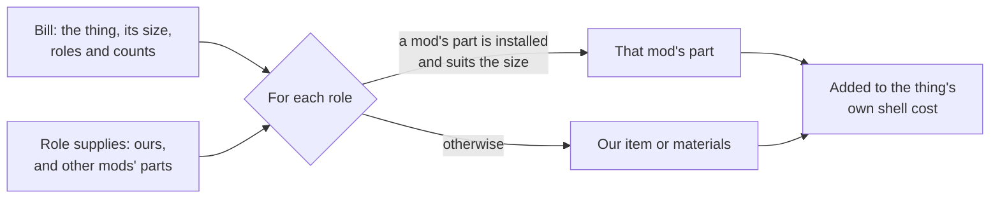

# Parts bills: what a built thing is made of, by role (11 Nov 2026)

**Read this first**

- A **parts bill** says what a built thing needs by **role** (an engine, a fuel tank, a pump), not by item. At start-up each role is
  filled by **another mod's part where that mod is installed and the part suits**, and by **ours otherwise**.
- It is **generic**: it lives in D'thorga Framework's core and works for **anything the player builds**, a placed building as much as
  a vehicle. Any mod, ours or another author's, uses it in XML alone.
- **Not yet tested in game.** Every count and figure here is authored and held for the owner's review.
- **A frame already being built** keeps what was delivered and then asks for the new list. Finish or cancel frames before installing a
  version that changes a bill.
- `python scripts/query-defs.py patched` cannot show a cost made in code. Read a bill in game with the dev action **"Framework: list
  every parts bill"**.

## Why

The owner (11 Nov 2026), on seeing the tanker's build cost beside the other vehicles': "all of our vehicles need to be brought more
inline with the kind of parts our Ullage Bulk Tanker is making use of ... making soft-dependencies where appropriate to enrich the
ecosystem where we can." Then, on the first plan: "Can any of this be genericized? I'm thinking about creating a possible chemical
industry mod later that might involve these mechanics, but with placed buildings instead."

Before this, only the tanker drew on other mods' parts, through four hand-written patch folders (one per mix of RimThunder and Vanilla
Vehicles Expanded). Every further parts mod would have doubled the folders, and a build could disagree with a repair: the tanker asked
for a heavy engine where the repair table gave its weight a medium one.

**What it lets the player do:** build our things from the parts their other mods make. **What it stops:** a vehicle built from steel
and three kits alone. **How it changes play:** building becomes gathering or making the parts first, as it is for other mods' vehicles.

## How it works



| Piece | Where | What it is |
| --- | --- | --- |
| `PhobosRoleSupplyDef` | `src/PhobosFramework/Bills/BillDefs.cs` | What fills a role: ours (an `item`, or `materials`), and `substitutes` from other mods, each with `MayRequire`, a `count` and an optional size window. The first Def that fits a role wins |
| `PhobosBillDef` | the same file | A built thing's bill: its `target` (any ThingDef the player builds), an optional `size`, `tags`, and `parts` written as the game writes a cost |
| `BuildBillRule` | `src/PhobosFramework/Rules/BuildBillRule.cs` | The game-free rule, with tests: which part fills a role, and how parts merge into the shell |
| `PartsBills` | `src/PhobosFramework/Bills/PartsBills.cs` | Applies every bill once at start-up; `Resolve` for a consumer with more to fill; `Report` for the dev action |

**The rules of the rule:**

- The target's own `costList` in XML is its **shell**: steel and the like. The bill adds the parts. Nothing is written twice.
- The shell's lines keep their order, and its first stays first (Vehicle Framework reads a vehicle's first cost item for its
  destruction sound).
- A substitute suits when the thing's size is inside its window. With no size, only a substitute with no window suits.
- A kit of ours marked `coversWholeBuild` is asked for **once**, however many of its roles a bill lists.
- A bill naming a role nothing supplies is a config error at load. A fault in one bill leaves that thing at its shell cost and is
  logged once.
- Costs are Def data. Nothing is saved, and removing a bill puts a thing back at the cost in its XML.

## Using it for a placed building

A reactor that needs a vessel, two pumps and piping. Ours is steel and components; where a mod that makes real pumps is installed, the
build asks for its pump. The names of the other mod's items are examples only.

```xml
<!-- What fills the role, once for every building that asks for it. -->
<Phobos.Framework.Bills.PhobosRoleSupplyDef>
  <defName>MyMod_Supply_Pump</defName>
  <label>process pump</label>
  <roles>
    <li>Pump</li>
  </roles>
  <materials>
    <Steel>25</Steel>
    <ComponentIndustrial>2</ComponentIndustrial>
  </materials>
  <substitutes>
    <li MayRequire="another.authors.mod"><thing>TheirPumpItem</thing></li>
  </substitutes>
</Phobos.Framework.Bills.PhobosRoleSupplyDef>

<!-- What the building is made of. Its ThingDef keeps only its shell in costList. -->
<Phobos.Framework.Bills.PhobosBillDef>
  <defName>MyMod_Bill_Reactor</defName>
  <target>MyMod_Reactor</target>
  <parts>
    <Vessel>1</Vessel>
    <Pump>2</Pump>
    <Piping>4</Piping>
  </parts>
</Phobos.Framework.Bills.PhobosBillDef>
```

**For the later chemical industry mod** this gives, with no new code: reactors, columns and pump stations with roles such as Vessel,
Pump, HeatExchanger, Piping and Instruments, each filled from another mod's items when installed. A `size` on the bill (litres, or a
tier) lets a small pump suit a small plant only.

**Not covered, said plainly:** recipe ingredients (a recipe takes filters, a different shape; the rule could serve it later), floors
and other terrain (a bill's target is a ThingDef), and anything like repairs for buildings.

## The player's setting

**Parts for building** (D'thorga Framework's settings): **Other mods' parts where installed** (default) or **Always our own parts**.
A change takes effect the next time the game starts.

## Limits

- Another mod that reads build costs in its own start-up code may read them before the bills are applied, and so see the shell cost.
  None on the owner's list is known to; the dev action shows what the game holds.
- A substitute is chosen by the order it is listed in, not by price.

## Who chose what

| Choice | Who |
| --- | --- |
| Bring every vehicle's parts in line with the tanker's, with soft dependencies | Owner, 11 Nov 2026 |
| One table worked out at start-up, not patch files; costs that match similar trucks; reach to materials mods and job gear; nodes, recipes and research in scope | Owner, question cards, 11 Nov 2026 |
| Generic, for placed buildings too | Owner's question, 11 Nov 2026; the design is the agent's |
| The Def types and their fields, the size window, kits that cover a whole build, the shell kept in XML, the setting and its default | Agent |
