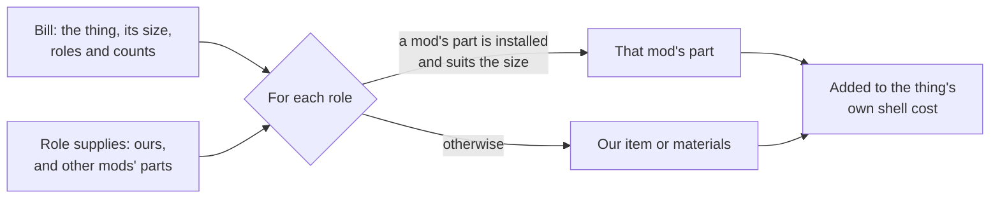

# Parts bills: what a built thing is made of, by role (11 Nov 2026)

**Read this first**

- A **parts bill** says what a built thing needs by **role** (an engine, a fuel tank, a pump), not by item. At start-up each role is
  filled by **another mod's part where that mod is installed and the part suits**, and by **ours otherwise**.
- It is **generic**: it lives in D'thorga Framework's core and works for **anything the player builds**, a placed building as much as
  a vehicle. Any mod, ours or another author's, uses it in XML alone.
- **Not yet tested in game.** Every count and figure here is authored and held for the owner's review.
- **A frame already being built** keeps what was delivered and then asks for the new list. Finish or cancel frames before installing a
  version that changes a bill.
- `python scripts/query-defs.py patched` cannot show a cost made in code. Read a bill in game with the dev action **"Framework: list
  every parts bill"**.

## Why

The owner (11 Nov 2026), on seeing the tanker's build cost beside the other vehicles': "all of our vehicles need to be brought more
inline with the kind of parts our Ullage Bulk Tanker is making use of ... making soft-dependencies where appropriate to enrich the
ecosystem where we can." Then, on the first plan: "Can any of this be genericized? I'm thinking about creating a possible chemical
industry mod later that might involve these mechanics, but with placed buildings instead."

Before this, only the tanker drew on other mods' parts, through four hand-written patch folders (one per mix of RimThunder and Vanilla
Vehicles Expanded). Every further parts mod would have doubled the folders, and a build could disagree with a repair: the tanker asked
for a heavy engine where the repair table gave its weight a medium one.

**What it lets the player do:** build our things from the parts their other mods make. **What it stops:** a vehicle built from steel
and three kits alone. **How it changes play:** building becomes gathering or making the parts first, as it is for other mods' vehicles.

## How it works



| Piece | Where | What it is |
| --- | --- | --- |
| `PhobosRoleSupplyDef` | `src/PhobosFramework/Bills/BillDefs.cs` | What fills a role: ours (an `item`, or `materials`), and `substitutes` from other mods, each with `MayRequire`, a `count` and an optional size window. The first Def that fits a role wins |
| `PhobosBillDef` | the same file | A built thing's bill: its `target` (any ThingDef the player builds), an optional `size`, `tags`, and `parts` written as the game writes a cost |
| `BuildBillRule` | `src/PhobosFramework/Rules/BuildBillRule.cs` | The game-free rule, with tests: which part fills a role, and how parts merge into the shell |
| `PartsBills` | `src/PhobosFramework/Bills/PartsBills.cs` | Applies every bill once at start-up; `Resolve` for a consumer with more to fill; `Report` for the dev action |
| `PhobosVehiclePartSupplyDef` | `src/PhobosFramework.Vehicles/Defs/PartSupplyDefs.cs` | The core's role supply with a repair's own figures added (whole-part share, turbine or not, cost by part health): one table for builds and repairs |
| `PhobosVehicleBillDef` | `src/PhobosFramework.Vehicles/Defs/VehicleBillDefs.cs` | A bill aimed at a vehicle's blueprint: its size is the vehicle's empty weight, and it may fill upgrade-tree nodes by key |

**The rules of the rule:**

- The target's own `costList` in XML is its **shell**: steel and the like. The bill adds the parts. Nothing is written twice.
- The shell's lines keep their order, and its first stays first (Vehicle Framework reads a vehicle's first cost item for its
  destruction sound).
- A substitute suits when the thing's size is inside its window. With no size, only a substitute with no window suits.
- A kit of ours marked `coversWholeBuild` is asked for **once**, however many of its roles a bill lists.
- A bill naming a role nothing supplies is a config error at load. A fault in one bill leaves that thing at its shell cost and is
  logged once.
- Costs are Def data. Nothing is saved, and removing a bill puts a thing back at the cost in its XML.

## Using it for a placed building

A reactor that needs a vessel, two pumps and piping. Ours is steel and components; where a mod that makes real pumps is installed, the
build asks for its pump. The names of the other mod's items are examples only.

```xml
<!-- What fills the role, once for every building that asks for it. -->
<Phobos.Framework.Bills.PhobosRoleSupplyDef>
  <defName>MyMod_Supply_Pump</defName>
  <label>process pump</label>
  <roles>
    <li>Pump</li>
  </roles>
  <materials>
    <Steel>25</Steel>
    <ComponentIndustrial>2</ComponentIndustrial>
  </materials>
  <substitutes>
    <li MayRequire="another.authors.mod"><thing>TheirPumpItem</thing></li>
  </substitutes>
</Phobos.Framework.Bills.PhobosRoleSupplyDef>

<!-- What the building is made of. Its ThingDef keeps only its shell in costList. -->
<Phobos.Framework.Bills.PhobosBillDef>
  <defName>MyMod_Bill_Reactor</defName>
  <target>MyMod_Reactor</target>
  <parts>
    <Vessel>1</Vessel>
    <Pump>2</Pump>
    <Piping>4</Piping>
  </parts>
</Phobos.Framework.Bills.PhobosBillDef>
```

**For the later chemical industry mod** this gives, with no new code: reactors, columns and pump stations with roles such as Vessel,
Pump, HeatExchanger, Piping and Instruments, each filled from another mod's items when installed. A `size` on the bill (litres, or a
tier) lets a small pump suit a small plant only.

**Not covered, said plainly:** recipe ingredients (a recipe takes filters, a different shape; the rule could serve it later), floors
and other terrain (a bill's target is a ThingDef), and anything like repairs for buildings.

## The roles (authored, held for the owner's review)

One table, `PartSupplies.xml`, fills both builds and repairs. The order of a role's substitutes is the order of preference for a build.

| Role | Ours | RimThunder - Core | Vanilla Vehicles Expanded |
| --- | --- | --- | --- |
| Engine | Engine assembly | Light engine under 4 t, medium 4 to 15 t, heavy from 15 t | 1 engine block under 6 t, 2 from 6 to 15 t, 3 from 15 t |
| Engine, on a turbine vehicle | Gas turbine assembly | Turbine | None |
| Transmission | Transmission | Transmission component | Car transmission, under 15 t |
| Fuel tank | 30 steel, 1 component | Fuel tank component | Car fuel tank |
| Wheels | 10 steel, 1 component each | Tyre | Car wheel, under 15 t |
| Suspension | One drivetrain kit for the whole build | None | Car suspension, under 15 t |
| Alternator | 10 steel, 2 components | None | Car alternator |
| Battery | 10 steel, 2 components | None | Car battery |
| Wiring | One electrical kit for the whole build | None | Car wiring |
| Radiator | 20 steel, 2 components | None | Car radiator |
| Exhaust | 8 steel | None | Car exhaust |
| Frame | 60 steel | Heavy casting | None |
| Fuel pump and other small mechanical parts | 12 steel, 2 components | None | None |

**Changed from 9 Nov 2026:** Vanilla Vehicles Expanded's parts were limited to vehicles under 6 tonnes. Its own heavy vehicles use more
of the same parts (its Wisent takes three engine blocks), so the table now does the same, and a repair accepts them too. The engine
classes are why the tanker, at 9 tonnes, now asks for RimThunder's medium engine where its old patch asked for the heavy one.

## The bills

Counts follow each vehicle's layout: tyres by its axles, suspension per axle, electrics and cooling once, an exhaust, a frame casting
on the heavy ones, and the pump or compressor its job needs. All authored.

| Thing | Size | Shell (its XML cost) | Parts |
| --- | --- | --- | --- |
| Survey truck | 4,500 kg | 300 steel, 10 plasteel, 10 uranium, 8 components | Engine 1, transmission 1, fuel tank 1, wheels 4, suspension 2, alternator 1, battery 1, wiring 1, radiator 1, exhaust 1, hydraulic pump 1 |
| Generator set | 6,000 kg | 340 steel, 10 plasteel, 9 components | Engine 1, fuel tank 1, wheels 4, suspension 2, traction motor 1, battery 1, wiring 1, radiator 1, exhaust 1 (diesel-electric: no gearbox) |
| Bulk tanker | 9,000 kg | 400 steel, 8 components | Engine 1, transmission 1, fuel tank 1, wheels 6, suspension 3, alternator 1, battery 1, wiring 1, radiator 1, exhaust 1 |
| Tipper truck | 10,000 kg | 420 steel, 8 components | As the tanker, with hydraulic pump 1 and frame 1 |
| Drill rig | 20,000 kg | 560 steel, 40 plasteel, 12 components | Engine 1, transmission 1, fuel tank 1, wheels 8, suspension 4, alternator 1, battery 2, wiring 1, radiator 1, exhaust 1, hydraulic pump 1, compressor 1, frame 2 |
| Seabed crawler | 4,800 kg (from its mass figure) | 480 steel, 15 plasteel, 10 components | Engine 1, fuel tank 1, battery 2, wiring 1 |
| Depot bay (a placed building) | none | 80 steel, 3 components | Fuel tank 1, fuel pump 1 |

**What each comes to** (worked out from the shipped XML; the game's dev action shows the same for the mods actually installed):

| Thing | With RimThunder and Vanilla Vehicles Expanded (the owner's list) | With neither |
| --- | --- | --- |
| Survey truck | 312 steel, 10 plasteel, 10 uranium, 10 components, a medium engine, a transmission component, a fuel tank component, 4 tyres, 2 car suspensions, a car alternator, battery, wiring, radiator and exhaust | 462 steel, 10 plasteel, 10 uranium, 21 components, an engine assembly, a transmission, a drivetrain kit, an electrical kit |
| Generator set | 380 steel, 10 plasteel, 17 components, a medium engine, a fuel tank component, 4 tyres, 2 car suspensions, a car battery, wiring, radiator and exhaust | 520 steel, 10 plasteel, 26 components, an engine assembly, a drivetrain kit, an electrical kit |
| Bulk tanker | 400 steel, 8 components, a medium engine, a transmission component, a fuel tank component, 6 tyres, 3 car suspensions, a car alternator, battery, wiring, radiator and exhaust | 570 steel, 21 components, an engine assembly, a transmission, a drivetrain kit, an electrical kit |
| Tipper truck | 432 steel, 10 components, the tanker's parts and a heavy casting | 662 steel, 23 components, an engine assembly, a transmission, a drivetrain kit, an electrical kit |
| Drill rig | 584 steel, 40 plasteel, 16 components, a heavy engine, a transmission component, a fuel tank component, 8 tyres, a drivetrain kit (car suspension stops at 15 t), a car alternator, 2 car batteries, wiring, radiator and exhaust, 2 heavy castings | 904 steel, 40 plasteel, 33 components, an engine assembly, a transmission, a drivetrain kit, an electrical kit |
| Seabed crawler | 480 steel, 15 plasteel, 10 components, a medium engine, a fuel tank component, 2 car batteries, car wiring | 530 steel, 15 plasteel, 15 components, an engine assembly, an electrical kit |
| Depot bay | 92 steel, 5 components, a fuel tank component | 122 steel, 6 components |

**Beside similar trucks** (their costs read with the owner's patches applied, 11 Nov 2026): Vanilla Vehicles Expanded's Bulldog is 440
steel, 16 components and about 36 car parts; GTek's L-ATV 410 steel, 60 plasteel, 12 components and about 26; the HUMVEE 550 steel, 6
components and about 13. Ours had been 220 to 360 steel and three kits. The shells were raised to sit beside those by weight (survey
truck 220 to 300, generator set 320 to 340, tanker 280 to 400, tipper 260 to 420, drill rig 360 to 560, crawler 350 to 480).

## Checks

- `tests/test_parts_bills.py` (in the gate): every role a bill asks for is supplied, every target and node key exists, and another
  mod's part is always behind `MayRequire`.
- The dev action **"Vehicle systems: run the self-test"** reads every bill as the game holds it.

## The player's setting

**Parts for building** (D'thorga Framework's settings): **Other mods' parts where installed** (default) or **Always our own parts**.
A change takes effect the next time the game starts.

## Limits

- Another mod that reads build costs in its own start-up code may read them before the bills are applied, and so see the shell cost.
  None on the owner's list is known to; the dev action shows what the game holds.
- A substitute is chosen by the order it is listed in, not by price.

## Who chose what

| Choice | Who |
| --- | --- |
| Bring every vehicle's parts in line with the tanker's, with soft dependencies | Owner, 11 Nov 2026 |
| One table worked out at start-up, not patch files; costs that match similar trucks; reach to materials mods and job gear; nodes, recipes and research in scope | Owner, question cards, 11 Nov 2026 |
| Generic, for placed buildings too | Owner's question, 11 Nov 2026; the design is the agent's |
| The Def types and their fields, the size window, kits that cover a whole build, the shell kept in XML, the setting and its default | Agent |
