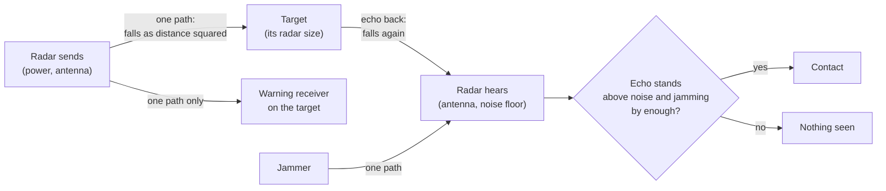

# Radar, air defence and countermeasures: what a radar adds beyond missiles (28 Nov 2026)

**Status (28 Nov 2026):** research and record only. Every row is a proposal; no slice is open. The owner chose to build all of it, in
time, one slice at a time on the owner's word ([order of slices](#an-order-of-slices-agents-default)); slices 1 and 2 first, together.
The owner answered six cards the same day ([below](#questions-for-the-owner)).

**A research record.** The owner, 28 November 2026, asked "what would things like RADAR, ECM, etc. add to the game outside of that than
just missiles? And perhaps disabling turrets, mechs, etc. as well?", then asked for "a strict research and record purview for this
RADAR, ECM, etc. design", and, on reading the plan: "I want to implement everything eventually from the suggestions you came up with".
Earlier the same day: "introducing a more realistic type of aerial warfare into the game with SAM sites, a properly simulated RADAR,
etc. is something I kind of want to undertake myself anyway".

It grows out of the radar sketch in [electronic warfare](electronic-warfare.md#a-detailed-radar-simulation-a-sketch-several-slices-away),
which it replaces as the place radar is designed, and builds on [air-defence tie-ins](air-defence-tie-ins.md), the radio's physics
(`src/PhobosRadio/Physics`) and [radio world coverage](radio-world-coverage.md).

How to read it: **[C]** read from code on 28 Nov 2026, **[D]** from a Def as patched, **[S]** a source named beside it and listed under
[Sources](#sources), **[inferred]** the agent's reading, **[authored]** a figure we would make up and label, **[unverified]** a real-world
claim with no source opened for this record. **Kind** is **XML** (Defs and patches only), **C#** (our own code) or **hook** (a Harmony
patch into the game's or another mod's code, in a tie-in assembly loaded only with that mod). **Risk** is graded by the shared rule
(`external/phobos-modkit/rules/designs.md`): what the player can lose, how much at once, and whether they can see it coming. Every grade,
lean and figure is the agent's proposal until the owner confirms it.

## Read this first

- **No radar of ours detects anything today.** "Radar" is an aircraft capability that gives back half the aim lost in bad weather
  (`AvionicsAimRule.Factor`, `AirCombatRule.cs:219` [C]) and that a hostile jam field switches off (`AirCombat.Works`,
  `AirCombat.cs:52` [C]). There is no two-way radar sum, and every antenna is one flat gain with no direction [C].
- **On a RimWorld map, range barely matters.** At the radio's default 1 m a cell (`RadioMod.metresPerCell` [C]) a map is a few hundred
  metres across, and the worked example below sees a fighter at about 50 km. On a map a radar is decided by walls, roofs, ground clutter
  and telling friend from foe, not by range. **Range, the horizon and rain matter on the world map**, where the radio counts a tile as
  1 km on VHF and UHF and 30 km on HF (`RadioRulesDef.metresPerWorldTile`, `hfMetresPerWorldTile` [C], both authored). **Radar uses
  30 km a tile** (the owner's card 1): a search radar covers a few tiles, its horizon about eight.
- **A raid does not exist before it lands.** The game decides it, places it and drops it in one tick (`IncidentWorker_Raid.
  TryGenerateRaidInfo` [C]); no hostile raid is ever a world-map object. **Early warning can only mean holding the raid back and
  announcing it**, as our radio's allied warning already does (`RadioNews.TryHold`, a prefix on `Storyteller.TryFire` [C]).
- **Three mods on the owner's list already hold raids for a warning.** Ours (an ally on the radio, 3 hours); Dubs Rimatomics (its radar
  with the ATOM upgrade defers a raid by 6 to 40 ticks per raid point, a quarter of that for drop pods); and Fortified Features Framework
  (any radar of a faction hostile to a falling pod's crew takes the pod out of the sky for a warning window) [C]. **Ours and Rimatomics'
  can both delay the same raid** today [inferred from both codes]: the raid we hold fires again as "queued", passes our prefix, and can be
  held a second time by Rimatomics; and a drop raid can then be held a third time by Fortified as it falls. Row RD7 proposes one hold per
  raid.
- **Another mod can plug its own radars and interceptors into Fortified's air-defence network**, in C#, but a world-map fire-control radar
  with locks and channels can only be Fortified's own ([what Fortified's network allows](#what-fortifieds-network-allows)). Fortified's
  detection ignores terrain and weather; ours would not.
- **The game has no "degraded" state.** EMP stuns a turret or a mechanoid completely, or not at all (`StunHandler` [C]). "Worse, not
  frozen" (rows RD25 to RD27) is new behaviour each time: a longer aim, a shorter reach, a weaker hold on a target.
- **Combat Extended's turrets are another class** (`Building_TurretGunCE : Building_Turret` [C]). Every turret hook is written twice.
- **The jamming that switches turrets off and stuns mechanoids in the owner's game today is the EA-6B Prowler author's**, not ours. Inside
  its 44 cells: a turret with no crew seat shuts down one time in four and otherwise cannot fire at aircraft; shields go down; powered
  buildings flicker off; mechanoids aim at half, move and work at three quarters, and take a small EMP hit 5 % of the time; its own
  faction is spared, everyone else is not [C]. This record does not change it.
- **The detection figure most often quoted is for the wrong target.** "About 13 dB above the noise" is a steady target; a real,
  fluctuating aircraft needs about 21 dB for the same odds on one look (MathWorks [S]). The worked example shows both.

## What exists today

| Piece | What it does | Where |
| --- | --- | --- |
| The radio's physics | Free space, the radio horizon, plane earth, ridges between tiles, the noise floor, barrage jamming as noise, the HF tables. All one-way | `src/PhobosRadio/Physics/Propagation.cs`, `TerrainRule.cs`, `NoiseFloor.cs`, `Jamming.cs`, `HfTable.cs` [C] |
| World coverage picture | A budgeted world-map picture (1.5 ms a frame, 200 tiles at most), built only while shown | `src/PhobosRadio/Services/WorldCover.cs` [C] |
| Aircraft as radar targets | Each loadout has a radar "size", on The Dead Man's Switch's scale (a range multiplier, 1.4 to 4.0), not square metres | `AirTrackSpec.size`, 13 loadouts [C], [D] |
| Warning receiver | Hears DMS Expedition's air defence track, lock and launch, and fires a salvo at a launch | `AirCombat.Heard` [C] |
| Jam fields | Blind a hostile vehicle's radar and warning receiver inside a flat radius | `JamFields.cs`, `Rules_VehicleSystems.xml:400-403` [C] |
| Self-protection pod | Automated turrets miss the carrier 30 % of the time | `EcmPod.cs` [C] |
| Sonar | An active ping finds things in water, and is heard at twice its range: the same one-way against two-way idea as a warning receiver | `CompPhobosSonar.cs`, `SonarRules.cs` [C] |
| Allied raid warning | Holds a fresh storyteller raid for 3 hours when an ally is in radio reach, and sends a letter | `RadioNews.cs` [C] |
| Rough landings | A landing in poor visibility without instruments, or in the dark without lights, may go wrong | `RoughLandings.cs:54-99` [C] |
| Air targets over a map | Hostile aircraft over a map are exposed to another mod's air defence | `SkyfallerInterception.cs:62-71` (`AirTargets`) [C] |

**Other mods on the owner's list that already do some of this** [C]:

| Mod | What it does |
| --- | --- |
| Fortified Features Framework (since 28 Nov 2026 the home of DMS Expedition's air defence) | Search radar, fire-control radar, close-in weapons, missile launchers, jammers; holds a falling drop pod for a warning, shown as an alert; a public plug-in interface our aircraft already use |
| Dubs Rimatomics (active) | Its radar dish, with the ATOM upgrade, holds raids for a warning; can turn a centre drop into an edge drop for stored power; works only unroofed |
| Combat Extended (active) | A close-in weapon that shoots skyfallers; an artillery marker that needs a worn radio pack; shells that cross the world map |
| Vanilla Gravship Expanded (active) | Signal jammers that delay a gravship threat, or block landings and launches within 55.9 cells |
| Atmosphere Overhaul (installed, **not active**) | Its own Doppler weather radar and a store of future weather that can be read ahead |

## The main idea: one physics, read two ways

A radar is a radio whose signal goes out and comes back. The radio already sums one path; a radar sums two, with the target in between.
Everything else in this record follows from that, or from holding something back long enough to be seen.



- **The echo falls with the fourth power of distance**; doubling the range costs 12 dB, where a radio link loses 6 (NAWCWD TP 8347,
  sections 4-3 and 4-4 [S]).
- **A warning receiver hears the radar one way**, so it hears it from much farther than the radar sees it; in practice the horizon is
  its limit (USAF Academy ECE-495, lesson 11 [S]).
- **Jamming travels one way too**, so a jammed radar sees nothing far off and sees again close in: the burn-through range
  (NAWCWD TP 8347, section 4-8 [S]). Jamming hides; it does not break anything.

### A worked example

A search radar of our own, every figure **[authored]** except where a source is named. The sums are the handbook's, done with the
radio's constants (the same sum reproduces the handbook's own example, −77.52 dBm, to 0.01 dB).

| Step | Figure |
| --- | --- |
| Radar | 3 GHz (S band), 100 kW peak (80 dBm), 33 dBi antenna, 1 MHz receiver, 5 dB noise figure **[authored]** |
| Noise floor | −174 + 60 + 5 = **−109 dBm** |
| Needed above it | 13.1 dB for a steady target, **21.1 dB for a fluctuating one** (Swerling 1, 90 % chance, one false alarm in a million; MathWorks [S]) |
| Sees a fighter (5 m² [S]) | **50 km** (79 km if the target were steady) |
| Sees a cargo aircraft (100 m² [S]) | **106 km** |
| Sees a helicopter (about 3 m², [unverified], from slides not opened) | 44 km |
| Sees a person (1 m² [S]) | 33 km, if nothing were in the way |
| Sees a mortar bomb (0.01 m², [S], marked "citation needed" at the source) | 10 km |
| Horizon, 10 m mast to an aircraft at 150 m | 64 km; at 3,000 m, 239 km (4/3 Earth, the radio's own rule) |
| A 100 W jammer on the fighter, all in the radar's band | Burn-through at **0.9 km**: the jammer wins almost everywhere |
| The same 100 W spread over 200 MHz (barrage) | 23 dB weaker in the radar's 1 MHz: burn-through at **12.6 km** |
| The fighter's warning receiver (−60 dBm, **[authored]**) | Hears the radar to 3,550 km by the sum; **the 239 km horizon is the real limit** |
| Heavy rain (25 mm/h), 20 km out and back | 0.3 dB at 3 GHz; **28 dB at 10 GHz** (ITU-R P.838-3 [S], our arithmetic) |

What it teaches the design: a self-protection jammer aimed at one radar nearly blinds it; a barrage jammer still hides a fighter beyond
about a dozen kilometres; a warning receiver always hears first; and a high-frequency radar is blinded by heavy rain where a low one
barely notices. Each of these falls out of the sums with no rule of its own.

## Part 1: the radar sum

| # | Row | Reads → changes | Lets · Stops · Changes · Who else notices | Kind and cost | Risk and lean |
| --- | --- | --- | --- | --- | --- |
| RD1 | **The two-way sum** | The radio's one-way terms, twice, with a target's radar size between → a margin above noise and jamming, as for a link | **Lets** every later row ask "is it seen?". **Stops** nothing. **Changes** nothing by itself. **Noticed by** nothing yet: a foundation, stated | C#, game-free, in the radio's physics library, with rule tests. Arithmetic only | None. **Take first** |
| RD2 | **Radar size in square metres** | A size for each vehicle Def, pawn body size, drop pod, shell and aircraft → the target term of RD1. DMS's own scale stays for its tie-in | **Lets** a large transport show far off and a small drone late. **Stops** nothing. **Changes** which aircraft escorts. **Noticed by** every radar of ours and, through the tie-in, DMS's | XML: one figure per Def, defaults by body size and mass **[authored]**, real figures where a source gives them (the table under [Sources](#sources)) | None. **Take first** |
| RD3 | **Horizon and terrain shadow** | Radar height, target height, the ridges between tiles (`TerrainRule.Worst`) and, on a map, mountain and thick roof → seen or hidden | **Lets** a mountain base hide, and a low flyer slip under. **Stops** a valley radar seeing out, and a buried base seeing in. **Changes** where a radar is built: on a hill, a tower or a mast. **Noticed by** raiders' aircraft (they fly low where they can), the player's siting | C# over the radio's existing terrain walk. Once per contact per radar, when a contact appears or moves a tile | None. **Take first** |
| RD4 | **Rain and clutter** | The weather's rain rate, the band, and a target's height above ground → a loss in rain; a clutter floor for low targets | **Lets** a low-band radar see through a storm. **Stops** a high-band radar in heavy rain, and any radar seeing a man in the grass. **Changes** which radar a player builds for which job. **Noticed by** the weather, the player's choice of band | C#: one ITU-R P.838 term per band, refreshed when the weather changes; clutter a fixed floor by height **[authored]** | None. **Take** |
| RD5 | **Jamming by the sum: burn-through** | Our jam fields and radio jammers as noise in a radar's band → replaces today's flat "inside the radius, radar does not work" | **Lets** a radar see again close in. **Stops** a jammer blinding a radar at its doorstep. **Changes** built behaviour: fields now fade with distance. **Noticed by** the Prowler player, every jammed radar, aircraft escorts | C#: `Jamming.AtAntennaDbm` already exists; the sum moves into `AirCombat.Works` for `radar`. Read when the field set changes (the noise snapshot's signature) | **Low**: changes when a radar works; nothing is lost at once. **Chosen by the owner (card 5)**: it replaces the flat radius, with no setting to bring it back; a change to built behaviour, said so in the changelog when built |

**How it reaches the world map.** A contact on the world map is checked tile by tile, the way [radio world coverage](radio-world-coverage.md)
checks a link: distance in tiles at 30 km a tile (the owner's card 1), the ridges between, and the
rain at the radar's tile. A contact on a map is checked in cells, where only walls, roofs, mountains and clutter decide.

## Part 2: what a radar tells the colony

| # | Row | Reads → changes | Lets · Stops · Changes · Who else notices | Kind and cost | Risk and lean |
| --- | --- | --- | --- | --- | --- |
| RD6 | **A radar station and its scope** | A building (search radar: mast, antenna, power, a crew seat for its full range) → contacts, and a scope window: a sweeping picture with blips, range rings and bearings | **Lets** the player see the sky. **Stops** nothing. **Changes** where power and staff go. **Noticed by** the colony (a work type to man it), every later row | C# and XML, with its own art. The scope draws only while open; contacts refresh every 30 ticks while the radar runs **[authored]** | None. **Take first**: the output must be seen, or the sums are wasted |
| RD7 | **Early warning, and one hold per raid** | A fresh storyteller raid arriving by air (drop pods, aircraft, shuttle; walk-in raids are not held, the owner's card 2) while a radar on that map runs → held, then announced as contacts: "6 to 10 contacts, north-east, about 2 hours" | **Lets** the player prepare. **Stops** surprise centre drops on a watched colony. **Changes** how a base is defended: time, not walls. **Noticed by** the raid (it arrives as announced), the storyteller (the raid is the same raid), letters, other mods' holds | Hook: our existing `Storyteller.TryFire` prefix gains a second reason to hold. **One hold per raid** (the owner's card 3): a raid we hold is marked, our radio and radar never hold it again, and where we can, Rimatomics' and Fortified's holds let it through | **Low**: it helps the player; the raid is the same. **Chosen by the owner (cards 2 and 3)**: drop and air raids only. The count and bearing are given honestly blurred: a range, not a number **[authored]** |
| RD8 | **Contacts on the world map, letters and alerts** | Our aircraft in flight, other factions' aircraft, shells crossing the map (Combat Extended), held raids as approaching contacts → world-map icons with a ring for each radar's reach; letters for new threats; an alert while one is inbound | **Lets** the player follow the sky beyond the map. **Stops** nothing. **Changes** planning of flights and convoys. **Noticed by** the world map, the letter stack | C#: an ordinary world object per contact (we already ship one: `WorldObject_PhobosRelayMast`), a drawing layer like the radio's coverage, budgeted per frame | None. **Take** |
| RD9 | **Friend or foe** | A contact is "unknown" until identified: by a transponder answering (our vehicles, allies who carry one), by its owner being known, or by being seen → unknown, friend or hostile | **Lets** a trader's shuttle and an ally's drop be told from a raid. **Stops** certainty: an unknown contact may be either. **Changes** what a warning means. **Noticed by** allies (a transponder fitting for them), friendly fire rules of our own air defence | C# and a fitting. A falling pod has no side of its own; friend and foe are told by contents in the game, CE and Fortified alike [C], so the honest picture is "unknown" until our rules say otherwise | **Moderate** if our own air defence (Part 3) may fire at unknowns: an ally's shuttle could be lost. That choice has its own setting, **off** (fire only at identified hostiles). **Take** |

## Part 3: our own air defence

The owner's wish of 28 Nov 2026: SAM sites and a properly simulated radar of our own. Real batteries split the work between a search
radar that finds, a fire-control radar that tracks and guides, and launchers (NAWCWD TP 8347 glossary [S]; the Hawk battery's PAR,
CWAR, HPIR and ROR radars, Wikipedia [S]).

| # | Row | Reads → changes | Lets · Stops · Changes · Who else notices | Kind and cost | Risk and lean |
| --- | --- | --- | --- | --- | --- |
| RD10 | **A battery: search, fire control, launcher** | RD6's search radar hands a contact to a fire-control radar, which locks and guides a launcher's missile → a hit chance from the guidance kind, the target's speed and evasion, countermeasures and the jamming margin | **Lets** the colony shoot down raiders' aircraft and, on the world map, aircraft crossing its reach. **Stops** an air raid going unanswered. **Changes** base layout (three linked buildings), power and research. **Noticed by** raiders' aircraft (they evade, flare, jam), the warning receivers of whoever is targeted | C#, XML, art. One lock per fire-control radar at a time **[authored]**, guidance kinds as Defs: command, semi-active, active, infrared, beam riding, track-via-missile (each described under [Sources](#sources)) | **Moderate**: missiles are spent and a missile can miss. **Take** |
| RD11 | **Engagement envelopes** | Each launcher Def gives a minimum and maximum range and height → a contact outside it cannot be engaged, however well it is seen | **Lets** low flyers slip under a long-range system, and short-range ones cover the gap. **Stops** one launcher doing everything. **Changes** which systems are built together. **Noticed by** raiders' aircraft choosing heights | XML; real envelopes for reference (S-75, Hawk, Rapier, Stinger, Strela-2; sources disagree on some and the record lists both) | None. **Take** |
| RD12 | **Shoulder-launched missiles** | An infrared missile a colonist carries → aimed at a hot engine within a few kilometres, no radar needed, fire and forget | **Lets** a colonist defend a caravan or a camp. **Stops** helicopters hovering at leisure. **Changes** a raid on a camp. **Noticed by** engines' heat (row AD5 of the air-defence record), flares | XML weapon with a C# verb. Heat from our engine figures | **Moderate**: a missile can miss and is spent. **Take** |
| RD13 | **Radar-aimed guns** | A gun turret linked to a fire-control radar → aims better at aircraft and falling things; without the radar it aims as now | **Lets** a gun defend against aircraft and pods. **Stops** nothing. **Changes** a gun's place in a base. **Noticed by** the radar (it must run, and can be found: RD17) | C# on both turret classes (the game's and Combat Extended's). No public figure separates radar from optical aiming with the proximity fuze set aside, so the bonus is **[authored]** | None. **Take** |
| RD14 | **Enemy batteries, and raiders' air defence** | Settlements of industrial factions and later have abstract air defence on the world map; a base the player attacks may have a battery on its map; raiders may bring shoulder-launched missiles | **Lets** a strike on a defended base be a real risk. **Stops** flying over enemies without a thought. **Changes** routes, heights, escorts and jammers. **Noticed by** the player's aircraft (lost or damaged), other factions | C#. On the world map, one check per flight leg, not per tick | **High**: an aircraft and its crew can be lost at once. **Its own setting, off** by the shared rule. **Take** |
| RD15 | **Working with Fortified's network** | Our radars as sensors, our launchers as effectors and our aircraft as tracks in Fortified Features Framework's air-defence network, where it is installed → one sky, not two | **Lets** DMS Expedition's defences and ours cover each other. **Stops** two systems shooting at the same thing twice. **Changes** the tie-in of [air-defence tie-ins](air-defence-tie-ins.md) (AD8, AD12) and its [watch](air-defence-tie-ins.md#watch-when-the-tie-in-should-wait-for-fortified-features-framework-instead-28-nov-2026). **Noticed by** DMS Expedition's air defence | Hook, in the tie-in assembly loaded only with Fortified. How far its interface lets another mod add a sensor or an effector is read in [What Fortified's network allows](#what-fortifieds-network-allows) | None of its own. **Chosen by the owner (card 4)**: join Fortified's network where it is installed, run alone where not |

### What Fortified's network allows

Read in Fortified Features Framework's build of 28 Nov 2026 [C]; the owner's log of that morning confirms its missile feature (which holds
all of this) is on, switched on by DMS Expedition's own Defs.

**Another mod can add its own radar and its own interceptors, in C#, without FFF's comps.** A comp that implements `IAirSensor` (a
radar), `IAirEffector` (an interceptor on the world map) or `IMapAirEffector` (an interceptor on a colony map) registers itself with
`MapComponent_AirEffectors.RegisterAll` when it spawns and `DeregisterAll` when it goes; nothing in FFF or DMS Expedition uses this
registry itself, so it exists for mods like ours. Three limits:

- **A locking, channelled fire-control radar on the world map can only be FFF's own** (`CompProperties_FireControlRadar` in XML). A
  plug-in interceptor that needs no fire control fires on its own, with no lock and no channel. On a colony map, a plug-in interceptor
  needs no fire control at all.
- **Registrations are not saved**: the comp registers again after every load.
- **The registry exists only while FFF's missile feature is on.** Using FFF's own comp types in our XML would switch that feature on by
  itself, even without DMS Expedition, so any such XML of ours sits in a load folder that waits for DMS Expedition (or for FFF, if [the
  watch](air-defence-tie-ins.md#watch-when-the-tie-in-should-wait-for-fortified-features-framework-instead-28-nov-2026) moves).

**How FFF decides a track is seen, on the world map:** a node sees a track when the distance in tiles is within its range, where range =
the radar's range × the track's size level × a stealth factor × an altitude factor (the square root of height over 1,000 m, held between
0.6 and 1.3) × a resolution factor; then × a jamming factor and the defending faction's alert stage. **Terrain, weather and line of sight
do not enter at all**, and speed changes only the lock time and the hit chance. Lock time and hit chance then follow the fire-control
radar's figures, the target's speed and stealth, and jamming. Our own sum (RD1 to RD5) is the more physical of the two; RD15 is how the
two agree.

**FFF's jamming is not burn-through.** A hostile jammer weakens a radar node by the distance from the jammer to the node, whatever the
target's position: detection range falls to as little as 15 %, lock time grows by up to 80 %. It does not shorten the drop-pod warning.
**Any running FFF jammer on a map, the player's own included, switches off that map's comms consoles.**

**FFF holds drop pods for a warning.** When a sensor of a faction hostile to a falling pod's crew runs on that map, the pod is taken out
of the sky and held for a window summed over that faction's radars (DMS Expedition's search radar about 2,400 ticks, its long-range
warning radar about 2,700, its phased array about 6,400 [inferred from their figures]; they add together), then dropped where it was
bound. The player sees an alert with the time left, and no letter. So with DMS Expedition, a radar of the player's already gives some
warning of a drop raid today; RD7 must not hold the same raid a second time.

**What FFF asks of a track provider like ours.** It calls our provider at least every 2,000 ticks, every 15 ticks while a scan runs, and
**every frame while the world map is open**. Ours keeps one list a tick (`AircraftTrack.cs`), so a paused world map costs one walk of the
world objects per game tick, not per frame [C].

**A gotcha for RD8:** the first time a player's FFF radar sees any track, FFF sends a "Incoming missile detected" letter; a hostile
aircraft of ours handed in as a track gets that letter too, and its wording would be wrong for an aircraft.

**Its figures for reference** (DMS Expedition's Defs, 28 Nov 2026 [D]): search radar 12 tiles, 2,500 W; fire-control radar 4 targets,
50 m to 40 km, best hit 0.85, 1,500 W; phased array 12 tiles, 24 targets, 9,000 W; long-range warning radar 40 tiles, 12,000 W; jammer
station 8 tiles, 6,000 W; a man-portable SAM, 2 charges, 40 cells.

## Part 4: listening and being found

| # | Row | Reads → changes | Lets · Stops · Changes · Who else notices | Kind and cost | Risk and lean |
| --- | --- | --- | --- | --- | --- |
| RD16 | **The warning receiver by the sum** | Any radar in reach, ours or another's, by the one-way sum → a warning with a bearing and the radar's kind, heard before that radar sees you | **Lets** an aircraft turn away or drop low before it is seen. **Stops** nothing. **Changes** today's warning receiver from DMS's events alone to every radar. **Noticed by** the crew, the radar (it never knows it was heard) | C# over RD1's one-way half. Only for aircraft in flight, once a leg | None. **Take** |
| RD17 | **Being found, and switching off** | Every radar, jammer and station of ours is an emitter (row EW15 of electronic warfare); a radar gains on, off and short-burst modes → a radar that transmits can be located; one that is off sees nothing | **Lets** silence and short bursts be tactics. **Stops** a radar running forever for free. **Changes** a radar into a choice. **Noticed by** enemy direction finding, anti-radiation missiles (RD18), raids that seek it out | C# beside EW12's direction finding. Real doctrine: weapon-locating radars should not radiate for more than two minutes where the enemy can listen (ATP 3-09.12 [S]) | **High** where it leads to losing the radar building to a strike. **Its own setting, off**. **Take** |
| RD18 | **Anti-radiation missiles** | A missile that homes on a running emitter → ours seek enemy radars and jammers; enemy ones seek ours | **Lets** a strike kill a radar first. **Stops** a radar staying on while one is in the air. **Changes** the Prowler's missile into what its name says (row EW13). **Noticed by** every emitter's owner | C#. Real answers: switch off (Falklands, 1982; Kosovo, 1999), short bursts of about 20 seconds (Air & Space Forces Magazine [S]) | **High** for enemy missiles at our radars: shares RD17's setting. **Take** |
| RD19 | **Passive radar** | A receiver that listens for echoes of other people's transmitters (our own stations, allies', broadcast) → contacts with no emission of its own | **Lets** a colony watch without being found. **Stops** nothing. **Changes** the worth of having transmitters nearby. **Noticed by** nobody: that is the point | C#: RD1 with the transmitter and receiver at different places (bistatic). Coarser than an active radar **[authored]**. Real systems: FM-based up to about 150 km (Wikipedia [S]); Hensoldt TwInvis [S] | None. **Take** |

## Part 5: countermeasures beyond missiles

**The owner's question, and the answer this record takes.** The owner asked whether jamming should also disable turrets and mechanoids.
The adopted design is **degrade and cut off, not switch off**, because jamming hides and confuses but does not break machines (NAWCWD
TP 8347, sections 4-2 and 4-8 [S]); because EMP already owns "switch off" in the game, with its own counters; and because an
autonomous machine has no link to cut. The test for each row is "what does this thing need to hear?". The owner may revise it.

| # | Row | Reads → changes | Lets · Stops · Changes · Who else notices | Kind and cost | Risk and lean |
| --- | --- | --- | --- | --- | --- |
| RD20 | **Navigation jamming scatters drop pods** | A jammer of ours running when a drop raid arrives → the drop spot moves away from the base and the pods spread wider | **Lets** the colony break up a centre drop. **Stops** a drop raid landing as one block in the base. **Changes** the defence against drops. **Noticed by** the raid (scattered), the storyteller (the same points) | Hook on the drop spot (the game's arrival modes resolve a spawn centre [C]), and the scatter radius of `DropPodUtility.DropThingsNear` [C]. Real effect: jamming takes guided weapons from about 5 m to about 30 m (RUSI [S]) | None for the player. **Take** |
| RD21 | **Jamming a siege's spotting** | A jammer of ours running while a siege fires mortars → each shell's miss radius grows | **Lets** jamming blunt a siege. **Stops** nothing. **Changes** a siege into something a jammer answers. **Noticed by** the siege (more shells wasted) | Hook: the game's `VerbProperties.GetForceMissFactorFor` and Combat Extended's `Verb_ShootMortarCE.ShiftVecReportFor`, both unpatched [C]. Combat Extended's own artillery marker already needs a worn radio pack [C], so jamming can drown the spotter's radio too | None for the player. **Take** |
| RD22 | **Jamming coordination** | A jammer of ours over a raid → its calls for a second wave or fire support do not go out (as EW18 already does for DMS's uplinks) | **Lets** a jammer cut a raid off from help. **Stops** reinforcements arriving while it runs. **Changes** an assault on a defended base. **Noticed by** the raiding faction | Hook on each calling mechanism; EW18's join is the pattern. Real basis: wide-area jamming means "the enemy is not postured to conduct accurate fire missions" (RUSI, 2022 [S]); a direct source for jammed reinforcement calls was not found | None for the player. **Take** |
| RD23 | **Beacons and drones** | A mech drop beacon or an ammunition beacon inside our jamming → its countdown pauses; a remotely flown drone loses its link → idles or falls (rows EW19, EW22) | **Lets** a jammer buy time against a cluster or a swarm. **Stops** our own drones under enemy jamming, the same way. **Changes** how a cluster is assaulted. **Noticed by** the cluster, drone owners | Hook: the wake path is two public methods and a public countdown [C] | **Moderate** for our own drones under enemy jamming. A setting, **on**. **Take** |
| RD24 | **Decoys** | A decoy emitter that looks like a radar or a station → enemy anti-radiation missiles and raids seeking emitters go to it | **Lets** a cheap decoy save a real radar. **Stops** nothing. **Changes** a base's layout. **Noticed by** raids and missiles | C#, XML. Real decoys of this kind were **not found** in an opened source; towed and expendable radar decoys were (AN/ALE-50 [S]). Labelled as a gameplay choice | None. **Take** |
| RD25 | **Radar-aimed turrets degrade under jamming** | A turret that aims by radar (ours from RD13, Fortified's close-in weapons, CE's) inside hostile jamming → reaches less far and takes longer to lock, by the jamming margin; a gun with its own sights barely notices | **Lets** a jammer open a gap in an air defence. **Stops** a jammed radar gun aiming as if nothing were wrong. **Changes** escorts on a strike. **Noticed by** the player's own turrets when an enemy jams | Hook on both turret classes' warm-up and target check (the Prowler author does the same, on `IsValidTarget` [C]). Which turrets aim by radar is a mark of ours on Defs | **Moderate** for the player's turrets under enemy jamming: they still fire. A setting, **on**. **Take** |
| RD26 | **The player's mechanoids lose command at distance** | Hostile jamming over the mechanitor or the order's target → command range falls from 24.9 cells (row EW20) | **Lets** an enemy jammer make a mechanitor stay close. **Stops** orders across a jammed field. **Changes** where a mechanitor stands. **Noticed by** the mechanitor | Hook on the command-range check, which eight other mods already patch [C]: a postfix that only lowers the figure | **Moderate**: mechs keep working, only new orders are refused. A setting, **on**. **Take** |
| RD27 | **Hostile mechanoids lose coordination** | Our jamming over hostile mechanoids → slower to pick a target, and they lose the bonus for staying on their last target | **Lets** a jammer make a mechanoid assault ragged. **Stops** nothing of the player's. **Changes** a fight with a cluster. **Noticed by** the mechanoids | A condition on them that raises the game's aiming-delay stat (no patch), and a postfix on the target score, which has no focus-fire term of its own; "no focused fire" means weakening the +40 kept for the last target [C] | None for the player. **Take** |

## Part 6: radar in peacetime

| # | Row | Reads → changes | Lets · Stops · Changes · Who else notices | Kind and cost | Risk and lean |
| --- | --- | --- | --- | --- | --- |
| RD28 | **Weather radar** | A weather radar station → the next weather, flashstorms and fallout fronts announced some hours ahead | **Lets** the player bring in the harvest, park aircraft, ground flights. **Stops** nothing. **Changes** farming and flying. **Noticed by** the weather, farms, flights | Hook: the game chooses the next weather only at the moment of change [C], so a forecast means choosing early and holding it, as raids are held. With Atmosphere Overhaul on, read its own future weather instead [C]. Real basis: nowcasting covers minutes to a couple of hours (Met Office [S]); a weather radar "shows you where the rain has been" (Bureau of Meteorology [S]) | None. **Take** |
| RD29 | **Bad-weather landings** | A ground radar at a landing site, manned → an aircraft landing there in poor visibility counts as having instruments | **Lets** aircraft come home in fog and at night. **Stops** nothing. **Changes** where aircraft are based. **Noticed by** rough landings, the crew | C#: the landing rule already takes "instruments" as a yes or no (`RoughLandings.cs:59-63` [C]). Real basis: precision approach radar talks a pilot down to 100 to 400 ft (Wikipedia [S]) | None. **Take** |
| RD30 | **Marine radar** | A boat's radar → it navigates in fog and at night without slowing, and finds other vessels and wrecks within its horizon | **Lets** boats work in all weather and search for wrecks. **Stops** nothing. **Changes** a boat's worth. **Noticed by** other vessels. Surface boats only; submarines stay out of view | XML fitting and C#. Real basis: marine radars are X band (sharper) or S band (better in rain and sea clutter) (Wikipedia, citing Bole [S]) | None. **Take** |
| RD31 | **Counter-battery radar** | A weapon-locating radar running → each enemy shell's flight is traced back to where it was fired, and the fog lifts there | **Lets** the player find and strike a siege's mortars. **Stops** a hidden mortar staying hidden. **Changes** how a siege is fought. **Noticed by** the siege, the fog | C#: a shell's launcher and origin are readable fields in the game and in Combat Extended [C]; no patch, a scan of the map's shells while the radar runs. Real basis: AN/TPQ-36 locates mortars to about 18 km, AN/TPQ-37 to about 30 km (ATP 3-09.12 [S]). Unfogging is permanent and can wake sleeping things [C], so it lifts only a small circle **[authored]** | None. **Take** |

## Part 7: over the horizon

| # | Row | Reads → changes | Lets · Stops · Changes · Who else notices | Kind and cost | Risk and lean |
| --- | --- | --- | --- | --- | --- |
| RD32 | **Over-the-horizon radar** | A large HF array → contacts across a great part of the world map, poorly placed, by the HF tables (time of day, season, sunspots); and its signal as HF noise for every radio in reach, ours included | **Lets** a colony see far beyond its horizon. **Stops** quiet HF while it runs. **Changes** HF for everyone, as JORN and the Soviet Duga did for radio amateurs. **Noticed by** every HF radio, the colony's own included | C#: the radio's HF tables already exist (`HfService`, `HfTable` [C]); one look per hour of game time. Real basis: 1,000 to 3,000 km, placed to about 20 to 40 km; fails at sunrise, sunset and in solar storms (Wikipedia, on OTH radar and JORN [S]). The Duga's "10 Hz tapping" crossed the amateur bands for 13 years (Wikipedia; IARU [S]) | **Low**: its noise is a nuisance, not a loss. A setting for the noise, **on** (the owner's own choice in conversation, 28 Nov 2026). **Take** |

**What one sounds like.** The owner has a recording of an over-the-horizon radar on the 20 m amateur band: a continuous buzz at 12.0 sweeps
a second, wider than the receiver's whole passband. Its sweep rate matches no catalogued radar exactly (IARU Region 1 Monitoring System
[S]); it is a fair model for what RD32's noise should sound like, if the owner wants it used.

## Other factions

| Row | In a raid on us | At a base we attack | Captured |
| --- | --- | --- | --- |
| RD3, RD4 | Raiders' aircraft use terrain and weather too | Their radars are sited and weathered by the same rules | Works as ours |
| RD5, RD25 | An enemy jammer degrades our radars and radar guns by the same sums | Our jammer degrades theirs | Works as ours |
| RD9 | Their transponders answer only their side | The same | Ours once captured, answering for us |
| RD10 to RD14 | Raiders may carry shoulder-launched missiles; they bring no battery | A battery may stand on the map, behind RD14's setting | A captured launcher works; its missiles are scarce |
| RD16 | Their aircraft hear our radars and react (turn, go low) | The same | Works as ours |
| RD17, RD18 | Their anti-radiation missiles seek our running radars, behind RD17's setting | Ours seek theirs | Works as ours |
| RD20 to RD23, RD27 | Our jamming acts on them | The same | Not applicable |
| RD26 | Not applicable (only the player has a mechanitor in this sense) | Not applicable | Not applicable |

## The four questions, for the rows that add a behaviour

| Row | Lets | Stops | Changes | Who else notices |
| --- | --- | --- | --- | --- |
| RD6 | See the sky | Nothing | Power and staff for a radar | The colony, every later row |
| RD7 | Prepare for a drop raid | Surprise centre drops | Defence by time | The raid, other mods' holds |
| RD10 | Shoot down aircraft | Unanswered air raids | Base layout and research | Raiders' aircraft and their receivers |
| RD14 | Real risk over enemies | Careless flying | Routes, heights, escorts | The player's aircraft, other factions |
| RD17 | Silence as a tactic | Free, endless radar | Radar as a choice | Enemy listening, anti-radiation missiles |
| RD20 | Break up a centre drop | Drops landing in one block | Drop defence | The raid |
| RD21 | Blunt a siege | Nothing | Sieges answered by a jammer | The siege |
| RD25 | Open a gap in air defence | Jammed guns aiming as if clear | Strike escorts | The player's turrets under enemy jamming |
| RD26 | Make a mechanitor stay close | Orders across a field | Where a mechanitor stands | The mechanitor |
| RD27 | Make an assault ragged | Nothing | Cluster fights | The mechanoids |
| RD28 | Plan around the weather | Nothing | Farming and flying | Farms, flights |
| RD31 | Find a siege's mortars | Hidden mortars | Siege fighting | The siege, the fog |
| RD32 | See far off | Quiet HF | HF for everyone | Every HF radio |

The other rows are foundations (RD1 to RD5), pictures (RD8), fittings for existing behaviour (RD9, RD11 to RD13, RD15, RD16, RD18,
RD19, RD22 to RD24, RD29, RD30), each stated in its own row.

## Risks, and their settings

All grades are the agent's, for the owner to confirm.

| Behaviour | What the player can lose | Grade | Its setting |
| --- | --- | --- | --- |
| RD9: our air defence fires at unknown contacts | An ally's or a trader's shuttle, at once | Moderate | "Air defence fires at unidentified contacts", **off** |
| RD14: enemy batteries and raiders' air defence | An aircraft and its crew, at once | **High** | "Enemy air defence", **off** |
| RD17, RD18: our emitters can be found and struck | A radar or jammer building, at once | **High** | "Enemies hunt running radars", **off** |
| RD23: our own drones under enemy jamming | A drone idles or falls | Moderate | "Jamming cuts drone links", on |
| RD25: our radar guns under enemy jamming | Worse aim; nothing lost at once | Moderate | "Jamming degrades radar-aimed turrets", on |
| RD26: our mechanitor's range under enemy jamming | New orders refused at range | Moderate | "Jamming shortens mechanitor command", on |
| RD32: over-the-horizon radar noise on HF | Worse HF links while it runs | Low | "Over-the-horizon radar fills HF with noise", on |
| The rest | Nothing | None | None needed |

Each setting, when built, is reported to the owner in the reply that delivers it, as the repository's rule asks.

## Its cost (the radio's performance rule)

Estimates, not measurements: nothing is built.

- **The sum is arithmetic.** RD1 is a dozen additions in decibels. Its cost is how often it is asked.
- **On a map: per radar, per contact, every 30 ticks while the radar runs** **[authored]**. Contacts are few: aircraft over the map,
  falling things, shells. A map with no radar running costs nothing.
- **Counter-battery (RD31)** scans the map's shells only while its radar runs, on the same interval; no patch on `Projectile.Launch`, which
  a dozen mods already patch [C].
- **On the world map: per radar, per contact, when the contact enters a new tile**, not per tick. Terrain between tiles reuses the radio's
  walk; nothing is cached across tiles, as the radio's own coverage does not.
- **Pictures (RD6's scope, RD8's world contacts)** draw only while open or selected, within a frame budget like the radio's coverage
  picture (1.5 ms a frame [C]).
- **Holds (RD7, RD28)** cost nothing until a raid or a weather change: one check at that moment.
- **Over the horizon (RD32)**: one look in the HF tables per radar per game hour; its noise joins the radio's noise snapshot, which already
  refreshes about once a second.
- **Jamming by the sum (RD5, RD25)** follows the noise snapshot's signature: recomputed when a jammer starts, stops or moves, not per tick.
- **Measured, never assumed:** each built slice is recorded with `python scripts/perf.py` on the owner's colony, asking first, before and
  after, and its figures are kept here.

## Where the code would go (agent's default)

| What | Where |
| --- | --- |
| The two-way sum, radar size terms, rain attenuation, burn-through (RD1, RD4, RD5) | The radio's physics library, `src/PhobosRadio/Physics`, game-free, with rule tests. **The sum is plain arithmetic, so a next game could take it as it stands**: it would need only its own targets' sizes and its own scale |
| Radar stations, the scope, contacts, holds, weather radar, OTH radar (RD6 to RD9, RD19, RD28, RD32) | The radio, `src/PhobosRadio`, as a radar part with its own settings section, beside the stations it shares power and masts with |
| Aircraft, boats, fittings, receivers, landings (RD2, RD16, RD29, RD30) | D'thorga Framework's vehicles, `src/PhobosFramework.Vehicles` |
| Batteries, guns, missiles (RD10 to RD14) | D'thorga Framework's vehicles part for what vehicles carry; buildings in the radio's radar part |
| Fortified's network (RD15) | The existing tie-in, `src/PhobosFramework.Vehicles.Dmse`, or a new one loaded with Fortified alone if [the watch](air-defence-tie-ins.md#watch-when-the-tie-in-should-wait-for-fortified-features-framework-instead-28-nov-2026) says so |
| Jamming effects on raids, turrets, mechanoids (RD20 to RD27) | The radio's jamming join (`RadioJamming`), with tie-in folders for Combat Extended, Royalty and each mod touched, each with its row in [the tie-in register](tie-in-register.md) |

## An order of slices (agent's default)

**The owner chose slices 1 and 2 first, together** (card 6), when building opens. **Every row has a slice.** Each stands on the one before; each opens only on the owner's word, and its cost is stated before it is built.

| Slice | Rows | Why here |
| --- | --- | --- |
| 1 | RD1, RD2, RD3, RD6 | The sum and a radar the player can see working: nothing else means anything without them |
| 2 | RD7, RD8, RD9 | What the radar tells the colony: warnings, contacts, friend or foe |
| 3 | RD4, RD5 | Weather and jamming by the sum, replacing today's flat rule |
| 4 | RD10, RD11, RD13, RD15 | Our own battery and radar guns, and one sky with Fortified's network |
| 5 | RD12, RD14 | Shoulder-launched missiles, and enemy air defence behind its setting |
| 6 | RD16, RD17, RD18 | Listening and being found |
| 7 | RD19, RD24 | Passive radar and decoys: the answers to being found |
| 8 | RD20, RD21, RD22, RD23 | Jamming against raids, sieges, calls, beacons and drones |
| 9 | RD25, RD26, RD27 | Turrets and mechanoids, degraded and cut off |
| 10 | RD28, RD29, RD30, RD31 | Radar in peacetime: weather, landings, boats, counter-battery |
| 11 | RD32 | Over the horizon, on the HF tables |

The electronic-warfare record's own slices (4 to 7) stay in its order; rows that appear in both (EW12, EW13, EW15, EW19, EW20, EW22) are
built once, in whichever slice the owner opens first.

## Questions for the owner

Put as cards on 28 Nov 2026, and all six answered that day. Each is recorded as it was put: every option, the agent's recommendation
marked, then the owner's answer. **None asked whether a suggestion is built: that is settled.** An answer sets the design; it starts no
work.

| # | Question | Options, as put | Answer |
| --- | --- | --- | --- |
| 1 | How far is a world tile for radar? | 30 km, the planet's own scale, as HF uses (recommended) · 1 km, as VHF and UHF links use · A setting | **30 km**: radar uses the planet's own scale, as HF does; VHF and UHF links keep their 1 km |
| 2 | May early warning hold a raid back, as the radio's allied warning does? | Yes, for drop and air raids only (recommended) · Yes, for every raid · No: warn only of what is already falling | **Drop and air raids only** |
| 3 | A raid can be held by our radio, Rimatomics and Fortified in turn. Should only one hold count? | One hold per raid: ours, if we held it (recommended) · Let each mod hold as it does now · Ours stands down when Rimatomics' or Fortified's radar runs | **One hold per raid** |
| 4 | Our radar and Fortified's network | Join it where installed, and run alone where not (recommended) · Always run our own beside it · Leave air defence to Fortified when installed | **Join where installed**, alone where not |
| 5 | Does jamming by the sum (RD5) replace today's flat jam radius for radar? | Yes (recommended) · Keep the flat radius as a setting | **Replace it**: burn-through by the sum, no setting for the flat radius |
| 6 | Which slice first, when building opens? | Slice 1 (recommended) · Slices 1 and 2 together · Decide later | **Slices 1 and 2 together**, when building opens |

## Who chose what

- **Owner (28 Nov 2026):** a research and record purview; build every suggestion of the agent's two replies of that day, in time; our own
  SAM sites and a properly simulated radar; the over-the-horizon radar's HF noise, on, as a setting.
- **Owner (28 Nov 2026), by adopting the list:** turrets and mechanoids are degraded and cut off, not switched off.
- **Owner (28 Nov 2026, by card):** radar at 30 km a tile; holds for drop and air raids only; one hold per raid; join Fortified's network
  where installed; burn-through replaces the flat jam radius; slices 1 and 2 first, together.
- **Agent:** every row, its grouping, lean, risk grade, figure, setting name, the order of slices, the worked example and the questions,
  for the owner to revise.

## Commands to run again

```text
python scripts/query-code.py show IncidentWorker_Raid.TryGenerateRaidInfo --in full
python scripts/query-code.py show Storyteller.TryFire --in full
python scripts/query-code.py show DropPodUtility.DropThingsNear --in full
python scripts/query-code.py show Verb_LaunchProjectile.TryCastShot --in full
python scripts/query-code.py show Verb_ShootMortarCE.ShiftVecReportFor --in CombatExtended
python scripts/query-code.py outline Building_TurretGunCE --in CombatExtended
python scripts/query-code.py show AttackTargetFinder.GetShootingTargetScore --in full
python scripts/query-code.py show WeatherDecider.StartNextWeather --in full
python scripts/query-code.py show StunHandler.Notify_DamageApplied --in full
python scripts/query-code.py show CompSearchRadar.MapWarningTicks --in Fortified-1.7-2026-11-28
python scripts/query-patches.py who "IncidentWorker_RaidEnemy.*"
python scripts/query-patches.py who "MechanitorUtility.InMechanitorCommandRange"
python scripts/query-defs.py patched Turret_Mortar
python scripts/query-code.py show MissileWorldMotion.DetectionRange --in Fortified-1.7-2026-11-28
python scripts/query-code.py show MapComponent_AirDefense.ComputeWarningWindow --in Fortified-1.7-2026-11-28
python scripts/query-code.py refs MapComponent_AirEffectors --in Fortified-1.7-2026-11-28
python scripts/query-code.py show CompFireControlRadar.ComputeHitChance --in Fortified-1.7-2026-11-28
python scripts/query-code.py show RimatomicsResearch.DonkeyRubarb --in Rimatomics-1.7
python scripts/query-code.py show MapComponent_ProwlerJammer --in EA6BProwler-1.7-2026-11-26
```

The Fortified and DMS Expedition decompiles of 28 Nov 2026 were made with the kit's ilspycmd into the ignored `.local/decompiled/`; after
the next update of either, `python scripts/assembly-archive.py compare Fortified.dll` shows whether the plug-in interface changed.

The game's full decompile is the corpus `full`; `RimWorld-1.7` holds only a selection. Always pass `--in`.

## Sources

Every sum in this record is ours, from the radio's own rules (`src/PhobosRadio/Physics`) and the handbook's equations. Read 28 Nov 2026
unless marked.

- **Naval Air Warfare Center Weapons Division, *Electronic Warfare and Radar Systems Engineering Handbook*, NAWCWD TP 8347, 4th edition,
  2013** (primary): the two-way and one-way radar equations (sections 4-3, 4-4), jamming-to-signal and burn-through (4-7, 4-8),
  stand-off jamming (4-9), radar horizon (2-9), radar cross-section (4-11), IFF (5-6), chaff, noise jamming and guidance kinds (glossary).
  everyspec.com/USN/NAVY-General/NAWCWD_TP_8347_4TH-ED_2013_55921/ (the DTIC copy refused an automated read). Transcribed in part by RF
  Cafe, rfcafe.com/references/electrical/ew-radar-handbook/.
- **US Air Force Academy, ECE-495 Electronic Warfare, lessons 11 and 17** (course texts): the warning receiver's one-way advantage, with
  the horizon as its practical limit; jamming-to-signal rising with range squared. usafa-ece.github.io/ece-495-ew/.
- **The MathWorks, "Modeling Radar Detectability Factors"** (vendor documentation): 13.12 dB for a steady target and 21.14 dB for Swerling 1,
  at a 90 % chance and one false alarm in a million. mathworks.com/help/radar/ug/modeling-radar-detectability-factors.html.
- **ITU-R Recommendation P.838-3 (2005), "Specific attenuation model for rain"** (primary): the coefficients at 3, 10 and 35 GHz; the
  attenuation figures in the worked example are our arithmetic from them. itu.int.
- **Radar cross-sections** (secondary): Wikipedia, "Radar cross section" (bird, person, missile, aircraft, ships; mortar and artillery
  figures there are marked "citation needed"); NAWCWD TP 8347 section 4-11; Ezuma, Funderburk and Guvenc, small drones measured at 15 and
  25 GHz (arXiv 1911.05926, primary research). Helicopter, truck and small-boat figures are from slides that were not opened:
  **[unverified]**.
- **US Army, ATP 3-09.12 *Field Artillery Target Acquisition*, 2015** (primary): how a weapon-locating radar extrapolates a shell to its
  origin; AN/TPQ-36, -37, -50 and -53 planning ranges; the two-minute radiation limit. govinfo.gov.
- **Guidance kinds and envelopes** (secondary): Wikipedia on missile guidance, S-75, MIM-23 Hawk, 2K12 Kub, Rapier, FIM-92 Stinger,
  9K32 Strela-2, ZSU-23-4 Shilka, track-via-missile and active radar homing; FAS on the Stinger (its range figures disagree with
  Wikipedia's; both are kept).
- **Anti-radiation missiles and emission control**: Wikipedia on anti-radiation missiles, AGM-88 HARM and AGM-45 Shrike (secondary);
  J. A. Tirpak, "Dealing With Air Defenses", *Air & Space Forces Magazine*, November 1999 (secondary). Decoy emitters against such
  missiles: **not found**.
- **Navigation and communications jamming**: RUSI, "Jamming JDAM" (2023) and *Preliminary Lessons in Conventional Warfighting from
  Russia's Invasion of Ukraine* (2022) (think-tank reports); Congressional Research Service, "Defense Primer: Electronic Warfare" (IF11118,
  primary, through a mirror) and "Directed-Energy Weapons" (IF11882).
- **Weather radar**: NOAA JetStream, "Reflectivity" (primary); Bureau of Meteorology, "How does a weather radar work?", 2017 (primary);
  Met Office, "Nowcasting" (primary). The Bureau's current radar pages refused an automated read.
- **Landings, boats, identification**: Wikipedia on ground-controlled approach, precision approach radar, marine radar and IFF
  (secondary); Government of Canada, *Navigation Safety Regulations, 2020* (primary national law, giving effect to SOLAS V/19).
- **Over-the-horizon and passive radar**: Wikipedia on over-the-horizon radar, JORN, the Duga radar and passive radar (secondary); IARU
  Region 1, "History of the IARU Region 1 Monitoring System" (primary for the amateur record); IARU Region 1 Monitoring System radar
  catalogue; Hensoldt, TwInvis product page (manufacturer). The RAAF's and DSTG's JORN pages refused an automated read.
- **Chain Home**: RAF Benevolent Fund, "The Dowding System and the role of radar in the Battle of Britain"; Wikipedia, "Dowding system"
  (secondary, citing the Ministry of Information, 1941: interception rates rising from 30 to 50 % before the war to about 90 % in the
  battle).
- **Radar-aimed guns**: Wikipedia, "SCR-584 radar" (secondary, citing War Department technical manuals); FAS on Phalanx. A figure for
  radar against optical aiming with the proximity fuze set aside: **not found**.
