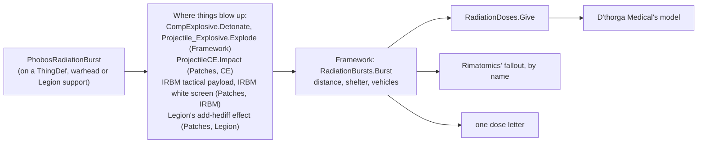

# Radiation from other nuclear and antimatter weapons (27 Nov 2026)

**Status (28 Nov 2026):** built, at the owner's word: IRBM's warheads, the antigrain weapons and the nuclear boiler in D'thorga Framework
0.358.0 and D'thorga Patches 0.47.0; DMS Legion's strike in Patches 0.48.0; the [Boomursh repair](#the-boomursh-repair-28-nov-2026)
(our own fallout, held people brought out, the strike's armour and timing) in Framework 0.364.0, Patches 0.50.0 and Medical 0.37.0. Not
yet tested in game (rows 716 to 719, 736 to 738).

The owner, 27 Nov 2026: "It seems that the tactical nukes from the IRBM mod don't have our realistic radiation modelling applied to
them? If that's the case, there are probably many other missile types from that mod and others missing said modelling as well that
are in dire need of it." A sweep of the owner's 387 active mods with `scripts/query-defs.py` confirmed it: only one weapon, IRBM's
Extinction-Class Strategic Nuclear Warhead, carried our strike and its dose. The owner's answers (question cards, the same day) chose
every recommendation below.

**How to read the marks.** **[code]** read in code or Defs, never run. **[P]** a primary source; **[S]** a secondary one. **[I]** our
inference. **[A]** an agent's choice or authored figure, for the owner to revise. **[O]** the owner's choice.

## Read this first (gotchas)

- **Every dose here goes through D'thorga Medical's radiation model.** With the model off or D'thorga Medical absent, these weapons
  do what their authors made them do and nothing more. (Our IRBM strike still falls back to Dubs Rimatomics' radiation, as before.)
- **Every dose figure is authored** [A]. At one metre a cell, a real nuclear weapon's prompt dose would reach far past the edge of any
  map; the figures here are squeezed onto a map, as the strike's are. The shape of the fall-off is the real one.
- **Fallout needs Dubs Rimatomics**: its fallout condition, by name. Without it, these weapons leave no fallout.
- **Two settings in D'thorga Framework** (General, "Radiation"), both on, and **one in D'thorga Patches** for DMS Legion, on.

## What each weapon did, and does now

| Weapon (mod) | Before [code] | Now |
| --- | --- | --- |
| Tactical Mini-Nuke Warhead (IRBM) | A super-bomb blast of radius 27 and a pulse of 32, fired as four hits (one, then a cluster of three); no radiation | A prompt dose at each hit, and a day or three of fallout [O] |
| Tactical Antimatter Disintegration Warhead (IRBM) | A super-bomb blast of radius 25 and a pulse | A prompt dose at each hit, no fallout [O] |
| Silent Surgical Strategic Warhead (IRBM) | IRBM's vaporising pass and nuclear winter; its description promises "localized fallout" | Our strike, small, with fallout [O] |
| Scavenger Clean Strategic Warhead (IRBM) | A "Beam" damage pass on people and plants; "radiation-enhancement technology" | Our strike with a small blast, four times the dose and no fallout: a neutron bomb [O] |
| Gamma-Ray Burst Strategic Warhead (IRBM) | 300 rounds of decay damage through thick roofs on people and plants | Its people take one dose across the whole map instead; built roofs do not shield it, rock does [O]. Its plants still die as IRBM made them |
| Nuclear strike (The Dead Man's Switch - Legion) | Its blast and heat rings, then "radiation corrosion" on every person on the map, deadly in seconds, deep bunkers included | Its rings as before; the corrosion replaced by our dose by distance and shelter, behind a setting [O] |
| CM-4 cruise missile (Legion) | Blast and heat rings only | Unchanged: Legion gives it no radiation, and its description does not call it nuclear [I] |
| Nuclear boiler (长征工业合作社, power system) | Holds a "5,000 kt" payload; blows up as an ordinary bomb of radius 28 | A prompt dose and fallout when it blows [O] |
| Antigrain shells, IED traps, charges and warpods (the game, Combat Extended, VFE Deserters, Vanilla Gravship Expanded 2, IRBM) | A super-bomb blast | A prompt dose at the blast, no fallout [O]; labelled a sci-fi extrapolation |
| Extinction-Class Strategic (IRBM), Dubs Rimatomics' ICBM | Already ours | Unchanged |

Left out as not nuclear [I]: IRBM's Molecular Fission (bond-breaking), Gravitational Singularity (a black hole) and Solar Flare;
VFE Power's reactor (its "radiation" only kills plants); Combat Extended's 60x225mm "radiation cannon" shell (burn damage, and nothing
says how it would irradiate).

## The four questions

- **What it lets the player do:** survive a small nuclear weapon by being far enough away or under enough rock, and survive a big one
  in a bunker. Use a mini-nuke knowing its radiation reaches past its blast.
- **What it stops them doing:** standing a stone's throw from a mini-nuke or an antigrain blast and walking away untouched.
- **How it changes the way they play:** shelter, distance and the doctor matter after these weapons, as they already do after the
  strategic strike. Legion's strike stops being a sure death for everyone on the map.
- **What outside the thing notices:** the player's people dosed get one letter, as after the strike (who, in words and grays); D'thorga
  Medical's doctor sees each dose; the log gets one line per burst. Nothing else notices [A]: no faction or goodwill effect beyond what
  the weapons' own mods already do.

## Risk and settings

- **Graded moderate** [A; confirmed by the owner on the Decisions page, 28 Nov 2026: "Moderate: on by default"]: new deaths are possible beyond a mini-nuke's or the boiler's blast, but the player
  fires most of these weapons, an incoming missile is announced, the doses are told in a letter, and shelter and care save people.
  So **on by default**. Legion's replacement lowers the risk (graded low), so it is on.
- D'thorga Framework, General page, section "Radiation":
  - **"Radiation from nuclear blasts"** (on): the prompt dose and fallout of every weapon marked nuclear.
  - **"Radiation from antimatter blasts"** (on): the prompt dose of every weapon marked antimatter.
- D'thorga Patches, its DMS Legion page: **"Legion's nuclear strike: dose by distance and shelter"** (on). Off, Legion's own corrosion runs.

## The rule

The dose in the open at distance *r* from the centre, for a burst whose dose at its edge radius *r₀* is *D₀*:

*D(r) = D₀ · (r₀ / r)² · e^−(r − r₀)/λ* for *r ≥ r₀*, and *D₀* inside *r₀*.

- **The shape is the real one** for the prompt radiation of a point burst: the inverse square, times air's attenuation [P: Glasstone
  and Dolan, *The Effects of Nuclear Weapons* (1977), chapter VIII, "Initial nuclear radiation"]. A check against a real weapon: the
  20-ton W54 of the Davy Crockett gave about 10,300 rem at 150 m and about 500 rem at 400 m [S: Carey Sublette's table, quoted in the
  [Davy Crockett article on Wikipedia](https://en.wikipedia.com/wiki/Davy_Crockett_(nuclear_device)) and
  [yarchive.net](https://yarchive.net/mil/davy_crockett.html); 600 rem at 400 m in other accounts]. Fitting those two points gives
  λ ≈ 230 m [I], a plausible length for gamma rays and neutrons in air.
- **The scale is squeezed** [A; kept by the owner on the Decisions page, 28 Nov 2026: "Squeezed onto the map", over the real scale as a
  setting and a gentler half]: the real W54 would give a lethal dose across a whole map. Each weapon's *D₀* and *λ* below are chosen
  so the dose matters for tens of cells past the blast, not hundreds.
- **Doses under 0.01 Gy are not given** [A], which also bounds the work: a burst touches only the people within its reach.
- **Shelter cuts it** by the strike's own shares (Glasstone and Dolan, Table 8.72, gamma rays: a frame house 0.9, 9-inch concrete
  0.15, three feet underground 0.003 [P]; thin rock 0.05 [A]), judged from the roof over each person and their room's walls before any
  roof falls. These shares and the cover judgement moved from D'thorga Patches into the Framework's core, so the strike and every
  burst use one copy. A weapon may say built buildings do not shield it (the gamma-ray burst).
- **People in a vehicle** take the share its hull lets through (the vehicles' own rule, NK9 of the strike record).
- **Worn shielding** is applied by D'thorga Medical, as for every dose.
- **A whole-map burst** (the gamma-ray warhead) gives *D₀* to everyone on each struck map, cut by shelter, with no fall-off.

### The figures [A]

| Weapon | Edge *r₀* (cells) | *D₀* (Gy) | λ (cells) | Fallout | Dose at 2 × *r₀* | Reach (0.01 Gy) |
| --- | --- | --- | --- | --- | --- | --- |
| IRBM Mini-Nuke | 27 | 30 | 100 | 1 to 3 days | about 5.7 Gy | about 330 cells |
| IRBM Antimatter | 25 | 20 | 60 | none | about 3.3 Gy | about 220 cells |
| Antigrain shells, traps, charges, warpods | 15 | 10 | 40 | none | about 1.7 Gy | about 120 cells |
| Nuclear boiler | 28 | 40 | 120 | 3 to 10 days | about 7.9 Gy | about 390 cells |
| Legion's nuclear strike | 10 | 80 | 250 | Legion's own toxic fallout | about 19 Gy | about 410 cells |
| IRBM Gamma-Ray Burst | whole map | 50 | — | none | — | the whole map |

For scale (D'thorga Medical's model): about 1 Gy brings the first sickness, about 4 Gy kills half of those untreated, over 8 Gy is
fatal. A mini-nuke's dose at 50 cells, in the open, is about 7 Gy; under a stone roof, about 1 Gy; under thick rock, almost nothing. Most reaches pass a map's edge: on a 250-cell map, every person is within reach of a mini-nuke, though most take a light dose.

IRBM's strategic warheads use the strike's own curve, as the Extinction-Class does, with their own zones [A]: Surgical a fireball of
15, blast of 60, reach of 150, fallout; Clean a fireball of 8, blast of 30, reach of 250, dose four times the strike's, no fallout and no
pollution.

## How it is built

- **The data:** a `PhobosRadiationBurst` mod extension (Framework core), added by XML to each weapon: its kind (nuclear or antimatter),
  edge, dose at the edge, air length, fallout days, whether built buildings shield, and whether it covers the whole map. Another
  modder adds it to theirs the same way. An edge of 0 means the thing's own explosion radius.
- **Each impact doses once**: a tactical warhead's first payload part only, never its chain explosions; a cluster's every hit.
- **The dose arrives with the flash**, so every hook runs before the blast it belongs to: those it kills take no dose, and roofs are
  judged before they fall.
- **The gamma-ray warhead**: its people are taken out of IRBM's damage passes for as long as its pulses run, on the maps it struck,
  and given our one dose instead.
- **Legion**: a prefix on its add-hediff effect skips the corrosion for a support type that carries our extension, and gives our burst
  at the target.

## Limits

- Neutrons are not modelled apart from gamma rays; the shelter shares are gamma figures.
- Combat Extended's ammunition cooking off (its own detonation path) gives no dose; the game's cook-off does.
- Fallout is Rimatomics' map-wide condition, not a plume downwind.
- Nothing here gives a dose to a map with no people on it, and nothing reaches people in caravans or on other maps, except the
  gamma-ray warhead's own neighbouring maps.

## The Boomursh repair (28 Nov 2026)

The owner struck Boomursh, a Custom Base Framework town, with the Extinction-Class warhead and found, hours later, "quite a few pawns
still standing, barely any injuries", with radiation exposure at 0.01% "across the board". Read from the `Player.log` and the save from
two minutes before the strike [log] [save]:

- **Armour stopped the blast.** The strike hit people with blast and burn damage at armour penetration 0; under Combat Extended any
  armour stops a hit with none, whatever its size. 102 died, mostly the unarmoured. Fixed: the blast takes the warhead's own penetration
  (overpressure goes through armour [I]); burns take 1, above every Combat Extended heat rating (power armour 0.54) [A].
- **The strike took hours of game time.** 77,467 things over 3,594 frames and 382 seconds, about 3.7 game hours at 24 ticks a second,
  while the game ran: people far out were struck at the distance they stood when it began, hours after the flash, and RimPacts' allied
  assault arrived mid-strike. Fixed (the owner's choice): people and vehicles are struck first, then every cell's fires and scouring,
  then buildings, items and plants.
- **40 of the garrison were off the map.** Custom Base Framework keeps a base's garrison in its reserve (`CustomBaseFramework.Reserve`,
  a map component holding them despawned) [save] [code]; the strike never saw them, and they walked out unhurt with no dose (the
  exposure condition's floor, 0.0001 Gy, shows as 0.01%). Fixed (the owner's choice, "and can that be genericized to work with other
  mods which might do the same? As a defensive measure"): D'thorga Framework's `HeldPawns` calls each listed holder's own method to
  put its people back (`PhobosHeldPawnsDef`, a row per mod: Custom Base Framework's `AllesAbsetzen`) before a strike, or before a burst
  reaching across half the map; any other map component found holding living people is named in the log once, for a row to be added.
- **Rimatomics' fallout is mild** [code]: each pass of the game's steady-effects sweep over an outdoor person's cell gives "strength 3",
  about 0.08 Gy through our conversion: roughly 3 Gy a day in the open on day one, nothing under any roof. Fixed (the owner's choice,
  "our own fallout, squeezed"): D'thorga Framework's fallout field doses every 600 ticks, falling by the 7:10 rule, 1.5 Gy an hour in
  the open at the first hour after a strike (about 5 Gy over the first day, 7 over two weeks) [A], cut by cover (a frame house 0.5, stone
  0.1, thin rock 0.05, deep rock 0.003) [A], neighbouring maps 0.3 of it [A]; the Mini-Nuke lays 0.3 Gy an hour and the boiler 1 [A].
  Rimatomics' own nuclear fallout gives no dose where ours lies (D'thorga Medical); its sky, plants and clouds stay. Without D'thorga
  Medical's model, nothing doses.
- Not ours, seen in the same log: about 4,500 errors from the game's music player failing to pick a song every frame, with IRBM's
  `Root_Play.Update` postfix on the stack, which filled the log to its 10,000-message cap. Left for now.

## Who chose what

- **The owner** (cards, 27 Nov 2026): all four IRBM warheads; Legion replaced with a setting; antimatter a prompt dose, no fallout; the
  boiler a dose and fallout. (Cards, 28 Nov 2026): people and fires first; held people brought out, generically; our own fallout, squeezed.
  (Decisions page, 28 Nov 2026): the scale stays squeezed onto the map (also offered: the real scale as a setting; gentler, half the
  figures), and the risk is moderate, on by default (also offered: high, off by default).
- **The agent**: the shape of the rule, every figure, the risk grade, the settings' places and names, leaving the CM-4 and the
  non-nuclear warheads alone.
