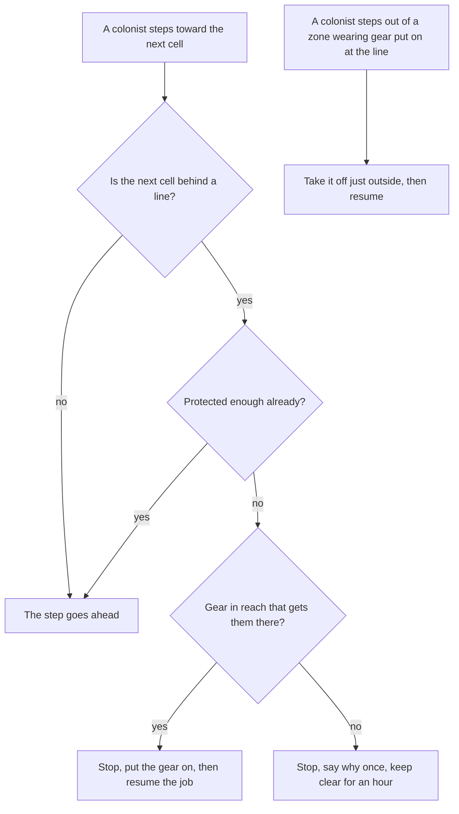

# Radiation control line (design record, 10 Nov 2026)

The owner asked on 10 Nov 2026 for something "unique" for Rimatomics: like the build-menu markers some mods have for "vacuum beyond this
point", one saying that "appropriate apparel for radiation protection (Rimatomics approved (TM)) must be adorned or changed into beyond
this point", using D'thorga Framework wherever possible. **Built the same day; not yet tested in game.**

## Read this first

- **Two ways to mark it** (owner's choice: both): a **radiation control point**, a sign built from the Misc tab that closes off the room it
  faces; and a **radiation controlled area**, painted from the zone tab like the home area, for open ground or several rooms.
- **Colonists suit up, then go** (owner's choice): one about to step in without enough protection stops at the line, fetches and puts on
  gear, then carries on with what they were doing. Stepping out, they take that gear off just outside. With no gear in reach they turn
  back, say so once, and keep clear of the zone for an hour.
- **Gear is judged by its effect, never by its name** (owner rule, 5 Nov 2026). Rimatomics cuts a pawn's radiation dose by the game's own
  *toxic environment resistance* (read from its 1.7 code, `DubUtils.applyRads`), so any worn gear raising that counts: its radiation suit
  and mask (0.40 each), its MOPP suits, other mods' hazmat gear, genes. **0.75 is required**, which takes a suit and a mask (authored).
- **Drafted colonists cross freely**: an order is the player's call (owner, 10 Nov 2026: extreme decisions, real consequences). So do
  prisoners, guests and animals, whom the player does not direct.
- **Home** (owner's choice): the machinery is generic, in D'thorga Framework's core (`Protection/`), so caustic gas or Odyssey's vacuum
  could use it later; the radiation line is D'thorga Medical's, in `Mods/Rimatomics`, loaded only with Rimatomics.

## What it does for the player

| | |
| --- | --- |
| **Lets the player** | Run a reactor hall the way a real plant runs one: a controlled area with suits on inside, without dressing every worker by hand |
| **Stops the player** | Sending an unprotected colonist into the hall by accident, and colonists wandering in and out of it in their everyday clothes |
| **Changes how they play** | Suits become kit stored at the door, like a real change room, and a hall's layout gains a step-off point |

## How it works

- **Where a line is:** `ProtectionZones` (a map component) holds the painted cells per kind of line (saved) and the control points
  standing on the map (found again as they spawn). A control point closes off the room in front of it, or past the door in front of it;
  facing a wall or open ground it closes off nothing, and its inspect line says which. While placing one, the room it would close off
  is outlined.
- **Which gear:** every unforbidden, wearable item outside every zone that raises the stat, its gain counted after whatever it would
  replace comes off. `ProtectionRule.Choose` (game-free, tested) takes the biggest gain first, the nearer of two equal ones first,
  skipping items that can't be worn together, and stops as soon as the requirement is met.
- **Putting it on:** the game's own Wear job for each item, then the job the pawn was doing, resumed where the game allows. The gear is
  marked forced, so the pawn's apparel policy doesn't take it off inside; the map remembers it as line gear (saved), and stepping out
  takes exactly that gear off with the game's own Remove apparel job, leaving it on the floor outside for haulers.
- **Two Harmony patches, in D'thorga Medical** (the Framework core stays free of Harmony): a prefix and postfix on
  `Pawn_PathFollower.TryEnterNextPathCell`, the one method every route into a room goes through (Field Tents and others patch it the
  same way); the prefix skips the original only on the step it refuses. A postfix on `ForbidUtility.InAllowedArea` keeps a turned-back
  colonist from taking work inside for the hour. On a map without a line, each costs a field read.
- **Turned back and at the line again** (Framework 0.72.1): a colonist kept clear of a zone whose route only crosses it, since the game's
  pathing ignores allowed areas, is stopped short with no gear search and no message, and their job ends as a job ends when its path
  fails (`JobCondition.ErroredPather`): the game has them wait 250 ticks, then look for work again with the zone still out of bounds.
  Whenever a line ends or interrupts a job, the pawn's pather is stopped first (`StopDead`), so the next job paths afresh.
- **Three sendings for gear in an hour** without becoming protected turn the colonist back (`MaxSuitUpAttempts`): whatever keeps the
  gear from going on, they stop being sent for it.

## Performance fault, 10 Nov 2026

The owner's profiler (Harmony patches tab, PG5, two maps open) charged 38% of every frame, about 40 ms, to the step prefix. The cause,
read from the code and the game's decompile: a colonist with no gear in reach was turned back by ending their job with `Incompletable`,
and the game's `EndCurrentJob` ran its full job search at once, inside our prefix. The refused step was skipped but the pather was never
stopped, so the pawn stayed mid-step; a new job to the same place kept the old path (`StartPath` returns early for an unchanged
destination), and the next tick's `PatherTick` tried the same step again. The gear scan and the job search repeated every tick for as
long as the colonist's route led through the area. `Step` never consulted `TurnedBack`, which only the allowed-area postfix read; the
route-through case was this record's known limit. Only player-controlled colonists ever reach the check, so NPCs and the second map
were not the cost, whatever the owner's first guess. The save could not name the pawn: nobody stood within six cells of the area when
it was written, minutes before the profile. Fixed in Framework 0.72.1 as the two points above say.

## The alert (Framework 0.70.0)

**Unprotected behind the line** (owner, 10 Nov 2026, from the agent's offer): a game alert lists every one of the colony's own living
flesh standing behind any line without enough protection, with the kind of area each is in, and clicking it jumps to them. It covers
what the line does not stop: animals, prisoners, slaves, guests and drafted colonists, and anyone caught inside when an area is painted
round them. It lives in the core (`Alert_PhobosUnprotectedBehindLine`), so every kind of line gets it; it rebuilds its list at most
every 250 ticks, and a map without a line costs a field read. Machines are left out: what a line keeps out is not assumed to harm them.
It changes nothing in the world.

- **Lets the player:** see at once who is exposed, instead of finding out from a sickness later.
- **Stops them:** nothing.
- **Changes how they play:** pets, prisoners and soldiers sent near a reactor become something to manage, not to forget.

## Limits, known now

- **A colonist already inside unprotected stays unprotected** (painted around them, or undrafted inside): only a crossing is checked.
  Since 0.70.0 the alert names them.
- **A turned-back colonist's route can still lead through a zone** on the way somewhere else, since pathing ignores allowed areas; since
  Framework 0.72.1 they stop short and wait as for a failed path, rather than being re-planned every tick. Routing them around the zone
  would need the game's pathing to know about lines, which it does not.
- **Gear taken off lands outside the line, not in a locker;** haulers put it away. **Before Framework 0.77.0 it lay forbidden** (owner's
  report, 11 Nov 2026): the game's `JobDriver_RemoveApparel` drops forbidden unless `haulDroppedApparel` is set, and that flag was not used
  because its haul runs as RemoveApparel, which the line lets through, so the wearer could carry the suit back across to a store inside
  unprotected. Since 0.77.0 the map remembers the gear being taken off (saved) and frees it once it is down, checked on the rare tick. Whatever the suit replaced (a duster, say) lies where
  the suit was picked up, and the colonist's apparel policy dresses them again later.
- **A pawn whose stat ends up short after suiting up** (another mod's multiplier, say) carries on in: the choice adds offsets only.
- **Rimatomics++** is on the owner's list; its Defs were not checked for other radiation gear. Effect-based choice covers it if its gear
  raises toxic environment resistance.

## Who chose what

- **Owner (10 Nov 2026):** that it exists; both a sign and a painted area; suit up then go; D'thorga Medical as its home; the Framework
  used wherever possible.
- **Agent:** the toxic environment resistance stat (from Rimatomics' code), 0.75 required, the hour's turn-back, drafted pawns crossing
  freely, taking gear off outside the line, the sign's look, cost and text, and the two Harmony targets. All are the owner's to revise.
- **Agent (10 Nov 2026, the performance fix):** the game's failed-path wait (250 ticks) for a turned-back colonist whose route crosses
  the zone, and three sendings for gear before turning back. Both are the owner's to revise.
