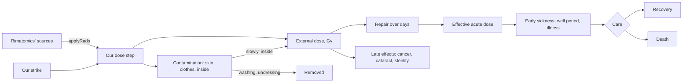

# A radiation model of our own: dose, radiation sickness, care and late effects (22 Nov 2026)

**Status (22 Nov 2026):** partly built, at the owner's word, in D'thorga Medical 0.21.0 (with Framework 0.229.0 and Patches 0.35.0):
the dose and its repair, the course, care, the doctor's estimate and the exact dose, Rimatomics' doses taken and its conditions
converted, the strike's dose in grays ([as built](#as-built-22-nov-2026)); dev actions to give and remove a dose in 0.22.0; late
effects (RM8) in 0.23.0; worn armour's shielding (RM17), contamination (RM6) and the three medicines (RM5) in 0.24.0. The strike's shelter,
shadow and letter (NK12, NK13, NK17, NK18) followed in D'thorga Patches 0.36.0. The owner's answers are
[below](#the-owners-answers-cards-22-nov-2026). Not yet tested in game: rows 361 to 363 and 369 to 374.

How the health layer works now: [systems/health-layer.md](systems/health-layer.md); this record keeps its history.

## As built (22 Nov 2026)

- **One saved condition, `PhobosRadiation_Dose`**, keeps every dose by game day, folds doses older than 150 days into the tenth beyond
  repair, and holds the lifetime dose, the highest effective dose of the course, its start and the first vomiting. A step every 300
  ticks from its own giver in OrganicStandard.
- **The course follows the highest effective dose reached** [A], so an acute dose is not softened by repair while its illness runs;
  repair matters for doses spread over days. It starts at 0.7 Gy.
- **Who dies is decided, not rolled** [A]: each person has a fixed sensitivity drawn from who they are, spreading the lethal dose about
  the preset's by about 0.8 Gy either way (ICRP's spread), and whether they vomit is fixed the same way. **Care raises their lethal dose
  while they are ill**, by the preset's figure at full care: tended (by quality) 0.35, in bed 0.2, a clean room 0.15, on fluids 0.15, on
  a medicine that speeds immunity 0.15.
- **The illness** rises to its height over 14 days (blood), 6 (gut) or 1.5 (brain), at a severity of the dose over the person's lethal
  dose; at 1 it kills, below it recedes 5 % a day. Its stages carry `lifeThreatening` from severe, so triage sees it.
- **Rimatomics' doses**: a by-name prefix on `DubUtils.applyRads` takes the dose for anyone Rimatomics does not count a robot, at 9 Gy
  per unit of its sickness, its radiation setting honoured, no toxic environment resistance; its fallout conditions are marked while
  they dose a cell, and their dose fades by the 7:10 rule from the first day [A]. The Geiger click and a figure in milligrays are redone.
- **Old Rimatomics conditions convert** the first time the step meets them, with the course started two days back.
- **The strike** gives 10 Gy at the fireball's edge [A], falling with its curve, through the Framework's `RadiationDoses`; without
  the model, Rimatomics as before.
- **Late effects (RM8), Medical 0.23.0**, each behind its own setting, their strength the preset's (Gentle none, Moderate half the
  chance, Realistic and Harsh full), arriving at **a quarter of the real time** (the owner's choice, no setting), real years counted as
  60-day game years. Who is affected is fixed by the person's draws, so a save and reload changes nothing. The rule is
  `RadiationLateRule`, game-free, with tests.
  - **Cancer**: 5.5 % a gray of the lifetime dose (ICRP 103's whole-population figure, which errs gentle at high doses [A]), a sixth of
    it leukaemia [A, unverified]. Leukaemia, a condition of ours that grows like the game's carcinoma at twice its pace [A], in 2 to 8
    real years; a solid cancer, the game's carcinoma, in 10 to 30, on a lung, the stomach, liver, torso, neck or a kidney [A].
  - **Cataract**: the game's cataract in both eyes, a chance rising in a straight line from 0.5 Gy to certain at 5 [A, between ICRP's
    two thresholds], in 8 real years at the threshold down to 1 at 5 Gy [A].
  - **Sterility**, from the highest effective dose: a man sterile for a while from 0.15 Gy, a quarter-year to five years [A]; for good
    past his own limit of 3.5 to 6 Gy, a woman's 2.5 to 6, lower with age [A for the age slope], as the game's own sterilized.
  - **Pregnancy (Biotech)**, the fetus taking the mother's dose [simplification: the CDC says it tends to be lower], in the CDC's
    windows (after NCRP Report 174) on a 38-week pregnancy: **loss** through Biotech's own miscarriage, from 0.1 Gy in the first two
    weeks and from 0.5 Gy later [A for the chances between the CDC's words]; **at birth** (a postfix on Biotech's birth) weaker movement
    from a dose in weeks 3 to 7 above 0.5 Gy [A], slower learning at the CDC's 40 % a gray in weeks 8 to 15 (from ICRP's 0.3 Gy) and 15 %
    in weeks 16 to 25 (from 0.5 Gy), and **the child carries its dose**, so its own cancer chance follows. Growth restriction is left
    out: the game has no fitting condition.
- **Worn armour's shielding (RM17), Medical 0.24.0**, as designed [below](#rm17-worn-mass-shields-a-little), behind its own setting
  (on): each garment's mass as the game has it over the authored areas of the groups it covers, layers adding, weighted by the marrow
  shares; applied to the Framework's doses (the strike) and every Rimatomics dose, all from outside.
- **Contamination (RM6), Medical 0.24.0** (the owner's choices: on clothes and skin; strip and wash a setting, off). From Rimatomics'
  fallout only (the one source that is dust), each dose outdoors leaves 1 unit of dust a gray [A] on the clothes (the caustic gas's
  clothing component, by the area each covers) and on bare skin; carried dust gives 0.02 Gy a day a unit [A], fading by the 7:10 rule,
  until a wash (any rinse, Dubs Bad Hygiene's shower or bath) clears the skin or the washing machine the clothes. Breathed through the
  Framework's mask rule: 0.03 Gy from inside per gray outside [A], delivered at caesium's 110-day half-life in the body [P]; skin dust
  swallowed from the hands, 0.01 a unit a day [A]; 2 Gy to the thyroid per gray outside [A, after Rongelap's high thyroid doses], none
  while Rimatomics' potassium iodide is in the body [P: its real role], bringing thyroid cancer at 1 % a gray for adults and 5 % for
  children [A, unverified] in 4 to 10 real years (a quarter, as the other late effects), on the neck, under the Cancer switch. With
  strip and wash on, a dusty colonist counts as needing the safety shower and leaves dusty clothes there, forbidden, through two hooks
  added to the shower's service. Not modelled: beta burns from dust on the skin (Rongelap), dust spreading to beds and floors.
- **The three medicines (RM5), Medical 0.24.0** (the owner's choices: all three; two research projects, Radiation medicine and Marrow
  stimulants; Prussian blue from steel and neutroamine). Drug-lab pills of the game's own kind, each giving an "on" condition: the
  anti-sickness tablets hold the early sickness at an eased stage (no vomiting, eating) for half a day [A]; Prussian blue cuts the
  half-life inside to a third for three days [P for the factor, A for the duration]; the marrow stimulant, if in the body within a day
  of the course starting, adds 0.5 Gy to the person's lethal dose [A, the record's figure]. **Doctors give them by themselves** through
  a doctor work giver of their own (the dosing part's job quits once pain or disease passes, so it could not carry these): tablets to
  anyone in the early sickness, the stimulant once 2 Gy or more is measured or estimated from vomiting within five hours and still
  within the day, Prussian blue once 0.05 Gy inside is still to come; never beyond the patient's medical care setting.
- **Not built yet:** the shadow and
  graded shelter of the strike (NK12, NK17, NK18), the strike's letter (NK13).

The owner, 22 Nov 2026, on the [nuclear strike record](nuclear-strike-effects.md): shadow and a graded dose should "wait for our own
model and when it does exist, we'll provide settings for players to configure it and the difficulty how they wish". Then: "Let's
continue with our own radiation model". It belongs to D'thorga Medical, beside burns, smoke and caustic gas. It is row NK14 of the
strike record, and NK12, NK13, NK17 and NK18 wait on it.

**How to read the marks.** **[code]** read in code or Defs on 22 Nov 2026, never run. **[P]** a primary source; **[S]** a secondary
one. **[I]** our inference. **[A]** an agent's choice or authored figure, for the owner to revise. **[not read]** says so plainly.
`M/` is `src/PhobosMedical/`; `RIM` is the Dubs Rimatomics 1.7 decompile in `.local/decompiled/Rimatomics-1.7`.

**Who read what.** A code survey and a sources survey by research agents on 22 Nov 2026. The agent writing this record re-read
Rimatomics' dose method (`DubUtils.applyRads`, RIM `DubUtils.cs:231-269`) itself; everything else is as the surveys reported it, with
the sources listed under [Sources](#sources). **Re-read a line before building on it.**

## Read this first

- **Radiation in the owner's game today is one number that rises and falls.** Dubs Rimatomics gives every dose as "radiation
  sickness" severity, recovering at 0.08 a day, which at 0.9 turns into a certain death over about two days **[code]**. There is no
  dose, no early sickness, no well period, no care that helps beyond potassium iodide's 0.1 a day, and no way to tell how much someone
  took.
- **Our strike's radiation does nothing you can see.** It adds at most 0.0144 to that number, whose first visible stage is 0.04, and
  recovery clears it in about four hours **[code, arithmetic]**. Fallout and leaking reactors are what harm people today.
- **Every Rimatomics dose passes through one method** (`DubUtils.applyRads`), which no mod patches **[code]**. One by-name patch there
  can hand every dose to our model.
- **D'thorga Medical already has the shape this needs:** the caustic gas model keeps a dose in one saved condition, with delayed
  tracks for what follows, run every 300 ticks from our burns giver, its curves game-free and tested **[code]**.
- **The real course is well documented** and has a shape a game can show: an early sickness whose timing tells the dose, a deceptive
  well period, then the illness, then recovery or death; and care moves the dose that kills half by about 1 to 3 Gy **[P]**.
- **Most "radiation" on the mod list is not radiation**: other mods' reactors and fallout give the game's toxic buildup **[code]**.
- **The biggest choice:** replace Rimatomics' sickness, or run beside it ([RM1](#rm1-what-becomes-of-rimatomics-sickness)).
- **The questions are at [the end](#questions-for-the-owner).**

## What the game does today

### Dubs Rimatomics [code, re-read where marked]

- **`applyRads(pawn, strength)`** (re-read, RIM `DubUtils.cs:231-269`): strength is multiplied by Rimatomics' own radiation setting
  (the owner's is 100 %), then by one minus the pawn's toxic environment resistance, then by 0.0028758, a tenth of the game's own toxic
  figure. A robot gets its own condition, which never heals. Anyone else gets that much **radiation sickness** and a tenth as much
  **radiation buildup**, or, once the sickness has reached 0.9, a **fatal radiation exposure** that rises 0.4 a day under Rimatomics++
  and cannot be treated. A colonist hears a Geiger click and sees the figure, once the Geiger research is done.
- **Radiation sickness** falls 0.08 a day; its stages take Consciousness from 0.05 to 0.25 and bring vomiting. **Radiation buildup**
  never falls and gives a carcinoma at a mean time between 5,120 days (at 0.04) and 20 days (at 0.8).
- **Where doses come from:** a leaking reactor core, turbine, broken core, damaged radioisotope generator, radioactive ship part,
  failed research, and nuclear fuel, waste and slag carried or lying near (`emitRadiation`, where each wall on the line cuts the dose by
  its hit points); nuclear fallout (strength 3) and radioactive fallout (5) outdoors; and our strike.
- **Rough figures** **[arithmetic]**: unprotected in nuclear fallout, about +0.31 sickness a day, certain death in about four days;
  in a suit and mask (resistance 0.8), +0.06, below the recovery; two cells from a leaking core, certain death within about an hour.
- **Care:** potassium iodide only, which takes 0.1 a day off the sickness and nothing else. Rad suits and masks give 0.4 toxic
  environment resistance each. A Geiger research shows doses; a radiation detector building shows a reading.
- **A probable bug of Rimatomics'** (repeated from the strike record): its nuclear fallout adds toxic buildup in proportion to a pawn's
  resistance instead of what is left after it, so the best protected gain the most.

### Everything else on the list [code, surveyed]

| Source | What it gives | Radiation? |
| --- | --- | --- |
| Vanilla Furniture Expanded – Power's nuclear generator | Toxic buildup in a radius, through walls, ignoring toxic environment resistance; a meltdown weather | Toxic in its author's terms |
| 长征工业合作社's fusion reactor meltdown | The game's toxic fallout condition for 15 days | Toxic |
| IRBM's nuclear winter | The game's airborne toxic buildup | Toxic |
| IRBM's gamma-ray warhead | `Decayed` damage, an injury | No dose |
| The Dead Man's Switch: Legion's nuclear strike | A condition that kills everyone on the map in hours (probably dev-mode only) | A sentence, not a dose |
| The game's toxic fallout, ancient reactors, the nuclear stomach | Toxic buildup; a carcinoma risk | Toxic |
| Vanilla Recycling Expanded's isotope pack | Toxic buildup on damage [not decompiled] | Toxic |

### D'thorga Medical's own pieces to build on [code, surveyed]

| Need | What exists |
| --- | --- |
| A saved dose with clocks | `Hediff_PhobosCausticExposure`: doses, peaks, time since first and last exposure, one-off roll flags, saved under `Phobos` keys, tooltips by display mode |
| A step every 300 ticks | `HediffGiver_PhobosBurns.OnIntervalPassed`, which runs the burns, smoke, airway and caustic services |
| Curves, tested | `M/BurnsAndSmoke/Rules/CausticRule.cs` (`Ramp`, `Fade`, `AddDose`), tests in `tests/PhobosMedical.Rules.Tests` |
| Danger triage and Search and Rescue can read | Stages' `lifeThreatening` and `deathMtbDays`, never a kill in code |
| Lasting effects by peak | Framework's `HediffComp_PhobosLeavesLasting` |
| Contamination on clothing | `CompPhobosContamination` on a garment, saved on it |
| Fluids | `FluidsService.Give`, our fluids kit and drip stands, More Injuries' saline |
| Drugs chosen by effect | `DoseIndex` and `DoseEffectRule` |
| Settings | `SettingsList.Radio` and `Choice` (preset buttons, not sliders) |
| What caused it, told | `CauseNote` |

Missing everywhere on the list **[surveyed]**: Prussian blue, DTPA, filgrastim or any marrow stimulant, any anti-sickness drug, any
dosimeter outside Rimatomics, an isolation room.

## What the real thing does

Gathered by a research agent on 22 Nov 2026; links under [Sources](#sources). One gray (Gy) is one joule per kilogram absorbed; 1 rad
is 0.01 Gy. The figures are for a sudden whole-body dose to a healthy adult.

### The course

- **Four phases** **[P]**: "an initial prodromal stage of malaise, nausea, vomiting, and diarrhea, a latent, symptom-free period, a
  critical or manifestation phase ... and a recovery phase or death" (Akashi and colleagues, on the Tokaimura accident, 2001).
- **Three syndromes by dose** **[P]**: blood-forming (about 1 to 8 Gy), gut (about 6 to 20 Gy) and neurovascular (20 to 50 Gy and up)
  (Goans and Flynn, Borden Institute). **The sources draw the bands differently**: the CDC gives about 0.7 to 10, above 10 and above 50.
- **How the timing shortens with dose** (US HHS REMM, after the IAEA) **[P]**:

| Dose | Vomiting | Well period | Illness | Without care |
| --- | --- | --- | --- | --- |
| 2–4 Gy | 1–2 h after, in 70–90 % | to day 18–28 | hair loss from day 15; illness 18–28 days after | up to half die at the top of the range, at 6–8 weeks |
| 6–8 Gy | under 30 min, in all | short | within 7 days | more than half die, from 1–2 weeks |
| Above 8 Gy | under 10 min, in all | little or none | at once | "uniformly fatal within 1-2 weeks without aggressive supportive care" |

- **What kills** **[P]**: in the blood-forming syndrome, "sepsis associated with pancytopenia ... and severe hemorrhage from platelet
  loss"; in the gut syndrome, diarrhoea, fluid loss and shock; in the neurovascular syndrome, collapse "within 2 days" (Goans and
  Flynn).
- **The skin** **[P]**: reddening within hours to days above about 2 Gy, gone in a day or two, back in two to three weeks with
  blistering and sloughing at high doses (Blakely, Borden Institute).

### How a doctor tells the dose without a dosimeter

| Dose (Gy) | Who vomits | Time to vomiting | Lymphocytes at 48 h (×10⁹/L; normal 1.4–3.5) |
| --- | --- | --- | --- |
| 1 | 19 % | over 10 h | 1.90 |
| 2 | 35 % | 4.6 h | 1.48 |
| 3 | 54 % | 2.6 h | 1.15 |
| 4 | 72 % | 1.7 h | 0.89 |
| 6 | 94 % | 1.0 h | 0.54 |
| 8 | 99 % | 0.7 h | 0.33 |
| 10 | 100 % | 0.5 h | 0.20 |

(Blakely, Borden Institute, Table 6-2, built from Waselenko and colleagues, 2004) **[P]**.

- **Its limits** **[P]**: vomiting misses more than 45 % of people at 3 Gy or less, stress makes people vomit too, and at 2 Gy the
  estimate can be out by 200 % (Dainiak and colleagues, 2011). The gold standard, counting broken chromosomes, takes two to four days
  in a laboratory.
- **As a rule** **[P]**: vomiting within an hour means more than 4 to 6 Gy; those who vomit within four hours go to professional care
  (Goans and Flynn).

### Care that changes the outcome

- **The dose that kills half within 60 days** **[P]**: about 3.5 Gy without supportive care, 4 to 5 Gy with antibiotics and
  transfusions (Goans and Flynn); 3 to 4 without, 6 to 7 with (Dainiak and colleagues); about 4, up to about 5 with supportive care and
  6 with growth factors (ICRP Publication 103); 7 to 9 Gy with intensive care, isolation and marrow transplant (López and Martín,
  2011). **The sources disagree; all agree care moves it by 1 to 3 Gy.** "The primary goal of medical therapy is to shift the survival
  curve to the right by 2 Gy or more" (Goans and Flynn).
- **Who benefits** **[P]**: those between 2 and 6 Gy. Above 6 Gy with burns or wounds, a patient is "probably expectant" in a mass
  casualty (Goans and Flynn, after Waselenko and colleagues).
- **What the care is** **[P]**: fluids; drugs against vomiting (ondansetron); antibiotics, antifungals and antivirals; platelet and
  blood transfusions (Chernobyl's grade III patients needed 3 to 5 platelet transfusions each); and marrow stimulants. Filgrastim's
  label: "10 mcg/kg as a single daily subcutaneous injection ... as soon as possible after suspected or confirmed exposure to radiation
  doses greater than 2 gray"; in monkeys at the dose that kills half with supportive care, 21 % died with it against 59 % without
  (Neupogen label). The benefit shown needed it started within a day.
- **Marrow transplant rarely helped**: at Chernobyl "bone marrow transplantation for patients with doses below 9 Gy only worsened the
  ARS therapy results", and of 13 transplants and 6 foetal-liver infusions one patient survived, on his own recovered marrow (UNSCEAR
  2008) **[P]**.
- **Combined injury** (from the strike record) **[P]**: a dose makes burns and wounds worse, and with them the dose that kills half
  falls to 2 to 4.5 Gy.

### Contamination, inside and out

- **On the skin and clothes** **[P]**: "Taking off your outer layer of clothing can remove up to 90% of radioactive material"; then a
  warm shower with soap, never scrubbing the skin raw (CDC). Decontamination "should not delay or impede stabilization of any patient"
  (REMM).
- **Potassium iodide** **[P]**: "provides protection only for the thyroid from radioiodines ... and provides no protection against
  external irradiation of any kind"; it lasts about 24 hours and works best taken before or as the cloud passes (US FDA, 2001).
- **Prussian blue** **[P]**: binds caesium and thallium in the gut; at Goiânia it cut caesium's time in adults' bodies from about 80
  days to 26 (Radiogardase label). Caesium otherwise leaves with a biological half-life of about 110 days.
- **DTPA** **[P]**: for plutonium, americium and curium, best within 24 hours. No such sources exist on the owner's list.

### Late effects

- **Two kinds** **[P]** (ICRP 103): tissue reactions, with a threshold and worse with dose (sickness, burns, cataract, sterility), and
  chance effects, cancer and heritable effects, whose likelihood but not severity rises with dose.
- **Cancer** **[P]**: about 5.5 % per sievert for a whole population, a protection figure for low doses, not a forecast for one
  person (ICRP 103). Among the atomic-bomb survivors, excess leukaemia began about 2 years after and peaked at 6 to 8; solid cancers
  began about 10 years after, about 50 % more per gray, raised for life (RERF).
- **Thresholds** (ICRP 103, from ICRP 41, single brief dose) **[P]**: temporary sterility in men at 0.15 Gy, permanent at 3.5 to 6;
  in women 2.5 to 6; the lens 0.5 Gy for detectable clouding (ICRP's 2011 statement), 5 Gy for a cataract that impairs sight.
- **Pregnancy** **[P]**: no malformation below about 0.1 Gy; in weeks 8 to 15, a threshold of at least 0.3 Gy for severe mental
  disability, and about 25 IQ points lost per gray (ICRP 103).

### Measuring and limits

- **Instruments** **[P]**: a Geiger counter reads radiation in real time but cannot show a past dose; film badges, TLDs and electronic
  dosimeters record what the wearer took, the electronic ones on a display with an alarm (REMM).
- **Limits** **[P]**: 20 mSv a year for workers; for informed volunteers saving lives, up to 500 or 1,000 mSv, "below 1000 mSv should
  avoid serious deterministic effects" (ICRP 103).

### Yardsticks

- **Chernobyl** **[P]**: of 134 people with radiation sickness, 28 died within four months; by grade, 0 of 41 at 0.8 to 2.1 Gy, 1 of 50
  at 2.2 to 4.1, 7 of 22 at 4.2 to 6.4, 20 of 21 at 6.5 to 16; skin burns contributed to at least 19 deaths (UNSCEAR 2008).
- **Tokaimura, 1999** **[P]**: three workers at 16 to 20, 6 to 10 and 1 to 4.5 Gy-equivalent; the first vomited within minutes and died
  on day 83 despite stem cells, skin grafts and cytokines; the second died on day 211; the third recovered.
- **Goiânia, 1987** **[P]**: an abandoned caesium source; 249 contaminated, 20 hospitalised, 4 died at 4.5 to over 6 Gy while 2 with
  similar doses survived; Prussian blue given (IAEA, 1988).

### Repair over days, and a dose spread out

- **The same dose spread out harms less** **[P]**: "if the dose rate is about 0.2 Gy per hour, LD50 values may be increased by around
  50% ... If the dose is delivered over a month, the LD50/60 may be doubled" (ICRP 103, A74). Glasstone and Dolan take an "acute" dose
  to be what is received in about a day, and say a dose of 600 rems "accumulated gradually over 20 years might have no observable
  effect".
- **A repair model with numbers** **[P]**: "10 percent of the exposure is irreparable and ... the body can repair about one-half of the
  remaining 90 percent in a month ... recovery commences about 4 days after the onset of exposure and ... each day there is repair of
  about 2.5 percent of the then remaining reparable damage", the "equivalent residual dose" (US Department of Agriculture, Agriculture
  Handbook No. 234, 1962, a civil-defence guide). Its worked example: 200 roentgens early in a month leaves about 110 by its end.
- **The sources disagree on repair** **[P]**: a 1976 German paper has 20 % irreparable and a flat 5 rads repaired a day (Gerber, an
  abstract only); the US Army's 1994 manual makes "no allowance ... for body recovery"; a 1999 US military medical handbook lets a
  unit's exposure category come down after 3 to 6 months.
- **The Army's exposure categories** **[P]** (FM 3-3-1, 1994, as reprinted by the Institute of Medicine, 1997): RES-0 (none), RES-1
  (up to 0.7 Gy), RES-2 (0.7 to 1.5 Gy), RES-3 (over 1.5 Gy, "any further exposure exceeds emergency risk"), with an allowance of
  further dose for each mission at negligible, moderate and emergency risk.

## The design [A]

### RM1. What becomes of Rimatomics' sickness

| Shape | How | Gains | Costs |
| --- | --- | --- | --- |
| **Replace** (recommended) | A by-name Harmony prefix on `applyRads` that hands the dose to our model and skips the original for flesh pawns, behind the model's setting (a recorded reason: the one entry for every Rimatomics dose) | One model; no double symptoms | We redo the Geiger click; Rimatomics' buildup, fatal exposure and iodide's effect stop for people; robots stay Rimatomics' |
| Beside | A postfix that records our dose; Rimatomics' sickness stays | Removing D'thorga Medical leaves Rimatomics intact | Two sicknesses at once, unless ours is a dose record only |
| Convert after | Move Rimatomics' added severity into ours | — | Fights it: the fatal promotion happens inside the call. Not recommended |

**Existing saves:** a person already carrying Rimatomics' sickness keeps it, running its course; only new doses come to us [A]. A
one-way conversion is possible, and a choice for the owner.

### RM2. The dose, in grays, in one saved condition

- A condition like the caustic one, **`PhobosRadiation_Dose`**, invisible below a threshold, holding: the **external dose** in Gy;
  the **effective acute dose** after repair (below); the **lifetime dose** for late effects; the time of the first significant dose and
  of the first vomiting; and the **contamination** tracks (RM6). Saved under `Phobos` keys, swept by D'thorga Medical's removal button.
- **Rimatomics' units to ours** [A]: one unit of Rimatomics' sickness counted as **9 Gy**, so its first visible stage (0.04) is about
  0.36 Gy and its fatal promotion (0.9) about 8 Gy, the dose above which the sources call the outcome uniformly fatal without care.
  Rimatomics' own radiation setting stays honoured.

### RM3. Repair over days

- **The effective acute dose is the equivalent residual dose** of the 1962 handbook [A, after it]: every dose received counts in full
  for its first four days; after that, a tenth of it stays for good and the rest is repaired at 2.5 % a day of what remains, so about
  half is gone in a month and nearly all in four months. As a formula, for one dose D taken t days ago (t over 4):
  0.1·D + 0.9·D·0.975^(t − 4). Each day's dose is counted on its own clock.
- **What it gives in play** [I]: a person sitting in fallout for weeks builds up far less effect than the sum of the doses; a second
  dose a month after the first counts against about half the first; and the tenth that never heals keeps a long exposure's cost.
- **The lifetime dose** for late effects is never repaired [A, after ICRP: chance effects have no threshold].
- **A record of the Army's categories** [A]: a person's tab shows their category, RES-0 to RES-3, from the lifetime dose, so a
  commander knows who may still go into fallout. A colony may set a turn-back dose on a dosimeter (RM7).

### RM4. The course

- **By the effective acute dose at the first significant exposure, re-judged as more arrives** [A]:
  - **Early sickness**: nausea and vomiting, its onset and chance from the table above, then a few hours to two days of malaise.
  - **The well period**, shortening with dose: about 3 weeks at 2 Gy, a week at 6 to 8, none above 8.
  - **The illness**: from about 1 Gy the blood-forming syndrome (infection risk, bleeding, tiredness, hair loss from about 3 Gy);
    from about 6 Gy the gut syndrome (diarrhoea, fluid loss, shock); from about 20 Gy the neurovascular syndrome (confusion, collapse,
    death in a day or two).
  - **Recovery or death**, decided by the dose, the care given and the harshness preset, never a roll at the start: each syndrome's
    conditions carry `lifeThreatening` and `deathMtbDays`, as our other conditions do, so triage, Search and Rescue and doctors see them.
- **Death figures** [A, after the sources]: without care, half die at **4 Gy**; with supportive care, at **6 Gy**; with a marrow
  stimulant started within a day as well, at **6.5 Gy**; almost none survive above **10 Gy** whatever is done.

### RM5. Care

| Care | What it does in the model [A] | What gives it |
| --- | --- | --- |
| **Bed rest in a clean room** | Cuts the infection risk of the blood-forming illness | A hospital bed; sterile floors; our steriliser |
| **Fluids** | Holds off the gut syndrome's shock | `FluidsService`, our fluids kit and drip stands, More Injuries' saline, Dubs Bad Hygiene's fluids |
| **Antibiotics** | Cut deaths from infection | Penoxycyline and other mods' antibiotics, chosen by effect |
| **Blood** | Cuts deaths from bleeding | More Injuries' blood bags, Biotech's hemogen packs |
| **An anti-sickness drug** (new, ours) | Ends the vomiting; lets the sick eat | Made at the drug lab |
| **A marrow stimulant** (new, ours, after filgrastim) | Moves the dose that kills half by about 0.5 Gy more, only if started within a day | Made at the drug lab, late research |

- **Doctors give it by themselves**, through D'thorga Medical's dosing by effect, once a person's dose is known or estimated.

### RM6. Contamination

- **External dose and contamination are kept apart** [A], because they are protected against differently: walls, earth and distance
  cut the external dose; **a suit and mask do not** (they stop dust, not gamma). Contamination, fallout dust on the skin and clothes and
  breathed in, **is** cut by a suit and mask.
- **Skin and clothes**: removing the outer layer clears most of it, as `CompPhobosContamination` already does for caustic residue; a
  wash (Dubs Bad Hygiene's showers, our shower trailer) clears the rest. Until then it gives a small dose and spreads to beds.
- **Inside**: a slow dose over weeks. **Potassium iodide** guards the thyroid from radioiodine for a day; **Prussian blue** (new, ours)
  speeds caesium out about threefold.
- **This changes the radiation control line's meaning** [I]: its 0.75 toxic environment rule would then guard against contamination,
  not the dose. A record of what the line protects against is updated with it.

### RM7. Knowing the dose

- **Without instruments:** a doctor's **estimate**, as a band ("probably 2 to 4 Gy"), from the time to first vomiting, and better after
  48 hours (the lymphocyte count, from a blood test at a hospital bed) [A, after the table above].
- **A dosimeter** (new, ours: a badge worn on the chest) shows a person's dose exactly, and alarms at a set level.
- **Rimatomics' Geiger research and radiation detector** still click and read; the click is redone for flesh pawns under "replace".
- **Words or figures by display mode**, as our other conditions: Plain says "a heavy dose", Engineer shows grays.

### RM8. Late effects

- **Cancer**: a chance per gray over the years, through the game's own carcinoma, leukaemia within a few years and other cancers from
  about ten [A, after RERF and ICRP].
- **Cataract**: a chance above 0.5 Gy to the eyes, certain above about 5 Gy, years later, through the game's own cataract.
- **Sterility**: temporary in men from 0.15 Gy, permanent above about 4 Gy; women above about 3 Gy; through Biotech's sterility where
  active.
- **Pregnancy**: a dose above 0.1 Gy in pregnancy risks the child, through Biotech's pregnancy where active. **Held** for the owner's
  word: it is a heavy subject.
- **A setting turns late effects off.**

### RM9. The strike's dose, now graded

The strike record's rows waiting on this model come with it: **NK12** (the dose cut by mass: almost none in the open, a fifth or so
behind thick stone, almost none underground; not cut by a mask), **NK13** (each dose told on the strike's letter), **NK17** (shadow:
heat and flash need a line to the fireball) and **NK18** (flash blindness worse at night). The strike gives its dose to our model
directly, in grays, by distance [A: about 10 Gy at the fireball's edge, falling with the strike's own curve].

### RM10. Harshness, as preset buttons

| Preset [A] | Half die without care at | Care moves it by | Well period | Late effects |
| --- | --- | --- | --- | --- |
| Gentle | 6 Gy | 3 Gy | as real | off |
| **Moderate** (default) | 5 Gy | 2.5 Gy | as real | on, halved |
| Realistic | 4 Gy | 2 Gy | as real | on |
| Harsh | 3.5 Gy | 1.5 Gy | shorter | on |

Beside them, switches for contamination, late effects, and the doctor's estimate (off: the dose is shown exactly).

### RM11 to RM16, smaller

| # | Idea | Verdict [A] |
| --- | --- | --- |
| RM11 | Robots and mechanoids stay with Rimatomics' own robot radiation | Take |
| RM12 | Other mods' toxic "radiation" (VFE Power's reactor, fallout conditions) stays toxic buildup, as their authors made it | Take |
| RM13 | The strike's crew in vehicles take the strike's dose cut by the hull (NK9), now in grays | Take |
| RM14 | A logbook line or tale for someone who survived a lethal-range dose | Idea |
| RM15 | Rimatomics' fallout toxic bug: a note to its author, if the owner wants one | Leave, as before |
| RM16 | Hair loss shown as a cosmetic condition from about 3 Gy | Idea |
| RM17 | Worn mass shields a little against radiation from outside, weighted by the marrow it covers ([below](#rm17-worn-mass-shields-a-little)) | **Owner: take, with slice 3** |

### RM17, worn mass shields a little

Asked by the owner on 22 Nov 2026 ("is material worn taken into account? We could use Combat Extended's properties"). **Built in
D'thorga Medical 0.24.0**, with slice 3 (the owner's choice), as below; not yet tested in game (row 372).

- **What stops gamma rays is mass per area, not strength.** To cut the strike's gamma rays to a tenth takes 3.3 inches of steel, 11 of
  concrete or 16 of earth (Glasstone and Dolan, Table 8.41, as read for the [strike record](nuclear-strike-effects.md#the-dose-at-detonation)) **[P]**: about **650 kg of anything per square metre** at ordinary densities **[I]**. Gamma
  rays are stopped mostly by scattering off electrons, and nearly all materials hold about the same number per gram, hydrogen about
  twice as many **[I]** (textbook physics, no source read here). Fallout's gamma rays carry less energy, so the same mass stops a little
  more of them **[I]**; no figure for fallout was read.
- **So Combat Extended's armour ratings are not used.** They measure stopping a bullet: plasteel and hyperweave score high per kilogram
  for their strength, which gamma rays ignore. **The apparel's mass as patched is used instead**, so Combat Extended's more realistic
  masses (its flak vest weighs 11 kg, the game's 4) count without any code of ours, and players without it get the game's masses.
- **Neutrons are not cut**: steel is poor against them (Glasstone and Dolan §8.66, the same) **[P]**, and armour's mix of materials is unknown. Agent's choice,
  to keep it simple; revisit if armour ever records its material.
- **Weighted by marrow.** The blood syndrome is the marrow's, and most of an adult's active marrow lies in the torso and pelvis: about
  80% in the agent's memory of ICRP Publication 70's table, **unverified**; read it before the weights are set. Torso cover then counts
  far more than arm or leg cover. Real wearable shields do this: StemRad's belt shields only the pelvic marrow (from memory,
  **unverified**).
- **The rule [A]:** each piece's mass is spread over the area of the body parts it covers (an authored area per part group); layers on
  a part add up; each part's transmission is 10 to the power of minus its kilograms per square metre over the tenth-value mass; the cut
  is the marrow-weighted sum. It applies to doses from outside only (the strike's flash dose, fallout lying on the ground, Rimatomics'
  leaks), never to dust breathed or swallowed, which is the masks' and suits' work in slice 3. Read when the dose arrives; nothing saved.
- **Its own switch** on the Radiation settings page, on by default (agent's default, after the owner's "settings for players to
  configure").

**What it does to armour in the owner's game** (masses as patched there, read with `query-defs.py`; covered areas and the cuts are the
agent's estimates **[I]**, ballpark only):

| Armour | Mass | Covers | About kg/m² | Cut to the strike's gamma dose |
| --- | --- | --- | --- | --- |
| Parka | 3 kg | torso, neck, shoulders, arms | 3 | about 1% |
| Flak vest | 11 kg | torso, neck | 18 | about 5% (torso only, marrow-weighted) |
| Recon armour | 30 kg | torso to legs | 19 | about 6% |
| Cataphract armour | 80 kg | torso to legs | 50 | about 16% |

**What it teaches, as the real thing does: armour barely helps; shelter does.** A basement passes a tenth or less (Glasstone and Dolan Table 8.72, in the
[strike record](nuclear-strike-effects.md#the-dose-at-detonation)). A sixth off can still decide a life near the lethal dose: 6 Gy becomes 5, where half die without care under Moderate.

## The four questions

| Behaviour | Lets | Stops | Changes |
| --- | --- | --- | --- |
| A dose and its course | See who is in danger, days before they fall ill | A dose vanishing in hours, or a sudden certain death | Rescue and care are planned through the well period |
| Care | Save people between about 2 and 6 Gy | Every high dose being hopeless or harmless | A hospital with blood, fluids and a clean room matters |
| Contamination | Undress and wash the exposed to cut their dose | A suit being a shield against gamma | Washdown points at the edge of fallout |
| Knowing the dose | Triage by time to vomiting, or exactly with a badge | Guessing | Dosimeters are worth issuing |
| Late effects | Pay for a dose years later | A dose with no lasting cost | Exposure is limited even when it does not sicken |

**What outside the person notices:** doctors and triage; the strike's letter (NK13); the logbook (RM14); a colony's records of
deaths; the radiation control line.

## Risk and settings

- **The owner graded NK14 moderate, on** (22 Nov 2026). Radiation already kills in the owner's game; this changes how and when, and
  lets care save people. Its harshest effects (late cancer) have their own switch.
- **Settings** (D'thorga Medical, a radiation page; not built): the model on or off (off: Rimatomics as today); the harshness preset;
  contamination; late effects; the doctor's estimate.

## Saves

- **Nothing is built, so nothing changes in any save.**
- If built: one saved condition per exposed person, swept by D'thorga Medical's removal button. Under "replace", **removing D'thorga
  Medical leaves people with no radiation at all**, and Rimatomics' conditions do not come back; the README says so.

## To read or prove before building

1. That a Harmony prefix on `applyRads` catches our own strike's delegate call too (inferred from how Harmony works).
2. Which Rimatomics callers give contamination and which an external dose, so fallout can be split (RM6).
3. Rimatomics++'s source, not read.
4. How the game's carcinoma, cataract and Biotech's sterility are best given by name.
5. The art: a dosimeter badge, an anti-sickness drug, a marrow stimulant, Prussian blue.

## Questions for the owner

To be asked as cards; the agent's recommendation first.

1. **RM1:** replace Rimatomics' sickness for people; run beside it; or convert.
2. **RM6:** a suit and mask stop contamination but not the dose (real); or keep toxic resistance cutting everything (today's).
3. **RM10:** the default preset: Moderate; Realistic; Gentle.
4. **RM8:** late effects: cancer, cataract and sterility on; cancer only; none. And pregnancy: held, or included.
5. **RM5 and RM7:** the new items (anti-sickness drug, marrow stimulant, Prussian blue, dosimeter badge), each needing a picture: all
   four; some; none.
6. **Existing saves:** leave Rimatomics' sickness to run its course; or convert it once.

## The owner's answers (cards, 22 Nov 2026)

| # | Question | The owner's answer | The agent's recommendation |
| --- | --- | --- | --- |
| 1 | RM1, Rimatomics' sickness | **Replace it, "with a setting to disable it"**: off, Rimatomics runs as today | Replace |
| 2 | RM6, suits | **Real: suits and masks stop dust, not the dose** | The same |
| 3 | RM10, the default preset | **Moderate** | The same |
| 4 | RM8, late effects | **All, pregnancy included, "with configurable settings for those who want to disable various things"**: a switch for each | All three, pregnancy held |
| 5 | RM5 and RM7, new items | The owner asked how Rimatomics' Geiger research ("a dosimeter of sorts") and its potassium iodide shape the choice. Answered: **the Geiger research serves as the dosimeter** (no badge), and **iodide guards the thyroid against fallout's iodine** (its real role). Then: **all three medicines** (an anti-sickness drug, a marrow stimulant, Prussian blue) | All four items, a badge among them |
| 6 | What a player sees before the Geiger research, or without Rimatomics | **A doctor's estimate**, exact once researched | The same |
| 7 | Existing saves | **Convert once at load** | Let them run their course |
| 8 | RM17, worn armour (asked by the owner, 22 Nov 2026) | **By mass, weighted by marrow, built with slice 3**; not Combat Extended's armour ratings | The same |
| 9 | RM8, when late effects arrive | **Sooner, a quarter of the real time, with no setting** | A setting, real by default |
| 10 | RM8, what a dose in pregnancy does | **All three: loss of the pregnancy, a lasting condition in the child, the child's own cancer risk**, each with its own switch | All three |
| 11 | RM6, how detailed contamination is | **On clothes and skin**, reusing the caustic system | The same |
| 12 | RM6, what colonists do by themselves | **Strip and wash, a setting, off by default** | The same, on by default |

**What follows from the answers:**

- **RM1:** the model replaces Rimatomics' sickness for people through a prefix on `applyRads`; a setting, **on by default**, turns
  it off, and then Rimatomics runs exactly as today.
- **RM6:** walls, earth and distance cut the external dose; suits and masks cut contamination only, which undressing and washing clear.
  The radiation control line's record is updated to say so when built.
- **RM7:** no dosimeter item. **Once Rimatomics' Geiger research is done, each person's dose shows exactly**; before it, or without
  Rimatomics, a doctor's estimate as a band, from the time to first vomiting and better after two days in a hospital bed.
- **Potassium iodide** (Rimatomics', made by D'thorga Factory Additions, asked for by the radiation line): it stops the iodine part of
  breathed or swallowed contamination, and the thyroid cancer that follows; it does nothing against the dose or the sickness. Its
  "0.1 a day off the sickness" is not carried over.
- **RM5:** three new medicines of ours, each with a picture: an anti-sickness drug, a marrow stimulant (late research), Prussian blue.
- **RM8:** cancer, cataract, sterility and pregnancy, each with its own switch, all on by default under the Moderate preset (at half
  strength, as the preset says).
- **Existing saves:** at the first load with the model on, each person's Rimatomics conditions become a dose in ours, once: sickness at
  9 Gy a unit, the fatal exposure as a dose above 8 Gy, the buildup into the lifetime dose. One-way: switching the model off later does
  not bring Rimatomics' conditions back. The README will say so.

## Who chose what

- **Owner (22 Nov 2026):** our own model, with settings for its difficulty; graded moderate and on (NK14); waiting for it, the strike's
  graded dose and shadow; then the answers above.
- **Agent:** every RM row, figure and preset; the unit conversion; the shapes compared.

## Sources

### Code, read 22 Nov 2026, never run

Re-read by the agent writing this record: Dubs Rimatomics' `DubUtils.applyRads` (RIM `DubUtils.cs:231-269`), through
`scripts/query-code.py`. Everything else in "What the game does today" is as the code survey reported it: Rimatomics 1.7's decompile and
Defs, Rimatomics++'s shipped XML (its source not read), D'thorga Medical's own code, and the other mods' code and Defs named there.

### The real thing

Gathered by a research agent on 22 Nov 2026, which opened and read each, unless marked. A host is named where it is not the author.

- **Goans RE and Flynn DF, "Acute Radiation Syndrome in Humans"**, chapter 2, and **Blakely WF, "Early-Phase Biological
  Dosimetry"**, chapter 6, of *Medical Consequences of Radiological and Nuclear Weapons* (Borden Institute, Textbooks of Military
  Medicine), hosted by the US Army Medical Center of Excellence: [chapter 2](https://medcoe.army.mil/pfw-images/dbimages/Nuke%20Warfare-ch02.pdf),
  [chapter 6](https://medcoe.army.mil/pfw-images/dbimages/Nuke%20Warfare-ch06.pdf). Its year was not on the pages read.
- **[ICRP Publication 103](https://www.nrc.gov/docs/ml1233/ML12338A682.pdf)** (2007), *Annals of the ICRP* 37(2-4), read in the copy the
  US NRC filed as a hearing exhibit; and **[ICRP Statement on Tissue Reactions](https://www.icrp.org/docs/ICRP%20Statement%20on%20Tissue%20Reactions.pdf)** (2011).
- **[UNSCEAR 2008 Report, Annex D, Chernobyl](https://webarchive.library.unt.edu/web/20120915122438/http://www.unscear.org/docs/reports/2008/11-80076_Report_2008_Annex_D.pdf)**,
  read in the University of North Texas web archive's copy.
- **[Akashi and colleagues, "Initial Symptoms of Acute Radiation Syndrome in the JCO Criticality Accident in Tokai-mura"](https://www.jstage.jst.go.jp/article/jrr/42/SUPPL/42_SUPPL_S157/_article/-char/en)**,
  *J Radiat Res* 42 (2001); and **[Ishii and colleagues](https://www.jstage.jst.go.jp/article/jrr/42/SUPPL/42_SUPPL_S167/_article/-char/en)**, the same issue (abstract).
- **[López and Martín, "Medical management of the acute radiation syndrome"](https://pmc.ncbi.nlm.nih.gov/articles/PMC3863169)**, *Rep
  Pract Oncol Radiother* 16(4), 2011.
- **[Dainiak and colleagues, "Literature Review and Global Consensus on Management of Acute Radiation Syndrome Affecting Nonhematopoietic Organ Systems"](https://pmc.ncbi.nlm.nih.gov/articles/PMC3638239)**,
  *Disaster Med Public Health Prep* 5(3), 2011.
- **[Rothkamm and colleagues, "Comparison of Established and Emerging Biodosimetry Assays"](https://pmc.ncbi.nlm.nih.gov/articles/PMC4094341)**,
  *Radiat Res* 180(2), 2013.
- **US HHS Radiation Emergency Medical Management (REMM)**: [time phases, 2 to 4 Gy](https://remm.hhs.gov/ars_timephases2.htm),
  [6 to 8 Gy](https://remm.hhs.gov/ars_timephases4.htm), [above 8 Gy](https://remm.hhs.gov/ars_timephases5.htm),
  [blood products](https://remm.hhs.gov/bloodtransfusion.htm), [cytokines](https://remm.hhs.gov/cytokines.htm),
  [stem cell transplant](https://remm.hhs.gov/stemcelltransplant.htm), [external contamination](https://remm.hhs.gov/ext_contamination.htm),
  [the Andrews lymphocyte curves](https://remm.hhs.gov/andrewslymphocytes.htm) (their severity bands are a picture, not read).
- **US CDC**, [self-decontamination](https://cdc.gov/radiation-emergencies/prevention/self-decontaminate.html) and
  [radiation and pregnancy for clinicians](https://www.cdc.gov/radiation-emergencies/hcp/clinical-guidance/pregnancy.html). The
  pregnancy page, dated 31 January 2025 and read again on 22 Nov 2026 for the late effects, gives its Table 1 "adapted from NCRP
  Report No. 174, Table 1.1": nothing but cancer detectable below 0.1 Gy; failure to implant in the first two weeks; miscarriage and
  major malformations above 0.5 Gy later; and intellectual disability (IQ under 70) in 40 % after 1 Gy in weeks 8 to 15 and 15 % in
  weeks 16 to 25. Its windows split a little differently in the extracted text, so the record uses its words, not every cell.
- **US FDA**: [*Potassium Iodide as a Thyroid Blocking Agent in Radiation Emergencies*](https://www.fda.gov/media/72510/download)
  (2001); the labels, on DailyMed, of [Neupogen (filgrastim)](https://dailymed.nlm.nih.gov/dailymed/drugInfo.cfm?setid=97cc73cc-b5b7-458a-a933-77b00523e193),
  [Radiogardase (Prussian blue)](https://dailymed.nlm.nih.gov/dailymed/drugInfo.cfm?setid=baa68c79-5f3d-468a-a510-58b9e978cd50) and
  [Ca-DTPA](https://dailymed.nlm.nih.gov/dailymed/drugInfo.cfm?setid=bc563e90-10e5-475d-aa84-b0e3d582ae95).
- **[FEMA, *Nuclear Detonation Response Guidance: Planning for the First 72 Hours*](https://remm.hhs.gov/fema_oet-72-hour-nuclear-detonation-response-guidance.pdf)**
  (2023), hosted by REMM. Its Table 9 labels both 10 and 100 R/h as "1 Gy/h", an error of its own, not used.
- **[IAEA Bulletin 4/1988, "Radiation sources: Lessons from Goiania"](https://iaea.org/sites/default/files/publications/magazines/bulletin/bull30-4/30402781017.pdf)**.
- **RERF**, the atomic-bomb survivors' [leukaemia](https://www.rerf.or.jp/en/programs/roadmap/health_effects/late/leukemia/) and
  [solid cancer](https://www.rerf.or.jp/en/programs/roadmap/health_effects/late/cancrisk/) pages, served in Japanese and read in translation.
- **Glasstone and Dolan, *The Effects of Nuclear Weapons*** (1977), [chapter IX](https://www.fourmilab.ch/etexts/www/effects/eonw_9.pdf)
  and [chapter XII](https://www.fourmilab.ch/etexts/www/effects/eonw_12.pdf), hosted by Fourmilab; RM17's shielding figures come from
  its chapter VIII, read for the [strike record](nuclear-strike-effects.md#sources).
- **[US Department of Agriculture, Agriculture Handbook No. 234](https://www.govinfo.gov/content/pkg/GOVPUB-A-PURL-gpo21249/pdf/GOVPUB-A-PURL-gpo21249.pdf)**
  (1962), the equivalent residual dose. A word of its title is illegible in the scan.
- **US Army FM 3-3-1, *Nuclear Contamination Avoidance*** (1994), Appendix A, in the [Internet Archive's scan](https://archive.org/download/MManuals/UsArmyNuclearContaminationAviodance1994.pdf),
  its tables as reprinted by the **[Institute of Medicine (1997)](https://www.nationalacademies.org/read/5853/chapter/6)**; and **AFRRI,
  *Medical Management of Radiological Casualties Handbook*** (1999), in the [Internet Archive's scan](https://archive.org/download/MManuals/MedicalManagementOfRadiologicalCasualtiesSp99-2.pdf).
- **Gerber GB (1976)**, "Recovery of the human organism after radiation exposure", *Zivilverteidigung* 4: the [abstract only](https://www.osti.gov/etdeweb/biblio/7214397).

**Looked for and not verified, so not used:** Waselenko and colleagues (2004) itself (its figures come here through the Borden
chapters, which cite it); the RITN referral guidelines; NCRP Report No. 42; UNSCEAR 1988 Annex G and the "NUREG 1997" report ICRP
cites; IAEA documents that refused automated download (its 1988 Goiânia report, emergency-worker reference levels); the AFRRI and Army
medical handbooks beyond what is above; the conversion of roentgens to grays (about 0.0096 Gy in soft tissue, from memory).

**Where the sources disagree:** the dose that kills half, with and without care; the dose bands of the three syndromes; time to
vomiting as a dose estimate; filgrastim's dose and start; whether marrow transplant helps; how much is never repaired, and whether
the body repairs at all in the Army's planning; the cataract threshold; the prenatal "no effect" level; potassium iodide's threshold
for children (FDA 5 cGy against WHO 1 cGy, as the FDA guidance says).
