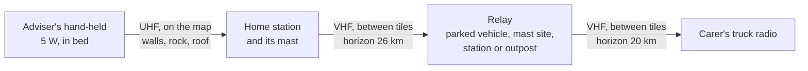

# Radio advice and relays (26 Nov 2026)

**Status (26 Nov 2026):** partly built. Relays between world tiles are built in Radio Framework 0.22.0 (halted convoys and depot
vehicles with the repeater kit, the relay mast, site height by hilliness, plane-earth fading); not yet tested in game: rows 609 and 610.
Radio advice is built in Radio Framework 0.23.0 with D'thorga Framework 0.330.0 ([as built](#as-built-radio-0230-26-nov-2026)); not yet
tested in game: rows 620 to 624. Home stations and outposts as relays, and channels at relays, are built in Radio Framework 0.24.0
([as built](#as-built-radio-0240-27-nov-2026)); not yet tested in game: rows 629 to 631. The hand-held's cross-band hop between tiles
is not started.

The owner, 26 Nov 2026: "An idea I just had is a doctor providing medical support/advice over the radio! We even have this in
Australia, right now. This could work with other skills just as well too. If we were to implement all this, how would it look, before
we were to go ahead with anything real?" Then, on seeing the sketch: "Build the mock-up page, and send the cards ^ ^ We could also tie
this into another thing I wish to implement, and that's relays through a base station or world outpost. There's another session doing
partial work on this already with the Datum, and this might be the time to formalize such a concept. Hiddensoul does it in the real
world when he's too sick to get out of bed and one of my radios, a Zastone, supports it too."

Both ideas were already in the owner's radio design of 18 Oct 2026 ([radio-framework-design.md](radio-framework-design.md)): "Flying
doctor: a remote doctor talks an unskilled pawn through treatment", "an Elmer who teaches skills from afar", "repeaters extend it",
"a vehicle can act as a mobile relay" and "Relay outpost: outpost on a hilltop tile". This record gives them their rules.

## Read this first

- **Only what the status line names is built.** Every figure marked **[A]** is the agent's proposal; **[O]** is the
  owner's choice, by card on 26 Nov 2026.
- **Radio advice was a Phase 4 item of the radio's roadmap**, brought forward on the owner's word (26 Nov 2026: "go ahead and build
  the radio advice").
- **Reach between world tiles (Radio 0.21.0) is itself not yet tested in game** (rows 600 and 601), and both ideas lean on it.
- **Not yet checked:** whether a mod on the owner's list already gives advice by radio; how the skill lift reaches the game's tending
  and surgery code; which skill our vehicle repairs read. Each is checked before any build.

## The mock-up page

- **Where:** <https://claude.ai/artifact/2C3uwuEwVrzgCLtTMLNF5Z>, a private page only the owner can open. Its source is not in this
  repository; this record holds everything it showed.
- **What it runs:** a port to JavaScript of the mod's link budget (`src/PhobosRadio/Physics`, `LinkBudgetService.EvaluateWorld`) with
  the Defs' own figures: the desk's 25 W, the hand-held's 5 W at 1.5 m, a vehicle radio's 25 W at 3 m, the Datum's 10 m mast, the whip,
  the mast and its 15 m extension, the 100 W amplifier, FM voice's 12 dB in 12.5 kHz, walls at 10 dB, rock at 30 dB a cell, a thick
  roof at 60 dB, and 1 km a tile. Tend quality and surgery chance by Medicine level are the game's own stat Defs
  (`python scripts/query-defs.py patched MedicalTendQuality --type StatDef`, and `MedicalSurgerySuccessChance`).
- **What it invents:** the map, the names, where things stand, 20 m of coax at home and at an outpost, and 40 m from a bed to the mast.
- **Checked outside the browser** (26 Nov 2026): the port gives a horizon of 20.2 km for 3 m against 10 m and 26.1 km for 10 m against
  10 m (the changelog's "about 20 tiles, 26 with a 10 m mast"), 6.02 dB for doubled distance, and −125.0 dBm for the noise floor.
- **Its controls:** drag the convoy and the relay or move them with the keyboard; preset buttons for every piece of kit and for every
  option the cards offered.

### What it found

| | Finding | What follows |
| --- | --- | --- |
| F1 | **Between tiles a link is clean right up to the horizon, then gone.** A 25 W radio has more than 50 dB to spare at 20 km in free space, so no Marginal or Workable link ever shows | The owner chose plane-earth fading ([card 8](#the-cards-as-put)) |
| F2 | **Plane earth changes vehicle radios little.** 25 W at 3 m to a 10 m mast is still Clean (about 16 dB) at 20 km. A hand-held to the same mast falls to Workable (about 10 dB) by 15 km | Advice's "less on a marginal link" will bite mostly on hand-helds and from walls and rock at either end |
| F3 | **The two-way rule shows.** With a 100 W amplifier at home, the far end's own power still decides | Worth a line in the player guide: an amplifier does not help you hear |
| F4 | **A hand-held under a mountain reaches the station's mast through one cell of rock, not two** (thick roof 60 dB, rock 30 dB a cell, 40 m, UHF: about +6 dB, then −24 dB) | The bed case works with the mod's present figures |
| F5 | **A relay on high ground changes everything.** 300 m up, an outpost's horizon to a truck is about 80 km against 20 | The owner chose site height by hilliness ([card 7](#the-cards-as-put)) |

## Radio advice

A skilled colonist talks a less skilled one through a job over the radio. The model is Australia's Royal Flying Doctor Service, which
gives medical advice by radio and telephone to people far from a doctor, who treat from a numbered medical chest.

### How one call plays [A]

1. **A job starts as normal.** A driver with Medicine 3 tends a wounded gunner, 15 tiles from home.
2. **The radio looks for a better head.** If a colonist with a higher skill is free and in radio touch, a call opens. It takes one
   voice channel at the station, as a new kind in the channel ledger ("advice call"), and may take a channel from local voice when the
   station is full, as the ledger already allows a kind to.
3. **The adviser gets a job**: "talking Mako through tending Ilse's patient". They stand at the desk, or stop and use their hand-held,
   until it is done. One call at a time for each adviser.
4. **The carer works above their own skill**: a share of the gap to the adviser's, by how good the link is.
5. **It is slower**: each step is spoken.
6. **If the link drops, the carer finishes alone**, at their own skill. A message says the call dropped. The result is never worse than
   having had no advice.

### The figures

| Thing | Value | Whose |
| --- | --- | --- |
| Share of the gap closed on a workable or clean link | Half | [O] |
| Share on a marginal link | A quarter | [O] |
| Where the adviser may be | Any radio in reach: the desk, or a hand-held that reaches a station, even from bed | [O] |
| Work speed while talked through | About 30% slower | [A] |
| What stays the carer's own | Manipulation and Sight: the game applies them after the skill | [A] |
| The lifted skill | Rounded down to a whole level, as the game's skills are | [A] |
| Calls for each adviser | One at a time | [A] |
| The carer learns faster while talked through | A bonus to the skill gained, size not set | [A] |
| The call's mode | FM voice, 12 dB in 12.5 kHz, the mod's own | The mod's |

Example, with the game's own stats: Medicine 3 gives a tend quality of 50% and a surgery chance of 40%. Talked through by Medicine 16 on
a workable link, the carer works as Medicine 9: 110% and 85%.

### What it covers first [O]

The owner chose all four offered.

| Job | Skill | Notes [A] |
| --- | --- | --- |
| Tending, people and animals | Medicine | The first to build; no risk beyond the adviser's time |
| Surgery | Medicine | Its own setting, see [risk](#risk-and-settings) |
| Field repairs of our vehicles | The skill our repair job reads (to check) | A mechanic at home talks a driver through a broken-down part |
| Trade talks | Social | A convoy's trader with home's best negotiator on the line; the lift goes through the game's own price stat and its cap. Needs care with balance: propose figures before building |

Each is a row in a table Def, so another job is data, not code. **Left out on purpose [A]:** Plants, Mining, Cooking and Art are hand
skills that talk does not carry. Teaching from afar (School of the Air, the Elmer) is a different feature on the same call and stays in
the radio design's Phase 4.

### Kit that would make it better [A]

- **A numbered medical chest.** The Flying Doctor's chests hold numbered items, and its doctors prescribe by item number. Ours would add
  a sixth of the gap for medicine, and sit on a truck or at an outpost. In the world, so its picture is made paid.
- **A body chart**, part of the chest: Sister Lucy Garlick, a flying nurse at Wyndham, devised the "Where Does It Hurt?" chart in 1951.
- **A picture**, later: the "vehicle picture" channel kind exists, so a camera link could let the doctor see the wound.

### The four questions

- **What it lets the player do:** treat well away from the doctor; keep the doctor safe at home; have one doctor serve several parties,
  one call at a time; get help from a doctor who is in bed themselves.
- **What it stops:** the adviser does no other work during the call; a channel is taken; a party past radio reach is on its own.
- **How it changes play:** a truck with a radio and a chest goes out instead of the doctor; antenna height, relays and a hand-held by the
  bed start to matter to medicine.
- **What outside notices:** the patient and the carer get a thought and a better opinion of the adviser; the station's Net tab and
  waterfall show the call; jamming can cut it (the Prowler's jam fields exist); with HF later, a neighbour could ask for the colony's
  doctor for goodwill, or the colony could ask theirs; and the adviser could call out an aircraft of ours, as the Flying Doctor flies
  when advice is not enough. The last two are ideas only.

### Risk and settings

- **Tending, repairs and trade: no risk [A].** Advice never makes a result worse than working alone; it costs the adviser's time.
  Who may be pulled to the radio is decided by the work's own work type in the Work tab (as built: see below).
- **Surgery: moderate [O]** (the owner's card of 26 Nov 2026, "Moderate, on by default"). The player may attempt an operation they would not have tried alone, and a call
  that drops part-way leaves the carer at their own skill. One person can be lost; the player chooses the bill and can see the link
  before starting. So it gets its own setting, on by default.

### Other factions [A]

Advice works between any two people of one faction who hold radios in touch, so a raid's medic could be talked through by a doctor at
its camp. Nothing gives other factions radios yet; the rule should not assume the player's faction.

### Cost

Nothing each tick. One look when a tending, surgery, repair or trade job starts: the map's cached contacts, or the convoy's reach, which
is already asked at most once a tenth of a game hour. The lift is read from a small table of calls in progress. A call ends with its job.
To be measured with `python scripts/perf.py` before and after, as every radio feature is.

### Where it would live [A]

- **The call, its channel kind, the adviser's job and the rule** (game-free, with tests): the Radio Framework.
- **The chest, and links to Triage and care needs:** D'thorga Medical, only when the radio is installed.
- **The mechanic's row:** D'thorga Vehicles' radio tie-in.
- **For another game:** the rule (a share of a skill gap by link quality) is game-free and could move to phobos-modkit's side with the
  link budget; the jobs and stats are RimWorld's.

### As built (Radio 0.23.0, 26 Nov 2026)

Built on the owner's word of 26 Nov 2026, not yet tested in game (rows 620 to 624). Where it differs from the design above:

- **The lift is D'thorga Framework's, for any helper** (Framework 0.330.0, `Phobos.Framework.Skills`): a source registers, and a
  stat part added in code to each lifted stat raises the stat's factors for the skill to the lifted level (the game's own two kinds of
  factor are read) or slows a work speed while a call is live. The help shows as a line in the stat's explanation. A vehicle repair's
  minimum skill asks the same seam. A tend on the road, which has no job, is wrapped by a Harmony prefix on the game's tending (it never
  skips it), so help read for its quality is booked once the tend is done. Advice by radio is the first source; a later one (the Elmer,
  a manual) adds no code there.
- **Who may advise is the work's own work type, switched on** [A]: Doctor for medicine, Construction for repairs, and for trade anyone
  not incapable of social work. No new Work tab column.
- **A call takes no channel of its own** [A]: the two radios already hold theirs in the ledger. The "advice call" kind was dropped.
- **Where the adviser takes it** [A]: on a hand-held where they stand (a job that holds them there), in bed with no job if they are
  resting there awake, or at the nearest powered station's desk they can reach, if they carry no radio. In the trade talks the game
  stops, so only an adviser already on a hand-held can take the call.
- **Acts with no job** [A]: a convoy's tend, a convoy's repair and the trade talks are helped at once, and the adviser is then booked on
  the radio: 1250 ticks after a convoy's tend (the game's caravan tending interval), 2500 after a repair or trade. A message for the
  same carer and act on the road is said at most once a day.
- **A carer must have a radio**: a hand-held served by a station on their map, or a convoy whose radio reaches home. Between tiles the
  adviser must be on the home map the convoy reaches. A carer on another map with no station of its own gets no advice yet.
- **Chest** [A]: within 8 cells or in the carer's room, carried, or anywhere in the convoy's inventory.
- **Thought** [A]: the carer gains "talked me through it by radio", +6 opinion of the adviser for 10 days. The patient gets nothing.
- **Not built**: learning faster while talked through; other factions' advice; a downed adviser (a person must be able to take a job
  or lie awake in bed); advice in person without a radio. **Aiming at one colony through another's repeater** [A, set aside 27 Nov
  2026]: with two colonies, a convoy reaches whichever answers best, and only that colony's people advise. Asking again aimed at the
  other colony, so its station's repeater carries the call, would replace the places the convoy's own reach holds at each relay (Radio
  0.24.0 holds them per caller), and costs one more chain search per colony; worth it only if the owner finds two-colony convoys short of
  advice in play.
- **Cost, as built**: every 60 ticks, a set lookup on each colonist's job on maps with a station; a search of the home map's colonists
  only for one doing advisable work with no call, at most once every 250 ticks each; an offer for a person off the map kept 250 ticks.
  A read of a lifted stat costs two dictionary lookups when no call is live. **To measure with `scripts/perf.py`** before and after,
  on the owner's colony, when the owner says go.

## Relays

A relay passes a call on, so two radios that cannot reach each other can still talk. The owner's own examples: Hiddensoul works his
base radio from bed with a hand-held, and the owner's Zastone set does the same (cross-band repeat).

*A call from a bed to a convoy over three hops. The weakest hop decides how good the call is.*

### The rules

1. **A relay is a hop, never a second system.** Every hop goes through the one link budget: on a map with its walls, between tiles
   with its horizon.
2. **A chain is as good as its worst hop**: the lowest two-way margin. The sheet names the hop that decides.
3. **At most three hops, two relays [A]**, a figure in the rules Def (`maxRelayHops`).
4. **The fewest hops that give the best link [A]**: a direct link is used when it is as good as the relayed one.
5. **Channels are capacity.** A relayed call takes channels at each relay through the ledger; two at a relay between tiles, one in and
   one out [A]. The first build leaves capacity at relays out, and its changelog says so.
6. **Derived, never saved.** A chain is worked out when asked and kept until something changes.

### Two kinds, by physics [O]

| Kind | What it is | What it needs |
| --- | --- | --- |
| **Cross-band, the last hop** | A hand-held works through a dual-band station or vehicle radio near it: in on UHF, out on VHF at once | Nothing extra: any dual-band radio does it. The far end hears VHF |
| **A relay between tiles** | A true repeater: it hears and sends on the same band at once | A repeater kit (a duplexer), and two channels. As built in Radio 0.22.0 [A]: the repeater kit, a fitting for any land vehicle, 15 steel and 2 components, after remote-controlled vehicles; channels are not counted yet |

The vehicle control fitting is VHF only today, so a vehicle needs a dual-band voice radio before a hand-held can work through it [A].

### What can be a relay between tiles [O]

The owner chose all four offered.

| Site | State |
| --- | --- |
| A halted convoy, or a radio-fitted vehicle left at a depot, with the repeater kit | Built in Radio 0.22.0; not yet tested in game (row 609) |
| A relay mast a stopped convoy builds on a tile and leaves: 25 W on 10 m, 60 steel and 4 components [A] | Built in Radio 0.22.0; not yet tested in game (row 610) |
| A colony's own base station, between two convoys or to a second colony | Built in Radio 0.24.0, with the station's repeater upgrade; not yet tested in game (row 630) |
| A world outpost with a relay mast, a tie-in with Vanilla Outposts Expanded | Built in Radio 0.24.0 as the radio relay post, an outpost of Vanilla Expanded Framework's; not yet tested in game (row 631) |

### High ground [O]

A relay's tile adds a set height to its aerial by its hilliness, the owner's choice. The figures are the agent's, as the mock-up used
them [A]: flat 0 m, small hills 30 m, large hills 100 m, mountainous 300 m. Height over the land around is what matters, which is why
hilliness was offered rather than elevation above the sea. This answers outstanding row WE6 in part.

### Fading between tiles [O]

The owner chose plane-earth fading over the agent's lean of keeping the link in or out. Between tiles the path loss becomes the greater
of free space and plane earth:

- Free space: 20 log₁₀ d(km) + 20 log₁₀ f(MHz) + 32.45 dB.
- Plane earth: 40 log₁₀ d(m) − 20 log₁₀ (h₁ × h₂) dB, heights in metres, site height included.
- Still nothing past the horizon.

Plane earth is the standard two-ray model of a direct ray and one ground reflection past its break point; it is a simplification, as
real ground, hills and trees add more. The figure needs a named source in [radio-reference-checks.md](radio-reference-checks.md) before
a Def or a description quotes it.

### The four questions

- **What it lets the player do:** reach a convoy two horizons away; reach home from bed; plant a mast on a hill and cover a region.
- **What it stops:** a relay between tiles needs its kit, its power and its channels; a chain is no better than its weakest hop; three
  hops at most.
- **How it changes play:** where a vehicle is parked, and which tile gets the mast, become decisions; a Datum halted on a hill is worth
  more than one in a valley.
- **What outside notices:** a relay site is a thing on the world map that can be raided or lost; with direction finding and intercepts
  later, a relay is also a signal others can find. The second is an idea only.

### Cost

Asked, never ticking: a chain is searched when a reach is asked (a convoy's line, an advice call, an airdrop's targets), over a handful
of nodes and at most three hops, each hop one link budget a band. The builder states and measures the figure in its changelog.

### What is built, and what is not

| Piece | State | Where |
| --- | --- | --- |
| The chain search (`RelayRule`, game-free, tested), the node registry (`RelayNodes`, `IRelaySource`), `maxRelayHops` = 3 | Built | Radio Framework 0.22.0 |
| The gate: a radio's `relays` field, off by default; a node relays when its source declares a repeater or its radio's field is on (`RelayNodes.CanRelay`) | Built | Radio Framework 0.22.0 |
| Vehicles and the mast site as relay nodes; the repeater kit (`PhobosFitting_RepeaterKit`) in a repeater bay on every land vehicle | Built | Radio 0.22.0, Framework 0.328.0 |
| Plane earth (`Propagation.PlaneEarthPathLossDb`) and site height by hilliness (`Propagation.SiteHeightMetres`), both in `EvaluateWorld` | Built | Radio Framework 0.22.0 |
| Home stations (the repeater upgrade), the radio relay post, channels at relays (`RelayLedger`, game-free, tested) | Built | Radio Framework 0.24.0 |
| Cross-band last hop | Not started | Radio Framework |
| Radio advice: tending, surgery, vehicle repairs, trade talks, the numbered medical chest | Built | Radio Framework 0.23.0, Framework 0.330.0 |

Built by another session (road-work-three) to this record's shape; what the version delivered is in the Radio Framework's changelog.

### As built (Radio 0.24.0, 27 Nov 2026)

The owner, 27 Nov 2026: "1, 2, 3, and 4" (of road-work-four's suggestions: home stations and outposts as relays, channels at relays), and
by card: **a station becomes a relay through an upgrade** ("Station upgrade") and **an outpost through our own relay post** ("Our own
relay post"). Built by road-work-four. Every figure is the agent's. Not yet tested in game (rows 629 to 631).

| Option offered (27 Nov 2026) | Chosen |
| --- | --- |
| A station relays through: a repeater upgrade (the agent's lean); every powered station; a separate building | **The upgrade** |
| An outpost relays as: our own relay post (lean); any outpost given a repeater kit; none, as a mast can stand on an outpost's tile | **Our own relay post** |

- **Channels at relays** (rule 5): `RelayLedger` (game-free, 10 tests) counts a relay's channels by kind as a station's ledger does,
  one use taking twice its channels (one in, one out) and its radios taking turns. A repeater has the rules' `repeaterChannels` (2 [A]):
  five convoys talking (voice, keyed a fifth of the time) or two vehicles driven by radio (control, keyed half the time); a picture
  needs more than a repeater has. Vehicle control pre-empts talk, as at a station. **A call holds a lease** at each relay on its chain,
  renewed each time its convoy is asked about and lapsing after `relayLeaseTicks` (a game hour [A]) when it is not; nothing is saved.
  `RelayNodes.BestChain` leaves out a relay with no room for the caller and holds the places of the chain it finds; the convoy's line
  names a full relay that would have carried it. A call's kind is its radio's (`CompRadio.Kind`).
- **Home stations**: the base station's **repeater** upgrade (`PhobosRadio_UpgradeRepeater`, 25 steel and 3 components, Construction 5,
  after remote-controlled vehicles [A]) sets the figure `repeater` (`RadioUpgrades.Repeater`); each powered station with it on a home map
  is a relay (`HomeStationRelaySource`). It helps only a call aimed at one colony: a call that reaches any colony is home already, and a
  target is never passed through. Radio advice is such a call; radio-autonomy aims it at each adviser's colony after this version.
- **The radio relay post** (`PhobosRadio_RelayPost`, `Outpost_PhobosRelayPost`): an outpost of Vanilla Expanded Framework's own outposts
  code, which the Radio Framework depends on already, so its "create outpost" window offers it with no code of ours. 120 steel and 8
  components, one colonist to keep it [A]; it produces nothing; a 50 W VHF relay radio on a 20 m mast with four channels [A], made from
  its Def and never saved. Unmanned, it relays nothing. Its world icon borrows the mast antenna's picture.
- **Cost**: a search asks the ledger once a relay (a few short lists); the station source walks each home map's stations, as the
  convoy's home ends already do; the post source walks the world objects, as the mast source does. Nothing runs on its own. Not measured.

## The cards as put

Each card as the owner saw it on 26 Nov 2026, the chosen option first and marked.

| # | Card | Chosen | Not chosen |
| --- | --- | --- | --- |
| 1 | Which jobs the first version covers (several may be chosen) | **All four: tending (the agent's lean), surgery, vehicle field repairs, trade talks** | None left out |
| 2 | How much of the skill gap advice closes | **Half, a quarter when marginal** (the agent's lean) | Two thirds, a third when marginal: nearly as good as sending the doctor. A third, a sixth when marginal: a help, never a substitute |
| 3 | Where the adviser must be | **Any radio in reach** (the agent's lean) | Desk only: simpler, but a doctor in bed cannot help. Either, with a hand-held closing one step less than the desk |
| 4 | What follows the design record | **Record, then wait** (the agent's lean) | Record, then build the first version. Record and park it at Phase 4 |
| 5 | What a radio needs before it can relay | **Two kinds, by physics** (the agent's lean) | Everything relays with no kit. A kit for both kinds, even a hand-held through its own station |
| 6 | Which things can relay between tiles (several may be chosen) | **All four: halted or parked vehicle, relay mast site, home station, world outpost** | None left out |
| 7 | Whether high ground lifts a relay's aerial | **By hilliness** (the agent's lean) | By the difference in elevation between the two tiles: a high plateau would count as a peak. Not yet: every site flat |
| 8 | Whether distance makes a link between tiles fade | **Plane-earth fading** | Keep as built, in or out (the agent's lean). Keep in or out now, and later let high ground between two tiles block the path |
| 9 | Buy the three pictures (chest, repeater kit icon, relay mast), two tries each | **Buy all three, cap US$0.90** (the agent's lean; spent about US$0.32) | The chest only, cap US$0.30. Not now |
| 10 | How risky surgery talked through is | **Moderate, on by default** (the agent's lean) | High, off by default. Low, no switch |

## Sources

- Royal Flying Doctor Service: [Medical Chests](https://flyingdoctor.org.au/what-we-do/Medical-Chests) and its Queensland
  [Medical Chest Service](https://www.flyingdoctor.org.au/qld/what-we-do/medical-chest/) pages, for the chests and prescribing by item
  number. Read as search summaries on 26 Nov 2026, not the full pages.
- *Rural and Remote Health*, [Rural health history](https://mail.rrh.org.au/journal/article/937) (2008), for Sister Lucy Garlick's
  1951 chart at Wyndham. Read as a search summary; whether the first chart numbered the body's areas is **unverified**.
- The radio horizon and free-space loss are the radio design's own, checked in [radio-reference-checks.md](radio-reference-checks.md).
  The plane-earth formula is quoted here from general radio engineering and is **not yet checked against a named source**.
- The advice figures, the relay rules and the site heights are our own authored design, not the Flying Doctor's practice. No
  endorsement is implied.
