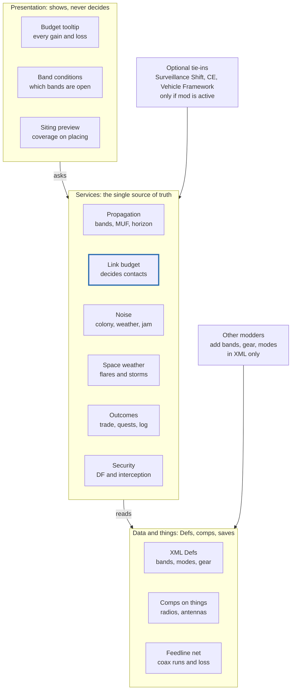
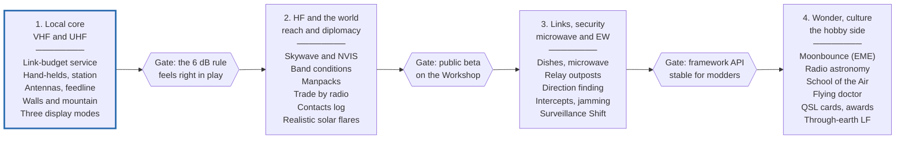

# D'thorga Radio Framework

18 Oct 2026 · Phobos D'thorga

> Exported on 18 Oct 2026 from the living design doc, which is the master copy:
> https://claude.ai/code/artifact/cd5abeb4-e350-4282-9bc5-85c01e62fabe
>
> **Repository snapshot** of the living doc at revision 15, filed on 18 Oct 2026 (agent). The text is as
> written. The two diagrams are redrawn in Mermaid from the exported images, and the formulas are GitHub
> math blocks. The Reference figures are checked against primary sources in
> [radio reference checks](radio-reference-checks.md); the facts behind the Versions decision are in the
> [RimWorld modding reference](rimworld-modding-reference.md).

## Overview

A shared, XML-extensible radio framework for RimWorld in which every contact is decided by a real link budget: power, antennas, feedline, distance, terrain, noise and mode. Distance follows the inverse-square law, so doubling it costs 6 dB.

**Status:** design only. This doc gets refined during play before any implementation starts. Target RimWorld 1.6, with 1.7 (Waylith) in mind.

**Goals**

- Make radio *feel* like real radio: bands with distinct personalities, propagation that changes with time and weather, and kit that is heavy when physics says so.
- Turn the vanilla comms console from a magic phone into a station you design, site and power.
- Give contacts real value: trade, diplomacy, warnings, quests, collecting, and the joy of the contact itself.
- Ship as a **framework** that other modders extend in XML: bands, antennas, feedlines, radios, modes.

**Non-goals**

- A full electromagnetic simulation. Realism is a feel, not a hidden calculation nobody sees.
- Real audio, real-world voice, or live Morse decoding.
- Replacing on-map tactical systems that Surveillance Shift already covers well.

**Audience:** players at three comfort levels (Plain, Operator, Engineer), and modders building on the framework. "D'thorga Radio Framework" is a working title.

## Design principles

The physics is real but legible: every rule should be visible to a player who wants to see it, and invisible to one who doesn't.

1. **Feel over simulation.** Use the simplest model that produces the right behaviour. A visible "band conditions" readout beats hidden ionospheric maths.
2. **One model, many views.** A single link-budget service decides every contact. Plain, Operator and Engineer modes only change what the UI shows.
3. **Decibels everywhere.** Gains and losses add up in dB, so a contact reads like a real link-budget sheet. Doubling distance always costs 6 dB.
4. **Physics sets the kit, the kit sets the play.** Wavelength drives antenna size, which drives portability, power draw and where things can be built.
5. **Data-driven framework.** Bands, modes, antennas, feedlines and radios are Defs. Other modders add hardware in XML without touching C#.
6. **UI presents, services decide.** Screens and gizmos only display and delegate. All rules live in shared services.
7. **Optional tie-ins only.** Every cross-mod feature switches on only when the other mod is active. Players running the framework alone see no errors.
8. **Cheap to run.** Link budgets are arithmetic. Recalculate only when something changes: new hardware, weather, time-of-day band, map events.
9. **Save-friendly.** Safe to add mid-game; removal documented and tested.

## Physics core: the link budget

Every contact is decided by one sum in decibels: what arrives, minus what the receiver needs to hear it, is the margin.

```math
P_{rx} = P_{tx} + G_{tx} - L_{feed,tx} - L_{path} - L_{obs} + G_{rx} - L_{feed,rx}
```

```math
\text{Margin} = P_{rx} - \left( N_{floor} + \text{SNR}_{mode} \right)
```

**Path loss (inverse-square).** Free-space path loss, with distance in km and frequency in MHz:

```math
L_{FSPL} = 20\log_{10} d + 20\log_{10} f + 32.44
```

Doubling the distance adds 6 dB of loss, which takes four times the power to win back. Bands with other path physics (skywave, bounce, through-earth) swap this term out; see Propagation.

**Noise floor.** Thermal noise is −174 dBm per Hz at room temperature. The floor is that plus 10 log₁₀ of the bandwidth, plus the receiver's noise figure, plus local noise (colony machinery, storms, jamming). Narrower modes therefore hear deeper.

**Mode threshold.** Each mode needs a minimum signal-to-noise ratio. Weak-signal digital modes decode far below the noise; voice needs a clear signal (figures in Modes).

**Margin decides the outcome.** The bands below are starting values to tune in play.

| Margin | Outcome |
| --- | --- |
| Below 0 dB | No contact |
| 0 to 6 dB | Marginal: slow, partial or garbled; fewer options, chance of misunderstanding |
| 6 to 15 dB | Workable: the contact succeeds normally |
| Above 15 dB | Clean: full options, small bonuses (faster, better goodwill) |

**Power and heat.** A transmitter's draw is its output divided by its efficiency, scaled by the mode's duty cycle. The difference becomes heat pushed into the room, using RimWorld's existing heat system.

## Propagation by band

Each band swaps in its own path term, so the same link budget produces very different behaviour per band.

| Band | Path model | Varies with | RimWorld data used |
| --- | --- | --- | --- |
| HF skywave | Hops off the ionosphere; maximum usable frequency (MUF), skip zones, daytime low-band absorption | Local time, season, space weather | Tile latitude and longitude, local time by longitude, season |
| HF NVIS | Fired near-vertical, rains back over a regional circle; ignores mountains | Time of day (lower bands at night) | Tile distance |
| VHF / UHF | Line of sight plus free-space loss; repeaters extend it | Antenna height, terrain between tiles | Tile elevation and hilliness |
| Microwave | Point-to-point line of sight; dish aiming matters | Rain and snow (rain fade) | Weather on both ends |
| Bounce (moon, asteroid) | Radar equation: loss falls with the 4th power of distance, not the 2nd | Target in view, dish size, power | Odyssey orbital layer |
| LF / VLF | Ground wave and through-earth; very slow, text only | Depth, rock type | Deep And Deeper levels (optional) |

**HF in practice.** A simple MUF curve by local time and season is enough. Low bands work at night and over short ranges; high bands open by day over long ranges. Grey-line openings happen near dawn and dusk, which RimWorld can model because local time follows longitude.

**VHF/UHF radio horizon.** With antenna heights in metres and distance in km: d ≈ 4.12 × (√h₁ + √h₂). Tower height buys range, so hilltop relays matter.

**Space weather, done right.** Vanilla's solar flare kills electrical devices, which real flares don't do. The framework makes a solar flare black out HF on the sunlit side of the planet (the Dellinger effect). A separate geomagnetic storm, arriving a day or more later, brings aurora and power-grid trouble.

**Weather.** Thunderstorms add static crashes on HF. Rain weakens microwave links. Aurora can add flutter, or rare aurora-scatter openings on VHF.

## Bands and equipment

Wavelength sets antenna size, so each band has its own kit, costs and role: HF reaches the world but needs a backpack, while VHF and UHF fit in a hand.

| Band | Reach | Portable form | Strengths | Costs |
| --- | --- | --- | --- | --- |
| HF (3–30 MHz) | Worldwide via skywave; regional via NVIS | Manpack backpack with whip; long wire when stopped | Only way to reach distant factions and caravans | Heavy kit, big antennas, high draw, noisy, conditions change hourly |
| VHF (30–300 MHz) | Line of sight; nearby tiles via repeaters | Hand-held, about 5 W | Cheap, light, reliable outdoors | Blocked by terrain; needs height |
| UHF (300 MHz–3 GHz) | Shorter line of sight | Hand-held, small antenna | Copes better inside buildings and mountain bases | Shorter range, more foliage loss |
| Microwave (GHz) | Point to point | Fixed dishes only | Bandwidth for data and video | Precise aiming, rain fade, clear path needed |
| LF / VLF (optional) | Through rock and earth | Fixed, very large antennas | Reaches deep mines | Very slow, text only |

**Portability tiers**

| Tier | Bands | Form in RimWorld | Notes |
| --- | --- | --- | --- |
| Hand-held | VHF, UHF | Small utility item | Battery in watt-days; weight and bulk under CE |
| Manpack | HF, high-power VHF | Backpack-layer apparel | Slows the carrier; deploys a field antenna as a temporary building when stopped |
| Vehicle | HF, VHF, UHF | Vehicle Framework component | Runs off vehicle power; a vehicle can act as a mobile relay |
| Fixed station | All | Buildings: radio, amplifier, antenna, tower, dish | Grid power, heat, siting and feedline runs |
| Relay outpost | VHF, UHF, microwave | Outpost on a hilltop tile | Solar-powered repeater extending line of sight |

**Hardware model**

- **Antennas** are parameters, not simulations: gain (dBi), pattern (omni, or directional with beamwidth and front-to-back), frequency range, efficiency, height. Directional antennas get a rotator gizmo.
- **Dishes** derive from first principles: gain = η × (πD/λ)² with η about 0.55 to 0.7; beamwidth ≈ 70 × λ/D degrees.
- **Feedline** is its own buildable item. Each coax type has a loss per metre that rises with frequency. Unsealed runs slowly degrade from water ingress until someone fixes them.
- **Power and heat**: draw = output ÷ efficiency × duty cycle. Roughly 50% efficiency for linear SSB and 60–70% for FM (approximate). Waste heat warms the shack.

## On-map model

On a single map, distance barely matters; obstruction and noise do. A map is only a few hundred cells across, so walls, roofs and your own machinery decide whether a signal gets through.

- **Penetration loss by material.** Each wall or door between two points adds loss by its stuff: wood a little, stone more, plasteel close to a Faraday cage. Values live in XML so other mods' materials can join.
- **Overhead mountain is near-total.** A mountain base needs a surface antenna and a long feedline run. That makes siting a genuine base-design problem.
- **Colony noise.** Reactors, inverters, heavy machinery and arcing equipment raise the local noise floor around them. Antennas sited away from them hear better; ferrite chokes and filters (research) reduce it.
- **Antenna siting.** Height above surrounding structures, distance from noise sources and clear sky for dishes all feed the link budget, shown in the placement preview.
- **Interference between your own stations.** Two transmitters on the same band close together desensitise each other unless separated or filtered.

Open question: how much of this to show while placing a building (see Player experience).

## Modes and what contacts buy

Modes trade speed for sensitivity: the weaker the signal a mode can use, the less it can carry. That turns Shannon's limit into the core gameplay choice.

| Mode | Needs (approx. SNR in 2.5 kHz) | Carries | Use in play |
| --- | --- | --- | --- |
| Weak-signal digital (FT8-like) | About −21 dB | Short structured messages | Pings, position reports, "send a trader", contacts for the log |
| CW (Morse) | Between digital and voice | Short free text | Skill-based mode for trained operators; light kit, long reach |
| Voice (SSB / FM) | About +10 dB | Full conversation | Trade window, negotiation, quests, diplomacy |
| Digital voice (NXDN-like) | Similar to voice | Voice, encrypted | Can't be intercepted; needs matching kit both ends |
| Data / video (microwave) | High, wide bandwidth | Files, camera feeds | Outpost camera feeds, remote monitoring |

**What a contact buys** (gated by mode and margin)

- **Trade and diplomacy** by voice: replaces the instant comms console. Scheduled check-ins with allies earn goodwill; missing them costs a little.
- **Early raid warning**: intercepted analogue raider chatter, or allies warning you under a treaty.
- **Quests**: overheard distress calls, located by direction finding.
- **Collecting**: a contacts log with awards (worked all factions, worked every biome, first bounce contact). Factions send back QSL cards as craftable-style art items.
- **Space weather and weather reports**: advance warning of solar flares, geomagnetic storms and cold snaps.
- **Flying doctor**: a remote doctor talks an unskilled pawn through treatment, modelled on the Royal Flying Doctor Service.
- **School of the Air**: Biotech children attend lessons by HF from a friendly faction's teacher, feeding their learning need.
- **A radio friend and an Elmer**: a recurring named contact for mood and gossip, and a radio mentor who teaches skills from afar.

## Trade-offs and risks

Transmitting is never free: every watt that reaches a friend can also reach an enemy.

- **Operational security.** High-power transmissions can be direction-found. Raiders may follow your signal home, with a chance that scales with power, time on air and their tech level.
- **Interception.** Analogue voice can be overheard in both directions. Encrypted digital can't, but needs matching kit and research.
- **Jamming.** Mechanoid hives and clusters raise the noise floor nearby. Some raids could jam on approach.
- **Spectrum regulation.** The Empire licenses its bands. Transmitting on Imperial spectrum without a royal permit costs goodwill.
- **Licence tiers as research.** Power limits unlock with research, mirroring Australia's classes: Foundation 10 W, Standard 100 W, Advanced 400 W.
- **Self-inflicted problems.** Big amplifiers need power and cooling; poor siting lets colony noise drown weak signals; neglected feedline degrades.

## Player experience and display modes

The player picks how much maths they see; the rules underneath never change. A mod setting chooses the default, and each panel can expand one level deeper on request.

| Mode | Who it's for | Shows | Chooses for you |
| --- | --- | --- | --- |
| Plain | Players who want radio to just work | Signal bars, "contact likely / unlikely", plain-English reasons | Band, mode and antenna |
| Operator | Players who enjoy the hobby side | SNR and margin, band-conditions widget ("20 m open to the east"), mode choice | Nothing beyond defaults |
| Engineer | Hams and tinkerers | Line-by-line link budget, antenna patterns, feedline losses, noise floor, propagation chart | Nothing |

**Key widgets**

- **Link-budget tooltip**: every gain and loss in a column, like a real link-budget sheet, with the margin at the bottom.
- **Band conditions**: which bands are open to which directions right now, with a short forecast.
- **Placement preview**: when placing an antenna or dish, its height, nearby noise, obstruction and expected coverage.
- **Contacts log**: every station worked, by faction, biome and band, with awards.

**Onboarding**: a short in-game guide that teaches the 6 dB rule first, then bands, then modes. Each concept appears only when the player first meets it.

## Framework architecture

A single link-budget service is the source of truth; the UI asks it, and it reads Defs, comps and saved state. Other mods extend it through XML and optional load folders.



Presentation never changes game state; services own every rule; data stays declarative so other modders can add hardware without C#.

**Decisions to make**

- **Feedline network**: build our own cable net, or reuse Vanilla Expanded Framework's pipe-network system (Surveillance Shift's video cables already use one).
- **Hardware Defs**: new Def types (BandDef, ModeDef) plus DefModExtensions on ThingDefs for antennas, radios and noise sources.
- **Public C# API**: a small interface other mods can call to ask "can A reach B, and how well?".
- **Saves**: contacts log, schedules and relay links stored in a GameComponent; safe to add mid-game.
- **Versions**: build for 1.6 first, keep 1.7 (Waylith) in view; avoid touching Unity directly.

## Optional integrations

Every tie-in loads only when its mod is active (LoadFolders and active-mod checks), so the framework alone never errors.

| Mod | Tie-in |
| --- | --- |
| [Surveillance Shift](https://github.com/fernyrepos/Surveillance-Shift) | Its walkie-talkies and threat reports run through the link budget; microwave links carry its camera feeds to outposts |
| Combat Extended | Weight and bulk for radios, manpacks and batteries |
| Vehicle Framework | Vehicle-mounted radios on vehicle power; vehicles as mobile relays |
| Vanilla Outposts Expanded | A relay-station outpost type for hilltop repeaters |
| Deep And Deeper | Through-earth LF/VLF radio to deep levels |
| RimPacts, Empire Refactored | Diplomacy, treaties and scheduled check-ins by radio |
| Royalty | Imperial spectrum licensing and permits |
| IRBM | Its satellites double as communications relays; radar shares the noise model |
| Odyssey, Vanilla Gravship Expanded | Orbital contacts and bounce paths; gravship stations |
| Biotech | School of the Air for children |
| Rimatomics, Dubs mods | Their machinery as colony noise sources |

## Scope and roadmap

The proposed minimum lovable version is local VHF/UHF radio on the full link-budget core; HF and the wider world follow once the core feels right in play.



*Proposed order: local radio first, the wider world after. Phases in order, not to scale; each gate must pass before the next phase starts.*

Phase 1 proves the physics where it is easiest to test: on one map, with walls, mountains and noise. Each later phase adds a band or system on the same core.

**Out of scope**

- Real audio, voice or live Morse decoding.
- Full ionospheric or electromagnetic simulation.
- Multiplayer support (revisit after the public beta).
- Re-implementing what Surveillance Shift already does on-map; integrate instead.

## Open questions and notes from play

Settle these while playing; tick each one off and record the answer beside it.

- [ ] What real distance does one world tile represent? Every HF and VHF range depends on it.
- [ ] What is the cell scale on a map, for radio-horizon and penetration maths?
- [ ] Which bands ship first: VHF/UHF alone, or HF alongside?
- [ ] Does the framework replace the vanilla comms console, or upgrade it?
- [ ] How often should HF conditions change: hourly, or in a few daily phases?
- [ ] How harsh should direction-finding by raiders be by default?
- [ ] Should licence tiers be on by default, or an option?
- [ ] Name: keep "D'thorga Radio Framework", or something neutral for a public release?

**Notes from play**

| Date | What happened | Idea for the mod |
| --- | --- | --- |
| | | |

## Reference

Starting figures for implementation. All are approximate, from memory rather than looked up; verify each before it goes into a Def.

| Quantity | Value or formula |
| --- | --- |
| Free-space path loss | 20 log₁₀ d(km) + 20 log₁₀ f(MHz) + 32.44 dB |
| Distance rule | 2× distance = +6 dB loss = 4× power to compensate |
| Thermal noise | −174 dBm/Hz at 290 K |
| Noise in 2.5 kHz | About −140 dBm, before noise figure |
| Dish gain | η × (πD/λ)², η ≈ 0.55–0.7 |
| Dish beamwidth | ≈ 70 × λ/D degrees |
| Radio horizon | ≈ 4.12 × (√h₁ + √h₂) km, heights in m |
| Bounce path | Loss rises with distance⁴ (radar equation); moonbounce ≈ 252 dB at 144 MHz |
| Weak-signal digital | Decodes near −21 dB SNR in 2.5 kHz |
| Voice | Comfortable copy near +10 dB SNR |
| Amplifier efficiency | Linear SSB ≈ 50%; FM ≈ 60–70% |
| Australian licence limits | Foundation 10 W, Standard 100 W, Advanced 400 W |
| Vanilla comms console draw | 200 W |

**Sources**

- [Ludeon: Announcing the Waylith Engine and Update 1.7](https://ludeon.com/blog/2026/10/announcing-the-waylith-engine-and-update-1-7/)
- [Surveillance Shift source (GitHub)](https://github.com/fernyrepos/Surveillance-Shift)
