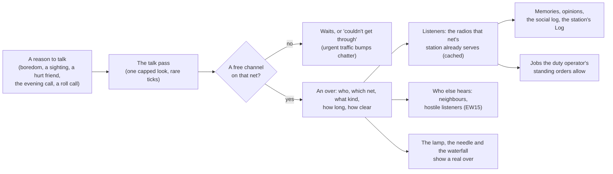

# Life on the air: colonists who use the radio by themselves (28 Nov 2026)

**Status (28 Nov 2026):** slice 1, "the air is alive", is built in Radio Framework 0.63.0 with D'thorga Framework 0.379.0 (RN1, RN2 and
RN6 in part, RN7, RN8, RN9; [as built](#as-built-radio-framework-0630-28-nov-2026)), not yet tested in game (rows 778 to 780). Slice 2, "the
operator decides" (RN4 with RN4b, RN5), is built in Radio Framework 0.73.0
([as built](#as-built-radio-framework-0730-28-nov-2026-slice-2-the-operator-decides)), not yet tested in game (rows 804 and 805). Every other
row is a proposal with the agent's lean. The owner chose by card which groups go deepest and first, and answered the record's four
questions the same day (below).

**A research record.** The owner, 28 November 2026: "Our handling of radios, their nets, and so much more are in desperate need of a
liven up. We REALLY need more gameplay that is emergent in nature, how the pawns act autonomously on their own, etc. This is strictly a
research and record purview."

**The owner's answers by card, the same day:**

- **Go deepest on, and put first: colonists talk on the air (group B), colonists act on what they hear (group C), and the world
  answers back (group D)** [O]. The harsh side (group E) is still recorded, after them. The fourth option offered, not chosen as a
  first group: "The harsh side: known only by radio" (orders, news and alarms reach only those in touch; a setting that starts off).
- **Ideas that come from real radio life are written as real practice, with no names** [O]. The other options offered: "Named as
  yours" (the record says plainly whose experience each comes from) and "Leave those ideas out".

How to read it:

- **[C]** read from code (ours, or the game's through `python scripts/query-code.py --in full`), **[D]** read from a Def,
  **[P]** read from `python scripts/query-patches.py` (which of the owner's mods patch the same method), **[inferred]** the agent's
  reading, **[authored]** a figure we would make up and label, **[not read]** a claim about code nobody has read for this record,
  **[unverified]** a real-world claim with no primary source read. **[O]** the owner's choice, **[A]** the agent's.
- Every row answers what it **lets** the player do, what it **stops**, how it **changes** play, and **who else notices**
  (`external/phobos-modkit/rules/designs.md`).
- **Kind**: **XML** (Defs and patches), **C#** (our code), **hook** (a Harmony patch on the game's or another mod's code).
- **Cost** is stated for every row, as the radio's rules require (`src/PhobosRadio/AGENTS.md`, "Performance first": what it touches,
  how often, what makes it run again). **No row with no cost is leaned towards building.** Every cost here is a reading of the code,
  not a measurement; each is measured with `python scripts/perf.py` before and after, on the owner's colony, asking first.
- **Risk** follows the shared rule: what the player can lose, how much at once, and whether they see it coming. A grade is the agent's
  proposal until the owner confirms it, and a setting's default follows it (on, unless high or higher).

## Read this first

- **Nobody talks on the net unless a feature asks them to.** A worn hand-held in touch holds a channel whether or not anyone speaks;
  the lamp, the needle and the waterfall's streaks are drawn from a duty cycle, not from speech [C]
  (`src/PhobosRadio/Services/RadioNet.cs`, `RadioKeyed` and `StationKeyed`: `Channels.KeyedNow` on a 600-tick cycle).
- **No colonist starts radio traffic unasked**, apart from two: the radio-friend chat chosen as recreation
  (`JoyGiver_PhobosRadioChat`, Radio 0.29.0) and a child's radio lessons (School of the Air, 0.35.0) [C]. Advice by radio, teaching,
  neighbours' calls and remote operation are all started by our systems; faction calls and check-ins only by the player.
- **A net is a calculation, not a group of people.** `RadioNet` is a map component that works out who reaches which station every 60
  ticks; it has no name, no members, no controller and no schedule [C].
- **Nothing is lost without a radio.** The owner's design (`radio-framework-design.md`, "What a contact buys") says scheduled check-ins
  earn goodwill "and missing them costs a little"; today check-ins only earn, and nobody is missed [C].
- **The world is one identical radio.** Every industrial-or-higher settlement is the same authored 50 W VHF/UHF set on a 20 m mast
  (`Radio/FactionDoctors.xml`) [D], so the HF station cannot reach any settlement [inferred]. A radio friend is a world pawn that never
  calls first and has no news of its own [C].
- **Little reaches the player's memory.** Every radio message is sent as not historical, so none stays in the message history; the
  station's Log tab is the only record, and the radio has no alerts at all [C].
- **The game's own social talk cannot cross the air.** Two pawns chat only when both are spawned on one map and a few cells apart
  (`Pawn_InteractionsTracker.CanInteractNowWith` asks `SocialInteractionUtility.IsGoodPositionForInteraction`) [C], and Hospitality
  replaces `TryInteractRandomly` with a prefix that may skip the original [P]. **Talk over the air must be our own pass**, as the
  vehicles' chat aboard already is (`LifeAboard.Chat`, Framework 0.292.0: it gives the game's own chit-chat memories and writes the
  game's own social-log line) [C]. No patch on the game's social code is proposed anywhere in this record.
- **The game tells every colonist everywhere, at once, when a colonist dies.** `PawnDiedOrDownedThoughtsUtility.AppendThoughts_ForHumanlike`
  walks `PawnsFinder.AllMapsCaravansAndTravellingTransporters_Alive` [C]: a colonist in a caravan three hundred kilometres away grieves
  in the same tick. Altered Carbon 2 prefixes the same method and may skip it [P].
- **Machines break with no warning.** `CompBreakdownable.CheckForBreakdown` rolls a mean time of 13,680,000 ticks (about 228 days)
  per machine, checked every 1,041 ticks [C]. Vanilla Expanded Framework's transpiler and Vanilla Gravship Expanded's prefix (which may
  skip it) already touch it [P].
- **Lightning does not seek masts.** `WeatherEvent_LightningStrike.DoStrike` picks any open standable cell and sets a 1.9-cell fire
  blast there [C]. Realistic Rain already prefixes `FireEvent` to pick the strike cell, and Quiet Wonders prefixes `DoStrike` [P].

### Already on record elsewhere (not repeated here)

| Record | Rows that touch this one |
| --- | --- |
| [The owner's radio design](radio-framework-design.md) | Check-ins that cost when missed, early raid warning by intercept, distress calls found by direction finding, space weather, operational security |
| [Electronic warfare](electronic-warfare.md) | EW12 direction-finding set, EW15 "we can be found too" (high risk, off), EW17 raiders carry radios, EW25 spark ignition as noise |
| [Radar and air defence](radar-and-air-defence.md) | RD7 early warning (one hold per raid), RD17 being found and switching off, RD28 weather radar |
| [Radio ties with other mods](radio-ties-with-other-mods.md) | RT11 other machines as colony noise, RT17 Vanilla Furniture Expanded's radios hear the net |
| [Radio friends, School of the Air, medevac](radio-friends-school-medevac.md) | The radio friend, lessons, neighbours' calls and medevac as built |
| [The radio as the comms console](radio-comms-console.md) | Trader calls, military aid, check-ins, the raid warning, hostile listeners (B1 to B6) |
| [Emergent play with vehicles](vehicle-emergent-play.md) | EM9 calls for help as quests, EM15 supply runs, EM16 snow forecast, EM44 ambush choices |
| [Autonomous vehicles](autonomous-vehicles.md) | Lost-link choice per vehicle (hold by default), loops and routes |
| [People use parked vehicles](vehicle-parked-use.md) | PV1 the cab stereo (music only, not the radio net), PV8 a chat aboard |

### Repeaters and relays: where each row leans on them

The owner, 28 Nov 2026: "We should be adding the appropriate 'cross-links' between repeaters and relays as we go." Several rows here
are answered by kit that already exists, and the owner's answer to question 3 makes repeaters and relays **the** remedy for a call
nobody hears. What is built, for every row below: relays between tiles (convoys, a relay mast, a vehicle with the repeater kit, an
aircraft holding station), a home station's **repeater** upgrade, the **radio relay post**, two channels a repeater held on leases, and
the **cross-band last hop** that carries a hand-held home through a vehicle (Radio 0.22.0 to 0.37.0; none yet tested in game).

| Row | What it needs from repeaters and relays | Where that is recorded |
| --- | --- | --- |
| RN2 nets | A net away from home (a work party, a convoy) stays one net through a repeater; each net held across a relay takes its channels | [Relays: the rules](radio-advice-and-relays.md#the-rules); [channels](radio-stations.md#channels-radio-070) |
| RN3 roll call | An away member answers through the relay chain; a worn-out or raided relay mast is how someone becomes "not heard from" | [What can be a relay between tiles](radio-advice-and-relays.md#what-can-be-a-relay-between-tiles-o); [masts that are lost](radio-advice-and-relays.md#as-built-radio-0370-27-nov-2026-reach-on-the-world-map-and-masts-that-are-lost) |
| RN4, RN4b radio watch | **The owner's remedy for a missed call** [O]: a repeater carries the home net to every hand-held, so anyone in touch counts as listening; the cross-band last hop does the same through a vehicle | [Two kinds, by physics](radio-advice-and-relays.md#two-kinds-by-physics-o); [the cross-band last hop](radio-advice-and-relays.md#as-built-radio-0250-27-nov-2026-the-cross-band-last-hop); [in touch through a vehicle](radio-advice-and-relays.md#as-built-radio-0340-27-nov-2026-in-touch-through-a-vehicle) |
| RN8 the evening call | A call home from a caravan holds a lease on each relay it crosses; two channels a repeater makes "couldn't get through" real on a busy evening | [Relays as built, 0.24.0](radio-advice-and-relays.md#as-built-radio-0240-27-nov-2026) |
| RN16 a call for help | A downed colonist's hand-held reaches home through a repeater or a vehicle's cross-band; an urgent over pre-empts chatter on the relay's channels too (RN6) | [the cross-band last hop](radio-advice-and-relays.md#as-built-radio-0250-27-nov-2026-the-cross-band-last-hop) |
| RN19 a person as a relay | The human relay is the fallback **only when no hardware chain answers**; a repeater makes it unneeded | [Relays: the rules](radio-advice-and-relays.md#the-rules) |
| RN25 the regional net | Today a home station relays only for a call aimed at one colony; relaying for two other factions widens that rule | [Relays as built, 0.24.0](radio-advice-and-relays.md#as-built-radio-0240-27-nov-2026) |
| RN27 the road channel | Other travellers are a second source beside the convoy's own chain home | [What can be a relay between tiles](radio-advice-and-relays.md#what-can-be-a-relay-between-tiles-o) |
| RN30, RN35 being heard | A repeater on a hill is loud: hostile listeners hear what it repeats (with EW15) | [Electronic warfare](electronic-warfare.md) |
| RN33 orders by radio | Orders reach an away party only through the chain; a relay lost is orders lost | [What can be a relay between tiles](radio-advice-and-relays.md#what-can-be-a-relay-between-tiles-o) |

## The idea in one picture

Today a radio is a state (in touch or not). This record makes it a **place where things are said**: a colonist keys up, the people
on the same net hear it, and what they hear changes what they do.



## Group A: the backbone

Four pieces the other rows hang from. None is play on its own; each makes the rows after it cheap.

| # | Row | Reads → changes | Lets · Stops · Changes · Who else notices | Kind and cost | Risk and lean |
| --- | --- | --- | --- | --- | --- |
| RN1 | **Real traffic: an "over" is an event.** A transmission has a speaker, a net, a kind (chatter, call, report, broadcast, distress), a length and a clarity (from the link margin the link budget already gives). Listeners are the radios the same station serves at that moment | The channel ledger hands out channels and `RadioKeyed` invents turns from a duty cycle [C]. Change: the lamp, needle and waterfall show a real over when there is one and fall back to the duty cycle when there is none. Overs live in a short ring per map (the last 64 [authored]), never saved | **Lets** the player see who is talking and hear it in the Log. **Stops** the lamp lying. **Changes** nothing by itself. **Who notices:** everything below | C#. An over is made only by the talk pass (RN7 onwards) or a feature's own call; listeners are read from `RadioNet`'s existing `servedOn` cache, no new link sums. Nothing per tick | None. **Take, first**: every other row needs it |
| RN2 | **Nets are groups of people.** Each station's radios fall into named nets by what their people are doing: the home net, a work party far out on the map, a convoy, the guard (drafted colonists), a caravan. The player may rename a net and move a radio between nets | Kinds already split the ledger (`ChannelKindDef`: LocalVoice, VehicleControl with `preempts`, VehiclePicture) [D]. Change: the guard net is a kind that pre-empts chatter; the others are LocalVoice with a label. Membership is derived each recompute from drafted state, caravan and job; only the player's renames and moves are saved | **Lets** talk reach the right people (the guard hears the sighting first). **Stops** one undifferentiated channel pool. **Changes** what a second transceiver or a repeater buys: more nets at once. **Who notices:** the Net tab, RN3, RN6 | XML (kinds) + C# (membership). Rides the existing 60-tick recompute; a radio's net is one more field beside its channel | None. **Take, with RN1.** "Channels are capacity, never physics" holds: a net is a kind in the ledger, never a second system of frequencies |
| RN3 | **Net control and the roll call.** At set hours [authored: 08:00 and 20:00] the duty operator calls each member who is away (caravans, convoys, outposts, a work party out of sight). Each answers with a position report ("12 km north-east of home, all well"); one who does not answer is **not heard from** | Check-ins with allies exist and only earn (+2 goodwill every 5 days) [C]. The game's own alert covers a downed colonist on the home map; nothing covers one away [inferred]. Change: a roll call writes position reports to the Log (`WorldPlaces` already words a place), gives a small "checked in" mood to those reached, and raises an alert naming whoever was not heard from, with their last report. Ally check-ins join the same schedule, and a missed one costs a little goodwill, as the owner's design asked | **Lets** the player know where everyone is without opening each caravan. **Stops** a lost caravan going unnoticed. **Changes** the operator's day into a routine with a shape. **Who notices:** allies (goodwill both ways), the members (mood), the Log | C#. Twice a day per map: one look over the away members (a short list) using the reach answers the caravan code already caches. The alert reads a saved "last heard" per pawn | Low (a little goodwill at a missed ally check-in, seen coming). **Take, slice 5.** In the default game the gain is mostly knowledge and mood; with the harsh side (RN33) it becomes how orders reach people |
| RN4 | **Radio watch.** A station hears unscheduled calls (neighbours, strangers, friends, warnings) only while someone listens: an operator at the desk, anyone with a hand-held on the home net, or the on-call colonist woken by a **selective-call** tone (a cheap desk upgrade). A call that nobody hears goes in the Log as **missed**, and the caller may try again later | Neighbours' calls arrive as a letter whether or not anyone listens; the raid warning holds a raid if any ally is in reach [C]. Change: every call needs a listener, built ones too (RN4b), with no setting: the owner's remedy is kit, a repeater or the cross-band last hop carrying the home net to every hand-held ([relays](radio-advice-and-relays.md#two-kinds-by-physics-o)) [O] | **Lets** a night watch at the radio matter. **Stops** a silent, empty radio room hearing everything. **Changes** schedules: someone is on watch, or the selective call is bought. **Who notices:** the callers (a missed neighbour remembers, RN24), the Log | C# + XML (a work type "Radio watch", like Remote operation; the upgrade). A listener check is one look at the station's served radios when a call comes, never a scan | **Moderate** (a missed raid warning), seen coming in the station's inspect text. **Take, slice 2.** No setting [O]: the remedy is repeaters, relays and the selective call |
| RN5 | **Standing orders.** A small window on the station: what the duty operator may do unasked. Each is a tick box: answer neighbours' requests (no letter, the best colonist goes, as the letter's "yes" does today); pass a sighting to everyone (RN17); send help to a call for help (RN16); send the medevac to a convoy that reports a casualty; ask an allied trader in when silver is over a sum the player sets; keep the roll call (RN3) | The neighbour's letter, the medevac button and the trader call exist as player actions [C]. Change: the same service calls, made by the operator's job when the box is ticked, each logged with who did it | **Lets** the colony run itself while the player is elsewhere, which is the autonomy the owner asked for. **Stops** letters the player would always answer the same way. **Changes** the operator from a seat-filler into a person with judgement (their Social skill speeds each act). **Who notices:** the factions answered, the Log, the people sent | C# (UI presents, the service decides). No cost of its own: each box rides the event it answers | Each box carries the risk of what it does (RN16 moderate). **Take, slice 2, with RN4.** Boxes start ticked only where the act is low risk [A] |
| RN6 | **Priority: "break, break".** Urgent traffic (a call for help, a sighting, a distress call) takes a channel from chatter at once; chatter cut off waits. A full net with nothing to bump delays even urgent traffic, and the Log says so | `preempts` already lets vehicle control take channels from talk [D]. Change: urgent kinds pre-empt LocalVoice chatter the same way | **Lets** an emergency through a busy net. **Stops** chatter blocking a mayday. **Changes** the value of channels: a crowded net is now a danger, not just a lamp. **Who notices:** the cut-off chatterers (no mood cost [A]), the Log | XML (flags on kinds). The ledger's existing pre-emption path | None. **Take, with RN1** |

### The talk pass and its budget

Everything in groups B and C that starts an over goes through **one pass**, never a per-pawn tick:

- **What it touches:** the colonists already in touch on each map (the list `RadioNet` holds), and the away members the caravan code
  already caches. No cells, no link sums: margins are read from `RadioNet`'s cache.
- **How often:** every 250 ticks, looking at **at most 8 people per map per pass** [authored], chosen round-robin, so a colony of 40 in
  touch has each person considered about once every 1,250 ticks (half a game hour).
- **What makes it run again:** time only; nothing in it is recomputed on a change.
- **Rolls:** the owner's rule is that rolls are a last resort and each is named. Talk is driven first by **need and chance** (a bored
  colonist alone; two friends apart; an evening hour), and the one roll left is the gap between chats, as `LifeAboard`'s `chatGapHours`
  already is [C]. Each row below names any further roll.
- **Target:** under 0.05 ms per pass on the owner's colony [authored], measured with `perf.py` before anything ships.

## Group B: colonists talk on the air (deepest)

| # | Row | Reads → changes | Lets · Stops · Changes · Who else notices | Kind and cost | Risk and lean |
| --- | --- | --- | --- | --- | --- |
| RN7 | **Chatter across the map.** Two colonists in touch on the same net, apart (more than the game's own talking distance), awake, with no urgent traffic: now and then one calls the other. They get the game's own chit-chat memories and its social-log line, and a little Social recreation if bored. A **lone worker** (a miner at the far edge, a hunter, a hauler on a long run) is the likeliest to call | `LifeAboard.Chat` does exactly this for riders [C]; it moves to the Framework core as a shared "talk at a distance" helper (the core rule: generic code goes there with its first second user). On a marginal link a chat may be misheard, as trader calls already are (25%) [C]: then it becomes the game's own slight (`Insult` memories) instead, one named roll | **Lets** social life reach big maps and lone jobs. **Stops** the lone miner's silence. **Changes** a hand-held from a status item into a social one; channel crowding becomes real (more chatter, more channels, a repeater earns its place). **Who notices:** the two, the social log, anyone else on the net (RN13), hostile listeners if EW15 is built | C#. Inside the talk pass; one chat makes one over and two memories | None (a slight now and then on a bad link: a mood blip). **Take, slice 1** |
| RN8 | **The evening call home.** Lovers, family and close friends who are apart (a caravan, a convoy, a camp, the relay post) call each other at the end of the day. At home the call is made from the desk, so several wanting to call make a **queue at the desk**; a call that finds no free channel or relay gives "couldn't get through" | Reach from caravans and convoys exists (`CaravanRadios`, `ConvoyReachSource`, relays with leases) [C]; desk seats exist (`RadioSeats`, `IRadioDeskCall`) [C]. Whether the game gives lovers apart a thought: [not read]. Change: a call gives both a "talked to my partner/family/friend" memory sized by relationship [authored], and "couldn't get through" a small negative one | **Lets** distance hurt less when the kit is there. **Stops** a caravan being a silent absence. **Changes** what a second seat, a second transceiver and relay channels buy: evenings without a queue. **Who notices:** the pair, the colonists waiting at the desk, the relay's channels (a call holds a lease) | C# + XML (memories). The talk pass marks "evening" once per map per day; each pair is checked once that evening | None. **Take, slice 1** |
| RN9 | **Company through the night.** A colonist confined to bed (sick, hurt, recovering) or on a lone night watch leaves a radio on with someone at the other end: a colonist awake at the desk, or the radio friend. Both may doze off on the air, the one at the desk asleep in the chair. A practice real operators know well | The radio-friend chat already works from bed (`TryGiveJobWhileInBed`) [C]. Change: an "on the air" companion state for the night: a "not alone tonight" mood for the one in bed [authored +3], and the one at the desk may fall asleep there (the game's own rest without a bed) | **Lets** a long recovery feel less grim. **Stops** nothing. **Changes** the night shift into a choice of who keeps whom company. **Who notices:** the pair, the doctor (a calmer patient is less likely to break, through mood only), the Log | C#. One look per evening for people in bed and people on watch, inside the talk pass | None. **Take, slice 1** (small, and close to the heart of what radio is for) |
| RN10 | **Habits from hours on the air.** Hours on the radio count (the Framework's `Practice` already counts hours at any kind of thing). With hours come a personal callsign (made as QSL callsigns already are), and a style from traits: the abrasive channel-hog who causes slights, the kind voice who calms a net. A practised operator's traffic is clearer: fewer mishearings on a marginal link | `Practice` and `PracticeRule` (half gain at 40 h) [C]; procedural callsigns (Radio 0.58.0) [C]. Change: a practised speaker's mishearing chance falls (a figure on an outcome, as the rules require: the UI only shows what changes something) | **Lets** an operator grow into the job. **Stops** every voice on the air being the same. **Changes** who the player puts on watch. **Who notices:** listeners (fewer slights from good operators), QSL cards and the Log (callsigns), RN14 | C#. One counter per over, written when the over ends | None. **Take, slice 3** |
| RN11 | **The gossip hour.** Once a day at a set hour the neighbours in reach open the air for news and chat, as the outback's flying-doctor radio network did after its working hours (the "galah session", named for the noisy cockatoo; one secondary source, below). Colonists free to listen gather at the speaker of a station; those away listen on hand-helds. They hear **news from the game's own world**: a settlement destroyed, a faction leader dead, a quest on offer, a trader on the road | The game's party is a joinable gathering (`GatheringWorker`, `LordJob_Joinable_Party`) [C]; where world news can be read from (letters archive, history events): [not read]. Change: a "radio evening" gathering at a station with a speaker: Social recreation for those there, a news line in the Log for each item heard, +1 goodwill per quadrum with each faction that took part [authored, capped] | **Lets** the world feel inhabited. **Stops** news only ever arriving as the player's own letters. **Changes** the station into a place people gather. **Who notices:** the neighbours (goodwill), the radio friend (often there, RN24), hostile listeners if EW15 is built | XML (gathering) + C#. One start per map per day; the news is a short list built once at the hour | None. **Take, slice 4** |
| RN12 | **Broadcast evenings.** A colonist with an instrument, a book or a speech goes on the air for the colony: those with a hand-held on recreation time can listen, a parked vehicle's cab stereo can tune to it (today it plays music only, PV1), and so can Vanilla Furniture Expanded's radios (RT17). A ceremony can be **heard by radio** from a caravan | The cab stereo visit is music only (`VisitWorker_Radio`, the `CabStereo` grant) [C]; rituals' participants and outcomes: [not read]. Change: a listen job as a joy giver (like `JoyGiver_ListenToMusic` patterns); a smaller "heard the ceremony on the radio" memory for those away [authored] | **Lets** people far out share in the colony's evenings. **Stops** a caravan missing every ceremony. **Changes** an artist's or speaker's value. **Who notices:** listeners; neighbours in reach (a good broadcast: goodwill, capped [authored]); a broadcast is loud, so hostile listeners hear it first (EW15) | C# + XML. One over held for the broadcast's length; listeners join through their own recreation pick, at no cost to anyone else | None. **Take, slice 4** |
| RN13 | **Breaks on the air.** Some mental breaks get a radio form when the colonist holds a radio: a **rant on the open channel** (everyone on the net gets a small negative memory); and **the lonely call into the dark**, where a very low colonist calls out to nobody, and **now and then someone answers**: a stranger who becomes a radio friend, or, rarely, asks to join (the game's own wanderer arriving, with that person) | Mental breaks are Defs with a worker and a weight [inferred from the game's `MentalBreakDef`; worker conditions not read]. Change: two breaks, each available only with a radio in touch: an XML break with our worker. The answer is one named roll | **Lets** a break become a story rather than a pause. **Stops** nothing. **Changes** a radio from a neutral item into one that can make a bad day better, or louder. **Who notices:** the net (the rant), a stranger (the call), the storyteller's own wanderer event | XML + C#. Only when a break starts, which is rare | Low (mood only). **Take, slice 4** |
| RN14 | **Silent key.** When a colonist with hours on the air dies, the Log marks them a silent key (radio operators' long-standing word for one who has died; also the Morse sign for the end of a contact), their callsign is retired, and the station may hold a **memorial net**: those who join, at home or away, get a memory that eases grief. Neighbours who worked them send condolences, a card in the Log | `KnowColonistDied` reaches every colonist at once [C]. Change: a memorial net as a gathering (RN11's) with a memory that offsets part of the grief [authored]; condolence cards reuse the QSL card painter (Radio 0.59.0) | **Lets** the colony mourn together across distance. **Stops** nothing. **Changes** a death into something the radio community notices. **Who notices:** the neighbours, the radio friend, the Log | XML + C#. Only on a death | None. **Take, slice 4** |
| RN15 | **Children listen in.** A child who finds a radio free plays at it: listens to the gossip hour, calls the children at a neighbour's settlement, imitates the operator. A little Social learning, a lot of joy | School of the Air and the game's own children's radio talk on our station are built [C]. Change: a child's recreation pick at a free radio | **Lets** children have a radio life of their own. **Stops** nothing. **Changes** little. **Who notices:** the neighbours' children (nothing modelled), the operator (a child hogging the desk) | XML + C#. A recreation pick | None. **Later**: small value |

## Group C: colonists act on what they hear (deepest)

| # | Row | Reads → changes | Lets · Stops · Changes · Who else notices | Kind and cost | Risk and lean |
| --- | --- | --- | --- | --- | --- |
| RN16 | **A call for help.** A colonist with a hand-held who is downed, bleeding, trapped or under attack far from the others calls for help. Under the standing order "send help" (RN5), the operator sends the nearest able colonist with medicine at once (or a vehicle, if one is near), interrupting their work. Away from home, a convoy's casualty call offers the medevac at once | The game's rescue is a doctor's work scan plus the "needs rescuing" alert [inferred]; `SendNearest` already finds and orders the nearest free colonist [C]; Search and Rescue's jobs are registered through `PhobosSearchAndRescueRole` [C]; the medevac button exists (Framework 0.345.0) [C]. Change: the call makes a "help" over and, with the box ticked, one `SendNearest` | **Lets** a lone worker be saved quickly. **Stops** a downed colonist bleeding out at the edge while everyone hauls. **Changes** whether carrying a radio matters: it does. **Who notices:** the rescuer, the net (an urgent over pre-empts chatter, RN6), hostile listeners who may hear the mayday (EW15) | C#. Only when a colonist is downed or hurt with a radio, an event | **Moderate**: the rescuer may walk into the danger that downed the first. Setting "Colonists go to a call for help" on, the box in RN5 ticked [A]. **Take, slice 3** |
| RN17 | **Sighting reports.** A colonist far out who sees a threat arrive (raiders, a manhunter pack, a predator stalking) calls it in: what, how many, which side. Under the standing order "pass sightings to everyone", **colonists who do not fight stop work and go indoors**, and the guard net hears it first | Raids already arrive with the game's letter, so the player always knows [C]; what the game makes non-violent colonists do near enemies: [not read]. Change: the autonomy is the point: people react before the player does, which matters at speed 3 and on a big map. A report names the reporter, so the Log says who saw it | **Lets** the colony react by itself. **Stops** the cook walking into a raid on the way to the freezer. **Changes** where people work: posts with a view and a radio earn their place. **Who notices:** every colonist in touch; the reporter (they may now be seen) | C#. Once per threat's arrival, never per tick | **Low** (lost work time). Setting on [A]. **Take, slice 3** |
| RN18 | **A call for a lift or a load.** A colonist far out with a full load, or a work party at a far mining site, calls for a truck. A vehicle on a loop or under remote control nearby **diverts** to them, loads, and goes back to its loop | Loops, routes and remote control exist (Framework 0.281.0 onwards: `Remote/Route.cs`, `RouteRule`) [C]. Change: a "call-up" stop a loop may take, once, before resuming | **Lets** trucks serve people, not only stockpiles. **Stops** a miner walking 200 cells with one load. **Changes** how big maps are worked. **Who notices:** the truck's operator (if remote), the loop's timing | C#. Only on a call | Low (a loop runs late). **Take, slice 5** |
| RN19 | **A person as a relay.** When two colonists cannot hear each other (a hill, thick walls, distance) but a third hears both, the third passes the message on: slower, and on a poor link with mistakes. Directed nets work this way in practice: net control relays for stations that cannot hear each other (WICEN's procedures, below) | Relays today are hardware only (`RelayNodes`, `RelayLedger`) [C]. Change: one human relay at most, tried only for urgent traffic (RN16, RN17) when the direct link fails | **Lets** a well-placed colonist hold a spread-out party together. **Stops** an urgent call dying at a hill. **Changes** where a work party stands. **Who notices:** the relaying colonist (interrupted a moment) | C#. Only for an urgent over whose direct path failed: one look at the people already in touch | None. **Later** |
| RN20 | **Take a radio when you go.** Colonists leaving home for long (a caravan forming, a long haul, a far job) pick a hand-held off the shelf and put it back when home, as the game's inventory stock does for medicine | Hand-helds stack ten to a shelf and the Framework's `StackedApparel` takes one off when worn (Radio 0.60.0) [C]; hand-helds draw no power and have no battery [D]; whether the game's inventory stock groups can be extended by XML: [not read] | **Lets** radios go with the people who need them. **Stops** the forgotten radio. **Changes** how many sets a colony builds. **Who notices:** RN3 (only those carrying one answer the roll call) | XML first. No cost: a pick at departure | None. **Take, slice 3**. Batteries and a charging rack are a separate question (the vehicle rule "an accessory uses up something real" is about vehicles; the owner has not said it for hand-helds) |
| RN21 | **Storm drill.** Before a thunderstorm, a practised operator **unplugs the aerials** (the station goes off the air for the storm), as operators do to protect a station from lightning. A station left plugged in under a tall mast may take a strike, unless the player has built a **lightning arrestor**. After rain, a feedline connector not sealed lets water in: extra loss until someone reseals it | Lightning picks any open standable cell and sets a 1.9-cell fire blast [C]; Realistic Rain already picks the strike cell and Quiet Wonders prefixes the strike [P]. The owner's design lists "neglected feedline degrades" [C]. Change: a strike on the map within the mast's reach may move to the mast (one named roll, by height) by asking for the cell after Realistic Rain has chosen, never instead of it [inferred: needs a read of its prefix]; water in the coax is a loss figure on the feedline that a maintenance job clears | **Lets** weather reach the radio. **Stops** a mast being a free, riskless tower. **Changes** storm days: off the air, or a gamble. **Who notices:** the operator (the drill), the net (silence during the storm), the weather | hook + C#. One look per storm start; one per strike, which is rare | **Moderate** (a station can burn, in weather the player sees coming). Setting on, the arrestor cheap [A]. Water in the coax: **low**, on. **Ask** (it is a new burden) |
| RN22 | **A noise hunt.** A machine about to fail makes radio noise first: hash on the waterfall, a little lift in the noise floor. A practised operator notices, tracks it down, and a repair before it breaks saves the breakdown | Breakdowns are memoryless rolls with no warning [C]; Vanilla Expanded Framework transpiles and Vanilla Gravship Expanded may skip the same roll [P]. **A warning needs our own two-stage breakdown** (a "failing" state first, then the breakdown unless serviced) **in place of the game's roll**, with a skip prefix and a recorded reason; colony noise from a building already works through `RadioNoiseExtension` [C] | **Lets** a radio operator save a generator. **Stops** surprise breakdowns, for players who listen. **Changes** maintenance into something that can be got ahead of. **Who notices:** the operator, the waterfall, the machine's owner | hook (skips a vanilla roll) + C#. A check per machine per 1,041 ticks, as the game's own | **Changes a vanilla behaviour**: by the owner's "vanilla default stands", a setting that starts off [A]. **Record, ask**: the gain is real but it replaces a game rule two other mods touch |
| RN23 | **Tinkerers.** Colonists who love the radio (many hours on the air, a passion for Intellectual or Crafting) spend spare time tuning aerials, raising a wire antenna, or building a compact multi-band square aerial for HF on a small roof. An aerial's match drifts with weather and seasons; tuning brings it back | Antenna upgrades are player builds (`Radio/Upgrades.xml`) [D]. Change: an authored "match" loss on each aerial that drifts up [authored: about 1 dB a season] and a tinkering recreation that resets it | **Lets** enthusiasts improve the station by themselves. **Stops** nothing. **Changes** who the station is good for. **Who notices:** the link budget (a small margin), the Log | XML + C#. One drift step per aerial per season; tinkering is a recreation pick | None. **Later** (a figure players will barely feel unless margins are tight) |

## Group D: the world answers back (deepest)

| # | Row | Reads → changes | Lets · Stops · Changes · Who else notices | Kind and cost | Risk and lean |
| --- | --- | --- | --- | --- | --- |
| RN24 | **Friends with lives.** A radio friend has a life: news of their settlement (raided, at war, a wedding), troubles, small requests (medicine, a part). They **call first**. They may visit with their faction's visitors, **flee to us** when their settlement falls (arriving at the gate as the game's own wanderer, the same person), or go quiet: "not heard from" before word of their death arrives | A radio friend is a world pawn with hours and a lost-friend memory; it never acts [C]. Requests can reuse the contracts' quest pattern (`QuestScriptDef PhobosVehicleContract`) [C]. Which world events the game records for a settlement: [not read]. Change: a weekly look per friend [authored] that picks one thing from their faction's real state | **Lets** a long radio friendship pay off in a story. **Stops** the friend being a mood number. **Changes** why a colonist keeps chatting. **Who notices:** the friend's faction (goodwill on a request met), the colonist, the colony (a refugee who is already a friend) | C# + XML. One look per friend per week; most do nothing | Low (a request turned down costs a little goodwill). **Take, slice 4** |
| RN25 | **The regional net.** When our station hears two factions that cannot hear each other, it can **relay for them**: a neighbour's call for help passed to an ally, a trade request passed on. Goodwill with both, at the price of an operator's time and channels | Our relays carry only our own traffic [C]; faction reach is cached (`FactionDoctors.ReachFor`, 2500 ticks) [C]. Change: a relayed call is a neighbour-call kind with two factions | **Lets** a well-placed station become a hub. **Stops** nothing. **Changes** where a station is worth building. **Who notices:** both factions, raiders who hear a busy hub (EW15) | C#. On an existing neighbour call only | None. **Later** |
| RN26 | **The trade net.** At a set hour, settlements in reach call out what they want and what they have too much of. Those listening log it; the player sees who has what without the comms console, and a standing order may ask a trader in | Trader calls exist (Radio 0.53.0) [C]; how a settlement's stock is made: [not read] | **Lets** the player plan a caravan. **Stops** blind trips. **Changes** what radio reach is worth: market knowledge. **Who notices:** the factions (a trader comes) | C#. Once a day per map | None. **Later** |
| RN27 | **The road channel.** Convoys hear oncoming travellers (other factions' caravans near on the world map, settlements on the route) on a common road channel, as Australian truckies use UHF CB channel 40 (below): an ambush ahead, a road snowed in, a bog | The ambush warning counts reach home (EM44, `RoadDangers`) [C]; the snow forecast (EM16) and bogging (EM43) exist [C]. Change: other travellers within reach are a second source for the same warnings | **Lets** a convoy far from home still hear of danger. **Stops** relying only on a home station. **Changes** the value of a convoy's own radio. **Who notices:** other factions' caravans | C#. On the convoy's existing road-work look (a tenth of a game hour) | None. **Take, slice 5** |
| RN28 | **The weather net.** Neighbours report the weather coming: a cold snap, a heat wave, a flare. The more neighbours in reach, the earlier the warning. A **space weather bulletin** warns of a solar flare before it starts | Our raid hold already holds a storyteller incident and re-queues it (`Patch_Storyteller_TryFire_RaidWarning`) [C]; Vanilla Expanded Framework also prefixes `Storyteller.TryFire` [P]. Change: the same hold for weather incidents, a few hours, with a letter. Links EM16 (snow forecast) and RD28 (weather radar) | **Lets** the player prepare. **Stops** nothing. **Changes** what a station is for in a harsh biome. **Who notices:** the neighbours who warned (a thank-you check-in) | C#. On an incident firing only | None. **Take, slice 5** |
| RN29 | **Distress calls and strangers.** Some of the game's own stranger events (a refugee chased by raiders, a pod crash, a traveller asking to join) are **heard on the radio first**, if someone is listening (RN4): an earlier choice, and with two stations or a direction-finding set (EW12), where they are | The owner's design: "overheard distress calls, located by direction finding" [C]. Which game quests and incidents carry a stranger: [not read]. Change: additive (heard earlier), never gating the game's event | **Lets** radio reach and a watch pay off in people. **Stops** nothing. **Changes** night watches. **Who notices:** the stranger, their pursuers | C#. On those events only | None. **Take, slice 5** |
| RN30 | **Overheard raiders.** When raiders with radios approach (industrial or higher, EW17), a colonist listening on a band they use hears their chatter: on a clear link their number and side; on a poor one "something is coming". **One hold per raid** (RD7's rule) | Raids carry no origin; the nearest settlement stands in (as EM5 does) [C]; listeners are already computed for traders (`RadioDiplomacy.Listeners`) [C]. Change: the reverse path, their radios heard by ours | **Lets** a watch at the radio give warning. **Stops** nothing. **Changes** the guard's day. **Who notices:** the raiders (with EW15, they hear us too) | C#. Once per raid | None for the player. **Take with EW17** |
| RN31 | **Guests and prisoners.** A guest calls home (goodwill with their faction). **A prisoner who gets hold of a radio calls their people**, who come sooner | Hospitality's guests and the game's prisoner code: [not read] | **Lets** guests' factions grow closer. **Stops** a careless armoury. **Changes** where radios are kept. **Who notices:** the guest's or prisoner's faction | C#. On a pick-up only | Guests: none. **Prisoners: high** (a raid). Setting off [A]. **Later** |
| RN32 | **Each settlement's own kit.** A faction's radio follows its tech level and kind: none for tribes and medieval towns; VHF, UHF and HF for industrial settlements; everything for spacers; the Empire's licensed bands. Outposts and mining sites carry less | One authored set for every industrial-or-higher settlement [D]. Change: a table by tech level and faction kind, in XML | **Lets** HF reach settlements (today it cannot) [inferred]. **Stops** one radio for the whole world. **Changes** every row in this group: who can be heard depends on who they are. **Who notices:** every faction | XML (a Def on the faction or its kind). The reach cache stays as it is | None. **Take, slice 4**: groups D's rows grow from it |

## Group E: the harsh side

The owner's view: balance sets the default, not the ceiling, and a punishing mode is welcome as a choice (19 Nov 2026). These rows
are for that mode. Each starts off.

| # | Row | Reads → changes | Lets · Stops · Changes · Who else notices | Kind and cost | Risk and lean |
| --- | --- | --- | --- | --- | --- |
| RN33 | **Orders travel by radio.** Out of reach, a caravan or a work party does not get the player's new orders; it follows **standing orders** chosen when it left (carry on, come home, hold), as a remote vehicle does on a lost link | Lost-link choice per vehicle exists (hold by default) [C]. Which caravan and pawn orders would be held, and how a player is shown it: a large design, not read | **Lets** distance be a real thing. **Stops** the player steering every caravan from afar. **Changes** everything about caravans | hook + C#. Large | **High** (a caravan cannot be recalled). Setting off. **Record only** |
| RN34 | **News travels by radio.** A colonist away and out of touch hears of a death (or a wedding, a birth) only when back in touch or home | The game gives every colonist the thought at once, everywhere [C]; Altered Carbon 2 may skip the same method [P]. Change: our own hold of the thought for those out of touch, given on the first roll call that reaches them | **Lets** an away party carry on unknowing. **Stops** nothing. **Changes** when grief lands | hook + C#. Only on a death | Low, but it changes a vanilla behaviour: setting off [A]. **Later** |
| RN35 | **Radio silence.** An order on a station: no chatter, no broadcasts, short calls only. Colonists miss their chats (mood), and in return hostile listeners hear nothing | Being heard has no consequence until EW15 or RD17 is built [inferred]. Change: one switch that every over checks | **Lets** a colony hide. **Stops** nothing until listening raiders exist. **Changes** wartime life. **Who notices:** hostile listeners | C#. One flag | None. **Only with EW15** |

## Group F: wonder

Short entries, each for later. They give enthusiasts something to do by themselves.

| # | Row | Reads → changes | Kind and cost | Lean |
| --- | --- | --- | --- | --- |
| RN36 | **The band is open.** When the HF forecast shows a rare opening, radio lovers drop their recreation to work it: far contacts, QSL cards, awards | The forecast exists, in dev mode only (`HfForecast`) [C] | C#; hourly, as the forecast is | With skywave (HF slice 2) |
| RN37 | **Field day.** Once a year colonists set up portable stations on emergency power at a camp spot and count contacts for a day, as clubs do in the American Radio Relay League's Field Day (below). Tests the kit; mood and skill | Camps and portable kit exist [C] | XML (a gathering) + C#; once a year | Later |
| RN38 | **Fox hunt.** A hidden transmitter on the map; colonists find it for fun, and learn the direction finding they will use against raiders (EW12). Radio orienteering has international rules (IARU Region 1, below) | DF is EW12, not built [C] | C#; a recreation | With EW12 |
| RN39 | **A pass overhead.** An orbital trader or a gravship passes in reach for a few minutes; children ask it questions for a large learning boost, as school contacts with the International Space Station do in a ten-minute pass (ARISS, below) | Orbital traders come through the comms console [inferred] | C#; on the trader's arrival | Later |
| RN40 | **A beacon.** An unattended low-power beacon; colonists log who hears it, which maps the band | — | XML + C# | With skywave |
| RN41 | **The hydrogen line.** A dish at a radio-quiet site listens to the galaxy at 1420 MHz; research is faster while the colony's own noise stays low | Noise is per map (`NoiseService`) [C]; microwave is Phase 3, not built | C#; on a change of noise only | With microwave |
| RN42 | **Tracking collars.** Collar a tame or wild animal; find it again by direction finding | — | C# | With EW12 |
| RN43 | **The signal that should not be there.** With Anomaly only: a voice at night on a dead band, a numbers station, a call from someone who died | — | XML + C# | Later; Anomaly only, setting off |

## Risks and their settings

Grades are the agent's proposals until the owner confirms them; defaults follow them.

| Behaviour | What the player can lose | Grade | Its setting and default |
| --- | --- | --- | --- |
| RN3 missed ally check-in | A little goodwill, seen coming | Low | With the roll call; on |
| RN4b built calls need a listener | A raid warning or a neighbour's call | Moderate | **No setting** [O]: the remedy is kit (repeaters, relays, the selective call) |
| RN7, RN13 slights and rants | Mood | Low | None needed |
| RN16 colonists go to a call for help | A rescuer hurt by the same danger | Moderate | "Colonists go to a call for help", on |
| RN17 non-fighters take cover | Work time | Low | "Colonists take cover on a sighting", on |
| RN21 lightning on masts | A station damaged or burnt, in visible weather | Moderate | "Lightning finds tall masts", on, with a cheap arrestor |
| RN21 water in the coax | A little reach, slowly | Low | On |
| RN22 failing machines warn | Nothing lost; it changes a vanilla rule | (vanilla change) | Not built: record only [O] |
| RN31 prisoners call home | A raid | High | Off |
| RN33 orders by radio | A caravan out of reach of orders | High | Off |
| RN34 news by radio | Nothing; grief comes later | Low (vanilla change) | Off |

## Where the code would go (agent's default)

- **The talk pass and overs**: `src/PhobosRadio/Services/RadioTalk.cs`, ticked from the radio's existing game component hub
  (`GameComponent_RadioAdvice`, hourly and 60-tick branches) on its own 250-tick branch.
- **Reasons to talk as Defs**: a `RadioTalkDef` with a worker class, modelled on `PhobosVehicleVisitDef` and its `VisitWorker`, so
  other modders add a reason in XML. Chatter, the evening call, company at night, the gossip hour and the broadcast are each one Def.
- **Talk at a distance**: `LifeAboard.Chat` moves to the Framework core as one helper both mods call (the core rule: generic code goes
  there with its first second user).
- **Nets and urgency**: new `ChannelKindDef`s with `preempts`; membership in `RadioNet`'s recompute.
- **Standing orders**: saved on the station's comp; a window that presents, and one service call per box.
- **Reused as they are**: `RadioSeats`, `IRadioDeskCall`, `RadioAdvice.InTouch` and `NearestDesk`, `FactionDoctors.MakePerson` and
  `ReachToTalk`, `RadioLog.Add`, `RadioQsl.Worked`, `RadioDiplomacy.Listeners`; the Framework's `Practice`, `Logbook`, `SkillLifts`,
  `SendNearest`, `WorkTypeSeeding`, `WorldPlaces` and `PhobosSearchAndRescueRole`; the `Humanlike_PreMain` think-tree tag as D'thorga
  Medical's dosing uses it; the game's own gatherings for RN11, RN12 and RN14.
- **Seen in play**: every row built gets its `Seen.Note` key and test row, as the shared rules ask.
- **Other games**: talk at a distance, reasons as data and standing orders are not RimWorld ideas. A next game would need its own
  "who is in touch" answer and its own social memories; the rest is data.

## An order of slices (agent's lean)

1. **The air is alive**: RN1, RN2, RN6, the talk pass, RN7, RN8, RN9. Colonists talk, and the lamp shows it. Measured first.
2. **The operator decides**: RN4 and RN5. The autonomy lever.
3. **Acting on what is heard**: RN16, RN17, RN10, RN20.
4. **The world answers**: RN32 first, then RN24, RN11, RN12, RN13, RN14.
5. **The network**: RN3, RN18, RN27, RN28, RN29; RN30 with EW17.
6. **The rest**, as the owner picks; group E and the vanilla changes only on the owner's word.

## As built (Radio Framework 0.63.0, 28 Nov 2026)

Slice 1, on the owner's word ("Shall we get started with Slice #1?"). Not yet tested in game: rows 778 to 780. Only what differs from the
rows above is written here; what the version delivered is in the radio's changelog.

- **One setting**, *Colonists talk on the radio by themselves*, on (no risk: mood and the social log only, the agent's grade). Off, the
  radio is as before, the lamp's rhythm included.
- **RN1, overs**: a short list of overs live now (`RadioAir`), pruned as each ends, rather than a ring of the last 64. **The lamp no longer
  falls back to the old rhythm for a colonist's hand-held** [A]: on the local voice net it is keyed only while its colonist really talks,
  in an over or in any radio job that was already a call (a radio friend's chat, a neighbour's call, a faction call, a lesson, advice), the
  two taking turns of 60 ticks. Orders, pictures and the guard net keep their mode's rhythm. A station's inspect text says who is on the
  air through it. This is a change from the row, which kept the rhythm as a fallback: the row's own "stops the lamp lying" asked for it.
- **RN2 and RN6, nets and urgency**: two nets only for now, home (local voice) and **guard**, a new channel kind for a drafted colonist's
  hand-held, served before home and pre-empting it. Named work-party and convoy nets, renaming and moving radios between nets are not
  built; nor are the urgent kinds, which come with slice 3's calls for help and sightings.
- **RN7, chatter**: as designed. The misheard chat gives the game's own slight memories ("Slight", the insult's if another mod removed it),
  through the Framework's new shared helper `Phobos.Framework.Mood.TalkApart`, which the vehicles' chat aboard now uses too. A chat gives
  each 0.02 Social recreation [A].
- **RN8, the evening call**: to colonists **in a caravan on the world map** only (on foot or in vehicles), through the existing reach home
  (`RemoteReach`), never by Morse; colonists on another map are not called yet. The caller is not in bed. **No queue at the desk**: a
  desk with no channel hangs up at once, which counts as "couldn't get through", as does a caravan with a hand-held but no reach.
- **RN9, company**: "in bed" means the game says they should rest (`HealthAIUtility.ShouldSeekMedicalRest`); "working alone at night"
  means a job from work, with nobody within 12 cells. The companion is the awake colonist, not in bed, whom they like best (both opinions at
  least 0); with none, the radio friend, whose hours grow by the night's company. **Dozing off at the desk is not built.**
- **Cost, as designed**: a look every 250 ticks at up to 8 colonists a map, reading the net's last pass; the evening calls search each
  caravan's reach home once a day. **Not yet measured with `perf.py`**; the owner's colony is to be measured, asking first.
- **Not saved** [A]: when each colonist last had company and when each one away was last called, so after a load someone may have company
  twice that night. A call in progress is saved with the caller's job.

## As built (Radio Framework 0.73.0, 28 Nov 2026): slice 2, the operator decides

RN4 (with RN4b) and RN5, on the owner's card of 28 Nov 2026 (slices for the night: "Life on the air, slice 2"). Not yet tested in game: rows
804 and 805. Every choice below not in the rows is the agent's [A], for the owner to revise.

**What it lets, stops and changes, and who notices** (the four questions): it **lets** a night watch at the radio matter, and lets the
colony answer neighbours and ask a trader in while the player is elsewhere; it **stops** an empty radio room hearing every call; it
**changes** the colony's day (someone keeps watch, or the selective call is fitted); **who notices**: the neighbours and allies who called
(a missed neighbour tries once more; a missed ally's warning is a raid that comes unannounced), the on-call colonist (woken, with the game's
own "disturbed sleep"), and the Log.

**Cost, stated before building** (the radio's performance rule):

- **Who is listening** is one look over a map's free colonists (their job, whether awake, whether their radio is served: reads of what the
  net already holds, no link sums), kept 250 ticks and worked out only when something reads it: a station's inspect text while selected,
  the radio-watch work's look for work, or a call coming in (which always looks afresh). Nothing runs per tick, and a colony nobody
  selects and that no call reaches costs nothing.
- **Standing orders**: answering a neighbour rides the neighbour's call (about once a fortnight). The trader order looks once a game day
  per home map, at the map's 10:00, reading the colony's silver count (which the game keeps) and the allies in reach (the reach search
  already kept an hour).
- **The watch job** looks at whether it is still wanted every 250 ticks of the watcher's stint, from the same kept answer.
- **Not yet measured with `perf.py`**: owed with slice 1's measurement, asking first.

**RN4, radio watch, as built:**

- **Who listens** [A]: a colonist at a station's desk (on radio watch, working the console for vehicles, or on a call at the desk), awake;
  or an awake colonist, not drafted (a drafted colonist's hand-held is on the guard net), able to hear, whose hand-held is in touch with
  the colony's stations, directly or through a vehicle's cross-band ([the cross-band last hop](radio-advice-and-relays.md#as-built-radio-0250-27-nov-2026-the-cross-band-last-hop);
  [in touch through a vehicle](radio-advice-and-relays.md#as-built-radio-0340-27-nov-2026-in-touch-through-a-vehicle)). Colonists away
  from the map do not count. The owner's remedy for a missed call is kit [O]: a hand-held in touch anywhere the stations reach, through
  [a repeater or relay](radio-advice-and-relays.md#two-kinds-by-physics-o), makes its wearer a listener.
- **A new work type, Radio watch** [A]: a colonist with it keeps watch at a station's desk when nobody else is listening, for an hour at a
  time, and leaves when someone else is listening again or a vehicle needs the console. Low in the work list (below most work), and
  **not started for colonists already in a save** [A]: the player chooses who keeps watch. New colonists start it as the game starts any
  work type.
- **The selective-call upgrade** [A]: a cheap fitting for the base station and the radio terminal (5 steel, 1 component, Local radio
  research). With it, a call nobody hears wakes **the on-call colonist**: the one asleep on the map, able to hear, with Radio watch
  ticked, at its highest priority. They wake with the game's own "disturbed sleep" memory. With nobody on call, the call is missed.
  Real basis: selective calling (Selcall) on HF and VHF sets, which rings one radio by its code; common operating practice, **unverified
  here** (no primary source read for this record).
- **Calls that need a listener (RN4b, no setting [O])**: a neighbour asking for a colonist, and an ally's raid warning. A missed
  neighbour **tries once more after 3 hours** [A, authored]; a missed raid warning is a raid that comes as the game sends it. Each heard
  or missed call goes in the Log with who took it and how. **The raid warning's part lands with Radio 0.74.0**: its one line sits in
  a file another session (the radar's slices) was reworking in the same tree, so that session carries it in its commit; until then an
  ally's warning is heard as before.
- **Figures** [A, authored]: 3 hours before a missed neighbour tries again, a watch stint of an hour, and the trader order's look at
  10:00. They are named constants in `RadioWatch` for now, not rules-Def fields, because the rules file held the radar session's
  unfinished lines; they move into the rules Def when it is next touched.
- **The station's inspect text** names who is listening, or that nobody is and calls will be missed, or who the selective call would
  wake.

**RN5, standing orders, as built:**

- **A Standing orders button on each station** opens a small window of tick boxes, saved on the station; a box ticked on any working
  station of the map counts [A]. Each order is carried out by whoever is listening, and logged with their name.
- **Answer neighbours who ask for help**: on by default (low risk: an hour of a colonist's time, for goodwill). The best colonist goes on
  the radio at once, as the letter's "yes" sends them, with a message instead of the letter.
- **Ask an allied trader in when the colony's silver is over an amount** (the game's own number box, 2,000 to start, in steps of 100): off
  by default (moderate risk: goodwill each time, and a hostile listener may waylay the caravan). Once a day at the map's 10:00 the one
  listening asks the first ally in reach that can send one, with a caravan kind of theirs picked at random, through the same request the
  call menu makes. Never while a trader asked for by radio is still on its way.
- **Not built yet**: sending help to a call for help and passing a sighting on (they come with slice 3's calls, RN16 and RN17), sending the
  medevac to a convoy's casualty (convoys do not report casualties yet), and keeping the roll call (RN3, slice 5).
- **No new mod setting**: the orders are the station's own, as the owner's answer to RN4b leaves the listener rule without one.
- **Icon owed**: the Standing orders button borrows the radio's signal icon until one of its own is drawn.

## Questions for the owner

Asked by card on 28 Nov 2026. Each card as put: the owner's answer first and marked, then the other options.

1. **Which slice is built first, when the owner gives the word?**
   - **The air is alive** (RN1, RN2, RN6, the talk pass, RN7, RN8, RN9), measured with `perf.py` first. **[O] Chosen** (the
     agent's lean).
   - The operator decides (RN4, RN5).
   - Acting on what is heard (RN16, RN17, RN10, RN20).
   - The world answers (RN32, RN24, RN11, RN12, RN13, RN14).
2. **How often does a colonist chat with another over the radio, by themselves (RN7)?**
   - **Lone workers often**: someone working alone far from others calls about every few game hours [authored]; colonists near
     others rarely bother; chat follows need, not a flat chance. **[O] Chosen** (the agent's lean).
   - Everyone sometimes: any two in touch and apart, about as often as the game's own chit-chat.
   - Rarely: once or twice a day across the colony.
3. **Do the built calls (neighbours' calls, allies' raid warnings) need someone listening, as the new calls would (RN4b)?**
   - **The owner's own answer [O]:** "This is easily solved via relays and repeaters :) No extra settings needed! Just the right
     technology and upgrades." **The agent's reading, for the owner to correct:** yes, every call needs a listener, built ones too, with
     **no setting**; a colony that wants never to miss a call reaches its people with kit: a repeater or relay that carries the home net
     to every hand-held on the map and beyond, and the selective-call upgrade that wakes the on-call colonist. This is the owner's
     choice against the shared rule's default (a moderate risk would otherwise have its own setting).
   - Offered, not chosen: "Setting, starts off" (the agent's lean: built calls as now, a setting for the harsher game); "Yes, always";
     "No, never" (only new calls need a listener).
4. **Machines that warn before breaking (RN22) and lightning that finds masts (RN21)**, both game rules other mods also change:
   - **Masts yes, breakdowns record only**: lightning finds tall masts (moderate, on, a cheap lightning arrestor), working after Realistic
     Rain picks the strike spot; breakdown warnings stay a record, since they replace a game rule Vanilla Expanded Framework and Vanilla
     Gravship Expanded touch. **[O] Chosen** (the agent's lean).
   - Both, as settings (masts on, breakdown warnings off).
   - Neither for now.

## Who chose what

- **Owner [O]:** the scope ("strictly a research and record purview"); groups B, C and D deepest and first; real-life practice written
  without names; slice 1 "the air is alive" first; lone workers chat often; every call needs a listener, with kit as the remedy and no
  setting; lightning finds masts, breakdown warnings record only.
- **Agent [A]:** every row, its lean and its grade; the talk pass and its figures; the order of slices; the settings' defaults.

## Commands to run again

```text
python scripts/query-code.py --in full show Pawn_InteractionsTracker.CanInteractNowWith
python scripts/query-code.py --in full show PawnDiedOrDownedThoughtsUtility.AppendThoughts_ForHumanlike
python scripts/query-code.py --in full show CompBreakdownable.CheckForBreakdown
python scripts/query-code.py --in full show WeatherEvent_LightningStrike.DoStrike
python scripts/query-patches.py who "Pawn_InteractionsTracker.*"
python scripts/query-patches.py who "CompBreakdownable.*"
python scripts/query-patches.py who "WeatherEvent_LightningStrike.*"
python scripts/query-patches.py who "Storyteller.TryFire"
python scripts/query-patches.py who "PawnDiedOrDownedThoughtsUtility.*"
```

## Sources

Real-world practice behind the rows. Each is the source's account; what we make of it in play is ours.

- **Scheduled check-ins and position reports on HF** (RN3): the VKS-737 Radio Network, a division of the Australian National 4WD
  Radio Network, runs daily safety schedules with position reporting, road and weather reports and message handling
  ([VKS-737, mobile radios](https://vks737.radio/mobile-radios); [Wikipedia summary](https://en.wikipedia.org/wiki/VKS737), secondary).
- **Net control, directed nets and relaying** (RN2, RN3, RN19): the Wireless Institute Civil Emergency Network
  ([WICEN Australia](https://wicen.org.au); WICEN Victoria's
  [voice procedure](https://www.vic.wicen.org.au/wp-content/uploads/2011/05/VoiceProcedure.pdf)).
- **The flying doctor's radio network and the "galah session"** (RN11): the Royal Flying Doctor Service's own history of Alfred
  Traeger's pedal radio and the network ([RFDS history](https://www.flyingdoctor.org.au/about-the-rfds/history/));
  the after-hours "galah session" is from one secondary source only
  ([Western Plains App](https://westernplainsapp.com.au/NewsStory/the-worlds-oldest-aeromedical-service-turns-95/646add036a42e300287d9274)),
  **otherwise unverified**.
- **The road channel and emergency channels** (RN6, RN27): UHF CB channel 40 is Australia's road channel, and channels 5 and 35 are
  kept for emergencies under the ACMA's citizen band radio class licence
  ([the class licence, F2025L01088](https://www.legislation.gov.au/F2025L01088/asmade/2025-09-15/text/original/pdf);
  [ACMA consultation, 2025](https://www.acma.gov.au/sites/default/files/2025-05/Changes%20to%20CB%20radio%20arrangements_consultation%20paper.pdf)).
- **Silent key** (RN14): the American Radio Relay League lists departed operators as Silent Keys
  ([ARRL silent key guidelines](https://www.arrl.org/silent-key-submission-guidelines)).
- **Field Day** (RN37): [ARRL Field Day rules](https://www.arrl.org/field-day-rules).
- **Radio orienteering** (RN38): the IARU Region 1 ARDF working group's
  [rules (2025)](https://www.iaru-r1.org/wp-content/uploads/2025/01/ARDF-Rules_B_2025.pdf).
- **A school contact in a ten-minute pass** (RN39): Amateur Radio on the International Space Station
  ([ARISS, about contacts](https://ariss.org/about-ariss-contacts.html)).
- **Unplugging aerials before lightning, water in coax** (RN21): common operating practice; **unverified** here (no primary source read
  for this record).
