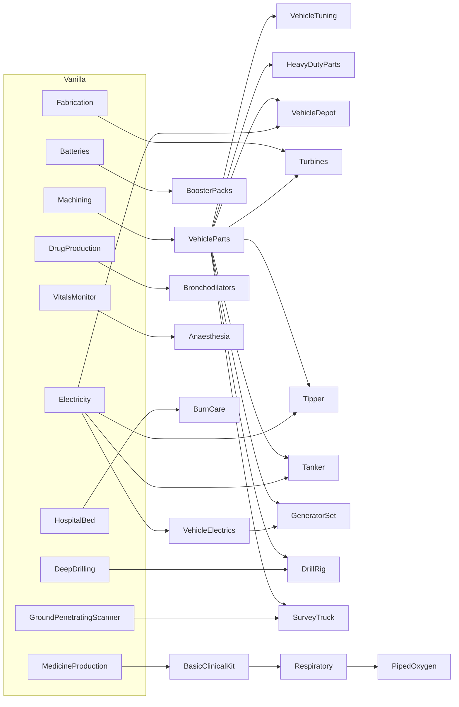

# The D'thorga research tree (design record, 10 Nov 2026)

The owner asked on 10 Nov 2026 for "a research tree for our designs along with any possible tie-ins with other mods as a soft-dependency". This records what was built, why, and who chose what. **Not yet tested in game.**

## Read this first

- **One new tab, D'thorga**, with a lane for vehicles and a lane for medicine: 12 vehicle projects and 6 medical ones.
- **Old saves keep what they could build.** The first time a save loads with the tree, each project is finished for free if the older research it replaces was already done. This happens once per project. New colonies research everything normally.
- **Our vehicles' upgrades now need their research.** Vehicle Framework declares research on upgrades and never checks it, so those gates did nothing before. Other authors' vehicles are unchanged.
- **Every cost is authored**, a gameplay choice to tune in play. So is every position and soft requirement.

## What it does for the player

| | |
| --- | --- |
| **Lets the player** | Follow a visible path from basic vehicle work to specialist trucks and clinical care, and see in one place what our mods offer |
| **Stops the player** | Building a specialist truck, fitting an upgrade or building specialist care equipment straight after a basic research such as Machining or Medicine production |
| **Changes how they play** | Research becomes a choice between vehicle and medical branches, and between trucks |

## The tree

All are Industrial, named `PhobosResearch_<Name>`. Those names stay fixed once a save can hold them.

| Name | Cost | Hard requirement | Soft tie-in | Unlocks | Replaces, for the grant |
| --- | --- | --- | --- | --- | --- |
| VehicleParts | 1,200 | Machining | EngineBasis | Four vehicle parts, parts bench | Machining |
| VehicleElectrics | 800 | Electricity | | Heavy-duty alternator, deep-cycle battery | Electricity |
| VehicleTuning | 1,500 | VehicleParts | | Tuning rig, radiator, oil cooler, springs, road tyres | Machining |
| HeavyDutyParts | 1,200 | VehicleParts | | Heavy-duty grade | Machining |
| VehicleDepot | 1,800 | VehicleParts, Electricity | | Depot bay | Machining, Electricity |
| BoosterPacks | 600 | Batteries | | Booster pack and recharge | Batteries |
| Turbines | 4,500 | Fabrication, VehicleParts | EngineAdvanced | Turbine part, turbocharger | Fabrication |
| Tipper | 1,500 | VehicleParts, Electricity | VVE_BasicVehicles | Tipper | Machining, Electricity |
| Tanker | 2,400 | VehicleParts, Electricity | VVE_BasicVehicles | Tanker | Machining, Electricity |
| GeneratorSet | 2,100 | VehicleParts, VehicleElectrics | VVE_BasicVehicles, VFE_IndustrialGenerators | Generator set | Machining, Electricity |
| DrillRig | 3,600 | VehicleParts, DeepDrilling | | Drill rig | DeepDrilling |
| SurveyTruck | 2,800 | VehicleParts, GroundPenetratingScanner | | Survey truck | GroundPenetratingScanner |
| BasicClinicalKit | 1,000 | MedicineProduction | Cpr | Steriliser, resuscitator, intubation kit, fluids kit, burn dressing | MedicineProduction |
| Respiratory | 2,400 | BasicClinicalKit | | Nebuliser, oxygen concentrator, ventilator | MedicineProduction |
| Bronchodilators | 600 | DrugProduction | | Bronchodilator vial | DrugProduction |
| Anaesthesia | 1,800 | VitalsMonitor | | Anaesthesia machine | VitalsMonitor |
| BurnCare | 1,200 | HospitalBed | AdvancedFirstAid | Burn bed | HospitalBed |
| PipedOxygen | 1,500 | Respiratory, VGE_OxygenNetwork | | Oxygen stand, trolley, field oxygen | MedicineProduction, VGE_OxygenNetwork |

**How the costs were set.** The first proposal ran from 300 to 1,500; the owner judged it low and suggested 2 to 4 times. Against the game's Machining (1,000) and Fabrication (4,000), and other mods' basic factories (5,000) and big rigs (4,000):

- **4x** for the drill rig and survey truck, which outperform what they copy by 10 times (`vehicle-drill-rig.md`, `vehicle-survey-truck.md`).
- **3x** for other trucks, tuning, depots, turbines and specialist care.
- **2x** for vehicle parts, because everything else sits behind it and those parts repair every vehicle; for the clinical kit and burn care, because they keep colonists alive; and for small consumables.

**Soft tie-ins.** A soft requirement counts only when that mod is on, and it costs the player extra research then. The five above are the ones whose theme earns it. Every project also keeps a hard requirement of ours or the game's, because a project whose requirements all drop away opens at once (read from the game's code).

**Tie-ins that were already there**, now enforced where they sit on upgrades: the well kit, deepchem head, groundwater survey and decompression kit; the Gravship oxygen buildings; the parts patches that stack other mods' research on the tanker.

**Left off the tree on purpose:** jump-start kit, the six tunes, safety shower, escharotomy, tracheotomy, gas alarm, electrolyser, liquid oxygen store and hyperbaric chamber. Each stays on what it had, because a gate would not be proportional to it or it already has a gate that fits.

**"Any of these unlocks it" was not built.** The game's requirements are all-of, and working around that hands out free research.

**Pressure vessels** take Fabrication, the fallback in `utility-vehicles-design.md` for when no gas building is present.

## How it works

- **Tab:** `PhobosDthorga`, in the Framework's always-loaded folder. It loads only with Vehicle Framework or D'thorga Medical active, because the game lists even empty tabs.
- **Where projects live:** with their content. Parts and stations in the Framework's Vehicle Framework folder, trucks in D'thorga Vehicles, medical in D'thorga Medical, piped oxygen in Medical's Gravship folder.
- **Upgrades:** the marker `PhobosEnforceUpgradeResearch` on an upgrade tree makes its nodes need their research. A postfix on `CompUpgradeTree.PrerequisitesMet` covers the click, the greyed node and the highlight. A prefix on `ITab_Vehicle_Upgrades.DrawButtons` says which project is missing; it skips the original only when research refuses, because Vehicle Framework's own refusal text is fixed. God mode bypasses it, as the game does. Upgrades fitted or already under way are left alone.
- **The grant:** `ResearchReplacesExtension` lists what a project replaces. A brand new project, with nothing to take over, says so with an empty `<replaces />` and is never granted. `ResearchGrantComponent` saves the names of projects already considered, so a project added later also grants once. It uses `AddProgress` when a project's requirements are not all done, because `FinishProject` finishes unfinished requirements too and would give away other mods' research.
- **Removing a mod:** the first load logs one-time "could not load reference" errors for its projects, then the next save is clean (read from the game's code). Projects are not granted a second time if the mod returns.

## Still unknown

- Nothing has run in game. Vehicle Framework was read from its 1.6 decompile.
- 16 mods patch `FinishProject`; their bodies were not read. Look at the log at the first grant.
- Nice Research Tab may rearrange positions; it is not decompiled.
- RimThunder and More Injuries are tagged 1.6 only, so whether their projects load on 1.7 is theirs to answer. `MayRequire` covers them being absent.

## Who chose what

- **Owner (10 Nov 2026):** that the tree should exist; one D'thorga tab; granting old saves; vehicles, parts and Medical in scope; enforcing upgrades on our vehicles only; raising the costs.
- **Agent:** the projects and their grouping, every cost, position and label, which tie-ins are worth having, the Fabrication gate on pressure vessels, and leaving the listed items off the tree. All are the owner's to revise.
- **Related:** the Seabed Crawler's projects are planned on a tab of their own beside this one (`vehicle-seabed-crawler.md`). The generator set's "Vehicles tier" (`vehicle-generator-set.md`) is met by `VehicleParts`.
