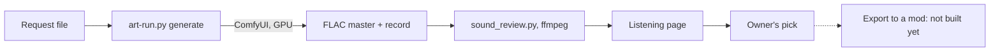

# Sound generation: research and pipeline (10 Nov 2026)

**Status:** the tools are built and their offline tests pass; the first real sounds (the pilot) are the next step.
**No sound is in any mod**, and nothing here is tested in game.

## Read this first (gotchas)

- **Local, like the icon pipeline.** Stable Audio 3 Small SFX runs in the owner's ComfyUI (0.41.0 already supports it), driven
  by `scripts/art-run.py` with the same stop time, game check and records as images. **It uses the graphics card**, so it never
  runs while RimWorld is open, and a run needs the owner's go.
- **ffmpeg does every audio job** (owner, 10 Nov 2026: "a much finer tool"): the gyan.dev full build, installed with
  `winget install Gyan.FFmpeg --scope user`. It needs the full build for `rubberband`. Python only drives it.
- **Masters are never changed.** Each candidate is a lossless FLAC kept byte for byte; every copy anyone hears is made from it.
- **Licence:** generated sounds are ours, and shipping them in a free mod needs no notice (see [Licence](#licence)).
- **The quiet rule stands** (AGENTS.md): sounds only where usefulness is high, quiet, never alarming, with a volume setting.

## What it lets us do

| Question (AGENTS.md) | Answer |
| --- | --- |
| What it lets the owner do | Make sound effects for our mods locally, with no subscription or credits, and judge them by eye and number as well as ear |
| What it stops | Picking a sound on listening alone, which misses hiss, whine and clicks for anyone who loses the high frequencies |
| How it changes the work | Sounds follow the image route: a request file, a run with safeguards, a review page, a pick, a record |

## Who chose what

| Choice | By |
| --- | --- |
| A local sound pipeline like the icon one | Owner, 10 Nov 2026 |
| ffmpeg for all processing, not Python audio libraries | Owner, 10 Nov 2026 |
| A lowered listening copy with the high frequencies moved down | Owner, 10 Nov 2026 ("just for the moment") |
| Go for the tools and the pilot | Owner, 10 Nov 2026 |
| Stable Audio 3 Small SFX as the model; its distilled twin as the comparison; Medium optional | Agent choice |
| Every threshold, the review loudness, the loop crossfade, the split frequency | Agent choices, named constants in `scripts/art/sound_review.py` |
| The pilot's four sounds and their wording | Agent choice, for the owner's review |

## Models compared

| Model | Made by | Weights' licence | Verdict |
| --- | --- | --- | --- |
| **Stable Audio 3 Small SFX** (base and distilled, 2.27 GB each) | Stability AI | Stability AI Community License | **Used.** Made for sound effects, up to 2 minutes, stereo, trained on "licensed and Creative Commons data" (Stability) |
| Stable Audio 3 Medium (base and distilled, 9.2 GB each) | Stability AI | Same | Optional comparison: up to about 6 minutes, music as well |
| Woosh (Flow, DFlow) | Sony AI | CC BY-NC 4.0 | Second opinion only: a community ComfyUI node with an open "fails on the second run" issue |
| TangoFlux | declare-lab | Non-commercial research only | Ruled out |
| MMAudio | Ho Kei Cheng and colleagues | CC BY-NC (secondary source), built for video | Ruled out |
| HunyuanVideo-Foley | Tencent | Hunyuan licence, said to exclude the EU, UK and South Korea (secondary source) | Ruled out, as Hunyuan3D was |
| Stable Audio Open 1.0 | Stability AI | Community License | Replaced by version 3 |

Weights come from Comfy-Org's packaging (`Comfy-Org/stable-audio-3`, not gated; the Hub lists its licence as
`stable-audio-community` and links Stable Audio Open 1.0's `LICENSE.md`). Stability's own repositories ask for a click-through
acceptance. `scripts/art/fetch_models.py --only stable_audio_3_small_sfx` and `--only t5gemma` fetch what the pilot needs,
checking the Hub's licence and each file's SHA-256; Medium is marked optional and waits for `--optional` or `--only medium`.

## Licence

The Stability AI Community License Agreement (last updated 5 July 2024), read 10 Nov 2026. The agreement never names Stable
Audio 3; Stability's announcement ties the two ("Under the Stability AI Community License, you own your outputs").

- **Outputs are ours:** "You own any outputs generated from the Models or Derivative Works to the extent permitted by applicable
  law."
- **Outputs are not Derivative Works:** the definition ends "but do not include the output of any Model".
- **The notice duty does not reach a mod's sounds:** the "Powered by Stability AI" and Notice duties apply when we "distribute or
  make available the Stability AI Materials or a Derivative Work". Shipping weights or a fine-tune would trigger them; shipping
  sounds does not. Our reading of the text, not legal advice.
- **A free mod is a Non-Commercial Purpose** ("personal use (i.e., hobbyist)"), which needs no registration. Commercial use is
  free under US$1M a year in revenue, with registration.
- **One limit:** no output may be used "to create or improve any foundational generative AI model".

## The pipeline



A sound request, beside the image requests in an asset folder (`assets/phobos-sounds/requests/pilot.json`):

```json
{"name": "generator-loop", "engine": "sa3-sfx-base", "seconds": 8, "loop": true, "seeds": [11, 12],
 "prompt": "Small diesel generator running steadily ... calm. Length: 8 seconds"}
```

- **Engines** (`scripts/generate-art.py`): `sa3-sfx-base` (50 steps, guidance 7), `sa3-sfx` (8 steps, guidance 1),
  `sa3-medium-base`, `sa3-medium`. The settings are ComfyUI's Stable Audio 3 Medium templates; **ComfyUI has no Small SFX
  template, so using them for Small SFX is an assumption the pilot tests.** The graph is the templates' core without their Qwen
  prompt rewriter: our prompts are written the way its sound-effects guide asks (source, material, space, how it changes, and a
  closing "Length: N seconds").
- **Run:** `python scripts/art-run.py generate assets/phobos-sounds/requests/pilot.json --stop-at HH:MM`. After the sounds,
  it runs `scripts/art/sound_review.py` and names the listening page in its report.
- **Records:** each FLAC has a JSON record beside it: engine, model file and SHA-256, text encoder, prompt, seed, steps,
  guidance, seconds asked, whether it loops, the ComfyUI version, the time taken and an AI disclosure.

## The listening page

`sound_review.py` writes `sound-review.html` (dark) in the generated folder. Each candidate gets:

| Item | What it is |
| --- | --- |
| **As made** | The untouched master |
| **Review level** | Ends trimmed of silence, faded, levelled to −20 LUFS (true peak kept under −1 dBTP), so loudness never decides a pick |
| **Lowered** | The review copy with everything above 3 kHz moved down an octave by rubberband, mixed back over the untouched lows: the frequency lowering hearing aids do. A listening aid only, never shipped; it shows *that* something is up there, not how it sounds to others. `--octaves 2` moves the highs down two octaves |
| **Loop** | For a looping request: a circular crossfade of 0.25 s, so the end runs into the start; plays on repeat |
| **Spectrogram** | Time left to right, pitch upwards, brightness for loudness. A bright band near the top is hiss or whine; a thin upright line is a click |
| **Seam picture** | The loop played twice: a line down the middle is its seam |
| **Numbers and flags** | Measured on the master; see below |

Flags are reasons to look again, not verdicts. All thresholds are authored except where a standard is named.

| Flag | When |
| --- | --- |
| Clipped | A sample peak at −0.1 dBFS or more, or a true peak above 0 dBTP |
| Nearly silent | A mean level under −60 dB |
| Strong high frequencies | The band above 4 kHz within 12 dB of the whole sound's mean level |
| Sharp attack | The true peak more than 20 dB above the integrated loudness: may startle |
| Loop seam | The level either side of the seam differs by more than 3 dB |

Checked offline on 10 Nov 2026 with made-up sounds: a 9 kHz whine over a hum was flagged and showed as a bright line, the lowered
copy moved it to about 4.5 kHz, and the seam picture showed the loop's join. A synthetic white-noise click earned the
high-frequency and clipping flags. These are signal checks on test tones, not a judgement of any generated sound.

## Loops

The crossfade follows what worked in Phobos Ostranauts (washer and pump loops, 6 Oct 2026): a 250 ms circular crossfade, and in
the game, volume fades only when a machine starts or stops, never at each repeat. Equal-power curves are used because the two
ends of a generated sound are unrelated.

## History: what did not work

In Phobos Ostranauts (6 Oct 2026), 38 sounds synthesised by Python were rejected and deleted at the owner's request; the owner
then picked ElevenLabs Sound Effects v2 loops (paid). Stable Audio 3 is the local equivalent of the route that worked.
Synthesis from code is not offered as the main route again. A physical engine model such as Ange Yaghi's
[Engine Simulator](https://github.com/ange-yaghi/engine-sim) (MIT) is a different thing and stays an idea for engines only.

## Into the game (not built)

- RimWorld loads `.wav`, `.mp3` and `.ogg` from a mod (`Verse.ModContentLoader.AcceptableExtensionsAudio`, read with
  `scripts/query-code.py`). A picked sound would ship as `.ogg` under the mod's `Sounds/` folder with a `SoundDef`.
- An export step (cut, level against comparable vanilla sounds, mono for sounds from one spot if the game's spatial sound
  wants it, encode) is still to build. Whether mono suits RimWorld's positioned sounds is unverified.
- The volume setting AGENTS.md requires lives in the owning mod's settings.

## Open questions

1. **Archive branches for sounds?** Images go to `art-masters` and `art-references`; whether sounds should too is the owner's call.
2. **Which sounds first** after the pilot, and for which mod.
3. **The sample rate** of Small SFX's output, and whether the template settings suit it: the pilot answers both.
4. **Medium:** worth its 9.2 GB only if Small SFX falls short.

## Sources

- Stability AI: [Meet Stable Audio 3](https://stability.ai/news-updates/meet-stable-audio-3-the-model-family-built-for-artistic-experimentation-with-open-weight-models);
  [Community License Agreement](https://stability.ai/community-license-agreement); the agreement as
  [Stable Audio Open 1.0's LICENSE.md](https://huggingface.co/stabilityai/stable-audio-open-1.0/blob/main/LICENSE.md).
- Comfy-Org: [Stable Audio 3 workflow guide](https://docs.comfy.org/tutorials/audio/stable-audio/stable-audio-3);
  [stable-audio-3 packaging](https://huggingface.co/Comfy-Org/stable-audio-3); the installed templates
  `audio_stable_audio_3_medium.json` and `audio_stable_audio_3_medium_base.json` (graph, settings and the SFX prompt guide).
- Sony AI: [Woosh](https://github.com/SonyResearch/Woosh); [ComfyUI-Woosh](https://github.com/Saganaki22/ComfyUI-Woosh)
  (community node, Saganaki22).
- declare-lab: [TangoFlux licence](https://huggingface.co/declare-lab/TangoFlux/blob/main/LICENSE.md). Ho Kei Cheng and
  colleagues: [MMAudio](https://arxiv.org/abs/2412.15322). Tencent:
  [HunyuanVideo-Foley notice](https://huggingface.co/tencent/HunyuanVideo-Foley/blob/main/NOTICE).
- FFmpeg developers: [filter documentation](https://ffmpeg.org/ffmpeg-filters.html) (`ebur128`, `acrossover`, `rubberband`,
  `acrossfade`, `showspectrumpic`); gyan.dev's [Windows builds](https://www.gyan.dev/ffmpeg/builds/).
- EBU: [R 128 loudness recommendation](https://tech.ebu.ch/publications/r128) (the LUFS and true peak measures).
