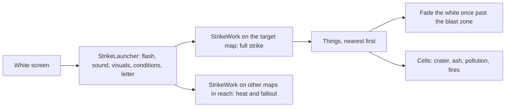

# Strategic strike: design and decisions (7 Nov 2026)

The record behind D'thorga Patches' own strike model for InterRim Ballistic Missile's extinction-class warhead (0.9.0), Stage 2 of the
owner-approved plan. The player guide is the [D'thorga Patches README](../../mods/PhobosPatches/README.md#interrim-ballistic-missile);
Stage 1 (the fast sweep every warhead uses) and the original hang are in [missile patches](missile-patches.md). **Not yet tested in
game.**

## Why

The owner (7 November 2026) asked for "extensive changes of our own to the IRBM mod, in our own flavour", taking inspiration from Dubs
Rimatomics' nukes. Stage 1 made every strategic strike finish; it kept the missile mod's model, which destroys everything on every
open map within six world tiles evenly, then lights fires on a fifth of every cell in one frame. Stage 2 gives the true blast warhead
a shape: a fireball, a blast zone and a thermal zone around ground zero, with burns, wilting, ash, a pulse, pollution and fallout.

## The model

**Ground zero is the map's centre**: the missile mod has no impact cell on the map. Zones by distance in cells, on the warhead
(`PhobosStrikeExtension`, added to `IRBM_Warhead_Strategic_Standard` by XML patch):

| Zone | Radius (authored) | People | Buildings and items | Plants | Ground |
| --- | --- | --- | --- | --- | --- |
| Fireball | 25 | Killed (the warhead's own 10,000 Bomb to the core) | Vanish, mountain rock too | Vanish | Every roof gone, floors stripped, ash, polluted |
| Blast | 25 to 110 | Bomb by falloff, then burns | Vanish (rubble and fragment settings apply) | Vanish | Built roofs gone; ash and pollution by chance; fires |
| Thermal | 110 to the edge | 0.3 of the blast by falloff, then burns; flash blindness and radiation with Rimatomics; pulse on mechanoids | Bomb by falloff (may stand); pulse on powered buildings | Leafless | Built roofs gone; fires falling with distance |
| Neighbouring maps | treated as 200 cells | As thermal | Pulse only | Leafless | Fires |

**The falloff is Dubs Rimatomics' curve** (`NuclearStrike.DamageAt`, read 7 November 2026): reach times minus the natural log of
distance over reach. With reach 250: about 576 at the fireball's edge, 205 at the blast zone's edge, nothing at 250. Rimatomics
vanishes within a tenth of its reach; we keep that ratio for the fireball.

**Shelter** is the Stage 1 setting (any overhead mountain by default): sheltered cells and things are skipped outside the fireball.
Inside the fireball every roof goes first, mountain too, as in Rimatomics' `Flash`.

**Fallout** ("existing effects first", the owner's rule and choice): with Dubs Rimatomics active and the setting on Automatic, its
`NuclearFallout` condition on each struck map (10 to 30 days, its own range), up to six of its drifting `Fallout` world objects from
the target tile, radiation through its `DubUtils.applyRads` by falloff, and its `FlashBlindness` on the eyes by chance. Without
Rimatomics, the missile mod's nuclear winter as before. None of it in space: no air to carry fallout, the call Rimatomics++ makes too.

**Realism note.** At one metre per cell, a real strategic warhead's fireball alone would be wider than the map. The zones are a
gameplay choice so a strike has a centre and an edge; every radius and factor is authored, in the rules Def and on the warhead, for
the owner to tune.

## Decisions

| Decision | By |
| --- | --- |
| Both stages, Stage 1 first | owner |
| Shelter is a setting; any overhead mountain by default, as in Rimatomics | owner |
| Rimatomics' fallout and radiation as an optional tie-in, by name | owner |
| Other maps in reach get heat and fallout only, with a setting for a full strike everywhere | owner |
| Every setting that costs speed carries a warning | owner |
| A setting for Combat Extended's wall fragments | owner |
| Only the extinction-class warhead is a blast; the others keep the missile mod's effects | agent (they are gamma ray, cold, storm and vacuum effects) |
| Ground zero at the map centre; zones 25, 110 and reach 250 | agent defaults after Rimatomics' high yield |
| A prefix that skips the missile mod's private `OnWhiteScreenReached` for marked warheads | agent; recorded reason: one block, no extension point |
| The white screen held until the blast zone is done (at most 8 s) | agent |
| The fragments setting's middle choice is "a tenth as many", not "only in the blast zone" as first planned | agent: the cost is per fragment wherever it is thrown |

## Settings

In the D'thorga Patches window, section "The blast, the heat and what follows": the blast model itself, a full strike on every map
in reach, fires (none, sparse, moderate, firestorm), fallout (automatic, nuclear winter only, nothing), fallout clouds (0 to 6) and
radiation (with Rimatomics), ground pollution (with Biotech), and the pulse. Costly choices show their cost in amber. The README has
the table.

## Test protocol (owner runs it)

1. Deploy D'thorga Framework and D'thorga Patches with the game closed. The load line names the blast model, fires, fallout and
   whether Rimatomics is active.
2. On a throwaway save, dev mode, D'thorga category: **strike current map with D'thorga's blast model**. Expect a crater of bare,
   ashen, polluted ground at the centre; nothing standing within the blast zone; standing walls, wilted plants, burned survivors and
   scattered fires towards the edges; with Rimatomics, fallout on the map and flash-blinded survivors; batteries and turrets stunned.
   Report the line that starts "Strike on".
3. A real extinction-class missile at a settlement with its map open, and a second map open nearby: white, the letter, the fade
   within about 8 seconds, the target struck, the neighbour burning but standing.
4. Settings: turn on the full strike everywhere and repeat; see the warning and the cost in the log's seconds.

## Sources

- Dubs Rimatomics 1.7, decompiled to `.local/decompiled/Rimatomics-1.7` (`NuclearStrike`, `WorldObject_ICBMfission`, `DubUtils`,
  `GameCondition_NuclearFallout`) and its Defs; read 7 November 2026, nothing copied.
- Rimatomics++ by NachoToast: its settings and README (fallout in space; no change to the names we read).
- InterRim Ballistic Missile 1.6 (`StrategicImpactCountdown`, `MissileWarheadDef`, its strategic warhead Defs).
- RimWorld 1.7 (`Plant.MakeLeafless`, `TerrainGrid.RemoveTopLayer`, `PollutionGrid.SetPolluted`, `TileFinder`, `StunHandler`).
