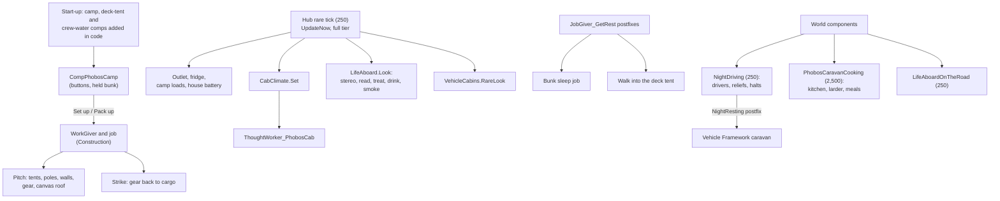

# Camping and life aboard

**Status (25 Nov 2026):** living; written from the code at D'thorga Framework 0.269.0 and D'thorga Vehicles 0.114.0, with people
using parked vehicles added at Framework 0.289.0. Built: the
power budget (outlet, house battery, fridge), the camp order with tents, awnings, swags, kitchen box, lights and heater, deck
tents, the camper trailer as a camp, cab bunks and sleeping aboard, driving through the night, caravan cooking, walk-in cabins,
life aboard and hotboxing, the cab's climate and moods, the crew water tank, three crew machines, and people using parked
vehicles by themselves. **Passed in game by the
owner:** none of this system's rows. **Not yet tested in game:** all of it; its rows are listed under [Tests](#tests).

This page says how camping and life aboard work now. Why they are this way is in the [decision
log](../decisions/camping-and-life-aboard.md) and the [archived records](#why-it-is-this-way). How the vehicle code is laid out
in general is in [How the code is built](../architecture.md). Fittings themselves (how one is fitted, its weight and price) are on
[upgrades and fittings](upgrades-and-fittings.md); the engine's ledger and the cab heater's engine side are on [engines and
drivetrains](engines-and-drivetrain.md); towing a trailer is on [hitches and trailers](hitches-and-trailers.md).

## Read this first (gotchas)

- **Every land vehicle with a loadout gets the camp comp, added in code.** No Def names it. Trailers get it only when their
  trailer comp says `campDeck` or `campSide` (`Service/VehicleSystems.cs:254`). The camp buttons show only when there is gear to
  set out.
- **A vehicle will not move with its camp out, or with anyone in its deck tent** (`Camp/CompPhobosCamp.cs:910-916`). Leaving
  the map packs the camp away by itself; a destroyed vehicle leaves its camp behind as ordinary things.
- **Packing up never deletes the player's things.** A bed in use stops it; a piece carried away is left. The exceptions: a roof
  tent or camper bed whose fitting has gone is destroyed at pack-up, and a held cab bunk is destroyed once its fitting is removed.
- **The cab bunk is a real bed that is never spawned.** It lives in the camp comp's holder; the `Bunk` getter makes or destroys it
  as its fitting comes and goes (`CompPhobosCamp.cs:204-225`).
- **Water exists only with Dubs Bad Hygiene, and not in its lite mode.** Without it there is no crew water tank, nobody drinks
  aboard, and kitchens ask for no water (`Service/CaravanWater.cs:23-30`).
- **Three things are off by default:** the power outlet's switch on each vehicle, the setting "Night heater at camp" (and each
  vehicle's night heater switch), and "Drive through the night".
- **Walk-in cabins and bunk sleep are for the player's vehicles only.** Other factions pitch a camp once at their bases, and their
  riders may arrive hotboxed; nothing else here runs for them. Cab climate runs only at the full detail tier.
- **Colonists use parked vehicles by themselves** (Framework 0.289.0): they climb into free passenger seats for the radio, a smoke,
  warmth or a nap, and take food and water from the stores when the map has none. Each vehicle's "Open to the colony" switch stops it.
- **Much of this is never saved**: a sleeper on the road, the cab's climate, cab smoke, the night-drive halts, the fridge's
  chilled stacks and the open deck tents. A game loaded mid-halt simply drives on. What is saved is listed under [Saved data and
  removal](#saved-data-and-removal).
- **Most figures are authored.** The few with a source are named where they appear; everything else is a gameplay figure.

## What it does

### The power budget

The vehicle's electrics are on [engines and drivetrains](engines-and-drivetrain.md) (the alternator and its ledger). The camp adds
loads to them.

| Fitting | What it does | Figures (authored unless named) |
| --- | --- | --- |
| Power outlet | Feeds a camp's grid what its users ask beyond other producers, through an inverter | 300 W at 12 V (600 at 24 V); 85 %; off when fitted |
| House battery | A second battery for camp loads, charged once the start battery is nearly full | 100 Ah; shore charger 10 A; camp loads stop at 10 % |
| 12-volt fridge | Keeps the cargo food closest to spoiling cold, whole stacks only | 30 kg at 4 °C (or colder air); 0.2 to 1.5 A by the air's heat |

- **The amps an outlet draws** are its watts ÷ 0.85 ÷ the vehicle's volts (`Rules/CampRule.cs:23-25`).
- **The house battery's charging** waits until the start battery is 0.9 to 0.98 full, as an isolator does. That behaviour is
  from a secondary source (REDARC), marked unverified in `Systems_HouseBattery.xml`. Above 0.8 charge it tapers; it loses about
  5 % a month by itself.
- **Loads marked `campLoad`** (the fridge, the outlet and, since Framework 0.276.3, the camp lights) draw only on the house battery
  when one is fitted, and stop at its cutoff rather than being shed.
- **Without a house battery, the camp lights keep the start** (Framework 0.276.3, the owner's card of 24 Nov 2026): a load with
  `startReserve` goes out as the starting power enters the "barely enough to start" band, 0.2, the top of the stage above the
  no-start one in `Systems_Electrical.xml` (`StartReserveRule.Line` reads it from the stages; no figure of its own). A message says
  why, the light's inspect line and the Systems tab too; they come back once the battery is charging and past the line again, or a
  house battery is fitted. The fridge and outlet have no such floor: the accessories record (Y5, Y7, Y1) lets them run the starting
  battery down as the player's own risk.
- **The fridge's 0.8 A at 32 °C** is the one sourced point on its curve (ARB, through Overland Expo, a secondary source); the
  rest is authored. It says so once when it loses power with food aboard.

### The camp order: set up and pack up

- **Set up camp** and **Pack up camp** are buttons on the vehicle. A colonist doing Construction work does it, at Construction
  speed (`Camp/CampJobs.cs:57-95`). Hovering the button previews the layout.
- **The work** is 600 for a tent, 450 for an awning or side fly and 900 for each closed room, plus each piece of gear's own figure
  (a swag 150, a bedroll 100, a stool 30, a sleep machine 150). All authored, in `PhobosVehicleRulesDef`.
- **Where things go**: the preferred side first, then the other; at most 6 cells out. Tables first, then other gear, then up to
  four stools a table, then a sleep machine at the head of each bed. Each piece's spot is remembered and reused next time.
  **Forget the camp's layout** clears it.
- **It refuses** when the vehicle is not on a map, already camped, moving, airborne, towed, has nothing to set out, or has no
  room.

### Tents, awnings and swags

The fittings sit on two mounts: a roof mount (roof tent, fold-out camper, deck tent) and a side rail (awning, side fly, walled
awning); the rear tent takes either. Sizes are in `Rules/CampLayoutRule.cs`.

| Piece | What it gives | Figures (authored) |
| --- | --- | --- |
| Roof tent | A 2 × 2 bed up top | Rest 1.0, comfort 0.8; 55 kg; "slept in a roof tent" +4 |
| Awning | A canvas roof, 2 deep, poles at most 6 apart; not a room | Drawn at 0.6 opacity |
| Side fly | A canvas roof 3 rows deep | — |
| Walled awning | A closed room 4 out, as long as the vehicle (at least 4) | — |
| Fold-out camper | A room 5 out by 6 along with two 2 × 2 beds | Compact 90 kg, comfort 0.8; roomy 110 kg, 0.9 |
| Rear tent | A room 5 deep, one cell past each side | — |
| Swag | A bed packed in the cargo | Rest 1.0, comfort 0.75, 6 kg; "slept under the stars" +5 |

- **"Slept under the stars"** comes only under an open sky, in fair weather (rain or snow at most 0.01), and without a
  slept-in-cold or slept-in-heat memory. The game's bedrolls count as camp gear too.
- **The camp heater** burns chemfuel (about 2 a day, holds 10) and only below 15 °C, heating to 15 °C.
- **The kitchen box** is a field stove, 2 × 1, burning chemfuel or wood. It copies every cooking stove's recipes (and Vanilla
  Brewing Expanded's espresso, when present) and cooks for a caravan: 8 meals a cook. With it come a camp table and stools.
- **Camp lights**: a 10 W pole light on the vehicle's 12-volt supply (an LED light bar, authored), lit while it stands in a camp
  and the vehicle's camp-lights load runs, on the house battery when one is fitted and otherwise out before the starting battery is
  too low to start the engine; or a lantern that burns its own chemfuel.

### Deck tents and the camper trailer

- **A deck tent** goes on any vehicle whose Def has `PhobosFlatDeckExtension`: our flatbed trailer and tipper, and by patch
  Frontline Workshop's J70, RimThunder's HEMTT and Vanilla Vehicles Expanded's Mule and Roadrunner. Its cabin comp is added in
  code. It needs a flat deck.
- **Inside it is a small pocket map** (two beds by default). Its air is the outside air plus 4 °C, never above 15 °C; the roomy
  tent adds 2 to both. Beds: rest 1.0, comfort 0.75 light or 0.85 roomy. Kit: 30 or 40 kg.
- **Sleepers are chosen on the vehicle** and walk in at bedtime. Danger outside wakes them and puts them out; joining a caravan
  moves them aboard and closes the tent.
- **The camper trailer** is the Pintle flatbed (`campDeck`), which takes a roof mount and a side rail. The bowsers, the Billy
  field kitchen and the shower trailer are `campSide`: a side rail only. A trailer pitches only once unhitched.

### Sleeping aboard: the cab bunk

- **The cab bunk** fits a wheeled vehicle of at least 3,500 kg. Rest 0.9, comfort 0.7, 40 kg (authored). In a cab of more than
  two seats it takes one passenger seat (`Rules/NightDriveRule.cs:70`).
- **On the road**, the most tired rider who is not crew, with rest below 0.95, gets it through the caravan's bed count.
- **Parked**, the colonist assigned to it walks over at bedtime and climbs in (90 ticks). They rest at the bunk's rate while the
  vehicle stands still, are checked every 250 ticks, and get up at rest 0.98, or for danger, fire, illness, their timetable or
  reassignment. Two hours of sleep or more gives "slept in the cab" +2.
- **The night heater** keeps a bunk sleeper's cab warm (3 °C an hour toward 18 °C, burning 0.4 chemfuel an hour), only with
  "Night heater at camp" on and the vehicle's switch on. The heater's range is a general figure, marked as such in the XML.

### Driving through the night

- **With "Drive through the night" on**, every caravan keeps moving at night unless its own switch (on the first vehicle) says
  stop. A driver is fit while rest is above 0.3; a relief from the same vehicle's passenger seats must be above 0.6 (authored).
- **Hand-overs and swaps** happen as drivers tire, and the night goes into the logbook once each half day.
- **The arrival estimate** takes no nights out when every vehicle has its driving seats filled and at least one relief; the
  route planner and the forming window see the same.

### Cooking in a caravan

- **Once a night** (looked at hourly, at most once each half day) a player caravan's cooks make simple meals.
  - **Resting**, they cook at camp. **Driving through the night**, they either simmer on the move (the default, half as many
    meals) or halt for a meal (2,500 ticks); a switch on the caravan chooses.
- **The kitchen** is a field kitchen on wheels or in tow first, else a packed kitchen box. **Meals made** are the least of cooks ×
  meals a cook, the food, the fuel and the water (`Rules/CaravanCookRule.cs:43-51`).
- **The larder** is the caravan's packs, towed cargo and packed cold boxes.
- **Defaults** (`PhobosCaravanCookingExtension`, authored): 20 meals a cook, 0.5 fuel a meal, 1 litre of water a meal, 20
  cooking experience a meal, a 2 % chance of food poisoning. The kitchen box sets 8 meals and no water.

### Walk-in cabins

- **A walk-in cabin** is a pocket map built from rows in the vehicle's Def: `S` seat, `L`/`l` litter, `B`/`b` bed, `T` tank, `E`
  way out, `.` floor (`Rules/CabinLayoutRule.cs`). The Osprey is the only vehicle with one; its layout changes with its ferry
  tank and litter fittings.
- **Colonists walk in** (60 ticks) to wait, rest or tend the wounded, on the ground or in flight. Hungry ones eat from the
  vehicle's cargo by the caravan's rules. Idle colonists walk out; an empty cabin closes, and leftovers are set down outside.
- **A walk-in cabin shares one limit with the passenger seats**; a deck tent does not. A destroyed vehicle puts everyone out.
- **Its temperature** is the cab's when the vehicle has a cab climate, else 21 °C.

### Life aboard

Every 250 ticks the vehicle looks at its riders, on a map and on the road (`LifeAboard/LifeAboard.cs`):

| Thing | What it gives | Figures (authored unless named) |
| --- | --- | --- |
| Stereo | 0.08 joy an hour to everyone aboard | 1 A at 12 V; 3 kg |
| Reading | 0.12 joy an hour to riders not driving, below 0.9 joy, in daylight or by the reading light | Light 0.3 A; a book's effects run at its speed |
| A treat | A non-drug joy food from the cargo | At most every 4 hours |
| A drink | 1.5 litres from the crew water tank (Dubs Bad Hygiene; on a map only) | Thirst to full; Dubs' contamination check |

### People use parked vehicles

Colonists go to the colony's parked vehicles by themselves (`Visits/`; record: [people use parked vehicles](../vehicle-parked-use.md)).
A **visit** walks them over, climbs them into a free passenger seat (never a driver's or a gunner's), and ends by itself; the
rest of this page's life aboard then applies to them.

| Reason | When | Ends when | Figures (authored unless named) |
| --- | --- | --- | --- |
| Radio | A recreation choice, kind "high culture", with a stereo fitted and switched on | Recreation full, the timetable leaves recreation, the stereo stops, or 2 hours | 0.36 recreation an hour (the game's own rate for a recreation job); chance 1 |
| Hotbox | A recreation choice, kind "chemical": a closed cab, Hotboxing on, and a smoke the policy allows in reach or a friend in the cab | An hour after their smoke, or 2 hours | Friend at 20 opinion; ×3 chance; chance 0.8 |
| Warm | The game's safe-temperature giver found no room for someone with a serious temperature injury | Comfortable outside, or the cab no longer helps | The night heater runs for them (its switch and setting on) |
| Nap | The game's rest giver chose the ground | Rested (0.98), or the bunk's wake rules | Rest 0.85 (the ground's 0.8 is the game's); "slept sitting up in a cab" −1 after an hour |

- **Everyone climbs out** for danger, fire, illness, a mental break, the setting or switch turned off, and before the vehicle moves
  (Vehicle Framework's ignition and move events). The player is told why, except when the reason was simply spent.
- **Food** (PV4): only when the game's food giver found nothing; the game's own best food from the vehicle's cargo, policy included,
  taken out and eaten. **Water** (PV5, Dubs Bad Hygiene): only when Dubs found nothing; 1.5 litres from the crew tank.
- **The battery**: a visitor's radio stops at the start line (the camp lights' line) unless "Visitors may flatten the battery" is on.
- **Asleep aboard**: the game counts a rider with no job as awake; life aboard now asks the visits, so nappers and bunk sleepers
  neither hear the stereo nor read, snack or smoke.

### Hotboxing

- **A rider lights up** when their drug policy schedules a smoked drug (on a map), or for joy (joy below 0.5, at most every six
  hours). A smoked drug is one whose ingest sound is the game's smoke sound.
- **The others aboard take a share**: 0.3 of the dose in a closed cab with the windows up, 0.05 otherwise; below a severity of
  0.05 it is ignored. The shares start from Herrmann et al. 2015 (secondhand cannabis smoke in a car), as starting figures to
  tune. The smoke clears in an hour, or a quarter of one with the windows down or the glass gone.
- **Memories**: "hotboxed" +3; "against my will" −5 for a teetotaller or for a hard drug.
- **Raiders** arrive hotboxed one time in twenty (a roll per vehicle).

### The cab: climate and moods

- **A closed cab's temperature** is held by the vehicle's cab quantity (`Systems_Cabin.xml`, authored): a heater to 18 °C at
  6 °C an hour, a cooler to 24 °C at 4 °C an hour, losing 2 °C an hour through the body. The game reads it for the riders.
- **"Passengers feel the cab"** gives a memory by the cab's air against each rider's comfortable range: +3 for a warm cab in the
  cold or a cool one in the heat, −2 for chilly or hot, −5 for freezing or stifling (10 °C past their range).
- **"Every closed cab has climate control"** (off) gives every closed cab automatic climate control; on, only vehicles built with
  it have it.

### Crew machines

- **The cab bunk's sleep accelerator**: +0.35 rest and 20 % more hunger, the game's own figures for its sleep accelerator. It
  draws 400 W through the inverter (39.2 A at 12 V) only while the bunk is in use. Fitting: 60 kg.
- **The litter's vitals monitor**: +0.07 tend quality, capped by the medicine's maximum (the game's vitals monitor). 7.8 A.
- **At camp**, with Ideology, the game's own sleep accelerator is camp gear set at a bed's head; without it, our sleep machine
  (50 W idle, 400 W in use) takes its place.

### The crew water tank (Dubs Bad Hygiene)

- **120 litres**, low below a quarter; it weighs 1 kg a litre as cargo. The figure is authored: real planning figures are 2 to
  4 litres a person a day, and a Dubs shower takes 65 litres.
- **Parked**, it becomes a hidden Dubs water tower; taking it up returns the water. Dubs' basin and simple shower become camp
  gear.

## How it works

**Per tick**: the camp comp ticks only while a camp stands at another faction's base or a sleeper is in the bunk; otherwise it
asks to stop ticking. A bunk sleeper's rest rises each tick.

**Every 250 ticks**: the hub's rare tick runs the outlet, the fridge and the camp loads, sets the cab's air, looks at life aboard
and at open cabins. The world components look at night driving and at life aboard on the road. A bunk sleeper's wake check runs.

**Every 2,500 ticks**: caravan cooking looks, and cooks at most once each half day.

**On events**: a vehicle leaving the map strikes its camp; joining a caravan closes a deck tent; danger wakes sleepers;
bedtime (the game's rest job) sends assigned sleepers to the bunk or the deck tent.

**Where the numbers come from**: the rules Def (`PhobosVehicleRulesDef`, `Rules_VehicleSystems.xml`) for work, reach, deck-tent
air, night driving, life aboard and hotboxing; the fitting Defs for loads, weight and beds; the cooking extension for meals.

## Code

All under `src/PhobosFramework.Vehicles/` unless named.

| File | What it holds |
| --- | --- |
| `Camp/CompPhobosCamp.cs` | The camp comp: pitching, striking, the held bunk, sleepers, caravan switches; the preview button |
| `Camp/CampDefs.cs`, `Camp/CampJobs.cs`, `Camp/CampPieces.cs` | Gear and bed-memory extensions; the camp job; canvas roofs, poles, roof tent |
| `Camp/CampLights.cs`, `Camp/CrewMachines.cs` | Camp lights; the bunk accelerator's stat part, hunger and the litter's tend bonus |
| `Camp/Berths.cs`, `Camp/BunkSleep.cs` | Beds on the road; sleeping in a parked vehicle |
| `Camp/NightDriving.cs` | The night-driving world component, the rest and arrival postfixes |
| `Cabins/` | Cabin comp and layout, pocket-map generation, enter and leave jobs, shared seats, deck tents |
| `LifeAboard/LifeAboard.cs` | Life aboard, hotboxing, the on-the-road world component |
| `Visits/VehicleVisits.cs`, `Visits/VisitReasons.cs` | People use parked vehicles: the visit service and its saved component, the four reasons, jobs, recreation choices and fallbacks |
| `src/PhobosFramework.Vehicles.Hygiene/VisitDrink.cs` | A drink from a parked vehicle's crew tank (Dubs Bad Hygiene) |
| `SetOut/CaravanCooking.cs`, `SetOut/FieldKitchen.cs` | Caravan cooking; the field stove and its copied recipes (shared with the field kitchen trailer) |
| `Service/CampAccessories.cs`, `Service/CabClimate.cs` | The outlet and fridge; the cab's held temperature |
| `Service/CaravanWater.cs`, `Service/ThoughtWorker_PhobosCab.cs` | Water sources for a caravan; the cab mood |
| `Systems/CompPhobosVehicleSystems.cs` | The house battery, outlet, fridge and camp-load plumbing in the hub |
| `Rules/` | `AccessoryRules`, `CampRule`, `CampLayoutRule`, `CabinLayoutRule`, `CaravanCookRule`, `LifeAboardRule`, `NightDriveRule` |
| `src/PhobosFramework/Rules/ShelterComfort.cs` | The cab mood's stages |
| `src/PhobosFramework/Rules/StartReserveRule.cs` | The line a camp load keeps clear of on the starting battery, and when it is held |
| `src/PhobosFramework.Vehicles.Hygiene/CompPhobosCrewWater.cs` | The crew water tank (Dubs Bad Hygiene) |

## Defs and XML

The modders' types, linked to [the reference site](https://phobos-dthorga.github.io/phobos-rimworld/) (pages are
`api/<Namespace>.<Type>.html`):

- **[`CompProperties_PhobosCamp`][r1]**: added in code; no XML instance.
- **[`PhobosCampGearExtension`][r2]** (`work`, `besideTable`, `besideBedHead`): makes any building camp gear; another mod's bed,
  stove or basin joins the camp with a patch.
- **[`PhobosBedMemoryExtension`][r3]** (`memory`, `openSkyOnly`, `fairWeatherOnly`, `comfortableOnly`): a memory for sleeping in
  a bed.
- **[`PhobosFlatDeckExtension`][r4]** (`rows`): a flat deck takes a deck tent; three patches give other mods' trucks one.
- **[`CompProperties_PhobosVehicleCabin`][r5]** with **[`CabinLayoutSpec`][r6]** (`whenFitted`, `whenGranted`, `rows`): a
  walk-in cabin by fitting or grant.
- **[`PhobosCaravanCookingExtension`][r7]** and **[`PhobosCopyStoveRecipesExtension`][r8]**: a kitchen that cooks in a caravan;
  a stove that copies the cooking stoves' recipes.
- **[`PhobosVehicleFittingDef`][r9]**: the camp, berth, crew-machine and life-aboard fittings (grants, loads, `minKilograms`,
  `flatDeckOnly`); and **[`ElectricalLoadSpec`][r10]** with `campLoad`.
- **[`CompProperties_PhobosNightLight`][r11]**: the camp's pole light.
- **[`PhobosVehicleRulesDef`][r12]**: the work, reach, deck-tent air, night driving, life aboard, hotboxing and `campLoads`.
- **Schema classes**: [`When_CampLights`][r13], `When_RidersAboard`, `When_BunkSleeper`, `When_BunkInUse`, `When_LitterInUse`,
  `When_CaravanResting`; `Input_CampLightAmps`, `Input_OutletAmps`, `Input_TwelveVoltShare`, `Input_CampLoadAmps`.
- **Systems**: `PhobosVehicleSystem_HouseBattery` (`Systems_HouseBattery.xml`) and `PhobosVehicleSystem_Cabin`
  (`Systems_Cabin.xml`).
- **The crew water tank's comp** (`Phobos.VehicleSystems.Hygiene.CompProperties_PhobosCrewWater`) is in the Dubs Bad Hygiene
  tie-in assembly, which the reference site does not cover.

The Defs are in D'thorga Framework's `Mods/VehicleFramework/.../VehicleSystems/`: `Accessories_Camp.xml`,
`Accessories_Berths.xml`, `Accessories_CrewMachines.xml`, `Accessories_LifeAboard.xml`, `Accessories_PowerBudget.xml`,
`Cabins.xml`, `Systems_HouseBattery.xml`, `Systems_Cabin.xml`, `Thoughts_Cab.xml`. The player's words
are in `PhobosCamp.xml` (Keyed).

[r1]: https://phobos-dthorga.github.io/phobos-rimworld/api/Phobos.VehicleSystems.CompProperties_PhobosCamp.html
[r2]: https://phobos-dthorga.github.io/phobos-rimworld/api/Phobos.VehicleSystems.PhobosCampGearExtension.html
[r3]: https://phobos-dthorga.github.io/phobos-rimworld/api/Phobos.VehicleSystems.PhobosBedMemoryExtension.html
[r4]: https://phobos-dthorga.github.io/phobos-rimworld/api/Phobos.VehicleSystems.PhobosFlatDeckExtension.html
[r5]: https://phobos-dthorga.github.io/phobos-rimworld/api/Phobos.VehicleSystems.CompProperties_PhobosVehicleCabin.html
[r6]: https://phobos-dthorga.github.io/phobos-rimworld/api/Phobos.VehicleSystems.CabinLayoutSpec.html
[r7]: https://phobos-dthorga.github.io/phobos-rimworld/api/Phobos.VehicleSystems.PhobosCaravanCookingExtension.html
[r8]: https://phobos-dthorga.github.io/phobos-rimworld/api/Phobos.VehicleSystems.PhobosCopyStoveRecipesExtension.html
[r9]: https://phobos-dthorga.github.io/phobos-rimworld/api/Phobos.VehicleSystems.PhobosVehicleFittingDef.html
[r10]: https://phobos-dthorga.github.io/phobos-rimworld/api/Phobos.VehicleSystems.ElectricalLoadSpec.html
[r11]: https://phobos-dthorga.github.io/phobos-rimworld/api/Phobos.Framework.Environment.CompProperties_PhobosNightLight.html
[r12]: https://phobos-dthorga.github.io/phobos-rimworld/api/Phobos.VehicleSystems.PhobosVehicleRulesDef.html
[r13]: https://phobos-dthorga.github.io/phobos-rimworld/api/Phobos.VehicleSystems.When_CampLights.html

## Settings

All in D'thorga Framework's vehicle systems settings. The full text is in the generated [settings
reference](../settings-reference.md#dthorga-framework-and-dthorga-vehicle-systems). None needs a restart.

| Label | Default | Page, section |
| --- | --- | --- |
| Passengers feel the cab | On | Cabs, camps and caravans, Cabs |
| Every closed cab has climate control | Off | Cabs, camps and caravans, Cabs |
| Walk-in cabins | On | Cabs, camps and caravans, Cabs |
| Hotboxing | On | Cabs, camps and caravans, Cabs |
| People use parked vehicles | On | Cabs, camps and caravans, Cabs |
| Visitors may flatten the battery | Off | Cabs, camps and caravans, Cabs |
| Night heater at camp | Off | Cabs, camps and caravans, Camps and caravans |
| Field kitchens cook in a caravan | On | Cabs, camps and caravans, Camps and caravans |
| Drive through the night | Off | Cabs, camps and caravans, Camps and caravans |

Per-vehicle switches, not settings: "Open to the colony" (on), the outlet (off when fitted), the night heater (off), the fridge, stereo, reading light, camp
lights and bunk accelerator (on); the caravan's night-driving switch and its meal halts.

## Saved data and removal

- **The camp comp** saves the held roof tent, bunk and camper beds (deep), the placed pieces, poles and tent walls, the bunk's and
  the tent's sleepers, the side, the order and the remembered spots, under `PhobosCamp_*` keys (`CompPhobosCamp.cs:1397-1437`).
  The order is saved by name and its values are only ever appended. After a load, lost references are dropped and spots forgotten
  if their lists disagree.
- **Camp buildings** save their canvas roof (`PhobosAwning_*`, `PhobosRoofTent_Roof`, `PhobosCanvas_Roof`).
- **A cabin** saves its pocket map (`PhobosVehicleCabin_Map`) and its way out the vehicle (`PhobosCabin_Vehicle`).
- **World components**: the caravans that stop at night (`PhobosNightDrive_Stopping`), and the last cook and meal halts
  (`PhobosCaravanCooking_LastCooked`, `_MealHalts`). Both are keyed by caravan, so a caravan that forms again starts fresh.
- **Visits** save each visitor, their vehicle, reason and times (`PhobosVisits_List`, `PhobosVisit_*`); each vehicle saves its "Open
  to the colony" switch (`PhobosVisit_OpenToColony`). A visit whose visitor is no longer aboard is dropped at load.
- **The crew water tank** saves its litres, quality, the amount when laid and its tower (`PhobosCrewWater_*`).
- **Removal**: the Framework's "Remove the added parts from this colony's vehicles" sweep clears systems and parts only. **It does
  nothing for camps, cabins, canvas roofs or held bunks**: pack camps up and empty cabins before removing the Framework ([How the
  code is built, Saves and removal](../architecture.md#saves-and-removal)).

## Tie-ins

Every tie-in is in the [tie-in register](../tie-in-register.md).

- **Vehicle Framework**: the caravan's bed count (`Caravan_BedsTracker`), its arrival estimates (both overloads), its seat count
  (`AreSlotsAvailable`, shared with the cabin and the bunk), and the caravan's night rest.
- **RimWorld**: the rest job giver (bunk, deck tent and naps), the food and safe-temperature job givers (parked vehicles, on their "nothing" only), bed memories, the outdoor temperature (deck tents), food fall (the
  accelerator), tend quality (the vitals monitor) and a caravan's drug use (hotboxing).
- **Dubs Bad Hygiene**: the crew water tank, drinking aboard and from a parked vehicle (its drink job giver, on its "nothing" only), the caravan's water source, Billy's kettle, and its basin and shower
  as camp gear. Lite mode switches all of it off.
- **Ideology**: the game's sleep accelerator, found by its Def rather than the DLC's name.
- **Vanilla Brewing Expanded**: espresso at the kitchen box. **Frontline Workshop, RimThunder, Vanilla Vehicles Expanded**: flat
  decks for deck tents, loaded only with their mods.

## Performance

- **Nothing here is measured on its own.** The hub's rare tick, which runs the power budget, cab climate and life aboard, is
  timed as "vehicle rare tick / full" (`CompPhobosVehicleSystems.cs:900`); its last measurement is on [engines and
  drivetrains](engines-and-drivetrain.md#performance).
- **Shape of the cost**: per tick, only a camp with a sleeper or at a base; every 250 ticks, life aboard (one count for an empty
  vehicle), night driving, wake checks and open cabins; every 2,500 ticks, cooking. The deck tent's temperature postfix returns at
  once with no tent open; the seat postfix with nobody in a cabin and no bunk.
- **Caches**: the camp plan and "has gear" 60 ticks; the camp light's owner 2,500 ticks; the arrival estimate 100 ticks; a
  caravan's kitchen 250 ticks.

## Limits and known gaps

- **No solar panel.** Nothing in the code or the Defs makes one.
- **Other factions** pitch a camp once at their base and may be hotboxed; they get no bunks, cabins, cab climate or cooking.
- **Drinking aboard happens on a map only**; in a caravan, Dubs Bad Hygiene or the game handles it.
- **The arrival estimate ignores meal halts and relief tiredness**; it is an estimate.
- **A cabin's tank cell holds no fuel**; it only takes the cell.
- **Found while writing (inferred from the code, not tested in game):**
  - **Packing up undercounts closed rooms.** Setting up adds 900 for each room; packing up adds 900 once
    (`CompPhobosCamp.cs:932,939`).
  - **A parked bunk sleeper takes a free passenger seat**, and the bunk already takes one in bigger cabs, so a cab with one seat
    left may refuse with the bunk empty (`CompPhobosCamp.cs:310-327`; `Cabins/CabinSharedSeats.cs:26-29`).
  - **The food-poisoning chance applies to every caravan meal**, in a tent too (`CaravanCooking.cs:21,265`).
  - **A raider's hotbox roll is not saved**, so each load rolls again for raider vehicles still on the map.

## Tests

None of these is a test in game.

- **Rule tests** (`tests/PhobosFramework.Vehicles.Rules.Tests`): `AccessoryRulesTests`, `AutoLightRuleTests`,
  `CabinLayoutRuleTests`, `CampLayoutRuleTests`, `CampRuleTests`, `CampTentRuleTests`, `CaravanCookRuleTests`,
  `LifeAboardRuleTests`, `NightDriveRuleTests`, `SetOutRuleTests`, `VisitRuleTests`. In `tests/PhobosFramework.Rules.Tests`:
  `ShelterAndChargeTests`, `StartReserveRuleTests` (the camp lights' floor).
- **Python**: `tests/test_check_vehicle_schemas.py` (a bad cabin block) and `tests/test_vehicle_bindings.py` (the cabin system).
- **In game** ([the test list](../in-game-test-pass.md)): **passed**: none of this system's rows. **Waiting**: accessories 178
  to 180; the camp 315 to 317, 326 to 328, 338, 353; deck tents 329, 330, 337, 357, 358; camp gear drawn 359, 360, 366; bunks and
  night driving 319 to 321, 347, 365; walk-in cabins 314, 349, 350; caravan cooking 152 to 154, 156, 191, 322, 323, 325, 334;
  life aboard 354 to 356, 364; crew machines 432, 438 to 440; people use parked vehicles 518 to 521; the cab 27, 30, 71, 445; camp lights and the start 482.

## Why it is this way

- **[The decision log](../decisions/camping-and-life-aboard.md)**: every choice, one line each, with who made it and where.
- **Archived records**, kept unchanged for their history: [vehicle accessories](../archive/vehicle-accessories.md) (camp gear,
  berths and the power budget), [hotboxing](../archive/vehicle-hotboxing.md) and [walk-in cabins](../archive/vehicle-cabins.md).
- **Records kept in place** (they cover camping and another system): [the world map and the
  cab](../vehicle-world-map-design.md), [the field kitchen trailer](../vehicle-field-kitchen.md), [crew
  machines](../vehicle-crew-machines.md), [working trailers](../vehicle-trailers.md).
