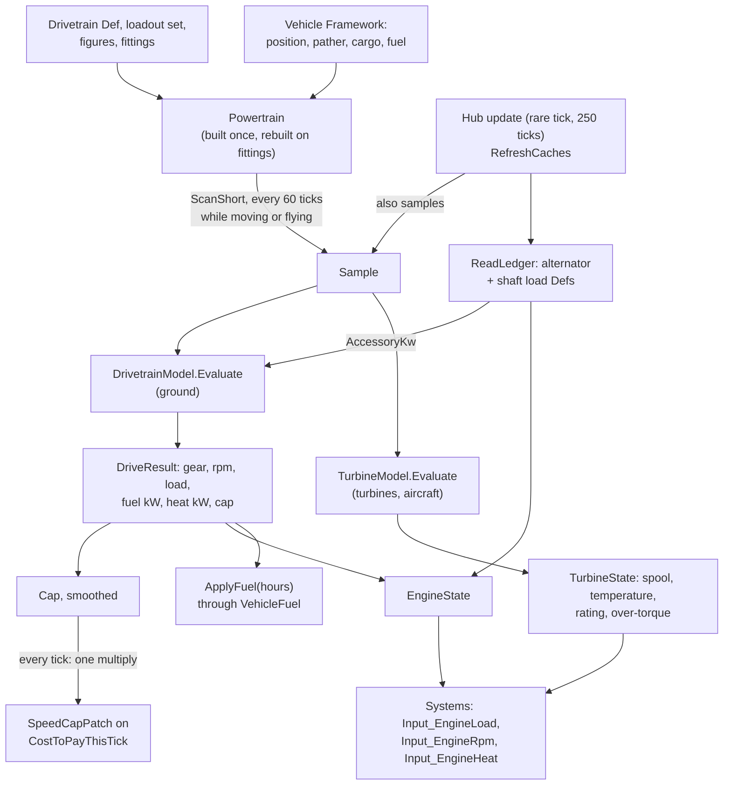

# Engines and drivetrains

**Status (23 Nov 2026):** living; written from the code at D'thorga Framework 0.265.1. Built: piston, turbine, electric,
diesel-electric, propeller and thruster engines, the engine-load ledger, fuel that follows the engine, thin air and descents.
Steam has a boiler but no drivetrain. **Passed in game by the owner:** rows 8, 103, 147, 160, 165, 184, 187 and 282; rows 19 and
69 in part. **Not yet tested in game:** everything else, including the core gear, rpm and speed-cap model, which has no passed
row.

This page says how engines and drivetrains work now. Why they are this way is in the [decision
log](../decisions/engines-and-drivetrain.md) and the [archived records](#why-it-is-this-way). How the vehicle code is laid out
in general is in [How the code is built](../architecture.md).

## Read this first (gotchas)

- **Vehicle Framework still decides how fast a vehicle moves. We only slow it.** The model works out the most speed the engine's
  power and the tyres' grip allow, and caps the path cost Vehicle Framework pays each tick. It never raises speed, never touches
  the MoveSpeed stat, and never applies an engine part's health twice (Vehicle Framework already feeds it into MoveSpeed).
- **Quasi-static: worked backwards, never simulated.** From the speed the vehicle is moving at, back through wheels, gearbox and
  engine to gear, rpm, load, fuel and heat. Nothing is integrated, so it cannot go unstable and costs the same at any game
  speed.
- **Two clocks.** Speed uses the action clock (60 ticks a second, one cell a metre, so MoveSpeed 10 is 36 km/h). Fuel, heat and
  wear use the day clock (2,500 ticks an hour), as Vehicle Framework's fuel rates do.
- **Nothing in the drivetrain is saved.** Gear, rpm, load, the speed cap, the mass and the ledger are rebuilt from the vehicle
  after a load. A change of fittings rebuilds the whole powertrain.
- **Only the full detail tier runs it.** That is the player's vehicles, on a map or in a caravan. Another faction's vehicles run
  the lite tier: no drivetrain, no loads, no thin air, and Vehicle Framework's own fuel rates.
- **"Fuel use follows engine load" is on by default.** The vehicle author's fuel rate still holds exactly at a nominal cruise.
  Idling burns about a quarter of the cruise rate, where Vehicle Framework alone burns half.
- **A vehicle with no drivetrain and no flight profile has no powertrain at all.** It keeps Vehicle Framework's flat rate.
  **Steam locomotives are like this**: their boiler is a system of quantities, with no gears or speed cap.
- **Rated power is net power.** Standing loads (the water pump, the steering pump, the engine's own electronics) are counted
  into the nominal cruise, so they take nothing from driving and leave the author's rate intact.
- **Read the engine's one picture, never work it out again.** `EngineState` (why it runs, rpm, drive load, loads' share) is put
  together once per update and refreshed by each drive sample. Everything that shows or uses the engine reads it.
- **Every figure is authored unless its Def names a source.** Torque curves, friction, idle shares, the turbine derate and most
  thresholds are authored. Real-engine figures live in D'thorga Vehicles' named drivetrains, each with its source in the XML.

## What it does

### Engine kinds

| Engine, transmission | Who has it | What sets the load | Fuel |
| --- | --- | --- | --- |
| Piston, `Automatic` | Cars, trucks, tracked, tractors | The road load at the speed driven | Willans line |
| Piston, `Propeller` | Boats | Speed: power as the cube of shaft speed | Willans line |
| Piston, `DieselElectric` | The Goat DE2, the generator set | The power asked; rpm rises with it | Willans line |
| Electric, `Direct` | Electric vehicles (the Lightning) | Road load; constant torque, then power | The pack; no ledger |
| Turboshaft, `Automatic` | The Abrams (AGT1500) | Road load, plus the ledger | Idle floor 0.6, plus a share |
| Turboshaft or Turbofan, `None` | Helicopters, jets, the Osprey | The flight phase, or a hover | Idle floor 0.2 or 0.05 |
| Thruster, `None` | Vanilla Vehicles Expanded's pods | Lift against weight | Vehicle Framework's rate |

The archetypes are in `Drivetrains.xml`; a loadout picks one by effect (Mass, tracks, `electricPowered`, vehicle type), never by
name. A named drivetrain replaces the archetype for a real vehicle: D'thorga Vehicles carries 24 (the L-ATV, the Humvee, the
Abrams' AGT1500, the T700, the Pegasus and others), and D'thorga Farming three tractors.

### Gears and the speed cap

- **Gear choice is automatic.** The model takes the highest usable gear in which the engine turns at or above its downshift rpm,
  stays within 10 % over rated rpm, and keeps 10 % torque in hand. It keeps the current gear while that still holds and rpm
  stays under the upshift line. Players never shift.
- **Pulling away**, below first gear's launch rpm, the clutch slips and the engine is held at its launch rpm.
- **Power runs short** on a grade, in soft ground, under tow or with a weak engine. A 16-step bisection finds the highest speed
  some gear can hold. **Grip runs short** when the pull needed is above grip × driven share × weight on the driven wheels.
- **The cap never goes below 0.15.** A vehicle without grip crawls, saying "Wheels spinning"; it never stops. The cap moves
  halfway to its new value each sample, so the vehicle never jerks.
- **What the cap multiplies** (`CompPhobosVehicleSystems.SpeedCap`): the drivetrain's cap (in Full mode, on the ground), a tow's
  plain cap, the battery drive's factor and the glass's view factor.

### Ground, weight and towing

- **Ground**: rolling resistance and grip are curves on the cell's path cost plus snow: 0.012 and 0.8 on built floors, 0.05 and
  0.6 on soil, 0.25 and 0.35 in soft sand and mud, 0.35 and 0.3 in marsh (authored from secondary tables). Rails carry fixed
  figures.
- **Grip is then scaled** by tread wear, soft-ground tyres and dual wheels, and by rain, snow, ice and wet ground (its own
  setting).
- **Weight** is kerb mass plus cargo, carried loads (a tanker's fluid), fitted kits, a sling load, passengers (cabin occupants
  too), loaded rounds, dispenser cartridges and fuel. It is recomputed on cargo and passenger events, and at most every 250
  ticks.
- **A trailer** behind the hitch is rolled, speeded up and lifted with the vehicle but adds no grip; an articulated vehicle's
  driven rear half grips as its own weight. A plough or drill adds its draught to the road load.
- **On the world map** a moving caravan is evaluated at its design speed, with the tile's biome, road and snow as path cost and
  a grade from hilliness that climbs for the first half of a leg and descends for the second.

### What the engine drives (the ledger)

Every load that takes shaft power is on one ledger, in kilowatts, worked out at each update. **Loads beyond the standing set
come off the power left for driving**, are burned on the Willans line and heat the coolant.

- **The alternator**, charged for the amps it makes (the loads' and the batteries'), at its charging voltage (14 V on 12), with
  8 % drag whenever it turns, through its efficiency (0.55, falling with speed). It turns at rpm × `alternatorRatio` (2.5; 4 on
  the diesel-electrics).
- **The engine's own electronics**, a standing load sized by rated power and by `electronicsShare` (a quarter on the old
  mechanically injected diesels).
- **`PhobosVehicleShaftLoadDef` loads**: the water pump and steering pump (standing), steering effort while turning, the
  radiator fan by coolant temperature, the air conditioner (sized by rated power), the air compressor (loaded and unloaded), an
  idle hydraulic pump, and the tanker's pump. The figures come from National Academies table 5-11 where marked; the rest are
  authored.
- **The drive belt** carries 30 % of rated power when sound; asked for more, it slips, and everything on it is underdriven.
- **Standing work** (a drill, a survey, a pump, the tipper's hoist) asks for a share of rated power through
  `IVehicleEngineDemand`; it burns through the model where the work allows, otherwise at its own rate.
- **Idle-up**: standing, the engine idles up to a fifth faster once the extra loads reach 5 % of rated power. Turbines keep
  their own idle.
- **Aircraft**: the generator, reaction-control bleed in a hover (3 %, more in wind) and cabin bleed (0.5 %) are ledger rows,
  and all of it is the turbine's demand.

### Fuel

- **Vehicle Framework's own burn stays**: its daily rate moving, half drafted and standing on a map, none undrafted; on the
  world map only while the caravan moves. **We add or refund the difference** between that and the model's fuel, through
  `VehicleFuel`, which names what every burn was for (engine, work, heater, leak, flight, spilled, electrics).
- **Normalised at a nominal cruise**: design speed, kerb mass plus 15 %, a built floor, with the standing loads on. There the
  model burns exactly the author's rate. Tunes, a clogged filter (`Effect_EngineFuel`) and loads move it from there.
- **With the setting off**, Vehicle Framework's rates stand, times any tune's flat fuel factor.
- **Descents**: on the overrun a piston engine's fuel is cut off; a turbine burns its idle floor.
- **Aircraft**: between tiles, Vehicle Framework's rate times the fuel at a cruise with today's loads and wear against a sound
  one (so the launch screen's range is the fuel that will be burned). On a map, what the engines owe by phase is settled against
  what the tank is seen to have lost to the flight frameworks, and burned or handed back. A flight mod's own flat rate is
  carried by how far Vehicle Framework's rate for that aircraft stands from its Def's (`FuelRateRule.RateFactor`, held to 0.1 to
  10).
- **A twin's fuel** is split into two side tanks with a cross-feed: automatic, open or shut. A dry side behind a shut cross-feed
  starves its engine. A lopsided twin jet burns up to 7.5 % more holding itself straight.

### Starting

- **The draft switch is the ignition.** Vehicle Framework has no other: the engine runs while drafted with fuel, while a caravan
  moves, while flying, or while standing work turns it. A flight phase decides for aircraft on a map.
- **Starting power** is battery charge × the battery's cold factor × a cold-oil factor × a gear-reduction starter's help. Below
  0.1 a piston engine will not start; 0.1 to 0.2 warns first.
- **A turbine needs more**: below 0.25 it will not light (a hung start, refused with the reason); below 0.4 it lights hot,
  costing 3 % of hot-section life and a message; 0.25 to 0.5 warns.
- **Aircraft on our own flight or Vehicle Framework's launch light their engines one after another**, 0.1 game hour each, and
  may not take off until all run. Jets on their authors' frameworks spool up their own way and are left alone.

### Failure and wear

- **Lost power is lost power.** A choked air filter, a warped head or a starved fuel feed (`Effect_EnginePower`) takes a share
  of the engine's power at every speed, so the vehicle slows only where power holds it back. Without the model it falls back to
  speed.
- **Gearbox**: below 40 % working order the top gear is lost; below 20 % only first and second remain.
- **Clutch**: below 50 % working order, or worn, it passes less torque and slips under load.
- **Driven wheels**: damaged ones cut the driven share; a wheel set below 20 % triples rolling resistance.
- **Turbines**: an engine at or below 20 % working order is out. Above that, with "Damaged turbine engines give less power" on,
  it gives from half its output rising to all of it when sound (authored). Hot air derates output 0.7 % per °C over 15 °C
  (authored, inside the 0.5 to 0.9 % published for industrial machines). Above the continuous limit the hot section wears,
  doubling every 25 °C; past a rating's time limit it wears faster, with one message. A worn hot section gives less (down to
  0.6) and burns more (`turbineWearFuelPenalty`). Each engine of a multi-engine aircraft keeps its own hot-section life.
- **A one-engine-out rating** opens only with another engine out (the T700's control arms it at 51 % torque or below, TM
  1-1520-238-10).
- **Grit** from rough ground can strike an aircraft's intakes in take-off, landing and taxi phases (authored rates by exposure).
- **Diesel-electric traction motors** heat with the square of their pull over the continuous rating, fitted to a US Army
  switcher manual's short-time ratings (TM 55-2210-223-12); running hot from 155 °C, burning from 180 °C.
- **Steam**: a cold boiler refuses to move below half its working pressure; low water melts a fusible plug, or, with "Boiler
  explosions" on, bursts a plugless boiler. Safety valves hold pressure to 1.06 of working, the most 49 CFR 230 allows.
- **Electric**: the traction battery's temperature sets its power and charging; a worn pack holds less; the motor heats.

### Thin air and descents

- **Thin air** ("Thin air at height", on): a tile's height sets the air's pressure by the International Standard Atmosphere. A
  naturally aspirated piston engine keeps 1.132 × density − 0.132 of its power (Leishman's correction); a turbocharged one holds
  all of it to 1,500 m, then falls as one without; a turbine's output and thrust go with pressure. Electric motors and thrusters
  lose nothing. At 1,500 m: 0.846, 1 and 0.835. Fuel for the same work does not change.
- **Descents**: steep enough to push the vehicle, the engine is driven. In the lowest gear within its rev limit it holds back by
  its friction, its loads and any retarder: a compression brake on every diesel of 250 kW or more, or an exhaust brake fitting.
  An electric drive regenerates (70 % of rated, 70 % efficient); a diesel-electric brakes into its resistors. The service brakes
  take the rest and heat; past 260 °C they fade, and the vehicle slows until what holds it suffices.

## How it works

**Per tick**: `SpeedCapPatch` multiplies Vehicle Framework's path cost by `SpeedCap` (one lookup and one multiply), and
`EngineSound.Tick` glides pitch and blend for a vehicle with an engine sound of ours. Nothing else.

**Every 60 ticks** (Vehicle Framework's `ScanShort`), for a full-tier vehicle that is moving, flying or still capped:
`Powertrain.Sample` reads the sub-cell position (the pather's next cell and the share of its cost paid, never `DrawPos`),
divides out its own cap to get the speed Vehicle Framework intends, and evaluates. The engine picture takes the new rpm and
load.

**Every rare tick** (`CompTickRare` → `UpdateNow`), the hub catches up by the hours since its last update:

1. `RefreshCaches` reads the air's height and pressure, decides whether the engine runs, samples the powertrain, reads standing
   work, works out the ledger (`ReadLedger`) and puts the `EngineState` together.
2. `Powertrain.ApplyFuel(hours)` burns or refunds the difference from Vehicle Framework's rate, or settles an aircraft's fuel.
3. Each system's worker advances; cooling reads the engine's heat (as a share of full-load heat), lubrication its rpm, the
   gearbox its drive heat, the turbine system the turbine's temperature and life.
4. Per-part figures are shared out (each engine's hot-section life), then grit, side tanks, stages and their effects.

**Where the numbers come from**, most specific first:

| Figure | Order of precedence |
| --- | --- |
| Kerb mass | Figures extension; loadout or drivetrain `emptyKilograms`; Mass × 12 kg, at least 50; the player's tuning |
| Rated power | Figures extension; `ratedKilowatts`; `kilowattsPerTonne` × kerb; × fittings' factor × inlet loss |
| Everything else | The drivetrain Def; the loadout's `set` by name; fittings (final drive, thrust, derate) |
| Tuning figures | `PhobosVehicleRulesDef` (`Rules_VehicleSystems.xml`): idle-up, belt, alternator, turbo height |

## Code

All under `src/PhobosFramework.Vehicles/` unless named.

| File | What it holds |
| --- | --- |
| `Rules/DrivetrainModel.cs` | The model: `DrivetrainModel`, `DrivetrainSpec`, `DriveConditions`, `DriveResult`, the kinds |
| `Rules/TurbineModel.cs` | `TurbineModel`, `TurbineSpec`, `TurbineRating`, `TurbineState`, `BleedRule` |
| `Rules/ShaftLoadRule.cs` | The ledger: load sizes, alternator output and drag, idle-up, belt grip, steering |
| `Rules/EngineStateRule.cs` | `EngineWhy` and why the engine runs |
| `Rules/FuelRateRule.cs` | `FuelUse`, the fading fuel-rate figure, Vehicle Framework's idle share, the rate factor |
| `Rules/EngineRoundTwoRules.cs` | `StartSequenceRule`, `StripDebrisRule`, `SideTankRule` |
| `Rules/DescentRule.cs`, `Rules/DriveHeatRules.cs` | Retarders, regeneration, brake fade; gearbox heat |
| `src/PhobosFramework/Rules/AirRule.cs` | Pressure, density, piston and turbine power with height |
| `Defs/PowertrainDefs.cs` | `PhobosVehicleDrivetrainDef`, its blocks (`EngineXml`, `TurbineXml` …), `LoadoutDrivetrain` |
| `Defs/ShaftLoadDefs.cs` | `PhobosVehicleShaftLoadDef`, `ShaftLoadNow` |
| `Systems/Powertrain.cs` | `Powertrain`: building the spec, sampling, mass, ground, engines, hover checks, fuel |
| `Systems/EngineState.cs` | `EngineState`, the engine's one picture |
| `Systems/EngineRoundTwo.cs` | `StartSequence`, `StripDebris`, `SideTanks`, `CrossFeedMode` |
| `Systems/CompPhobosVehicleSystems.cs` | The hub: `RefreshCaches`, `ReadLedger`, `OnScanShort`, `UpdateNow`, `SpeedCap` |
| `Systems/EngineSound.cs`, `Systems/BatteryDrive.cs` | The engine sound; the generator set's battery drive |
| `Service/Patches.cs` | `SpeedCapPatch`, `ChargeRatePatch` |
| `Service/VehicleFuel.cs` | Every burn and refund of ours, by use |
| `Service/CruiseHeightPatches.cs`, `Sling/SlingPatches.cs` | Aircraft fuel between tiles |
| `Presentation/ITab_VehicleSystems.Drivetrain.cs` | The Systems tab's drivetrain card and ledger (read only) |

## Defs and XML

The modders' types, linked to [the reference site](https://phobos-dthorga.github.io/phobos-rimworld/) (pages are
`api/<Namespace>.<Type>.html`):

- **[`PhobosVehicleDrivetrainDef`][r1]**: `engine` (kind, fuel, idle, launch and rated rpm,
  `ratedKilowatts` or `kilowattsPerTonne`, torque curve, friction, efficiency, coolant share, idle fuel share,
  `alternatorRatio`, `electronicsShare`, `compressionBrakeShare`, `turbocharged`, `turbine`), `transmission` (kind, gears, final
  drive, shift rpm, efficiency, tractive efforts), `running` (wheel radius, driven share, drag area, fixed rolling resistance
  and grip) and `mass`. Its `ConfigErrors` refuses rising gears, an upshift below the downshift, a launch rpm outside idle to
  rated, a torque curve not ending at zero, and turbine ratings that fall or lack a time limit.
- **[`TurbineXml`][r2]** and **[`TurbineRatingXml`][r3]**: idle speed and temperature, derate, ratings
  (share, speed, temperature limit, minutes, thrust, `wet`, `engineOutOnly`), water injection, `transmissionLimit`,
  `liftToWeightAtMaxGross`.
- **[`PhobosVehicleLoadoutDef`][r4]**: `drivetrain` with a `def` and a `set` of overrides by name;
  `Engine1` to `Engine8` roles; `engineArms`, `engineOutYaw`.
- **[`PhobosVehicleShaftLoadDef`][r5]**: one load on every ground engine whose `available` holds:
  `kilowatts`, `shareOfRated`, `speedExponent`, `beltDriven`, `baseline`, `when`, `inputs`. Another mod adds a load with a Def,
  no C#.
- **[`PhobosVehicleFiguresExtension`][r6]**: a vehicle's own `ratedKilowatts` and `emptyKilograms`.
- **[`PhobosVehicleRulesDef`][r7]**: the tuning figures named above.
- **Systems** (`PhobosVehicleSystemDef`): `PhobosVehicleSystem_Turbine` and `_WaterInjection` (`Systems_Turbine.xml`), `_Boiler`
  and `_FusiblePlug` (`Systems_Boiler.xml`), `_TractionMotors` and `_RotorDrive` (`Systems_PowerAndLift.xml`),
  `_TractionBattery` and `_ElectricDrive` (`Systems_Electric.xml`).
- **Schema classes**: `Input_EngineLoad`, `Input_EngineRpm`, `Input_EngineHeat`, `Input_DrivePower`, `Input_EngineRunning`,
  `Input_Turbine`, `Input_TractionLoad`, `Input_RatedPower`, `Input_EngineElectronics`, `Input_SteeringWork`,
  `Input_HeaterCore`, `Input_AlternatorOutput`, `Input_AirCooling`; `When_EngineRunning`; `Effect_EnginePower`,
  `Effect_EngineFuel`.
- **The flight profile** (`PhobosVehicleFlightProfileDef`) belongs to flight; this page uses only the demand it gives.

`python scripts/check-vehicle-schemas.py` reads all of it offline. `python scripts/query-defs.py` shows a drivetrain as patched.

[r1]: https://phobos-dthorga.github.io/phobos-rimworld/api/Phobos.VehicleSystems.PhobosVehicleDrivetrainDef.html
[r2]: https://phobos-dthorga.github.io/phobos-rimworld/api/Phobos.VehicleSystems.TurbineXml.html
[r3]: https://phobos-dthorga.github.io/phobos-rimworld/api/Phobos.VehicleSystems.TurbineRatingXml.html
[r4]: https://phobos-dthorga.github.io/phobos-rimworld/api/Phobos.VehicleSystems.PhobosVehicleLoadoutDef.html
[r5]: https://phobos-dthorga.github.io/phobos-rimworld/api/Phobos.VehicleSystems.PhobosVehicleShaftLoadDef.html
[r6]: https://phobos-dthorga.github.io/phobos-rimworld/api/Phobos.VehicleSystems.PhobosVehicleFiguresExtension.html
[r7]: https://phobos-dthorga.github.io/phobos-rimworld/api/Phobos.VehicleSystems.PhobosVehicleRulesDef.html

## Settings

All in D'thorga Framework's vehicle systems settings. The full text is in the generated [settings
reference](../settings-reference.md#dthorga-framework-and-dthorga-vehicle-systems).

| Label | Default | Section |
| --- | --- | --- |
| How engines and drivetrains work | Full drivetrain | Engines and driving |
| Fuel use follows engine load | On | Engines and driving, Fuel and power |
| Accessories load the engine | On | Engines and driving, Fuel and power |
| Brakes heat and fade on descents | On | Engines and driving, Fuel and power |
| Thin air at height | On | Engines and driving, Fuel and power |
| Rain, snow and ice take grip | On | Engines and driving, Ground, weather and towing |
| Aircraft fuel follows the engines | On | Aircraft and sling loads, Flight |
| Damaged turbine engines give less power | On | Aircraft and sling loads, Flight |
| Lopsided thrust unsettles twin jets | On | Aircraft and sling loads, Flight |
| Aircraft engines start one after another | On | Aircraft and sling loads, Flight |
| When an aircraft is too heavy or too hot to lift off, hover onto its pad or land at a journey's end | Refuse it | Flight |
| Realistic feed water | Off | Steam and electric |
| Boiler explosions | Off | Steam and electric |
| Battery fires | Off | Steam and electric |
| The Lightning runs on batteries | Off (needs a restart) | Steam and electric |

"Display only" shows gear and rpm with no effect on speed or fuel; "Off" stops sampling. Both take effect at once.

## Saved data and removal

- **Nothing of the drivetrain is saved**: `DriveResult`, the cap, the mass, the ledger, `EngineState`, `TurbineState` and the
  rating timer are derived. After a load the first sample rebuilds them; a rating's time limit starts counting again.
- **What is saved, by key on the hub** (`CompPhobosVehicleSystems.PostExposeData`): the systems' quantities under
  `PhobosVehicleSystems_Values` (turbine temperature, hot-section life, injection water, steam pressure, traction motor and pack
  temperatures); each engine's hot-section life under `PhobosVehicleSystems_PartFigures`; and the side tanks under
  `PhobosVehicleSystems_SideTankImbalance`, `_SideTankLeak`, `_CrossFeed` and `_CrossFeedCrewOpened`. Saves from Framework
  0.247.0 carry `PhobosVehicleSystems_EngineHotSection`, read once and taken over.
- **Drivetrain Defs are never named in a save**, so renaming or removing one breaks no save; the vehicle takes another loadout
  at the next start.
- **Removal** follows the vehicle systems' sweep ([How the code is built, Saves and
  removal](../architecture.md#saves-and-removal)). Switching the drivetrain to Off mid-game is safe and live.

## Tie-ins

Every tie-in is in the [tie-in register](../tie-in-register.md).

- **Vehicle Framework** (the part loads only with it): `ScanShort`, cargo and passenger events, the path follower,
  `CompFueledTravel` (called, never patched, for burns; its `ChargeRate` getter is patched for electric charging), and the
  launcher's fuel multiplier.
- **Vanilla Vehicles Expanded**: its acceleration controller scales the same path cost and reads it to brake. `SpeedCapPatch`
  runs first, so it counts the capped figure; measured speed carries its ramps, so launches use first gear.
- **The aircraft frameworks** (the Harrier's, rabiosus's VTOL framework, Close Air Support, the Prowler, the C-17): their flight
  state and on-map fuel rate are read by name (`PhaseReader_Members`); D'thorga Patches hooks the Harrier's `CanHover`.
- **Combat Extended**: a turret's loaded rounds weigh by `chargePerAmmoCount`.
- **Dubs Bad Hygiene**: water for steam stops and the Harrier's injection water; free without it.
- **Trains of the Rim**: steam boilers and the Goat DE2. **RimThunder, GTek, Frontline Workshop and others**: named drivetrains
  in D'thorga Vehicles, each loaded only with its mod.

## Performance

- **Measured** in the owner's game on 18 Nov 2026 (Framework 0.137.0, one minute with `scripts/perf.py`): the whole vehicle
  systems' rare tick, ledger and engine model included, about 0.1 % of the main thread; the drivetrain sample 0.02 %. D'thorga
  Framework's share of ticking fell from 1.3 % to 0.3 % with the step back ([engine loads, the recording
  after](../archive/vehicle-engine-loads.md#the-recording-after-18-nov-2026)). Nothing newer is measured.
- **Offline**: 500 drivetrain samples under 50 ms in the rule tests (Framework 0.11.0).
- **The budget** is the vehicle model's: 0.05 ms a tick on average and 0.1 ms per full-tier vehicle per rare tick ([How the code
  is built](../architecture.md#how-things-run)).
- **Shape of the cost**: one multiply per moving vehicle per tick; a sample every 60 ticks while moving or flying, timed under
  `PhobosTiming` as "vehicle sample"; a bisection only where a limit binds; ground read once per cell; mass at most every 250
  ticks.

## Limits and known gaps

- **Drag is one fixed figure per drivetrain.** No fitting, accessory, load or upgrade changes it (the vehicles' rule); height
  and lopsided thrust are its only exceptions, and both are aircraft's.
- **No manual shifting, no driver skill in the drivetrain, no skid-steer turning cost** (Vehicle Framework's rotation events
  were only on its development branch).
- **Other factions' vehicles get none of it**: their speed is never capped by power or grip, and they burn Vehicle Framework's
  rates.
- **Electric vehicles have no ledger**: their loads draw on the traction pack through the converter (92 %, against a 72 kWh
  pack).
- **Steam has no drivetrain**: no gears, cap, ledger or thin air. Priming and scale are not modelled.
- **Found while writing (inferred from the code, not measured)**: the hub's update samples the powertrain on every rare tick
  while the drivetrain is not Off, parked or not, so "parked vehicles cost nothing" no longer holds; the sample is small.
- **Turning is seen only as the vehicle's eight headings change**, so gentle curves read as straight for steering effort.
- **The water pump's figure is unverified** (seen only in search summaries); its load is authored.
- **The engine-start sequence skips jets and attack helicopters on their authors' frameworks**, which spool up their own way.
- **A flight between tiles keeps its departure tile's air** for its lift check; its cruise has a height of its own (flight).
- **`EngineFuel` (diesel or petrol) only picks sounds**; efficiency is the Def's `indicatedEfficiency`.

## Tests

None of these is a test in game.

- **Rule tests** (`tests/PhobosFramework.Vehicles.Rules.Tests`): `DrivetrainTests`, `PowerAndLiftTests`, `PowerLossTests`,
  `ShaftLoadRuleTests`, `EngineStateRuleTests`, `FuelRateRuleTests`, `TurbineAirAndFuelTests`, `EngineOutputTests`,
  `EngineOutRatingTests`, `EngineRoundTwoRulesTests`, `LopsidedThrustTests`, `DescentRuleTests`, `OverrunRuleTests`,
  `DraughtTests`, `TowRuleTests`, `TreadRulesTests`, `DriveHeatRuleTests`, `ElectricRuleTests`, `EngineSoundRuleTests`,
  `ServiceLifeUpgradeTests`. In `tests/PhobosFramework.Rules.Tests`: `AirRuleTests`.
- **Python and checkers**: `tests/test_check_vehicle_schemas.py` and `scripts/check-vehicle-schemas.py` (the Defs offline);
  `scripts/check-targets.py` (the by-name members the patches and phase readers use).
- **In game** (`src/PhobosFramework.Vehicles/Debug/VehicleSelfTest.cs`, run by the owner) and the [test
  list](../in-game-test-pass.md): **passed** 8, 103, 147, 160, 165, 184, 187, 282; **passed in part** 19, 69; **waiting** 3, 35,
  50, 54, 65, 72, 73, 78, 163, 182, 183, 185, 186, 188, 200, 390 to 393, 401, 402, 404, 405, 407 to 410 and 412 to 419.

## Why it is this way

- **[The decision log](../decisions/engines-and-drivetrain.md)**: every choice, one line each, with who made it and where.
- **Archived records**, kept unchanged for their history: [drivetrain and engine
  speed](../archive/vehicle-drivetrain-design.md), [gas turbines](../archive/vehicle-turbine-design.md), [electric
  vehicles](../archive/vehicle-electric-design.md), [steam boilers](../archive/vehicle-steam-design.md), [engine
  loads](../archive/vehicle-engine-loads.md), and, with [flight](flight.md), [power and
  lift](../archive/vehicle-power-and-lift-design.md).
- **Sources and figures**: [vehicle figures research](../vehicle-figures-research.md), [steam and diesel-electric
  research](../steam-and-diesel-electric-research.md), [vehicle simulation references](../vehicle-references.md).
- **Records kept in place** (they cover engines and another system): [per-engine realism](../per-engine-realism.md), [thin air,
  turbines and aircraft fuel](../vehicle-altitude-and-turbines.md), [real figures](../vehicle-real-figures-design.md), [world
  elevation and descents](../world-elevation-and-descents.md).
