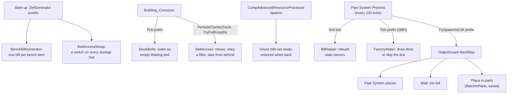

# Factory Additions

**Status (24 Nov 2026):** living; written from the code at D'thorga Factory Additions 0.14.2. Built: the "Belts may take from
here" switch, belts that obey a storage filter, stuck belts woken, the output guard and batches placed in parts, bill repair and
bills set aside, the automated fabrication bay with generated bills, the deep factory hopper, new and corrected factory bills for
sixteen mods, and piped water with food poisoning under Dubs Bad Hygiene. **Passed in game by the owner:** the human-meat bill (28
Oct 2026), the drug lab bills on their machines (29 Oct), belts taking from switched-on storage only from behind (29 and 30 Oct),
a bill with no recipe taken off a machine (10 Nov), and row 194 (a deep hopper takes four stacks of output). **Not yet tested in
game:** everything else, including rows P3, 25, 97 and 169.

This page says how D'thorga Factory Additions works now: what it adds to **Vanilla Furniture Expanded - Factory** (VFE Factory)
and the Pipe System inside Vanilla Expanded Framework that runs VFE Factory's machines. Three neighbours have pages or homes of
their own: pipes laid beneath the conveyor oven and the Framework's water reader are on [power, top-up and
machines](power-and-machines.md); the bulk bunker and belts into vehicles are D'thorga Vehicles' (on [stations, yard and
depots](stations-yard-and-depots.md)); the bottle tap is D'thorga Water Tap's, a mod of its own. The glass chain is D'thorga
Framework's, not this mod's. How to play with it is in the player guide's [Factory chapter](../../player-guide/factory.md). Why it
is this way is in the [decision log](../decisions/factory.md) and the [records](#why-it-is-this-way).

## Read this first (gotchas)

- **A VFE Factory machine draws only from its input cells, and nobody stocks them.** Pawns never carry ingredients to a machine
  that feeds from hoppers. Feed each ingredient by belt, or raise the input hoppers' priority, and tick the ingredient in the
  hopper's filter. This is VFE Factory's design; we change only what is named below.
- **Machines wait at a full output hopper** instead of destroying the finished batch. A machine that used to eat its inputs
  silently may now stand idle: run a belt out of every output hopper.
- **A corpse gives its meat once.** Oversized batches are placed in parts until all is out, so the old endless meat is gone.
- **The belt switch starts off on ordinary storage and on for hoppers.** Only a belt pointing straight away from switched-on
  storage takes from it, and only what its storage filter allows.
- **Every patch class is applied on its own.** One whose target changed in an update logs an error and is off; the rest still
  work.
- **With Dubs Bad Hygiene, the conveyor oven's wet bills pause until a pipe touching the oven reaches water.** Two settings decide
  this; the settings page appears only while Dubs Bad Hygiene is active.
- **The stock "Synthesize neutroamine" bill stops taking human meat**; the human-meat bill takes it instead.
- **The fabrication bay and the deep hopper look exactly like the machining bay and the ordinary hopper.** Select them to tell.
- **Several patches stand in for faults in Pipe System or VFE Factory** and should come out when their authors fix them. They are
  in the [register of patches for other authors' faults](../temporary-patches.md), rows 8 to 12 and 24.
- **Removing the mod**: take its bills off every machine and let running batches finish, and deconstruct every deep hopper and
  fabrication bay first.

## What it does

### Belts that take from any storage

Every storage building the player owns gets a **Belts may take from here** button (`CompBeltAccess`), added in code at start-up to
every `ThingDef` whose class is a `Building_Storage` (`BeltAccessSetup.AddSwitches`): shelves, pallets, Rimefeller's unloading
bays, every Adaptive Storage building. It **starts off** on ordinary storage and **on** for anything flagged as a factory hopper:
VFE Factory's hoppers, our deep hopper, and any building carrying Pipe System's `FactoryHopperExtension` (the corpse fridge, the
chemfuel tap, The Dead Man's Switch's feed hopper, D'thorga Water Tap's bottle tap, D'thorga Vehicles' bulk bunker). The inspect
pane mentions the switch only when it differs from where it started. Toggling a selection sends one message.

- **Switched-on ordinary storage** feeds only a belt that has it directly behind, looks every 10 ticks while the belt has room,
  and hands over the first whole stack its storage filter allows. It also counts as a machine's input cell, never as an output.
- **A switched-off hopper** is refused by belts. Belts still deliver into it, and machines and colonists still take from it.
- **Storage marked to obey its filter** (`BeltFilterExtension`: the corpse fridge, The Dead Man's Switch's feed hopper) gives a
  belt only what its filter allows; a stray item stays for haulers. VFE Factory's own hoppers and taps keep its no-filter rule.

Three patches do this: a postfix on `Building_Conveyor.PeriodicCacheCheck` (a belt sees switched-on storage behind it), a prefix
and postfix on `Building_Conveyor.TryPullFromDir` (refuse, obey a filter, take), and a postfix on Pipe System's
`Process.InputFactoryHopperDetected` (storage as an input cell). If VFE Factory's private neighbour cache is gone, the lookup
falls back to the map's thing grid.

### Stuck belts woken

A VFE Factory belt that is empty and in its Waiting state returns at once from its tick and never moves again. A prefix on
`Building_Conveyor.Tick` (never skipping the original) calls VFE Factory's own private `ResetConveyorState` on such a belt. The
first ten wakes each session are logged. The patch's `Prepare` looks for the reset method and leaves the patch out, with one
warning, if it is gone.

### The output guard and batches in parts

VFE Factory's machines finish a batch through Pipe System's `Process.TrySpawnAtCell`, which in some cases merged the batch into a
stack that could not hold it, and the surplus vanished. Our prefix (`TrySpawnAtCellPatch`) asks `OutputGuard.NextStep` first:

| Step | When | What happens |
| --- | --- | --- |
| Pipe System places | The bill is not hopper-only, its output is made from stuff, the cell is not walkable, or the batch fits | Pipe System's own code runs |
| Wait | The batch would lose items, or a deep hopper cell has no room for it | The machine says "too full" and tries again next tick |
| Place in parts | Over one stack (a corpse's meat), or a deep hopper cell with room | The game's direct placement puts out what fits; the rest is remembered |

Random result workers (VFE Factory's drill and fish farm) are asked inside a saved and restored random state, so their answer here
matches the one Pipe System gets next. A batch placed in parts is remembered on the process until it is all out (`BatchInParts`),
and a finished placement clears its ingredients through Pipe System's own step on a stand-in item. Bionics, weapons and armour
leave one at a time. A deep hopper on an output cell fills all four of its places (canned soup to 300).

### Bill repair and bills set aside

Pipe System builds a saved bill's ingredient owners once and never compares them with its recipe again, so a bill whose recipe
changed in an update kept stale owners, and a bill whose recipe no longer exists loaded with none and threw every frame,
uncancellable.

- **A stale bill** is found on its first tick after a load (`BillRepair.IsStale`: owners against the recipe by thing, category,
  pipe and count) and rebuilt with its target count kept. A message names the bill and the machine. Once a process, through a weak
  table.
- **A bill with no recipe** is taken off the machine before it spawns (`GhostBillsPatch`) and kept as a `SetAsideBill` (its recipe
  name, repeat mode, target count and quality choices); ingredients it held are set down after the load. A message names the count
  and the machine. When the recipe comes back (its mod turned on again), the bill is restored.
- **An item no owner can take** no longer ends the hopper scan with an error (`AddIngredientGuardPatch`, a skipping prefix on
  `AdvancedProcessorsManager.AddIngredient`), and **an owner left marked as being filled** is unmarked after the input check
  (`BeingFilledClearPatch`).

### The automated fabrication bay and generated bills

The **automated fabrication bay** (`PhobosFactory_AutomatedFabricationBay`) is VFE Factory's automated machining bay with a
different cost (300 steel, 150 plasteel, 12 components, 10 advanced components; 7,000 work) and research (VFE Factory's complex
factories and Fabrication). Everything else is inherited: size, the three input cells, power, heat, overclocking, its picture and
the two shredding bills.

Its bills are **generated at start-up** from bench templates (`BenchBillTemplateDef`), one bill for each item the bench can make:

| Template | Bench it copies | Research | Needs |
| --- | --- | --- | --- |
| `PhobosFactory_FabricationBench` | Fabrication bench | Fabrication | |
| `PhobosFactory_BioferriteShaper` | Bioferrite shaper | Bioferrite shaping | Anomaly |
| `PhobosFactory_VehiclePartsBench` | Our vehicle parts bench | Vehicle parts | Vehicle Framework |
| `PhobosFactory_RimatomicsMachining` | Rimatomics' machining table | Rimatomics' activation | Dubs Rimatomics |

`BenchBillGenerator` takes every `ThingDef` whose `recipeMaker` names the bench and skips buildings, items VFE Factory already
makes, excluded items, and items made of stuff plus parts. A stuff item takes a fitting stuff, else steel, cloth or leather. Work
is the recipe's work (or 3,200 when it names none) times four; the output waits at a stack or 75, whichever is smaller; research
is the template's and the item's. An ingredient the bay's pipe carries is drawn from the pipe. Bills are sorted by category and
label, with labels made unique on each machine. A generated bill appears in the machine's **Add process** menu only while the
bench's own recipe for the item is available now (`ProcessesOptionsPatch`); an empty menu says why. The work factor of four and
the cap are authored.

### The deep factory hopper

`PhobosFactory_DeepFactoryHopper` holds four stacks in its cell (35 steel and a component, 800 work; authored). It inherits
everything else from VFE Factory's hopper, including its look, its research and its place in the Architect. Machines read every
stack in it, and as an output cell it takes a batch into all four places (the output guard, above).

### New and corrected bills

Every bill is a Pipe System factory process, hopper-only. Those for other mods load only while that mod is active.

| Machine | Bills | For |
| --- | --- | --- |
| Neutroamine synthesizer | Neutroamine from human meat (3 chemfuel, 20 human meat → 6) | Always |
| Neutroamine synthesizer | Neutroamine from neutroaleaves | Farmable Neutroamine |
| Medicine granulator | Industrial medicine from synthread | Always |
| Medicine granulator | Psycho | Combat Extended |
| Medicine granulator | Two vacsop bills | Complementary Odyssey |
| Medicine granulator | Glitterworld medicine (a fifth input cell) | Glitterworld Medicine Production |
| Medicine granulator | Hemogen from hemofungus | Hemofungus |
| Medicine granulator | Potassium iodide | Dubs Rimatomics |
| Medicine granulator | Fifteen drug lab bills; three infusions with Deep Pills | Medicines+ |
| Medicine granulator | Seven vaccines, seven antiserums, two reproduction pills | Ushankas Biological Warfare |
| Conveyor oven | Cooked simple soup | Vanilla Cooking Expanded |
| Biofuel refinery | Polyamide | Passive Exoskeletons |
| Biofuel refinery | Detergent and heavy-duty detergent | Simple Washing Machine |

Corrections to VFE Factory's own Defs: the stock neutroamine bill no longer takes human meat; the stock uncooked soup makes one
(guarded on its worker existing); with Vanilla Chemfuel Expanded, its chemfuel tap is a factory hopper again and VFE Factory's
skipped piped-chemfuel steps are reapplied. Piped chemfuel feeds our refinery bills and the human-meat bill; with Vanilla Races
Expanded - Android, piped neutroamine feeds the granulator bills that use it. Every ingredient count and time is in the Defs;
those ported from a lab recipe keep its ratios, the rest are authored.

With **The Dead Man's Switch**, VFE Factory's hopper becomes a facility its automatic benches link to (four links, six cells) and
a material source, its benches link our deep hopper too, and its feed hopper is a factory hopper that obeys its filter. The
benches then draw from hoppers with no colonist.

### Piped water and food poisoning (Dubs Bad Hygiene)

With Dubs Bad Hygiene, the conveyor oven carries `CompFactoryWater` and a pipe beneath it. Five bills carry a `WaterUseExtension`:
mass-produced meals (10 litres a batch), our cooked soup (20), VFE Factory's uncooked soup (40), baby food (2) and pumpkin coffee
(10); every figure is authored.

- **Each working tick of a batch** draws its share of the batch's litres through D'thorga Framework's water reader
  (`PlumbingFeed`, which reads Dubs Bad Hygiene's network). With no water the tick is skipped and the machine's sound stops; the
  inspect pane says why. Bills with no extension are untouched.
- **Water that is contaminated** gives the batch a chance of food poisoning: a quarter for the meals and our soup, by the share of
  its litres that came contaminated. One roll is made for each new item before it merges. The cause reads "contaminated water"
  (`FoodPoisonCause` 101). Untreated water carries no risk for cooking.
- **The bill's description** gains a line saying how much water a batch needs, added at start-up.
- **Lite mode** of Dubs Bad Hygiene, or the first setting off, means no water is needed.

## How it works

**Per tick**: every belt's tick prefix reads two fields in the common case. Every 10 ticks a belt with room and switched-on
storage behind it looks for a stack.

**Every process tick** (Pipe System's, every 100 ticks per working process): the bill-repair check, a weak-table lookup; with Dubs
Bad Hygiene, the water draw on a bill that needs water.

**About once a second per belt** (VFE Factory's own cache check): our postfix's one lookup, only while the belt has no hopper
behind.

**On events**: the output guard at each finished batch; ghost bills when a machine spawns; the menu filter when the Add process
menu opens; generated bills and switches once at start-up.

**Where the numbers come from**: the machines, cells and process timing are VFE Factory's and Pipe System's; bill ratios from the
mods whose lab recipes they port; water litres, poison chances, the work factor and caps, the hopper's and bay's costs are
authored.

## Code

Under `src/PhobosFactory/` unless named.

| File | What it holds |
| --- | --- |
| `FactoryMod.cs`, `FactorySettings.cs` | The mod, its two settings, `ApplyPatches` (each class on its own), the options page |
| `Comps/CompBeltAccess.cs`, `Services/BeltAccess.cs`, `Services/BeltAccessSetup.cs` | The switch, the belt rules, adding it to every storage Def |
| `Patches/PeriodicCacheCheckPatch.cs`, `TryPullFromDirPatch.cs`, `InputFactoryHopperDetectedPatch.cs` | The three belt patches |
| `Patches/ConveyorTickPatch.cs`, `Services/StuckBelts.cs` | Waking stuck belts |
| `Patches/TrySpawnAtCellPatch.cs`, `Services/OutputGuard.cs`, `Services/BatchInParts.cs` | The output guard, `OutputStep`, the rest of a batch |
| `Patches/BatchInPartsPatches.cs` | Saving and resetting a batch in parts; noting a missing recipe while loading |
| `Patches/BillRepairPatches.cs`, `Services/BillRepair.cs` | The six bill-repair patches, `SetAsideBill`, the messages |
| `Patches/DefGeneratorPatch.cs`, `Services/BenchBillGenerator.cs` | Generated bills and the switches at start-up |
| `Patches/ProcessesOptionsPatch.cs`, `Services/BillAvailability.cs` | Hiding generated bills until their recipe is available |
| `Defs/BenchBillTemplateDef.cs`, `Defs/Extensions.cs` | The template Def; `GeneratedBillExtension`, `BeltFilterExtension` |
| `Rules/BeltRule.cs`, `OutputRule.cs`, `WaterRule.cs` | Game-free rules, compiled into the rule tests |
| `Seen.cs` | Seen-in-play notes |
| `src/PhobosFactory.Hygiene/CompFactoryWater.cs`, `FactoryWater.cs` | The oven's water tally; drawing water, poisoning, cause 101 |
| `src/PhobosFactory.Hygiene/Patches.cs`, `WaterUseExtension.cs` | The four Dubs Bad Hygiene patches; the per-bill extension |

## Defs and XML

The modders' types, linked to [the reference site](https://phobos-dthorga.github.io/phobos-rimworld/) (pages are
`api/<Namespace>.<Type>.html`):

- **[`BenchBillTemplateDef`][r1]**: a bench, its research, the machine, a first priority, input cells, a work multiplier (4) and
  exclusions; its `ConfigErrors` refuse a template with no bench or machine. Bills it makes carry
  **[`GeneratedBillExtension`][r2]** (set in code).
- **[`BeltFilterExtension`][r3]** on a storage Def that also carries Pipe System's `FactoryHopperExtension`: belts then take only
  what its filter allows. Add it from a folder loaded only while this mod is active.
- **[`CompProperties_BeltAccess`][r4]** and **[`CompBeltAccess`][r5]**, added in code; **[`OutputStep`][r6]** for code that asks
  the output guard.
- **`WaterUseExtension`** (`litresPerBatch`, `poisonChanceUntreated`, `poisonChanceContaminated`) on a factory process, and
  **`CompFactoryWater`** on the machine, in the Dubs Bad Hygiene tie-in assembly, which the reference site does not cover (source:
  `src/PhobosFactory.Hygiene/WaterUseExtension.cs`, `CompFactoryWater.cs`).
- **For another mod's storage to feed belts by default**, give it Pipe System's `FactoryHopperExtension` with `isfactoryHopper`.
- XML patches add a `Name` to VFE Factory's machining bay and hopper so ours can inherit from them (`Common/Patches/`). `python
  scripts/check-factory-patches.py` checks every patch path, Def, cap, parent name and template offline.

[r1]: https://phobos-dthorga.github.io/phobos-rimworld/api/Phobos.Factory.BenchBillTemplateDef.html
[r2]: https://phobos-dthorga.github.io/phobos-rimworld/api/Phobos.Factory.GeneratedBillExtension.html
[r3]: https://phobos-dthorga.github.io/phobos-rimworld/api/Phobos.Factory.BeltFilterExtension.html
[r4]: https://phobos-dthorga.github.io/phobos-rimworld/api/Phobos.Factory.CompProperties_BeltAccess.html
[r5]: https://phobos-dthorga.github.io/phobos-rimworld/api/Phobos.Factory.CompBeltAccess.html
[r6]: https://phobos-dthorga.github.io/phobos-rimworld/api/Phobos.Factory.OutputStep.html

## Settings

Options > Mod settings > **D'thorga Factory Additions**, listed only while Dubs Bad Hygiene is active. One plain page (not a
D'thorga settings book). The full text is in the generated [settings
reference](../settings-reference.md#dthorga-factory-additions).

| Label | Default | Notes |
| --- | --- | --- |
| Factory bills need piped water | On | Off: wet bills run without water |
| Contaminated water can poison food | On | Shown only while the first is on |

"Belts may take from here" is a button on each building, not a setting. Testing notes use D'thorga Framework's seen-in-play
setting.

## Saved data and removal

| Key | Where | Written |
| --- | --- | --- |
| `PhobosFactory_BeltsMayTake` | Each storage building's switch | Only when it differs from where it started |
| `PhobosFactory_BatchLeftThing`, `PhobosFactory_BatchLeftCount` | A Pipe System process | Only while a batch is part-way out |
| `PhobosSetAsideBills` (recipe, repeat mode, target count, quality choices) | A machine's process stack | Only while it holds set-aside bills |
| `PhobosFactory_WaterBatchLitres`, `PhobosFactory_WaterBatchRiskLitres` | The conveyor oven (with Dubs Bad Hygiene) | Always on such ovens |

Saves also name our bills (`PhobosFactory_...` process Defs and generated `<template>_<item>` bills), our two buildings, and food
poisoned with cause 101.

**Removal**: take our bills off every machine and let running batches finish; deconstruct deep hoppers and fabrication bays (items
on a hopper stay). Switch states and batches part-way out are dropped; bills set aside are lost; pipes laid under ovens stay as
ordinary hidden pipe; poisoned food names its cause as a number. Links with The Dead Man's Switch simply unlink. **A bill left on
a machine** loads with no recipe; with this mod gone nothing sets it aside, so it would throw as 0.12.1 found such bills do
(inferred from the code, not tested in game; the README expects the game to drop it).

## Tie-ins

Every tie-in is in the [tie-in register](../tie-in-register.md); each loads from its own `IfModActive` folder.

- **Required**: Harmony, Vanilla Expanded Framework (Pipe System), VFE Factory, D'thorga Framework (the water reader, pipes
  beneath, seen-in-play notes).
- **New bills**: Medicines+ (and Deep Pills inside it), Ushankas Biological Warfare, Combat Extended, Dubs Rimatomics (also a
  bench template), Hemofungus, Complementary Odyssey, Glitterworld Medicine Production, Farmable Neutroamine, Passive
  Exoskeletons, Simple Washing Machine, Vanilla Cooking Expanded.
- **Pipes**: Vanilla Chemfuel Expanded (piped chemfuel, VFE Factory's skipped steps), Vanilla Races Expanded - Android (piped
  neutroamine).
- **Storage**: "[sbz] Fridge" (the corpse fridge as a filtered hopper), The Dead Man's Switch (hoppers and its benches).
- **Dubs Bad Hygiene**: piped water and food poisoning, in its own small assembly.
- **Vehicle Framework** and **Anomaly**: generated bench bills, by `MayRequire` on their templates.
- **D'thorga Water Tap** and **D'thorga Vehicles**: their bottle tap and bulk bunker carry the factory-hopper flag, so our switch
  starts on for them.

## Performance

- **Nothing here is measured** on its own.
- **Shape of the cost**: two field reads per belt per tick; a lookup per belt about once a second and a scan every 10 ticks only
  beside switched-on storage; a weak-table lookup per process tick; the output guard once per finished batch; the water draw per
  working tick of a wet bill. Generation and switches cost load time only.

## Limits and known gaps

- **The fabrication bay and the deep hopper have no art of their own.**
- **Generated bills copy a bench's items, not its recipes' extras**: an item made of stuff plus parts is skipped, and a stuff item
  falls back to steel, cloth or leather when no fitting stuff is named.
- **Machines still draw only from their input cells.** Nothing here makes colonists stock them.
- **VFE Factory's own hoppers and taps take no filter**; only storage we mark obeys one.
- **The output guard covers only hopper-only bills** whose output is not made from stuff and lands on a walkable cell.
- **The patches for Pipe System's and VFE Factory's faults** are temporary by intent; each needs checking against an author's
  update ([register](../temporary-patches.md), rows 8 to 12, and row 24 for the output guard and batches in parts).
- **Inferred from the code, not tested in game**: `BenchBillGenerator` makes labels unique against the machine's other bills only,
  so two templates on one machine (the fabrication bay carries up to four) could give two bills the same label, and the menu
  filter matches options by label.
- **Inferred from the code**: `BillRepair.cs` opens with two summaries back to back; the first describes `BillRepair` but sits on
  `SetAsideBill`. The deep hopper's Def comment still says "not yet tested in game", though row 194 passed.

## Tests

None of these is a test in game, bar the rows marked passed.

- **Rule tests** (`tests/PhobosFactory.Rules.Tests`): `BeltRuleTests`, `OutputRuleTests`, `WaterRuleTests`.
- **Python**: `tests/test_check_factory_patches.py` (for `scripts/check-factory-patches.py`).
- **Seen-in-play notes**: `factory.deep-hopper-output-stacks` and others, tied to rows by `config/test-evidence.json`.
- **In game** ([the test list](../in-game-test-pass.md)): **passed** 194; **waiting** P3, 25, 97, 169. Rows 82, 87 and 88 (pipes
  under the ovens) belong to the Framework's pipes beneath.

## Why it is this way

- **[The decision log](../decisions/factory.md)**: every choice, one line each, with who made it and where.
- **Archived records**, kept unchanged for their history: [VFE Factory additions](../archive/vfe-factory-additions.md) (with the
  drafted report on oversized batches and the earlier modders' notes), [VFE Factory conveyors and
  hoppers](../archive/vfe-factory-conveyors.md) (how VFE Factory's belts pull and push, read from its code).
- **The guide**: [the player guide's Factory chapter](../../player-guide/factory.md).
- **Records kept in place** (they cover the factory and another system): [universal hoppers](../universal-hoppers.md).
- **Also cited**: [patches for other authors' faults](../temporary-patches.md), [the crash record of 9
  Nov](../crash-2026-11-09-stack-overflow.md) (the bills 0.12.1 removed).
