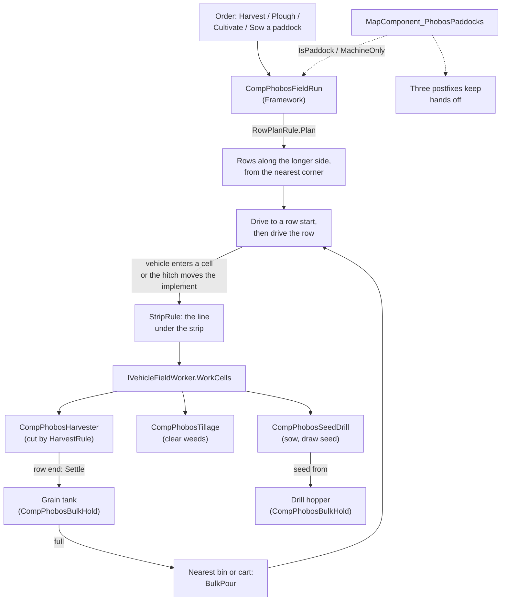

# Farming

**Status (24 Nov 2026):** living; written from the code at D'thorga Farming 0.7.9 and D'thorga Framework 0.273.2. Built: paddocks,
the field run, the combine with three fronts, the chaser bin, the field bin and the silo, crop classes, the Thane tractors (T60,
T130 and the articulated T400, two models each), the turnover plough, two cultivators, the seed drill, bought seed, "Hands use
seed too", the Agricultural Frame's hay limit, research and parts bills. **Passed in game by the owner:** row 298 (tall upgrade
trees scroll, Farming's among them); row 301 in part (the D'thorga tab). **Seen in play, no verdict yet:** row 283 (the
Agricultural Frame's hay). **Not yet tested in game:** everything else, including rows 272 to 274 (paddocks and the combine), 276
and 277 (tillage and sowing), 280, 281, 285, 291 to 293 and 379. The side industries, soil rules, other harvesters, sprayers and
farms on other tiles are designs only.

This page says how D'thorga Farming works now: machine-worked paddocks and the machines that work them. Three Framework pieces it
stands on have pages of their own: the hitch, couplings and the articulated tractor on [hitches and
trailers](hitches-and-trailers.md); bulk holds, pouring and the grain stores' store on [power, top-up and
machines](power-and-machines.md#bulk-holds); engine loads and grip on [engines and drivetrains](engines-and-drivetrain.md). How
the code is laid out in general is in [How the code is built](../architecture.md). Why it is this way is in the [decision
log](../decisions/farming.md) and the [records](#why-it-is-this-way).

## Read this first (gotchas)

- **A paddock is an ordinary growing zone with a mark.** The mark lives in a map component keyed by the zone's ID; nothing about
  the zone changes, so blight, raiders and every other mod still see a growing zone. Taking the mark off gives back the zone's own
  "Allow sowing" as it was.
- **Machines work only paddocks.** A combine or an implement offers only zones marked "Machine-worked"; an implement lowered by
  hand is the one exception (tillage anywhere, a drill only in a paddock).
- **A crop is taken by its crop class, never its name.** The game's crop Defs cannot tell grain from potatoes, so each crop is
  placed in a class by XML (`PhobosCropExtension`). A crop in no class is left for hands. Vanilla Cooking Expanded's wheat,
  barley, oats, rye and sorghum are left out on purpose: they yield flour straight from the plant, which no combine pours out.
- **The combine harvests by the game's own steps,** with its driver standing in for the colonist: the yield stat, the failure
  roll, the quest notice, other comps' extra yield, then the plant's own harvest hook with the vehicle as the harvester, so other
  mods' hooks still fire.
- **A combine's tank keeps to one product.** With another crop's grain still in it, it refuses the paddock and says so.
- **A full tank never destroys a plant.** A plant that would not fit is left standing for the next pass.
- **Implements are vehicles of their own**, held by the tractor through our hitch and moved by it; they cannot be driven alone.
  The implement's strip is worked when the hitch moves it, never on the tractor's move.
- **No implement ever destroys a sown crop**, of any kind, nor a tree. Tillage passes over a cell holding one whole.
- **The T400 is two vehicles**: the front half drives; the rear half follows on a permanent pivot and carries the linkage.
- **The Framework does the driving.** The field run, row planning and bulk holds are D'thorga Framework's, game-free where they
  can be; Farming supplies the workers (front, plough, cultivator, drill) and the crops.
- **Removing Farming takes the machines with it**, and the grain and seed inside them. Paddocks become plain growing zones.

## What it does

### Paddocks

Every growing zone gets a **Machine-worked** button. Marked, it becomes a paddock: colonists keep off it, and its own "Allow
sowing" button is taken away so it cannot be flipped back by hand. A paddock also gets **Hands may help**, which lets colonists
sow and harvest it too and gives the game's own button back. The setting "Hands may help on new paddocks" decides what a newly
marked zone starts with (off by default).

Keeping hands off takes three postfixes (`PaddockPatches.cs`): the zone's buttons; `WorkGiver_Grower.ExtraRequirements`, which
keeps a machine-only paddock out of the zones a colonist starts a harvest from; and `WorkGiver_GrowerHarvest.HasJobOnCell`,
because the harvest job gathers up to forty ripe cells around its first one by that test, and without it a colonist harvesting
beside a paddock took its plants too. Sowing already honours the zone's own "Allow sowing", so it needs no patch.

A paddock remembers when it was last ploughed or cultivated (once a run has worked 90 % of it). The mark is shown in the end
message and is kept for the soil rules to come; it does nothing else yet.

A gravship carries its growing zones with their IDs. A paddock's mark follows: a map asked about a zone it has never seen takes
the mark from the map the zone left, or from a game component that keeps the marks of maps that are gone for a quadrum.

### Crop classes

Seven classes (`CropClasses.xml`), each saying whether its harvest is its own seed and whether cutting it leaves straw:

| Class | Crops placed in it (`Patches/Crops.xml`) | Harvest is seed | Leaves straw | Taken by |
| --- | --- | --- | --- | --- |
| Cereal | Rice; buckwheat (Vanilla Cooking or Plants Expanded) | Yes | Yes | Standard and wide grain fronts |
| Pulse | Chickpeas, peas | Yes | Yes | Standard and wide grain fronts |
| Oilseed | Canola | Yes | Yes | Standard and wide grain fronts |
| Row crop | Corn, sunflowers | Yes | Yes | Corn header |
| Forage | Haygrass | No | Yes | No machine yet |
| Fibre | Cotton | No | No | No machine yet |
| Root crop | Potatoes, sweet potatoes, carrots, beets | No | No | No machine yet |

Each placement is a conditional patch that applies only where its crop exists, so none of the crop mods is needed. Which crop goes
in which class is an agent's reading of real harvesting, held for review. Root crops count as "not seed" for now: seed potatoes
are real but take about a tenth of the crop, not grain's few per cent.

### The combine and its fronts

The **Reaper combine harvester** is self-propelled, 4 by 9 cells, 16 tonnes empty, 250 kW, 200 units of chemfuel (all authored,
labelled approximate in the Def against general knowledge of mid-size combines). It has no front until one is fitted by upgrade,
and fronts are either/or: the first fitted counts.

| Front (upgrade node) | Width | Takes | Research |
| --- | --- | --- | --- |
| Standard grain front | 6 cells, centred on the 4-cell body | Cereal, pulse, oilseed | The combine's (mechanised harvesting) |
| Wide grain front | 8 cells | Cereal, pulse, oilseed | Wide grain fronts |
| Corn header | 6 cells | Row crop | The combine's (mechanised harvesting) |

Its other upgrades are a **tank extension** (the tank's capacity × 1.33) and a **straw chopper**. Fronts are drawn ahead of the
body once fitted (the Framework's node looks); the tank extension and the chopper are not drawn.

Give it a driver and press **Harvest a paddock**; with nobody aboard, it calls a colonist with Drive work to take the wheel. It
cuts each ripe, mature plant its strip covers that may be cut, can yield, and is of a class its front takes. A zone that does not
allow cutting keeps everything but its own crop, as the game's own harvest scan does. For each plant (`CompPhobosHarvester.Cut`):

1. If the tank has no room for the product (counting what the row has already cut), the plant is left standing.
2. The driver's yield stat (`PlantHarvestYield`, or `DrugHarvestYield` for a drug crop) decides the failure roll, as for a hand,
   unless "A machine's driver can fail a harvest, as by hand" is off. Only a humanlike driver can fail.
3. Otherwise the yield is the plant's `YieldNow` times the stat when above one, rounded by a roll (`HarvestRule.Yield`). It goes
   into the row's tally; the quest manager hears of it, and the driver's "plants harvested" record counts up.
4. Other comps' extra yield and a dual crop's second product (Vanilla Expanded Framework's barley hay, oats' raw oats) go into a
   second tally. The second product is worked out by the same arithmetic as that framework's own patch, written afresh
   (`HarvestRule.SecondProduct`), because its patch passes over a vehicle.
5. The driver learns Plants at a quarter of what cutting the plant by hand would teach (0.085 a tick of harvest work, × 0.25; the
   share authored).
6. The plant's own harvest hook runs with the vehicle as the harvester.

At each row's end the tally is poured into the grain tank (`Settle`). Second products are left lying in the field beside the
combine; with the straw chopper fitted, only straw (anything a person cannot eat) goes into the field, and an edible second
product such as oats' grain is still laid down. Whatever finds no room on the ground stays in the tally for the next row's end.
The end message gives the plants cut, the products by amount and the plants lost to failed cuts.

### Bins and the silo

| Holder | Kind | Holds | Pours | Reach |
| --- | --- | --- | --- | --- |
| Combine's grain tank | On the vehicle | 9,000 kg, one product (12,000 with the tank extension) | 100 kg/s | 2 cells |
| Garner chaser bin | Towed, 3 by 7, 4.5 t empty, drawbar | 12,000 kg, any products | 120 kg/s (× 1.5 with the fast auger) | 2 cells |
| Field bin | Building, 3 by 3, 220 steel | 25,000 kg, any products | 60 kg/s | 2 cells |
| Grain silo | Building, 4 by 4, 420 steel and 2 components, 300 W | 60,000 kg, any products | 80 kg/s | 2 cells |

Every figure is authored and labelled approximate in the Defs. Grain is held by weight as one amount per product, never as stacks,
and goes off as it would in the open; the **silo's fan keeps it at a quarter of the spoiling rate while it has power** (authored;
aeration keeps real grain cool and dry). A **Pour** button empties any of them into a cart or bin in reach, or onto the ground,
where colonists haul it as usual; every hold's **Load from the ground** takes crops and seed stacks in its reach. How holds store,
mix, age and pour is the Framework's ([bulk holds](power-and-machines.md#bulk-holds)).

When the combine's tank is full mid-run, the run drives to the nearest bin or cart with room (trying up to four, nearest first),
parks broadside so its auger reaches, pours, and goes back to the next row. With nowhere to pour, it ends and says so.

### Tractors

All three Thane sizes carry an implement on the three-point linkage and pull on the drawbar; a cart can follow behind an implement
that has a hitch of its own (the Framework's lines of tows). Two models of each size share one Architect button.

| Tractor | Size | Empty mass | Power | Fuel | Couplings it offers |
| --- | --- | --- | --- | --- | --- |
| Thane T60, T60 F (wide tyres) | 3 by 5 | 4.0 t, 4.3 t | 60 kW | 80 | Drawbar, three-point |
| Thane T130 (ballasted), T130 RC (row crop) | 3 by 6 | 8.0 t, 7.0 t | 130 kW | 150 | Drawbar, pick-up hitch, three-point |
| Thane T400, T400 B (ballasted) | Two halves of 4 by 4 | 12 t, 13 t; rear 10 t, 11 t | 400 kW | 480, 400 | Rear half: drawbar, pick-up hitch, three-point |

All figures authored, in the ranges of real farm tractors (general knowledge, not read from a source). The T400 bends on our
hitch: one blueprint builds the front half, which sets its rear half down behind it and couples it on the articulation pivot
(about 40 degrees of swing); the pivot has no Unhitch. The rear half's weight counts as driven grip, not towed weight. Its fuel
deck is drawn on the rear half but carried by the front, which burns it (a simplification). The articulation itself is on [hitches
and trailers](hitches-and-trailers.md).

Their upgrades (`UpgradeTrees_BatchTwo.xml`, costs authored): **liquid tyre ballast** (500 kg), **front weights** (400 kg) and
**dual rear wheels** (600 kg and a quarter more grip on soft ground), with the Framework's auxiliary fuel tank drawn as a saddle
tank. Ballast is kit weight on the vehicle's own mass, so it adds grip and fuel as real ballast does. The T60, T60 F and T130 RC
take all three; the ballasted T130 takes ballast and dual wheels, the T400 ballast and front weights, the T400 B ballast only. The
tractors have no paint mask and offer no paint.

### Implements

| Implement | Coupling | Width (with wings) | Draught (kN a metre) | Does |
| --- | --- | --- | --- | --- |
| Sillion turnover plough | Three-point | 1 cell (2) | 7.3 | Clears and marks "ploughed"; rolls over at each row's end |
| Tillman cultivator | Three-point | 4 cells (7) | 4.4 | Clears and marks "cultivated" |
| Tillman light cultivator | Three-point | 4 cells (7) | 3.6 | As the cultivator, easier to pull |
| Coulter seed drill | Drawbar | 4 cells (7) | 1.0 | Sows from its 1.5-tonne hopper (more with the hopper extension) |

Draught per metre comes from Iowa State University's tables for medium soil (as cited in the Def and `FieldWorkRule`); the 1.5
metres a cell stands for is an agent's scale. An implement drags its draught only while lowered: `FieldWorkRule.DraughtNewtons` is
width × metres a cell × kN a metre, and the engine-load ledger takes it as the tractor's load ([engines and
drivetrains](engines-and-drivetrain.md)). The wing extensions widen the strip, and the draught with it.

- **Tillage** destroys every plant in its strip that is not a sown crop and not a tree: weeds, stubble, wild plants. A cell
  holding a sown crop is passed over whole. Each cell is tilled once per run, so an emptied cell never reads as work again.
- **The turnover plough** rolls over at each row's end, so every furrow is thrown the same way; its picture shows the side that is
  down, and its wings follow that side.
- **The drill** sows the paddock's crop in empty cells by the game's own checks for a hand: the season where the paddock is (a
  heated greenhouse sows in winter), light, roofs, neighbouring blockers and the ground. It never cuts anything. Before a run it
  refuses a crop whose sowing research is unfinished, out of season, or above its driver's Plants skill, and a hopper with no
  seed. A sown plant counts as sown by the driver: their "plants sown" record and the game's history events.

**Lowered by hand.** An implement's **Lower** button makes it work and drag while the tractor drives anywhere, until it is lifted
or a field run starts. Lowered by hand, tillage works any cell it passes; a drill sows only a paddock it could sow by a run.

### Seed

A drill sows each cell with **3 % of what the cell's crop would yield by weight** (from the Birchip Cropping Group and Teagasc
figures in the farm machines record), at least 5 grams. It draws seed in two ways:

- **The crop's own grain**, when its class says its harvest is seed: it loses a **10 % cleaning share** (authored), so it sows at
  its weight divided by 0.9. Cotton is never sown with cloth.
- **Seed grain** (`PhobosFarming_Seed`), bought from bulk goods traders (300 to 900 units at the outlander bulk caravan and the
  orbital bulk trader), which sows any crop at the plain rate. A unit weighs 0.03 kg, as a unit of rice, and is worth three times
  as much (3.3 silver; authored). It cannot be eaten or crafted.

The seed a cell takes is far less than a unit, so the drill keeps the weight owed and draws a whole unit only as it passes one
(`FieldWorkRule.DrawSeed`). A hopper with too little for a cell keeps what it has; the run stops at that row's end and says so.

**Hands use seed too** (off by default). With it on, a colonist sowing a crop whose harvest is its own seed first fetches enough
for 20 cells into their inventory and uses it cell by cell at the drill's rate; with none they can reach, the sowing job is
refused with the reason shown. Other crops are sown free, as the game does. With Combat Extended, the handful is registered with
its hold tracker so a loadout does not drop it.

### The Agricultural Frame's hay

With The Dead Man's Switch - Legion, its Agricultural Frame drops extra hay with every plant it harvests. With **Agricultural
Frame: hay only from straw crops** on (the default), the frame's own list of plants is filled with the crops whose class leaves
straw, so cabbages, fruit, root crops, cotton, flowers and herbs give none. An author's narrower list is kept narrow. The author's
amounts are kept; off puts every original value back. No Harmony patch and no reference to its assembly: the comp's fields are
read by full name (`AgriculturalFrameHay.cs`).

### Research and building

All on the D'thorga research tab:

| Project | Cost | After | Unlocks |
| --- | --- | --- | --- |
| Mechanised harvesting | 1,800 | Vehicle parts | The combine, the standard front, the corn header, the chaser bin, the field bin |
| Wide grain fronts | 1,200 | Mechanised harvesting | The wide grain front |
| Grain storage | 1,400 | Electricity | The silo (with mechanised harvesting) |
| Tillage and sowing | 1,600 | Machining; mechanised harvesting, hidden | The T60 and T130, the plough, the cultivators, the drill |
| Articulated tractors | 2,400 | Tillage and sowing | The T400 |

Tillage's requirement on mechanised harvesting is hidden so no line crosses the trucks' column; the project's details still name
it. Every machine is built from the motor pool's way of building vehicles; each of the twelve blueprints has a parts bill by role
(`Bills.xml`), and the silo's fan is an electric motor by role ([parts bills](power-and-machines.md#parts-bills)). Farming's
buildings sit in the Farming sub-tab of the D'thorga Architect tab.

## How it works

**The field run** (`src/PhobosFramework.Vehicles/Field/CompPhobosFieldRun.cs`) plans rows with `RowPlanRule`: the area cut into
strips as wide as the worker, the last moved back to end at the area's edge, each strip driven the opposite way to the last,
starting from the corner nearest the vehicle. A row's start is moved in along it until the body (and the implement behind) fits on
drivable ground; a row is driven only between the first and last lines with work. A second **sweep** drives every row that still
has work from its far end, to finish what a wall or a full tank left. The worker's strip (`StripRule.Front`) lies one cell ahead
of a combine's body, or the implement's whole length behind its front for an implement, so it never works cells under its own
body. Every vehicle with a field run counts crops as costing nothing to drive through (`FieldMachinePaths`), so the cheapest way
along a row is the straight one.

**Per tick**: nothing. **Each time the vehicle enters a cell** (Vehicle Framework's position event) a combine works its strip; an
implement works when the hitch reports it moved (`WorkerMoved`). A few cells each time.

**Every rare tick** (250 ticks) a run looks at its phase: to a row start, along a row, to a hold, pouring. It ends on: done, full
with nowhere to pour, no way to a row (four failed rows in a row), orders taken away, the engine off, enemies threatening the map,
the area gone, the worker gone (unhitched or lost), out of seed, or stopped by the player; a sweep that leaves rows unreached ends
"partly". A drive standing still for 600 ticks counts as stuck. These figures are authored on `CompProperties_PhobosFieldRun`.

**Daily** a map drops paddock marks whose zones no longer exist.

**On demand**: the paddock postfixes, once per growing zone a colonist's work scan asks about (the last map's component is
cached); the seed check, its "no seed" answer cached for a tick per colonist.

**At start-up**: the Agricultural Frame's hay list, and again when the settings window closes; the crop path costs.

**Where the numbers come from**: harvest arithmetic is the game's (read from `JobDriver_PlantWork`, `JobDriver_PlantHarvest`);
draught from Iowa State University's tables; seed share from the record's sources; every machine figure, capacity, pour rate,
cleaning share, front width and experience share is authored.

## Code

Under `src/PhobosFarming/` unless named.

| File | What it holds |
| --- | --- |
| `FarmingMod.cs` | `FarmingSettings` (four settings), the mod, its one settings page, its load line, Harmony |
| `Paddocks.cs` | `PaddockState`, `MapComponent_PhobosPaddocks`, `GameComponent_PhobosPaddocksAdrift`, the `Paddocks` service and its buttons |
| `PaddockPatches.cs` | The three postfixes: the zone's buttons, the grower giver's requirements, the harvest giver's cell test |
| `Crops.cs` | `PhobosCropClassDef`, `PhobosCropExtension`, `Crops.ClassOf` and `OwnSeed` |
| `CompPhobosHarvester.cs` | `PhobosHarvestFront`, `CompProperties_PhobosHarvester`, the combine's cutting, tallies, straw and end words |
| `DualCrops.cs` | Vanilla Expanded Framework's second product, read by reflection |
| `Implements.cs` | `CompPhobosImplement` (draught, lowering by hand), `CompPhobosTillage`, `CompPhobosSeedDrill` |
| `HandSeed.cs` | `SeedRates`, "Hands use seed too" and its two postfixes, Combat Extended's hold tracker |
| `AgriculturalFrameHay.cs` | The frame's hay list, set and restored |
| `Seen.cs` | Seen-in-play notes |
| `src/PhobosFramework.Vehicles/Field/CompPhobosFieldRun.cs` | The field run: rows, sweep, pouring trips, ends |
| `src/PhobosFramework.Vehicles/Field/IVehicleFieldWorker.cs`, `Implements.cs` | The worker contract; held, driven and lowered |
| `src/PhobosFramework.Vehicles/Field/FieldConditions.cs`, `FieldMachinePaths.cs` | Engine-load conditions; straight rows |
| `src/PhobosFramework.Vehicles/Tanks/CompPhobosBulkHold.cs` | Bulk holds on vehicles |
| `src/PhobosFramework/Rules/RowPlanRule.cs`, `HarvestRule.cs`, `FieldWorkRule.cs` | Rows and strips; harvest; draught and seed (game-free) |

## Defs and XML

The modders' types, linked to [the reference site](https://phobos-dthorga.github.io/phobos-rimworld/) (pages are
`api/<Namespace>.<Type>.html`):

- **[`PhobosCropClassDef`][r1]** (`harvestIsSeed`, `leavesStraw`) and **[`PhobosCropExtension`][r2]** (`cropClass`) on a plant.
  Placing another mod's crop takes one conditional patch, shown in [the mod's
  README](../../../mods/PhobosFarming/README.md#for-modders).
- **[`CompProperties_PhobosHarvester`][r3]**: `fronts` (each a [`PhobosHarvestFront`][r4]: `node`, `width`, `takes`, `label`),
  `driverExperienceShare` (0.25), `strawChopperNode`, `orderIconPath`.
- **[`CompProperties_PhobosImplement`][r5]**: `widthCells`, `kilonewtonsPerMetre`, `metresPerCell`, `wingNode`, `wingWidthCells`;
  **[`CompProperties_PhobosTillage`][r6]** adds `mark`, `markShare` (0.9), `turns`; **[`CompProperties_PhobosSeedDrill`][r7]**
  adds `seedShare`, `cleaningLoss`, `genericSeed`.
- **[`CompProperties_PhobosFieldRun`][r8]** (`stuckTicks` 600, `failedRowsToGiveUp` 4, `stopForEnemies`, `holdsToTry` 4) and the
  contract **[`IVehicleFieldWorker`][r9]** for another mod's worker.
- **[`CompProperties_PhobosBulkHold`][r10]** on a vehicle and **[`CompProperties_PhobosBulkStore`][r11]** on a building.
- **[`PhobosVehicleShaftLoadDef`][r12]**: the threshing drum and front take 40 % of the rated power while a row is driven, the
  unloading auger 5 % while pouring (`ShaftLoads.xml`, authored, to tune). Only the vehicle carrying the work pays: a tractor pays
  its implement's draught, never a drum; a towed bin's auger is free.
- `Common/Patches/Crops.xml` (the classes) and `Traders_Seed.xml` (bought seed); `Mods/CombatExtended/Patches/Machines_Armour.xml`
  gives the combine's parts Combat Extended's Skin figures (2 mm, 4 MPa). `python scripts/check-vehicle-armour.py` holds it to the
  Def.

[r1]: https://phobos-dthorga.github.io/phobos-rimworld/api/Phobos.Farming.PhobosCropClassDef.html
[r2]: https://phobos-dthorga.github.io/phobos-rimworld/api/Phobos.Farming.PhobosCropExtension.html
[r3]: https://phobos-dthorga.github.io/phobos-rimworld/api/Phobos.Farming.CompProperties_PhobosHarvester.html
[r4]: https://phobos-dthorga.github.io/phobos-rimworld/api/Phobos.Farming.PhobosHarvestFront.html
[r5]: https://phobos-dthorga.github.io/phobos-rimworld/api/Phobos.Farming.CompProperties_PhobosImplement.html
[r6]: https://phobos-dthorga.github.io/phobos-rimworld/api/Phobos.Farming.CompProperties_PhobosTillage.html
[r7]: https://phobos-dthorga.github.io/phobos-rimworld/api/Phobos.Farming.CompProperties_PhobosSeedDrill.html
[r8]: https://phobos-dthorga.github.io/phobos-rimworld/api/Phobos.VehicleSystems.CompProperties_PhobosFieldRun.html
[r9]: https://phobos-dthorga.github.io/phobos-rimworld/api/Phobos.VehicleSystems.IVehicleFieldWorker.html
[r10]: https://phobos-dthorga.github.io/phobos-rimworld/api/Phobos.VehicleSystems.CompProperties_PhobosBulkHold.html
[r11]: https://phobos-dthorga.github.io/phobos-rimworld/api/Phobos.Framework.Bulk.CompProperties_PhobosBulkStore.html
[r12]: https://phobos-dthorga.github.io/phobos-rimworld/api/Phobos.VehicleSystems.PhobosVehicleShaftLoadDef.html

## Settings

All on D'thorga Farming's **General** page. The full text is in the generated [settings
reference](../settings-reference.md#dthorga-farming).

| Label | Default | Section |
| --- | --- | --- |
| Hands may help on new paddocks | Off | Paddocks |
| A machine's driver can fail a harvest, as by hand | On | Harvest |
| Hands use seed too | Off | Seed |
| Agricultural Frame: hay only from straw crops (only while The Dead Man's Switch - Legion is active) | On | Other mods |

Every one takes effect at once; the hay setting is applied when the window closes. D'thorga Framework's **Rain soaks open fields**
(off) waters paddocks with the rest of the map's open ground ([framework services](framework-services.md)).

## Saved data and removal

- **Paddocks**: on each map, `PhobosPaddocks` (per zone: its ID, machine-worked, hands may help, the "Allow sowing" it had, last
  tilled and when). Marks of a map that is gone wait on the game under `PhobosPaddocksAdrift` for a quadrum.
- **The combine**: what a row has cut and not yet poured, its second products and the run's totals (`PhobosHarvestRow`,
  `PhobosHarvestSecond`, `PhobosHarvestTotals`), its paddock, plants cut and failed. Saved because plants are destroyed as they
  are cut; a product whose Def is gone is dropped on load.
- **Implements**: lowered by hand, a run's paddock, whether it is running and cells worked (`PhobosFarming_Implement...`); the
  plough's side and a run's tilled cells; the drill's seed owed, cells sown and passed over.
- **The field run**: its phase, paddock, row, plan corner, direction, pass, a driver it waits for and its bin
  (`PhobosFieldRun...`).
- **Bulk holds and stores** save their contents with the thing ([power, top-up and
  machines](power-and-machines.md#saved-data-and-removal)).
- **Not saved**: what a colonist owes of hand seed below one unit (at most a unit's worth is forgotten at a load).
- **Removal**: paddocks become plain growing zones; every Farming vehicle and building vanishes with the grain and seed inside, so
  empty them first. A full store being taken down warns first and saves at most 40 heaps of its grain.

## Tie-ins

Every tie-in is in the [tie-in register](../tie-in-register.md).

- **Vanilla Cooking Expanded, Vanilla Plants Expanded**: their buckwheat, chickpeas, peas, canola, sunflowers, sweet potatoes,
  carrots and beets placed in classes by conditional patches; their flour-yielding cereals left for hands.
- **Vanilla Expanded Framework**: a dual crop's second product, read by reflection (`DualCrops`); it stands down with a warning if
  the extension's shape changes.
- **The Dead Man's Switch - Legion**: the Agricultural Frame's hay, by reflection.
- **Combat Extended**: the combine's armour figures; hand seed registered with its hold tracker.
- **Smart Farming, Vanilla Plants Expanded More Plants**: the hand-seed postfix runs last, so it sees the sowing job their
  postfixes settled on.
- **Vanilla Gravship Expanded**: the Farming sub-tab nests under its Architect category too; the game's gravship carries paddock
  marks with their zones.
- **Dubs Bad Hygiene**: through the Framework, its irrigation is the soil's water when rain soaks the fields.
- **Other mods' parts** fill the machines' parts bills where installed.

## Performance

- **Nothing here is measured** in game.
- **Shape of the cost**: no per-tick work. A field run looks once a rare tick and works a line of cells per cell driven; an idle
  machine costs a rare-tick check. The paddock postfixes cost a cached lookup per zone a colonist's scan asks about. Hand seed
  costs nothing with its setting off, and a cached answer per colonist per tick with it on. The frame's hay is one pass over the
  Defs at start-up and on a settings change.

## Limits and known gaps

- **Only grain, pulses, oilseeds and row crops have a machine.** Haygrass, cotton and root crops wait for harvesters that do not
  exist yet, and stay for hands. Sprayers, balers, mowers and pickers are designs only.
- **The flour cereals** of Vanilla Cooking Expanded are never machine-harvested; a drill still sows them from bought seed.
- **The tilled mark does nothing yet**: the soil rules, presets and field care are not built.
- **Farms on other tiles** and the farming side industries (feed mill and the like) are designs only.
- **The chaser bin, tractors and implements have no Combat Extended armour figures**; only the combine does.
- **A towed bin's or drill's auger takes no engine power** from anyone.
- **Two research lines are drawn backwards** on the tab; moving them needs the whole tab looked at.
- **A full store taken down saves at most 40 heaps.** It warns first.
- **A tractor's run saved by Farming 0.7.0 mid-paddock** loads without its paddock: stop it and start it again.
- **No path planning for an implement**: if the cells behind are not clear, the line stops, as any trailer does.
- **Whether crops costing nothing to drive through holds a machine to its row** is still to be seen in play.
- **Inferred from the code, not tested in game**: `FarmingMod`'s summary still calls the mod "batch one" (paddocks, the combine,
  the bins) and its load line names only "paddocks", "combine harvester" and "bulk bins", though the tractors and implements are
  built.
- **Inferred from the code, not tested in game**: removing Farming leaves a machine-only paddock's "Allow sowing" off, as the mark
  had set it; the player turns it back on by hand.
- **Inferred from the code, not tested in game**: `CompProperties_PhobosImplement.orderIconPath` defaults to the harvest icon for
  every implement unless its Def names another.

## Tests

None of these is a test in game.

- **Rule tests** (`tests/PhobosFramework.Rules.Tests`): `HarvestRuleTests`, `FieldWorkRuleTests`, `RowPlanRuleTests`;
  (`tests/PhobosFramework.Vehicles.Rules.Tests`): `CouplingRuleTests`.
- **Python**: `tests/test_trailer_hitch_reach.py`, `tests/test_check_vehicle_armour.py`, `tests/test_check_research.py`,
  `tests/test_parts_bills.py`, `tests/test_check_upgrade_trees.py`.
- **Seen-in-play notes**: `farming.paddock.marked`, `farming.harvest.cell`, `farming.harvest-run.end`, `farming.sow.cell`,
  `farming.tillage.end`, `farming.plough.turned`, `farming.hand-seed.fetch`, `farming.frame-hay.limited` and more, tied to rows by
  `config/test-evidence.json`.
- **In game** ([the test list](../in-game-test-pass.md)): **passed** 298; **passed in part** 301; **seen, no verdict** 283;
  **waiting** 272, 273, 274, 276, 277, 279, 280, 281, 285, 291, 292, 293, 379.

## Why it is this way

- **[The decision log](../decisions/farming.md)**: every choice, one line each, with who made it and where.
- **Archived records**: none; every farming record also covers another system or a design not yet built.
- **Modders' guide**: [the mod's README, For modders](../../../mods/PhobosFarming/README.md#for-modders): placing a crop in a
  class.
- **Records kept in place** (they cover farming and another system, or designs not yet built): [farm
  machines](../farming-machines.md), [farming batch one](../farming-batch-one.md), [farming batch two](../farming-batch-two.md),
  [soil rules](../farming-soil.md), [farms on other tiles](../farming-remote-farms.md), [the fault-read of D'thorga
  Farming](../fault-read-2026-11-21.md).
- **Also cited**: [tractor recordings](../farming-tractor-recordings.md) (the engine sounds' sources), [what four new mods teach
  us](../four-mods-study-2026-11-21.md) (the side-industry ideas).
