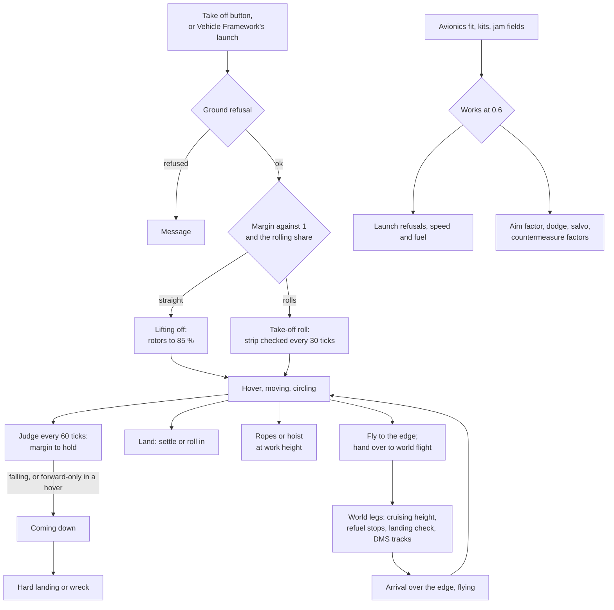

# Flight

**Status (23 Nov 2026):** living; written from the code at D'thorga Framework 0.267.0, Vehicles 0.113.3 and Patches 0.40.0. Built:
our own flight over a map (hover, circling, rolling take-off and landing, ropes and hoist, raiders by air), leaving and arriving
in flight, cruising height, lift-off limits, the sling, refuelling on a journey, avionics, aim, dodging, countermeasures, jamming,
the DMS air-defence tie-in and eleven aircraft in the fold. **Passed in game by the owner:** rows 49, 55, 140, 147, 187, 197, 199,
254 and 282; row 57 in part. **Not yet tested in game:** everything else, including the hover, circling and the rolling take-off.

This page says how aircraft fly and fight now. Why they are this way is in the [decision log](../decisions/flight.md) and the
[archived records](#why-it-is-this-way). Engines, turbines and the fuel ledger are on [engines and
drivetrains](engines-and-drivetrain.md); how the vehicle code is laid out is in [How the code is built](../architecture.md).

## Read this first (gotchas)

- **An aircraft stays an ordinary Vehicle Framework vehicle of its own class.** Our flight moves it by setting its position and
  heading from a saved true centre, and draws it through one postfix on `VehicleDrawTracker.DrawPos`. No class of ours is ever
  the vehicle's, so nothing of ours is named in a save as its type.
- **Our flight is opt-in per Def.** A `CompProperties_PhobosFlight` on the VehicleDef turns it on. It ships on the V-22 Osprey,
  and on Vanilla Vehicles Expanded's Mosquito, Cherokee and Louie behind "Stock helicopters fly over the map" (off). With that
  setting off, those three fly as Vehicle Framework made them.
- **Every other aircraft flies on its own author's code.** The Harrier (its fixed-wing framework), the Hind and Mongoose
  (rabiosus's VTOL framework), Close Air Support's jets, the Prowler, the C-17, the UH-60 and RimArrow's helicopters. We read
  their flight phase and airborne state by member name, and scale their figures; we never fly, aim or fire for them.
- **One figure runs our flight: the hover margin** (1 means just enough lift). At 1 or more it hovers. Down to
  `forwardFlightShare` (0.6) it can only fly forward. Down to `rollingShare` (the Osprey's 0.886) it can leave the ground rolling.
  Below that it falls or is refused. The margin comes from the engine model.
- **The margin exists only with the drivetrain on Full.** Below Full it reads as "can hover" everywhere, so no flight limit
  applies, not even every engine lost. Only an empty tank or a lost crew brings an aircraft down then.
- **The hover-limit setting reshapes the thresholds.** "Refuse it" (the default) applies them. "Allow it, at a cost" lets an
  aircraft hover past them and strains its engines. "Warn only" never brings it down for margin. Every engine out falls whatever
  the setting.
- **Tiers.** Our flight, rough landings, the dodge, jamming and the dispensers work for any faction's aircraft. The cruising
  height, refuel stops, the landing check and the lift-off refusal are the player's only. Another faction's aircraft runs the lite
  tier on a map (its systems do not evolve; they move only with hits).
- **A capability "works" at 0.6 or more.** Each avionics capability is a quantity on one system, `PhobosVehicleSystem_Avionics`:
  the loadout's figure × its part's efficiency × the battery's charge. Inside a hostile jamming field, radar and warning receiver
  read as not working whatever their health.
- **Countermeasures are a magazine, never cargo.** Cartridges in the cargo are never fired; haulers top the magazine up.
- **Two dodges, never both.** Ours (`mapEvasion`) is set only on the A-10 and Su-25, whose mod has none. The Harrier's and the
  Prowler's own dodges are scaled by a postfix. The Hind's and Mongoose's are left alone.
- **Turning the engines off in the air lands the aircraft**; the separate **Cut engines** button drops it as a fall.
- **A raiders' aircraft is never a prize.** Shot down it is a wreck with no hull; with its crew lost on the ground it is scuttled.
- **Almost everything is derived.** Speed, margin, cruise legs, salvo windows, jam fields and tracks are worked out again after a
  load. What is saved is listed under [Saved data](#saved-data-and-removal).
- **Every figure is authored unless the XML or code names a source.** Real figures (the Osprey's weights, the hoist's rating, the
  cruise clearances, the dispensers' loads) carry their source beside them in the Def or rule.

## What it does

### Which aircraft fly how

| Aircraft | Flies on | Profile | What we add |
| --- | --- | --- | --- |
| V-22 Osprey (ours) | Our flight | Its own | Everything on this page; hook, ropes, hoist, upgrades |
| Mosquito, Cherokee, Louie (Vanilla Vehicles Expanded) | Ours with the setting, else Vehicle Framework | StockRotorcraft | Hooks on the Cherokee and Louie |
| Frog, Toad, Goliath (Vanilla Vehicles Expanded) | Vehicle Framework | StockThrustLift | Lift by thruster; lopsided thrust on fuel |
| Harrier | Its fixed-wing framework | FixedWingJet | Avionics, dodge scaling, salvo, parts bill |
| Hind, Mongoose | rabiosus's VTOL framework | Helicopter | Avionics; a hook and hover lift on the Hind |
| A-10, Su-25 (Close Air Support) | Their framework | FixedWingJet | Avionics, our dodge, parts, bills, handling |
| EA-6B Prowler | Its framework | FixedWingJet | ICAP fittings, jamming fields, dodge scaling |
| C-17 Globemaster III | Vehicle Framework | StockAircraft | Four engines by wing; its hold counts as weight |
| UH-60M Black Hawk, RimArrow's helicopters | Vehicle Framework | StockRotorcraft | Hooks, avionics, bills |

### Taking off

- **The Take off button** works on the ground only. It is refused, with the reason, with the engines off (not drafted), short of
  crew, with an empty tank, under a roof, on a space map, by a system's launch refusal (blind take-off, controls), or by another
  mod's launch check (a closed sky).
- **Straight up** at margin 1 or more. Otherwise it rolls if a rolling share allows it, or is refused with the weight to shed
  ("lighten by N kg", worked out by the rotor rule at the 2/3 power of weight).
- **The climb** takes `climbSeconds` (6 s) to `flightHeightMetres` (60 m by default; Louie 50, Mosquito 40). It waits until the
  rotors reach 85 % of full speed, VTOL Vehicle's own figure. All of these are authored.

### Flying on a map

- **Orders**: Fly to, Hold here, Land here, Circle (three sizes, either way), and Cut engines. A right-click on the ground while
  airborne is a Fly to. Several aircraft ordered to one cell in one frame spread into rings of 6, 12 and so on.
- **Speed** (authored): 6 cells a second top, 1.5 cells a second², 45° a second turn by default; the Osprey 7 cells a second and
  35°. Stock helicopters get at least 4 cells a second. An aircraft brakes to arrive at rest, and slows to a quarter in a turn
  of 90° or more.
- **Holding**: it stops where its speed carries it. One that cannot hover circles instead and says so.
- **Judging the engines once a second** (staggered by ID): an aircraft that can only fly forward and is hovering, settling or
  working lines comes down where it is; while moving it flies on. An empty tank or a lost crew means a fall.
- **Undrafting in the air** lands it at the nearest clear spot within 15 cells (authored), or keeps the engines running and says
  why when there is none.
- **Drawn** on the skyfaller layer at eight headings, with a shadow offset by a quarter of its height (1.5 m a cell, authored).
  People beneath a hover or line work are slowed; an aircraft passing over slows nobody.
- **Rotors** spin up over 6 s and down over 10 s. The Osprey's nacelles tilt with forward speed, drawn by
  `CompPhobosTiltrotor`; this is presentation only.

### Landing, rolling and forced landings

- **A landing spot** is refused off the map or in the edge band, fogged, roofed, built on, claimed by another vehicle, or not
  standable. A trap refuses only an ordered landing. At touch-down the spot is checked again; blocked, the aircraft climbs back.
- **Every landing of the player's aircraft** ends with brakes on and engines off. Raiders keep their engines running.
- **A rolling take-off** needs a strip along one of four headings: from just under 1 to the full strip at the rolling share
  (9, 13, 17, 20 cells at 0.97, 0.94, 0.91, 0.886; an authored line). The Osprey's runs 5 to 20 cells on rough ground. The strip
  is outlined green or red ahead of a grounded aircraft that must roll. Lift-off is at 0.6 × top speed at the strip's end.
- **A rolling landing** comes down over the first two-fifths of a clear strip, braking evenly. A blocked strip stops it short
  with a forced landing's wear. A normal roll-in wears the undercarriage 5 %.
- **The Osprey's rolling share** is sourced: 52,600 lb of rolling weight against 57,000 lb gross, 0.886. No other aircraft has
  one, so no other can roll.
- **A forced landing** falls over 3 s. On open ground, undercarriage and airframe wear twice, 0.1 to 0.6 of a part's health by
  the shortfall, and each person aboard takes 2 to 10 blunt (authored). Over a building, roof, impassable ground, deep water or
  another vehicle, Vehicle Framework destroys it to a hull; cargo is set down first within 12 cells.
- **Destroyed in the air**, everyone aboard takes the fall harm of its height.

### Ropes and the hoist

- **Two fittings, any aircraft**: the fast-rope bar and the rescue hoist. They work from a steady hover at a 20 m work height
  (authored from the US Army's 90 ft rope less a margin; unverified). Every other order is refused while lines are out.
- **Ropes**: two riders at a time slide down at 4 m a second (the V-22 guide's two points; the speed authored).
- **Hoist**: rated 272 kg (600 lb, the V-22 guide); 0.7 m a second loaded and 1.2 empty (Army manual, Breeze-Eastern). It needs
  power, a second person aboard, room or a free litter, and the hover must hold with the person aboard. Unpowered it is wound by
  hand at 0.15 of its speed (authored).
- **A fall** from a line harms 2 points a metre above 1.5 m, in three blows (authored).

### Leaving and arriving

- **Leaving**: Vehicle Framework's launch is replaced for an aircraft on our flight. It takes off (or rolls), flies to the edge on
  the bearing of the journey's first tile, and hands over to Vehicle Framework's world flight there. A landing spot on the same
  map is flown to directly.
- **Arriving**: it comes in over the edge on the bearing it came from, at full height and speed, at the nearest place along the
  whole edge that wipes nothing out. Then it lands at the picked cell, or holds 12 cells in (centre, edge or targeted landing,
  which opens the landing targeter).

### Cruising height between tiles

- **Per leg** ("Cruising height between places", on), for the player's aircraft: the floor is the higher of ground + 300 m and
  mountains + 600 m (14 CFR 91.177). The oxygen line is 3,810 m (14 CFR 91.211), or the aircraft's own (the Osprey's 3,050 m).
  The ceiling is the published one scaled by weight to the 1.5 power and by the engines' share. 11,000 m is the top.
- **The height flown** is the design height, cut to the ceiling and the oxygen line, raised to the floor. A floor above the
  ceiling refuses the leg, with the kilograms to shed or "fly round".
- **What height does** (the air's density by the International Standard Atmosphere): a rotorcraft burns √(ρdesign/ρflown) more
  fuel at the same speed; a jet burns √(ρflown/ρdesign) and flies faster as the air thins; a propeller follows at a quarter power.
  The exponents are authored. Height is the one thing allowed to move an aircraft's speed and fuel through the air.
- **Oxygen**: everyone of flesh aboard needs it above the line, unless the cabin is pressurised (canopy intact), a cabin oxygen
  fitting works, or the crew are on a working oxygen set with no passengers. Walk-in cabin occupants count as passengers.
- **An engine lost on a leg** (looked at every 250 ticks): fly on, turn back to the stop it left, or struggle on.
- **Figures**: the Osprey 4,600 m design and 7,620 m ceiling; shared profiles 1,000 / 4,500 m (rotor) and 3,000 / 8,000 m
  (propeller), authored.

### Lift-off limits, rotor drives and thrust pods

- **Too heavy or too hot to lift off**: for the player's aircraft that Vehicle Framework launches, the lift-off check refuses the
  launch under "Refuse it". Aircraft on our flight answer it themselves. Past the limit under "Allow", a launch costs 0.1 of
  hot-section life, or 8 engine health without a turbine system (authored).
- **A rotor drive** caps lift power at the main gearbox's `transmissionLimit` × its parts' condition (at least 0.05). Shipped:
  0.9 on most, Mongoose 0.8, Louie 0.86 (0.9 where unsourced, authored).
- **Thrust-lifted pods** (Frog, Toad, Goliath) lift by `liftToWeightAtMaxGross` (1.5, 1.4, 1.2; authored); each thruster out takes
  its share of lift.
- **Thin air** ("Thin air at height") lowers lift with the tile's air pressure. Between tiles an aircraft keeps the air of the
  tile it left; the landing check at a journey's end reads the destination's temperature and pressure.
- **The landing check** at a journey's end (the player's lift-checked aircraft): refused, it lands rolling with 5 % gear wear;
  allowed, one strain; warn, a message.

### The sling

- **Any vehicle whose loadout has a `sling` block** gets the hook comp; it works with a fitted cargo hook and a sling set aboard.
  Loadouts with a sling: the Osprey (4,536 kg), the Hind, the UH-60, the Cherokee, the Louie and RimArrow's helicopters. Ours
  stands down on the Cherokee when Cherokee Sling is installed.
- **Capacity** falls 1 % for each °C above 15 °C, at most 30 % ("Hot days lift less"; authored).
- **A load** is refused if it is the aircraft itself, another aircraft, beyond 25 cells, roofed, moving, under a lord, hitched,
  or too heavy to hover with. **Overload and weather are warnings**: the lift goes ahead and strains the hook mount by the
  overload share, plus 0.25 in bad weather.
- **Slung flight** is 0.7 of speed on the map and between tiles, and burns 1.3 × fuel a tile (authored).
- **From a hover** (our flight, or the Hind) the aircraft flies to beside the load and hooks it, sets it down from the air, or
  releases it. A drop does nothing at 2 m or less and destroys the load at 40 m or more; a release from cruise is from 30 m, a
  crash drop from 15 m. Released over the world map, the load becomes a wreck site a caravan can recover. A hull can hang too.
- **The water bucket**: 3,000 litres, 100 a cell, 50-cell reach (authored).

### Refuelling on a journey

- **"Refuel from cargo"**, a switch on the aircraft: every 250 ticks in flight, below half a tank with a depot of ours on the
  tile, it stops there. Otherwise at a quarter tank with fuel aboard it sets down on open land (never water, impassable ground,
  space or a hostile site, nor where it could not hover under "Refuse it"), pours, and waits a quarter hour a tank plus 0.1 hour.
- **The picker** allows journeys that the fuel aboard covers. Caravans do the same on the road; that belongs to the world map.
- **No pouring in the air.**

### Raiders by air

- **"Raiders may arrive by aircraft"** (on) adds an air-assault arrival to attack-now raids: weight 0 at 1,000 points or less,
  0.1 at 1,500, 0.3 at 4,000 (authored). Only aircraft with the raider extension take part: today, the Osprey, Industrial and up.
- **Up to three aircraft**, crewed by two of the faction's people not in the raid, with a full tank.
- **Where they land**: past the turrets (half the time), roping in close (0.3), or simply close (0.2). Spots are 6 to 60 cells
  from the colony's middle and kept apart. Once unloaded it leaves by its way in; raiders still aboard are set down at the edge to
  walk in, and the crew go home.

### Avionics

- **Nine capabilities** in a loadout's fit: attitude, navigation (none, basic, full), autopilot, radar, sight (none, basic, full),
  night sight, warning receiver, countermeasures and oxygen, with `cruisesHigh`. Every aircraft has attitude and basic navigation.
- **Power** at 24 V (authored amps: radar 20, full navigation 6, autopilot 4 …), in two loads: the essentials stay on the battery;
  `missionAvionics` (autopilot, radar, night sight, the full fits' extra) is shed fourth.
- **Parts**: the instruments sit on an `Avionics` part (the aircraft's own, a dashboard, or an appended avionics bay). Every
  aircraft also gets small mounts for the kits (autopilot servos, a sensor station, a radar bay) and a pod pylon.
- **Blind take-offs** (A1): attitude below 0.6 in poor visibility (night, or weather accuracy below 0.8) refuses the launch;
  "Blind take-offs: warn only" turns it into a warning.
- **Navigation** (A2, A3): lost, or only basic in poor visibility, gives 0.85 speed and 1.15 fuel; a working autopilot halves
  that. A full set flies straight.
- **Rough landings** (A4, "Rough landings", on): a 0.4 chance on a landing the crew cannot see to make, or with flight controls
  below 0.5; halved with an autopilot. A hard landing wears the gear by 0.3 of its full health.
- **Controls** (A7 to A9): hydraulic boost below 0.4 halves flight control (0.7 with manual reversion, after the A-10A manual's
  "adequate for safe return"); flight controls below 0.35 refuse the launch; an engine out gives 0.8 speed.
- **Oxygen** (A14): an aircraft that cruises high with its oxygen out flies low, at 0.85 speed and 1.2 fuel where the cruising
  height does not govern. "Crews feel thin air when oxygen fails at height" (off) gives hypoxia when a hit knocks it out.
- **Four avionics kits** fit any aircraft (navigation set, autopilot, night sight, radar), each raising one figure and adding its
  own load. A kit is offered only where the built figure is lower.

### Aim, dodging and countermeasures

- **Aim by sight, dark and weather** ("Sights and weather affect an aircraft's aim", on), in the air on a map: a basic sight 0.8,
  none or out 0.667, dark without a night sight × 0.7, poor visibility a further × 0.7 of which a working radar gives back half.
  An aircraft with no sight in its fit keeps its author's aim. The factor scales the turret's accuracy, widens a bomb's or
  rocket's miss radius for one shot, and under Combat Extended widens the flight frameworks' sway. All figures authored.
- **The dodge**: the author's chance × flight control × (0.75 without a working warning receiver) + the salvo's bonus, capped at
  the higher of 0.85 and the author's chance, then × the lopsided-thrust factor.
- **Our dodge** (A-10 0.26, Su-25 0.35, scaled from the Harrier author's 0.40 by top speed): a vanilla shot it dodges is re-aimed
  past the footprint; a Combat Extended shot passes through, one roll per shot and aircraft.
- **The salvo** ("Chaff and flares"): 2 cartridges for +0.25 for 600 ticks, in the air, with dispensers working.
- **Lopsided thrust** ("Lopsided thrust unsettles twin jets", on): asymmetry from each engine's output and arm; dodge × (1 − yaw ×
  asymmetry) and fuel × (1 + yaw × 0.5 × asymmetry), authored. On the C-17 and the thrust pods it moves fuel only.
- **The magazine** holds the fit's cartridges (UH-60 60, C-17 120, A-10 240, Su-25 128, Prowler 60, Harrier 60, Hind 128) ×
  the fittings' factor. Cartridges are made ten at a time at the parts bench (10 steel, 20 chemfuel). Haulers top up once ten
  are missing. Another faction's aircraft is stocked once with 25 to 75 %. The loaded weight counts as mass.
- **The ECM pod** (any aircraft, on its pylon): an unmanned turret's shot misses 30 % of the time, combined with any dodge.

### Air defence and jamming

- **The Dead Man's Switch - Expedition** ("…'s air defence sees aircraft", on, shown only with it): every flying aircraft on the
  world map is a track, at its cruising height, climbing and descending over 1.5 tiles at each end.
- **Warnings** (AD2): "tracked", "locked on" and "launched", each at most once an hour; a launch always.
- **Countermeasures** (A16): each launch at the aircraft fires one salvo automatically, late "by eye" if the receiver is out. Hit
  chance × 0.6 on the receiver's cue, × 0.85 late; lock time × 1.5 on the cue. The Osprey's infrared jammer gives the cue factor
  with no cartridges. The ECM pod adds × 0.8 and × 1.4.
- **A hit in flight**: 60 damage in four blows on the aircraft's own hit areas. It comes down only with flight control below 0.35,
  every engine out, or body integrity below 0.2, through Vehicle Framework's crash event.
- **A closed sky** (AD7): a map whose alert reports its airspace blocked refuses take-off. **The launch warning** asks DMS's
  prompt before the player's flights leave.
- **Jamming fields**: the Prowler's jammer (its radius × 1.10 or 1.25 with ICAP II or III) and our Busbar generator set's mast
  blind a hostile faction's radar and warning receivers inside them, never their own side's.
- **InterRim Ballistic Missile has no tie-in with aircraft.** Its close-in weapons shooting Combat Extended's shells is an air
  defence patch of D'thorga Patches, not flight.

### The aircraft in the fold

| Aircraft | Avionics beyond the basics | Dodge | Parts and bill | Enemy fits; handling |
| --- | --- | --- | --- | --- |
| V-22 Osprey | Full nav, autopilot, warning, oxygen | none | Its own bill | Its tree: second hook, armour, IR jammer, terrain radar, inlet barrier |
| UH-60M | Full nav, autopilot, warning, CM | none | 2 engines, 2 rotor drives … | Generic refits |
| C-17 | Full nav, autopilot, radar, warning, CM, oxygen | none | 4 engines, 4 alternators … | Generic refits |
| A-10, Su-25 | Basic nav, full sight, warning, CM, oxygen | ours | Six parts each; bills | A-10C, late Su-25; "Realistic handling" off |
| EA-6B Prowler | Basic nav, radar, basic sight, warning, CM, oxygen | author's, scaled | Five parts; bill | ICAP II, III; "Realistic handling" off |
| Harrier | Full nav, autopilot, full sight, warning, CM, oxygen | author's, scaled | Ten parts; bill | Harrier Plus |
| Hind, Mongoose | Full nav, full sight, warning (+ CM, autopilot; night sight) | their own | none of ours | — |

- **The jets start as their early versions**: the Harrier as a day-attack AV-8B, the A-10A, the first Su-25, the 1976 ICAP
  Prowler. A Harrier from an older save gets its night sight and radar once, free. Upgrades come as our fittings beside the
  authors' trees.
- **Generic enemy refits** for any aircraft: a night refit (Industrial and up) and a full refit (Spacer and up), rolled at 0.25.
- **"Realistic handling"** (D'thorga Patches, off, needs a restart) brings the A-10's and Su-25's speeds to their real figures.
  The Prowler's equals its author's today.

### Munitions

Under Combat Extended, the aircraft's stores weigh what the real ones do (D'thorga Patches): RBK-250 273 kg, CBU-87 430 kg, HARM
360 kg, the ALQ-99 pod 431 kg, Shturm 46.5 kg, Hellfire 45 kg, beside the Mk. 82's 227 kg. A turret's loaded rounds count in the
aircraft's mass, so a loaded A-10 or Prowler weighs what its stores really do. Rearming takes one kind at a time for the Harrier,
Hind, Mongoose, Close Air Support and Prowler (a temporary patch). Their recipes and prices belong to [aircraft
munitions](../archive/aircraft-munitions.md).

### Parachute airdrops and the hold

An aircraft whose Def carries `PhobosAirdropExtension` drops by parachute (Framework 0.288.0; [the design](../airdrop.md)): a
**drop pass** on our flight (`CompPhobosFlight.Drop.cs`: a straight line through the release point upwind of the target, people then
bundles then vehicles, then on out), a **hover drop**, and from the world map `ArrivalAction_PhobosAirdrop` (a map, an empty tile as a
caravan or depot, a gift). Each load is a `PhobosParachuteFaller`, a skyfaller and active transporter whose ground cell moves along its
drift while its drawn height falls, so Combat Extended's CIWS leads and hits it as it does a drop pod. Drift is the Army's D = K x A x V
at a fifth of its real length (`ParachuteRule`), on the map's wind (`PhobosWind`: Combat Extended's, else ours). `CompPhobosHold`
carries vehicles off the map behind a ramp. The C-17 flies our pass only (`onlyInDrops`) and only with its setting on.

## How it works

**Per tick, airborne only** (`CompPhobosFlight.CompTick`): rotors and flight sound, Vehicle Framework's pather held still, the
engines, the state's step and the hover's path cost. **Every 30 ticks**: a raider's think and the sling's flight think (offset
15). **Every 60 ticks**: the judge, staggered by ID. The comp ticks only while it must: in the air, while a raiders' aircraft
unloads, or while rotors turn on the ground.

**Every rare tick** (250 ticks): the vehicle systems update (the avionics quantities with them) and rough landings are watched.

**On the world map**, for the player's aircraft (`WorldObjectComp_PhobosFlightSystems`): every 250 ticks the systems update, then
the refuel look and the cruising-height look; every tick the refuel hold while set down.

**On events**: Vehicle Framework's launch event strains an over-limit lift-off and arms the sling; DMS's events give warnings, the
automatic salvo and hits; every projectile launched at a vehicle meets the dodge once.

**Every flight patch asks `FlightRegistry.Any` first**, one dictionary count, and returns while nothing of ours flies.

## Code

All under `src/PhobosFramework.Vehicles/` unless named.

| File | What it holds |
| --- | --- |
| `src/PhobosFramework/Rules/FlightPathRule.cs`, `RollRule.cs`, `OrbitRule.cs` | Speed, thresholds, forced-landing wear; rolling shares and strips; circles |
| `src/PhobosFramework/Rules/CruiseRule.cs`, `LineRule.cs`, `RaidLandingRule.cs` | Floor, ceiling, oxygen and factors; ropes, hoist and falls; raid spots |
| `src/PhobosFramework/Rules/SlingRule.cs`, `WaterDropRule.cs` | Hook capacity, weather, strain, slung flight, drops; the bucket |
| `Rules/RotorRule.cs`, `TiltrotorRule.cs`, `LandingSurfaceRule.cs`, `PhaseReachRule.cs`, `FormationRule.cs` | Rotor spin, nacelles, dust, phases, rings |
| `Rules/AvionicsRule.cs`, `AirCombatRule.cs`, `JamFieldRule.cs` | Fit values and amps; aim, dodge, countermeasures, lopsided thrust; fields |
| `Flight/CompPhobosFlight.cs` (and `.Lines`, `.Raider`, `.Rotors`) | The flight comp: states, orders, ticks, lines, a raider's flight, rotors |
| `Flight/FlightSupport.cs`, `FlightJourneys.cs`, `FlightPatches.cs` | Registry, buttons, inspect text, strip; leaving and arriving; the map patches |
| `Flight/RaiderFlight.cs`, `FlightGroupOrders.cs`, `LandingSurface.cs` | Air assault; group spread; dust and grass fires |
| `Service/OnMapFlight.cs`, `HoverLimits.cs`, `LandingCheck.cs`, `RoughLandings.cs` | Others' airborne state; lift limits; journey's end |
| `Service/CruiseHeight.cs`, `CruiseHeightPatches.cs`, `CargoRefuel.cs`, `FlightCargoReachPatches.cs` | Cruise legs; refuel stops; reach |
| `Service/AirCombat.cs`, `AirborneEvasion.cs`, `AimScatterPatches.cs`, `JamFields.cs`, `EcmPod.cs` | Works, dodge, aim, fields, pod |
| `Sling/` (`CompPhobosSling.cs`, `HoverPilots.cs`, `SlingJobs.cs`, `SlingWreck.cs`, `WaterDrop.cs`, `SlingPatches.cs`) | The hook |
| `Systems/CompPhobosDispensers.cs`, `AircraftUpgrades.cs`, `CompPhobosTiltrotor.cs` | The magazine; upgrade hooks; nacelles |
| `Defs/PowertrainDefs.cs` (flight profile, phases, cruise, readers), `AirCombatDefs.cs`, `LandingSurfaceDefs.cs` | The Defs |
| `src/PhobosFramework.Vehicles.Dmse/` (`AircraftTrack.cs`, `AirDefenceTieIn.cs`) | The DMS tie-in, loaded only with DMS Expedition |
| `src/PhobosPatches.Harrier/`, `PhobosPatches.Prowler/`, `PhobosPatches.CloseAirSupport/`, `PhobosPatches.AircraftRearm/` | Authors' aircraft |

## Defs and XML

The modders' types, linked to [the reference site](https://phobos-dthorga.github.io/phobos-rimworld/):

- **[`CompProperties_PhobosFlight`][f1]**: speed, acceleration, turn, climb, descent and fall seconds, `flightHeightMetres`, roll
  lengths, `needsBuiltFloor`, `liftOffSpeedShare`, circling, `workHeightMetres`, ropes and hoist, `onlyWithStockSetting`,
  `flightSound`, rotor speeds. `ConfigErrors` refuses non-positive speeds and times, roll lengths out of order, a work height
  above the flight height and a circle tighter than speed over turn rate. Shipped on four Defs.
- **[`PhobosVehicleFlightProfileDef`][f2]**: `reader`, `phases` ([`FlightPhaseSpec`][f3]), `hoverPowerAtMaxGross`,
  `liftCheckAtLaunch`, bleeds, world and map fuel phases, `mapFuelRateMember`, `cruise` ([`CruiseSpec`][f4]: design and ceiling
  metres, `lift`, `oxygenLineMetres`, `pressurised`), `forwardFlightShare`, `rollingShare`. Six shipped: FixedWingJet, Helicopter,
  StockAircraft, StockRotorcraft, StockThrustLift and the Osprey's.
- **Phase readers**: `PhaseReader_OwnFlight` and [`PhaseReader_Members`][f5], whose `PhaseRule`s name a comp, a dotted member and
  a value; a missing member matches nothing.
- **[`PhobosRaiderAircraftExtension`][f6]**: `minTechLevel`, `weight`; on the Osprey. The arrival mode is `PhobosAirAssault`.
- **[`PhobosLandingSurfaceRulesDef`][f7]**: dust wear (0.5 % an event, floor 30 %), barrier, grass-fire chance (4 %, × 3 in a heat
  wave).
- **[`CompProperties_PhobosTiltrotor`][f8]** and **[`CompProperties_PhobosSling`][f9]** (added by code where a loadout has a
  `sling`).
- **[`AvionicsFit`][f10]** on a loadout (`avionics`), with [`AirTrackSpec`][f11] (`speed`, `cruiseMetres`, `lowCruiseMetres`,
  `size`), `countermeasureCartridges`, `cruisesHigh` and `mapEvasion`; 21 blocks ship.
- **[`PhobosAirCombatRulesDef`][f12]**: every air-combat figure, first loaded wins; it has no `ConfigErrors`.
- **Loadout fields**: `engineOutYaw`, `engineArms`, `heldMassComps`, `fittedOnOlderSaves`, `sling`. Fittings carry
  `parameterFloors`, `cartridgeFactor` and `jamRadiusFactor`; fit sets ([`PhobosVehicleFitSetDef`][f13]) give other factions'
  aircraft their kits.
- **[`PhobosVehicleRulesDef`][f14]** holds the sling, refuel and water-drop figures and `jammedQuantities`.
- **Systems**: `PhobosVehicleSystem_Avionics` and `_FlightHydraulics` (`Systems_Avionics.xml`), the flight controls
  (`Systems_FlightControls.xml`). The cartridge, its recipe, the hypoxia condition and the top-up Def are in `AirCombat.xml`.

`python scripts/check-vehicle-schemas.py` reads the Defs offline; `python scripts/query-defs.py` shows a loadout as patched.

[f1]: https://phobos-dthorga.github.io/phobos-rimworld/api/Phobos.VehicleSystems.CompProperties_PhobosFlight.html
[f2]: https://phobos-dthorga.github.io/phobos-rimworld/api/Phobos.VehicleSystems.PhobosVehicleFlightProfileDef.html
[f3]: https://phobos-dthorga.github.io/phobos-rimworld/api/Phobos.VehicleSystems.FlightPhaseSpec.html
[f4]: https://phobos-dthorga.github.io/phobos-rimworld/api/Phobos.VehicleSystems.CruiseSpec.html
[f5]: https://phobos-dthorga.github.io/phobos-rimworld/api/Phobos.VehicleSystems.PhaseReader_Members.html
[f6]: https://phobos-dthorga.github.io/phobos-rimworld/api/Phobos.VehicleSystems.PhobosRaiderAircraftExtension.html
[f7]: https://phobos-dthorga.github.io/phobos-rimworld/api/Phobos.VehicleSystems.PhobosLandingSurfaceRulesDef.html
[f8]: https://phobos-dthorga.github.io/phobos-rimworld/api/Phobos.VehicleSystems.CompProperties_PhobosTiltrotor.html
[f9]: https://phobos-dthorga.github.io/phobos-rimworld/api/Phobos.VehicleSystems.CompProperties_PhobosSling.html
[f10]: https://phobos-dthorga.github.io/phobos-rimworld/api/Phobos.VehicleSystems.AvionicsFit.html
[f11]: https://phobos-dthorga.github.io/phobos-rimworld/api/Phobos.VehicleSystems.AirTrackSpec.html
[f12]: https://phobos-dthorga.github.io/phobos-rimworld/api/Phobos.VehicleSystems.PhobosAirCombatRulesDef.html
[f13]: https://phobos-dthorga.github.io/phobos-rimworld/api/Phobos.VehicleSystems.PhobosVehicleFitSetDef.html
[f14]: https://phobos-dthorga.github.io/phobos-rimworld/api/Phobos.VehicleSystems.PhobosVehicleRulesDef.html

## Settings

D'thorga Framework's are in its vehicle systems settings, page "Aircraft and sling loads" unless named. The full text is in the
generated [settings reference](../settings-reference.md#dthorga-framework-and-dthorga-vehicle-systems); D'thorga Patches' are
[there too](../settings-reference.md#dthorga-patches).

| Label | Default | Section |
| --- | --- | --- |
| When an aircraft is too heavy or too hot to lift off, hover onto its pad or land at a journey's end | Refuse it | Flight |
| Stock helicopters fly over the map | Off | Flight |
| Cruising height between places | On | Flight |
| Aircraft fuel follows the engines | On | Flight |
| Rough landings | On | Flight |
| Blind take-offs: warn only | Off | Flight |
| Crews feel thin air when oxygen fails at height | Off | Flight |
| Sights and weather affect an aircraft's aim | On | Flight |
| Lopsided thrust unsettles twin jets | On | Flight |
| The Dead Man's Switch - Expedition's air defence sees aircraft | On (shown only with it) | Flight |
| Hot days lift less; A ground crew hooks the load up; Weather can ground a lift | On | Sling loads |
| Slung loads fly slower and burn more; Emergency release and drops | On | Sling loads |
| Raiders may arrive by aircraft | On | Dangers and raids, Other factions |
| Thin air at height | On | Engines and driving, Fuel and power |
| Realistic handling (Close Air Support; EA-6B Prowler) | Off, needs a restart | D'thorga Patches |

"How engines and drivetrains work" below Full turns every flight limit off (see the gotchas). "Figures only, no consequences"
stops raiders by air and the limits' consequences. People slowed beneath a hover have no setting.

## Saved data and removal

- **The flight comp** saves under `PhobosFlight_*`: state, true centre and heading, climb, target, landing cell and facing, the
  departure's nodes and arrival, the roll, the circle, engines cut, the line work (with anyone held on a line, deep) and the
  raider's plan.
- **The sling** saves under `PhobosSling_*`: the held load (deep), hook state, the drop cell and the approaches.
- **The hub** saves `PhobosVehicleSystems_RefuelFromCargo`, `_LandedRefuelUntil`, `_ArrivingFromWorld` and `_ArrivalFuelSet`.
- **The magazine** saves `PhobosDispensers_Magazine` (real cartridges, deep) and `_Settled`; the fittings save
  `PhobosVehicleSystems_FitSetRolled` and `_OlderSaveFitsSettled`.
- **World objects of ours**: the sling wreck site (`PhobosSlingWreck_*`) and the water run (`PhobosWaterRun_*`).
- **Derived, never saved**: speed, margin, cruise legs, phases, avionics readings, salvo windows, warning cooldowns, jam fields,
  tracks and lopsided thrust.
- **Older saves**: cargo cartridges move into the magazine once; a Harrier gets its night sight and radar once.
- **Removal** (inferred from the code): an aircraft of ours goes with its Defs. A Vanilla Vehicles Expanded helicopter saved in
  the air on our flight loads as a grounded vehicle beneath its centre; anyone on a line or hanging on the hook is lost with the
  comp's data; cartridges and the hypoxia condition lose their Defs. The general sweep is in [How the code is built, Saves and
  removal](../architecture.md#saves-and-removal).

## Tie-ins

Every tie-in is in the [tie-in register](../tie-in-register.md).

- **Vehicle Framework** (required): Harmony on its launch, arrival, world flight speed and fuel, the destination picker, the last
  node of a flight path, the crash event, drawing, boarding and turret firing; its launch and ignition events; some private fields
  read by name.
- **Vanilla Vehicles Expanded and Tier 3**: our flight on the Mosquito, Cherokee and Louie (a setting), stock profiles, hooks.
- **rabiosus's VTOL framework** (Hind, Mongoose): flight state, airborne state and the Hind's hover pilot, by name.
- **The Harrier's framework**: phase by `CompHarrier.landingPhase`, `FlightState` and taxiing; pad landings gated by the hover
  limit from D'thorga Patches; dodge scaled and the salvo registered.
- **Close Air Support, the EA-6B Prowler, the C-17 and the UH-60** (z3nt3's): loadouts, parts, bills, realistic handling, the
  Prowler's jammer read through its public methods and its ICAP radius by a postfix, the C-17's hold comp by type name.
- **The Dead Man's Switch - Expedition**: an optional assembly; our flights as tracks, its events, the closed sky and the launch
  prompt.
- **Combat Extended**: the dodge's collision postfix, blast penetration for hits in flight, the frameworks' sway, real munition
  weights.
- **Cherokee Sling**: our hook stands down on the Cherokee.
- **Other mods' launch checks** are honoured before our take-off.

## Performance

- **Nothing of flight has been measured.** The timed labels are "vehicle rare tick / in flight", "aircraft refuel from cargo" and
  "aircraft cruising height" (`Service/CaravanComp.cs`); nothing in `Flight/` or `Sling/` is timed.
- **Shape of the cost**: a ticking comp only while airborne; the judge every 60 ticks; thinks every 30; one dictionary count in
  every patch while nothing flies; ground on a leg cached per tile pair (256 entries); a leg worked once per next tile; member
  readers cached per type; jam fields re-read every 60 ticks a map; DMS tracks once a tick; one dodge roll per projectile.
- **The budget** is the vehicle model's ([How the code is built](../architecture.md#how-things-run)).

## Limits and known gaps

- **Below Full drivetrain, no flight limit applies**, every engine out included (inferred from the code).
- **Only the Osprey has a rolling share**, so no other aircraft rolls; `TooHeavy` always uses the rotor rule.
- **The landing check judges only lift-checked aircraft**: never the Hind, Mongoose or Harrier.
- **A blocked rolling-landing strip** makes the aircraft circle; it never looks for another strip.
- **VTOL Vehicle's airborne state is read under two names** (`IsAirborne` and `IsFlying`); not checked against the installed mod.
- **A raiders' aircraft lifts off without the rolling check**; one that cannot hover comes down at the next judge.
- **Night counts twice in aim**: night is also poor visibility, so without a night sight the factor is 0.49 (inferred).
- **The Osprey's terrain radar does nothing** but draw 20 A; the pod and infrared jammer keep working while their loads are shed.
- **The Hind carries 128 cartridges but has no map salvo**; they are spent only against DMS.
- **IRBM's radars never see our aircraft**, and DMS's blockades stay blind to them.
- **The refuel stop** uses the tile nearest the drawn position, so it may be a tile off.
- **Not built**: A13 (radar strike warning), A15 (cold cockpit), A17 (ejection), L4 (turbine oil feed); AD1, AD4 to AD6 and AD8
  to AD13; pouring fuel in the air; the F-35B and an attack helicopter of ours.

## Tests

None of these is a test in game.

- **Rule tests**, `tests/PhobosFramework.Rules.Tests`: `FlightPathRuleTests`, `RollRuleTests`, `OrbitRuleTests`,
  `CruiseRuleTests`, `LineRuleTests`, `RaidLandingRuleTests`, `SlingRuleTests`, `WaterDropRuleTests`, `CargoFuelRuleTests`,
  `TravelReachRuleTests`, `AirRuleTests`. `tests/PhobosFramework.Vehicles.Rules.Tests`: `RotorRuleTests`, `TiltrotorRuleTests`,
  `LandingSurfaceRuleTests`, `PhaseReachRuleTests`, `ArrivalFuelRuleTests`, `FormationRuleTests`, `ReachRuleTests`,
  `TurbineAirAndFuelTests`, `AirCombatRuleTests`, `AvionicsRuleTests`, `AvionicsEffectsTests`, `JamFieldRuleTests`,
  `LopsidedThrustTests`, `ServiceLifeUpgradeTests`.
- **Python**: `tests/test_no_spawn_in_spawn_setup.py`, `tests/test_vehicle_set_down_footprint.py`,
  `tests/test_check_vehicle_schemas.py`, `tests/test_tie_in_load_order.py`.
- **In game** ([test list](../in-game-test-pass.md)): **passed** 49, 55, 140, 147, 187, 197, 199, 254, 282; **passed in part** 57;
  **seen working by the game, awaiting the owner** 200, 204, 206, 226, 233, 306; **waiting** 22, 60, 63, 77 to 79, 99 to 102,
  113, 139, 141 to 145, 193, 198, 203, 205, 207 to 213, 220, 235 to 240, 242 to 244, 259, 278, 286, 289, 299, 307, 313, 314,
  342 to 345, 380, 381, 402, 405, 409, 420 to 422, 429, 431.

## Why it is this way

- **[The decision log](../decisions/flight.md)**: every choice, one line each, with who made it and where.
- **Archived records**, kept unchanged for their history: [our own flight over the
  map](../archive/vehicle-flight-over-the-map.md), [avionics](../archive/vehicle-avionics.md), [sling
  loads](../archive/vehicle-sling-design.md), [power and lift](../archive/vehicle-power-and-lift-design.md), [Close Air Support's
  jets](../archive/close-air-support-jets.md), [the EA-6B Prowler](../archive/ea6b-prowler.md), [the UH-60M Black
  Hawk](../archive/uh60-blackhawk.md), [the C-17](../archive/c17-globemaster.md), and, with [upgrades and
  fittings](upgrades-and-fittings.md), [aircraft service-life upgrades](../archive/aircraft-service-life-upgrades.md).
- **Records kept in place** (they cover flight and another system): [thin air, turbines and aircraft
  fuel](../vehicle-altitude-and-turbines.md), [refuelling from cargo](../vehicle-cargo-refuel.md), [air-defence
  tie-ins](../air-defence-tie-ins.md), [modern military aircraft and vehicles](../modern-military-vehicles.md), [the V-22
  Osprey](../vehicle-osprey.md), [aircraft munitions](../archive/aircraft-munitions.md).
