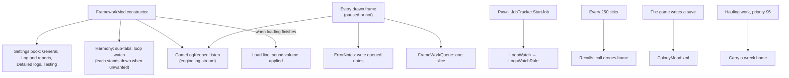

# Framework services

**Status (23 Nov 2026):** living; written from the code at D'thorga Framework 0.271.0. Built: settings books and pages, the shared
logger with verbose logging, the game log keeper and error notes, the load line, long jobs over frames, the loop watch, the
Architect's sub-tabs, the colony mood file, drones called home and their wrecks taken home, the sound volume, pictures and
progress bars, rules Defs, optional mods by name, the save helpers, seen-in-play notes and the uninstall sweep. **Passed in game
by the owner:** rows 267 (settings pages), 384 (drones called home), 257 (journeys in the logbook); row 301 in part (the D'thorga
tab: Medical nested under UI Rethemed, Motor pool not). **Not yet tested in game:** everything else, including rows 5 (the log
comes back), 114 (verbose logging), 230 (error notes), 303 (the loop watch), 385 (wrecks carried home) and 389 (send someone).

This page says how the Framework's shared services work now: what every D'thorga mod leans on that is not a game system of its
own. Gases, the health layer and building machinery have their own pages ([gases and air](gases-and-air.md), [the health
layer](health-layer.md), [power, top-up and machines](power-and-machines.md)). How to call each service is in [D'thorga
Framework for modders](../../framework-modding.md); how the code is laid out in general is in [How the code is
built](../architecture.md). Why it is this way is in the [decision log](../decisions/framework-services.md) and the
[records](#why-it-is-this-way).

## Read this first (gotchas)

- **Every service is generic.** Nothing here names a mod of ours or another author's, bar the tie-ins it reads by name (Vanilla
  Gravship Expanded's marker, Combat Extended's settings). A service another mod might need goes here in the change that first
  needs it.
- **The core has two Harmony patches only** (since 0.205.0): the Architect's sub-tabs and the loop watch. Each stands down by
  itself when it is not wanted. Everything else uses the game's own hooks.
- **Logs go through phobos-log**, a sibling repository compiled into this assembly: `Logs.For(mod, part)` in a static field named
  `Logger`, never `Log` (a field named `Log` hides the game's class). Each mod has one line budget, 200 warnings and 50 errors in
  ten minutes, however many parts it has.
- **The game log keeper turns the game's log back on** after its 10,000-message limit, at most 25 times a session, naming the
  loudest message each time. It changes nothing until the game has already silenced itself.
- **Error notes say where our code was on an error's path, never that it caused it.** At most 50 a session.
- **A settings book can span several Mod classes**: D'thorga Patches' tie-ins each add a page to one window; the vehicle systems
  have a book of their own that also writes a Framework setting.
- **Long jobs over frames are never saved.** A job still running at a save is forgotten on load, so every step must leave the map
  sound.
- **The loop watch only tells.** It never changes a job; it names the colonist and the thing once, then keeps quiet for a day.
- **Nothing a service keeps is saved unless named below.** Derived state is rebuilt.

## What it does

### Settings books and pages

Every D'thorga settings window is laid out as the game's own Options window: pages down the left, a search box above them that
searches every page, a tick that shows only changed settings (each marked with a dot), and a button that puts one page back to
its defaults.

- **`SettingsBook`**: one entry in the game's mod settings list. Several `Mod` classes may join one book (`SettingsBook.For(id)`,
  then `Join`); the first to join hosts it, and closing the window writes every member's file. A member may also name another Mod
  whose settings one of its pages changes, so that file is written too.
- **`SettingsPage`**: an ID, an order, a label translated when drawn (a language change shows at once) and, optionally, a test for
  whether it is listed (a tie-in's page only while its mod is active). The book remembers the page last open, for the session.
- **`SettingsList`** draws rows that each take their **default**, so the page can mark, list and reset them, and their label and
  tooltip, so search finds them: sections, ticks, radio rows (two to four options), menu rows, sliders (the game's do not round,
  so neither do ours unless told), notes, amber cost lines, buttons that act at once (a removal sweep), and rows a page draws
  itself.
- **Restart**: a setting that needs a restart says so beside its label; closing the window after changing one names it. A change
  put back to its first value is forgotten.
- **The pages each mod has**: D'thorga Framework's are General, Log and reports, Detailed logs and Testing.
- **Settings that change Defs** are read by XML patches through `PatchFlags` (`PatchOperationPhobosFlag`), and take effect at the
  next start. A **switched patch** (`SwitchedPatch`) goes in and comes out with its setting while the game runs, so a busy method
  costs nothing until asked for (first used for rain soaking the fields).
- **`SettingsImport`** carries a player's settings across a move of folder or Mod class, once, while the mod has no file of its
  own yet (the seven-to-one merges of 7 Nov 2026 used it).
- **`DisplayMode`**: Plain, Operator or Engineer: the same reason at every depth; Plain never shows a decibel or a percentage.

### Logging

| Piece | What it does |
| --- | --- |
| `Logs.For(mod, part)` | A log per mod or part, headed as the mod in Player.log, sharing the mod's budget; `Logger.Debug` lines only while verbose |
| Verbose logging | "Verbose logging: everything", or a tick per log on the Detailed logs page; saved as the logs' keys |
| `HostLog` | Writes under our own category through the engine's logging library, so a line still reaches Player.log after the limit |
| `GameLogKeeper` | Each frame, paused or not, turns the game's log back on if it has stopped, at most 25 times a session |
| `ErrorNotes` | After an error whose trace passes through `Phobos.` code or a `PhobosDthorga.` Harmony patch, one note per kind of error |
| `LoadReport` | Every mod's one load line: "[Prefix] version loaded. On: a, b. OFF because ...: c."; one per part for mods of parts |
| `UiGuard` | A tab, window or inspect text that throws is logged once in full, rests a few seconds showing one line, then tries again |

- **The loudest message** is counted from the engine's public log stream, which carries every mod's messages: one signature and
  one dictionary lookup per message.
- **Error notes** read only errors, never informational lines (which on 1.7 carry a trace too). A note is queued on whichever
  thread logged the error and written on the main thread at the next frame of play, under our own category, so it never feeds
  itself; an error while a save loads is noted once the game runs. Each quotes up to 120 characters.
- **If a later 1.7 build moves the engine's logging type**, `HostLog` says so once and writes through `Verse.Log` with the
  category as a prefix.

### Long jobs and the loop watch

- **`FrameWork` and `FrameWorkQueue`**: one long job runs a slice per drawn frame, paused or not, so the game keeps responding (a
  strategic blast crossing a map). A subclass says how to start, how to take a step, when it is finished and how much of a frame
  it may use; the queue times it. Cheap while empty.
- **`RoomRebuildHold`** holds a map's room and region rebuild while a slice destroys many things, so the game rebuilds once at the
  end of the slice. It sets the game's private "working" flag by reflection.
- **The loop watch** (`LoopWatch`): a postfix on the game's `Pawn_JobTracker.StartJob` notes, for the player's colonists only, a
  job whose first target is a particular thing (by ID): a hauling job (the game's haul-to-a-cell or haul-into-a-container drivers,
  or theirs) counts as putting it away, any other as fetching it. Three fetch-and-put-away turns within two game hours is a loop:
  one message names the colonist and the thing, then that pair is quiet for a day (all authored). Trails are forgotten once quiet
  and never saved. Behind "Notice when a colonist keeps fetching and putting away the same thing", on by default; with it off, the
  patch stands down.
- **`SendNearest`**: a button that needs a person sends the nearest of the player's colonists free to go (spawned, not downed, not
  in a mental state, not drafted unless allowed, able and able to reach), with the right-click kept for choosing who goes. The
  vehicles' extinguisher was first.

### The Architect's sub-tabs

One D'thorga tab sits on the Architect's bar, in Motor pool's old place beside Vehicle Framework's tab; Motor pool, Farming,
Medical and Radio are its sub-tabs (`PhobosNestedCategoryExtension` names a parent and a button picture).

| Who draws the sub-tabs | When |
| --- | --- |
| Vanilla Gravship Expanded | While it is active: each of our sub-tabs also carries its marker, so it lists them down its side |
| Nobody | Where another mod replaces the Architect (Better Architect; Dubs Mint Menus): each sub-tab is a tab of its own there |
| D'thorga Framework | Otherwise: the parent shows a button per sub-tab, a sub-tab a button back, and a search in the parent finds what they hold |

The two patches (`MainTabWindow_Architect.CacheDesPanels` and `DesignationCategoryDef.ResolvedAllowedDesignators`) apply only
when the Framework is the one drawing. A sub-tab with nothing available yet says why when opened. A button's picture that cannot
be found is a plain white square, never the game's red X. UI Rethemed - Architect keeps a tab it already had in its saved layout,
so Motor pool may stay a tab of its own there.

### Drones called home, and wrecks taken home

A `PhobosRecallDef` names a kind of drone: a pawn sent out from a home that holds its material and running on the game's
mechanoid power cell. It names, by member, the comp, where on it the home is, the comp's own method that sends it home, and the
job it does on the way.

- **Called home in time** ("Call drones home while they can still get there", on): every 250 ticks each drone is called home once
  its power left would barely cover the walk home, padded by half again (drones walk slower than their path promises), plus its
  wait at the platform and ten seconds spare (authored). The path finder prices the walk only when a straight line stretched four
  times comes close; prices are cached and dropped as they age.
- **Wrecks taken home** ("Carry drone wrecks home", on): haulers (Hauling, priority 95, before the game's corpse hauling at 90)
  carry a drone's wreck to its own platform, or to the nearest one with room that holds the same material. The platform takes back
  what the wreck salvages to, as far as it has room; the rest is set down beside it. Nothing is made from nothing.
- The only Def today is D'thorga Patches' for The Dead Man's Switch's drones, through Fortified Features Framework's comp. A name
  that no longer fits makes the Def stand down with one warning.

### The colony mood file

At every save (with "Write a colony mood file at each save", on), every colonist's thoughts are written to
`PhobosSnapshots/ColonyMood.xml` in the game's save-data folder, including what the game works out live (rooms, pain, beliefs) and
a save does not hold, for phobos-modkit's mood report. It runs while the game writes its save and never touches the save.

### Sounds and volume

- **`PhobosSoundVolumeExtension`** marks a SoundDef as ours; "D'thorga sounds volume" scales every marked sound's sub-sounds from
  their authored volume (remembered, so applying again never compounds), from none to twice as loud. A sound playing takes the new
  volume at its next sample. Authored volumes are set against a comparable game sound.
- A looping sound can play while a condition holds, started and ended with it.
- "Vehicle system sounds on other mods' vehicles too" (on) is drawn on the vehicle systems' Display, sound and stories page and
  saved with the Framework.

### Pictures, progress bars and tabs

- **`MapProgressBar`**: the game's own work bar for work with no pawn's job to carry it (a tank filling, a load tipped), drawn
  directly at the same size and colours, only at the closest zoom and never in screenshot mode. `IDrawsOwnWorkBar` marks a job
  driver that draws the game's bar itself, so D'thorga Patches' Vehicle Framework bar patch leaves it alone.
- **`FadingOverlay`**: a picture over a building that builds and fades with its state (frost on a cold store), as one long-lived
  mote tinted more or less see-through; motes are not saved, so the owner snaps it to its state after a load.
- **`PhobosWidgets`**: the gauge, warning light, history graph, heading and tachometer every tab draws the same way.
- **`ITab_PhobosLogbook`**: any thing whose comp keeps a logbook shows it, newest first, each day once as a heading with each
  entry's hour beside its words.
- **`TabState`**, **`PhobosTabs`**, **`ThingFilterWords`** ("chunks and raw resources" for a filter) and
  **`Dialog_PhobosThingFilter`** (a filter window with choices above it).

### Rules Defs and optional mods

- **`PhobosRulesDef`**: the base of every "rules" Def, the starting values a design tunes in play. One instance; the first
  loaded wins, so another mod patches the figures in XML. Read through `Current<T>()`. Player preferences are settings, never
  rules.
- **`OptionalMods`**: mods, types, Defs and stats by name, each lookup cached; a missing one is null, never an error.
- **`CombatExtendedAmmo`** and **`SingleUseWeapons`**: Combat Extended's ammunition system and cook-off, and weapons used up when
  fired (by their verbs, never their names), read by name with no Combat Extended assembly.

### Saves and data

| Helper | What it keeps |
| --- | --- |
| `PartStore` | Data and timers for parts that load only with another mod, under the part's key, in a component that always loads |
| `Logbook` | Entries by kind (`PhobosLogEntryDef`, words in XML with named placeholders), when, where, names as written then |
| `CauseNote` | What caused a condition, when and where ("a bullet hit, 3 days ago, near Amber Anchorage"), saved with the condition |
| `Practice` | Each person's hours at each kind of thing, by load ID, so the dead and departed keep theirs |
| `ScribeHistory` | A history ring as one compact string: the one saved exception to "derived state is never saved" |
| `DeepLoad` | A second try at loading an object whose class has no parameterless constructor |
| `Charges` | Uses held by a thing (a booster pack's starts), saved with it |

### The world map, items and the environment

- **`WorldPlaces`** names places in the player's words ("near Amber Anchorage", else the biome) and real distances (a tile about
  30 km, the owner's figure); **`WorldSeasons`** says when snow comes or lifts at a tile; **`BiomeGround`** reads a tile's typical
  terrain from the game's Defs; **`TileAir`** gives a tile's height above the sea.
- **`ItemFinder`** finds a tool a job needs, on the map or aboard a caravan; **`PackedThings`** lets a list of supplies name a
  building that packs up, found packed in storage or cargo.
- **Environment helpers**: `HeldTemperature` (a fixed temperature for things held in a cab, a pod, a fridge), `AttachedFires`
  (whether a thing larger than a cell burns, and putting it out), `LargeBlasts` (a blast's wind and heat at a thing),
  `GroundWetness` and `RainSoakedFields` ("Rain soaks open fields", off), `CompPhobosBurnWhenCold` and `CompPhobosNightLight`,
  `MapRegistry` (a per-map list of comps, kept as they spawn).

### Testing and developer tools

- **Seen-in-play notes** (`Seen.Note`, "Note features as they are seen working (for testing)", off): the first time each feature
  is seen working in a session, a line goes to `PhobosSnapshots/SeenInPlay.jsonl` and the log, for phobos-modkit's test pass and
  D'thorga Companion's Tests page. A note proves the code ran without error, never that the result looked right. "Say when a
  listed test happens (dev mode only)" adds a message when a note stands for a waiting test row.
- **The version ledger** (`GameComponent_PhobosVersionLedger`, Framework 0.287.0, no setting): at each start of a game, new or
  loaded, one line "tick|mod name|version" for every running D'thorga mod whose version changed since its last line. phobos-modkit's
  test-pass reads the lines from saves, so an event a vehicle saved names the version that recorded it, and evidence older than a
  test row's change is never fresh ([test automation](../test-automation.md)). Nothing runs during play.
- **`PhobosTiming`**: a dev-mode timing scope, free outside dev mode.
- **The patched Defs dump** ("Write every Def with all patches applied at the next start", dev mode): a patch operation of ours
  keeps the game's patched XML document, then writes it to `PhobosPatchedDefs/PatchedDefs.xml` for phobos-modkit's Def tool.
- **The uninstall sweep** (`CleanupService`): strips every condition a mod's Defs put on pawns, then the player saves and switches
  the mod off. Every mod offers it as a settings button and a dev action that name the mod.
- **Dev actions**: "Framework: game log status", the log probes T1 to T5, "write patched Defs at the next start", and those of the
  other pages.

## How it works

**Per tick**: nothing of these services, beyond the loop watch's postfix when a job starts (one check of the setting and the job's
first target) and the game's own sound and condition ticking.

**Per frame**: the log keeper reads one switch; queued error notes are written; one slice of a long job runs if any is queued.

**On a rare tick** (250 ticks): drones are looked at for a call home.

**On events**: the load line once; a save writes the mood file; seen-in-play notes the first time each key is seen; a settings
window's close writes every member's file.

## Code

All under `src/PhobosFramework/` unless named.

| File | What it holds |
| --- | --- |
| `FrameworkMod.cs` | `FrameworkSettings`, the load line, the settings pages |
| `UI/SettingsBook.cs`, `SettingsImport.cs`, `DisplayMode.cs` | Books, pages, `SettingsList`, `SettingsBookMod`; settings moves; display depth |
| `Patching/PatchFlags.cs`, `Patching/SwitchedPatch.cs` | Settings read by XML patches; a patch a setting puts in and takes out |
| `Logging/Logs.cs`, `HostLog.cs`, `GameLogKeeper.cs`, `ErrorNotes.cs` | The logger's host, our category, the keeper, error notes |
| `Rules/GameLogRules.cs`, `Rules/ErrorAttributionRule.cs` | The revive cap; reading a trace for our code |
| `LoadReport.cs`, `UI/UiGuard.cs` | The load line; the screen guard |
| `Work/FrameWork.cs`, `FrameWorkQueue.cs`, `RoomRebuildHold.cs`, `SendNearest.cs` | Long jobs, the rebuild hold, send someone |
| `Work/LoopWatch.cs`, `Rules/LoopWatchRule.cs` | The loop watch and its rule |
| `UI/ArchitectSubTabs.cs` | The sub-tab extension, who draws, the two patches |
| `Recall/PhobosRecallDef.cs`, `Recall/Recalls.cs`, `Rules/RecallRule.cs` | Drones called home; wrecks taken home |
| `Mood/ColonyMoodFile.cs` | The colony mood file |
| `Sounds/PhobosSounds.cs`, `Rules/SoundVolumeRule.cs` | The volume mark and setting, looping sounds, switch sounds |
| `UI/` (the rest) | Progress bars, fading pictures, widgets, the logbook tab, tab state, filters |
| `Defs/PhobosRulesDef.cs`, `OptionalMods.cs`, `CombatExtendedAmmo.cs`, `SingleUseWeapons.cs` | Rules Defs; by-name lookups |
| `Persistence/`, `Items/` | Save helpers; charges, the item finder, packed things |
| `WorldMap/`, `Environment/` | World places, seasons, ground and air; environment helpers |
| `Debug/`, `Uninstall/CleanupService.cs` | Seen in play, timing, the patched Defs dump, dev actions; the uninstall sweep |
| `external/phobos-log/src/` | The shared logging core, compiled into this assembly |

## Defs and XML

The modders' types, linked to [the reference site](https://phobos-dthorga.github.io/phobos-rimworld/) (pages are
`api/<Namespace>.<Type>.html`):

- **[`PhobosNestedCategoryExtension`][r1]** on a `DesignationCategoryDef`: `parentCategory`, `iconTexPath`. The D'thorga tab is
  `PhobosDthorga` (`Architect.xml`).
- **[`PhobosRecallDef`][r2]**: `compClass`, `homeMember`, `recallMethod`, `interrupt`, `returningJobMember`, `dockTicks`,
  `recall`, `reclaimWrecks`. The wreck work and job are in `Recall.xml`.
- **[`PhobosSoundVolumeExtension`][r3]** on a `SoundDef`.
- **[`PhobosRulesDef`][r4]**: the base class of every rules Def.
- **[`PatchOperationPhobosFlag`][r5]**: XML operations applied only while a registered setting flag is on.
- **[`PhobosLogEntryDef`][r6]**: a logbook entry's kind and words.
- **C# services**: [`SettingsBook`][r7], [`FrameWorkQueue`][r8], [`OptionalMods`][r9], [`LoadReport`][r10] and the rest named
  above.

[r1]: https://phobos-dthorga.github.io/phobos-rimworld/api/Phobos.Framework.Interface.PhobosNestedCategoryExtension.html
[r2]: https://phobos-dthorga.github.io/phobos-rimworld/api/Phobos.Framework.Recall.PhobosRecallDef.html
[r3]: https://phobos-dthorga.github.io/phobos-rimworld/api/Phobos.Framework.Sounds.PhobosSoundVolumeExtension.html
[r4]: https://phobos-dthorga.github.io/phobos-rimworld/api/Phobos.Framework.Defs.PhobosRulesDef.html
[r5]: https://phobos-dthorga.github.io/phobos-rimworld/api/Phobos.Framework.Patching.PatchOperationPhobosFlag.html
[r6]: https://phobos-dthorga.github.io/phobos-rimworld/api/Phobos.Framework.Persistence.PhobosLogEntryDef.html
[r7]: https://phobos-dthorga.github.io/phobos-rimworld/api/Phobos.Framework.SettingsBook.html
[r8]: https://phobos-dthorga.github.io/phobos-rimworld/api/Phobos.Framework.Work.FrameWorkQueue.html
[r9]: https://phobos-dthorga.github.io/phobos-rimworld/api/Phobos.Framework.OptionalMods.html
[r10]: https://phobos-dthorga.github.io/phobos-rimworld/api/Phobos.Framework.LoadReport.html

## Settings

D'thorga Framework's settings this page covers. The full text is in the generated [settings
reference](../settings-reference.md#dthorga-framework-and-dthorga-vehicle-systems).

| Label | Default | Page, section |
| --- | --- | --- |
| Call drones home while they can still get there | On | General, Topping up |
| Carry drone wrecks home | On | General, Topping up |
| Rain soaks open fields | Off | General, Fields |
| Notice when a colonist keeps fetching and putting away the same thing | On | General, Colonists |
| D'thorga sounds volume | 100 % (0 to 200 %) | General, Sound |
| Vehicle system sounds on other mods' vehicles too | On | Vehicle systems: Display, sound and stories, Sound |
| Keep the game's log going after its message limit | On | Log and reports |
| Say when D'thorga code was part of an error | On | Log and reports |
| Write a colony mood file at each save | On | Log and reports |
| Show gases at the mouse (dev mode); Write every Def with all patches applied at the next start (dev mode) | Off | Log and reports, Developer |
| Verbose logging: everything; Verbose: (one per log) | Off | Detailed logs |
| Note features as they are seen working (for testing) | Off | Testing |
| Say when a listed test happens (dev mode only) | Off | Testing |

The developer section shows only in dev mode. "Write every Def ..." takes effect at the next start; the rest at once.

## Saved data and removal

- **Saved with the game**: the version ledger's lines (`PhobosFramework_VersionLedger`, Framework 0.287.0); `PartStore`'s records
  by key (a record whose mod was removed is kept untouched, in case it returns);
  logbooks, cause notes, practice hours, history rings and charges with the things that own them; nothing else of these services.
- **Not saved**: long jobs, loop trails, recall prices, the sub-tabs' state, error notes, the log keeper's counts, seen-in-play's
  memory.
- **Settings**: `Mod_<Folder>_FrameworkMod.xml` in the game's `Config` folder, keys prefixed `PhobosFramework_` (verbose logs
  under `PhobosFramework_VerboseTopics`).
- **Files beside the saves**: `PhobosSnapshots/ColonyMood.xml`, `PhobosSnapshots/SeenInPlay.jsonl` and
  `PhobosPatchedDefs/PatchedDefs.xml`, in the game's save-data folder.
- **Removal**: each mod's uninstall sweep strips its conditions before the player saves and switches it off. `PartStore` keeps a
  part's data in a class that always loads, so a save never names a class that can vanish ([How the code is built, Saves and
  removal](../architecture.md#saves-and-removal)).

## Tie-ins

Every tie-in is in the [tie-in register](../tie-in-register.md).

- **Vanilla Gravship Expanded**: lists our sub-tabs from its own marker; **Better Architect** and **Dubs Mint Menus** draw the
  Architect their own way; **UI Rethemed - Architect** keeps its saved layout.
- **Fortified Features Framework** (The Dead Man's Switch's drones): called home and their wrecks taken home, through D'thorga
  Patches' Def, by name.
- **Combat Extended**: its ammunition settings and one-use verb, by name.
- **phobos-modkit and D'thorga Companion** read the mood file, seen-in-play notes and the patched Defs dump.
- **Better Stacktraces** (remembered by the owner) is the model for error notes; no tie-in.

## Performance

- **Nothing here is measured** on its own. The game log keeper costs one signature and one dictionary lookup per message, by
  design; the probe T5 dev action can time 1,000 messages each way.
- **Shape of the cost**: the loop watch is one postfix on job start; the recall looks every 250 ticks, pricing a walk only when a
  stretched straight line comes close; the frame queue is cheap while empty; the sub-tab patches apply only when the Framework
  draws them; `UiGuard` allocates nothing a frame.

## Limits and known gaps

- **A long job's progress is lost at a save**: it is never saved, by design.
- **The loop watch tells, it does not stop**: the colonist goes on until the player changes something.
- **Sub-tabs under another Architect mod** are each a tab of their own; under UI Rethemed - Architect a tab already in its saved
  layout stays where it was.
- **Error notes count our code on the trace**, which is not the same as our code causing the error; they say so.
- **The log keeper stops after 25 revivals**, about a quarter of a million messages, to spare the disk.
- **Rules Defs: the first loaded wins.** A second mod's instance is ignored, not merged.
- **The base class for interval map components** was considered and is not built; it waits in [outstanding
  work](../outstanding-work.md).
- **A first-load setup wizard and alternate looks** are recorded and not built.

## Tests

None of these is a test in game.

- **Rule tests** (`tests/PhobosFramework.Rules.Tests`): `GameLogRulesTests`, `ErrorAttributionRuleTests`, `LoopWatchRuleTests`,
  `RecallRuleTests`, `SoundVolumeRuleTests`, `MessageLevelRuleTests`, `HistoryTests`, `PracticeRuleTests`, `SeenLineRuleTests`,
  `SelfTestTests`, `ConstructorDefaultsRuleTests`, `DefRenameRuleTests`, `ExpiringTests`, `FadeRuleTests`,
  `GroundWetnessRuleTests`.
- **phobos-log's own tests** (`external/phobos-log/tests`): the budgets, signatures and tallies.
- **Python**: `tests/test_seen_note_cost.py`, `tests/test_test_evidence.py`, `tests/test_no_executing_assembly.py`,
  `tests/test_mod_settings_changes.py`.
- **Dev actions**: "Framework: game log status" and the log probes T1 to T5.
- **In game** ([the test list](../in-game-test-pass.md)): **passed** 257, 267, 384; **passed in part** 301; **waiting** 5, 89,
  114, 230, 303, 385, 387, 389, 443.

## Why it is this way

- **[The decision log](../decisions/framework-services.md)**: every choice, one line each, with who made it and where.
- **Archived records**, kept unchanged for their history: [settings pages](../archive/settings-pages.md), [a shared logging
  framework](../archive/logging-framework-design.md), [pick-up and put-down loops](../archive/pick-up-loops.md), [the Architect
  tab and its sub-tabs](../archive/architect-tabs.md), [the colony mood file](../archive/mood-snapshot.md), [drones called home,
  wrecks taken home](../archive/drone-recall-design.md), and, with [gases and air](gases-and-air.md) and [the health
  layer](health-layer.md), [D'thorga Framework: research and decisions](../archive/phobos-framework.md).
- **Modders' guide**: [D'thorga Framework for modders, Shared helpers](../../framework-modding.md#shared-helpers),
  [Logging](../../framework-modding.md#logging), [Tools for developers](../../framework-modding.md#tools-for-developers) and
  [Pictures, fades and progress bars](../../framework-modding.md#pictures-fades-and-progress-bars).
- **Records kept in place** (they cover services and another system, or services not built): [seen-in-play
  checks](../seen-in-play-checks.md), [mod consolidation](../mod-consolidation.md), [sound generation](../sound-generation.md), [a
  setup wizard on first load](../first-load-setup-wizard.md), [alternate looks](../alternate-looks.md).
