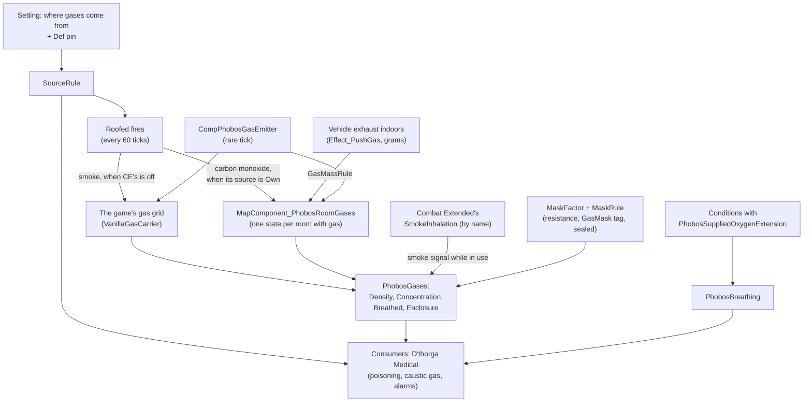

# Gases and air

**Status (23 Nov 2026):** living; written from the code at D'thorga Framework 0.271.0. Built: the gas layer (existing gases read
first, the Framework's own room gases, the source-mode override), fire smoke and carbon monoxide from roofed fires, masks,
supplied oxygen as a treatment, an XML gas emitter, and protective-gear lines (D'thorga Medical's radiation line the only
one). **Passed in game by the owner:** row 31a (the radiation control line itself). The gas layer and supplied oxygen were seen
working through D'thorga Medical in the owner's game and save on 5 Nov 2026, before the test list. **Not yet tested in game:**
everything else, including the line's alert (row 32), exhaust in closed rooms (row 260) and iodide at the line (row 96).

This page says how the Framework's gases, air and protective-gear lines work now. Why they are this way is in the [decision
log](../decisions/gases-and-air.md) and the [records](#why-it-is-this-way). How to use them from another mod is in [D'thorga
Framework for modders](../../framework-modding.md#gases). How the code is laid out in general is in [How the code is
built](../architecture.md).

## Read this first (gotchas)

- **The Framework never harms anyone.** It answers what a pawn breathes, how enclosed a cell is and what a room holds. What a
  breathed gas does to a body is the consumer's: D'thorga Medical's smoke inhalation, carbon monoxide poisoning and caustic
  gas. Without Medical, carbon monoxide fills rooms and hurts nobody.
- **Existing gases first.** Smoke is never the Framework's own: it is the game's blinding smoke, or Combat Extended's smoke
  inhalation while Combat Extended runs with its smoke effects on. The Framework adds an own gas only where nothing else
  carries it. **Carbon monoxide is the only own gas today** (`Gases.xml`).
- **Additive, and per room.** No air composition, no oxygen, no pressure and no vacuum model. A room holds a gas only while
  something has added it; outdoors, doorways and rooms in vacuum hold nothing. Supplied oxygen is a treatment condition on a
  pawn, never a gas in a room.
- **Only roofed fires add anything.** A fire in the open adds no smoke and no carbon monoxide of ours.
- **A filter mask stops smoke and tox gas but not carbon monoxide.** Only sealed headgear with its own air stops that. The mask
  is judged by effect: the game's toxic environment resistance, or an item tagged `GasMask`.
- **The source mode is a live switch.** "Where gases come from" decides per gas, at each call, whether a consumer reads an
  existing gas, the Framework's own, or nothing (and infers). Set to "Never the framework's own gases", fires add no carbon
  monoxide, and D'thorga Medical infers it from smoke and enclosure instead.
- **No Combat Extended reference.** Its smoke setting, its `SmokeInhalation` condition and its `SmokeSensitivity` stat are read
  by name. Nothing here adds Combat Extended's black smoke.
- **The protective-gear line's machinery is the Framework's, its patches are not.** The core holds the zones, control points,
  rules and alert with no Harmony. D'thorga Medical's two patches on the game's step and allowed-area checks switch it on.

## What it does

### What a pawn breathes

A consumer asks `PhobosGases` one of a few questions; each answer is 0 to 1.

| Question | Call | Where the answer comes from |
| --- | --- | --- |
| How thick is an existing gas here? | `Density(cell, map, kind)` | The thickest reading among the registered carriers (today only the game's gas grid) |
| How much of the room is an own gas? | `Concentration(cell, map, gas)` | The room's share in `MapComponent_PhobosRoomGases` |
| What does this pawn breathe? | `Breathed(pawn, kind)` or `Breathed(pawn, gas)` | Density or concentration at its cell, times its mask factor |
| How enclosed is this cell? | `Enclosure(cell, map)` | 0 unroofed; 0.25 roofed in a room that counts as outdoors; else 1 less the open-roof share |
| Which source should I read? | `Source(gas)` | `SourceRule`: the setting, the Def's pin, and whether an existing gas covers it |

The existing kinds (`GasKind`) are the game's four: **smoke** (blinding smoke), **tox gas** (Biotech only), **rot stink** and
**deadlife dust** (Anomaly only). The carrier refuses a kind whose expansion is missing, because the game logs an error when
asked for it. Only smoke and tox gas can be written.

**Smoke is special.** While Combat Extended runs with its smoke effects on, a pawn's breathed smoke is Combat Extended's own
`SmokeInhalation` severity, which already counts masks, sleep, being downed and breathing capacity; the mask factor is not
applied a second time. Otherwise it is the game's smoke at the cell through the mask rule. The setting is re-read once a tick,
so switching Combat Extended's option takes effect at once.

### Masks

| Gear | Smoke, tox gas (filtered) | Carbon monoxide (not filtered) |
| --- | --- | --- |
| Nothing | All of it | All of it |
| Toxic environment resistance R | 1 − R (a vanilla gas mask, 0.8, leaves 0.2) | All of it, unless sealed |
| An item tagged `GasMask` | None | All of it |
| Sealed headgear | As its resistance | None |

**Sealed** means, with Combat Extended, that its smoke sensitivity is at or below 0 counting only gear that is not tagged as a
gas mask (its power and recon helmets go to −1). Combat Extended's gas masks also take sensitivity to 0, so they are left out
of that sum, or a filter mask would stop carbon monoxide. Without Combat Extended, sealed means toxic environment resistance of
0.999 or more (`sealedToxicResistance`, authored).

### Fires

Every pass (60 ticks), `MapComponent_PhobosFireSmoke` walks the map's fires. For each **roofed** fire:

- **Smoke on the game's grid**, only when Combat Extended's smoke is not in use: 0.08 of a full cell per unit of fire size, at
  most 0.2 (authored). The game then spreads it through open doors, fades it more slowly under a roof, and gives it its aim
  and sight penalties.
- **Carbon monoxide into the room**, on either path, when the gas's source is the Framework's own: 0.4 cells of gas per unit
  of fire size, at most 1 (authored). A size-1 fire fills a 20-cell room in about 50 passes, about an hour and a quarter of game
  time.

### Carbon monoxide

`PhobosGas_CarbonMonoxide` is the one own gas. Indoors it halves on its own in 12 game hours (30,000 ticks); under a gap in the
roof its share of the room halves in 600 ticks; a filter mask does not stop it; it defers to no existing kind, so in Automatic
mode it is always the Framework's. All its figures are authored. Two things add it:

- **Roofed fires**, above.
- **A vehicle's exhaust in a closed room** (`Effect_PushGas`, D'thorga Framework's vehicle systems, behind their setting
  "Exhaust in closed rooms", off by default): 140 g an hour at full engine load, scaled by load, turned into the room's share
  through the gas's molar mass (28.01 g a mole) and the 1,600 ppm that a full room stands for (`GasMassRule`). The grams are
  authored from a petrol car without a working catalytic converter, with the sources in `Systems_Cooling.xml`; 1,600 ppm is
  authored to match D'thorga Medical's poisoning, against an OSHA-hosted training handout that puts death within two hours at
  that level (a training aid, not a study). A room mixes at once: a gameplay simplification.

### Supplied oxygen

Oxygen is a treatment, read from a pawn's conditions; nothing is stored and nothing ticks.

- A condition marked **`PhobosSuppliedOxygenExtension`** means "on supplied oxygen". It carries carbon monoxide's half-life on
  that oxygen (1.25 hours by default; a better treatment sets less) and a healing factor (1 for a mask, more for a chamber).
  When a pawn has several, the shortest half-life wins, and only the first such condition heals, so two treatments never
  double.
- A condition marked **`PhobosOxygenResponsiveExtension`** is one oxygen helps, from its `minSeverity`, healed by
  `healingPerDayOnOxygen` × the treatment's factor. A permanent condition is never healed: oxygen lets living tissue recover,
  it does not restore dead tissue.
- D'thorga Medical's oxygen treatments carry the first mark; Medical's smoke conditions and the vehicles' altitude hypoxia
  (`AirCombat.xml`) carry the second. The two sides never reference each other.

### Gas emitters

`CompProperties_PhobosGasEmitter` lets any building add an existing gas kind (a share of a cell) or an own gas (cells of gas)
every rare tick, optionally only while powered, switched on or fuelled. An own gas is added only while its source is the
Framework's. No Def of ours uses the emitter today.

### Protective-gear lines

A **protective-gear line** marks off ground where people need gear. A `ProtectionZoneDef` names the stat worn gear must raise,
how much is enough, the colour of its painted area and, optionally, conditions to be under before going in (a preventive drug).

- **Two ways to draw a line**: a **control point**, a sign that closes off the room it faces (or the room past the door it
  faces), worked out afresh whenever asked, so a wall built or knocked down changes it at once; or a **painted area**, drawn
  with a designator as the game's own areas are. Painted cells are checked first.
- **Stepping in unprotected**, a free colonist on foot stops, fetches the fewest pieces of gear that bring the stat to the
  requirement (biggest gain first, the nearer of equal gains, skipping pieces that cannot be worn together), puts them on and
  resumes its job. Protection is read from the pawn's stat, so genes, implants and every worn item count.
- **Stepping out** in gear put on at the line, it takes that gear off just outside. The dropped gear is remembered and freed
  for haulers once it is down, so it never lies forbidden.
- **No gear in reach**: the colonist turns back, says so once, and treats the zone as outside its allowed area for an hour, so
  the game's work search offers it other work. A colonist sent to suit up three times within that hour, and still unprotected
  at the line, is turned back too.
- **A preventive dose**: a colonist with none of the zone's preventive conditions takes a dose of any drug that gives one, from
  its inventory or from outside every zone, before suiting up; tried at most once an hour.
- **Drafted colonists, animals, prisoners, slaves and guests cross freely.** An order is the player's call. The alert
  **Unprotected behind the line** lists the colony's living people and animals behind a line without enough protection,
  including anyone painted in; machines are left out.

The only line defined is D'thorga Medical's **radiation controlled area** (with Rimatomics): toxic environment resistance 0.75,
which takes Rimatomics' suit and mask (0.40 each) or gear as good, and potassium iodide as its preventive condition. The 0.75 is
authored.

### What D'thorga Medical builds on this

Named here so the boundary is clear; Medical's own page covers them.

- **Smoke inhalation, carbon monoxide poisoning and airway burns** read `Breathed` for smoke and carbon monoxide. When carbon
  monoxide is not the Framework's (source mode "Never"), Medical infers it from breathed smoke and `Enclosure`.
- **Caustic gas** reads tox gas through `Density` for eyes and skin and `Breathed` for the lungs.
- **Fire heat**, the heat a fire throws at nearby cells, is Medical's own map component and patch, not the Framework's.
- **The gas alarm** reads smoke density at its cell; **oxygen equipment** gives the supplied-oxygen conditions.

## How it works

**The room engine** (`MapComponent_PhobosRoomGases`) copies how the game keeps room temperature. It holds one array of
concentrations for each room that holds gas, and nothing for any other room. **Every 60 ticks**, and only while some room holds
gas:

1. It indexes the map's rooms by ID and **rebuilds stale rooms**: a room that has gone or changed size is spread over the rooms
   its remembered cells now belong to, amount-weighted. A wall built through a smoky room leaves both halves smoky; a merged
   room is diluted.
2. For each room it **exchanges** through every door on its regions' portal neighbours (open: rate 1 every 34 ticks; closed:
   rate 1 every 375 ticks, the game's own door figures) and every switched-on vent among its contained and adjacent things
   (rate 14 every 250 ticks, the game's vent), each scaled to the 60-tick pass. Exchange moves both rooms toward their
   amount-weighted mean and **never past it**, so repeated openings converge. Each door or vent is used once a pass. An
   opening onto the outdoors, a doorway or vacuum is a **sink**: the room loses coefficient ÷ cells of its gas.
3. Each gas **fades** at its own half-life, and the open-roof share of the room fades at the open-roof half-life.
4. A gas below 0.001 is dropped; a room with none left is forgotten; a room half or more in vacuum is emptied.

**Adding gas** to a room adds cells ÷ room size, capped at the gas's `maxConcentration` (1 for carbon monoxide). Gas added
outdoors, in a doorway or in vacuum is lost at once.

**The fire source** (`MapComponent_PhobosFireSmoke`) runs on the same 60-tick beat, returning at once on a map with no fires,
or when neither smoke nor carbon monoxide is its to add.

**Protective-gear lines** run on demand: D'thorga Medical's prefix on the game's `Pawn_PathFollower.TryEnterNextPathCell` asks
`ProtectionLine.BeforeStep` before each step, its postfix calls `AfterStep` on a tick the pawn really stepped, and its postfix on
`ForbidUtility.InAllowedArea` asks `AllowsCell`. Each first asks whether the map has any line, a field read. A refused step
stops the pather before the new jobs start, so the pawn paths afresh rather than retrying the same step every tick. Gear being
taken off is looked at on the rare tick, only while there is any; the alert rebuilds its list every few seconds.

**Where the numbers come from**:

| Figure | Where |
| --- | --- |
| Door and vent rates | The game's own (`BuildingProperties`, `Building_Vent`), in `PhobosGasRulesDef` (`Rules.xml`) |
| Fire smoke and carbon monoxide per fire size, thresholds, sealed resistance | `PhobosGasRulesDef`, authored |
| A gas's half-lives, cap, mask filtering, molar mass, ppm at full | Its `PhobosGasDef` (`Gases.xml`): authored, bar the molar mass |
| Exhaust grams an hour | `Effect_PushGas` in `Systems_Cooling.xml`, authored from cited sources |
| A line's stat, requirement, colour, preventive conditions | Its `ProtectionZoneDef` (Medical's `RadiationControl.xml`) |

## Code

All under `src/PhobosFramework/` unless named.

| File | What it holds |
| --- | --- |
| `Gases/PhobosGases.cs` | The one door: `Density`, `Concentration`, `Breathed`, `Enclosure`, `Add`, `AddOwn`, `Source`, `ExistingPresent` |
| `Gases/PhobosGasDef.cs` | `PhobosGasDef` (an own gas) and `PhobosGasRulesDef` (the engine's figures) |
| `Gases/GasKind.cs`, `IGasCarrier.cs`, `GasCarriers.cs`, `VanillaGasCarrier.cs` | Existing gas kinds, the carrier interface, the registry, the game's grid |
| `Gases/MapComponent_PhobosRoomGases.cs` | The room engine: exchange, fading, rebuilding rooms, saving by cell |
| `Gases/MapComponent_PhobosFireSmoke.cs` | Smoke and carbon monoxide from roofed fires |
| `Gases/MaskFactor.cs`, `Gases/CombatExtendedSmoke.cs` | What a pawn wears; Combat Extended's smoke by name |
| `Gases/CompPhobosGasEmitter.cs` | The XML gas emitter |
| `Breathing/PhobosBreathing.cs` | The two oxygen marks and `PhobosBreathing` |
| `Rules/GasMixRule.cs`, `GasMassRule.cs`, `SourceRule.cs`, `SignalRule.cs` | Exchange and fading; grams to cells; the source mode; the smoke signal |
| `Rules/MaskRule.cs`, `EnclosureRule.cs`, `FireSmokeRule.cs`, `BreathingRule.cs` | Masks; enclosure; fire amounts; oxygen's half-life and healing |
| `Protection/ProtectionZoneDef.cs`, `ProtectionZones.cs` | The line's Def; a map's painted areas, control points and gear being taken off |
| `Protection/ProtectionLine.cs`, `Rules/ProtectionRule.cs` | What a step across a line does; the gear choice |
| `Protection/CompPhobosControlPoint.cs` | The control point comp, its place worker and the area designator base |
| `Protection/Alert_PhobosUnprotectedBehindLine.cs` | The alert |
| `Debug/FrameworkDebugActions.cs` | "Framework: log gases at cell", "add smoke at cell", "add 1 cell of each own gas", the mouse overlay |
| `src/PhobosMedical/Protection/ProtectionPart.cs` | Medical's two patches that switch the lines on |
| `src/PhobosFramework.Vehicles/Schema/Effects.cs` | `Effect_PushGas`, a vehicle's exhaust into its room |

## Defs and XML

The modders' types, linked to [the reference site](https://phobos-dthorga.github.io/phobos-rimworld/) (pages are
`api/<Namespace>.<Type>.html`):

- **[`PhobosGasDef`][r1]**: `decayHalfLifeTicks`, `openRoofHalfLifeTicks`, `maxConcentration`, `filteredByMask`,
  `preferExisting` (the existing kind it defers to in Automatic), `alwaysOwn` (the pin), `molarMassGramsPerMole`,
  `ppmAtFullConcentration`, `overlayColor`. Another mod adds a gas with a Def and calls [`PhobosGases`][r2].
- **[`PhobosGasRulesDef`][r3]**: door and vent rates, `minConcentration`, `vacuumClears`, `sealedToxicResistance`,
  `enclosureRoofedButOutdoors`, the fire amounts and `fireCarbonMonoxideGas`. One Def, the first loaded wins, so a mod may
  patch a figure.
- **[`CompProperties_PhobosGasEmitter`][r4]**: `kind` or `gas`, `amountPerRareTick`, `onlyWhenPowered`, `onlyWhenSwitchedOn`,
  `onlyWhenFuelled`.
- **[`IGasCarrier`][r5]**: another carrier, registered with `GasCarriers.Register` from a tie-in assembly.
- **[`PhobosSuppliedOxygenExtension`][r6]** (`carbonMonoxideHalfLifeHours`, `healingFactor`) and
  **[`PhobosOxygenResponsiveExtension`][r7]** (`minSeverity`, `healingPerDayOnOxygen`), on `HediffDef`s; read through
  [`PhobosBreathing`][r8].
- **[`ProtectionZoneDef`][r9]**: `stat`, `required`, `color`, `preventiveHediffs`. Its `ConfigErrors` refuses no stat and a
  requirement of nothing. A control point is a building with **[`CompProperties_PhobosControlPoint`][r10]** (`zone`) and
  `PlaceWorker_PhobosControlPoint`; a painted area subclasses `Designator_PhobosProtectionArea`. The step logic is
  [`ProtectionLine`][r11].
- **[`Effect_PushGas`][r12]** (vehicle systems): `gas`, `gramsPerHour`, `scaleBy`, `setting`.

[r1]: https://phobos-dthorga.github.io/phobos-rimworld/api/Phobos.Framework.Gases.PhobosGasDef.html
[r2]: https://phobos-dthorga.github.io/phobos-rimworld/api/Phobos.Framework.Gases.PhobosGases.html
[r3]: https://phobos-dthorga.github.io/phobos-rimworld/api/Phobos.Framework.Gases.PhobosGasRulesDef.html
[r4]: https://phobos-dthorga.github.io/phobos-rimworld/api/Phobos.Framework.Gases.CompProperties_PhobosGasEmitter.html
[r5]: https://phobos-dthorga.github.io/phobos-rimworld/api/Phobos.Framework.Gases.IGasCarrier.html
[r6]: https://phobos-dthorga.github.io/phobos-rimworld/api/Phobos.Framework.Breathing.PhobosSuppliedOxygenExtension.html
[r7]: https://phobos-dthorga.github.io/phobos-rimworld/api/Phobos.Framework.Breathing.PhobosOxygenResponsiveExtension.html
[r8]: https://phobos-dthorga.github.io/phobos-rimworld/api/Phobos.Framework.Breathing.PhobosBreathing.html
[r9]: https://phobos-dthorga.github.io/phobos-rimworld/api/Phobos.Framework.Protection.ProtectionZoneDef.html
[r10]: https://phobos-dthorga.github.io/phobos-rimworld/api/Phobos.Framework.Protection.CompProperties_PhobosControlPoint.html
[r11]: https://phobos-dthorga.github.io/phobos-rimworld/api/Phobos.Framework.Protection.ProtectionLine.html
[r12]: https://phobos-dthorga.github.io/phobos-rimworld/api/Phobos.VehicleSystems.Effect_PushGas.html

## Settings

D'thorga Framework's settings. The full text is in the generated [settings
reference](../settings-reference.md#dthorga-framework-and-dthorga-vehicle-systems).

| Label | Default | Page, section |
| --- | --- | --- |
| Where gases come from (Automatic; Always the framework's own gases; Never the framework's own gases) | Automatic | General, Gases |
| Show gases at the mouse (dev mode) | Off | Log and reports, Developer (dev mode only) |
| Exhaust in closed rooms | Off | Vehicle systems: Display, sound and stories, Stories |

**Automatic** reads an existing gas where one covers the Def's `preferExisting` kind and the Framework's own otherwise;
**Always** runs every own gas even where an existing one covers it; **Never** turns own gases off, and consumers infer. A gas
with `alwaysOwn` ignores the setting. All take effect at once. The protective-gear lines and supplied oxygen have no setting of
their own.

## Saved data and removal

- **Room gases are saved by cell**, under `PhobosFramework_gasCells`: each cell of a room with gas, with the gases' defNames and
  concentrations. Rooms are renumbered on every load, so the cells are spread back into whatever rooms they now form. A gas Def
  that no longer exists is skipped.
- **Protective-gear lines** save, per map, the painted areas (`PhobosProtectionPainted`), the gear pawns put on at a line
  (`PhobosProtectionLineGear`) and gear being taken off (`PhobosProtectionTakingOff`). Control points are found again as they
  spawn; turn-back times, suit-up tallies and dose tries are not saved.
- **Nothing else is saved**: the fire source, masks, supplied oxygen and the smoke signal are derived each time.
- **Removal** follows the Framework's sweep ([How the code is built, Saves and removal](../architecture.md#saves-and-removal)).
  Switching the source mode to "Never" stops new carbon monoxide at once; what a room holds fades or vents as usual.

## Tie-ins

Every tie-in is in the [tie-in register](../tie-in-register.md).

- **Combat Extended**: its smoke effects setting (`Controller.settings.SmokeEffects`), its `SmokeInhalation` condition and its
  `SmokeSensitivity` stat, all by name. While its smoke is in use, the Framework adds no smoke of its own.
- **Biotech and Anomaly**: tox gas and deadlife dust exist as kinds only with them.
- **Rimatomics**: D'thorga Medical's radiation controlled area loads only with it. Rimatomics cuts its dose by toxic environment
  resistance, which is why the line asks for that stat; with D'thorga Medical's radiation model on, that cut is not applied and
  the line guards against fallout dust ([radiation](medical-radiation.md)).
- **D'thorga Medical**: every consumer of breathed gas, the oxygen treatments and the two line patches.
- **Vehicle Framework**: the exhaust effect lives in the vehicle systems, which load only with it.

## Performance

- **Nothing here is measured** on its own.
- **Shape of the cost**: a map with no room gas costs the engine one dictionary count a tick; with gas, one pass every 60 ticks
  walks only the rooms holding gas, their regions' door neighbours and their adjacent things. The fire source walks the map's
  fires every 60 ticks and returns at once with none. The game's own gas grid, once any smoke has been added, runs as it does
  after any smoke grenade.
- **Lines**: every per-step check starts with whether the map has a line (a field read); the map component is cached for the
  map in view, because the allowed-area check is called very often. A turned-back pawn no longer retries its step every tick:
  the cost that once took 38 % of a frame in the owner's game was fixed by stopping the pather first ([the
  record](../archive/radiation-control-line.md#performance-fault-10-nov-2026)).

## Limits and known gaps

- **No air model.** There is no oxygen to run out of, no pressure and no vacuum: carbon monoxide does not displace anything, and
  a fire does not use up air.
- **A room mixes at once.** Gas reaches every cell of a room the pass it is added; only doors, vents and roof gaps move it on.
- **Gravships leave their gases behind.** The game's smoke, Combat Extended's and our room gas all stay on the old map.
- **No Combat Extended smoke carrier.** A mod that wanted to add Combat Extended's black smoke has no way through the Framework
  yet.
- **Only carbon monoxide is an own gas.** Hydrogen from an electrolyser, workstation fumes and vents for them are designed and
  not built ([ventilation and hydrogen](../ventilation-and-hydrogen.md)).
- **A line checks a crossing, not a stay.** Someone painted in, or undrafted inside, stays as they are; the alert names them.
  Pathing ignores allowed areas, so a turned-back colonist's route may still lead through a zone; it stops short and waits.
- **A pawn short of the requirement after suiting up carries on in**: the gear choice adds offsets only, so another mod's
  multiplier can leave it short.
- **Gear taken off lands outside the line**, not in a locker; haulers put it away.
- **Inferred from the code, not tested in game**: the comments in `Rules.xml` call a 60-tick pass a minute; a pass is about 1.4
  game minutes, so a size-1 fire fills a 20-cell room in about 72 game minutes, not 50.

## Tests

None of these is a test in game.

- **Rule tests** (`tests/PhobosFramework.Rules.Tests`): `GasMixRuleTests`, `SourceRuleTests`, `SignalRuleTests`,
  `MaskRuleTests`, `EnclosureAndFireSmokeRuleTests`, `BreathingRuleTests` (all in `RuleTests.cs`), `GasMassRuleTests` and
  `ProtectionRuleTests`.
- **Checkers**: `scripts/check-mod-layout.py` (the language keys); `scripts/check-targets.py` (the patched game members).
- **Dev actions**: "Framework: log gases at cell", "Framework: add smoke at cell", "Framework: add 1 cell of each own gas to
  room at cell", and the setting "Show gases at the mouse".
- **In game** ([the test list](../in-game-test-pass.md)): **passed** 31a; **waiting** 32, 96 and 260.

## Why it is this way

- **[The decision log](../decisions/gases-and-air.md)**: every choice, one line each, with who made it and where.
- **Archived records**, kept unchanged for their history: [the radiation control line](../archive/radiation-control-line.md);
  with [the health layer](health-layer.md), [D'thorga Framework: research and decisions](../archive/phobos-framework.md); and,
  with [injuries and care](medical-injuries-and-care.md), [burns and smoke](../archive/burns-and-smoke.md) and [caustic
  gas](../archive/caustic-gas.md); with [medical equipment](medical-equipment.md), [its first
  record](../archive/medical-equipment.md).
- **Modders' guide**: [D'thorga Framework for modders, Gases](../../framework-modding.md#gases), [Supplied
  oxygen](../../framework-modding.md#supplied-oxygen) and [Protective-gear
  lines](../../framework-modding.md#protective-gear-lines).
- **Records kept in place** (they cover gases and D'thorga Medical): [ventilation and hydrogen](../ventilation-and-hydrogen.md).
