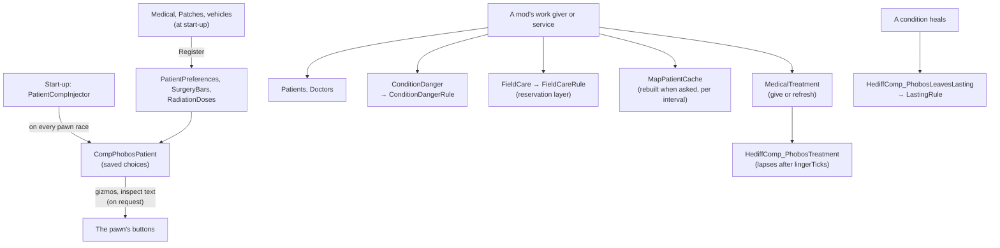

# The health layer and care

**Status (23 Nov 2026):** living; written from the code at D'thorga Framework 0.271.0. Built: who the doctors look after
(`Patients`), how dangerous a condition is (`ConditionDanger`), the doctor and patient tests, per-person care choices on every
pawn race (humanlike only until Framework 0.381.1), surgery bars, field care on its own reservation layer, treatment conditions that lapse, conditions that leave a
lasting one, the per-map patient cache and the radiation-dose door. **Passed in game by the owner:** row 170 (field care gives
way to the carry). The care-choice comp's corpse fault was reported gone by the owner on 7 Nov 2026, before the test list.
**Not yet tested in game:** everything else, including row 117 (Search and Rescue's medics with our kits).

This page says how the Framework's shared health layer works now: the pieces every medical feature of ours asks the same
questions through. What D'thorga Medical builds on it is on its own pages: [injuries and care](medical-injuries-and-care.md)
(burns, triage's queue, emergency dosing), [medical equipment](medical-equipment.md) and [radiation](medical-radiation.md). Why
the layer is this way is in the [decision log](../decisions/health-layer.md) and the
[records](#why-it-is-this-way). How to use it from another mod is in [D'thorga Framework for modders, The health layer and care
choices](../../framework-modding.md#the-health-layer-and-care-choices).

## Read this first (gotchas)

- **The layer decides nothing about medicine.** It answers who is a patient, how dangerous a condition is, who can doctor, and
  what the player chose for a person. Each mod adds its own need and its own care check on top. Nothing here changes game
  state, except the treatment and lasting conditions a mod asks it to give.
- **One answer for every mod.** A patient Emergency Dosing treats is a patient Triage triages, and a vehicle is never one: a
  vehicle is a pawn to the game but not humanlike, so it fails `IsFleshPerson`.
- **Care choices are saved on the pawn as plain lists**, keyed by a stable string, not as Def references. A save loads without
  the Framework, and a mod that stops registering a choice leaves its saved value unread.
- **The patient comp goes on by code, not XML.** A start-up sweep puts `CompPhobosPatient` on every race whose thing class is a
  pawn: humanlike ones until Framework 0.381.1, every one since (the owner's choice, 28 Nov 2026), so other mods' buttons
  (`PawnCommands`) reach a colonist of any race. Care choices still show only for the people the doctors look after. An XML
  patch on `race` would miss Humanoid Alien Races and races that inherit it.
- **Another mod's function never takes the comp down** (0.381.1, the owner's choice): each registered button provider, inspect
  line and care-choice test runs guarded, and a fault is logged once by `ProviderFaults`, naming the function and its assembly.
- **A doctor on the ground never holds a patient against a carrier.** Field care is held on our own reservation layer, which
  keeps our other doctors away and nobody else; the moment someone lifts the patient, the doctor's job ends. In a bed, the
  game's own hold applies.
- **"How soon it kills" is an expectation.** The death clock's mean is a mean: the game rolls against it, so a patient can die
  sooner or later.
- **Surgery bars hold, they never cancel.** A mod that queues operations reads the bar and waits, saying why; the bar's owner
  gives the reason in in-world words.

## What it does

### Who the doctors look after

`Patients` gives one answer for every mod.

| Test | True when |
| --- | --- |
| `IsPlayersPerson` | Spawned, alive, humanlike, past babyhood, and the player's own or the player's guest or prisoner |
| `IsFleshPerson` | As above, with a flesh body: what every treatment of ours needs first |
| `IsLyingDown` | Downed, or in a bed |
| `OnTheGround` | Downed and not in a bed: where field care is given |
| `IsLyingPatient` | A flesh person lying down |
| `GroupOf` | Prisoner, slave, colonist or guest, checked in that order (a slave is also the player's; a prisoner is also hosted) |
| `CareLevel`, `CareAllows` | The player's care setting; never "no care", never "no medicine" when the act needs it, at least a mod's minimum |
| `SurgeryBarred` | A registered bar gives a reason; the first reason given is returned |

`Doctors` wraps the game's own tests: `AnyAvailableFor` (the game's "some doctor could come"), `CanDoctorNow` (a free colonist,
up, awake, sane, not a patient in bed, with Doctor work on and not disabled), and `BestSurgeonSuccess` (the best surgery success
chance among the map's doctors who meet a recipe's skills, the patient left out; the game's outcome still multiplies it by the
recipe, the bed and the medicine).

### How dangerous a condition is

`ConditionDanger` reads Defs and live conditions for the game-free `ConditionDangerRule`, and caches each Def's answer.

- **Danger severity**: the lowest severity at which any stage threatens life or carries a death clock, or the lethal severity,
  whichever is lower; "never" when there is none.
- **Expected hours to death**: the soonest of three clocks. The death clock's mean at the current stage (days × 24); the time
  for a rising severity to reach the lethal one, at the rate the condition's own severity comps give (tending included); and
  the time to bleed out by the game's own estimate, which belongs to the pawn and is passed in. None applies: no clock.
- **Severity per day** sums the condition's severity-modifying comps; a condition without comps does not move.

### Care choices for each person

A mod registers a `PatientPreference`: a stable key (prefixed with the mod's), a label key with the current choice as
`{CHOICE}`, a description key, one label key per option, a default for each pawn (usually from the mod's settings by the pawn's
group), an optional test for which pawns it applies to, and an optional icon. A mod may also register **inspect lines**.

- **The comp** draws one button per registered choice, on every pawn the doctors look after (`GroupOf` not null) for which the
  choice applies. Clicking opens a menu of the options; picking one saves it on the pawn.
- **The choice in force** is the pawn's saved one, else the default for that pawn, so a pawn with nothing saved follows the
  settings as they stand. It is clamped to the options there are.
- **The icon** is the choice's own when its texture exists, else the game's industrial medicine icon (the game has none for
  "normal care"). The same icon and menu serve every place that offers the choice (the pawn's button and D'thorga Medical's
  health-tab button).
- **Today one choice is registered**: D'thorga Medical's triage authority ("Doctors may operate"), with four options from none to
  any repair, and one inspect line.

The comp shows nothing on a dead pawn or on a thing that is not a pawn: some mods give corpses the comp, and a dead person has no
choices.

### Surgery bars

A mod that owns something stopping surgery registers a function that returns null, or the reason, already translated and in
the game's words. D'thorga Medical's pressure chamber is the one bar today. A mod that queues operations (Medical's triage) reads
`Patients.SurgeryBarred` and holds the operation while it applies. No reference between the two mods is needed.

### Field care

`FieldCareRule` decides when care is given where a patient lies.

- **Urgency**: care that cannot wait (pain relief, breathing, rinsing acid off) is given on the ground; care that works over days
  (a dose against a disease) waits for a bed, so no doctor walks out to someone a carrier is about to lift.
- **The hold**: on the ground, a doctor's hold goes on the `PhobosFieldCare` reservation layer. The game counts a hold only
  against others on the same layer, so two of our doctors never double up, while a carrier (the game's, Search and Rescue's,
  any mod's) reserves on the game's layer and lifts the patient anyway. Lifting despawns the patient, which ends the doctor's
  job by its own fail condition. In a bed, the game's layer applies, as before. A forced order ignores other holds, as the
  game's checks do.
- **Every job of ours that goes to a patient reserves through `FieldCare`**, in its work giver and its driver alike, so both
  ask about the same layer: Medical's dosing, device and rinse jobs today.
- **The carry wins even over a hand pump**: only a bed, with its oxygen, fixes what a pump holds off. An agent default.

`LitterRule` beside it sends a carrier to a vehicle's litter when the litter is nearer than the patient's bed, or the patient
has none, comparing squared straight-line distances as the game's own nearest searches do; the litters themselves are in
[camping and life aboard](camping-and-life-aboard.md).

### Treatments that lapse

`MedicalTreatment.GiveOrRefresh(patient, def)` gives a treatment condition or keeps it going. Its
`HediffCompProperties_PhobosTreatment` comp removes it once nothing has refreshed it for `lingerTicks` (600 by default: a machine
pass of 250 with room to spare, authored), so a treatment can never outlive its source. A condition saved under an older class
is replaced by one of the Def's current class. D'thorga Medical's burn bed, nebuliser and ventilator use it.

### Conditions that leave a lasting one

`HediffCompProperties_PhobosLeavesLasting` (`lasting`, `fromSeverity`, optional `flag`) records the worst severity a condition
reaches. When it heals, it leaves the `lasting` condition on the same body part: nothing below `fromSeverity`; above it, from 0.1
at the threshold rising to 1 at full severity (`LastingRule`; 0.1 authored). An existing lasting condition is only ever raised.
Nothing is left on a part that is gone or replaced (a bionic eye), on a dead pawn, during the uninstall sweep, or while the named
setting flag is off. D'thorga Medical's caustic eye burns use it.

### The patient cache

`MapPatientCache<T>` is a per-map list a mod rebuilds at most once per interval it names, only when something asks, so work
givers and buttons never scan the map themselves. `Peek` reads the last build; `Invalidate` forces the next. D'thorga Medical's
dosing and the vehicles' litters each keep one.

### Radiation doses

`RadiationDoses` is a door with one receiver. D'thorga Medical's radiation model registers itself and says whether it is on; a
source (D'thorga Patches' nuclear strike) gives a whole-body dose in grays through `Give`, which returns false when no model
takes it, so the source falls back to its own route (Dubs Rimatomics' radiation). The last registration wins. Nothing here needs
Medical or Rimatomics.

## How it works

**Nothing here ticks on its own.** Every answer is computed when a mod asks, from the pawn and its conditions as they stand. The
only per-tick work is the game's own condition ticking: `HediffComp_PhobosLeavesLasting` notes a new worst severity on each
interval tick, and `HediffComp_PhobosTreatment` tells the game, when asked, whether it has lapsed.

**The patient comp** is added once at start-up, after the Defs load. Its buttons and inspect lines are built when the game draws
a selected pawn, reading the registry.

**Danger per Def** is computed once and cached for the session; the live clock is read fresh each call.

**Where the numbers come from**: the game's own (stages' `lifeThreatening` and `deathMtbDays`, `lethalSeverity`, severity comps,
`HealthUtility.TicksUntilDeathDueToBloodLoss`, the surgery success stat); the treatment linger (600 ticks) and the faintest
lasting severity (0.1) are authored.

## Code

All under `src/PhobosFramework/` unless named.

| File | What it holds |
| --- | --- |
| `Health/Patients.cs` | `PatientGroup` and `Patients`: who is a patient, their group, care level, surgery bars |
| `Health/Doctors.cs` | `Doctors`: the game's doctor tests, the best surgeon for a recipe |
| `Health/ConditionDanger.cs`, `Rules/ConditionDangerRule.cs` | `ConditionClock`, `ConditionDanger`; `StageDanger`, the danger and hours-to-death rule |
| `Health/PatientPreferences.cs` | `PatientPreference`, the registry, icons and menus |
| `Health/CompPhobosPatient.cs` | The comp, its saved choices and buttons, and `PatientCompInjector` |
| `Health/SurgeryBars.cs` | The bar registry |
| `Health/FieldCare.cs`, `Rules/FieldCareRule.cs` | The hold and its layer, `PhobosHealthDefOf`; `CareUrgency`, `FieldCareRule`, `LitterRule` |
| `Health/MedicalTreatment.cs` | `TreatmentPass`, `MedicalTreatment`, the lapsing treatment comp |
| `Health/LeavesLasting.cs`, `Rules/LastingRule.cs` | The lasting-condition comp and its rule |
| `Health/MapPatientCache.cs` | The per-map cache |
| `Health/RadiationDoses.cs` | The dose door |
| `Debug/FrameworkDebugActions.cs` | "Framework: log care choices of selected pawns" |

## Defs and XML

The modders' types, linked to [the reference site](https://phobos-dthorga.github.io/phobos-rimworld/) (pages are
`api/<Namespace>.<Type>.html`):

- **[`HediffCompProperties_PhobosTreatment`][r1]**: `lingerTicks`. Given through [`MedicalTreatment`][r2].
- **[`HediffCompProperties_PhobosLeavesLasting`][r3]**: `lasting`, `fromSeverity`, `flag`. Its `ConfigErrors` refuses a missing
  `lasting`.
- **`PhobosFieldCare`**, a `ReservationLayerDef` (`Defs/Phobos/Framework/FieldCare.xml`), used through [`FieldCare`][r4].
- **[`CompPhobosPatient`][r5]**: never written in XML; put on by the start-up sweep.
- **C# services, no XML**: [`Patients`][r6], [`Doctors`][r7], [`ConditionDanger`][r8] and [`ConditionDangerRule`][r9],
  [`PatientPreferences`][r10] with [`PatientPreference`][r11], [`SurgeryBars`][r12], [`MapPatientCache<T>`][r13] and
  [`RadiationDoses`][r14].

[r1]: https://phobos-dthorga.github.io/phobos-rimworld/api/Phobos.Framework.Health.HediffCompProperties_PhobosTreatment.html
[r2]: https://phobos-dthorga.github.io/phobos-rimworld/api/Phobos.Framework.Health.MedicalTreatment.html
[r3]: https://phobos-dthorga.github.io/phobos-rimworld/api/Phobos.Framework.Health.HediffCompProperties_PhobosLeavesLasting.html
[r4]: https://phobos-dthorga.github.io/phobos-rimworld/api/Phobos.Framework.Health.FieldCare.html
[r5]: https://phobos-dthorga.github.io/phobos-rimworld/api/Phobos.Framework.Health.CompPhobosPatient.html
[r6]: https://phobos-dthorga.github.io/phobos-rimworld/api/Phobos.Framework.Health.Patients.html
[r7]: https://phobos-dthorga.github.io/phobos-rimworld/api/Phobos.Framework.Health.Doctors.html
[r8]: https://phobos-dthorga.github.io/phobos-rimworld/api/Phobos.Framework.Health.ConditionDanger.html
[r9]: https://phobos-dthorga.github.io/phobos-rimworld/api/Phobos.Framework.Rules.ConditionDangerRule.html
[r10]: https://phobos-dthorga.github.io/phobos-rimworld/api/Phobos.Framework.Health.PatientPreferences.html
[r11]: https://phobos-dthorga.github.io/phobos-rimworld/api/Phobos.Framework.Health.PatientPreference.html
[r12]: https://phobos-dthorga.github.io/phobos-rimworld/api/Phobos.Framework.Health.SurgeryBars.html
[r13]: https://phobos-dthorga.github.io/phobos-rimworld/api/Phobos.Framework.Health.MapPatientCache-1.html
[r14]: https://phobos-dthorga.github.io/phobos-rimworld/api/Phobos.Framework.Health.RadiationDoses.html

## Settings

**The health layer has no setting of its own.** Each choice's default comes from the mod that registers it (D'thorga Medical's
triage settings, by group), and the player overrides it per person with the button. The layer follows the game's own medical
care setting for each pawn. The settings of the mods built on it are in the generated [settings
reference](../settings-reference.md#dthorga-medical).

## Saved data and removal

- **Care choices**, on each pawn's comp: `PhobosPatient_ChoiceKeys` and `PhobosPatient_ChoiceValues`, two plain lists. Lists of
  different lengths after a load are cleared, so the defaults apply again.
- **A lapsing treatment** saves its last refresh tick under `PhobosMedical_LastSupplyTick` (the key it had in D'thorga Medical
  Equipment, kept when it moved into the Framework).
- **A condition that leaves a lasting one** saves its worst severity under `PhobosFramework_PeakSeverity`.
- **Nothing else is saved**: groups, danger, the caches, the registries, holds on the field-care layer are recomputed or
  re-registered.
- **Removal**: the comp's keys are plain values, so a save without the Framework loads and drops them. Treatment and lasting
  conditions belong to the mods whose Defs carry the comps; they follow those mods' removal notes. The lasting comp leaves
  nothing during the Framework's uninstall sweep ([How the code is built, Saves and
  removal](../architecture.md#saves-and-removal)).

## Tie-ins

Every tie-in is in the [tie-in register](../tie-in-register.md).

- **D'thorga Medical**: the consumer of almost all of it: triage (the care choice, condition danger, surgery bars),
  emergency dosing (patients, danger, field care, the cache), medical equipment (treatments, field care, the pressure
  chamber's bar), caustic gas (lasting eye damage) and the radiation model (the dose door).
- **D'thorga Patches**: IRBM's nuclear strike gives its dose through `RadiationDoses`.
- **D'thorga Framework's vehicle systems**: the litters (`LitterRule`, a patient cache).
- **Search and Rescue** (and any mod that carries the downed): field care gives way to its carriers with no reference to it.
- **Humanoid Alien Races**: its races get the patient comp through the start-up sweep.

## Performance

- **Nothing here is measured** on its own.
- **Shape of the cost**: no ticking of its own. Danger is cached per Def. Work givers read a patient cache rebuilt at most once
  per interval the mod chooses. The comp's buttons and lines are built only for a selected pawn. The start-up sweep walks the
  ThingDefs once.

## Limits and known gaps

- **Only one care choice exists** (triage's); the registry is general, but nothing else uses it yet.
- **Groups are fixed** at prisoner, slave, colonist and guest. Mechanoids, animals and babies are never patients here.
- **Hours to death ignores other conditions**: each condition's clock is its own, with only bleeding passed in from the pawn.
- **The surgery-bar registry returns the first reason**, in the order mods registered.
- **Emergency dosing still writes its own "downed or in bed"** (`DoseService.cs`) rather than calling `Patients.IsLyingDown`: the
  same answer, kept in two places.
- **Inferred from the code, not tested in game**: `MapPatientCache` forgets maps that have gone only when it is asked about a map
  it has not seen before; until then a closed map's list, and the map itself, stay referenced. The class comment says "on the
  next build".

## Tests

None of these is a test in game.

- **Rule tests** (`tests/PhobosFramework.Rules.Tests`): `ConditionDangerRuleTests` (in `RuleTests.cs`), `FieldCareRuleTests`, and
  `LastingRuleTests` (in `ShelterAndChargeTests.cs`).
- **D'thorga Medical's rule tests** (`tests/PhobosMedical.Rules.Tests`) cover its uses of the layer.
- **Dev action**: "Framework: log care choices of selected pawns" lists each pawn's group, care level and every choice, default
  or saved.
- **In game** ([the test list](../in-game-test-pass.md)): **passed** 170; **waiting** 117.

## Why it is this way

- **[The decision log](../decisions/health-layer.md)**: every choice, one line each, with who made it and where.
- **Archived records**, kept unchanged for their history: [D'thorga Framework: research and
  decisions](../archive/phobos-framework.md), the record of the gas layer, supplied oxygen and the health layer; with [gases and
  air](gases-and-air.md). With [injuries and care](medical-injuries-and-care.md): [triage](../archive/triage.md), [emergency
  dosing](../archive/emergency-dosing.md) and [caustic gas](../archive/caustic-gas.md). With [medical
  equipment](medical-equipment.md): [its first record](../archive/medical-equipment.md). With [radiation](medical-radiation.md):
  [a radiation model of our own](../archive/radiation-model.md).
- **Modders' guide**: [D'thorga Framework for modders, The health layer and care
  choices](../../framework-modding.md#the-health-layer-and-care-choices).
- **Records kept in place** (they cover the health layer and D'thorga Medical): [soft-dependency
  cross-links](../soft-dependency-crosslinks.md).
