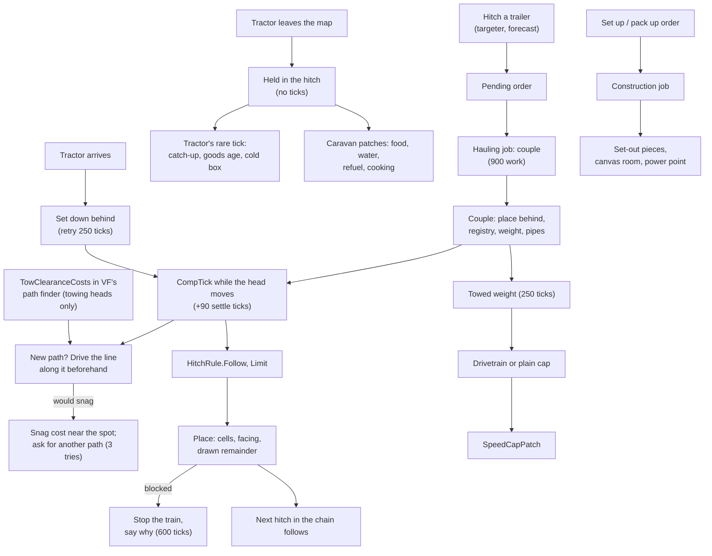

# Hitches and trailers

**Status (24 Nov 2026):** living; written from the code at D'thorga Framework 0.269.0, D'thorga Vehicles 0.114.0 and D'thorga
Farming 0.7.9, with the wider way round added at Framework 0.277.0. Built: our own hitch with a free-angle turn, couplings, chains
of up to three behind, the articulated tractor, trailers that cannot drive, set-up and pack-up by hand, set-out pieces and canvas
rooms, the cold box on the power lead, five trailers of ours, towing on the map and the world map, the wider way round, the
recovery winch and tow, and pushing by hand. **Passed in game by the owner:** row 441 (a trailer hitched on its drawbar); row 56
(towing a trailer) in part. **Not yet tested in game:** everything else, the wider way round (row 485) among it.

This page says how hitches and trailers work now. Why they are this way is in the [decision
log](../decisions/hitches-and-trailers.md) and the [archived records](#why-it-is-this-way). How the vehicle code is laid out in
general is in [How the code is built](../architecture.md). The tow's load on the engine is on [engines and
drivetrains](engines-and-drivetrain.md); camping from a trailer is on [camping and life aboard](camping-and-life-aboard.md); bay
trips, which use the recovery tow and pushing, are on [stations, yard and depots](stations-yard-and-depots.md).

## Read this first (gotchas)

- **Every land vehicle with a loadout gets a hitch, added in code**, unless its loadout says `noHitch` or it is a trailer
  (`Service/VehicleSystems.cs:246`). A vehicle that none of our loadouts claims has no hitch at all.
- **A trailer can still tow when its Def adds the hitch by hand.** D'thorga Farming's implements and the T400's rear half do; that
  is how chains work. The comments saying "a trailer never tows a trailer" are older than chains.
- **Whether a vehicle can tow is checked at the order, not at start-up.** Without a ground drivetrain of ours it is refused,
  unless "Vehicles without the drivetrain model can tow" is on (off by default).
- **Only the player's vehicles hitch, and only the player's trailers are taken.** A raider's trailer left behind cannot be hitched
  until it is claimed. The recovery winch is the exception: it may pull another faction's vehicle where a claim could take it.
- **A trailer stays a whole vehicle on the map.** It blocks, is blocked and can be shot. The hitch moves it in whole cells and
  four facings; the rest of the turn (within ±45°) and the sub-cell place are drawn, not walked.
- **The tractor plans; the trailer is checked, not planned.** A vehicle that tows pays more near ground a trailer cannot stand on,
  and each new path is driven on paper for the whole line before it is driven ([the wider way round](#the-wider-way-round)). It
  needs Vehicle Framework's newer path finder (on in its 1.7 release). If the cells behind are still not clear in play, the whole
  train stops and says so.
- **A trailer cannot drive.** It refuses drafting and moving with "no engine" (`Hitch/CompPhobosTrailer.cs:140-144`).
- **Set-up holds a trailer where it stands.** A set-up trailer, one with a set-up ordered or one with a camp out cannot be
  hitched; a towed trailer cannot be set up.
- **The articulated pivot is permanent**: neither half has an Unhitch button, and a pivot-only hitch takes nothing else.
- **Couplings default to "universal".** None of D'thorga Vehicles' trailers or trucks names a coupling, so they join anything;
  only D'thorga Farming's Defs name them.
- **Off the map, a trailer is held inside its tractor's hitch**, not in the caravan. The game's food, water and pack lists never
  see it, so our patches add its cargo back; it has no ticks of its own, and its tractor's rare tick catches it up.
- **In the Form caravan window a trailer follows its hitch** (Framework 0.303.1): an unhitched one cannot be ticked, and a hitched
  one is ticked exactly when its tractor is. When the caravan leaves, no trailer is a member: a hitched one goes in its hitch, an
  unhitched one stays. See [Forming a caravan](#forming-a-caravan).
- **The "Trailers" kind can be switched off** (on by default; needs a restart). Off, trailers lose their loadout: tyres and our
  Health tab.

## What it does

### Hitching

- **The player presses "Hitch a trailer"** ("Hitch a trailer or vehicle" with a recovery winch) and picks a target. The label by
  the mouse gives the refusal, or how the tractor will fare. A colonist doing Hauling work walks over and couples it.
- **Figures** (authored, `PhobosVehicleRulesDef`): reach 8 cells, centre to centre; coupling work 900 at General labour speed; the
  hitch 0.3 cells behind the rear edge, or a Def's `PhobosHitchPointExtension.behindCentre`.
- **Refusals, in order** (`Hitch/CompPhobosHitch.cs:111-136`): itself; a loop or a chain too long; not a trailer and no recovery
  tow; not ours; towed by another; not on this map; drawbar broken; couplings that do not match; set up; too far; the tractor
  moving. Bay trips skip the reach and moving checks.
- **At coupling** the trailer is set straight behind. If its cells are blocked, it says "no room" and nothing changes.
- **A broken drawbar** (the part named in `drawbarPart`, "Drawbar" by default, at 0) cannot be hitched.

### Following and the turn

- **Each tick while the tractor moves**, the trailer's axle is drawn toward the hitch until it is one drawbar length away
  (`Rules/HitchRule.cs:30-38`). The curve is an approximation of a tractrix, not checked against a reference. Reversing uses the
  same rule.
- **The jack-knife limit is an angle, not a force**: 70° by default, measured against the tractor's heading snapped to Vehicle
  Framework's eight directions. 0° means rigid (three-point implements).
- **It keeps following for 90 ticks** after the tractor stops, so the trailer settles.
- **Blocked**: the cells it would take must be in bounds, walkable and free of other vehicles. If not, the driving vehicle is
  stopped dead, and "cannot follow" is said at most every 600 ticks.
- **Geometry is per trailer** (`hitchToAxle`, default 3.2 cells; `axleToCentre`, 0.2). Our trailers' figures are measured from
  their pictures, and a Python test checks that the drawbar's eye lands within 0.1 cell of the hitch.
- **A white drawbar line** is drawn from the hitch to the trailer while towing.
- **Near a diagonal a trailer may stand either way round** (Framework 0.276.2): within 15° of 45° its cells may lie along either
  neighbouring facing, the one it already stands on first. A long trailer's box of cells overhangs its picture about equally
  either way there; turned to the nearest facing alone, it flipped upright as a trailer settled onto a south-east drive and
  reached into a fence its picture never touched (`HitchRule.Facings`).

### The wider way round

Framework 0.277.0, on the owner's go-ahead of 24 Nov 2026 ("do the wider way round for towing too"), after the L-ATV and the shower
trailer stopped by a fence.

- **Clearance costs**: a vehicle that drives a tow pays 3, 2 and 1 more for a cell 1, 2 and 3 cells (a diagonal step counts as
  one) from ground a trailer cannot stand on, or the map's edge (`towClearanceCosts`, authored). Vehicle Framework averages a
  cell's cost over the vehicle's footprint and weighs it ten to one against a step, so an average of 1 under the vehicle is
  worth about a cell of detour a step. It only makes a way dearer, never closes it, so a narrow gate is still used when it is the
  only way (`Rules/TowRouteRule.cs`).
- **How it reaches the path finder**: our `TowClearanceCosts` is a `VehicleCostOffsets`, Vehicle Framework's public extension
  point for its newer path finder, which makes one per map by itself and asks each whether it applies to a request. Ours applies
  only to a vehicle with something on its hitch and nothing towing it, so no other vehicle's paths change. No Harmony patch.
- **Not while a field run drives a row** (Framework 0.278.1): a tractor with an implement on its hitch counts as towing, and a
  row is one straight order with the strip on the row's cells, so the costs would draw a long row beside a fence a cell away
  from it. Costs and route check both stand down for that drive (`CompPhobosHitch.TakesWiderWay`); the drive to a row's start
  still takes the wider way.
- **The route check**: when the driving vehicle takes a new path, the whole line is driven along it beforehand, by the same follow
  rule, jack-knife limit, facings and test of the ground as in play, 4 steps a cell, up to 300 cells ahead (`towCheckSteps`,
  `towCheckMostCells`). Where a vehicle of the line would not fit, a **snag** of 30 more is laid within 3 cells of the spot for
  2,500 ticks (`towSnagCost`, `towSnagReachCells`, `towSnagTicks`), and Vehicle Framework is asked for another path the way it
  asks itself when a vehicle blocks the way (its private `RequestNewPath`, by name). Up to 3 paths per destination
  (`towRouteTries`); if the third still snags, "found no way round wide enough" is said once and the vehicle drives it, stopping
  where the trailer cannot follow, as before. A snag's cost is the map's, not the vehicle's: any towing vehicle keeps off it while
  it lasts. That a snag's spot is the right place to push the tractor away from is our heuristic: a trailer cuts the inside of a
  corner, so the tractor swinging wide of what it hit gives it room.
- **What it lets the player do**: tow through a base without steering round every corner by hand. **What it stops them doing**:
  nothing; with the setting off, routes are as before. **How it changes the way they play**: towing routes run wider and a little
  longer, and an impossible one is named before the drive rather than after the stop. **What outside the vehicle notices**:
  nothing beyond the map's other vehicles, which keep their own paths; a chosen agent default, as the cost only applies to the
  towing vehicle.
- **Risk** (agent's grade, for the owner to confirm): **low**. It lengthens routes and can lose nothing of the player's; the worst
  case is the old behaviour, a stop with a message. So its setting, **Vehicles that tow take a wider way round**, is on by default.
- **Other factions' vehicles**: no other faction hitches, so it never applies to them. A captured trailer towed by the player's
  vehicle is checked as any other.
- **Other uses of the same extension point, checked 25 Nov 2026 and left on the owner's cards:**
  - **Heavy vehicles preferring firm ground**: Vehicle Framework already adds each cell's terrain path cost (or the vehicle
    author's own figure) and its snow, times ten, to a step of ten, so mud at 14 is about fifteen times dearer than a floor for
    every vehicle (`PathGridCalculator`, read in the 1.7 decompile). That is the figure our drivetrain reads its rolling
    resistance and grip from. What it cannot know is rain and load; the owner left those.
  - **Errands going round growing crops**: Vehicle Framework never damages a plant (it runs over pawns only), and adds a
    thing's own path cost to its cell, 14 for a crop such as corn as written, so a field is already as dear as mud. Nothing to
    protect.
  - **A remote-driven vehicle keeping to radio cover**: built in Framework 0.279.0 and Radio 0.14.0, in
    [autonomous vehicles](../autonomous-vehicles.md#step-8-keeping-to-radio-cover-framework-02790-radio-0140).
- **A cost grid must stand down for a drive that needs exact cells** (learned at 0.278.1): ask of any new one which of our runs
  drive a line cell for cell.

### The load on the tractor

- **Towed weight** is the whole chain behind: each vehicle's empty weight, cargo, people aboard and carried loads. It is recounted
  every 250 ticks, and at once on coupling, letting go or a change in the chain.
- **With the full drivetrain**, the towed mass is rolled with the vehicle and adds no grip ([engines and
  drivetrains](engines-and-drivetrain.md#ground-weight-and-towing)).
- **Without it** (the setting on), the plain rule keeps a share of speed: own weight ÷ (own + towed), never below 0.15. That is a
  gameplay simplification. An articulated rear half's own weight counts as grip, not tow.
- **Brakes and clutch wear** take the towed weight (less a driven rear half).

### "Can this pull that?"

The forecast (`Hitch/TowTravel.cs:40-79`; `Rules/TowRule.cs`) says full speed (a share of 0.995 or more), slowed, crawls, or too
heavy. A recovery tow over its ratio reads too heavy; otherwise the drivetrain's forecast at design speed on level ground;
otherwise the plain rule. A second forecast adds an implement's draught. Plain words in Plain display; the share kept in Operator;
the train's weight in Engineer.

### Couplings

| Coupling | Notes |
| --- | --- |
| Drawbar, Pintle, Pick-up hitch, Ball, Heavy ball | Ordinary couplings |
| Three-point | Mounted implements; rigid |
| Articulated pivot | Permanent: joins only a hitch that names it |

- **A match** is universal when either side names nothing, then direct, then by adapter (an upgrade node unlocked), else none
  (`Rules/CouplingRule.cs:36-58`). No adapters ship yet.
- **Who names what** (all D'thorga Farming): the T60 and T130 take a drawbar and three-point (the T130 a pick-up hitch too); the
  T400's front half takes only its pivot; its rear half the T130's set; mounted implements are towed by three-point; the seed
  drill and the chaser bin by drawbar.

### Chains and articulated vehicles

- **At most three vehicles behind the head** (`hitchMostBehind`, a C# default not written in the rules XML). Loops are refused; a
  towed hitch takes only trailers, never a recovery tow.
- **The head drives**; each hitch behind follows after the one in front has moved. The head offers "Hitch behind" the last; a
  middle vehicle offers "Let go of" the one behind it.
- **An articulated vehicle** (the T400) makes its rear half at its first tick, not at spawning, and needs room behind; it tries
  again every 250 ticks and says why at most every 2,500. The rear half: swing 40°, a driven axle.

### Working trailers: the shared base

- **Set up and pack up by hand**: any trailer can be set up by a colonist doing Construction work, at Construction speed and
  skill, with no crew and no engine. The work is the trailer's own (`setUpWork` 1,500 and `packUpWork` 1,000 by default). A towed
  trailer says "Unhitch it first".
- **Set-out pieces**: on set-up a trailer such as Billy or the shower trailer puts real buildings beside it (on one side, or the
  other if blocked): pieces, a canvas room's walls and door, a canvas roof and a power point. Pack-up takes the pieces back into
  the trailer, removes the walls and lifts the roof; it waits while a piece is in use. A trailer destroyed while set up leaves its
  pieces standing.
- **The power point** draws the trailer's idle watts plus each piece's, at least 1 W.
- **Tank trailers** (the bowsers) set up through their tank; that is the tank's own code.
- **Pipes**: a parked trailer lays its own pipes beneath it, looking every eighth rare tick (about 2,000 ticks) and at once on
  hitching, letting go or set-up.

### The trailers we ship

All Pintle-family trailers in D'thorga Vehicles, none of them tested in game beyond row 441:

| Trailer | Size | Empty | What it is | Needs |
| --- | --- | --- | --- | --- |
| Pintle flatbed | 3 × 7 | 2,800 kg | 5,000 kg of cargo (6,000 with its upgrade); the camper trailer (`campDeck`) | — |
| Pintle fuel bowser | 3 × 8 | 2,000 kg | About 2,500 L of chemfuel; refuels a caravan in tow | — |
| Billy field kitchen | 3 × 8 | 1,800 kg | A kitchen with a canvas tent; cooks for a caravan | Water: Dubs Bad Hygiene |
| Pintle water bowser | 3 × 8 | 2,000 kg | About 2,500 L of water | Dubs Bad Hygiene |
| Pintle shower trailer | 3 × 8 | 2,000 kg | 2,000 L of water and set-out showers | Dubs Bad Hygiene |

The figures are authored. The bowsers, Billy and the shower trailer are `campSide`. D'thorga Farming's chaser bin, implements
and the T400's rear half are trailers too.

### A trailer's own systems

The trailer loadout gives one system, running gear (tyres), with our Health and Systems tabs and no Dashboard. Tyres wear while
the head of the chain moves, and off the map through the tractor's catch-up.

### The power lead and food in tow

- **The cold box in tow**: any vehicle with a trailer gets a "trailer cold box" load (on by default). It draws each packed cold
  box's 100 W at the vehicle's voltage while the box holds food, and keeps the box cold; packed goods age on their carrier's rare
  tick.
- **Food in tow**: a caravan eats from towed cargo only when its packs hold nothing it can eat. Days of food and days until rot
  count the towed food, and so does the Form caravan window.

### Water on the road (Dubs Bad Hygiene)

Towed tanks and Billy's own tank count as a caravan's water (not in Dubs' lite mode). Authored figures: a drink 1.5 litres; a
wash 5 litres below hygiene 0.3, raising it to 0.7; a shower 20 litres when a shower trailer is along, raising hygiene to full,
for 0.25 chemfuel when hot.

### On the world map

- **A tractor leaving the map takes its trailer along** inside its hitch. If it cannot, the trailer is set down and let go.
- **On arrival** the trailer is set down behind it at the next tick, within reach; with no room it tries every 250 ticks. If its
  first follow would not fit, it is set down unhitched (except an articulated half).
- **The caravan's speed** comes from the tractor's speed cap. The world map shows "{tractor} tows {trailer}: {weight} kg".
- **Towed tanks refuel the caravan; towed kitchens cook**; a towed trailer can be left at a depot; a lost convoy keeps its
  trailers with its tractors.

### Forming a caravan

Framework 0.303.1, from the owner's report of 26 Nov 2026: a flatbed was offered as ready to go beside a HEMTT it stood nowhere
near. Vehicle Framework's window lists every vehicle on the map as a member of its own and knows nothing of the hitch; a trailer has
no seats, so it passed as needing no crew, and the caravan took it from wherever it stood. The owner chose all three of the
agent's proposed fixes ("Build all three").

- **What it lets the player do:** take a hitched trailer's room and load as part of the caravan: it is ticked with its tractor, the
  Mass line counts its cargo room, and the caravan's people load it from the Items tab. **What it stops:** sending a trailer that is
  not hitched, which had crossed the map by itself. **How play changes:** hitch first, then form the caravan.
- **The tile** (`TrailerTileRefusal`, a postfix on the window's private `CanCaravan`): a trailer is never ticked by hand.
  Unhitched, its tooltip says to hitch it behind a vehicle going in the caravan; hitched, that it goes with the vehicle towing it.
  Vehicle Framework sorts tiles that cannot be ticked last, so a hitched trailer sits at the end of the list, not beside its tractor.
- **The tick** (`TrailersGoWithTheirTractor`, a prefix on the window's drawing): each frame, every trailer's row is set to its
  tractor's, from the front of a line back, and the window works its figures out again when one changed.
- **While it forms**, a hitched trailer is a member of the forming caravan, so it is loaded. Vehicle Framework drafts each member
  every 100 ticks, and a trailer refuses with a message: a trailer in a forming caravan is left undrafted without one
  (`TrailerNotDraftedForCaravan`). Undrafted, it is given no journey of its own and its hitch moves it. It is never the lead
  vehicle the caravan waits on at the exit (`TrailerNeverLeads`), since it stops its drawbar's length short of where its tractor
  stands.
- **Leaving** (`TrailersLeaveOnTheirHitch`, a prefix on `CaravanHelper.ExitMapAndCreateVehicleCaravan`): trailers are taken out
  of the members. A hitched one goes in its hitch as its tractor leaves (as above); an unhitched one stays where it stands, with a
  message for the player's. This is the backstop for anything else that sends one. A list of nothing but trailers is left as it
  was, since a caravan of nothing cannot be made; the window never allows it.
- **Who else notices:** the player's caravan figures (mass, days of food) and Vehicle Framework's "leave vehicles behind"
  confirmation when re-forming, which names an unhitched trailer as left behind. **Other factions:** the window and forming are the
  player's; the leaving rule applies to any faction's caravan that leaves through Vehicle Framework, with no message.
- **Risk: low** (agent's grade, for the owner to confirm): nothing is lost; a trailer left unhitched stays on the map, and the
  message says so. No setting.
- **Saves:** nothing saved. A trailer that joined a caravan as a member before 0.303.1 is set down unhitched when that caravan
  arrives; hitch it again. Splitting a caravan on the world map is left as it was, so such a trailer can still be moved between
  halves.

### Recovery: the winch and the recovery tow

- **The recovery winch** is a fitting (an electric motor, 65 steel and a component; 7,000 work; skill 5). It draws on the
  vehicle's electrics.
- **The winch** (authored): rated 5,443 kgf (the 12,000 lb class of real recovery winches), reaching 12 cells, 180 ticks a cell,
  up to twice as slow at its limit. The pull needed is the weight × the rolling resistance (or the ground's grip if the wheels do
  not turn), plus mire suction up to 0.3 of the weight on the softest ground. It can give the least of its rating and its own
  weight × grip. It stops if either vehicle moves, nobody is aboard, power is lost, the pull stalls or the way is blocked.
- **The recovery tow**: any land vehicle that is not an aircraft or a trailer can be towed on a 1.5-cell bar, 55° swing. Its
  geometry is worked from its length. **Over 1.5 times the tractor's weight it is warned, then allowed**; the forecast still says
  too heavy. The towed vehicle's crew stay aboard, their driving stopped.

### Pushing by hand

Only bay trips use it. People needed = the pull ÷ 25 kgf, rounded up, at most 6; 90 ticks a cell, up to twice as slow at the
limit. The 25 kgf a person is a ballpark, unverified. Hauling work; never while a hostile threat is about.

## How it works

**Per tick**: the hitch ticks only while it has a trailer, a winch working or a held trailer to set down, and returns at once
unless the tractor moves, it is settling or something asked it to look. The drawn offset is applied each frame to each vehicle,
returning at once when nothing is towed.

**Every 250 ticks**: the towed weight; a set-down or an articulated half's retry; the tractor's electrics (the cold box).
**Every eighth rare tick**: a parked trailer's pipes. **On events**: coupling, letting go, leaving and arriving, destruction; a
new path for a towing vehicle (the route check); a towing vehicle's path request after any cell's path cost changed (the
clearance grid, worked out again from the whole map).

**Where the numbers come from**: the rules Def for reach, work, gap, winch, recovery and push figures; each trailer's
`CompProperties_PhobosTrailer` for its geometry and work; the coupling Defs and extensions for who joins whom.

## Code

All under `src/PhobosFramework.Vehicles/` unless named.

| File | What it holds |
| --- | --- |
| `Hitch/CompPhobosHitch.cs` | The hitch comp, its properties, the hitch point extension and the `Hitches` registry |
| `Hitch/Chains.cs`, `Hitch/Recovery.cs` | Chains (head, behind, loops, weight, room); the winch and the recovery tow |
| `Hitch/TowRoute.cs`, `Hitch/TowClearanceCosts.cs`, `Rules/TowRouteRule.cs` | The wider way round: the route check; the cost grid in Vehicle Framework's path finder; the clearance costs |
| `Hitch/TowTravel.cs` | The forecast; taking a trailer along, holding it and setting it down |
| `Hitch/CompPhobosTrailer.cs`, `Hitch/Articulated.cs` | The trailer comp (no engine, drawbar, pipes); the articulated vehicle |
| `Hitch/Couplings.cs`, `Rules/CouplingRule.cs` | Coupling Defs, the extension and adapters; the match |
| `Hitch/HitchJobs.cs`, `Hitch/TrailerSetUp.cs` | The coupling job; set-up and pack-up by hand |
| `Hitch/HitchPatches.cs`, `Hitch/TowedLarder.cs` | A held trailer stays held; the drawn place; food in tow |
| `Hitch/CaravanForming.cs` | Trailers in the Form caravan window, while it forms and as it leaves |
| `SetOut/CompPhobosSetOut.cs`, `SetOut/SetOutDefs.cs`, `SetOut/CompPhobosTrailerSetUp.cs` | Set-out pieces and rooms; a plain trailer set-up |
| `SetOut/ColdInTow.cs`, `Systems/CompPhobosSetUp.cs` | The cold box on the lead and goods ageing; the shared set-up base |
| `Rules/HitchRule.cs`, `Rules/TowRule.cs`, `Rules/RecoveryRule.cs`, `Rules/PushRule.cs` | The game-free rules |
| `Jobs/PushVehicle.cs`, `Presentation/TowText.cs` | Pushing by hand; the forecast's words (read only) |
| `src/PhobosFramework.Vehicles.Hygiene/CaravanWaterAboard.cs`, `CompPhobosTrailerPlumbing.cs` | Water on the road; plumbing under a trailer |

## Defs and XML

The modders' types, linked to [the reference site](https://phobos-dthorga.github.io/phobos-rimworld/) (pages are
`api/<Namespace>.<Type>.html`):

- **[`CompProperties_PhobosHitch`][r1]** (no fields) and **[`PhobosHitchPointExtension`][r2]** (`behindCentre`).
- **[`CompProperties_PhobosTrailer`][r3]**: `hitchToAxle`, `axleToCentre`, `jackKnifeDegrees`, `drivenAxle`, `drawbarPart`,
  `setUpWork`, `packUpWork`, `campDeck`, `campSide`. A trailer of another mod becomes ours with this comp and the trailer loadout.
- **[`CompProperties_PhobosArticulated`][r4]** (`rearHalf`).
- **[`PhobosCouplingDef`][r5]** (`permanent`), **[`PhobosCouplingsExtension`][r6]** (`hitch`, `towedBy`, `adapters`) and
  **[`PhobosCouplingAdapter`][r7]** (`node`, `takes`).
- **[`CompProperties_PhobosTrailerSetUp`][r8]** and **[`CompProperties_PhobosSetOut`][r9]** with **[`SetOutPiece`][r10]** and
  `SetOutRoom`.
- **[`PhobosVehicleLoadoutDef`][r11]**: `noHitch`; the loadout selector's `trailer`, `campDeck` and `campSide`.
- **[`PhobosVehicleRulesDef`][r12]**: `hitchReachCells`, `hitchUpWork`, `hitchGapCells`, `hitchMostBehind`, the `tow` route
  figures (`towClearanceCosts`, `towSnagCost`, `towSnagReachCells`, `towSnagTicks`, `towRouteTries`, `towCheckSteps`,
  `towCheckMostCells`), the `winch`,
  `recovery` and `push` figures, `towLoads` and the caravan water litres.
- **Schema classes**: `When_TowedColdBox`, `Input_TowedColdBoxAmps`.
- **The trailer plumbing comp** (`Phobos.VehicleSystems.Hygiene.CompProperties_PhobosTrailerPlumbing`) is in the Dubs Bad
  Hygiene tie-in assembly, which the reference site does not cover.

The Defs: `Couplings.xml`, `Loadouts_Trailer.xml`, `Fittings.xml` (the winch) and `Rules_VehicleSystems.xml` (jobs and work
givers) in D'thorga Framework; the trailers in D'thorga Vehicles (`FlatbedTrailer/`, `FuelBowser/`, `FieldKitchen/`, and under
`Mods/DubsBadHygiene/` the water bowser and shower trailer); the couplings in D'thorga Farming's tractors and implements.

[r1]: https://phobos-dthorga.github.io/phobos-rimworld/api/Phobos.VehicleSystems.CompProperties_PhobosHitch.html
[r2]: https://phobos-dthorga.github.io/phobos-rimworld/api/Phobos.VehicleSystems.PhobosHitchPointExtension.html
[r3]: https://phobos-dthorga.github.io/phobos-rimworld/api/Phobos.VehicleSystems.CompProperties_PhobosTrailer.html
[r4]: https://phobos-dthorga.github.io/phobos-rimworld/api/Phobos.VehicleSystems.CompProperties_PhobosArticulated.html
[r5]: https://phobos-dthorga.github.io/phobos-rimworld/api/Phobos.VehicleSystems.PhobosCouplingDef.html
[r6]: https://phobos-dthorga.github.io/phobos-rimworld/api/Phobos.VehicleSystems.PhobosCouplingsExtension.html
[r7]: https://phobos-dthorga.github.io/phobos-rimworld/api/Phobos.VehicleSystems.PhobosCouplingAdapter.html
[r8]: https://phobos-dthorga.github.io/phobos-rimworld/api/Phobos.VehicleSystems.CompProperties_PhobosTrailerSetUp.html
[r9]: https://phobos-dthorga.github.io/phobos-rimworld/api/Phobos.VehicleSystems.CompProperties_PhobosSetOut.html
[r10]: https://phobos-dthorga.github.io/phobos-rimworld/api/Phobos.VehicleSystems.SetOutPiece.html
[r11]: https://phobos-dthorga.github.io/phobos-rimworld/api/Phobos.VehicleSystems.PhobosVehicleLoadoutDef.html
[r12]: https://phobos-dthorga.github.io/phobos-rimworld/api/Phobos.VehicleSystems.PhobosVehicleRulesDef.html

## Settings

All in D'thorga Framework's vehicle systems settings. The full text is in the generated [settings
reference](../settings-reference.md#dthorga-framework-and-dthorga-vehicle-systems).

| Label | Default | Page, section |
| --- | --- | --- |
| Vehicles without the drivetrain model can tow | Off | Engines and driving, Ground, weather and towing |
| Vehicles that tow take a wider way round | On | Engines and driving, Ground, weather and towing |
| Trailers | On (needs a restart) | The scope page, By kind of vehicle |
| A vehicle that cannot drive is towed to the dyno bay | On | Repairs, service and fittings, Dyno bay trips |
| Light vehicles that cannot drive are pushed to the dyno bay by hand | On | Repairs, service and fittings, Dyno bay trips |
| Vehicles you did not send pass over your traps | On | Engines and driving, Ground, weather and towing |
| Lost convoys stay where they stopped | On | Display, sound and stories, Stories |

The traps setting covers towed trailers. The "trailer cold box" load is a per-vehicle switch (on), not a setting.

## Saved data and removal

- **The hitch** saves its trailer and pending order, the trailer's axle and heading, the winch's target and wait, and the held
  trailer (deep) with its next set-down try, under `PhobosHitch_*` keys (`CompPhobosHitch.cs:511-517`; `TowTravel.cs:248-249`).
- **The trailer** saves its pipes (`PhobosTrailer_PipeUnderlays`); the articulated vehicle whether it is assembled.
- **Set-up** saves whether it is deployed, its side, a stall and the hand order (`PhobosTrailerSetUp_Deployed` and its kin);
  **set-out** its packed pieces (deep), placed pieces, structure, roof, power point and side (`PhobosSetOut_*`).
- **Never saved**: the towed weight, whether set-up holds it, the drawn offset, and the cold box's chill. Vehicle Framework does
  not save a vehicle's drawn rotation either, so it is reset on letting go.
- **Removal**: there is no special handling. On a map a trailer is an ordinary vehicle and the link is simply lost, but our
  trailers' Defs go with D'thorga Vehicles. **A trailer held off the map lives only inside its tractor's hitch**, so removing the
  Framework mid-journey would lose it and its cargo. Remove D'thorga Vehicles only once none of our vehicles is left, and run the
  Framework's "Remove the added parts" first ([How the code is built, Saves and removal](../architecture.md#saves-and-removal)).

## Tie-ins

Every tie-in is in the [tie-in register](../tie-in-register.md).

- **Vehicle Framework**: a prefix on `WorldPawns.PassToWorld` keeps a held trailer out of the world's pawns; a postfix on its
  glide (`VehicleTweener.TweenedPosRoot`, patched by name) draws the sub-cell place; the path cost and caravan speed postfixes
  carry the cap; the Form caravan window's food count. Its own `VehicleRect` is used throughout, because the game's is a cell
  out for even-length vehicles facing south or west; a Python test keeps it that way. The wider way round subclasses its public
  `VehicleCostOffsets` (found by type, no patch), and calls its path follower's private `RequestNewPath` by name, which
  `check-targets.py` keeps.
- **RimWorld**: a pawn's child holders (so a held trailer is saved and found), the caravan's best food, its days of food and its
  days until rot.
- **Dubs Bad Hygiene**: water on the road (a prefix that runs before Dubs' own caravan needs), the water bowser, the shower
  trailer and Billy's kettle. Lite mode switches it off.
- **D'thorga Farming**: couplings, chains, the articulated T400, and implements that follow the hitch (`IVehicleTowedMove`).
- **RimThunder**: none in code; our hitch stands in for its eight-step follow. **Vanilla Vehicles Expanded**: none for trailers.

## Performance

- **Nothing here is measured on its own**, and the hitch has no timing label. The held trailer's catch-up runs just after the
  hub's timed rare tick.
- **Shape of the cost**: the hitch ticks only while towing, winching or waiting to set down, and does almost nothing unless the
  tractor moves. A towed hitch in a chain only refreshes its weight. The draw postfix returns at once when nothing is towed.
- **Throttles**: weight 250 ticks; the blocked message 600; the forecast and the mouse label 60; set-down and articulated retries
  250; trailer pipes every eighth rare tick; the set-out refusal 60.
- **The wider way round** (not measured): a map event only sets a flag; the clearance grid is worked out again from the whole map
  (two passes over its cells, and only changed cells written) at a towing vehicle's next path request after a change. The route
  check runs once per new path of a towing vehicle: up to 300 cells × 4 steps × each vehicle of the line × its footprint's cells,
  stopping at the first snag. Vehicle Framework already copies its grid for every vehicle's request, so ours adds a row to that
  copy, not a new one.

## Limits and known gaps

- **The trailer is checked, not planned**: the tractor's path finder never sees the trailer's own sweep, only the clearance and
  snag costs; whole cells and four facings, with the remainder drawn. **What a next game would need** (the shared rule): the
  distance and cost rule is game-free already; the rest is RimWorld's and Vehicle Framework's own path finding.
- **The route check is a forecast**: a vehicle that moves in later, or a path Vehicle Framework changes on its own, can still stop
  the train. It looks no further than 300 cells ahead, and a path joined onto by a queued order is not checked again.
- **Without Vehicle Framework's newer path finder** (its "PathFinderV2", on in its 1.7 release), neither the costs nor the route
  check run.
- **Other factions never hitch**; a raider's trailer stays where its tractor fell until claimed.
- **No adapters ship**, and our own trailers name no couplings.
- **The chain's length is in C# only** (`hitchMostBehind`, 3); add the field to the rules XML to tune it.
- **The recovery tow is never offered for aircraft, boats or trailers**; pushing exists only inside bay trips.
- **The catalogue's other trailers are not built**: the dry-goods locker, the prisoner transport and the rest
  ([working trailers](../vehicle-trailers.md)).
- **Found while writing (inferred from the code, not tested in game):**
  - **The second and third vehicles in a chain check traps against the one in front**, not the head (`VehicleTraps.cs:36`).
  - **The world map lists only the first held trailer** of a chain (`Sling/SlingDrawing.cs:35,214`).
  - **A tractor destroyed off the map destroys its held trailer**, and a recovery-towed vehicle keeps its crew aboard
    (`CompPhobosHitch.cs:496-503`).
  - **The forecast says "too heavy" for a recovery tow that will go ahead** with a warning (`TowTravel.cs:51-53`).
  - **The inspect text refreshes the towed weight**, so drawing the UI changes state (`CompPhobosHitch.cs:630`).
  - **Billy's pack-up message speaks of a pump** it does not have (`PhobosTrailer_PackUpOrdered`).
  - **The forming window's towed food uses a fixed 3,300 ticks a move** (`TowedLarder.cs:212`).
  - **A wrong `drawbarPart` name silently turns the drawbar check off**; the Def's config check does not test it.

## Tests

None of these is a test in game.

- **Rule tests** (`tests/PhobosFramework.Vehicles.Rules.Tests`): `HitchRuleTests`, `TowRouteRuleTests`, `TowRuleTests`, `CouplingRuleTests`,
  `RecoveryRuleTests`, `PushRuleTests`, `DraughtTests`, `SetOutRuleTests`.
- **Python**: `tests/test_trailer_hitch_reach.py` (each trailer's drawbar eye within 0.1 cell of the hitch, from its picture) and
  `tests/test_vehicle_set_down_footprint.py` (no game footprint in the hitch or sling code).
- **In game** ([the test list](../in-game-test-pass.md)): **passed** 441; **passed in part** 56; **seen by the game, waiting for
  the owner** 125, 189, 336; **waiting** 68, 70, 104 to 107, 133, 152 to 157, 191, 253, 274, 279, 285, 296, 297, 322 to 327, 334,
  335, 346, 348, 357, 365, 437, 485. Row 318 (traps, towed trailers included) passed with the traps' own work.

## Why it is this way

- **[The decision log](../decisions/hitches-and-trailers.md)**: every choice, one line each, with who made it and where.
- **Archived records**, kept unchanged for their history: [the hitch and the generic trailer](../archive/vehicle-hitch-design.md)
  (with RimThunder's way of following).
- **Records kept in place** (they cover trailers and another system, or trailers still to build): [working
  trailers](../vehicle-trailers.md), [the field kitchen trailer](../vehicle-field-kitchen.md), [the prisoner transport
  trailer](../vehicle-prisoner-transport.md), [vehicle upgrades, round two](../vehicle-upgrades-round-two.md).
