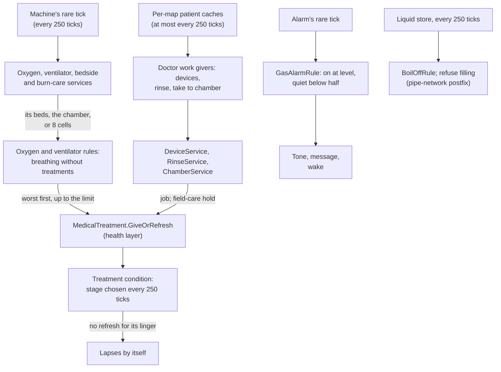

# Medical equipment

**Status (23 Nov 2026):** living; written from the code at D'thorga Medical 0.25.0. Built: the oxygen concentrator, the burn unit
bed and silver burn dressing, the ventilator and intubation kit, the manual resuscitator, the nebuliser and its vial, the
anaesthesia machine, the steriliser, the fluids kit, the carbon monoxide and smoke alarm, the safety shower and eyewash; with
Vanilla Gravship Expanded the bedside oxygen stand, the cylinder trolley, the field oxygen kit, the hyperbaric chamber, the
electrolyser and the liquid oxygen store; with More Injuries the needle decompression kit; with Dubs Bad Hygiene water from the
plumbing. Not built: hydrogen as a room gas, the vents and the hydrogen detector. **Passed in game by the owner:** row 166
(doctors still use the oxygen, hand pump and fluids kits with many wounded on the map); row 301 in part (the medical sub-tab).
Reported working by the owner before the test list: a patient's breathing improving on the concentrator (5 Nov 2026, on 0.1.0) and
the burn unit bed with its treatment (6 Nov 2026, on 0.2.0). **Not yet tested in game:** everything else, including rows 95, 117,
428 and 432.

This page says how D'thorga Medical's machines, beds, kits and showers work now: what each one does to a patient, and how doctors
and patients come to use it. What the conditions they treat do on their own (burns, burn shock, smoke, carbon monoxide poisoning,
acid on the skin, caustic gas) is on [injuries and care](medical-injuries-and-care.md); radiation and its medicines are on
radiation. The Framework pieces it stands on, the treatment that lapses, field care and the surgery-bar
registry, are on [the health layer](health-layer.md); the room gases and supplied oxygen as a mark on a condition are on [gases
and air](gases-and-air.md). Why the equipment is this way is in the [decision log](../decisions/medical-equipment.md) and the
[records](#why-it-is-this-way). The player's guide is [Medical, Equipment](../../player-guide/medical.md#equipment).

## Read this first (gotchas)

- **Machines act by themselves; nobody works them.** Every 250 ticks a machine looks at who it serves and gives or refreshes a
  treatment condition on each patient who needs it. The condition lapses about 600 ticks after its last refresh (the health
  layer's [treatments that lapse](health-layer.md#treatments-that-lapse)), so a machine switched off, unpowered, emptied or
  destroyed leaves nothing behind for long.
- **A bedside machine serves the bed it stands against.** The concentrator, ventilator, nebuliser, anaesthesia machine and oxygen
  stand are facilities placed adjacent to a bed, one of each kind per bed. A bed qualifies **if it already accepts a vitals
  monitor**, found by a patch on that effect, never by the bed's name, so other mods' hospital beds join.
- **Need is read from the body, never from a condition's name.** A patient needs oxygen when breathing, measured with every
  breathing treatment left out, is below 0.8, or when they carry a condition marked as one oxygen helps. A device's need is read
  the same way, by what the body shows.
- **Breathing at exactly zero means the airway is shut.** Oxygen and the hand pump refuse it and say why; only a breathing tube
  gets past a shut airway. With a tube already in, zero means no lung is left, and the ventilator adds nothing.
- **Oxygen never pushes breathing past normal.** Its condition raises breathing only for a patient below normal without it, and
  caps the result at normal; a patient on bionic lungs keeps what they have.
- **Six pieces exist only with Vanilla Gravship Expanded**: the bedside stand, the cylinder trolley, the field oxygen kit, the
  hyperbaric chamber, the electrolyser and the liquid oxygen store. They run on its canisters and its oxygen pipes. There is no
  oxygen network of ours. Without that mod a colony is shown one letter, once per install, recommending it.
- **The ventilator needs a breathing tube**, from an intubation kit or a tracheotomy. Until one is in, it says who is waiting.
- **No operation is done on someone lying in the hyperbaric chamber.** The bill is held, not cancelled, and runs once they are
  moved; the chamber's inspect line says so.
- **Water comes from Dubs Bad Hygiene's plumbing when that mod runs**, not in its lite mode. Otherwise the electrolyser's and the
  showers' water is assumed.
- **Hydrogen is not built.** The electrolyser's hydrogen is vented and vanishes; the gas and the vents are a design ([ventilation
  and hydrogen](../ventilation-and-hydrogen.md)).
- **Every figure is authored unless a source is named**: power draws, patient counts, breathing offsets, gas use and thresholds.
  The sourced figures are carbon monoxide's half-lives, the shower's water and the electrolyser's energy.

## What it does

### Oxygen at the bedside

| Piece | Serves | Runs on | Gives | Needs |
| --- | --- | --- | --- | --- |
| Oxygen concentrator | Two patients in the bed it stands against | 350 W | On oxygen | Respiratory care research |
| Bedside oxygen stand | Two patients in its bed | 1 canister a patient-hour, 20 held | On oxygen | Piped oxygen; gravship |
| Oxygen cylinder trolley | One patient lying beside it, bed or floor | 1 canister a patient-hour, 40 held | On oxygen | Piped oxygen; gravship |
| Hyperbaric chamber | Whoever lies in it (a bed for one) | 800 W; 6 canisters a patient-hour, 30 held | Hyperbaric oxygen | Hospital bed; oxygen network |

- **Who is served.** On each pass the machine gathers the occupants of its beds (or of the cells around a trolley, or of the
  chamber itself), keeps the living flesh ones who need oxygen, and serves the worst breathing first, up to its patient limit.
  Canister machines burn their fuel only for the patients served.
- **What oxygen does.** The treatment adds 0.2 breathing (0.3 in the chamber), capped at normal. Its stage is chosen from the
  patient's breathing measured without any breathing treatment, when it starts and every 250 ticks after, so a patient helped by
  it never looks well enough to be taken off. It also carries the Framework's supplied-oxygen mark: carbon monoxide's half-life
  becomes 75 minutes on a mask and 22.5 minutes in the chamber, against about 320 on room air, and conditions oxygen helps heal
  faster (twice as fast in the chamber). How those marks work is on [gases and air, Supplied
  oxygen](gases-and-air.md#supplied-oxygen).
- **What oxygen does not do.** It repairs no lung, and a patient on it still breathes the room's carbon monoxide.
- **The tooltip** says, in Plain mode, about how many times faster carbon monoxide clears; in the other display modes it gives the
  half-life in minutes beside room air's.
- **Every machine says what it is doing**, in the order a player fixes things: switched off, no power, no bed, no oxygen, waiting,
  treating (names), or someone in its bed who does not need it (names). The chamber adds who in it is waiting for an operation.

**The hyperbaric chamber** is a hospital-quality bed, 1 by 3 (the game gives a bed one sleeping place per tile of width). Its own
stats: tend quality −0.05 (harder to reach inside), immunity ×1.07, comfort 0.75. It takes the medical facilities other mods give
a hospital bed, only those that better tending or immunity ([linking like another
building](power-and-machines.md#linking-like-another-building)), and a vitals monitor. Two things set it apart:

- **Doctors carry a downed patient who needs oxygen there first.** A Doctor work giver, just above the game's own rescue, picks up
  a colonist, prisoner or guest who is downed on the ground and needs oxygen, whose care setting lets doctors act, and lays them
  in the nearest chamber that is switched on, powered, fuelled, free for them and reachable. With no free chamber the game's own
  rescue goes on as usual. A patient already in a bed is left there.
- **No surgery inside.** A patch on the game's medical bill keeps any bill for its occupant from starting, and the chamber is
  registered as one of the Framework's [surgery bars](health-layer.md#surgery-bars), with the reason in in-world words, so triage
  holds the operation and says why.

### The oxygen chain (Vanilla Gravship Expanded)

| Piece | Power | What it does |
| --- | --- | --- |
| Oxygen electrolyser | 3,000 W running, 50 W idle | Splits water: one network unit an hour into the oxygen pipes; idles when storage is full |
| Liquid oxygen store, 2 by 2 | 300 W cooler | Holds 2,000 units; fills from and feeds the pipes; canisters drawn off by hand |
| Canister machines | — | The stand, trolley and chamber link to the oxygen pipes by themselves and refill from them |

- **One unit of the network is one canister, taken as one patient-hour of oxygen** (about 0.3 cubic metres at 5 litres a minute;
  authored from the stand's rate).
- **The electrolyser's power is real arithmetic**: electrolysis needs about 4.5 to 6 kWh per cubic metre of hydrogen ([Energies
  14, 5347](https://arts.units.it/retrieve/e2913fde-cecd-f688-e053-3705fe0a67e0/energies-14-05347-v2_compressed2.pdf)), and each
  cubic metre of oxygen comes with two of hydrogen, so 9 to 12 kWh per cubic metre of oxygen, about 3 to 3.6 kW for one unit an
  hour (our arithmetic). It is far hungrier than Vanilla Gravship Expanded's own oxygen harvester by that mod's balance; its place
  is vacuum and thin air, where the harvester cannot work. It is built from that mod's own Architect tab, beside its oxygen
  buildings.
- **With Dubs Bad Hygiene** the electrolyser draws half a litre of water an hour from the plumbing (one unit of oxygen needs about
  0.48 kg of water by the reaction; our arithmetic). Without water it stops and idles, and its inspect line says whether the
  plumbing is missing or the towers are empty. Water quality is ignored (a real electrolyser needs pure water; a simplification).
- **The liquid oxygen store holds about four times a gas tank of its size**: one litre of liquid gives about 862 litres of gas
  ([Princeton EHS, cryogenic liquids](https://ehs.princeton.edu/laboratory-research/chemical-safety/cryogenic-liquids)), against a
  gas tank assumed at about 200 bar (Vanilla Gravship Expanded does not state its pressure). **Without power it takes in
  nothing**, still gives out what it holds, and boils off 2 % of its contents a day, vented with a hiss (authored; a real
  vacuum-insulated store loses well under 1 % a day with no cooler at all, from memory and unverified, so the cooler is a gameplay
  simplification). While cold and holding at least one unit it frosts over, gathering in an hour and melting over three. Badly
  damaged, it bursts into a fireball.
- **Canisters explode when they burn**: the stand, trolley and chamber on Vanilla Gravship Expanded's own terms, and the field
  oxygen kit by its own small explosive comp.

### Breathing support and the devices doctors use

Five hand-held devices are used by doctors **by themselves, as Doctor work**: they fetch the device (from their own inventory
first, else the nearest they can reach), carry it to a patient lying in bed or downed, and use it. Each device is matched by what
the patient's body shows. When several are needed, a tube comes first, then the hand pump, then the rest.

| Device | Who it helps | Skill; use | What it leaves |
| --- | --- | --- | --- |
| Intubation kit | No tube, and an airway closing (breathing under 0.5), or lying at a working ventilator | Medicine 4; 400 ticks, used up | Intubated 2 days |
| Manual resuscitator | Breathing under 0.5 and above zero, measured without treatments | Any; up to 2,500 ticks a turn, kept | Hand-ventilated: +0.3 |
| Field oxygen kit (gravship) | Needs oxygen; not already on supplied oxygen | Any; 300 ticks, used up | Field oxygen an hour: +0.2 |
| Fluids kit | Burn shock with no fluids, or poorer than a kit's | Any; 300 ticks, used up | Fluids at 0.9; a drip half a day |
| Needle decompression kit | More Injuries' collapsed lung, from severity 0.2 | Medicine 5; 300 ticks, used up | 0.5 off; a chest needle a day |

"Gravship" here means Vanilla Gravship Expanded. The intubation kit's tube stops talking and removes the airway condition it
bypasses (the airway burn). Hand ventilation is room air: +0.3 breathing up to normal, with no effect on carbon monoxide. Field
oxygen is the oxygen condition, with carbon monoxide's half-life at 75 minutes. Every breathing figure stops at normal.

- **The hand pump is sustained.** The doctor keeps squeezing while the patient still needs it, refreshing the treatment every 250
  ticks, and stops as soon as breathing (measured without the pump) is no longer weak. The treatment lapses 300 ticks after the
  last squeeze. It is room air: it does not clear carbon monoxide faster.
- **A needle buys time, not a cure.** It takes about a day's worsening off the collapsed lung; the trace left keeps the condition,
  and its thoracotomy, on the list.
- **On the ground, the doctor's hold is on the Framework's field-care layer** ([field care](health-layer.md#field-care)): it keeps
  other doctors of ours away and never a carrier. When someone lifts the patient, the pump gives way to the carry to a bed.
- **A right-click says why a doctor will not**: the airway is shut, no device is within reach (naming the five), the doctor lacks
  the skill (naming the level), the patient is already on oxygen or already has a tube. "Breathes well enough" is never shown: it
  would follow every right-click on a healthy person. Refusals are told only for a real patient lying down.
- **Search and Rescue's field medics use the devices too** (see [Tie-ins](#tie-ins)).

**The ventilator** is a bedside machine (200 W, one patient) that breathes through any open airway: a tube from the kit, or a
tracheotomy. It holds failing breathing up to a floor of 0.6: its condition has six stages of +0.1 each, and it takes the fewest
that reach the floor from the breathing the patient manages without any treatment, rechecked every 250 ticks. It adds nothing at
or above the floor and nothing at zero. Its inspect line names who it breathes for, who needs a tube first and who breathes well
enough.

### The burn unit bed and burn dressings

- **The burn unit bed** is a hospital-quality bed with a powered air-cell mattress (200 W). While the blower runs, an occupant
  with an open burn gets **on air cells**: wounds heal ×1.25 and pain ×0.85. Its own stats give tend quality +0.15 (and so fewer
  infections), immunity ×1.11 and surgery ×1.1. Without power it is still a good hospital bed. It takes every facility other mods
  give the hospital bed ([linking like another building](power-and-machines.md#linking-like-another-building)).
- **An open burn** is an unhealed injury whose Def carries the burn-care mark: the game's burn, electrical, chemical and acid
  burns by patch, Combat Extended's secondary burn with it. A scar is not an open burn.
- **The silver burn dressing** is an ordinary medicine (potency 0.80, quality cap 0.85, between herbal and industrial; authored).
  The game's infection chance has no patient-side modifier, so a better tend is the honest route; it works on any wound.

### The nebuliser

A bedside machine (60 W) loaded with **bronchodilator vials** as fuel (10 held; made at a drug lab, four from one neutroamine). It
treats a patient in its bed who carries a condition tagged for it (`Bronchospasm`): our acute smoke inhalation, and Combat
Extended's smoke inhalation from severity 0.1 by patch. The mist adds 0.15 breathing up to normal and burns a vial per four
patient-hours. The conditions themselves are on [injuries and care](medical-injuries-and-care.md).

### Surgery and cleanliness

- **The anaesthesia machine** (150 W) is a bedside facility adding 0.08 to the bed's surgery success factor (the vitals monitor
  adds 0.05), and it plays its bellows while a doctor is operating on someone in a linked bed. It gives no drug: the game's own
  anaesthetic comes with the operation.
- **The steriliser** is unpowered and counts Cleanliness 4 into its room, which the game already turns into fewer infections and
  better surgery. It has no working sound: it never ticks.

### The carbon monoxide and smoke alarm

A ceiling fixture (5 W; not an edifice, so it shares a cell with furniture; Electricity research). Every 250 ticks it reads smoke
density at its own cell and carbon monoxide there as the burns part measures it (the Framework's room gas where carried, otherwise
inferred from smoke and enclosure), unfiltered by masks.

- **It sounds** at 0.05 carbon monoxide or 0.1 smoke (the game's fractions, not parts per million; authored) and stays on until
  the gas falls below half that level.
- **When it starts, or a second gas joins**, it plays one soft tone, sends a message naming the room and what to do, and **wakes
  everyone asleep in its room** through the game's own wake-up, never someone downed or unable to wake. The message counts who
  woke.
- **Switching it off silences it.** Its state is not saved, so after a load it warns again if the air is still bad.

### Safety showers and rinsing

The **safety shower and eyewash** (no research) is where acid comes off the skin. What acid on the skin does, and the caustic-gas
residue and fallout dust that also send someone here, are on [injuries and care](medical-injuries-and-care.md) and
radiation.

- **Anyone who can walk rinses themselves.** A job giver in the game's constant think tree for people, after moving away from
  heat, sends a pawn with acid on the skin to the nearest usable shower within 60 cells (it interrupts work; the game's gate skips
  the drafted, downed, burning, asleep and broken). They stand on it for 625 ticks.
- **A patient lying down is rinsed by a doctor** (Doctor work): the doctor draws water at the shower for 120 ticks, carries it
  over and rinses for 625 ticks, holding the patient on the field-care layer.
- **The water** is the ANSI/ISEA Z358.1 figures as reported by ISHN (approximate;
  [ISHN](https://www.ishn.com/articles/105549-ansiisea-z3581--2014-emergency-eyewash-and-shower-equipment), a secondary source): a
  drench shower 75.7 litres a minute and an eyewash 1.5, each for 15 minutes, so one rinse is about 1,136 litres, or 22.7 when
  every acid burn is on an eye.
- **With Dubs Bad Hygiene** the water is drawn from the plumbing, one rinse at a time. A failed draw marks the shower dry for an
  hour, so nobody keeps running to it, and says why (no plumbing, or the towers are empty). Its showers and bathtubs become rinse
  stations too, and its other washing (a shower, a bath, a hot tub, swimming, a water cell, a wash bucket; not the sauna) rinses
  as a safety shower does. Its washing machine clears caustic residue from the clothes it washes.
- **When a rinse finishes**, contaminated clothes come off first if strip-and-rinse is on, then the skin is washed; the radiation
  part registers its own finish (dust washed off, dusty clothes left behind).

### Hydrogen and vents (designed, not built)

The electrolyser's hydrogen is vented and vanishes. The design makes hydrogen a flammable room gas of ours, with an extractor
fan, a passive vent, a fume hood and a hydrogen detector; none is built. The design is in [ventilation and
hydrogen](../ventilation-and-hydrogen.md); the gas layer it would join is on [gases and air](gases-and-air.md).

### Research and the Architect

| Project | Cost | After | Opens |
| --- | ---: | --- | --- |
| Clinical equipment | 1,000 | Medicine production; More Injuries' CPR | Resuscitator, intubation kit, fluids kit, burn dressing, steriliser |
| Respiratory care | 2,400 | Clinical equipment | Concentrator, ventilator, nebuliser |
| Bronchodilators | 600 | Drug production | Bronchodilator vial |
| Anaesthesia | 1,800 | Vitals monitor | Anaesthesia machine |
| Burn care | 1,200 | Hospital bed; More Injuries' advanced first aid | Burn unit bed |
| Piped oxygen | 1,500 | Respiratory care; Vanilla Gravship Expanded's oxygen network | Stand, trolley, field oxygen kit |

The hyperbaric chamber needs the hospital bed and the oxygen network; the electrolyser and liquid store the oxygen network; the
decompression kit More Injuries' emergency medicine; the alarm Electricity. The safety shower needs none. A colony that had
already done the research a project replaced got the project free, once ([the research
tab](power-and-machines.md#the-research-tab)). The machines sit in the Architect's **Medical** sub-tab under D'thorga, with its
own icon ([the Architect's sub-tabs](framework-services.md#the-architects-sub-tabs)); the electrolyser and liquid store sit in
Vanilla Gravship Expanded's tab.

## How it works

**Per rare tick (250 ticks)**, each oxygen supply, ventilator, bedside treatment, burn bed and alarm runs one pass through its
service. The comp keeps only the last pass (who it treated, who it left alone) for its inspect text, and its working sound.
Nothing here runs every tick except the liquid store's comp, which acts on its hash interval of 250.

**The patient's side.** A treatment condition rechecks its stage every 250 ticks: oxygen whether to raise breathing, the
ventilator how many steps. Both read breathing "without treatments": a shared flag makes every breathing treatment report its
neutral stage while the game recalculates the capacity. For a patient with no breathing treatment on, the game's own remembered
figure is used instead, since it is the same number and the full calculation walks the whole body.

**Doctor work** reads three per-map caches from the health layer's [patient cache](health-layer.md#the-patient-cache): patients
needing a device, patients needing a rinse, and downed patients wanting a chamber (built only while the map has a chamber). Each
is rebuilt at most every 250 ticks and only when a work giver asks; a right-click (a forced check) ignores the cache's age so a
patient is never hidden. Device Defs are indexed once, from every ThingDef carrying the device extension.

**Three Harmony postfixes**, applied with the rest of the mod's patches: an unpowered liquid store accepts nothing
(`CompResourceStorage.AmountCanAccept`, which is not virtual), no surgery in a chamber (`Bill_Medical.ShouldDoNow`), and the
one-time letter (`Game.FinalizeInit`, so nothing is saved in the game). The Dubs Bad Hygiene assembly adds a prefix on its washing
machine's unload. The electrolyser's water gate needs no patch: a subclass of Vanilla Expanded Framework's resource trader answers
its virtual "can be on" and "low power" hooks.

**Where the numbers come from**: the rules Def (`PhobosMedical_Rules`: need 0.8, assist 0.5, ventilator floor 0.6 and step 0.1,
alarm levels 0.05 and 0.1, quiet share 0.5), each machine's comp in XML (patients, fuel per patient-hour, treatment, sounds), the
treatment conditions' Defs (offsets, linger, half-lives), and the burns rules Def for the fluids kit's quality. All authored
except the half-lives, the shower's water and the electrolyser's energy, which are sourced above.

## Code

All under `src/PhobosMedical/Equipment/` unless named.

| File | What it holds |
| --- | --- |
| `MedicalEquipmentModule.cs` | The equipment settings (display mode, letter shown), the start-up (registers the surgery bar), the load line, a dev action |
| `Defs/MedicalDefs.cs` | `PhobosMedicalRulesDef`, the seven Def extensions, `MedicalDefOf` |
| `Comps/OxygenComps.cs`, `Services/OxygenService.cs`, `Rules/OxygenRule.cs` | Oxygen supply, `Hediff_PhobosOnOxygen`; who is served; need, status |
| `Comps/VentilatorComps.cs`, `Services/VentilatorService.cs` | The ventilator, `Hediff_PhobosVentilated`, its pass (its rule is in `OxygenRule.cs`) |
| `Services/AirwayTubes.cs` | Tubes, closing airways and what a tube bypasses, by extension |
| `Comps/BedsideTreatmentComps.cs`, `Services/BedsideTreatmentService.cs` | The tagged bedside treatment (the nebuliser) |
| `Comps/BurnCareComps.cs`, `Services/BurnCareService.cs`, `Rules/BurnCareRule.cs` | The burn bed's comp, its pass, its status |
| `Services/ChamberService.cs`, `Jobs/WorkGiver_PhobosTakeToChamber.cs` | The chamber: who goes, which one, the surgery bar; the carry |
| `Rules/DeviceRule.cs`, `Services/DeviceService.cs`, `Services/PressureRelief.cs` | Device needs, refusals, `BoilOffRule`; using a device; the needle |
| `Jobs/WorkGiver_PhobosUseDevice.cs`, `Jobs/JobDriver_PhobosUseDevice.cs` | Device work, lanes, and the job (kit or sustained pump) |
| `Comps/GasAlarmComps.cs`, `Services/GasAlarmService.cs`, `Rules/GasAlarmRule.cs` | The alarm: sensing, warning, waking |
| `Comps/RinseStationComps.cs`, `Services/RinseService.cs`, `Jobs/RinseJobs.cs` | Rinse stations, `IPhobosWaterSource`, who rinses where; the two rinse jobs |
| `Comps/BoilOffComps.cs`, `Comps/GatedTraderComps.cs` | The liquid store's boil-off and frost; the gated resource trader and `IPhobosProductionGate` |
| `Comps/SurgerySoundComps.cs` | A facility's sound while an operation runs in a linked bed |
| `Services/LinkedBeds.cs`, `Services/RecommendationService.cs` | Occupants of linked beds; the one-time letter |
| `Patches/MedicalPatches.cs` | The three postfixes |
| `src/PhobosMedical.Hygiene/` | `CompPhobosWaterFeed`, `CompPhobosRinseWater`, `DbhWashing` and the washing-machine prefix (Dubs Bad Hygiene only) |
| `src/PhobosFramework.Hygiene/PlumbingFeed.cs` | The Framework's plumbing reader both water comps use |

## Defs and XML

The modders' types, linked to [the reference site](https://phobos-dthorga.github.io/phobos-rimworld/) (pages are
`api/<Namespace>.<Type>.html`). Every machine, device and condition is matched by these, never by name, so another mod adds its
own in XML.

- **Machines (comps)**: [`CompProperties_PhobosOxygenSupply`][r1] (`maxPatients`, `fuelPerPatientHour`, `treatment`,
  `servesAdjacent`, `flowingSound`, `startSound`); [`CompProperties_PhobosVentilator`][r2] (`maxPatients`, `treatment`,
  `workingSound`); [`CompProperties_PhobosBedsideTreatment`][r3] (`tag`, `treatment`, `maxPatients`, `fuelPerPatientHour`,
  `statusKeyPrefix`, `workingSound`); [`CompProperties_PhobosBurnCare`][r4] (`treatment`); [`CompProperties_PhobosBoilOff`][r5]
  (`fractionPerDayUnpowered`, `boilingSound`, `frostMote`, `frostBuildHours`, `frostMeltHours`);
  [`CompProperties_PhobosGasAlarm`][r6] (`sound`); [`CompProperties_PhobosRinseStation`][r7] (`showerLitres`, `eyewashLitres`,
  `rinseTicks`, `fillTicks`, `showerSound`, `pourSound`); [`CompProperties_PhobosSurgerySound`][r8] (`sound`);
  [`CompPhobosGatedResourceTrader`][r9] as a `CompProperties_ResourceTrader`'s `compClass`.
- **Interfaces for tie-ins**: [`IPhobosWaterSource`][r10] (a rinse station's water) and [`IPhobosProductionGate`][r11] (a
  producer's extra condition).
- **Treatment conditions**: [`Hediff_PhobosOnOxygen`][r12] with [`HediffCompProperties_PhobosOnOxygen`][r13] (`lingerTicks`,
  `roomAirHalfLifeHours`); [`Hediff_PhobosVentilated`][r14]; the plain ones use the health layer's lapsing comp.
- **Marks on conditions**: [`PhobosOpenAirwayExtension`][r15], [`PhobosBypassedByTubeExtension`][r16],
  [`PhobosBedsideTreatableExtension`][r17] (`tags`, `minSeverity`), [`PhobosPressureReliefExtension`][r18] (`minSeverity`,
  `severityRelieved`), [`PhobosBurnCareExtension`][r19].
- **Marks on things**: [`PhobosPressureChamberExtension`][r20] on a bed; [`PhobosPatientDeviceExtension`][r21] on an item (`need`,
  one of [`DeviceNeed`][r22]; `treatment`, `workTicks`, `consumed`, `sustained`, `refreshTicks`, `minMedicineSkill`, `useSound`;
  its `ConfigErrors` refuses a missing treatment or a zero time).
- **Work**: [`WorkGiver_PhobosUseDevice`][r23] with [`PhobosDeviceWorkExtension`][r24] on its WorkGiverDef (`needs`,
  `requireDoctorWork`) for a lane; [`WorkGiver_PhobosTakeToChamber`][r25]; [`JobGiver_PhobosRinseSelf`][r26], inserted by patch.
- **The rules Def**: [`PhobosMedicalRulesDef`][r27], one instance (`Defs/Phobos/Medical/Rules.xml`); patch its figures.
- **Dubs Bad Hygiene comps** are in the tie-in assembly, which the reference site does not cover, so their source is linked:
  [`CompProperties_PhobosWaterFeed`](../../../src/PhobosMedical.Hygiene/CompPhobosWaterFeed.cs) (`litresPerHour`) and
  [`CompProperties_PhobosRinseWater`](../../../src/PhobosMedical.Hygiene/CompPhobosRinseWater.cs).
- **Files**: `mods/PhobosMedical/Common/Defs/Phobos/Medical/` (buildings, conditions, items, jobs, research, sounds, the
  Architect's sub-tab), `Common/Patches/Phobos/Medical/` (beds, burn care, the rinse think node), and the folders under
  `mods/PhobosMedical/Mods/` loaded only with each other mod.

[r1]: https://phobos-dthorga.github.io/phobos-rimworld/api/Phobos.Medical.Comps.CompProperties_PhobosOxygenSupply.html
[r2]: https://phobos-dthorga.github.io/phobos-rimworld/api/Phobos.Medical.Comps.CompProperties_PhobosVentilator.html
[r3]: https://phobos-dthorga.github.io/phobos-rimworld/api/Phobos.Medical.Comps.CompProperties_PhobosBedsideTreatment.html
[r4]: https://phobos-dthorga.github.io/phobos-rimworld/api/Phobos.Medical.Comps.CompProperties_PhobosBurnCare.html
[r5]: https://phobos-dthorga.github.io/phobos-rimworld/api/Phobos.Medical.Comps.CompProperties_PhobosBoilOff.html
[r6]: https://phobos-dthorga.github.io/phobos-rimworld/api/Phobos.Medical.Comps.CompProperties_PhobosGasAlarm.html
[r7]: https://phobos-dthorga.github.io/phobos-rimworld/api/Phobos.Medical.Comps.CompProperties_PhobosRinseStation.html
[r8]: https://phobos-dthorga.github.io/phobos-rimworld/api/Phobos.Medical.Comps.CompProperties_PhobosSurgerySound.html
[r9]: https://phobos-dthorga.github.io/phobos-rimworld/api/Phobos.Medical.Comps.CompPhobosGatedResourceTrader.html
[r10]: https://phobos-dthorga.github.io/phobos-rimworld/api/Phobos.Medical.Comps.IPhobosWaterSource.html
[r11]: https://phobos-dthorga.github.io/phobos-rimworld/api/Phobos.Medical.Comps.IPhobosProductionGate.html
[r12]: https://phobos-dthorga.github.io/phobos-rimworld/api/Phobos.Medical.Comps.Hediff_PhobosOnOxygen.html
[r13]: https://phobos-dthorga.github.io/phobos-rimworld/api/Phobos.Medical.Comps.HediffCompProperties_PhobosOnOxygen.html
[r14]: https://phobos-dthorga.github.io/phobos-rimworld/api/Phobos.Medical.Comps.Hediff_PhobosVentilated.html
[r15]: https://phobos-dthorga.github.io/phobos-rimworld/api/Phobos.Medical.Defs.PhobosOpenAirwayExtension.html
[r16]: https://phobos-dthorga.github.io/phobos-rimworld/api/Phobos.Medical.Defs.PhobosBypassedByTubeExtension.html
[r17]: https://phobos-dthorga.github.io/phobos-rimworld/api/Phobos.Medical.Defs.PhobosBedsideTreatableExtension.html
[r18]: https://phobos-dthorga.github.io/phobos-rimworld/api/Phobos.Medical.Defs.PhobosPressureReliefExtension.html
[r19]: https://phobos-dthorga.github.io/phobos-rimworld/api/Phobos.Medical.Defs.PhobosBurnCareExtension.html
[r20]: https://phobos-dthorga.github.io/phobos-rimworld/api/Phobos.Medical.Defs.PhobosPressureChamberExtension.html
[r21]: https://phobos-dthorga.github.io/phobos-rimworld/api/Phobos.Medical.Defs.PhobosPatientDeviceExtension.html
[r22]: https://phobos-dthorga.github.io/phobos-rimworld/api/Phobos.Medical.Rules.DeviceNeed.html
[r23]: https://phobos-dthorga.github.io/phobos-rimworld/api/Phobos.Medical.Jobs.WorkGiver_PhobosUseDevice.html
[r24]: https://phobos-dthorga.github.io/phobos-rimworld/api/Phobos.Medical.Defs.PhobosDeviceWorkExtension.html
[r25]: https://phobos-dthorga.github.io/phobos-rimworld/api/Phobos.Medical.Jobs.WorkGiver_PhobosTakeToChamber.html
[r26]: https://phobos-dthorga.github.io/phobos-rimworld/api/Phobos.Medical.Jobs.JobGiver_PhobosRinseSelf.html
[r27]: https://phobos-dthorga.github.io/phobos-rimworld/api/Phobos.Medical.Defs.PhobosMedicalRulesDef.html

## Settings

**The equipment has no setting that changes how it works.** D'thorga Medical's settings window, on its **General** page, draws:

| Label | What it does | Default |
| --- | --- | --- |
| How much to show | Plain (words only), Operator (a practitioner's figures) or Engineer (the full working); the whole mod's display mode | Plain |
| Medical equipment (a note) | Says whether Vanilla Gravship Expanded is active, and which pieces are missing without it | — |

The letter's "shown" flag is saved with the settings, so it never repeats on that install. Other settings the equipment follows
belong to the parts that own them: strip-and-rinse (caustic gas) and dusty colonists strip and wash (radiation) decide what comes
off at a shower. All are in the generated [settings reference](../settings-reference.md#dthorga-medical). The balance figures live
in the rules Def and on each machine's comp, not in settings.

## Saved data and removal

- **Treatment conditions on pawns** (on oxygen, field oxygen, hand-ventilated, hyperbaric, ventilated, on air cells, nebulised)
  are saved by the game as conditions. Their chosen stage is not saved; it is checked again on the next interval. Each keeps its
  last refresh tick under `PhobosMedical_LastSupplyTick` (the health layer's lapsing comp).
- **Conditions that wear off by themselves**: intubated (two days), chest needle (a day), on a drip (half a day).
- **The device job** saves `PhobosMedical_TicksSinceRefresh`, the pump's count toward its next refresh.
- **Buildings and items** are the game's (fuel in a refuelable comp, oxygen in Vanilla Expanded Framework's storage).
- **Mod settings**: `PhobosMedical_DisplayMode` and `PhobosMedical_GravshipLetterShown`.
- **Not saved**: each machine's last pass, the alarm's state, the stores refusing to fill, the frost, the water comps' last draw,
  the patient caches and the device index. All are rebuilt.
- **Removing D'thorga Medical**: press **Remove every condition this mod adds, from every pawn** on the settings window's **Taking
  this mod out of a colony** page, deconstruct the machines and burn unit beds, take the items out, save, then switch the mod off
  (the [README](../../../mods/PhobosMedical/README.md) has the steps). Buildings and items left behind are dropped by the game
  with an error line.
- **Removing Vanilla Gravship Expanded**: its six pieces go the same way; patients on them lose the treatment within the hour,
  when the conditions lapse. Their treatments are defined with the core Defs, so the save still loads them.

## Tie-ins

Every tie-in is in the [tie-in register](../tie-in-register.md#dthorga-medical). Each loads from its own folder only while the
other mod is active.

- **Vanilla Gravship Expanded**: the whole piped-oxygen chain (stand, trolley, field kit, chamber, electrolyser, liquid store, the
  piped oxygen research). Vanilla Expanded Framework links any building whose fuel takes its canister to its oxygen pipes, so our
  canister machines refill from the pipes with no code of ours. The Architect's medical sub-tab also nests under D'thorga in its
  tab layout. Vanilla Expanded Framework itself is a required dependency (its pipe-network classes are used directly).
- **Dubs Bad Hygiene**: water for the electrolyser and the safety shower from the plumbing (with the Framework's pipe underlay),
  its showers and bathtubs as rinse stations, its other washing as a rinse, and its washing machine cleaning caustic residue.
- **More Injuries**: the needle decompression kit for its collapsed lung; supplied oxygen heals its organ hypoxia (4 a day) and
  cerebral hypoxia (2 a day) faster, times the treatment's factor (both authored); its CPR and advanced first aid research lead
  into clinical equipment and burn care.
- **Combat Extended**: its secondary burn gets burn-unit care; its smoke inhalation counts as needing oxygen and as bronchospasm
  for the nebuliser.
- **Search and Rescue**: two lanes of our device work inside its field-rescue work type, for a responder with Doctor work on and
  caring work open, as its own treatment lanes ask: airway devices (intubation, hand pump, needle) at 121, just above its own
  treatment, and oxygen and fluids at 106, between its paramedic rescue and its routine treatment. No Harmony: they are
  WorkGiverDefs of our existing work giver. Its carriers still lift a patient our doctor holds on the ground (field care).
- **VFE Medical**: its intravenous drip stand keeps a burn-shock patient on fluids, at quality 0.7 against the kit's 0.9; that is
  the burns part's ([injuries and care](medical-injuries-and-care.md)). Its facilities link to our burn bed and chamber as to a
  hospital bed. Any mod's bed that takes a vitals monitor takes our bedside machines.
- **The radiation part** registers its fallout dust as another reason to rinse, and its own finish
  (radiation).
- **D'thorga Framework's vehicles** carry their own medical machines and litters ([camping and life
  aboard](camping-and-life-aboard.md)); our equipment is not fitted to vehicles.

## Performance

- **Nothing here is measured on its own.** Row 166 passed by the owner's eye: with about 25 downed people on one map, the game ran
  no slower than before Medical 0.17.1, and doctors still used the oxygen, hand pump and fluids kits.
- **Shape of the cost**: each machine and alarm does one pass per 250 ticks over its own beds or cell. Work givers read caches
  rebuilt at most every 250 ticks. The full breathing calculation runs only for patients already on a breathing treatment
  (0.17.1); others use the game's remembered figure. The liquid store's postfix runs on every pipe-network pass and is one table
  lookup.
- **The anaesthesia machine's sound check** walks the map's pawns for each patient in its linked beds, once per 250 ticks: small,
  but it grows with the colony.

## Limits and known gaps

- **Hydrogen, the vents and the hydrogen detector are not built.** The electrolyser's hydrogen vanishes, and nothing of ours takes
  a gas out of a room.
- **No oxygen network of ours.** Without Vanilla Gravship Expanded the concentrator is the only oxygen; the field kit, the trolley
  and the chamber do not exist.
- **A mask is assumed.** No job fits it, and a patient on oxygen still breathes the room's carbon monoxide. A concentrator's
  roughly 93 % oxygen is treated as a canister's.
- **The hand pump cannot help at breathing zero**, a sharper line than real life, where a partly blocked airway can sometimes
  still be ventilated.
- **Water quality is ignored**, and outside Dubs Bad Hygiene water is free.
- **The nebuliser serves the first patients it finds**, not the worst off, unlike the oxygen machines (it serves one, so it rarely
  matters).
- **Inferred from the code, not tested in game:** the load line lists five pieces as needing Vanilla Gravship Expanded and leaves
  out the trolley (`MedicalEquipmentModule.cs:52`), while the letter and the settings note name six; `RecommendationService.cs:9`
  says five.
- **Inferred from the code, not tested in game:** a ventilator with more patients needing it than its limit names neither the
  extra patient as treated nor as waiting (`VentilatorService.Supply`); with one patient a ventilator this cannot happen.
- **Inferred from the code, not tested in game:** a Dubs Bad Hygiene shower or bathtub used as a rinse station draws the safety
  shower's full 1,136 litres for one rinse (its comp takes the default figures), which may empty a small water system.
- **Inferred from the code, not tested in game:** two XML comments are stale. `Buildings_Hyperbaric.xml:8` says surgery in the
  chamber is not prevented (the patch prevents it), and `Buildings_OxygenChain.xml:85` says the store's frost is not drawn yet (it
  is a mote of its own).

## Tests

None of these is a test in game.

- **Rule tests** (`tests/PhobosMedical.Rules.Tests/Equipment`): `RuleTests.cs` (burn bed status, oxygen need, fuel, the ceiling at
  normal, machine status, worst first), `DeviceRuleTests.cs` (each device's need and refusal, lanes, field responders, boil-off),
  `VentilatorRuleTests.cs`, `GasAlarmRuleTests.cs`, `DecompressionRuleTests.cs`.
- **Dev action**: "Log a pawn's oxygen need" (breathing, whether they need oxygen, in bed, carbon monoxide's half-life on oxygen).
- **Seen-in-play notes**: `medical.device-job-made` when a device job is made, and `medical.field-care-gave-way` when a carrier
  lifts a patient from a device or rinse job.
- **In game** ([the test list](../in-game-test-pass.md)): **passed** 166; **passed in part** 301; **waiting** 95 (the drip stand),
  117 (Search and Rescue's medics with our kits), 428 (the burn bed's facilities), 432 (the chamber's facilities) and P2's
  rinsing.

## Why it is this way

- **[The decision log](../decisions/medical-equipment.md)**: every choice, one line each, with who made it and where.
- **Archived records**, kept unchanged for their history: [medical equipment](../archive/medical-equipment.md), the first set and
  the oxygen chain, with [gases and air](gases-and-air.md) and [the health layer](health-layer.md); [medical equipment, second
  set](../archive/medical-equipment-2.md), the eight pieces of 7 Nov 2026; and, for acid on the skin and the shower's purpose,
  [caustic gas](../archive/caustic-gas.md) and [burns and smoke](../archive/burns-and-smoke.md), with [injuries and
  care](medical-injuries-and-care.md).
- **Player guide**: [Medical, Equipment](../../player-guide/medical.md#equipment).
- **Records kept in place** (they cover the equipment and another system): [ventilation and
  hydrogen](../ventilation-and-hydrogen.md) (designed, not built), [soft-dependency cross-links](../soft-dependency-crosslinks.md)
  (SD22, SD23). Also cited: [the sound catalogue](../sound-catalogue.md) (the machines' sounds) and [the research gates
  audit](../research-gates-audit-2026-11-17.md) (what is left off the tree).
