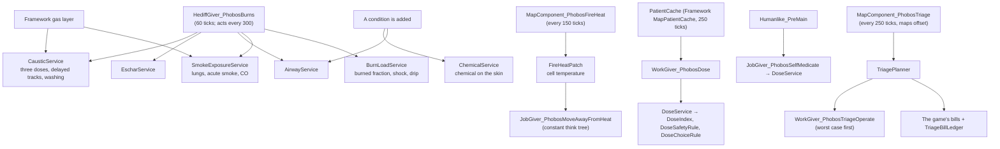

# Injuries and care (D'thorga Medical)

**Status (23 Nov 2026):** living; written from the code at D'thorga Medical 0.25.0. Built: the burned fraction and burn shock,
airway burns and the tracheotomy, eschar and the escharotomy, fluids, smoke, carbon monoxide poisoning, coughing, fire heat and
moving away from it, acid on the skin, caustic gas, contaminated clothing and wilting plants, emergency dosing, drugs against a
disease, fussing, self-medication and triage with its tags. **Passed in game by the owner:** rows 166 (doctors' work with many
wounded) and 170 (field care gives way to the carry). **Reported working by the owner before the test list:** burn numbers,
progression and the tie-ins (5 Nov 2026, on D'thorga Burns and Smoke 0.4.2), and doctors' dosing (5 Nov 2026, on D'thorga
Emergency Dosing 0.3.0). **Not yet tested in game:** everything else, including rows 95 (the drip stand) and 117 (Search and
Rescue's medics) and P2 (caustic gas, when play brings it up).

This page says how D'thorga Medical hurts and cares for people now: burns, smoke, gas and acid, the doctors who dose on their
own, and triage. The machines, beds and kits are on [medical equipment](medical-equipment.md), radiation on
[radiation](medical-radiation.md), the Framework's shared part (patients, danger, care choices, field care) on [the health
layer](health-layer.md), and the gases themselves on [gases and air](gases-and-air.md). Why it is this way is in the [decision
log](../decisions/medical-injuries-and-care.md) and the [records](#why-it-is-this-way). What a player does is in the [player
guide's Medical chapter](../../player-guide/medical.md).

## Read this first (gotchas)

- **Three parts, three namespaces.** Burns and smoke (`Phobos.BurnsAndSmoke`), emergency dosing (`Phobos.Dosing`) and triage
  (`Phobos.Triage`) were separate mods; each keeps its classes, Defs, saved keys and rules Def, so old saves load.
- **Burns and smoke hang on one hediff giver.** `HediffGiver_PhobosBurns`, in the game's `OrganicStandard` set (every 60 ticks
  per flesh pawn), acts on **humanlike pawns only**, once per 300 ticks, and only for someone burned, burning, carrying one of
  our conditions, or in smoke, carbon monoxide or tox gas. Animals only move away from heat.
- **The burned fraction and burn shock are derived, never trusted from the save.** Each pass reads the burns the pawn has and
  writes both conditions afresh. Tending, healing and Combat Extended's separate burns are all seen.
- **Area and depth are two numbers.** The game's burn severity is depth. Area comes from it by the burn's kind, so a fire's wide
  shallow burn and an incendiary round's small deep one come out differently.
- **Caustic gas is the game's tox gas.** It needs Biotech, which has the only tox gas. The game's own irritation and toxic buildup
  are untouched; our harm is added on top, and by default it comes hours later.
- **Doctors dose resting patients only** (downed or in bed). Someone up and working in pain fetches their own painkiller, by
  their drug policy, or gets nothing.
- **Painkillers are found by what they do, never by name.** Every ingestible item's outcome is read from its Defs once at load.
  An effect another mod applies from its own code is invisible here.
- **Triage queues the game's own bills.** It never operates itself. Its bills sit in the operations list like the player's, and
  only the ones it queued are ever withdrawn.
- **Every figure is authored unless a source is named** beside it.

## What it does

### Burns: how much of the body, and burn shock

**The burned fraction** (the condition labelled *burns*) is the game's stand-in for total body surface area burned.

- Every open burn on an outside part counts: a Def carrying `PhobosBurnLikeExtension` (the game's four burns, Combat
  Extended's incendiary burn).
- **Area per point of damage**, by kind (authored): fire, chemical and acid burns cover 1/12 of the part per point, up to the
  whole part; electrical and Combat Extended's incendiary burns 1/40, up to 0.3 of it. So about ten seconds on fire is about a
  fifth of the body.
- **Each part's share of the skin** comes from the body's coverage tree (`SkinShareRule`): for a human, torso 0.405, each leg
  0.126, each arm 0.080. Approximate: coverage is a hit chance, not skin area (the rule of nines gives the torso 36 %).
- **A part burned off counts as its whole subtree burned** while the stump is fresh, then fades out over 15 days (authored).
- **Scars do not count.** Healed skin neither leaks fluid nor loses heat.
- Shown from 5 % burned, slight to critical, with pain, and from serious a cost to blood pumping and moving.

**Burn shock** is how dangerous that burned area is, by the revised Baux score: age in years, plus the percent burned, plus 17
with an inhalation injury (Osler and colleagues, 2010, revising Baux's 1961 score). An airway burn or carbon monoxide at 0.2 or
more counts as inhalation.

- It starts at 15 % burned, where fluid resuscitation begins by the Parkland formula (approximate).
- **Its target** runs from 0 at a score of 36 to 1 at 110. The marks are authored from one small burn-unit cohort; larger
  burn-centre data put 50 % mortality near 110 (Roberts and colleagues, 2012).
- **Care lowers the target.** Tended burns take 0.2 off, bed rest 0.15, and fluids 0.35 per point of the shock's own tend
  quality, capped at 1.3, with a floor of 0.1 (all authored). With burns tended and bed rest: no medicine leaves 55 % of the
  target, herbal 44 %, industrial 30 %, glitterworld 20 %. **Tending the shock is giving fluids.**
- Past 15 % burned the target is at least 0.1, so the compensated stage, and the fluids job, always show.
- Severity moves toward the target, up 1 a day, down 0.35 (authored): compensated, shock (life-threatening), severe (death
  clock 4 days), terminal (1 day).

### Fluids for burn shock

Fluids are tends of the burn shock at a fixed quality (`FluidsService`), so the shock's clock and tooltip read them like any
tend.

| Source | Quality | Where |
| --- | --- | --- |
| A fluids bill with a saline bag (More Injuries) | 1 | `Mods/MoreInjuries/Defs/.../Fluids_MoreInjuries.xml`; never fails |
| A fluids kit hung by a doctor | 0.9 | A device: [medical equipment](medical-equipment.md) |
| A drip stand linked to the bed (VFE Medical's) | 0.7 | `BedsideFluids`, on each burns pass |

All three qualities are authored. A drip never replaces better fluids.

### Airway burns and the tracheotomy

- **Onset**: while a pawn is on fire, a 15 % chance per pass; otherwise from fresh burn damage to the head or neck, half that
  chance at 10 points and the full chance at 20 or more (authored).
- **Course** (`HediffComp_PhobosRiseThenFall`): swelling rises for 8 hours, holds to 24, and is gone at 48 (approximate; the
  delay follows Walker and colleagues, Critical Care 2015, on inhalation injury). The peak follows the exposure: the lightest
  reaches half the stage table, the worst all of it. Stages: hoarse, swelling, closing, obstructed.
- **A closed airway kills by setting breathing to 0**, not by a lethal severity, so another mod's organ failure can step in.
- **The tracheotomy** (Medicine 6, 2 % death on failure) removes the airway burn and leaves a tracheostomy for five days
  (`Recipe_PhobosRemoveAddHediff`, since the game's own remove surgery does not apply `addsHediff` in 1.7). No research alone;
  More Injuries' Emergency Medicine with it.

### Deep burns on a limb: eschar and the escharotomy

Deep burns all round a limb harden into a crust that cannot stretch; as the tissue swells, blood stops reaching the limb, and
cutting the crust releases it ([NCBI Bookshelf NBK482120, "Escharotomy"](https://www.ncbi.nlm.nih.gov/books/NBK482120/)). The game
has depth but not "all round", so the stand-in is a labelled simplification.

- **It forms** when the open burn damage on an arm or leg reaches 60 % of the limb's health. A limb is found by its tags, so any
  race's limbs count.
- **It tightens** from 0.05 at 1.5 a day (authored): tight, constricting from 0.4, cutting off blood from 0.7 (part efficiency
  -0.7, which triage counts as crippling). It goes once the limb's burns heal below the mark.
- **Without More Injuries**, a tight eschar deals ischaemic damage once an hour, up to 0.4 at the tightest (authored: a human leg
  in about three days), so the limb is lost the game's way. **With More Injuries**, its dry gangrene takes over through its public
  secondary-condition handler, and ours stands down.
- **The escharotomy** (Medicine 4, any medicine, no research) removes the eschar on that limb and leaves incisions that heal in
  four days. A hidden condition stops a new eschar forming on a released limb while its burns stay deep.

### Smoke and the lungs

Breathed smoke is read from the Framework's gas layer, which uses Combat Extended's smoke condition while its smoke runs, else
the game's smoke through the mask ([gases and air](gases-and-air.md)).

- **Chemical lung injury** builds at 0.15 an hour in full smoke (authored). It lasts days, is tendable, and past half invites
  pneumonia (mean time 4 days at severe, 2 at critical). Our pneumonia is a disease with immunity, lethal untreated. Supplied
  oxygen eases breathing and speeds the lungs' healing; how is on [gases and air](gases-and-air.md).
- **Acute smoke inhalation**, ours, builds only when Combat Extended's is not running, at Combat Extended's own rate per 50-tick
  check. A setting applies it beside Combat Extended's too, off by default.
- **With More Injuries' fire inhalation on** (read by name from its settings; on if unreadable), our lung injury is not added
  while the pawn is itself burning, since that mod burns the lungs then.
- Combat Extended's smoke condition gains an in-world tooltip line saying what follows from it, and a cough.

### Carbon monoxide poisoning

- **Uptake**: 0.3 an hour at full gas (authored), capped at 0.8. The gas is the Framework's; with its source off, smoke breathed
  times how enclosed the cell is stands in.
- **Clearance** halves every 5.3 hours under a roof and every 3 outdoors (`HediffComp_PhobosHalfLife`); about 320 minutes on
  room air follows Weaver and colleagues, 2000; the open-air figure is authored. Supplied oxygen shortens it further
  ([gases and air](gases-and-air.md)).
- Stages: headache, dizzy, confused, collapsed, dying (death clock half a day). A filter mask does not stop it.
- With More Injuries, carbon monoxide and a closing airway feed its hypoxia of the brain and organs (`Hypoxia_MoreInjuries.xml`).

### Coughing

People with acute smoke inhalation, an airway burn or caustic-stung airways cough now and then, awake: every 2 game hours on
average at full severity, less when milder (authored). A sound only. **It stands down by itself** while another active mod has a
sound named "cough" or "wheez", or a mod in the rules Def's `coughSoundMods` is active, and says which.

### Fire heat and moving away from it

The game spreads a fire's heat evenly through its room and throws it away outdoors. This part adds the local heat.

- **A postfix on the game's cell temperature** (`FireHeatPatch`) adds a hot zone around each fire, so heatstroke, burns from hot
  air, moods, plants, spoiling and the inspector all feel it.
- **Shape** (authored): 600 degrees above the air at a full-size fire's cell (wood flames run about 600 to 1,000 °C; Vytenis
  Babrauskas, "Temperatures in flames and fires", a secondary summary), scaled by the fire's size, falling with the square of
  distance plus one, out to 5 cells; fires add, capped at 900.
- **Indoors**, a room of 30 cells or fewer gets nothing extra; a larger room gets the share the even spread misses, `1 - 30 /
  cells` (authored). A cell inside a wall has no air and is skipped.
- **It stands down** while a mod that models air cell by cell is active (Atmosphere Overhaul, Celsius; the rules Def's list).
- **Moving away from heat**: people and animals in one of our zones hot enough to burn them (the game's line, 150 degrees over
  their comfortable maximum) sprint to the nearest reachable cooler cell within 12. Firefighters, the drafted and anyone ordered
  there stay. The giver sits in the game's constant think trees, beside fleeing an explosion.

### Acid on the skin

- An acid or chemical burn (a Def with `PhobosRinsedByWaterExtension`: the game's two) puts **chemical on the skin**, which
  deepens the open chemical burns by up to 2 an hour (authored), ignoring armour, until spent in about three hours.
- **Washing it off** ends it and eases the pain for a few hours. The washing happens at a safety shower, an eyewash (enough when
  every acid burn is on an eye) or a Dubs Bad Hygiene shower or bath: the buildings and the walk are on [medical
  equipment](medical-equipment.md). `CausticService.WashingProbes` lets a tie-in report washing elsewhere.

### Caustic gas

A game design with no real-agent data: every figure here is authored. On each pass a pawn in tox gas gains **three exposures**,
kept on one saved condition, the *caustic gas dose* (`Hediff_PhobosCausticExposure`):

| Exposure | Grows with | Stopped by |
| --- | --- | --- |
| Eyes | The cell's density | Gear or a gene immune to tox gas exposure (the game's own check) |
| Lungs and throat | The gas layer's breathed figure | Toxic environment resistance and masks |
| Skin | Density × skin cover: bare 1, covered 0.25 | Only worn gear at toxic environment resistance 0.999 or more |

Doses grow at 0.6 an hour at full exposure, never past 1. **Slow-acting** (the default): the gas stings and seems to pass, and the
harm begins at hour 4. **Fast-acting** (a setting): the eyes hurt at once from density 0.2, the skin burns only above 0.8. The
delayed tracks follow each dose's **peak**, since the dose itself fades by 0.5 a day once the harm has begun and the gas is gone.

| Track | What it does |
| --- | --- |
| Eyes | A caustic eye injury on each natural eye, worst at hour 12 (slow): 1.2 per point of peak dose |
| Throat | One roll at onset, chance equal to the lung peak, for an airway burn; needs the airway burn setting |
| Lungs | Chemical lung injury, 0.8 per point of peak, rising from the onset to hour 60 (slow), or from a dose-dependent onset (fast) |
| Skin | The game's chemical burn, a point at a time, 4 points an hour at a full skin dose, on random outside parts |
| Immunity | Slow-acting only: at hour 72, weakened immunity, mild from a heavy dose (0.5), severe from massive (0.8) |
| Aftermath | Lungs at 0.5 or more leave irritable airways; from 0.75, a one-in-five chance they last for good |

- **A burned eye scars.** A caustic eye injury that reached its burned stage leaves a scarred cornea on that eye when it heals,
  through the Framework's lasting-condition comp ([the health layer](health-layer.md)): -10 % to -50 % sight, by how bad it was. A
  replacement eye or a healer mech serum cures it. It is behind its own setting.
- **A second gassing is as serious as the first.** Gas met after 4 hours in clear air is a fresh exposure: the clock restarts,
  counting what is still in the body, and lung harm already paid for is not paid again.
- **Skin burns put chemical on the skin**, so a gassed pawn runs to a shower, and rinsing also clears the skin dose.

### Clothes that carry the gas, and plants

- **Strip and rinse** (a setting, off). Worn clothes soak up residue (0.6 an hour at full density), dose the skin at 0.3 of it
  times the skin they cover, fade 0.25 a day and are clean under 0.05 (authored). The wearer goes to a shower, drops them there
  forbidden, and rinses. The residue is a comp on every apparel Def (`CompPhobosContamination`); Dubs Bad Hygiene's washing
  machine cleans it; the *allow contaminated* filter is off in new policies and stockpiles.
- **Plants wilt.** Once an in-game hour, every plant in tox gas at least 0.3 dense loses up to 20 hit points an hour by density
  (authored: an 85-point crop lasts about four hours in thick gas). Corpses are left alone.

### Doctors who dose

A doctor gives a patient who is **down or in bed** the best dose within reach (`WorkGiver_PhobosDose`, Doctor, priority 85:
after tending, before feeding).

- **Who**: the doctors' patients (the Framework's), with care at least the setting, never "no medicine", not raging.
- **The need** (`DoseNeedRule`): pain at 0.4 or more is pain relief; at 0.8 or more (the game's "extreme"), a sedative may follow
  when nothing lighter can be given.
- **The index** (`DoseIndex`): every ingested item's conditions, read at its dose for pain, consciousness and breathing costs,
  bleeding, addictiveness and kind. Kept when it takes 30 % of the pain and scores above zero. A consciousness ceiling of 0.1 or
  less makes a sedative; an offset is a cost. `PhobosDosingExtension.neverAutoDose` keeps an item out.
- **The choice** (`DoseChoiceRule`): medical painkillers, then a sedative when wanted, then recreational painkillers as a last
  resort (a setting, off). Within a tier, relief less 0.5 × consciousness cost (not for sedatives), 0.5 × breathing cost, bleed
  increase (a quarter weight unless bleeding) and 0.5 × addictiveness. The pain level is ignored, so the pick never varies.
- **Safety** (`DoseSafetyRule`), in order: it must do what the need asks; a sedative only for sedation; recreational only by
  setting; the patient must be willing (a setting overrides that for medical drugs); **no painkiller while bleeding at 30 % a
  day or more** (sedatives exempt: some painkillers raise bleeding in code the index cannot see); none while an earlier dose is
  at a quarter or more (a medical painkiller blocks every other); none at overdose 0.3 or more; none that reaches a dangerous
  stage of its own condition; consciousness and breathing must stay at 0.15 or more after its costs.
- **Rules first, reach last.** Only the chosen item is looked for; if it is out of reach, the next best is tried.
- **The dose** uses the game's feed-a-patient toils, so the item works as written. A right-click says why no dose comes.

**Drugs against a disease that is winning.** A patient in bed with a disease that can kill, whose immunity would arrive within
two days of the lethal mark or later at today's rates, gets a medical drug that speeds immunity by 0.1 or more. Pain comes first;
if no pain relief can come, the disease drug still does. Nothing that gives a disease is on the list.

### Care needs: one table of reasons

Since Medical 0.28.0 every reason for a dose is a row of one table, a `PhobosCareNeedDef` (`Defs/Phobos/Dosing/CareNeeds.xml`). A
row gives its order, how serious it is, whether it keeps the player's reserve and whether an unmet one raises the alert; its worker
class (`Dosing/Needs/`) reads the patient. `DoseService` is the engine every worker calls: one safety rule and one choice. A doctor
looks at the rows in order, and the first with something to give decides the dose. **Not yet tested in game** (rows 590 to 593,
605 to 607, 613 to 615, 654 and 655).

| Order | Need | Who qualifies | How serious | Switch |
| --- | --- | --- | --- | --- |
| 2 | Caught in vacuum | On their feet in vacuum and harmed by it, carrying something that raises vacuum resistance | Life-threatening | Self only: a tick (on) |
| 5 | Breathing rescue | Down or in bed, breathing at 0.3 or under and not capped there | Life-threatening | Nobody, or doctors (default) |
| 10 | Cure | Down or in bed, with a visible bad condition some indexed item removes | Serious; life-threatening when the condition can kill | Nobody, or doctors (default) |
| 20 | Pain relief | As *Doctors who dose* says | Serious | The dosing switch, and self-medication's own |
| 30 | Help against a disease | As above | Life-threatening | Its own tick |
| 35 | Radiation medicine | By dose and stage; **the radiation part keeps its own choice, work giver and job** | Life-threatening | The radiation model's |
| 38 | Protection from toxins | Toxic buildup at 0.04 or more and its source still around them | Minor | Nobody, doctors, or doctors and self (default) |
| 40 | Prevention in an outbreak | An outbreak disease is on the map and this person could still catch it | Minor | Nobody, doctors, or doctors and self (default) |
| 50 | Refilling a reservoir | An artificial part's reservoir (The Dead Man's Switch's biogel) with room for a whole dose | Serious | Nobody (default), doctors, or doctors and self |
| 52 | Mental strain | Mood below the major break threshold, not in a break | Serious | The same, off |
| 54 | Addiction | An addiction no drug of its chemical may feed by the person's drug policy, and not one that kills unmet | Serious | The same, off |
| 56 | Old wounds | A permanent injury or chronic condition that hurts, or takes from a capacity or from a part that serves one | Serious | The same, off |
| 58 | Missing part | A natural part missing, with no artificial part on it or above it | Serious | The same, off |

**A breathing rescue** (0.29.0). A help to breathing is a medical drug whose conditions, at its dose, add 0.1 or more to breathing
after any breathing they cost (Medicines+' smelling salts: +0.2 for two hours). A patient at 0.3 or under, where triage calls a
vital capacity immediate, is given one where they lie, and again once the last is under a quarter of its dose: a bridge to oxygen
or an operation, never a cure. **Not where a condition caps breathing at or under the level** (`BreathingRescueRule`): a stimulant
adds to breathing and cannot lift a ceiling. For this need alone the safety rule does not ask the breathing floor, since the
patient is under it already; it asks that the dose gives more breathing than it takes. **Consciousness is not read**: nobody is
woken with a stimulant (the owner's choice: an awake patient in pain is tended worse).

**Protection while exposed** (0.30.0; the owner's cards of 26 Nov 2026). An item protects against toxins when its conditions, at its
dose, keep out a quarter or more of toxic buildup: the game multiplies what a person takes in by one less each of the two toxic
resistances (`ToxicUtility.DoPawnToxicDamage`), so Medicines+' AntiTox (0.5 and 0.6) keeps out 80%, for about 2.4 hours. Exposure is
under way when the buildup is 0.04 or more and its source is at the person's cell: polluted ground, ground that builds toxins, tox gas,
or open sky under toxic fallout or toxic weather, the places the game deals it from. Doctors give it to someone down or in bed there;
people on their feet take their own at the painkillers' hook, after a preventive. A minor need, with the preventives' reserve.

**Caught in vacuum** (0.30.0, Odyssey). Someone on their feet standing at half vacuum or more, with vacuum resistance under 1, takes
an item they carry that adds a quarter or more to vacuum resistance (Complementary Odyssey's vacsop: 0.5 for a day, and no vacuum
burns). The giver is a node in the game's **constant** think tree just ahead of its search for air (`JobGiver_FindOxygen`), because
that tree interrupts any job and the search for air would otherwise always come first; on a map not in vacuum it costs one field
read. Only what they carry: nobody walks into vacuum to fetch one and no doctor goes in. Life-threatening, so a rare item may be used;
no reserve, since nothing comes off the shelf. Drafted, downed, raging or ordered people are not interrupted.

**The toxic controlled area** (0.30.0): a second protective-gear line beside the radiation one, painted from the zone menu, always
loaded. Toxic environment resistance 0.6 to cross, and any medical drug raising either toxic resistance as its preventive, found by
what it does (the Framework's `preventiveStats`): AntiTox alone passes, as does a gas mask (0.8); a face mask (0.5) needs more. Its
paint tools show the game's home-area pictures until their own are made. **Every line's dose now goes through dosing's safety and the
reserve** (`DoseService.LineDoseAllowed`): someone who will not take it, is overdosed or is still on the last dose is not sent, and the
shelf keeps the preventives' reserve, potassium iodide at the radiation line included.

**The long-term needs** (0.31.0; the owner's cards of 26 Nov 2026), each **off** until the player turns it on, doctors for those
down or in bed and, at "doctors and self", people on their feet taking their own after everything else. Treatment, so no reserve and
no alert. The items, found by what they do:

- **Mental strain**: a medical drug lowering the break threshold by 0.03 or more at its dose (Medicines+' clozapine, 0.05 for two
  days; its own code also ends an extreme break early).
- **Addiction**: a condition whose class, or a comp's class, is in the rules' `addictionTreatments` (Medicines+' addictol, which takes
  an addiction down 0.005 an hour for a day and is 5% addictive; Ushanka's Glittertech Expansion's addiction remover, which removes
  every addiction but luciferium at once), or `treatsAddiction` on the item. Never a drug of a chemical being quit. The gentler is
  chosen first. The remover takes every addiction, wanted or not.
- **Old wounds**: a condition with the game's `HediffCompProperties_HealPermanentWounds` (Medicines+' Hydra, for a month; luciferium
  too, refused for the dependency it begins), or `healsOldWounds`. It heals one at random every 15 to 30 days, harmless ones included.
- **Missing part**: a comp in `regrowthClasses` (The Dead Man's Switch's combat regeneration serum), or `regrowsParts`.
- **Reservoir**: an outcome the rules' `reservoirs` reader names (The Dead Man's Switch's Neuroglue, 25 units of biogel in a reservoir
  of 100), read through the condition's level member by name. Refilled once the smallest dose fits; every ten units the reservoir
  loses rolls a rising chance of degeneration in DMS's code, and an empty one brings worse, so it is kept topped up.

A condition with no stages (Hydra's) now counts for the redose check, so a dose still working is not doubled.

**What the index reads besides the game's own outcome** (0.32.0). A condition given through another mod's own class is read through
the rules' `givenConditionReaders`: the class's full name, its condition and severity fields, whether a negative severity takes away
rather than gives, and a field that makes the effect depend on the taker (such an effect is not read). Vanilla Races Expanded - Genie's
antibiotics come in that way (+10% immunity speed: a drug for fighting disease). **Items swallowed through the game's
use-on-swallowing outcome** (`IngestionOutcomeDoer_UseThing`) have their use effects read: the game's `CompProperties_UseEffectAddHediff`
by type, another mod's comp through a reader. Vanilla Factions Expanded - Medieval 2's draughts come in that way: the painkiller draught
(80% of the pain), the immunization draught (+35% immunity speed) and the antitox draught (62.5% of toxic buildup kept out). **A harm
an item brings alongside its work** (a condition the game marks harmful, from an item that also gives one it does not: the draughts'
toxic buildup) counts for the danger check and not for the redose check (`DoseSafetyRule.CountsForRedose`). Items only used, never
swallowed, are not read: the dose job swallows.

**What an item is worth** is the game's own figure: for an item whose Def states none, the game works it out from what goes into
making it. Biological Warfare's antiserums come to about 137 silver and vaccines about 120; Glittertech's addiction remover to about
534, over the default rare mark, so it is not given for an addiction. The dev action "Dosing: log every care list, with worth" prints
every list with each item's figure and whether the mark holds it back.

**Cures.** The index lists an item as a cure when one of its outcomes removes conditions: an outcome class named in the rules'
`removalReaders` (the class's full name and the field holding the conditions; Ushanka's Biological Warfare's antiserums), or `cures`
declared on the item's `PhobosDosingExtension`. A cure works at once, so it is given where the patient lies.

**Prevention.** A preventive is an item whose condition, at its dose, carries the game's `makeImmuneTo` for an outbreak disease (or
that declares `prevents`). An outbreak disease is one a game event brings to a group (`IncidentDef.diseaseIncident`), one that
spreads between people (Vanilla Expanded Framework's spreadable comp, found by name), or one the rules list. While one of the
player's people on a map visibly has such a disease (`PreventionService`, a per-map list rebuilt at most every 250 ticks), anyone
whose chance factor of catching it (the game's `DiseaseContractChanceFactor`) is 0.5 or more counts as unprotected: doctors give a
preventive to those down or in bed, and people on their feet take their own, at the think-tree hook painkillers use.

- **A drug policy decides only where it has a tick**: for an item that addicts or is taken for pleasure. A plain medicine has only
  a schedule there, so the need's own switch is the gate (agent's reading of the owner's card, for the owner to revise).
- **No disease passes between people in the game by itself, nor in the owner's mods as read on 26 Nov 2026** (no condition carried
  the spreadable comp). There, prevention protects against the next strike, not the one under way.

**What the table adds to safety** (`CareSafetyRule`, after the dose itself has passed, for every row):

- never an item that begins a dependency that kills when it stops (the addiction's own stages threaten life), unless the patient
  has that addiction already;
- an addictive item only for a serious or life-threatening need;
- an item at or over the player's rare mark only for a life-threatening need (a setting since 0.29.0: a slider, 300 silver by
  default, the figure triage uses for a rare tool; zero keeps nothing back);
- a need that keeps the reserve (prevention) never takes an item below it, counted per item over the unforbidden stock on the map
  (5 by default).

A cure or a preventive scores 1 less its costs, with vomiting counted (a quarter per vomit a day), so an emetic is on neither list.
Pain and immunity scores do not count vomiting, so those choices are as they were.

**The alert.** `Alert_PhobosCareUnmet` ("Medicine needed") names each person with a need whose row raises it (every row but
prevention) while no item that answers it is on the map and the colony knows how to make one (a recipe that makes it is available
now). `CareStock` keeps the per-map list, rebuilt at most every 250 ticks, when the alert asks. A setting, on.

**Fussing.** An awake patient in extreme pain (0.8 or more) is tended worse: the tend quality is multiplied by 0.9 at 0.8 pain,
falling to 0.75 at full pain (authored). A postfix on the game's base tend quality; a setting, on.

**Self-medication.** A free adult colonist (the game's `IsFreeColonist`) up and about, not drafted, not resting for medical
reasons, in pain at 0.4 or more (0.3 with chemical interest, 0.2 with fascination), takes a painkiller their drug policy allows
for joy or on a schedule; the two traits bypass the policy, as in the game's joy givers. Teetotalers do not, nor anyone for whom
the game nullifies the pain thought (a masochist, a belief that idealises pain). The doctors' safety and choice apply, never a
sedative, with a higher floor: consciousness and breathing at 0.4 or more after the dose. **Who:** free colonists; the colony's
slaves only by a setting, off by default (`MaySelfMedicate`: the game counts a slave who is not rebelling or escaping as a free
colonist, so the test is `IsFreeNonSlaveColonist` first); guests by their own setting, and with no policy they take medical
painkillers only. The giver sits at the game's `Humanlike_PreMain` hook and uses the game's ingest job.

### Triage

One planning pass per map every 250 ticks (`MapComponent_PhobosTriage`, maps offset) reads every patient and does three things.

**Classes each visible bad condition by its effects** (`ConditionClassRule`):

| Class | When |
| --- | --- |
| Lethal | Its stage threatens life or has a death clock; severity climbs to a lethal one; or, lasting, it holds a vital capacity at 0.3 or under |
| Crippling | Not clearing, with a capacity cap at or under 0.5, or a capacity or part-efficiency offset at or under -0.5 |
| Other | Anything else |

A cap alone never makes a condition lethal (every sedative caps one). Addictions and chemical dependencies are left out.

**Queues an operation** when the person's authority allows the class (the Framework's per-person choice, "Doctors may operate":
never, to save life, to save life or a limb, for any repair). Defaults by group: colonists, slaves and prisoners to save life,
guests never. With "any repair", a condition classed other is queued when an operation removes it, but never sets the tag.

- **Operations** are every surgery that removes the condition (`removesHediff`), plus what `PhobosTriageExtension.treatsHediffs`
  names on a recipe; `neverAutoQueue` keeps a recipe for the player (`OperationIndex`).
- **The choice** (`OperationChoiceRule`): the highest expected success (the recipe's factor times the best qualifying doctor's
  chance, clamped at 0.98 as the game clamps), then the cheapest. **Refusals**, nearest to fixable first, so the message names
  one thing to change: a missing item, skill, no doctor, research, too risky, care level, a violation, a rare tool, no recipe.
- **Risk**: the chance of death is the recipe's death chance times the chance the best doctor fails; 5 % by default, a setting.
- **Rare tools**: an ingredient that is not medicine and worth 300 silver or more (authored); allowed by default.
- **A bill for a lethal condition goes to the top** of the patient's list (a rules flag, on). At most 15 bills a patient.
- **Messages**: one when an operation is queued; one per patient and condition when a lethal one has nobody who can operate.
- **Withdraws** only its own bills (the ledger), once the condition is gone, care is "no care", or the authority disallows it.
- **Surgery bars**: while another mod holds the patient from surgery (the pressure chamber), nothing is queued or withdrawn for
  the hold, and the hold's reason is shown.

**Tags each patient** for the doctors (`TriageRule`): **immediate** (dying within 6 hours, or a vital capacity at or under 0.3),
**urgent** (dying, with more time), **delayed** (crippled), **minor**, and **expectant** (dying of a condition only an operation
removes, and nobody can do one). A held operation counts as feasible, so a held patient is never expectant.

- **The score** bands the tags 100 apart (immediate 400, urgent 300, delayed 200, minor 100, expectant 50); within a band, less
  time scores higher, half the urgency at 24 hours left. Expectant gets no urgency, so it never outranks a minor case.
- **The order of work**: `WorkGiver_PhobosTriageOperate`, a prioritised copy of the game's operate giver at Doctor priority 75,
  above the game's 70, over every patient in bed with a bill, the player's included. Off by setting, the game's giver serves.
- **Where the tag shows**: the inspect line ("Triage: urgent. …", no hours in Plain mode), and an icon by the pawn's name: red
  immediate, yellow urgent, green delayed, white minor, black expectant. With Useful Marks it is one of its marks (a tie-in
  assembly); without, a postfix draws it.
- **The care choice on the health tab**: a small button beside the game's medicine setting opens the same menu as the pawn's
  own (`HealthTabChoices`).

## How it works

**Per pass** (300 ticks a pawn, spread by hash): burns and shock rebuilt, smoke and carbon monoxide taken up, airway and eschar
checked, caustic tracks acted. **Per condition tick**: carbon monoxide clears, the airway follows its curve, acid and eschar act
hourly, coughs roll. **Per map**: fire heat every 150 ticks, plants hourly, triage every 250. **On demand**: dosing when a doctor
looks for work, self-medication when a pawn chooses a job.

**Where the numbers come from**: three rules Defs, one per part (`PhobosBurns_Rules`, the dosing rules, the triage rules), the
first loaded winning; the conditions' stages in XML; the game's own figures (tend quality, pain labels, the hot-air burn line,
bleed rates, immunity rates, surgery success).

## Code

All under `src/PhobosMedical/` unless named.

| File | What it holds |
| --- | --- |
| `MedicalMod.cs` | The mod: one settings file, the settings pages, load lines, the removal button; the five former mods' settings imported once |
| `Seen.cs` | Seen-in-play notes, including field care that gave way to a carrier |
| `HealthTabChoices.cs` | The care-choice buttons beside the health tab's medicine setting |
| `BurnsAndSmoke/BurnsAndSmokeMod.cs` | Settings, the load line, the two settings pages, the per-cell air mod check |
| `BurnsAndSmoke/Defs/` | `PhobosBurnRulesDef`, `PhobosBurnLikeExtension`, `PhobosRinsedByWaterExtension`, `BurnsDefOf` |
| `BurnsAndSmoke/Givers/HediffGiver_PhobosBurns.cs` | The one engine hook |
| `BurnsAndSmoke/Services/` | Burn load, skin shares, airway, smoke and CO, eschar, fluids and the drip, acid, caustic gas, plants, hot cells |
| `BurnsAndSmoke/Rules/` | Game-free rules: burn load, burn shock, skin share, airway, carbon monoxide, eschar, chemical, caustic, fire heat |
| `BurnsAndSmoke/Comps/` | The half-life, rise-then-fall, cough, ischaemia, acid and tooltip comps; the caustic dose; clothing contamination |
| `BurnsAndSmoke/Heat/` | The hot-zone map component, the temperature postfix, the move-away job giver |
| `BurnsAndSmoke/Surgery/` | The remove-and-leave surgery worker, the fluids bill |
| `Dosing/DosingMod.cs` | Settings, load line, settings page |
| `Dosing/Services/` | `DoseService` (decides, makes the job), `DoseIndex`, `PatientCache`, `PreventionService`, `CareStock`, `FussingService` |
| `Dosing/Rules/` | Need, effect, safety, choice, immunity, self-dose, care-need and fussing rules |
| `Dosing/Jobs/`, `Dosing/Patches/` | The work giver, the dose driver, the self-medication giver; the fussing postfix |
| `Triage/TriageMod.cs`, `TriagePreferences.cs` | Settings, the per-person authority registered with the Framework, the inspect line |
| `Triage/Services/` | `TriagePlanner`, `OperationIndex`, `ConditionReader`, `TriageBillLedger`, the map component |
| `Triage/Rules/` | Class, authority, operation choice, tag and score |
| `Triage/Jobs/`, `Triage/UI/` | The ordered operate giver; the tag's style and map overlay |
| `*/Debug/` | Dev actions (see Tests) |
| `src/PhobosMedical.UsefulMarks/TriageMarks.cs` | The triage tag as a Useful Marks mark |

## Defs and XML

The modders' types, linked to [the reference site](https://phobos-dthorga.github.io/phobos-rimworld/) (pages are
`api/<Namespace>.<Type>.html`):

- **Rules Defs**, one each, the first loaded wins (patch figures rather than adding a second): [`PhobosBurnRulesDef`][r1]
  (`Defs/Phobos/BurnsAndSmoke/Rules.xml`, with `fluidsFacilities`, `perCellTemperatureMods`, `coughSoundWords`, `coughSoundMods`),
  [`PhobosDosingRulesDef`][r2] and [`PhobosTriageRulesDef`][r3].
- **Extensions**: [`PhobosBurnLikeExtension`][r4] (`areaPerDamage`, `maxArea`) and [`PhobosRinsedByWaterExtension`][r5] on an
  injury Def; [`PhobosDosingExtension`][r6] (`neverAutoDose`) on an item; [`PhobosTriageExtension`][r7] (`treatsHediffs`,
  `neverAutoQueue`) on a recipe.
- **Condition comps**: [`HediffCompProperties_PhobosHalfLife`][r8] (`halfLifeHoursRoofed`, `halfLifeHoursOutdoors`,
  `removeBelow`), [`HediffCompProperties_PhobosRiseThenFall`][r9] (`peakHours`, `plateauEndHours`, `resolveHours`),
  [`HediffCompProperties_PhobosCough`][r10] (`sound`, `mtbHoursAtFull`, `minSeverity`),
  [`HediffCompProperties_PhobosIschaemia`][r11], [`HediffCompProperties_PhobosChemicalDeepening`][r12] and
  [`HediffCompProperties_PhobosBurnTooltip`][r13]; the dose's own class, [`Hediff_PhobosCausticExposure`][r14].
- **Clothing**: [`CompProperties_PhobosContamination`][r15], put on every apparel Def by code;
  [`SpecialThingFilterWorker_PhobosContaminated`][r16] (`PhobosBurns_AllowContaminatedApparel`).
- **Workers and AI**: [`HediffGiver_PhobosBurns`][r17] (patched into `OrganicStandard`), [`Recipe_PhobosRemoveAddHediff`][r18]
  (the tracheotomy, the escharotomy), [`Recipe_PhobosGiveFluids`][r19], [`JobGiver_PhobosMoveAwayFromHeat`][r20] (inserted into
  `HumanlikeConstant` and `AnimalConstant`), [`JobGiver_PhobosSelfMedicate`][r21] (`PhobosDosing_SelfMedicate`, at
  `Humanlike_PreMain`), [`WorkGiver_PhobosDose`][r22] with [`JobDriver_PhobosDose`][r23] (`PhobosDoctorDose`, `PhobosDose`), and
  [`WorkGiver_PhobosTriageOperate`][r24] (`PhobosTriageOperate`).
- **Useful Marks' provider** lives in the tie-in assembly `PhobosMedical.UsefulMarks`, which the reference site does not cover:
  [`src/PhobosMedical.UsefulMarks/TriageMarks.cs`](../../../src/PhobosMedical.UsefulMarks/TriageMarks.cs).
- **Conditions and damage kinds** are `PhobosBurns_*` Defs in `Defs/Phobos/BurnsAndSmoke/`.

[r1]: https://phobos-dthorga.github.io/phobos-rimworld/api/Phobos.BurnsAndSmoke.Defs.PhobosBurnRulesDef.html
[r2]: https://phobos-dthorga.github.io/phobos-rimworld/api/Phobos.Dosing.Defs.PhobosDosingRulesDef.html
[r3]: https://phobos-dthorga.github.io/phobos-rimworld/api/Phobos.Triage.Defs.PhobosTriageRulesDef.html
[r4]: https://phobos-dthorga.github.io/phobos-rimworld/api/Phobos.BurnsAndSmoke.Defs.PhobosBurnLikeExtension.html
[r5]: https://phobos-dthorga.github.io/phobos-rimworld/api/Phobos.BurnsAndSmoke.Defs.PhobosRinsedByWaterExtension.html
[r6]: https://phobos-dthorga.github.io/phobos-rimworld/api/Phobos.Dosing.Defs.PhobosDosingExtension.html
[r7]: https://phobos-dthorga.github.io/phobos-rimworld/api/Phobos.Triage.Defs.PhobosTriageExtension.html
[r8]: https://phobos-dthorga.github.io/phobos-rimworld/api/Phobos.BurnsAndSmoke.Comps.HediffCompProperties_PhobosHalfLife.html
[r9]: https://phobos-dthorga.github.io/phobos-rimworld/api/Phobos.BurnsAndSmoke.Comps.HediffCompProperties_PhobosRiseThenFall.html
[r10]: https://phobos-dthorga.github.io/phobos-rimworld/api/Phobos.BurnsAndSmoke.Comps.HediffCompProperties_PhobosCough.html
[r11]: https://phobos-dthorga.github.io/phobos-rimworld/api/Phobos.BurnsAndSmoke.Comps.HediffCompProperties_PhobosIschaemia.html
[r12]: https://phobos-dthorga.github.io/phobos-rimworld/api/Phobos.BurnsAndSmoke.Comps.HediffCompProperties_PhobosChemicalDeepening.html
[r13]: https://phobos-dthorga.github.io/phobos-rimworld/api/Phobos.BurnsAndSmoke.Comps.HediffCompProperties_PhobosBurnTooltip.html
[r14]: https://phobos-dthorga.github.io/phobos-rimworld/api/Phobos.BurnsAndSmoke.Comps.Hediff_PhobosCausticExposure.html
[r15]: https://phobos-dthorga.github.io/phobos-rimworld/api/Phobos.BurnsAndSmoke.Comps.CompProperties_PhobosContamination.html
[r16]: https://phobos-dthorga.github.io/phobos-rimworld/api/Phobos.BurnsAndSmoke.Comps.SpecialThingFilterWorker_PhobosContaminated.html
[r17]: https://phobos-dthorga.github.io/phobos-rimworld/api/Phobos.BurnsAndSmoke.Givers.HediffGiver_PhobosBurns.html
[r18]: https://phobos-dthorga.github.io/phobos-rimworld/api/Phobos.BurnsAndSmoke.Surgery.Recipe_PhobosRemoveAddHediff.html
[r19]: https://phobos-dthorga.github.io/phobos-rimworld/api/Phobos.BurnsAndSmoke.Surgery.Recipe_PhobosGiveFluids.html
[r20]: https://phobos-dthorga.github.io/phobos-rimworld/api/Phobos.BurnsAndSmoke.Heat.JobGiver_PhobosMoveAwayFromHeat.html
[r21]: https://phobos-dthorga.github.io/phobos-rimworld/api/Phobos.Dosing.Jobs.JobGiver_PhobosSelfMedicate.html
[r22]: https://phobos-dthorga.github.io/phobos-rimworld/api/Phobos.Dosing.Jobs.WorkGiver_PhobosDose.html
[r23]: https://phobos-dthorga.github.io/phobos-rimworld/api/Phobos.Dosing.Jobs.JobDriver_PhobosDose.html
[r24]: https://phobos-dthorga.github.io/phobos-rimworld/api/Phobos.Triage.Jobs.WorkGiver_PhobosTriageOperate.html

## Settings

Every label and default is in the generated [settings reference](../settings-reference.md#dthorga-medical), on the pages
*Burns and smoke*, *Caustic gas*, *Emergency dosing* and *Triage*. **Every switch is on by default except these, off:** the
fast-acting caustic model, strip and rinse, recreational drugs for pain, medical drugs for those who refuse drugs, slaves and
guests taking painkillers, operations that wrong another faction, and our smoke inhalation beside Combat Extended's (shown only with it).

- **Choices with values**: minimum care for dosing (herbal or worse); triage's defaults by group (colonists, slaves and prisoners
  to save life, guests never); the highest chance of death the doctors may accept alone (5 %, from 0 to 50 %).
- **Dependent switches**: the caustic tracks show only while tox gas does lasting harm; the throat track also needs airway burns,
  the lung track smoke inhalation.
- **Switching off** the burned fraction, burn shock, eschar or caustic gas takes those conditions off pawns on the next pass;
  the other switches only stop new harm.
- **Display mode** (Plain, Operator, Engineer) is D'thorga Medical's one setting on its General page; Plain shows no figures.

## Saved data and removal

- **Conditions on pawns**, all hediffs. The airway burn saves its peak (`PhobosBurns_peak`); the caustic dose its doses, peaks,
  clocks and one-off flags under thirteen `PhobosBurns_…` keys (`Hediff_PhobosCausticExposure.ExposeData`).
- **On every garment**: `PhobosBurns_ContaminationLevel` and `PhobosBurns_ContaminationTick` (the residue fades from the tick
  without ticking). The radiation dust keys beside them belong to [radiation](medical-radiation.md).
- **Game component**: `TriageBillLedger` saves the bills triage queued, by reference (`PhobosTriage_Bills`), pruned before each
  save so none dangles.
- **On the Framework's patient comp**: the triage authority choice, under `PhobosTriage_Authority` ([the health
  layer](health-layer.md)).
- **Not saved**: the burned fraction and shock targets, fire heat zones, the triage entries and tags, the dosing patient list,
  the dose index, the operation index. The map components for fire heat, caustic plants and triage save nothing but are written
  into the save by name ([How the code is built, Saves and removal](../architecture.md#saves-and-removal)).
- **Settings** are in D'thorga Medical's one settings file, under the keys the former mods used (`PhobosBurns_…`,
  `PhobosDosing_…`, `PhobosTriage_…`).
- **Removal**: **Remove every condition this mod adds, from every pawn** (`MedicalMod.cs:156`) takes the mod's conditions off
  every pawn, alive or dead, leaving no lasting scar. Triage's bills stay as ordinary bills. A save without the mod then logs a
  missing class once for each component.

## Tie-ins

Every tie-in is in the [tie-in register](../tie-in-register.md). None is required; each loads only with its mod.

- **Combat Extended**: its smoke signal, its incendiary burn, and our tooltip line and cough on its smoke condition.
- **More Injuries**: its fire inhalation setting, saline bag, gangrene, hypoxia and Emergency Medicine, as above; its brain
  therapy is found by triage through `PhobosTriageExtension` (`BrainTherapy_MoreInjuries.xml`), its other operations as any
  recipe is.
- **Search and Rescue**: its carriers lift patients our doctors are dosing (the Framework's field care); its field medics use our
  devices ([medical equipment](medical-equipment.md)); the airway burn keeps `removesHediff`, so it stays surgical to it.
- **VFE Medical** (the drip stand), **Dubs Bad Hygiene** (washing; [medical equipment](medical-equipment.md)), **Useful Marks**
  (the tag), **Hospitality** (guests), **Atmosphere Overhaul** and **Celsius** (fire heat stands down), **Biotech** (tox gas).
- **The save bridge** (More Injuries beside Medical Surgery Expanded 2) has a page of its own: [the medical save
  bridge](medical-save-bridge.md).

## Performance

- **Nothing here is measured on its own.** Row 166 passed: with about 25 downed people on one map, the game ran no slower than
  before Medical 0.17.1, as seen in play, not timed.
- **Shape of the cost**: the burns giver costs a few comparisons per uninteresting pawn every 60 ticks, and real work once per
  300 ticks for the few burned or breathing something. Fire heat is one lookup per temperature read (one count with no fire) and
  a rebuild every 150 ticks. Dosing reads a cached list of patients someone may dose now and looks for one item at a time.
  Triage asks each surgeon's chance once per operation per pass.

## Limits and known gaps

- **Animals** get no burn load, shock, airway, eschar, smoke or caustic harm; they only move away from heat.
- **A stump past 1.5 days counts as tended**, tended or not; a late tend drops its weight at once. Coverage stands in for skin
  area.
- **Carbon monoxide is inferred** from smoke and enclosure when the Framework's gas is not running.
- **Fire heat** can linger up to 150 ticks after its fire dies, and every map rebuilds on the same tick.
- **Effects applied from code are invisible to the dose index**: Vanilla Races Expanded's antibiotics, given through its own
  outcome class, are not indexed; More Injuries' morphine raising bleeding is why the bleeding hold exists.
- **Stronger pain does not prefer stronger drugs**: the score ignores the pain level.
- **Antibiotics are not told from antivirals**; every disease drug counts for every disease.
- **Prevention reaches only what an item already prevents, and only once a disease is in the colony.** Our own vaccines, hygiene and
  masks are designed, not built ([vaccines and prevention](../vaccines-and-prevention.md)). Every slice of the [care
  needs](../medical-care-needs.md) is built; blood loss is left to More Injuries.
- **Effects in another mod's code are read only through a named reader**: the addiction treatments, the regrowth comp and the biogel
  reservoir are named in the rules Def by class. A rename in that mod stops them being found; the reservoir and refill readers say so
  once in the log, the class lists do not.
- **What the index does not read** of the long-term items: The Dead Man's Switch's bionic shock that the serum and Neuroglue set, and
  Neuroglue's own condition (about five days), which holds the next refill until it is a quarter gone.
- **Blood loss is left to More Injuries** (the owner's choice, 26 Nov 2026): its doctors transfuse blood bags on their own, and it
  counts a hemogen pack as one, so a need of ours would send a second doctor. **Its epinephrine is kept out of automatic dosing**
  (`Mods/MoreInjuries`, `neverAutoDose`): the risk it carries is applied in More Injuries' code, and Search and Rescue gives it for
  cardiac arrest.
- **A cure hidden in another mod's code is not found** until a reader names its outcome class or the item declares it. Nothing
  checks a reader's class and field against the other mod's updates but the one warning in the log at start-up.
- **Mechanoid doctors** never dose or take the ordered operate work (`canBeDoneByMechs` false).
- **Search and Rescue's evacuation to a vehicle** is not ours to add; a request for its author is drafted in the [soft-dependency
  record](../soft-dependency-crosslinks.md).
- **Inferred from the code, not tested in game**: `TriageMod.cs:53` says triage has no Harmony, but the tag overlay
  (`Triage/UI/TriageTagOverlay.cs`) is a Harmony postfix; the comment is stale, the behaviour is as described here.

## Tests

None of these is a test in game.

- **Rule tests** (`tests/PhobosMedical.Rules.Tests`): `BurnsAndSmoke/` (`BurnLoadRuleTests`, `SkinShareRuleTests`,
  `BurnedOffTests`, `BurnShockRuleTests`, `CarbonMonoxideRuleTests`, `AirwayRuleTests`, `EscharRuleTests`, `ChemicalRuleTests`,
  `CausticRuleTests`, `FireHeatRuleTests`), `Dosing/` (`DoseEffectRuleTests`, `DoseNeedRuleTests`, `DoseSafetyRuleTests`,
  `DoseChoiceRuleTests`, `ImmunityTests`, `BleedingHoldTests`, `SelfDoseRuleTests`, `FussingRuleTests`, `CareSafetyRuleTests`, `StockReserveRuleTests`, `PreventionRuleTests`, `CareScoreTests`,
  `CareSafetyOrderTests`, `BreathingRescueTests`, `ExposureTests`, `LongTermTests`) and `Triage/`
  (`ConditionClassRuleTests`, `AuthorityRuleTests`, `OperationChoiceRuleTests`, `TriageRuleTests`).
- **Dev actions** (`*/Debug/`): five "Burns:" (burn load, fire heat at the mouse cell, start an airway burn, heal caustic eyes,
  scorch plants), four "Dosing:" (the index, disease drugs, self-medication, a patient's decision), three "Triage:" (the index,
  selected pawns, run the planner) and "Medical: remove every condition D'thorga Medical adds".
- **Load lines**: each part writes what is on and off, and why, at start-up.
- **In game** ([the test list](../in-game-test-pass.md)): **passed** 166, 170; **waiting** 95, 117 and P2.

## Why it is this way

- **[The decision log](../decisions/medical-injuries-and-care.md)**: every choice, one line each, with who made it and where.
- **Archived records**, kept unchanged for their history: [burns and smoke](../archive/burns-and-smoke.md) (with [gases and
  air](gases-and-air.md)), [caustic gas](../archive/caustic-gas.md) (with gases and air and [the health layer](health-layer.md)),
  [emergency dosing](../archive/emergency-dosing.md) and [triage](../archive/triage.md) (each with the health layer).
- **Player guide**: [Medical](../../player-guide/medical.md).
- **Records kept in place** (they cover part of this system and another, or a design not yet built): [soft-dependency
  cross-links](../soft-dependency-crosslinks.md) (the drip stand, Search and Rescue's medics), [vaccines and
  prevention](../vaccines-and-prevention.md) (designed, not built). Also cited: [medical save
  bridge](../archive/medical-save-bridge.md) (More Injuries beside Medical Surgery Expanded 2), [the sound
  catalogue](../sound-catalogue.md) (coughing) and [mod consolidation](../mod-consolidation.md) (how the five mods became one).
