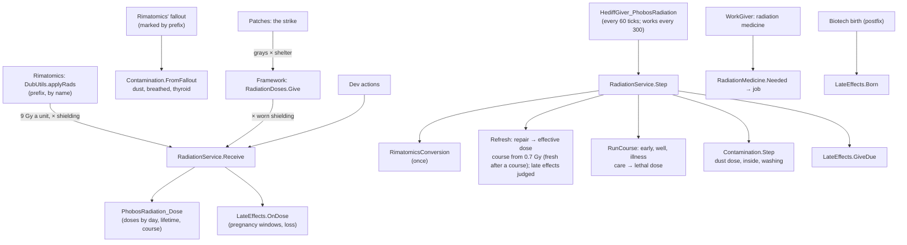

# Radiation

**Status (24 Nov 2026):** living; written from the code at D'thorga Medical 0.25.0 and D'thorga Patches 0.40.0, the course's restart
rule at Medical 0.26.1. Built: the dose in
grays and its repair, the course of radiation sickness, care that moves who lives, the harshness presets, a doctor's estimate or
the exact dose, Dubs Rimatomics' doses taken and its old conditions converted, the strike's dose, worn shielding, fallout dust and
the thyroid, the three medicines, late effects, harm in pregnancy, the radiation control point and area, and the dev actions.
**Passed in game by the owner:** row 31a (the radiation control line itself, on the Framework's line machinery). **Not yet tested
in game:** everything else, including rows 32 (the line's alert), 96 (iodide at the line), 361 to 363 (the course, the strike's
dose, conversion), 369 to 374 (late effects, pregnancy, dev actions, shielding, dust, medicines) and 458 (no second course without a
new dose).

This page says how D'thorga Medical's radiation model works now. The Framework's side, the door a dose comes in by
(`RadiationDoses`), is on [the health layer and care](health-layer.md); the protective-gear line's machinery is on [gases and
air](gases-and-air.md#protective-gear-lines). Why the model is this way is in the [decision
log](../decisions/medical-radiation.md) and the [records](#why-it-is-this-way).

## Read this first (gotchas)

- **The model replaces Dubs Rimatomics' radiation sickness for people, behind one setting** ("Radiation sickness runs its real
  course", on). Off, Rimatomics runs exactly as it did, and the nuclear strike gives its dose to Rimatomics too.
- **Rimatomics' old conditions convert once, one way.** The first step that meets a person carrying Rimatomics' sickness, fatal
  exposure or buildup turns them into a dose of ours and removes them. Switching the model off later does not bring them back.
- **Robots stay Rimatomics'.** Anything Rimatomics counts as a robot, and anything without a flesh body, keeps Rimatomics' own
  handling. Other mods' "radiation" that is really the game's toxic buildup (reactors and fallout from mods other than Rimatomics)
  is left as their authors made it: only Rimatomics' one dose method is taken.
- **Suits and masks stop dust, not the dose.** With the model on, Rimatomics' cut by toxic environment resistance is not applied.
  Walls, earth, distance and the mass of what is worn cut the dose from outside; a mask cuts only what is breathed. The radiation
  control line still asks for toxic environment resistance 0.75, so with the model on it guards against contamination.
- **Who dies is decided, not rolled.** Each person carries fixed numbers drawn from their thing ID
  (`RadiationService.Sensitivity`): how sensitive they are, whether they vomit, whether a late effect finds them. Saving and
  loading changes nothing.
- **The course follows the highest effective dose reached**, so repair never softens an acute dose while its illness runs. Repair
  matters for doses spread over days.
- **A dose shows as a doctor's estimate until it can be measured.** "Measured" means Dubs Rimatomics' Geiger counter research is
  finished, or dev god mode is on. Without Rimatomics, the estimate is all there is unless the setting is turned off.
- **Late effects come at a quarter of the real time**, real years counted as 60-day game years. There is no setting for this.
- **Danger is told only through the illness's stages**: `lifeThreatening` from severe, death at severity 1. Nothing kills in code,
  so triage, Search and Rescue and the game's doctors read it as they read any condition.
- **Every figure is authored unless a source is named beside it.** Sources are the record's; the agent's figures and
  simplifications are marked as such.

## What it does

### The dose and its repair

A person's radiation lives in one saved condition, `PhobosRadiation_Dose` (`Radiation/Hediff_PhobosRadiationDose.cs`). It keeps
every dose by the game day it was taken, the part already beyond repair, the lifetime dose, the highest effective dose of the
course, when the course began and when the person first vomited. Its severity is the **effective dose in grays**: invisible below
0.05 Gy, shown from there (`Hediffs_Radiation.xml`).

**Repair** follows the equivalent residual dose of the US Department of Agriculture's civil-defence handbook ([Agriculture
Handbook No. 234, 1962](https://www.govinfo.gov/content/pkg/GOVPUB-A-PURL-gpo21249/pdf/GOVPUB-A-PURL-gpo21249.pdf)), simplified
for play (`RadiationRule.Remaining`, `Radiation/Rules/RadiationRule.cs:68`):

- A dose counts in full for its first **4 days**.
- After that, **a tenth stays for good**, and the rest is repaired at **2.5 % a day** of what remains: about half is gone in a
  month, nearly all in four months. For a dose D taken t days ago (t over 4): 0.1·D + 0.9·D·0.975^(t − 4).
- Each day's doses run on their own clock. After **150 days** a dose is folded into the part beyond repair (its tenth) and dropped
  from the list (`RadiationService.Refresh`).
- **The lifetime dose is never repaired.** Late effects and the exposure category read it.

The tooltip names the **exposure category** from the lifetime dose, after the US Army's FM 3-3-1 (Appendix A, in the [Internet
Archive's scan](https://archive.org/download/MManuals/UsArmyNuclearContaminationAviodance1994.pdf)): 0 for none, 1 up to 0.7 Gy, 2
up to 1.5 Gy, 3 above (`RadiationRule.ExposureCategory`).

### The course of radiation sickness

A **first course** starts when the effective dose reaches **0.7 Gy** (`RadiationRule.CourseFrom`), and from then on follows the highest
effective dose reached in it. **After a course has ended, the next starts only when the doses taken since, each repaired, reach 0.7 Gy
by themselves** (`RadiationRule.Fresh`, `StartsCourse`; the owner's card of 24 Nov 2026, Medical 0.26.1): repair is too slow to bring
the dose under the threshold soon, so the old damage alone never restarts the sickness, but it still counts in the new course's
height. Its phases (`RadiationRule.Phase`):

| Phase | When | What the person has |
| --- | --- | --- |
| **Early sickness** | From the first vomit, 2.2 − 0.25 × dose days (2 at most, 6 hours at least) | Vomiting, poor appetite, tiredness, duller |
| **Well period** | Then 30 − 3.5 × dose days (26 at most, none from about 8.6 Gy) | Nothing shown: a deceptive spell of feeling well |
| **Illness** | Then, rising to its height and recovering, or death | `PhobosRadiation_Illness`: mild to critical |

- **Vomiting** is fixed when the course starts: the person vomits if their own draw falls under the share of people who vomit at
  that dose (19 % at 1 Gy, 35 % at 2, 54 % at 3, 72 % at 4, 94 % at 6), and the hours to the first vomit fall from over 10 at 1 Gy
  to half an hour at 10. Both from Blakely, "Early-Phase Biological Dosimetry", Table 6-2, in the Borden Institute's *Medical
  Consequences of Radiological and Nuclear Weapons* ([chapter
  6](https://medcoe.army.mil/pfw-images/dbimages/Nuke%20Warfare-ch06.pdf)). Someone who never vomits goes straight to the well
  period.
- **The well period** follows the US HHS REMM time phases after the IAEA ([2 to 4 Gy](https://remm.hhs.gov/ars_timephases2.htm),
  [6 to 8 Gy](https://remm.hhs.gov/ars_timephases4.htm), [above 8 Gy](https://remm.hhs.gov/ars_timephases5.htm)): to day 18 to 28
  at 2 to 4 Gy, about a week at 6 to 8, none above 8. The straight line is a simplification.
- **Which system fails first** sets how fast the illness climbs (Goans and Flynn, "Acute Radiation Syndrome in Humans", [chapter
  2](https://medcoe.army.mil/pfw-images/dbimages/Nuke%20Warfare-ch02.pdf) of the same book): the blood-forming syndrome from 1 Gy
  reaches its height in **14 days**, the gut from 6 Gy in **6**, the neurovascular from 20 Gy in **1.5** (the day counts are
  authored).
- **The illness's height** is the dose over the person's own lethal dose: 1 kills; below it the illness recedes by 5 % of severity
  a day (`recoveryPerDay`, authored), never rising again once past its height. The stages are authored: severe (0.55) and critical
  (0.8) are life-threatening and cut immunity, moving, manipulation, blood pumping and, when critical, breathing.
- **A recovered course ends**: the illness is removed, and the dose condition stays, still repairing. The day it ended is saved, with
  the grays already recorded that day, so a dose later that same day counts as fresh. Doses folded beyond repair after 150 days no
  longer count as fresh.

### Who lives: the lethal dose, care and the presets

Each person's **lethal dose** (`RadiationRule.LethalDose`) is the preset's dose that kills half without care, plus the preset's
care figure times the care they are getting (0 to 1), plus their own sensitivity: a fixed draw put through a logistic curve with a
spread of **0.8 Gy** (ICRP 103 puts the dose that kills a tenth about 2 Gy below the one that kills half; [ICRP Publication
103](https://www.nrc.gov/docs/ml1233/ML12338A682.pdf), 2007). Never below 1 Gy. A marrow stimulant in time adds 0.5 Gy more.

| Preset (authored) | Half die without care at | Full care moves that by | Late effects |
| --- | --- | --- | --- |
| Gentle | 6 Gy | 3 Gy | none |
| **Moderate** (default) | 5 Gy | 2.5 Gy | at half strength |
| Realistic | 4 Gy | 2 Gy | full |
| Harsh | 3.5 Gy | 1.5 Gy | full |

**Care** is judged at each step while the illness runs (`RadiationService.Care`), from supportive care as the sources describe it
(fluids, antibiotics, rest and a clean room against infection; [López and Martín,
2011](https://pmc.ncbi.nlm.nih.gov/articles/PMC3863169)). The weights are authored, in the rules Def:

| Care | Adds |
| --- | --- |
| The illness tended, times the tend's quality (a tend lasts 24 hours) | 0.35 |
| In bed | 0.2 |
| In bed in a room with cleanliness 0.6 or better (a hospital's sterile floor) | 0.15 |
| On a drip (`PhobosMedical_OnDrip`, from the drip stand or fluids kit, when present) | 0.15 |
| Immunity gain speed above 1.05 (a medicine or bed that speeds immunity) | 0.15 |

Care is read fresh each step, so a patient who leaves bed loses its share at once.

### What a doctor can tell

The dose condition's tooltip (`RadiationService.Describe`):

- **Exact**, once Dubs Rimatomics' Geiger counter research is finished, with the estimate setting off, or in god mode: the dose
  now after repair, the lifetime dose and the category.
- **A doctor's estimate** otherwise, as a band in grays (`RadiationRule.EstimateFromVomiting`, after Goans and Flynn and Blakely):
  first vomit within half an hour, 8 to 30 Gy; within an hour, 6 to 8; two hours, 4 to 6; five hours, 2 to 4; later, 1 to 2. No
  vomiting yet: 0 to 10 Gy for the first 12 hours, then 0 to 2.
- **A blood count narrows it**: two days or more into the course, a person in a medical bed has one taken, and the band becomes a
  quarter either way of the true dose (authored, after the lymphocyte-depletion assays in [Rothkamm and colleagues,
  2013](https://pmc.ncbi.nlm.nih.gov/articles/PMC4094341)).
- **Outside a course**, without measurement, the tooltip says only that the person was exposed, and the category.

### The three medicines

Three drug-lab pills of the game's own kind (`Items_RadiationMedicine.xml`), each giving an "on" condition. **Doctors give them by
themselves** through their own work giver, `PhobosRadiation_DoctorMedicine` (Doctor work, priority 84), never beyond the patient's
medical care setting, and they can be given by hand or by drug policy too.

| Medicine | Research; made from | What it does | Doctors give it when |
| --- | --- | --- | --- |
| Anti-sickness tablets | Radiation; 1 neutroamine | Early sickness held eased (no vomiting) for half a day | Anyone in the early sickness |
| Marrow stimulant | Marrow; 3 neutroamine | +0.5 Gy to the lethal dose, if taken within a day of the course | 2 Gy or more known, within that day |
| Prussian blue capsules | Radiation; 1 steel, 1 neutroamine | Half-life inside cut to a third, about three days | 0.05 Gy or more inside still to come |

- **Radiation medicine** ("Radiation" above; 1,200 research) needs Medicine production and Drug production; **Marrow stimulants**
  ("Marrow"; 2,400) need Radiation medicine and Vitals monitor (`Medical/Research.xml`).
- **Sources behind the effects**: the marrow stimulant follows filgrastim, whose label's radiation use is for doses "greater than
  2 gray" ([Neupogen label](https://dailymed.nlm.nih.gov/dailymed/drugInfo.cfm?setid=97cc73cc-b5b7-458a-a933-77b00523e193)); the
  0.5 Gy it adds is authored. Prussian blue's factor follows the [Radiogardase
  label](https://dailymed.nlm.nih.gov/dailymed/drugInfo.cfm?setid=baa68c79-5f3d-468a-a510-58b9e978cd50) (caesium's half-life in
  the body about 80 days down to 26, at Goiânia). Durations, costs and work are authored.
- **"Known" for the marrow stimulant** means measured, or estimated from the first vomit: within five hours means 2 Gy or more.
- The giving job is the game's feed-a-patient toils, so the pill's own outcome applies; it gives up once the patient no longer
  needs that medicine. Doctors hold patients through the Framework's field-care layer ([the health layer, Field
  care](health-layer.md#field-care)).

### Worn shielding

What a person wears cuts a dose from **outside** a little, by its mass (`ShieldingRule`, `WornShielding`), behind "What is worn
shields a little" (on):

- Gamma rays are stopped by mass per area, whatever the material: about **650 kg a square metre** cuts them to a tenth (from
  Glasstone and Dolan, *The Effects of Nuclear Weapons*, 1977, Table 8.41: 3.3 inches of steel, 11 of concrete, 16 of earth; read
  for the [strike record](../nuclear-strike-effects.md#sources)).
- Each garment's mass, as the game has it (so Combat Extended's masses count), is spread over the skin area of the body part
  groups it covers; layers on a group add. The skin areas (about 1.8 m² in all) are the agent's estimates.
- The share that passes is weighted by the **active bone marrow** under each group, since the marrow's dose decides the blood
  syndrome: the torso three quarters, the skull 8 %, the upper thighs 7 %, the neck 4 %, the shoulders 4 %, the arms 2 %. These
  shares are the agent's, after ICRP Publication 70, from memory and **unverified**. A helmet over the upper head covers half the
  skull's share.
- In practice the cut is small: a heavy armour vest might take a few percent off. It applies to the strike's dose and every
  Rimatomics dose, never to dust breathed or swallowed.

### Fallout dust and contamination

Behind "Fallout dust on skin and clothes" (on), from **Rimatomics' fallout only**, the one source that is dust (`Contamination`,
`ContaminationRule`). The amounts are authored, in the rules Def, unless named.

- **Dust settles** with each dose taken in fallout: 1 unit a gray, spread over the worn clothes by the skin each covers (each
  garment's `CompPhobosContamination`, the caustic gas's clothing component) and onto bare skin for the rest.
- **Carried dust doses**: 0.02 Gy a day for each unit on the skin or in worn clothes. Dust fades as fallout does, by the 7:10 rule
  (Glasstone and Dolan, [chapter IX](https://www.fourmilab.ch/etexts/www/effects/eonw_9.pdf), 9.16): all of it for the first day,
  then as the age to the power −1.2. A unit of 0.1 or more wants washing.
- **Breathed** through the Framework's mask rule (`MaskFactor.Filtered`): 0.03 Gy from inside per gray outside, unmasked; skin
  dust swallowed from the hands, 0.01 Gy inside a unit a day, which a mask does not stop.
- **The dose from inside** arrives over weeks, at caesium's half-life in the body of about **110 days** (the Radiogardase label),
  a third of that on Prussian blue.
- **The thyroid** takes 2 Gy per gray of fallout breathed unmasked (authored, after the high thyroid doses on Rongelap), none
  while Dubs Rimatomics' potassium iodide is in the body: iodide guards the thyroid and nothing else, as the US FDA says it
  "provides protection only for the thyroid from radioiodines" ([*Potassium Iodide as a Thyroid Blocking Agent*,
  2001](https://www.fda.gov/media/72510/download)).
- **Washing**: any rinse at the safety shower clears the skin, and so does washing at Dubs Bad Hygiene's showers or baths; the
  clothes' dust goes in Dubs Bad Hygiene's washing machine, as caustic residue does. With "Dusty colonists strip and wash" on (off
  by default), a colonist carrying dust counts as needing the safety shower, and leaves dusty clothes there, forbidden. The shower
  itself is on [medical equipment](medical-equipment.md); the caustic residue it shares is on [injuries and
  care](medical-injuries-and-care.md).
- **Not modelled**: beta burns from dust on the skin, and dust spreading to beds and floors.

### Late effects

Each behind its own switch; their strength is the preset's (Gentle none, Moderate half, Realistic and Harsh full); they arrive at
a quarter of the real time (`RadiationLateRule`, `LateEffects`). Each is judged whenever the dose is refreshed, and given when its
day comes, with a message for the player's people.

| Effect | Chance | When (real years, then a quarter) | What it gives |
| --- | --- | --- | --- |
| **Leukaemia** | A sixth of 5.5 % a gray of lifetime dose | 2 to 8, by the person's draw | Ours, growing like the game's chronic cancers |
| **Solid cancer** | Five sixths of 5.5 % a gray | 10 to 30 | The game's carcinoma: lung, stomach, liver, torso, neck or kidney |
| **Thyroid cancer** | 1 % a gray to the thyroid for adults, 5 % under 18 | 4 to 10 | The game's carcinoma on the neck |
| **Cataract** | None to 0.5 Gy, rising in a straight line to certain at 5 Gy | 8 at the threshold, down to 1 at 5 Gy | The game's cataract in each eye |
| **Sterility, men** | From 0.15 Gy, temporary; for good past 3.5 to 6 Gy | At once | Ours for a quarter-year to five years; the game's sterilized |
| **Sterility, women** | For good past 2.5 to 6 Gy, lower with age | At once | The game's sterilized |

- **Sources**: cancer at 5.5 % a sievert is ICRP 103's whole-population figure, which errs gentle at the high doses of the
  survivors' studies (the agent's choice); the leukaemia sixth is the agent's figure, **unverified**. Latencies are after the
  atomic-bomb survivors' [leukaemia](https://www.rerf.or.jp/en/programs/roadmap/health_effects/late/leukemia/) and [solid
  cancer](https://www.rerf.or.jp/en/programs/roadmap/health_effects/late/cancrisk/) pages (RERF), read in translation. The
  cataract thresholds are the [ICRP Statement on Tissue
  Reactions](https://www.icrp.org/docs/ICRP%20Statement%20on%20Tissue%20Reactions.pdf) (2011) and ICRP 41 in ICRP 103; the
  straight line between them and the latency are authored. Sterility's thresholds are ICRP 103's, after ICRP 41, for a single
  brief dose; women's age slope and men's temporary span are authored. The thyroid figures are the agent's, **unverified**: the
  sources agree only that children are far more at risk, as after Chernobyl.
- **Sterility follows the highest effective dose ever reached** (after repair); cancers and cataracts follow the lifetime dose.
- **The cancer sites** are an authored list in the rules Def (`solidCancerParts`), after the commoner cancers in the survivors;
  the place is fixed by the person's draw, the first such part they still have.

### Pregnancy (Biotech)

Behind three switches, all on: loss of a pregnancy, harm to a child before birth, and a child's own cancer risk. The fetus is
taken to receive the mother's dose, a simplification: the CDC says it "tends to be lower". The windows and thresholds are the US
CDC's, after NCRP Report 174 ([radiation and pregnancy for
clinicians](https://www.cdc.gov/radiation-emergencies/hcp/clinical-guidance/pregnancy.html)), on a 38-week pregnancy measured from
Biotech's gestation:

- **Loss**, through Biotech's own miscarriage, with a letter: from 0.1 Gy in the first two weeks, from 0.5 Gy later. The chances
  between the CDC's words are authored: a fifth at 0.5 Gy early, nine in ten by 1.5; none at 0.5 later, half by 3 Gy.
- **At birth** (a postfix on Biotech's `PregnancyUtility.ApplyBirthOutcome`): weaker movement and hands from a dose in weeks 3 to
  7 above 0.5 Gy (authored chances, three in five by 2 Gy); slower learning at the CDC's 40 % a gray in weeks 8 to 15, from ICRP
  103's 0.3 Gy, and 15 % a gray in weeks 16 to 25, from 0.5 Gy.
- **The child carries its dose**: what it took before birth goes into its own lifetime dose, so its cancer chance follows.
- **Left out**: growth restriction, which the game has no fitting condition for. A pregnancy that ends another way forgets its
  doses.

### Doses from Dubs Rimatomics

Every Rimatomics dose passes through one method, `DubUtils.applyRads`. A prefix found by name (`RimatomicsDose`), first in
priority, takes the dose for a person while the model is on and skips the original:

- **The conversion** is the record's: Rimatomics' sickness per unit of its strength, times **9 Gy** a unit of sickness, so its
  first visible stage (0.04) is about 0.36 Gy and its fatal turn (0.9) about 8 Gy, the dose above which the sources call the
  outcome uniformly fatal without care. The 9 is authored.
- **Rimatomics' own radiation setting is honoured.** Toxic environment resistance is not applied.
- **Fallout fades** by the 7:10 rule from the fallout's first day, which Rimatomics' constant fallout does not do: prefixes on its
  two fallout conditions mark the dose as fallout, with its age, and leave dust (above).
- **What is worn shields it**, since every Rimatomics dose comes from outside (a leak, waste carried, fallout lying around).
- **Its Geiger click** and a figure in milligrays over the colonist are redone for doses above a small strength, once the Geiger
  research is finished.

**Old conditions convert** at the first step that meets them (`RimatomicsConversion`): the sickness at 9 Gy a unit; the fatal
exposure as a dose of (0.9 + its severity) × 9 Gy; the buildup, a tenth of every dose it gave, into the lifetime dose at ten times
its severity times 9. A converted dose of 0.7 Gy or more starts a course dated two days back, so the early sickness does not come
again. Each condition is removed as it is converted.

### Doses from a nuclear strike

D'thorga Patches' strike on InterRim Ballistic Missile's warheads (`src/PhobosPatches.Irbm/Strike/StrikeWork.cs`) gives its dose
through the Framework's door. Only the dose path is here; the blast, heat, flash and vehicles are on [vehicle
damage](vehicle-damage.md) and in the [strike record](../nuclear-strike-effects.md).

- **The dose**: **10 Gy at the fireball's edge** (`radiationGraysAtFireballEdge`, authored), falling with the strike's own
  strength curve, given through `RadiationDoses.Give(pawn, grays, "strike")`. Medical's registration multiplies it by worn
  shielding before it is received. Without the model, or with it off, the dose goes to Rimatomics instead when Rimatomics is
  active.
- **Shelter** (with "Shadow and shelter from the strike" on): the dose is cut by what stood overhead before the roofs were
  stripped, from Glasstone and Dolan's Table 8.72 for gamma rays: a light building passes 0.9, a stone-walled room 0.15, three
  feet of earth (thick rock) 0.003; a thin rock roof 0.05 is the agent's figure (`StrikeShelterRule.DosePass`). People under rock
  now take that share rather than none.
- **People aboard a vehicle** take the dose people in the open take there, times the hull's share (1 open, 0.9 closed under 15
  tonnes, 0.7 to 40, 0.35 above; authored after Davidson's tank figures), in grays.
- **The letter** lists the player's people dosed, in words and grays, as they stood outside, before worn shielding: light below 1
  Gy, moderate below 2, heavy below 4, severe below 6, lethal above.

### The radiation control line (Rimatomics)

With Dubs Rimatomics, D'thorga Medical defines the one protective-gear line there is (`Mods/Rimatomics/Defs/Phobos/Protection/`):
a **radiation control point** (10 steel), and a **radiation controlled area** painted from the zone tab. Colonists stop at its
edge to put on gear worth toxic environment resistance 0.75 (Rimatomics' suit and mask together, authored), and take Rimatomics'
potassium iodide first when there is some within reach (SD21). How a line stops, fetches gear and turns people back is the
Framework's, on [gases and air](gases-and-air.md#protective-gear-lines). With the model on, the line guards against dust, the
iodide guards the thyroid, and neither cuts the dose.

### Dev actions

In dev mode, under D'thorga Medical (`Radiation/Debug/RadiationDebugActions.cs`): give a dose to selected pawns (0.25 to 50 Gy);
remove all radiation, ours and Rimatomics' (so nothing is converted back); bring late effects due now; dust as 1 Gy of fresh
fallout would; log the dose.

## How it works

**The per-tick path.** `HediffGiver_PhobosRadiation` is patched into the `OrganicStandard` giver set, so the game calls it every
60 ticks for every flesh pawn. It returns at once unless the model is on, the pawn's hash phase falls on the rules' interval (300
ticks, five seconds at normal speed), and the pawn carries our dose or a Rimatomics condition to convert. Only then does `Step`
run: conversion, repair and the course start, the course itself, contamination for those 300 ticks' worth of days, the marrow
stimulant's start, late effects due, and a pregnancy's doses forgotten if it ended.

**On a dose.** `Receive` adds the grays to today's entry, notes the source, books the dose to a pregnancy's window (and may end
it), then refreshes at once, so a course can start on the tick a large dose lands.

**Where the numbers come from.** The dose bands, repair, timings, the spread, the estimate and the presets are constants in the
game-free rules (`RadiationRule`, `RadiationLateRule`, `ShieldingRule`, `ContaminationRule`), each with its source or "authored"
in its comment. The rest (the interval, recovery, care weights, the clean room, cancer sites, dust, the medicines) is in
`PhobosRadiationRulesDef`, all authored except caesium's half-life and Prussian blue's factor.

## Code

All under `src/PhobosMedical/` unless named.

| File | What it holds |
| --- | --- |
| `Radiation/RadiationPart.cs` | Harshness, `RadiationSettings`, registration with the Framework, the settings page, the load report |
| `Radiation/Hediff_PhobosRadiationDose.cs` | The saved dose condition: doses by day, lifetime, course, late effects, contamination; its tooltip |
| `Radiation/Rules/RadiationRule.cs` | Phases, presets; repair, vomiting, well period, lethal dose, estimates, category, Rimatomics units, 7:10 |
| `Radiation/Rules/RadiationLateRule.cs` | Cancer, cataract, sterility and pregnancy figures; the quarter time scale |
| `Radiation/Rules/ShieldingRule.cs` | Skin areas, marrow shares, transmission by mass per area |
| `Radiation/Rules/ContaminationRule.cs` | Dust fading, delivery from inside, bare skin, thyroid cancer |
| `Radiation/Services/RadiationService.cs` | Receiving, the step, repair and course, care, the fixed draws, the tooltip line |
| `Radiation/Services/LateEffects.cs` | Judging and giving late effects; pregnancy loss; harm at birth |
| `Radiation/Services/Contamination.cs` | Dust from fallout, the carried and inside doses, washing and stripping, the thyroid |
| `Radiation/Services/WornShielding.cs` | Reads worn garments for the shielding rule |
| `Radiation/Services/RimatomicsDose.cs` | The by-name prefixes on Rimatomics' dose and fallout; the Geiger research test |
| `Radiation/Services/RimatomicsConversion.cs` | Converting Rimatomics' conditions once |
| `Radiation/Services/RadiationMedicine.cs` | Which medicine a patient needs; their effects on the model; the doctor's job |
| `Radiation/Jobs/RadiationMedicineJobs.cs` | The work giver and job driver for the medicines |
| `Radiation/Givers/HediffGiver_PhobosRadiation.cs` | The engine hook in `OrganicStandard` |
| `Radiation/Patches/BirthPatch.cs` | The postfix on Biotech's birth |
| `Radiation/Defs/RadiationDefs.cs` | `RadiationDefOf`, `PhobosRadiationRulesDef` |
| `Radiation/Debug/RadiationDebugActions.cs` | The five dev actions |
| `Protection/ProtectionPart.cs` | The radiation area's designators, the line's step and allowed-area patches, its load report |
| `src/PhobosFramework/Health/RadiationDoses.cs` | The Framework's dose door ([health layer](health-layer.md#radiation-doses)) |
| `src/PhobosPatches.Irbm/Strike/StrikeWork.cs`, `Rules/StrikeShelterRule.cs` | The strike's dose, shelter shares and letter |

## Defs and XML

Linked to [the reference site](https://phobos-dthorga.github.io/phobos-rimworld/) (pages are `api/<Namespace>.<Type>.html`):

- **[`PhobosRadiationRulesDef`][r1]** (`Common/Defs/Phobos/Radiation/Rules_Radiation.xml`, `PhobosRadiationRules`): the interval,
  recovery, care weights, clean-room threshold, cancer sites and start severity, dust, inside and thyroid amounts, the medicines'
  thresholds. The first loaded wins; patch its figures rather than adding a second.
- **[`Hediff_PhobosRadiationDose`][r2]**, the class of `PhobosRadiation_Dose` (`Hediffs_Radiation.xml`), with the early sickness
  and the illness beside it.
- **[`HediffGiver_PhobosRadiation`][r3]**, added to `OrganicStandard` by `Common/Patches/Phobos/Radiation/GiverSet.xml`.
- **[`WorkGiver_PhobosRadiationMedicine`][r4]** and **[`JobDriver_PhobosRadiationMedicine`][r5]**, with the three medicines, their
  "on" conditions, `PhobosRadiation_GiveMedicine` and `PhobosRadiation_DoctorMedicine` (`Items_RadiationMedicine.xml`); the two
  research projects in `Common/Defs/Phobos/Medical/Research.xml`.
- **Late-effect conditions** (`Hediffs_RadiationLate.xml`): leukaemia, temporary sterility, and the two prenatal harms; the game's
  `Carcinoma`, `Cataract` and `Sterilized` for the rest.
- **With Rimatomics** (`Mods/Rimatomics/`): a [`ProtectionZoneDef`][r6] `PhobosZone_RadiationControlled`, the control point with
  [`CompProperties_PhobosControlPoint`][r7] and [`PlaceWorker_PhobosControlPoint`][r8], and the zone tab's
  [`Designator_PhobosRadiationAreaExpand`][r9] and [`Designator_PhobosRadiationAreaClear`][r10].
- **C# only**: [`RadiationSettings`][r11], [`RadiationService`][r12], the rules [`RadiationRule`][r13],
  [`RadiationLateRule`][r14], [`ShieldingRule`][r15], [`ContaminationRule`][r16]; and the Framework's [`RadiationDoses`][r17].

[r1]: https://phobos-dthorga.github.io/phobos-rimworld/api/Phobos.Radiation.Defs.PhobosRadiationRulesDef.html
[r2]: https://phobos-dthorga.github.io/phobos-rimworld/api/Phobos.Radiation.Hediff_PhobosRadiationDose.html
[r3]: https://phobos-dthorga.github.io/phobos-rimworld/api/Phobos.Radiation.Givers.HediffGiver_PhobosRadiation.html
[r4]: https://phobos-dthorga.github.io/phobos-rimworld/api/Phobos.Radiation.Jobs.WorkGiver_PhobosRadiationMedicine.html
[r5]: https://phobos-dthorga.github.io/phobos-rimworld/api/Phobos.Radiation.Jobs.JobDriver_PhobosRadiationMedicine.html
[r6]: https://phobos-dthorga.github.io/phobos-rimworld/api/Phobos.Framework.Protection.ProtectionZoneDef.html
[r7]: https://phobos-dthorga.github.io/phobos-rimworld/api/Phobos.Framework.Protection.CompProperties_PhobosControlPoint.html
[r8]: https://phobos-dthorga.github.io/phobos-rimworld/api/Phobos.Framework.Protection.PlaceWorker_PhobosControlPoint.html
[r9]: https://phobos-dthorga.github.io/phobos-rimworld/api/Phobos.Medical.Protection.Designator_PhobosRadiationAreaExpand.html
[r10]: https://phobos-dthorga.github.io/phobos-rimworld/api/Phobos.Medical.Protection.Designator_PhobosRadiationAreaClear.html
[r11]: https://phobos-dthorga.github.io/phobos-rimworld/api/Phobos.Radiation.RadiationSettings.html
[r12]: https://phobos-dthorga.github.io/phobos-rimworld/api/Phobos.Radiation.Services.RadiationService.html
[r13]: https://phobos-dthorga.github.io/phobos-rimworld/api/Phobos.Radiation.Rules.RadiationRule.html
[r14]: https://phobos-dthorga.github.io/phobos-rimworld/api/Phobos.Radiation.Rules.RadiationLateRule.html
[r15]: https://phobos-dthorga.github.io/phobos-rimworld/api/Phobos.Radiation.Rules.ShieldingRule.html
[r16]: https://phobos-dthorga.github.io/phobos-rimworld/api/Phobos.Radiation.Rules.ContaminationRule.html
[r17]: https://phobos-dthorga.github.io/phobos-rimworld/api/Phobos.Framework.Health.RadiationDoses.html

## Settings

On D'thorga Medical's **Radiation** page, in this order (the generated [settings
reference](../settings-reference.md#dthorga-medical) has every description):

| Setting | Default | What it does |
| --- | --- | --- |
| Radiation sickness runs its real course | On | The whole model; off, Rimatomics' radiation as before |
| How harsh radiation is | Moderate | Gentle, Moderate, Realistic, Harsh: the lethal dose, care's reach, late effects' strength |
| A doctor estimates a dose until it can be measured | On | Off: the dose always shows exactly |
| What is worn shields a little | On | Worn mass cuts doses from outside |
| Fallout dust on skin and clothes | On | Dust, the dose from inside and the thyroid |
| Dusty colonists strip and wash | Off | A dusty colonist goes to the safety shower and leaves dusty clothes; needs fallout dust on |
| Cancer, Cataracts, Sterility | On | Under "Late effects, months or years after a dose" |
| Loss of a pregnancy, Harm to a child before birth, A child's own cancer risk | On | The same heading; need Biotech to matter |

**D'thorga Patches** (IRBM: after-effects) adds "Radiation sickness and flash blindness for survivors" (on), without which the
strike gives no dose, and "Shadow and shelter from the strike" (on), without which shelter does not cut it. Every setting takes
effect at the next step.

## Saved data and removal

- **The dose condition** saves under `PhobosRadiation_` keys: `DoseDays` and `DoseGrays` (two lists; of different lengths after a
  load, both are cleared), `BeyondRepair`, `Lifetime`, `Peak`, `CourseStart`, `FirstVomit`, `WillVomit`, `BloodCount`,
  `IllnessHeight`, `LastSource`, `Highest`, the late-effect days, `SterileTemporaryFor`, `SterilePermanent`, `PregnancyId`,
  `Prenatal`, `SkinDust`, `SkinDustTick`, `Inside`, `Thyroid`, `ThyroidCancerDay`, `MarrowStart`, `CourseEndDay`,
  `CourseEndDayGrays`. The delayed illness is the point, so all of it is saved. **A save from before Medical 0.26.1** has no course
  end: someone loaded out of a course whose highest dose reached 0.7 Gy gets the load's day as their course end, once.
- **Garment dust** is saved on each garment's contamination comp, with caustic residue ([injuries and
  care](medical-injuries-and-care.md)).
- **Not saved**: the fixed draws (recomputed from the thing ID), care, the estimate, the Rimatomics hooks.
- **Settings** save under `PhobosRadiation_` keys in D'thorga Medical's settings.
- **Removal**: D'thorga Medical's one uninstall button removes every condition whose Def belongs to the mod, so the dose, the
  sicknesses, leukaemia, temporary sterility, the prenatal harms and the "on" conditions go. **The game's carcinoma, cataract and
  sterilized stay**: they are the game's own and real by then. Converted Rimatomics conditions do not return.

## Tie-ins

Every tie-in is in the [tie-in register](../tie-in-register.md).

- **Dubs Rimatomics**: its doses and fallout taken by name; its conditions converted; its Geiger research as the dosimeter; its
  Geiger click; its potassium iodide against the thyroid dose and before the radiation line; its robots left to it. Without
  Rimatomics nothing is patched and the line's Defs do not load.
- **D'thorga Framework**: the dose door and field care ([the health layer](health-layer.md)); the mask rule and protective-gear
  lines ([gases and air](gases-and-air.md)).
- **D'thorga Patches and InterRim Ballistic Missile**: the strike's dose, shelter and letter.
- **D'thorga Medical's other parts**: the drip stand and fluids kit as care, the safety shower and its rinse hooks ([medical
  equipment](medical-equipment.md)); the caustic gas's clothing component for dust ([injuries and
  care](medical-injuries-and-care.md)); triage reads the illness's danger.
- **Dubs Bad Hygiene**: washing clears skin dust; its washing machine cleans the clothes.
- **Biotech**: pregnancy, miscarriage and birth. Without it, none of the pregnancy path runs.
- **Combat Extended**: garment masses as it patches them count for shielding; its armour ratings are not used.

## Performance

- **Nothing here is measured** on its own.
- **Shape of the cost**: one hediff check per flesh pawn every 60 ticks from the giver, plus a modulo; the step only for a dosed
  person, every 300 ticks, walking at most 150 days of dose entries. Each Rimatomics dose computes worn shielding afresh (a list
  of the person's garments). The medicine work giver walks every spawned pawn on the map when a doctor looks for work, with a
  hediff check each; it keeps no cache.

## Limits and known gaps

- **Care is five fixed terms.** Antibiotics, blood and marrow transplant, which the sources weigh, are not counted on their own; a
  medicine counts only through immunity gain speed.
- **Rimatomics' radiation detectors are not read**: measurement is the research, colony-wide, not an item a doctor uses.
- **Dust comes only from Rimatomics' fallout.** The strike's own fallout counts only when Rimatomics makes it. Beta burns and dust
  on floors and beds are not modelled.
- **The fetus takes the mother's whole dose**, and growth restriction is left out.
- **The strike's letter gives grays even when Rimatomics took the dose** in Rimatomics' units, and always before worn shielding.
- **No words-or-figures display mode**: the tooltip always gives grays.
- The rules Def's `courseEndsBelow` (0.2), meant to end a course below a threshold, is read nowhere; nor is `smallestShown`, whose
  job the dose condition's 0.05 stage does. (A course no longer restarts from old damage alone: Medical 0.26.1, above.)
- **Inferred from the code, not tested in game**: the illness itself lowers immunity gain speed (by 0.1 to 0.7), so the care term
  for a medicine that speeds immunity needs a boost larger than the illness's cut before it counts, and is lost as the illness
  worsens.
- **Inferred from the code, not tested in game**: before measurement, the tooltip's exposure category still follows the true
  lifetime dose, which tells more than the estimate beside it.

## Tests

None of these is a test in game.

- **Rule tests** (`tests/PhobosMedical.Rules.Tests/Radiation/`): `RadiationRuleTests` (30), `RadiationLateRuleTests` (22),
  `ShieldingRuleTests` (8), `ContaminationRuleTests` (8).
- **Dev actions**: the five above; with the seen-in-play setting on, the model notes doses taken, courses, care and the lethal
  dose, late effects, dust, washing, shielding, medicines and conversion.
- **In game** ([the test list](../in-game-test-pass.md)): **passed** 31a (the line itself); **waiting** 32, 96, 361, 362, 363,
  369, 370, 371, 372, 373, 374, 458.

## Why it is this way

- **[The decision log](../decisions/medical-radiation.md)**: every choice, one line each, with who made it and where.
- **Archived records**, kept unchanged for their history: [a radiation model of our own](../archive/radiation-model.md), with the
  [health layer](health-layer.md); [the radiation control line](../archive/radiation-control-line.md), with [gases and
  air](gases-and-air.md).
- **Sources**: the archived record's Sources section lists every source read, and what was looked for and not verified.
- **Records kept in place** (they cover radiation and another system): [nuclear strikes, vehicles and
  people](../nuclear-strike-effects.md), [soft-dependency cross-links](../soft-dependency-crosslinks.md) (SD21).
