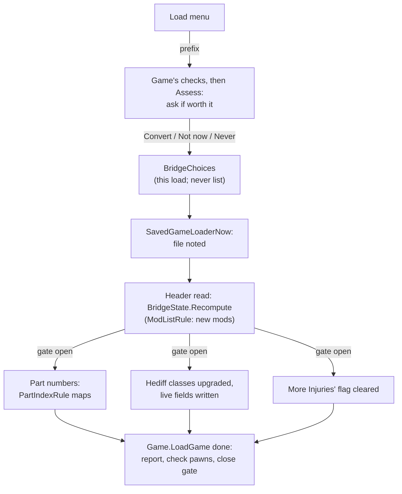

# Medical save bridge

**Status (24 Nov 2026):** living; written from the code at D'thorga Medical (its save bridge part,
`src/PhobosMedical/SaveBridge`). Built: the header gate, re-numbering saved body parts, upgrading saved hediff classes, holding
More Injuries' first-load wipe, the after-load report and its two dev actions, and the question before converting with its "never"
list. **Passed in game by the owner:** the first load of a colony with More Injuries added (3 Nov 2026, with the part's 0.1.0 and
0.1.1), then saved and reloaded. **Not yet tested in game:** the question before converting (added when the part joined D'thorga
Medical), and a new colony.

This page says how D'thorga Medical's save bridge works now: what it does when a mod that adds body parts, More Injuries above
all, is switched on beside a colony saved without it. The rest of D'thorga Medical is on [injuries and
care](medical-injuries-and-care.md), [medical equipment](medical-equipment.md) and [radiation](medical-radiation.md). Why it is
this way is in the [decision log](../decisions/medical-save-bridge.md) and the [record](#why-it-is-this-way).

## Read this first (gotchas)

- **It acts only while its gate is open**: a save is loading whose own mod list lacks a mod that is running now. A save written
  with every active mod leaves it inert, so after one save with the new mod it never acts again on that colony.
- **It asks first.** From the load menu, when converting would change something (parts that would shift, or More Injuries' wipe),
  the player chooses **Convert now**, **Not now** or **Never for this save**. Escape goes back without loading.
- **A load no menu announced** (another mod's quick-load) converts without asking, as the bridge did before the question existed.
- **It hooks the game's own conversion points**, never Medical Surgery Expanded 2, and reaches More Injuries by name only.
- **Every target is looked up by name and checked**; a missing one switches that step off with a line in the load report, never an
  error.
- **It assumes added parts are appended.** A mod that moves or deletes an existing body part is beyond it.
- **Nothing it knows about a load is saved.** Only the "never" list is kept, in the mod's settings.

## What it does

A save names each body part by its position in the body's part list. A mod that adds parts (More Injuries adds eight to the human
body) shifts those positions, so a colony saved without it loads with wounds on the wrong parts, lost limbs that grow back and,
with More Injuries' own first-load clean-up, every pawn wiped of wounds and dead pawns revived. The bridge carries the save
across:

| Step | What | Where it hooks |
| --- | --- | --- |
| Gate | Reads the save's mod list as its header loads; open when a running mod is missing from it | Postfix on `ScribeMetaHeaderUtility.LoadGameDataHeader` |
| Re-number | Each saved part number translated to today's, for every body that gained parts | Postfix on `BackCompatibility.GetBackCompatibleBodyPartIndex` |
| Upgrade | A saved hediff made as its def's subclass, with a live wound's bleeding state | Postfix on `BackCompatibility.GetBackCompatibleType` |
| Hold | More Injuries' first-load flag cleared as it is set; its clean-up finds nothing | Postfix on More Injuries' `MoreInjuryComp.PostExposeData`, by name |
| Report | What was done, and a read-only check of every pawn, written to the log; the gate closes | Postfix on `Game.LoadGame` |
| Reset | A new colony sees an inert bridge | Postfix on `Game.InitNewGame` |

- **Re-numbering** covers every saved part reference at once (hediffs, medical bills, Medical Surgery Expanded 2's limb
  configurations, any mod saving a part), because all of them pass through the game's hook. A part is new when its def comes from
  a mod the save lacks. A saved number that was never valid for the old body is left to the game's own answer.
- **Upgrading** a class keeps a wound's severity, part, age and tending, and leaves Medical Surgery Expanded 2 nothing to
  re-install. The class must be a subclass of the saved one with a constructor taking nothing. For More Injuries' wounds the
  bridge first writes the fields a live wound saves (`overriddenBleedRate` 1, `temporarilyTamponadedMultiplierBase` 1,
  `reducedBleedRateTicksRemaining` 0), because their load defaults would stop an old wound bleeding for good. These are save-file
  field names read from More Injuries 1.6.0.2, not copied code.
- **The report** lists any hediff on a part the save never knew (there should be none) and any added part sitting where its
  installing recipe does not allow, which More Injuries' own fix-up would have moved or removed. It changes nothing; at most 40
  lines a check.

### The question before converting

From the load menu, a prefix on `GameDataSaveLoader.CheckVersionAndLoadGame` runs the game's own version and mod-mismatch checks
and then, before the load, works out what converting would change (`BridgeChoices.Assess`). It asks only when loading without the
bridge would lose something: bodies whose parts would shift (up to six named, then how many more) or More Injuries' wipe. Any
other new mod leaves the bridge only the class upgrade, which acts only where a class no longer matches, so it does not ask. A
second prefix, on `SavedGameLoaderNow.LoadGameFromSaveFileNow`, tells the gate which file is really loading. Both prefixes go in
together or not at all.

- **Convert now**: the gate opens for this load. Once the colony is saved, the conversion is done for good.
- **Not now**: loads as it is and asks again next time; saving it keeps whatever went wrong.
- **Never for this save**: loads as it is and remembers the save's name; D'thorga Medical's settings page **Colonies saved before
  More Injuries** shows how many and has **Ask about them again**.

## How it works

**Per tick**: nothing. Everything happens while a save loads, and only while the gate is open; with it shut each hook returns
after one boolean read.

**Where the numbers come from**: the game's own depth-first ordering of a body's parts (`BodyDef.CacheDataRecursive`, read from
RimWorld 1.7); the saved fields from More Injuries' `BetterInjuryState.ExposeData`. Nothing is authored but the report's limits.

## Code

All under `src/PhobosMedical/SaveBridge/`.

| File | What it holds |
| --- | --- |
| `MedicalSaveBridgeMod.cs` | `SaveBridgeSettings` (the never list), applying each hook by name, the load line, the settings page |
| `Rules/ModListRule.cs`, `Rules/PartIndexRule.cs` | Which mods are new to a save; the old-to-new part map (game-free) |
| `Services/BridgeState.cs` | The gate, the maps, the counts, the gate and count lines |
| `Services/BridgeChoices.cs` | What converting would change, the question, the choice for one load, the never list |
| `Services/HediffStateDefaults.cs` | The fields a live wound saves |
| `Services/LoadReport.cs` | The read-only checks after a load |
| `Patches/*.cs` | The header, part index, hediff class, load choice and More Injuries hooks |
| `UI/BridgeChoiceDialog.cs`, `Debug/BridgeDebugActions.cs` | The three-button question; two dev actions |

## Defs and XML

None. The bridge has no Defs, comps or extensions for modders; the reference site does not list it (source:
`src/PhobosMedical/SaveBridge/`).

## Settings

On D'thorga Medical's page **Colonies saved before More Injuries**: a note on what the bridge does, the count of saves marked
"never", and **Ask about them again** (shown while any are marked). The never list is saved in the mod's settings
(`PhobosSaveBridge_NeverConvert`); the [settings reference](../settings-reference.md#dthorga-medical) lists it as a saved key not
drawn as a setting.

## Saved data and removal

- **Nothing in the save.** The gate, the maps and the counts live in memory for one load.
- **The settings file** keeps the never list by save name.
- **Removal**: after one save with the new mod, the colony no longer needs the bridge. Removing D'thorga Medical before that save
  leaves the save as it was; loading it with the new mod and no bridge brings back the shifted parts and the wipe.

## Tie-ins

- **More Injuries** (`Th3Fr3d.ExtendedInjuries`): the first-load hold, by name, only while it is active; its wounds' classes and
  saved fields.
- **Medical Surgery Expanded 2**: never patched; with the classes upgraded it has nothing to re-install.
- **Any mod that adds body parts**: re-numbered the same way.

## Performance

- **Nothing is measured.** The cost falls on one load: a map per body that gained parts, one lookup per saved part reference and
  per saved hediff, and a pass over every pawn for the report.

## Limits and known gaps

- **Moved or deleted parts** are beyond the rule: only appended children keep the old order.
- **A new mod inserting records of vanilla part defs** would not be seen as new.
- **More Injuries' add-ons** (Organ Failure, Medieval Solutions) were not read; the owner's load with both on was clean.
- **The faults it bridges are other authors'**: More Injuries' wipe and Medical Surgery Expanded 2's re-install. Reports are
  drafted for the owner in the record. In the [register of patches for other authors' faults](../temporary-patches.md)
  the bridge is mixed: re-numbering is permanent, because mods really do change bodies; the wipe hold could go if More Injuries
  re-numbered instead of wiping.

## Tests

- **Rule tests** (`tests/PhobosMedical.Rules.Tests/SaveBridge`): the mod list and part index rules.
- **Dev actions**: "Medical Save Bridge: log body part indices" (the human body's parts with each one's old number) and "check
  every pawn's parts" (the after-load check again).
- **In game**: the owner's first load of 3 Nov 2026 (with 0.1.0, then 0.1.1 after upgrading blood loss and hypothermia too), saved
  and reloaded; no test-list row.

## Why it is this way

- **[The decision log](../decisions/medical-save-bridge.md)**: every choice, one line each, with who made it and where.
- **Records kept in place**: [medical save bridge](../medical-save-bridge.md) (the failure, the chain read from the code, the
  first load's counts, and the drafted reports).
- **Also cited**: [mod consolidation](../mod-consolidation.md) (how the bridge became part of D'thorga Medical).
