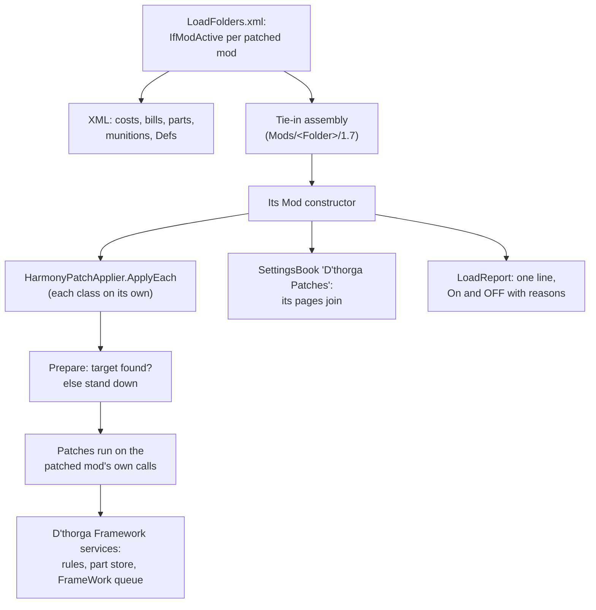

# Patches

**Status (24 Nov 2026):** living; written from the code at D'thorga Patches 0.40.0. Built: twenty-one tie-in folders, thirteen of
them with an assembly, for the Harrier, Hind, Mongoose, Close Air Support, the EA-6B Prowler, the UH-60, the C-17, RimThunder,
Vehicle Framework, Spaceship Turret Hull, Combat Extended, Fortified Features Framework, InterRim Ballistic Missile, RimPacts,
Visit Settlements, Vanilla Factions Expanded - Classical, Nice Research Tab, Vanilla Expanded's outposts and Biotech. **Passed in
game by the owner:** rows 24 (stuck fires on a vehicle), 190 (drone platforms topped up), 241 (soldiers go back to their own
guns), 267 (settings pages), 287 (mech rechargers by size), 302 (sidearms that loop), 382 (the research tab opens every time) and
384 (drones called home). **Seen in play, no verdict yet:** row 227. **Not yet tested in game:** everything else, including rows
P1, 6, 25, 62, 79, 98, 118, 134, 138, 143, 228, 299, 313, 331 to 333, 342, 343, 362, 375, 380, 381, 385 and 420.

This page says how D'thorga Patches works now: one mod of small parts, each loaded only while the mod it patches is active. What
the aircraft do once in the fold (our flight, avionics, dodging, jamming) is on [flight](flight.md); their parts bills and
fittings on [upgrades and fittings](upgrades-and-fittings.md); topping up and drone recall, which two Patches Defs switch on, on
[power, top-up and machines](power-and-machines.md) and [framework services](framework-services.md); radiation doses from a strike
on [radiation](medical-radiation.md). Every patch for another author's fault has a row in the [register of patches for other
authors' faults](../temporary-patches.md), which says how to retire it. Why it is this way is in the [decision
log](../decisions/patches.md) and the [records](#why-it-is-this-way).

## Read this first (gotchas)

- **Every part loads only while its mod is active**: an `IfModActive` folder per patched mod in `LoadFolders.xml`, with the
  assembly in a `1.7` folder below it. Without the patched mod nothing of that part is loaded, not even its settings page.
- **Each patch class is applied on its own** (`HarmonyPatchApplier.ApplyEach`). One whose target changed logs "Could not apply X;
  that part is switched off" and the rest still work. Most patches also find their target by name in a `Prepare` and stand down
  when it is gone.
- **Each part writes one load line**, `[D'thorga Patches] 0.40.0 loaded (part). On: ... OFF: feature (reason).` A feature that
  stood down is named under OFF with its reason. XML-only folders write none.
- **One Harmony ID for every part**, `PhobosDthorga.Patches`, and one settings window, **D'thorga Patches**, whose pages come and
  go with their mods.
- **Temporary patches are meant to come out.** A patch for another author's fault stays only until they fix it; before removing
  one, check the fault is gone in their new build ([register](../temporary-patches.md)).
- **Nothing here references another mod's assembly unless it must.** Most parts reach the patched mod by type and member name; the
  IRBM, Outposts and Vehicle Framework parts reference theirs at build time, never shipping them.
- **Costs, parts bills and munitions change how other authors' aircraft are built.** They are balance choices, not fault fixes,
  and are left out of the register on purpose.
- **A save can hold this mod's things**: the 500-lb bomb's and Mk. 84's cases and fills, the seeker head, the heavy castings, the
  Spaceship Turret Hull's class, and two pieces of saved data. Remove bills and deconstruct those hulls before removing the mod.

## What it does

The parts, grouped by kind. Each names its folder (`mods/PhobosPatches/Mods/<Folder>`) and, where it has one, its assembly
(`src/PhobosPatches.<Name>/`).

### Fixes for other authors' faults (temporary)

- **Row 2, Vehicle Framework.** Fires attached to a vehicle are left behind when it leaves a map, and only the first is put out. A
  prefix on `VehiclePawn.DeSpawn` puts every fire out; a rare-tick postfix puts out fires off the map or beyond the first, and
  says so.
- **Row 3, Visit Settlements.** Its downing postfix closes a battle map directly, skipping the game's rules. Our prefix skips it
  while a battle, a conscious colonist on foot or aboard, or a player mech on its feet keeps the map.
- **Row 4, Visit Settlements.** Its food-drop sum reads the food need of pawns that do not eat and throws every tick. A prefix on
  that lambda (found by its shape) gives 0 for them; a finalizer resets its counters and warns once a day.
- **Row 5, Harrier with RimPacts.** RimPacts patches `LaunchProtocol.GetArrivalOptions` from a generic class, which made the
  Harrier framework's patching fail. We unpatch that postfix and re-add it as a plain one calling RimPacts' own method.
- **Row 6, Aircraft rearming.** The Harrier, Hind, Mongoose, Close Air Support and Prowler share one author's rearm code: with no
  kind chosen, a colonist fetches any kind and a different kind throws the load out. We fetch only the loaded kind, and refuse
  another unless the player chose it.
- **Row 7, IRBM.** The strategic pass runs over a whole map in one frame. We spread it over frames (below). Its project looks
  dormant, so this may be permanent in practice.
- **Row 13, Combat Extended.** A mod's ammo sets name ammo nothing defines, and Combat Extended's ammo setup throws. A prefix
  drops the empty entries once at start-up.
- **Row 14, Vehicle Framework.** Its vehicle work never draws a progress bar. A postfix adds the bar; our own drivers draw their
  own.
- **Row 15, Harrier (a diagnostic).** The Harrier cannot be taken apart. `DisassemblyTrace` logs each stage of the removal, only
  while its detailed log is ticked.
- **Row 16, IRBM with Combat Extended.** Its close-in weapon systems never shoot Combat Extended's shells. Three postfixes let
  them; a setting turns it off.
- **Row 17, RimPacts.** Its assault counts an empty vehicle as a live defender. A postfix calls such a vehicle not live.
- **Row 19, Vehicle Framework with VTOL Vehicle.** A turret lined up off the main thread while a save loads loses its picture and
  throws every frame. A prefix skips that off the main thread.
- **Row 20, Vanilla Factions Expanded - Classical.** A save made during a scorpion raid loads the raid with no orders. A postfix
  on `Lord.ExposeData` retries the load with empty arguments.
- **Row 22, Vehicle Framework.** A vehicle saved mid-burst loses itself and its crew. A prefix and finalizer save an empty turret
  queue in its place, only while its save code still saves the queue by reference.
- **Row 23, Nice Research Tab with Vanilla Expanded Framework.** Two threads editing one cached unlock list can leave a blank in
  it, and the research tab throws. A lock around each read, and blanks removed.

Rows 13, 17, 19, 20 and 22 stand down by themselves, in effect, once the fault is fixed; rows 3, 4, 6 and 16 only in part; rows 2,
5, 7, 14, 15 and 23 need a check after each update ([register](../temporary-patches.md)). Rows 8 to 12, 18, 21 and 24 belong to
[Factory Additions](factory.md) and D'thorga Framework.

### Fixes our own design needs (permanent)

- **Crew in the air keep the map open** (`AirborneCrewKeepsMap`, a postfix on `MapPawns.AnyPawnBlockingMapRemoval`): a spawned
  player vehicle with a free colonist aboard blocks map removal, for any mod's map. Sorties need it.
- **Sidearms that loop** (`Patch_SimpleSidearms_RetrieveWeapon`, with Simple Sidearms and Combat Extended): a colonist never
  fetches a sidearm their loadout would only put down again. The loadout wins.
- **No outpost from a caravan with vehicles** (`ConvoyOutpostRefusal`, a postfix on Vanilla Expanded's camp dialog): every outpost
  is refused, with the reason, while the caravan holds a vehicle. A setting, on.

### Aircraft in the fold

Six aircraft mods are brought into line with our vehicle systems. What our flight model does with them is on [flight](flight.md).

| Aircraft (folder) | Cost to build (the shell; parts by bill) | Parts appended | Other |
| --- | --- | --- | --- |
| AV-8B Harrier (`HarrierVtol`) | 400 steel, 120 plasteel, 10 components; skill 10 | Ten, canopy to pylons | Cheaper drop tanks; hover gate, dodge, salvo |
| A-10 and Su-25 (`CloseAirSupport`) | 600/220/15 + 4 advanced; 520/185/12 + 3; skill 10 | Six each | Optional realistic handling |
| EA-6B Prowler (`EA6BProwler`) | 600 steel, 180 plasteel, 15 components, 10 advanced; skill 10 | Five, with jam receivers | Dodge, salvo, jamming |
| UH-60 Black Hawk (`UH60Blackhawk`) | 350 steel, 120 plasteel, 10 components | None | Parts bill only |
| C-17 Globemaster III (`C17Globemaster`) | 2,000 steel, 500 plasteel, 300 silver, 40 components | None | Parts bill only |
| Mi-24 Hind, Mongoose (`HindHelicopter`, `MongooseHelicopter`) | Unchanged | None | Missiles at real weight (below) |

Each cost is the airframe's shell; the engines, tanks, gear, hydraulics and avionics come from a parts bill by role
(`PhobosVehicleBillDef`, [upgrades and fittings](upgrades-and-fittings.md)). Shell figures are authored against the stock costs.

- **The Harrier's hover gate**: four patches on the Harrier framework's `CanHover` and vertical landing refuse a pad when the
  Framework's hover limit says the jet is too heavy or too hot, with our reason. The setting is D'thorga Framework's.
- **Dodging**: postfixes on the Harrier's and the Prowler's `Evasion.ChanceFor` scale their dodge by the Framework's air-combat
  rule. Each registers the Framework's chaff-and-flare salvo button.
- **The Prowler's jamming**: a postfix scales its jammer's radius by its ICAP upgrades, and its jamming is registered with the
  Framework's jam fields, which blind radar.
- **Sorties over battles**: with RimPacts, a postfix on `CompVehicleLauncher.CanTarget` explains a sortie refused over a battle
  not joined; a setting lets fixed-wing sorties fly over one anyway (off).
- **Realistic handling** (Close Air Support, the Prowler; off): a setting-gated XML patch sets top and cruise speeds by real
  figures (the A-10 0.20 and 0.16, one-engine factor 0.80; the Su-25 0.26 and 0.21; the Prowler 0.27 and 0.21). The Prowler's
  author's speeds already match, so it changes nothing today. Needs a restart.

### Munitions at real weight

With Combat Extended, the aircraft's bombs and missiles are built from parts at their real weight and priced like the Mk. 82:

| Munition | Mass | Built from |
| --- | --- | --- |
| Mk. 82 (500 lb) | 227 kg | A Mk. 82 case (280 steel, 140 kg) and 10 kg FSX, 15 chemfuel, 2 components |
| Mk. 84 and its incendiary, EMP, smoke and tox fills | | A Mk. 84 case (956 steel, 478 kg) and a fill |
| Shturm (Hind) | 46.5 kg | 40 steel, 8 FSX, 40 chemfuel, 8 components |
| Hellfire (Mongoose) | 45 kg | A seeker head and 40 steel, 10 FSX, 50 chemfuel, 6 components |
| FAB-250, RBK-250, CBU-87 (Close Air Support) | 250, 273, 430 kg | Case, FSX, chemfuel, components |
| HARM (Prowler) | 360 kg | A seeker head and 140 steel, 15 FSX, 150 chemfuel, 10 components, 1 advanced |
| ALQ-99 pod (Prowler) | 431 kg | 80 steel, 20 gold, 10 components, 2 advanced |

The **missile seeker head** (10 steel, 2 components, 1 advanced; 5 kg; Microelectronics) is made at a machining table or
fabrication bench while the Hellfire or the HARM exists. Market values are removed so the game prices each from its parts. The
Dead Man's Switch's automated benches (its ammo printer, rotary forger, stamping machine and microgravity facility) take the
munitions, cases and fills where installed. Masses are the real weapons' (labelled in the record); ingredient counts are authored.
The patches apply only with Combat Extended, and the shared ones only while the Mk. 82 still weighs 227 kg, so a changed Def is
left alone.

### Other additions and compatibility

- **Heavy castings at the rotary forger** (RimThunder with The Dead Man's Switch - Expedition): 1,200 steel to 12 heavy castings
  and 12 slag, a batch recipe.
- **Spaceship Turret Hull under Combat Extended**: seven hulls get Combat Extended's turret class and aim values, and the mod's
  three guns become Combat Extended guns. Built hulls keep the class; rebuild existing hulls.
- **Bomb cases renamed**: three load-time patches carry saves made before 0.14.2 to the new case names.
- **Soldiers keep their guns** (Combat Extended): a colonist downed or drafted with a grenade goes back to their own gun: the one
  in their pack, then the one they dropped, then, if that is gone, another of the same kind. A think node placed before Combat
  Extended's "drop unused inventory" does this when a colonist looks for a job; three recoveries in an hour bring a day's
  back-off. With Simple Sidearms, the gun is what it hands back, not a grenade. Four settings, all on.
- **Mech rechargers that draw real power** (Biotech; off): a recharger draws by the mech's body size, from the battery a mech of
  its size would carry (body size × 480 Wd × the battery preset), at the game's charge rate and 84 % efficiency; charging tapers
  past 80 % to a quarter; 16 % comes off as heat into the room, up to 80 °C; idle, it draws its Def's figure or 5 %. Every figure
  is an authored rules Def another mod may patch. It writes the power output the game reads, so standby mods stack.
- **The IRBM strike model** (below), and **quiet reveals**: no "Area revealed" letters while a blast runs.
- **RimPacts' war deadline**: a vanilla quest delay is added to a war quest so its countdown shows when the war will fail. Checked
  every 250 ticks. With the IRBM part, a town struck in the last 15 days counts its dead defenders when RimPacts sizes its
  assault.
- **Fortified Features Framework**: two Defs name its drone platform's and drone's members, so the Framework tops platforms up and
  calls drones home. All the behaviour is the Framework's.

### The IRBM strike

InterRim Ballistic Missile's strategic warhead runs its damage over a whole map in one frame. With **Spread a strategic blast over
several moments** on, our prefix on `StrategicImpactCountdown.ApplyStrategicDamage` skips it and queues an `IrbmSweep` on the
Framework's per-frame job queue: a slice a frame, inside a time budget (12 ms by default, 2 to 50; up to 40 ms while the screen is
white), at least eight things a slice. Rooms are rebuilt once a moment. A blast still running when the game is saved is forgotten
on load.

For the standard strategic warhead (`PhobosStrikeExtension`: fireball 25 cells, blast 110, reach 250), a prefix on
`OnWhiteScreenReached` launches **our own strike** instead: fireball, blast and heat by distance; fires beyond the blast; fallout
and radiation (with Dubs Rimatomics or D'thorga Medical's radiation model); flash blindness; ground pollution near the centre
(with Biotech); an electromagnetic pulse; vehicles in the strike; shadow and shelter. Its figures come from the rules Def
(`PhobosStrikeRulesDef`) and the settings. Since 0.47.0 the Surgical and Clean warheads take the strike too (the Clean one with
`doseFactor` 4), and the Mini-Nuke, antimatter and Gamma-Ray warheads give D'thorga Framework's radiation bursts. Since 0.50.0 the
strike strikes people and vehicles first, then cells, then the rest; its blast and burns penetrate armour; it brings out people held
off the map first and lays D'thorga Framework's fallout
(`Patches/RadiationBurstPatches.cs`; [the record](../radiation-bursts.md)). The radiation people take is on [radiation](medical-radiation.md); what a blast does to
vehicles is on [vehicle damage](vehicle-damage.md).

## How it works

**Per tick**: the Vehicle Framework fires postfix on each vehicle's rare tick (250 ticks); a mech recharger's tick while the
recharger setting is on (one boolean read while off); RimPacts' war deadline check every 250 ticks through the Framework's part
store.

**Per frame**: only an IRBM blast under way, inside its budget.

**On the patched mod's own calls**: everything else, when the game or the mod calls the patched method: a rearm job, a sortie, a
dodge roll, a map closing, a lord loading, a research list read (a lock, well under a microsecond uncontended).

**At start-up and load**: the ammo guard, Visit Settlements' lambda search, the bomb case renames, the RimPacts arrival swap,
every `Prepare`.

**Where the numbers come from**: masses of real munitions; shell costs, ingredient counts, strike radii, the time budget, the
recharger's battery and taper are authored; dodge and hover limits are the Framework's rules.

## Code

| Assembly (`src/`) | What it holds |
| --- | --- |
| `PhobosPatches.Harrier` (`Phobos.VehiclePatches`) | `AirborneCrewKeepsMap`, `RimPactsArrivalFilter`, `SortieGate`, `HoverGate` |
| | `HarrierEvasion`, `BombCaseRename`, `DisassemblyTrace` |
| `PhobosPatches.AircraftRearm` | `RearmOneKind`: one kind to a magazine, per aircraft namespace; `SortieOverHome` (0.41.0): a fixed-wing sortie may strike a home map, its arrival, circling point and return judged as on a strike map; `SortieFuel` (0.42.0): the jets' own sortie fuel sum applied in Vehicle Framework 1.7's destination picker |
| `PhobosPatches.CloseAirSupport` | `CloseAirSupportPatchesMod`: its page and the handling flag |
| `PhobosPatches.Prowler` | `ProwlerPatches` (dodge, jam reach, salvo, its page), `ProwlerJamFields` |
| `PhobosPatches.VehicleFramework` | Fires (`VehicleFrameworkPatchesMod`, `AttachedFireRule`), the work bar, `TurretGraphicWhileLoading`, `TurretQueueSave` |
| `PhobosPatches.CombatExtended` | The ammo guard (`CombatExtendedPatchesMod`); `KeepGuns/` (own guns, sidearm loops); `LoadoutExcessRule` |
| `PhobosPatches.Irbm` (`Phobos.MissilePatches`) | `IrbmSweep`, `BlastSlice`, `Patches/` (spread, reveals, the strike, CIWS), `Strike/`, `Rules/` |
| `PhobosPatches.RimPacts` | `UnmannedVehicleTargets`, `WarQuestCountdown`, `Rules/` |
| `PhobosPatches.VisitSettlements` | `VisitMapStaysOpen`, `SettlementEventsGuard`, `VisitMapRule` |
| `PhobosPatches.Classical` | `RaidOrdersOnLoad` |
| `PhobosPatches.NiceResearchTab` | `ResearchUnlocksGuard` |
| `PhobosPatches.Outposts` | `ConvoyOutpostRefusal` |
| `PhobosPatches.Biotech` | `MechCharging`, `RechargerRealPower`, `StatWorker_PhobosRechargerDraw`, `PhobosMechChargingRulesDef` |

Five parts (Biotech, Classical, Combat Extended, Nice Research Tab, Vehicle Framework) write seen-in-play notes from a `Seen.cs`.
The shared pieces are D'thorga Framework's: `LoadReport`, `SettingsBook`, `OptionalMods`, `PatchFlags`, `PhobosRulesDef`,
`RearmRule`, `BatteryChargeRule`, `DeepLoad`, the part store (`GameComponent_PhobosPartStore`) and the per-frame job queue;
`HarmonyPatchApplier` is compiled in from `src/Shared`.

## Defs and XML

D'thorga Patches' assemblies are not on the modders' reference site; each type links its source.

- **`PhobosStrikeExtension`** on an IRBM warhead Def marks it a blast for our strike (fireball, blast and reach radii; fallout,
  EMP and pollution switches); another mod's warhead takes it the same way (source:
  `src/PhobosPatches.Irbm/Strike/StrikeDefs.cs`). **`PhobosStrikeRulesDef`** holds the strike's tuning
  (`Mods/IRBM/Defs/Phobos/Strike/Rules.xml`).
- **`PhobosMechChargingRulesDef`** holds the recharger's figures and may be patched in XML (source:
  `src/PhobosPatches.Biotech/PhobosMechChargingRulesDef.cs`); the stat `PhobosMechRechargerDraw` shows a recharger's draw.
- **`JobGiver_PhobosKeepOwnGun`**, inserted into the humanlike think tree by `Mods/CombatExtended/Patches/KeepGuns.xml` (source:
  `src/PhobosPatches.CombatExtended/KeepGuns/JobGiver_PhobosKeepOwnGun.cs`).
- **Patch flags** for other XML: `PhobosCloseAirSupportPatches.realisticHandling`, `PhobosProwlerPatches.realisticHandling`.
- The aircraft folders use D'thorga Framework's types: `PhobosVehicleBillDef` for parts bills; the Fortified folder
  `PhobosTopUpDef` and `PhobosRecallDef`; the handling patches `PatchOperationPhobosFlag` ([power, top-up and
  machines](power-and-machines.md), [framework services](framework-services.md)).
- Two retired components, `WorldComponent_PhobosStrikeMemory` and `GameComponent_PhobosWarQuestCountdown`, stay public only so old
  saves load; each retires itself on load.

## Settings

One window, **D'thorga Patches**, with a page per part that has settings, listed only while its mod is active. The full text is in
the generated [settings reference](../settings-reference.md#dthorga-patches).

| Page | Label | Default |
| --- | --- | --- |
| Mechanoids | Mech rechargers draw power by the size of the mech | Off |
| Mechanoids | Mech battery size (Standard × 1, Large × 3, Huge × 10) | Standard |
| Combat Extended | Colonists go back to their own guns (recommended) | On |
| Combat Extended | When their own gun is gone, take another of the same kind | On |
| Combat Extended | Simple Sidearms keeps a colonist's gun, not a grenade, as the weapon it hands back (recommended) | On |
| Combat Extended | A colonist never fetches a sidearm their loadout would only put down again (recommended) | On |
| Harrier jump jet | Sorties may fly over a battle you have not joined | Off |
| Close Air Support | Realistic handling (needs a restart) | Off |
| EA-6B Prowler | Realistic handling (needs a restart) | Off |
| IRBM: strikes | Spread a strategic blast over several moments | On |
| IRBM: strikes | Time each moment may spend on the blast | 12 ms |
| IRBM: strikes | Take up to 40 ms a moment while the screen is still white | On |
| IRBM: strikes | Rebuild rooms once per moment during a blast | On |
| IRBM: strikes | What shelters people and things from a blast | Any overhead mountain |
| IRBM: strikes | Leave rubble and salvage where buildings stood | Off |
| IRBM: strikes | The dead | Vaporised |
| IRBM: strikes | Tell me when a blast takes a while, and when it ends | On |
| IRBM: strikes | No "Area revealed" letters while a blast runs | On |
| IRBM: strikes | Wall fragments from a strategic blast (with Combat Extended) | None during a blast |
| IRBM: after-effects | Fireball, blast and heat by distance from ground zero | On |
| IRBM: after-effects | Full strike on every settlement in range | Off |
| IRBM: after-effects | Fires beyond the blast | Moderate |
| IRBM: after-effects | Fallout and radiation | Automatic |
| IRBM: after-effects | Fallout clouds drifting from the strike (with Rimatomics) | 6 |
| IRBM: after-effects | Radiation sickness and flash blindness for survivors (with Rimatomics) | On |
| IRBM: after-effects | Ground pollution near the centre (with Biotech) | On |
| IRBM: after-effects | Electromagnetic pulse | On |
| IRBM: after-effects | Vehicles in the strike | On |
| IRBM: after-effects | Shadow and shelter from the strike | On |
| IRBM: after-effects | Close-in weapon systems shoot down Combat Extended shells (with Combat Extended) | On |
| Outposts | Refuse to found an outpost from a caravan with vehicles (recommended) | On |

The Harrier's disassembly trace is a tick on D'thorga Framework's **Detailed logs** page ("D'thorga Patches: Harrier
disassembly"), not a setting here; the hover limit is a D'thorga Framework setting. IRBM's settings were carried over once from
D'thorga Missile Patches' file.

## Saved data and removal

- **Soldiers keep their guns**: in the Framework's part store under `PhobosPatches.CombatExtended.OwnGuns`, one line per colonist
  (their dropped gun, its kind and stuff, the back-off and recoveries), at most 400. Removing Combat Extended or this mod leaves
  no error.
- **The IRBM strike**: the towns struck in the last 15 days and their defenders, in the part store under
  `PhobosPatches.Irbm.StrikeMemory`. Older saves' world component is read once and retired.
- **RimPacts' war deadline**: a vanilla `QuestPart_Delay` inside the quest; it finishes harmlessly after removal.
- **The turret queue fix** writes an empty queue in place of bursts under way; nothing of its own.
- **Things in saves**: the Mk. 82 and Mk. 84 cases and fills, the seeker head and heavy castings lose their Defs on removal
  (delete their bills first); Spaceship Turret Hull's hulls keep Combat Extended's turret class (deconstruct them first).
- **Removing the Harrier part with RimPacts active** brings back the Harrier framework's failed start-up.
- Removal otherwise follows the Framework's sweep ([How the code is built, Saves and
  removal](../architecture.md#saves-and-removal)).

## Tie-ins

Every tie-in folder is in the [tie-in register](../tie-in-register.md); the load folder for each is above. The patched mods, by
package ID: `potemkinvillager.av8bharrier`, `.mi24hindhelicopter`, `.mongooseattackhelicopter`, `.CloseAirSupport`,
`.ea6bprowler`; `z3nt3.uh60blackhawk`, `z3nt3.c17globemaster`; `RimThunder.Core`; `SmashPhil.VehicleFramework`;
`MK.SpaceshipTurretHull` with `CETeam.CombatExtended`; `CETeam.CombatExtended` (Simple Sidearms by name); `AOBA.Framework`;
`kazepsi.irbm` (Dubs Rimatomics, RimPacts, Biotech and D'thorga Medical by name); `wowgag.RimPacts`;
`ninagoblin.visitsettlements`; `OskarPotocki.VFE.Classical`; `andromeda.niceresearchtab`; Vanilla Expanded Framework with Vehicle
Framework (outposts); and `ludeon.rimworld.biotech`.

## Performance

- **Measured**: none of the parts on its own. The IRBM blast's frame budget is a setting (12 ms by default), so a strike's cost
  per frame is bounded by design.
- **Shape of the cost**: almost every patch runs only when the patched mod calls its method. The standing costs are a rare-tick
  look per vehicle for fires, a boolean per recharger tick while that setting is off, the research list's lock on each read, and
  the war deadline's check every 250 ticks. The disassembly trace's prefixes on every pawn's and job's end return at once unless a
  vehicle is being taken apart.

## Limits and known gaps

- **Temporary patches need checking after each update** of their mods; rows 2, 5, 7, 14, 15 and 23 do not stand down by
  themselves, and rows 3, 4, 6 and 16 only in part.
- **The Harrier's disassembly fault is not known**; the trace only gathers evidence.
- **Only the standard strategic warhead** carries our strike; other warheads keep IRBM's own damage, spread or not.
- **Shell costs and munitions are authored balance**, left out of the register; another author's update can change the stock costs
  they replace.
- **Visit Settlements, the rearm fix, RimThunder's forger, Spaceship Turret Hull and the outpost refusal** have no test-list row.
- **Inferred from the code, not tested in game**: IRBM's language file has a section heading, "The blast, the heat and what
  follows", that the after-effects page never draws.
- **Inferred from the code**: comments lag behind the parts: the rearm part's class comment leaves out the Prowler; the Prowler's
  says "three patches" where there are two and a salvo registration; the Vehicle Framework part's says "fires only, no settings,
  no save data", though it holds four fixes and one changes what a save writes; `VehiclePatchesMod.cs` opens with two summaries
  back to back; the Harrier's parts file calls the 35 % grounding a Patches rule, though it is the Framework's.
- **The README's test status is stale**: it names only the fires and one missile strike, while the rows above passed.

## Tests

None of these is a test in game, bar the rows marked passed.

- **Rule tests** (`tests/PhobosPatches.Rules.Tests`): `AssaultSizeRuleTests`, `AssaultTargetRuleTests`, `AttachedFireRuleTests`,
  `IrbmRuleTests` (budget, shelter, hits, sweep order), `LoadoutExcessRuleTests`, `StrikeRuleTests`, `StrikeShelterRuleTests`,
  `VisitMapRuleTests`, `WarDeadlineRuleTests`; the Framework's `RearmRuleTests`, `BatteryChargeRuleTests`, `DefRenameRuleTests`.
- **Python**: `tests/test_temporary_patches_list.py` (the register against `config/temporary-patches.json`),
  `test_patches_name_own_nodes.py`, `test_parts_bills.py`, `test_no_executing_assembly.py`, `test_mod_settings_changes.py`.
- **Debug actions** (IRBM): strike the current map, log or drop the blast queue, dismiss "Area revealed" letters, count fragments.
- **In game** ([the test list](../in-game-test-pass.md)): **passed** 24, 190, 241, 267, 287, 302, 382, 384; **seen** 227;
  **waiting** P1, 6, 25, 62, 79, 98, 118, 134, 138, 143, 228, 299, 313, 331, 332, 333, 342, 343, 362, 375, 380, 381, 385, 420.

## Why it is this way

- **[The decision log](../decisions/patches.md)**: every choice, one line each, with who made it and where.
- **Archived records**, kept unchanged for their history: [vehicle patches](../archive/vehicle-patches.md) (the Harrier's costs,
  rearming, bombs, castings, Spaceship Turret Hull), [aircraft munitions](../archive/aircraft-munitions.md), [missile
  patches](../archive/missile-patches.md), [RimPacts patches](../archive/rimpacts-patches.md), [Visit Settlements
  patches](../archive/visit-settlements-patches.md), [mech rechargers that draw real
  power](../archive/mech-recharging-real-power.md); with [flight](flight.md), [Close Air Support's
  jets](../archive/close-air-support-jets.md), [the EA-6B Prowler](../archive/ea6b-prowler.md), [the
  UH-60](../archive/uh60-blackhawk.md), [the C-17](../archive/c17-globemaster.md); with [vehicle damage](vehicle-damage.md),
  [Vehicle Framework's fires](../archive/vehicle-framework-fires.md).
- **The register**: [patches for other authors' faults](../temporary-patches.md), living and gate-checked.
- **Records kept in place** (they cover Patches and another system): [soldiers keep their guns](../soldiers-keep-their-guns.md),
  [nuclear strikes, vehicles and people](../nuclear-strike-effects.md), [air-defence tie-ins](../air-defence-tie-ins.md).
